# Compte rendu — Apprentissage v2, recherche de phrases, tags « Début / Fin de cours », finitions des boîtes (25/10/2026)

Quatre chantiers MedRevise, livrés, testés dans Chrome (ordinateur 1440 × 900, tablette 820 × 1180 ou 1024 × 1366
au toucher, téléphone 390 × 844), commités et poussés. MealWeek et `src/shared/` sont intacts. Aucune écriture
destructive vers Supabase : les tests tournent sur une base locale ou sur un faux Supabase local, jamais sur le vrai
cloud.

## Sommaire

1. [Mode Apprentissage : toutes les flashcards, tableau de bord](#1-mode-apprentissage--toutes-les-flashcards-tableau-de-bord)
2. [PdfReader : recherche ⌘F de phrases](#2-pdfreader--recherche-f-de-phrases)
3. [Tags « Début de cours » / « Fin de cours »](#3-tags--début-de-cours----fin-de-cours-)
4. [Finitions des boîtes](#4-finitions-des-boîtes)
5. [Tests et non-régression](#5-tests-et-non-régression)
6. [Migration SQL](#6-migration-sql)
7. [Commits](#7-commits)
8. [Points à savoir](#8-points-à-savoir)

---

## 1. Mode Apprentissage : toutes les flashcards, tableau de bord

### 1.1 Audit UX/UI (avant)

**Parcours d'avant.** Une carte n'entrait dans le mode Apprentissage que par un geste explicite. Ce geste existait sous
plusieurs formes :

- l'icône « rafale » d'une carte dans le panneau Flashcards ;
- la même icône sur la carte retournée en révision (`ActionsCarte`) ;
- le mode « Sélectionner » du panneau, puis « Mettre N cartes en apprentissage » ;
- un glisser de la carte (panneau, Bibliothèque, séance) sur l'onglet « Apprentissage » de la barre latérale.

L'onglet affichait ensuite la liste `learning_set`, rangée par matière puis par cours :

- une case à cocher par cours, et « Tout » ;
- « Lancer » ;
- une croix « Retirer » sur chaque carte.

En fin de session, l'écran proposait « Retirer de l'apprentissage les cartes sues ».

**Ce qui était confus.**

- **Une liste à entretenir à la main.** Une carte qu'on ne pense pas à ajouter n'existe pas dans le mode. L'écran
  restait vide tant qu'on n'avait pas fait des allers-retours vers chaque cours.
- **Quatre façons d'ajouter, deux de retirer**, réparties sur trois écrans.
- **La pastille « Apprentissage »** sur la carte du panneau était ambiguë. Elle disait « elle suit toujours les J », ce
  qui laissait croire à un lien avec la planification.
- **Le compteur de l'onglet** était le seul repère, et il ne disait pas lesquelles des cartes étaient comptées.
- **Ni recherche ni filtre.** Retrouver une carte se faisait à l'œil, dans une liste qui ne montrait que le recto
  (tronqué à deux lignes), sans verso, sans image et sans aperçu.
- **Le choix d'une session** se limitait à des cases par cours : impossible de viser un type de carte, les Nouvelles,
  ou d'exclure un cours.
- **« Retirer les cartes sues » en fin de session** était la seule écriture d'une session censée « ne rien
  enregistrer ».

### 1.2 Structure retenue

- **Toutes les flashcards, d'office.** Toute flashcard enregistrée (hors cartes éphémères de séance) est dans le mode,
  y compris les futures. Partout, le bouton « Mettre en apprentissage / Retirer », la pastille, le mode « Sélectionner »
  pour l'apprentissage, le glisser vers l'onglet et son compteur ont été supprimés.
- **L'ancien enregistrement `learning_set` est gardé en base mais ne filtre plus rien.** Seules ses **notes par carte**
  restent lues et affichées : sur la vignette, dans l'aperçu (modifiables) et en session sous la réponse.
- **En-tête du tableau de bord** :
  - une barre de recherche sur le recto, le verso (Muscle et Tableau mis à plat) et le thème ;
  - des puces de filtre :
    - **Matières** : plusieurs à la fois, regroupées par section ;
    - **Cours** : chaque cours a ✓ « seulement ces cours » et ⊘ « exclure » ;
    - **Nouvelles** : la définition existante, `lib/categoriesFC.js` → `estNouvelle`, en lecture seule ;
    - **Type** : texte, Muscle, Tableau, Molécule, image ;
  - le compteur « 1004 cartes » (« sur 1004 » quand un filtre est actif), mis à jour en direct ;
  - « Réinitialiser » ;
  - le choix de la vue : grille (par défaut) ou liste compacte ;
  - « Lancer (N) ».
- **Contenu rangé Section → Matière → Cours**, dans l'ordre de la Bibliothèque. Les groupes sont repliables et portent
  des compteurs. Au-delà de 160 cartes visibles, les cours s'ouvrent repliés pour garder un tableau de bord lisible ; un
  clic les déplie.
- **Vignette** :
  - le tag « Nouvelle » en haut, avec le type si ce n'est pas du texte ;
  - le recto en haut, sur 3 lignes au plus ;
  - le verso en dessous, sur 4 lignes au plus, avec « voir plus / voir moins » ;
  - une miniature de l'image, chargée seulement à l'approche de l'écran ;
  - la note de la carte.
- **Aperçu** : un clic sur une vignette ouvre l'aperçu plein. Il montre le recto ou le verso complet (le recto reste
  rappelé au verso) et se retourne avec Espace ou le bouton. ← → passent aux cartes visibles voisines, Échap ferme.
- **« Lancer »** démarre la même session qu'avant sur les cartes **visibles**, dans l'ordre affiché :
  - les champs sont révélés un par un ;
  - une carte est sue après 2 « Su » d'affilée ;
  - « Skip » la passe ;
  - l'ordre est conservé.

  « Retirer les cartes sues » a été supprimé : **la session n'écrit plus rien du tout.**
- **Sur téléphone** :
  - la recherche est en tête ;
  - le bouton « Filtres (N) » ouvre une **feuille du bas** (Nouvelles, Type, Matières, Cours, Affichage,
    « Voir N cartes ») ;
  - les vignettes sont en pleine largeur.
- **Mémorisés sur l'appareil** (localStorage, confort seulement) : les filtres et la vue.

**Indépendance J / FSRS.** `apprentissageLibre/tableauBord.js` est pur et n'écrit rien. Il lit l'identité, le rangement
et le contenu des cartes, plus la définition existante des « Nouvelles », que la demande impose comme filtre. Aucun champ
de planification n'est écrit, rien ne part dans le journal. C'est prouvé par empreinte SHA-256 avant/après (§ 5).

| Ordinateur | Téléphone (feuille de filtres) |
|---|---|
| 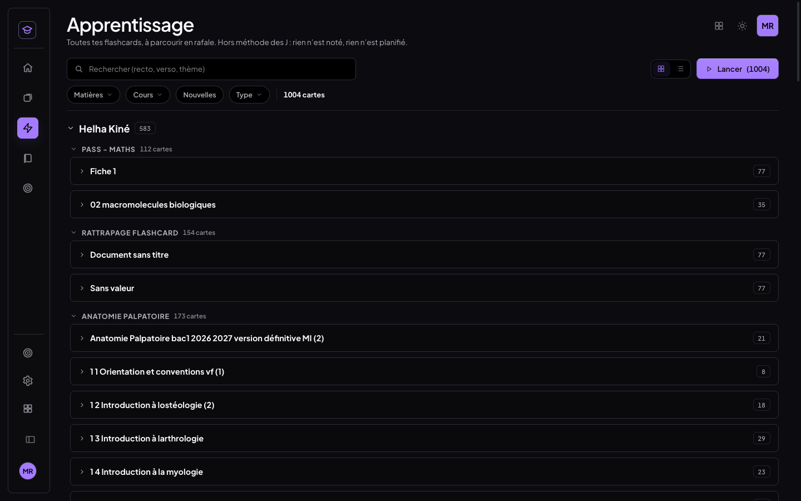 | 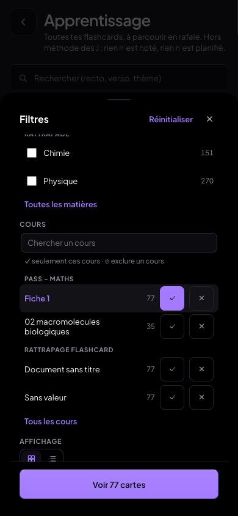 |
| 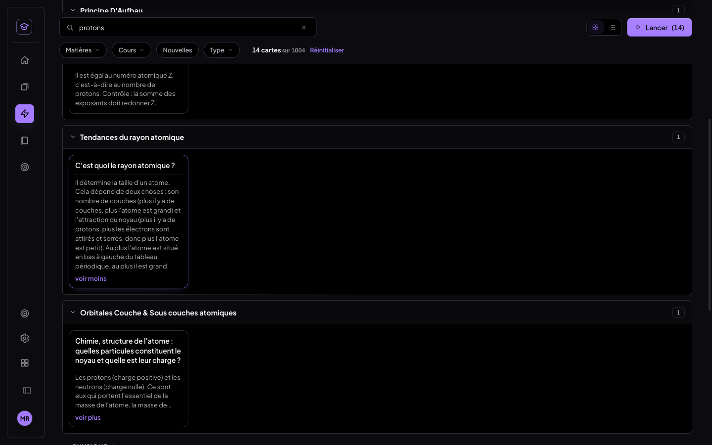 | 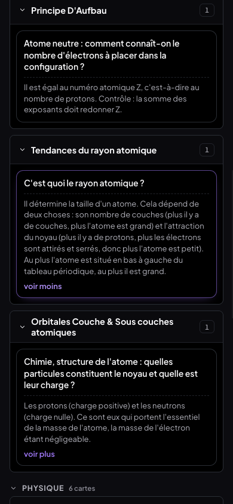 |

Aperçu plein (verso) et vue liste : 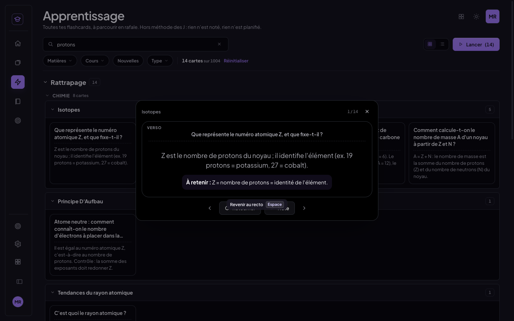 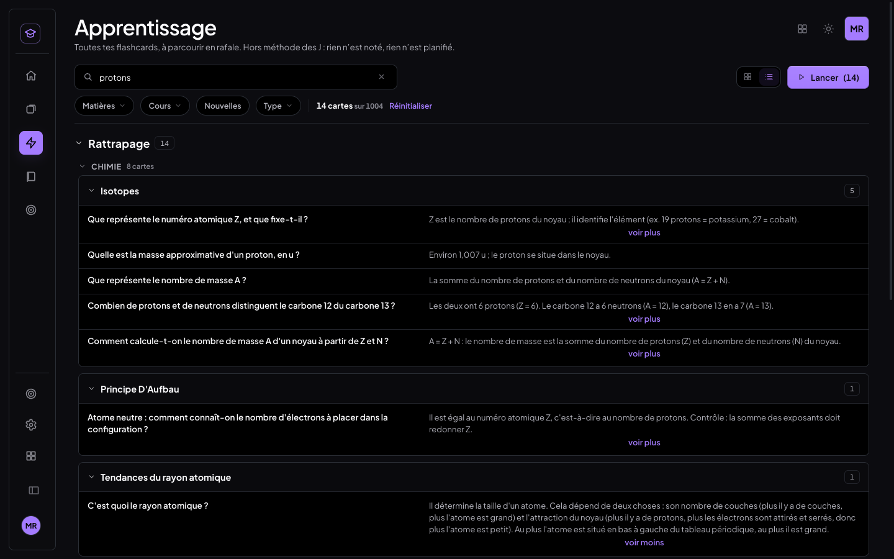

## 2. PdfReader : recherche ⌘F de phrases

**Cause du bug.** La recherche comparait la requête à chaque **item** de texte du PDF, c'est-à-dire une ligne ou un
morceau de ligne, et à chaque **nœud** de texte d'un document. Une phrase qui continuait sur la ligne suivante ne
pouvait donc jamais être trouvée. De plus, la comparaison n'était insensible qu'à la casse.

**Moteur unique** (`lib/rechercheTexte.js`, pur, testé) :

- Le texte est indexé **sur une suite de segments** : les items du PDF, les mots de l'OCR, les nœuds texte d'un
  document. Chaque caractère gardé se souvient de son segment et de sa position.
- La comparaison est insensible :
  - à la casse et aux accents ;
  - aux ligatures (fi, œ) ;
  - aux apostrophes et guillemets typographiques ;
  - aux tirets, dont la césure en fin de ligne ;
  - à **tous les blancs** : retours à la ligne, espaces multiples, espaces perdus ou ajoutés par l'extraction du PDF.
- Une occurrence est faite de **morceaux**, un par segment touché.

**Où le moteur sert** :

- **PDF** (texte natif et OCR, original et **fiche jumelle**) : les rectangles de surlignage sont calculés par morceau,
  donc une phrase sur deux lignes est surlignée sur ses deux lignes.
- **Document éditable** (`pdf/rechercheDom.js`) : le moteur parcourt les nœuds texte du flux, y compris le calque OCR
  des images. Toutes les occurrences sont surlignées et la courante est marquée, par la CSS Custom Highlight API.

**Interface** :

- le compteur « 3 sur 12 » ;
- ↑ ↓, Entrée et Maj+Entrée pour passer d'une occurrence à l'autre ;
- une **liste des résultats** sous le champ : chaque ligne donne la page et un extrait, la phrase trouvée en évidence,
  et un clic y va. On la masque ou l'affiche avec le bouton liste. Elle est posée en position fixe, pour que ni la
  barre ni le panneau ne la coupent.

| Phrase coupée par une césure (« proxi- / mal ») | Diapositive image (OCR), sur deux lignes, tablette |
|---|---|
| 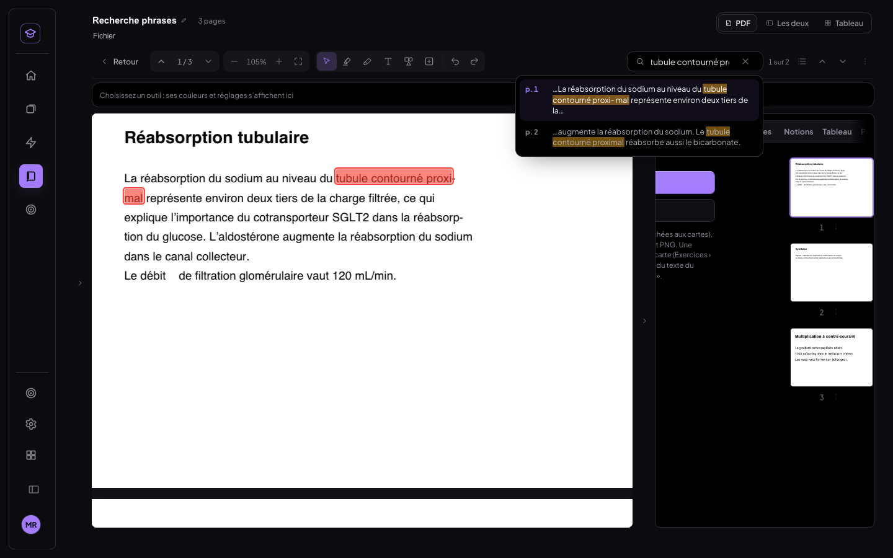 | 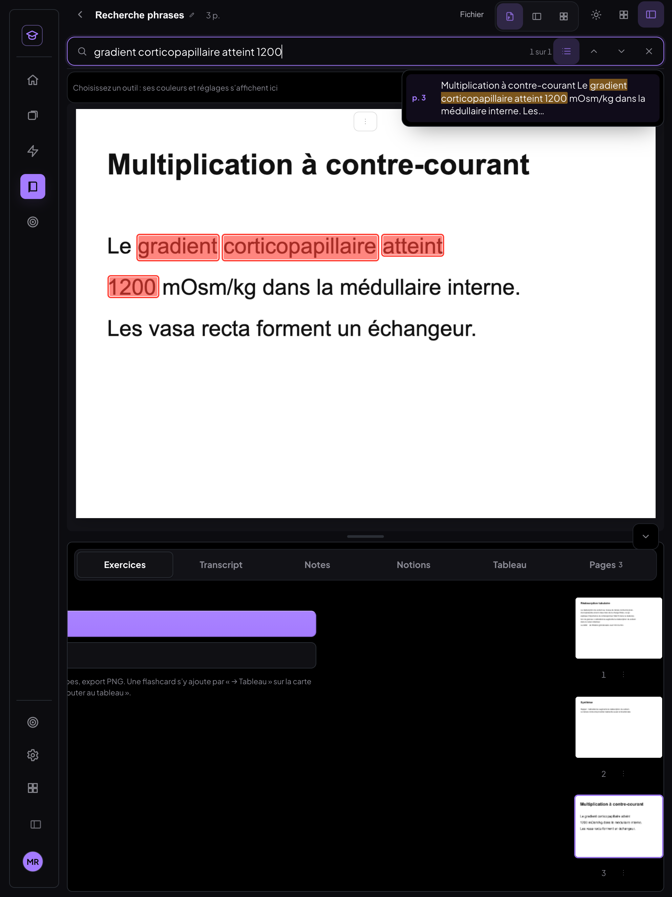 |

Document éditable : 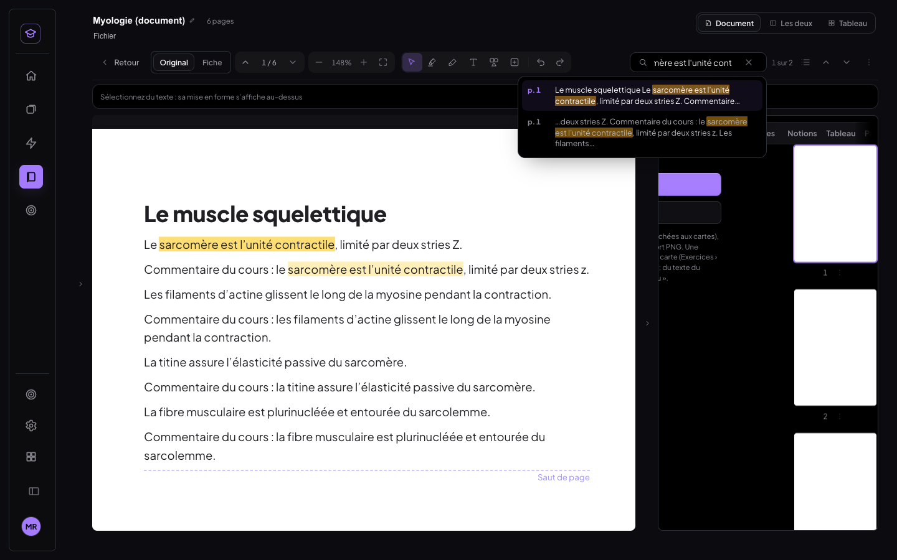

## 3. Tags « Début de cours » / « Fin de cours »

**Ouverture.** Le menu de la page s'ouvre au clic droit sur la page, sauf sur une sélection de texte ou dans un champ
de saisie, où le menu du navigateur est gardé. Il s'ouvre aussi par le bouton « … » centré en haut de la page, visible
au survol et toujours au doigt.

**Entrées du menu.** Il propose « Marquer début de cours » et « Marquer fin de cours ». Quand un tag existe déjà sur la
page, le menu propose à la place « … : date et transcript » et « Retirer le tag ».

**Fenêtre du tag** :

- la date, aujourd'hui par défaut, modifiable ;
- le transcript lié, au choix :
  - **aucun** ;
  - **la session en cours**, proposée par défaut si une transcription tourne sur ce cours ;
  - **une session existante**, choisie dans la liste des sessions du cours (date, heure, durée).

**Pastilles.** Elles sont discrètes, dans le coin supérieur gauche de la page : « ▶ Début · 22 oct. »,
« ■ Fin · 22 oct. ». La même pastille apparaît sur la **vignette** de la page. Un clic sur une pastille liée ouvre le
panneau Transcript **sur la session liée**, même pendant une transcription en direct (« Retour » ramène au direct). Un
clic sur une pastille sans lien ouvre sa fenêtre.

**Liseré.** Les pages comprises entre un début et une fin portent un liseré latéral fin, de la couleur des pastilles.

**Séances…** est une nouvelle entrée du menu Fichier. Elle liste les séances (date, pages début–fin, transcript lié),
la plus récente d'abord. Un clic va à la page de début ; le bouton du transcript l'ouvre.

**Panneau des pages.** Il **n'existait pas**. La demande y place une pastille sur chaque vignette, il a donc été créé au
plus simple, comme un mode « Pages » du panneau latéral :

- une vignette par page, rendue à petite échelle et seulement à l'approche ;
- les pastilles et le liseré ;
- la page courante entourée ;
- un clic pour y aller ;
- « … » et le clic droit pour le même menu de page.

**Stockage.** Un nouveau type synchronisé, `page_tag` :

```js
{ id, courseId, document: 'original' | 'fiche', page, pageCle, kind: 'debut' | 'fin', date, transcriptSessionId }
```

- `pageCle` est la clé stable de la page, qui suit les pages ajoutées ou déplacées.
- Retirer un tag le **marque** `supprime: true` : il n'est jamais effacé, aucune suppression ne part au cloud.

**Appariement d'une séance** : un début, suivi de la fin la plus proche dans le même document, avant le début suivant.

| Pastille et liseré sur la page | Pastilles sur les vignettes (mode « Pages ») |
|---|---|
| 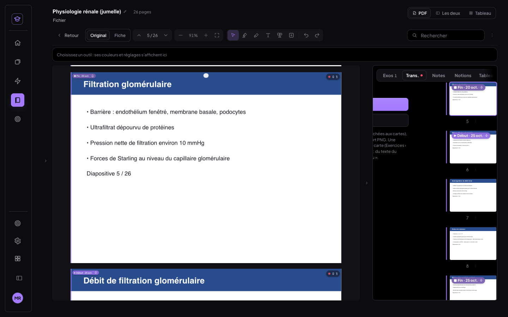 | 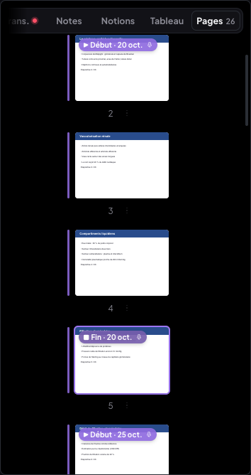 |

Liste « Séances » : 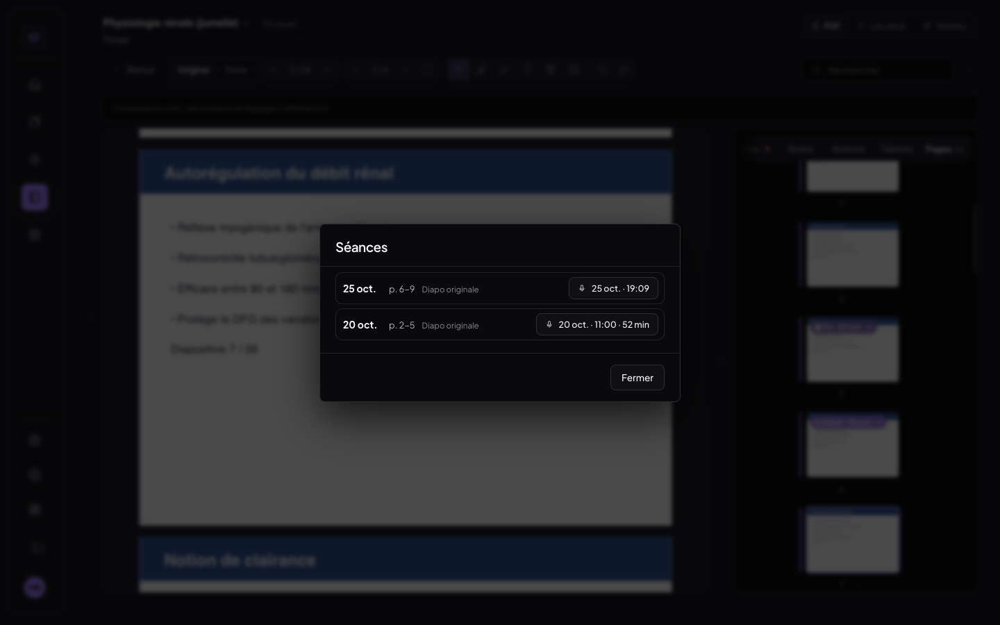

## 4. Finitions des boîtes

### 4.1 Menu Tableau à côté de la boîte

**Avant.** Le panneau était un menu déroulant posé sous le bouton « Tableau » de la mini barre, donc par-dessus le
tableau.

**Maintenant.** Il est posé sur la racine de l'app, en position fixe, **à côté de la boîte**
(`pdf/tableauPlacement.js` → `placerACote`) :

- à droite ;
- sinon à gauche ;
- sinon en dessous ;
- sinon au-dessus.

Il ne recouvre jamais la boîte ni le tableau. Il reste dans l'écran et défile en interne s'il manque de hauteur, puis se
recale au défilement et au redimensionnement. Le contenu et l'organisation du menu sont inchangés. Le curseur reste dans
la cellule et les actions agissent comme avant.

| Boîte au bord droit → menu à gauche | Boîte pleine largeur en bas de l'écran → menu au-dessus |
|---|---|
| 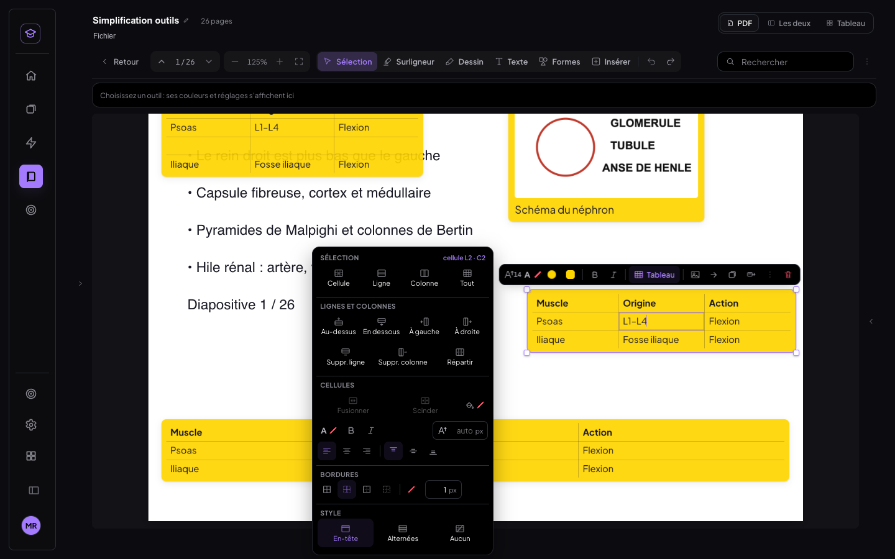 | 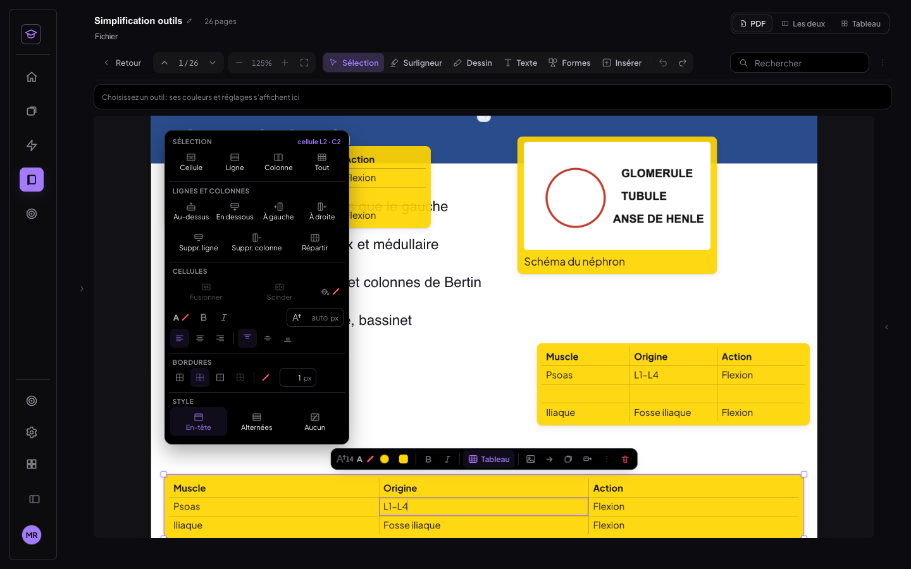 |

### 4.2 Cellule sélectionnée

- Le surlignage bleu et le champ arrondi incrusté sont supprimés.
- **Cellule sélectionnée** : seulement un contour intérieur fin couleur d'accent (1,5 px en `box-shadow inset`, que
  Chrome n'arrondit pas).
- **En édition** : on tape directement dans la cellule, avec le curseur texte couleur d'accent, sans champ visible (ni
  ombre, ni fond, ni arrondi), dans la même typographie.
- **Plage** : un léger voile d'accent à 12 %, plus un contour autour de la **plage entière**. Chaque cellule ne trace
  que ses bords extérieurs.

| Cellule en édition | Plage 2 × 2 |
|---|---|
| 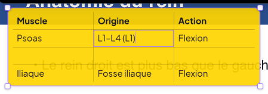 | 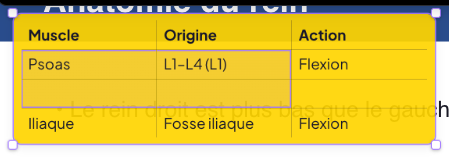 |

### 4.3 Images dans les boîtes

Une seule entrée « Image » de la mini barre regroupe :

- **Recadrer** : en place, avec le même composant que les images collées (`lib/rognageImage.js` → `ouvrirRognage`) :
  cadre, 4 poignées, Entrée pour valider, Échap pour annuler. Le recadrage est non destructif ; le fichier n'est jamais
  modifié.
- **Largeur** : glisser les **poignées latérales** de l'image (boîte sélectionnée). L'image reste centrée et bornée à
  la largeur intérieure de la boîte. « Toute la largeur de la boîte » la remet à 100 %.
- **Au-dessus / En dessous** du texte.
- **Remplacer…**
- **Copier le texte de l'image (OCR)**.
- **Retirer**.

L'**export PDF** suit le recadrage et la largeur. La carte du tableau Miro faite d'une boîte (même `ImageBoite`) les
suit aussi.

Image recadrée, puis réduite : 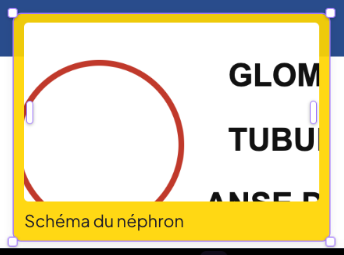 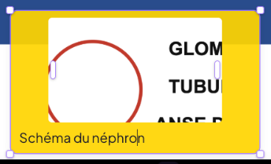

### 4.4 Icône de taille du texte

« T↕ 11.3 » devient **un « A » avec une petite flèche, suivi de la valeur arrondie à l'entier (« 11 »)**. La même icône
apparaît partout où l'on règle une taille de texte :

- la mini barre des boîtes, textes et boîtes-tableaux (et le panneau de taille) ;
- le menu Tableau ;
- la taille du texte d'un document ;
- les deux éditeurs du transcript ;
- les tailles A A A du Transcript ;
- les tailles du dessin au téléphone.

Pour les épaisseurs, la valeur reste au dixième.

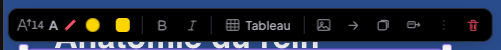

### 4.5 Infobulles

Un composant unique (`components/Infobulles.jsx`) est monté une fois par shell. Au survol à la souris ou au stylet,
**jamais au doigt**, de toute commande, il affiche son nom après **400 ms**, dans une bulle sombre compacte à la DA de
l'app, avec le **raccourci clavier** en touche quand il existe (« ⌘3 », « ⌘F », « Échap »…). Le texte vient du `title`,
retiré le temps du survol pour éviter la double bulle du navigateur, sinon de l'`aria-label`.

Il manquait un nom à un seul bouton (« Transcrire le cours ») ; il a été ajouté.

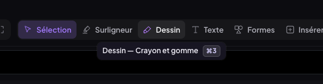

**Liste exhaustive** (test `t-infobulles.mjs`, ordinateur) : chaque commande visible de chaque contexte est survolée, et
la bulle est lue.

**368 commandes** au total, **toutes nommées** (aucune sans nom). La bulle a été vue au survol pour **365** d'entre elles ; les 3 autres étaient hors de l'écran, et seule la présence de leur nom a été vérifiée. Une sous-barre reprend la barre principale : seules ses commandes propres sont listées. Les pastilles du dock de couleurs de chaque outil font partie de sa sous-barre.

- **Barre principale** — 20 commandes, 20 bulles vues : Cliquer pour renommer la fiche (« Simplification outils ») · Fichier — le cours, la diapo originale, la fiche · Le PDF seul · PDF et tableau côte à côte (« Les deux ») · Le tableau en plein (« Tableau ») · Revenir à la liste (« Retour ») · Page précédente · Page suivante · Dézoomer · Zoomer · Ajuster à la largeur · Sélection · ⌘1 — Sélectionner du texte, ouvrir une annotation, déplacer un objet (« 1 Sélection ») · Surligneur · ⌘2 — Commencer sur du texte le surligne ; ailleurs, le geste trace un surlignage à main levée (« 2 Surligneur ») · Dessin · ⌘3 — Crayon et gomme (« 3 Dessin ») · Texte · ⌘4 — Boîte, texte libre, post-it, boîte-tableau — cliquer sur la page pour poser · Échap pour arrêter (« 4 Texte ») · Formes · ⌘5 — Choisir une forme, puis cliquer pour la poser ou glisser pour l’étirer · Maj : proportions · Échap pour arrêter (« 5 Formes ») · Insérer · ⌘6 — Image, page blanche, dessins reçus du téléphone (« 6 Insérer ») · Annuler (Cmd+Z) · Rétablir (Cmd+Maj+Z) · Actions sur le document — sélectionne du texte pour le remplacer
- **Sous-barre surligneur** — 27 commandes, 27 bulles vues : Rouge · Orange · Jaune — prioritaire · Vert · Bleu · Violet · Rose — cloze · Noir · Blanc · Plus de couleurs — sélecteur complet (couleurs du thème, pipette, autres couleurs) ; une couleur choisie ici devient un favori · Épaisseur du trait libre : 14 px · Trait libre en ligne droite, du point de départ au point d’arrivée (aimantée à l’horizontale) (« Ligne droite »)
- **Sous-barre dessin** — 28 commandes, 28 bulles vues : Dessiner à main levée (« Crayon ») · Effacer les traits et les formes — cliquer, ou glisser pour en effacer plusieurs (« Gomme ») · Épaisseur du crayon : 3 px · Rouge · Orange · Jaune — prioritaire · Vert · Bleu · Violet · Rose — cloze · Noir · Blanc · Plus de couleurs — sélecteur complet (couleurs du thème, pipette, autres couleurs) ; une couleur choisie ici devient un favori
- **Sous-barre ecrire** — 29 commandes, 29 bulles vues : Cliquer ou tracer pour poser une boîte — l’outil reste actif pour enchaîner (« Boîte ») · Cliquer sur la page pour y écrire du texte libre, sans cadre (« Texte libre ») · Cliquer pour coller un post-it (une question, un « je n’ai pas compris »…) (« Post-it ») · Cliquer ou tracer pour poser une boîte contenant un tableau (3 colonnes × 4 lignes) (« Boîte-tableau ») · Rouge · Orange · Jaune — prioritaire · Vert · Bleu · Violet · Rose — cloze · Noir · Blanc · Plus de couleurs — sélecteur complet (couleurs du thème, pipette, autres couleurs) ; une couleur choisie ici devient un favori
- **Sous-barre forme** — 33 commandes, 33 bulles vues : Rectangle — clic sur la page pour la poser, glisser pour l’étirer (Maj : proportions gardées) · Cercle / ellipse — clic sur la page pour la poser, glisser pour l’étirer (Maj : proportions gardées) · Triangle — clic sur la page pour la poser, glisser pour l’étirer (Maj : proportions gardées) · Étoile — clic sur la page pour la poser, glisser pour l’étirer (Maj : proportions gardées) · Ligne — clic sur la page pour la poser, glisser pour l’étirer (Maj : angle de 45°) · Flèche — clic sur la page pour la poser, glisser pour l’étirer (Maj : angle de 45°) · Plus de formes : rectangle arrondi, losange, étoile, double flèche, accolade, crochet, croix · Rouge · Orange · Jaune — prioritaire · Vert · Bleu · Violet · Rose — cloze · Noir · Blanc · Plus de couleurs — sélecteur complet (couleurs du thème, pipette, autres couleurs) ; une couleur choisie ici devient un favori · Remplir la forme d’une teinte légère de sa couleur (« Vide »)
- **Sous-barre inserer** — 18 commandes, 18 bulles vues : Image — importer une image et la placer sur la page (ou la coller avec Cmd/Ctrl+V) · Page — insérer une page blanche juste après la page affichée (ou avec le « + » entre deux pages) · Dessins reçus du téléphone — les glisser sur une page du PDF
- **Mini barre › boîte** — 13 commandes, 13 bulles vues : Taille du texte (« 10 ») · Couleur du texte (« A ») · Fond de la boîte (couleur) · Fond : plein — cliquer pour « transparent » (plein → transparent → teinté) · Gras (⌘B) · Italique (⌘I) · Alignement : à gauche — cliquer pour « centré » · Image : ajouter une image dans la boîte (aussi ⌘V ou glisser-déposer sur la boîte) · Ajouter une flèche : clique ensuite l’endroit, le surlignage, la forme ou la boîte visés · → Flashcard : créer une carte depuis cette boîte (aperçu modifiable) · → Tableau : ajouter cette boîte au tableau de la fiche (même contenu, même couleur) · Plus d’options · Supprimer la boîte (annulable par Cmd+Z)
- **Mini barre › boîte › …** — 8 commandes, 8 bulles vues : Police (« Par défaut Par défaut serif sa ») · Souligné (⌘U) · Barré · Surligneur de fond du texte · Liste à puces · Liste numérotée · Réduire en pastille : un clic sur la pastille rouvre la boîte, un glisser la déplace · Verrouiller : la boîte ne bouge plus
- **Panneau de couleurs (boîte)** — 62 commandes, 62 bulles vues : Noir · Gris · Rouge · Orange · Jaune · Vert · Cyan · Bleu · Violet · Magenta · Noir, plus claire 80 % · Gris, plus claire 80 % · Rouge, plus claire 80 % · Orange, plus claire 80 % · Jaune, plus claire 80 % · Vert, plus claire 80 % · Cyan, plus claire 80 % · Bleu, plus claire 80 % · Violet, plus claire 80 % · Magenta, plus claire 80 % · Noir, plus claire 60 % · Gris, plus claire 60 % · Rouge, plus claire 60 % · Orange, plus claire 60 % · Jaune, plus claire 60 % · Vert, plus claire 60 % · Cyan, plus claire 60 % · Bleu, plus claire 60 % · Violet, plus claire 60 % · Magenta, plus claire 60 % · Noir, plus claire 40 % · Gris, plus claire 40 % · Rouge, plus claire 40 % · Orange, plus claire 40 % · Jaune, plus claire 40 % · Vert, plus claire 40 % · Cyan, plus claire 40 % · Bleu, plus claire 40 % · Violet, plus claire 40 % · Magenta, plus claire 40 % · Noir, plus foncée 25 % · Gris, plus foncée 25 % · Rouge, plus foncée 25 % · Orange, plus foncée 25 % · Jaune, plus foncée 25 % · Vert, plus foncée 25 % · Cyan, plus foncée 25 % · Bleu, plus foncée 25 % · Violet, plus foncée 25 % · Magenta, plus foncée 25 % · Noir, plus foncée 50 % · Gris, plus foncée 50 % · Rouge, plus foncée 50 % · Orange, plus foncée 50 % · Jaune, plus foncée 50 % · Vert, plus foncée 50 % · Cyan, plus foncée 50 % · Bleu, plus foncée 50 % · Violet, plus foncée 50 % · Magenta, plus foncée 50 % · Pipette — prélever une couleur n’importe où à l’écran · Autres couleurs — roue chromatique, saturation et luminosité, code hex
- **Taille du texte (boîte)** — 4 commandes, 4 bulles vues : 14 px (« Aa 14 px ») · 18 px (« Aa 18 px ») · 24 px (« Aa 24 px ») · Toutes les tailles (« ▾ »)
- **Mini barre › post-it** — 13 commandes, 13 bulles vues : Taille du texte (« 10 ») · Couleur du texte (« A ») · Couleur du post-it · Fond : plein — cliquer pour « transparent » (plein → transparent → teinté) · Gras (⌘B) · Italique (⌘I) · Alignement : à gauche — cliquer pour « centré » · Image : ajouter une image dans la boîte (aussi ⌘V ou glisser-déposer sur la boîte) · Ajouter une flèche : clique ensuite l’endroit, le surlignage, la forme ou la boîte visés · → Flashcard : créer une carte depuis cette boîte (aperçu modifiable) · → Tableau : ajouter cette boîte au tableau de la fiche (même contenu, même couleur) · Plus d’options · Supprimer la boîte (annulable par Cmd+Z)
- **Mini barre › post-it › …** — 8 commandes, 8 bulles vues : Police (« Par défaut Par défaut serif sa ») · Souligné (⌘U) · Barré · Surligneur de fond du texte · Liste à puces · Liste numérotée · Réduire en pastille : un clic sur la pastille rouvre la boîte, un glisser la déplace · Verrouiller : la boîte ne bouge plus
- **Mini barre › texte libre** — 7 commandes, 7 bulles vues : Taille du texte (« 11 ») · Couleur du texte (« A ») · Gras (⌘B) · Italique (⌘I) · Alignement : à gauche — cliquer pour « centré » · Plus d’options · Supprimer ce texte (annulable par Cmd+Z)
- **Mini barre › texte libre › …** — 7 commandes, 7 bulles vues : Police (« Par défaut Par défaut serif sa ») · Souligné (⌘U) · Barré · Surligneur de fond du texte · Liste à puces · Liste numérotée · Verrouiller : la boîte ne bouge plus
- **Mini barre › boîte-tableau** — 13 commandes, 13 bulles vues : Taille du texte (« 14 ») · Couleur du texte (« A ») · Fond de la boîte (couleur) · Fond : plein — cliquer pour « transparent » (plein → transparent → teinté) · Gras (tout le tableau) · Italique (tout le tableau) · Tableau : lignes, colonnes, cellules, bordures, style · Image : ajouter une image dans la boîte (aussi ⌘V ou glisser-déposer sur la boîte) · Ajouter une flèche : clique ensuite l’endroit, le surlignage, la forme ou la boîte visés · → Flashcard : créer une carte depuis cette boîte (aperçu modifiable) · → Tableau : ajouter cette boîte au tableau de la fiche (même contenu, même couleur) · Plus d’options · Supprimer la boîte (annulable par Cmd+Z)
- **Mini barre › boîte-tableau › …** — 3 commandes, 3 bulles vues : Alignement : à gauche · Réduire en pastille · Verrouiller : la boîte ne bouge plus
- **Menu Tableau** — 31 commandes, 31 bulles vues : Cellule · Ligne · Colonne · Tout · Insérer une ligne au-dessus (« Au-dessus ») · Insérer une ligne en dessous (« En dessous ») · Insérer une colonne à gauche (« À gauche ») · Insérer une colonne à droite (« À droite ») · Supprimer la ligne (ou les lignes de la sélection) (« Suppr. ligne ») · Supprimer la colonne (ou les colonnes de la sélection) (« Suppr. colonne ») · Répartir uniformément : colonnes de même largeur, lignes à leur hauteur naturelle · Fusionner · Scinder · Fond des cellules · Couleur du texte (« A ») · Gras · Italique · Aligner à gauche · Centrer · Aligner à droite · En haut de la cellule · Au milieu de la cellule · En bas de la cellule · Toutes les bordures · Bordures intérieures · Bordures extérieures · Aucune bordure · Couleur des bordures (aucune = celle du texte) · Ligne d’en-tête (1re ligne en gras) (« En-tête ») · Lignes alternées (une sur deux teintée) (« Alternées ») · Aucun style
- **Mini barre › image collée** — 7 commandes, 7 bulles vues : Droite (segments) — cliquer pour une courbe · Pointe de début : aucune (aucune, ouverte, pleine) · Pointe de fin : pleine (aucune, ouverte, pleine) · Style : continu (continu, tirets, pointillés) · Épaisseur de la flèche : 1 413,3 px (« 1413.3 ») · Couleur de la flèche · Supprimer la flèche (Suppr)
- **Mini barre › forme** — 5 commandes, 5 bulles vues : Style du trait (continu, tirets, pointillés) · Vide — cliquer pour remplir d’une teinte légère · Épaisseur du trait : 1 413,3 px (« 1413.3 ») · Couleur de la forme · Supprimer la forme (annulable par Cmd+Z, ou à la gomme)
- **Mini barre › flèche** — 7 commandes, 7 bulles vues : Droite (segments) — cliquer pour une courbe · Pointe de début : aucune (aucune, ouverte, pleine) · Pointe de fin : pleine (aucune, ouverte, pleine) · Style : continu (continu, tirets, pointillés) · Épaisseur de la flèche : 1 413,3 px (« 1413.3 ») · Couleur de la flèche · Supprimer la flèche (Suppr)
- **Mini barre › trait** — 7 commandes, 7 bulles vues : Droite (segments) — cliquer pour une courbe · Pointe de début : aucune (aucune, ouverte, pleine) · Pointe de fin : pleine (aucune, ouverte, pleine) · Style : continu (continu, tirets, pointillés) · Épaisseur de la flèche : 1 413,3 px (« 1413.3 ») · Couleur de la flèche · Supprimer la flèche (Suppr)
- **Panneau › sélecteur de modes** — 6 commandes, 5 bulles vues : Exercices (« Exercices Exos 4 ») · Transcript (« Transcript Trans. ») · Notes (« Notes Notes ») · Notions (« Notions Notions ») · Tableau (« Tableau Tableau ») · Pages (« Pages Pages 26 »)
- **Transcript** — 2 commandes, 0 bulles vues : Transcrire le cours : démarrer une transcription en direct · Crédits Deepgram — cliquer pour le détail et Actualiser (« 199,92 $ · ≈ 689 h 23 min »)
- **Tableau Miro** — 10 commandes, 10 bulles vues : Nouvelle carte (N, ou double-clic sur le fond) (« Carte ») · Nouvelle boîte-tableau : une carte contenant un tableau (3 colonnes × 4 lignes) · Annuler (⌘Z) · Rétablir (⇧⌘Z) · Dézoomer (⌘ + molette, ou pincer) (« − ») · Zoomer · Recadrer sur tout · Minimap · Fond blanc · Exporter le tableau en image PNG

Le tableau complet (368 lignes, avec le texte de chaque bulle) est dans [annexe-infobulles-2026-10-25.md](annexe-infobulles-2026-10-25.md).


---

## 5. Tests et non-régression

Tous les tests ont tourné dans un Chrome headless isolé, piloté en CDP avec de vrais événements souris, toucher et clavier, sur un Vite local **sans Supabase**.

- **Apprentissage** : profil Chrome avec une **copie restaurée des vraies données** (1 004 flashcards, 616 entrées de journal), hors ligne.
- **Synchro** : faux Supabase local (`scripts/faux-supabase.mjs`).
- **Session de transcript en direct** : faux Deepgram local.

### 5.1 Bancs des quatre chantiers (`scripts/tests-apprentissage-v2/`), passage final sur le code commité

| Banc | Ordinateur | Tablette | Téléphone |
|---|---|---|---|
| `t-tableau-bord.mjs` — Apprentissage (vraies données) | 28 ✅ | 28 ✅ | 27 ✅ |
| `t-recherche.mjs` — ⌘F de phrases | 20 ✅ | 20 ✅ | sans objet (pas de lecteur sur téléphone) |
| `t-tags.mjs` — tags début / fin | 17 ✅ | 17 ✅ | sans objet |
| `t-tags-synchro.mjs` — 2ᵉ appareil (faux Supabase) | 5 ✅ | — | — |
| `t-boites.mjs` — menu Tableau, cellule, image, icône de taille | 23 ✅ | 22 ✅ | sans objet |
| `t-infobulles.mjs` — liste exhaustive | 28 ✅ (368 commandes) | sans survol au doigt | — |

**Contenu de chaque banc :**

- **Apprentissage** :
  - **Toutes les cartes sont présentes** : compteur 1004 = 1004 flashcards en base. Plus aucun « Mettre en apprentissage / Retirer » à l'écran.
  - **Recherche** sur un mot du verso, tapé en majuscules : résultat égal au calcul du module.
  - **Filtres** :
    - une matière, puis deux ;
    - **exclusion d'un cours** (266 − 77 = 189) ;
    - ce cours seul ;
    - « Nouvelles » (75 = définition existante), avec le **tag « Nouvelle » sur les 75 vignettes** ;
    - chacun des 5 types (texte 901 · Muscle 9 · Tableau 1 · Molécule 0 · image 93) ;
    - une combinaison vide (« Aucune carte ne correspond ») puis « Réinitialiser ».
  - **Vignettes** : recto au-dessus du verso, « voir plus » ; aperçu ouvert puis retourné ; vue liste.
  - **« Lancer »** sur un filtre de 14 cartes : la session compte bien 14 cartes ; Su, Su, Pas su, Skip, Finir, Terminer.
  - **Indépendance** : l'empreinte SHA-256 des cartes entières, des champs de planification (`dueDate`, `j0Date`, `intervalDays`, `fsrs`, `historique`, `nouvelle`, `updatedAt`), du journal des révisions (616 entrées) et de la séance du jour est **identique avant et après**, sur les 3 tailles.
- **⌘F** :
  - les 5 phrases :
    - « tubule contourné proximal », coupée par une césure « proxi- / mal » ;
    - « deux tiers de la charge filtrée, ce qui explique », sur deux lignes ;
    - « l'aldostérone augmente la réabsorption du sodium », apostrophe droite tapée et typographique dans le PDF ;
    - « DEBIT DE FILTRATION GLOMERULAIRE », sans accents et avec des espaces multiples dans le PDF ;
    - « gradient corticopapillaire atteint 1200 », sur une **diapositive image lue par l'OCR**, sur deux lignes ;
  - l'occurrence active est surlignée sur ses **deux** lignes ;
  - Entrée et Maj+Entrée ; clic dans la liste des résultats ;
  - le **document éditable** (2 occurrences, courante et autre surlignées) ;
  - la **fiche jumelle**.
- **Tags** :
  - **séance 1** posée au clic droit (début p. 2) et au « … » (fin p. 5), datée du 20 oct. et liée à une **ancienne session** ;
  - **séance 2** (p. 6 → 9) liée à la **session en cours** (transcription en direct démarrée, proposée par défaut), datée d'aujourd'hui ;
  - **pastilles** sur les pages ;
  - **liseré** sur les pages 2–5 et 6–9, pas sur 1 ni 10 ;
  - **mode « Pages »** : 26 vignettes rendues, 4 pastilles, liseré 2–9 ; un clic va à la page ;
  - liste **« Séances »** : 2 séances, et un clic va à la page de début ;
  - **pastille liée** → panneau Transcript sur la session liée ;
  - lien retiré, puis tag retiré, marqué `supprime` (aucun effacement) ;
  - **synchro** : 2 lignes `page_tag` au faux cloud, empreinte SHA-256 identique sur le 2ᵉ appareil, avec pastille et liseré visibles.
- **Boîtes** :
  - **menu Tableau** pour une boîte au bord gauche (→ droite), au bord droit (→ gauche) et pleine largeur en bas de l'écran (→ au-dessus). Le menu ne recouvre ni la boîte, ni le tableau, ni la mini barre ; il reste dans l'écran, le curseur reste dans la cellule et une entrée agit ;
  - **cellule** : contour intérieur sur 4 bords, sans fond ; en édition, ni ombre, ni fond, ni arrondi, même typographie ;
  - **plage 2 × 2** : voile à 12 % et 2 bords par cellule ;
  - **image** : entrée « Image » avec ses 7 options ; recadrage (Entrée l'enregistre, Échap l'annule) ; largeur à 62 %, puis bornée à 100 % ; « Remplacer… » ;
  - **icône « A »** suivie de la valeur entière « 14 ».

### 5.2 Tests automatiques

`npm test` : 131 tests sur 132 passent. Nouveaux : `tests/recherche/*`, `tests/apprentissage-libre/tableauBord.test.js` et `tests/tags/tagsPages.test.js`, soit 22 tests.

Le seul échec, `tests/crayon/crayon.test.js › trois épaisseurs par mode`, **existe déjà sur le code d'avant** ce chantier (vérifié) ; il ne touche aucun fichier modifié ici. `npm run build` est vert, sans import manquant.

### 5.3 Non-régression

- **MealWeek et `src/shared/`** : le diff depuis 1c5ccec est vide. **MealWeek est identique au pixel** entre un build d'avant (1c5ccec) et un build d'après, tous deux sans Supabase, servis sur la même origine (comparaison octet par octet des captures).
- **Bancs existants** :
  - « simplification des outils » : 16 bancs × 2 tailles, tous ✅ ;
  - « séance par catégories » (`t-seance`, vraies données) : 40 ✅ ;
  - fiche jumelle : `t-jumelle-bascule` 13 ✅, `t-jumelle-ocr` 5 ✅, `t-doc-editeur` 7 ✅ ;
  - « boîtes & tableaux » : `t-tableau` (ordinateur, tablette), `t-tableau-miro` (ordinateur, tablette), `t-image`, `t-flashcard`, `t-exports`, `t-document`, `t-mobile`, `t-tableau-doigt`, `t-export-tableau` ✅.
- **Trois régressions** sont apparues, toutes dues au menu Tableau sorti dans un portail, et ont été corrigées (commit 175049f) :
  - toucher une entrée du menu fermait l'écriture de la boîte ;
  - le sélecteur de couleur qu'il ouvre passait sous lui ;
  - posé au-dessus, il recouvrait la mini barre.

  Ces mêmes bancs passaient sur l'ancien code et repassent au vert. L'attendu de `t-image` a été mis à jour pour la nouvelle entrée « Image », un changement voulu.


## 6. Migration SQL

`supabase/migrations/20261025_page_tag.sql` est **préparée, NON appliquée**. Elle ajoute un index partiel de lecture
sur le type `page_tag`, sans toucher aux données. L'app fonctionne exactement pareil sans elle : la table
`medrevise_records` est générique et `medrevise_push` n'a pas de liste blanche de types.

## 7. Commits

- `175049f` fix(medrevise): menu Tableau — la mini barre compte avec la boîte (le menu ne la recouvre plus), le menu reste un endroit « de la boîte » (l'écriture ne se ferme plus quand on y touche une entrée), et passe sous les sélecteurs de couleur qu'il ouvr
- `129661a` feat(medrevise): infobulles — au survol (souris / stylet) de chaque commande de chaque barre et mini barre, son nom après 400 ms dans une bulle à la DA, avec le raccourci clavier ; un seul composant (title / aria-label existants) ; liste exhaustive
- `e36aea1` feat(medrevise): finitions des boîtes — menu Tableau posé À CÔTÉ de la boîte (droite, sinon gauche, sinon dessous / dessus ; jamais sur la boîte ni le tableau, dans l'écran, défile en interne) ; cellule sélectionnée = contour intérieur fin d'accent
- `0a79e1c` feat(medrevise): tags « Début / Fin de cours » sur les pages — menu de la page (clic droit / « … ») : marquer début / fin, date (aujourd'hui par défaut, modifiable), lien vers la session de transcript en cours ou une session existante (modifiable, 
- `86897ea` feat(medrevise): recherche ⌘F de phrases — phrase entière dans le texte natif ET l'OCR, insensible à la casse / aux accents / retours à la ligne / espaces multiples / césures / apostrophes typographiques ; occurrences surlignées même sur deux ligne
- `4038d6a` feat(medrevise): Apprentissage v2 — toutes les flashcards d'office (plus de « Mettre en apprentissage / Retirer » ni de pastille), tableau de bord : recherche recto/verso/thème, puces Matières · Cours (inclure / exclure) · Nouvelles · Type, compteu
- (ce compte rendu, ses captures, l'annexe des infobulles et les bancs : le commit « docs » qui suit)


## 8. Points à savoir

- **Le filtre « Nouvelles » lit la définition existante** (historique de notation, `nouvelle`), en lecture seule, comme
  la demande l'impose. C'est la seule lecture d'un champ lié aux J. Rien n'est écrit.
- **La recherche ignore les blancs et les tirets.** Elle trouve donc « parti » pour « par ti ». C'est voulu : c'est ce
  qui la rend tolérante aux retours à la ligne, aux espaces perdus par l'extraction et aux césures. La ponctuation
  compte toujours.
- **Le lecteur n'existe pas sur téléphone** : le shell mobile n'a pas de lecteur, en dessous de 760 px. La recherche, les
  tags et les boîtes ont donc été testés sur ordinateur et sur tablette au toucher. L'Apprentissage a été testé sur les
  trois.
- **Un 6ᵉ mode du panneau** (« Pages ») a été ajouté, faute de panneau des pages existant. Le sélecteur de modes défile
  à l'horizontale quand le panneau est étroit, comme avant.
- **Le panneau Transcript affiche maintenant la session liée** demandée par une pastille, même pendant une transcription
  en direct. Avant, le direct prenait toujours la place, y compris pour le badge « N lignes » d'une page.
