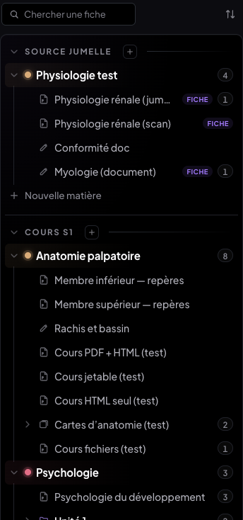
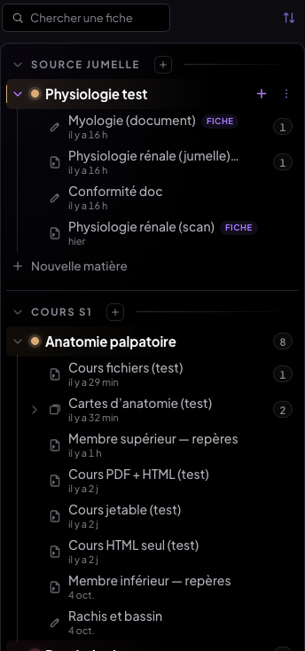
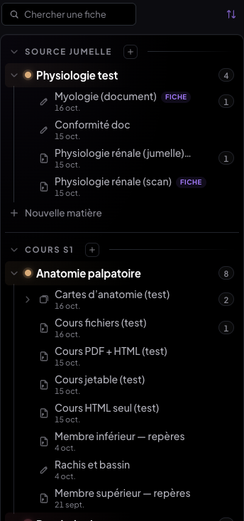
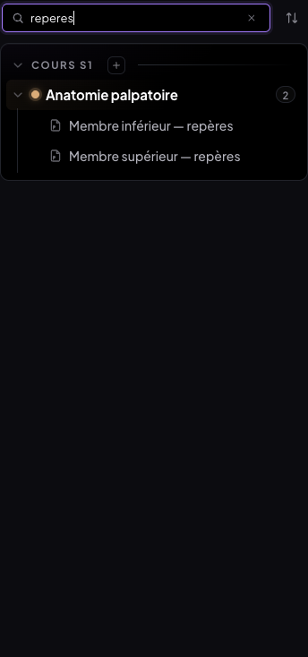
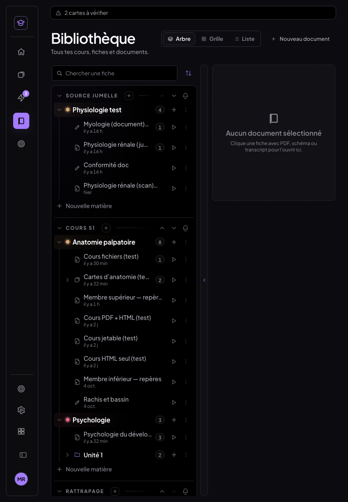
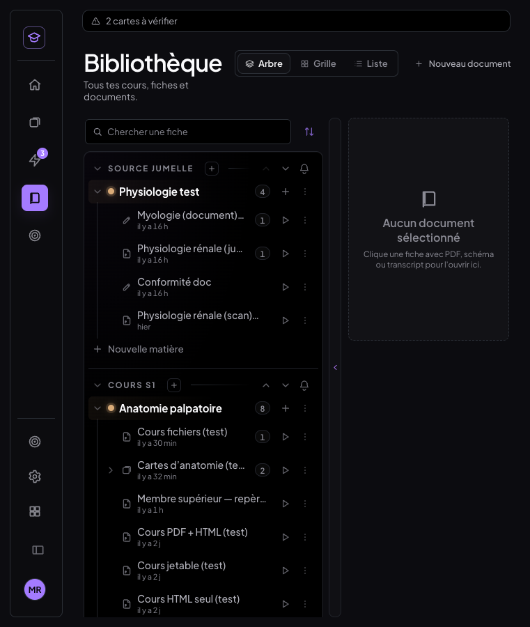

# Compte rendu — tris de la Bibliothèque · menu « Fichier » unique (15-16/10/2026)

Deux finitions de MedRevise, livrées, testées dans Chrome (ordinateur, tablette, téléphone)
sur un banc **local** (Vite sans Supabase + Chrome headless) — jamais le vrai cloud.

Règles tenues : rien dans `src/shared/` ni MealWeek (vérifié en fin de chantier, voir §4) ;
aucune écriture Supabase destructive, aucune migration ; aucune fiche, dossier ou matière
modifié par les tris (vérifié par test) ; DA existante (jetons et composants déjà là).

---

## 1. Bibliothèque : deux tris en plus de l'ordre manuel

> **Mise à jour du 17/10 :** les tris ne produisent plus de liste plate, ils gardent l'arborescence ;
> la recherche et le tri sont dans une rangée en tête du panneau. Voir le § 7 ; ce qui suit décrit
> la version du 15/10 (le calcul des dates, lui, est inchangé).

Un petit menu **« Trier »** à côté de la recherche et des modes d'affichage (Arbre · Grille · Liste) :

| Tri | Affichage |
|---|---|
| **Ordre manuel** (défaut) | l'arbre tel qu'on l'a rangé : sections › matières › dossiers › fiches |
| **Dernière modification** | liste **plate** de toutes les fiches, la plus récemment modifiée en tête, « Modifiée il y a 2 h · Anatomie palpatoire » |
| **Date d'ajout** | même liste plate, la plus récemment créée en tête, « Ajoutée le 12 oct. · Psychologie » |

La matière est en gris (plus clair que la date) pour se repérer.

| Ordre manuel | Dernière modification | Date d'ajout |
|---|---|---|
|  |  |  |

### Ce que « modifiée » veut dire (`src/medrevise/lib/datesFiches.js`, lecture seule)
Le plus récent `updatedAt` des enregistrements qui appartiennent à la fiche :
surlignages et annotations (y compris ceux de la **fiche jumelle**, espace `<cours>::fiche:<v>`),
texte du document et onglet Notes (`notes_doc`), texte d'un transcript (`docs`), sessions de
transcription, fiche jumelle importée (`companion_pdf`), tableau, dessins reçus du téléphone,
et la **création** de ses cartes (flashcards, QCM, notions créées dedans).

Volontairement exclus :
- la **révision** d'une carte (elle réécrit la carte, mais ne modifie pas le cours) ;
- `fiche.updatedAt` : un glisser-déposer réécrit l'ordre de toutes les fiches voisines, qui
  paraîtraient toutes « modifiées » ;
- la position de lecture (lire n'est pas modifier).
Plancher : la date d'ajout (une fiche jamais touchée est « modifiée » le jour de son ajout).
Limite : supprimer la *dernière* annotation d'une fiche ne la fait pas remonter (une suppression
ne laisse pas d'enregistrement local daté).

**Date d'ajout** : l'instant de création lu dans l'identifiant de la fiche (`genId` = préfixe +
horodatage en base 36) — `dateImport` ne garde que le jour, et deux fiches importées le même
jour doivent être départagées. Repli sur `dateImport` si l'identifiant ne porte pas d'instant.

**En direct** : `lib/storage.js` émet un simple événement `medrevise:ecriture` après chaque
écriture (rien de changé dans ce qui est écrit) ; la Bibliothèque relit le seul store touché.
Annoter une fiche ouverte la fait remonter en tête sans fermer le cours :

| Annoter « Membre inférieur » (11e) … | … elle est en tête, « Modifiée à l'instant » |
|---|---|
|  |  |

### Le reste
- **Importer un PDF en liste plate** : le déposer sur une ligne l'importe dans la matière (et le
  dossier) de cette fiche ; en tri « Date d'ajout », il apparaît en tête.
  
- **Mémorisé par appareil** (`localStorage`, clé `medrevise.biblio.tri`), pas synchronisé.
- **Aucune écriture** : un tri ne fait que lire et trier pour l'affichage. Revenir à l'ordre
  manuel rend exactement l'arborescence et l'ordre d'avant (test : matières, dossiers, `ordre`
  et état de dépliage identiques, arbre affiché identique).
  
- **Grille et Liste** suivent le tri (même ordre, sans regroupement ; en Liste, la colonne de
  date devient « Modifiée » et le tri par colonne reste celui de l'ordre manuel).

| Grille · date d'ajout | Liste · dernière modification |
|---|---|
|  |  |

- **Recherche** (il n'y en avait pas : ajoutée, puisqu'elle devait être compatible) : titre,
  matière ou dossier, sans accents ni casse, dans les trois tris et les trois affichages. En
  ordre manuel, l'arbre est filtré et les branches utiles sont dépliées **pour l'affichage
  seulement** (le dépliage mémorisé n'est pas réécrit).
  
- **Rattrapage** : les fiches suivent le même filtre de section que l'arbre — sections et
  matières archivées exclues, fiches archivées exclues ; la section Rattrapage est incluse
  comme les autres (testé avec une section archivée et une fiche archivée dans le jeu de test).
- **Tablette** : sous 1 280 px, les actions passent sous le titre ; lignes de 48 px au doigt.
  Téléphone : shell mobile (pas de Bibliothèque), inchangé.
  

---

## 2. Menu « Fichier » identique partout

Un seul composant, `src/medrevise/pdf/MenuFichier.jsx`, pour **toutes** les pages du lecteur :
cours PDF, document créé dans l'app, fiche jumelle, onglet Notes — et aussi la fiche HTML.
La liste est un tableau fixe (`ENTREES_FICHIER`) : **même ordre, mêmes libellés, mêmes
icônes, mêmes raccourcis** partout, par construction.

1. Renommer — `F2`
2. Importer la fiche jumelle… / Remplacer la fiche jumelle… (selon l'état) — pastille **Pages** (correspondance) quand elle existe
3. Mise en page… (marges et fond de page)
4. Reconnaissance de texte… (état à droite : « terminée · 93 % », « inutile »…)
5. Exporter le PDF annoté — `⌘P` / `Ctrl+P`
6. Exporter — pastilles **.md** et **PNG par page**
7. Export spécial IA… — `⌘⇧E` / `Ctrl+Maj+E`
8. Textes d'annotations (JSON) — pastilles **Exporter** et **Importer**
9. séparateur
10. Supprimer… (rouge, en dernier)

Une entrée qui ne s'applique pas est **grisée, jamais masquée ni déplacée** : au survol, son
infobulle donne la raison (« Non disponible pour un document ») ; touchée au doigt, la raison
s'affiche en bas du menu, qui reste ouvert.

**Avant** — un menu différent sur chaque page (12 à 14 entrées pour un PDF, 10 pour un
document, dans un autre ordre, avec des lignes d'aide de hauteur variable) :

**Après** — le même menu, chaque bouton à la même place :

| | Cours PDF | Document | Fiche jumelle | Onglet Notes | Fiche HTML |
|---|---|---|---|---|---|
| Grisées | Mise en page | Reconnaissance de texte, PNG par page, Export spécial IA | Mise en page | Mise en page | tout sauf Renommer et Supprimer |
| Infobulle | « …pour un cours PDF » | « …pour un document » | « …pour la fiche jumelle » | « …pour un cours PDF » | « …pour une fiche HTML » |

**L'onglet Notes** est un onglet du panneau d'un cours : la page garde l'en-tête du cours, donc
exactement le même menu (testé onglet Notes ouvert). Son contenu est inclus dans l'export .md.

### En-têtes
Ordre identique partout : titre, nombre de pages, **Fichier**, puis les modes d'affichage
(à droite), puis thème et profil (menu de l'avatar sur ordinateur ; boutons en tablette). Le
bouton Fichier est au même endroit, même taille, même style sur les cinq pages (mesuré : 141,92
· 54×24 px). Sur la fiche HTML il était en 12,5 px/22 px (hors du conteneur `.pdfr-v2`) :
corrigé. Un cours qui a un PDF **et** une fiche HTML montre une bascule **PDF · HTML** avec
les modes d'affichage.

### Où sont passées les entrées qui n'étaient pas dans la liste
Rien n'est supprimé ; chaque action a rejoint sa place naturelle :

| Avant (menu Fichier) | Maintenant |
|---|---|
| Correspondance des pages… | pastille **Pages** de l'entrée 2 |
| Annotations non replacées (n) | bouton « Non replacées (n) » de l'éditeur de correspondance |
| Afficher la couche OCR | fenêtre Reconnaissance de texte (déjà là, avec « Relancer ») |
| Version des textes (IA / originale) | panneau des textes, volet « Affichage » |
| Fond de page : blanc / noir | panneau Mise en page |
| Copier les notions · Exporter en JSON · Prompts | panneau Export spécial IA, « Aussi pour une IA » |
| Prompts (document) | panneau › Exercices › ⋯ « Prompts (théorie et exercices)… » |
| Détacher le PDF | fenêtre « Supprimer… » (Annuler · Détacher le PDF… · Supprimer le cours) |
| Voir la fiche HTML / Voir le PDF | bascule PDF · HTML de l'en-tête |
| Remplacer la sélection | ⋯ de la barre d'outils, seulement quand du texte est sélectionné |
| Importer un PDF… (document) | Bibliothèque › ⋯ de la fiche › « Attacher un document » (même effet) |

| Export spécial IA | Mise en page | Supprimer… |
|---|---|---|
|  |  |  |

Nouveau : **Exporter › PNG par page** (le PDF annoté, une image par page à 2×, dans un .zip)
et **Exporter › .md** sur un cours PDF (texte structuré du cours, passages surlignés, puis
l'onglet Notes). **Supprimer** = la corbeille de la Bibliothèque (restaurable), avec confirmation.

### Raccourcis clavier (identiques sur toutes les pages)
| Raccourci | Action |
|---|---|
| `F2` | Renommer (hors champ de saisie) |
| `⌘P` / `Ctrl+P` | Exporter le PDF annoté (document : son export PDF) — remplace l'impression du navigateur |
| `⌘⇧E` / `Ctrl+Maj+E` | Export spécial IA |
| `↑` `↓` `Début` `Fin` | se déplacer dans le menu ouvert (les entrées grisées restent atteignables, à leur place) |
| `Entrée` | lancer l'entrée |
| `Échap` | fermer le menu (le focus revient au bouton Fichier) |
| `Tab` (hors texte) · `⌘⇧F` | basculer Original ⇄ Fiche (fiche jumelle, inchangé) |

Un raccourci d'une entrée grisée ne fait rien (et `⌘P` n'ouvre pas l'impression à la place).

### Tablette et téléphone
Même menu dans l'en-tête tablette (Retour · titre · **Fichier** · modes · Thème · Changer
d'app · Panneau), entrées de 42 px au doigt ; le menu se recale pour rester dans l'écran
(le bouton y est à droite). Téléphone : shell mobile sans lecteur, inchangé.

| Tablette portrait · document | Tablette paysage · fiche jumelle |
|---|---|
|  |  |

---

## 3. Tests (`scripts/tests-bibliotheque-fichier/`, base locale du banc)

Préalable : Vite `:5199` sans Supabase, Chrome headless `9333` ; `node seed-biblio.mjs` et
`node seed-menu.mjs` (jeu de test idempotent : 3 sections dont Rattrapage et une archivée,
dossiers, dates d'ajout et de modification échelonnées).

| Script | Ce qui est vérifié | Résultat |
|---|---|---|
| `t-biblio-tris.mjs <pdf>` | 3 tris, libellés, annoter → en tête (en direct), importer un PDF → en tête, mémorisation après rechargement, grille et liste, recherche (3 tris), sections archivées exclues / Rattrapage inclus, **aucune écriture** (matières, dossiers, `ordre`, dépliage identiques), arbre manuel identique | **29/29** (deux passages, dont `tout.sh` le 16/10) |
| `t-biblio-tablette.mjs` | tablette paysage 1 180 et portrait 820 au doigt (lignes 48 px, menu Trier, pas de débordement), téléphone | **13/13** |
| `t-menu-fichier.mjs` | 5 pages (PDF, document, fiche jumelle, onglet Notes, fiche HTML) : 9 entrées dans l'ordre fixe, grisées et infobulles attendues, chaque entrée à la même position, mêmes libellés/icônes/raccourcis, bouton Fichier même endroit/taille/style, ordre de l'en-tête | **39/39** |
| `t-menu-actions.mjs` | clavier (focus, ↑ ↓, Échap), grisée touchée = raison, F2, ⌘P (PDF, fiche, document), .md, PNG (.zip), ⌘⇧E, extras IA, prompts, textes, sélecteur de fiche jumelle, Pages, Non replacées, Mise en page + fond, Remplacer la sélection, Supprimer (annuler puis corbeille, sur un cours jetable remis ensuite) | **33/33** (deux passages) |
| `t-menu-tablette.mjs` | 3 pages × paysage/portrait au doigt : même menu, 42 px, menu dans l'écran, bouton Fichier même place, raison au doigt ; téléphone | **17/17** (deux passages) |

Rejouer : `./tout.sh <PDF sans espace dans le chemin>` (rejoue les jeux de test avant chaque script) — **131/131** au dernier passage.

**Non-régression** :
- tests du chantier fiche jumelle (`scripts/tests-fiche-jumelle/tout.sh`) : **201/201**, comme avant
  (seule l'aide `menuFichier` des tests a été adaptée au nouveau menu) ; correspondance 30/30
  sur les trois fiches.
- `tests-finitions/t-bureau.mjs` **non rejoué** : il exige le banc à deux appareils (Chrome 9335
  et ses jeux de données) qui n'était pas monté ; ce qu'il touche ici (textes d'annotations,
  export IA) est couvert par `t-menu-actions`.

---

## 4. Vérifications de fin de chantier

- `git diff 55a499f -- src/shared src/mealweek` : **aucun fichier** (rien touché depuis le début du chantier).
- `npm run build` : vert.
- Aucune écriture Supabase : banc sans Supabase ; aucune migration ; `lib/storage.js` n'a reçu
  qu'un événement local après écriture (contenu écrit inchangé).
- Aucune fiche, dossier ou matière modifiés par les tris (test « aucun tri n'a écrit »).

## 5. Commits

- `21305ef` feat : Bibliothèque — tris « Dernière modification » et « Date d'ajout », recherche
- `0145452` feat : menu « Fichier » unique
- (ce compte rendu) docs

---

# Suite du 17/10 — raccourcis ⌘1–9 des outils · tri qui garde l'arborescence

Deux finitions, testées dans Chrome (ordinateur, tablette, fenêtre étroite), en local seulement
(Vite :5199 sans Supabase, Chrome headless). MealWeek et `src/shared/` n'ont pas bougé ;
aucune écriture Supabase ; l'ordre manuel des matières, dossiers et fiches n'est jamais touché.

## 6. Raccourcis ⌘1 … ⌘9 pour les outils (`pdf/PdfToolbar.jsx`)

L'ordre est relevé dans le code (`OUTILS` de `PdfToolbar.jsx`, puis le bouton Image). C'est
l'ordre exact de la barre, le même dans le lecteur PDF, dans l'éditeur de document et en
tablette :

| Raccourci (Mac) | Windows / Linux | Outil |
|---|---|---|
| `⌘1` | `Ctrl+1` | Sélection |
| `⌘2` | `Ctrl+2` | Surligneur |
| `⌘3` | `Ctrl+3` | Boîte (commentaire) |
| `⌘4` | `Ctrl+4` | Texte |
| `⌘5` | `Ctrl+5` | Forme |
| `⌘6` | `Ctrl+6` | ? (« je n'ai pas compris ») |
| `⌘7` | `Ctrl+7` | Crayon |
| `⌘8` | `Ctrl+8` | Gomme |
| `⌘9` | `Ctrl+9` | Image (ouvre le choix du fichier) |

**Numérotation des barres réduites**
- Une barre réduite (fiche HTML : Sélection et Surligneur seulement) est numérotée de façon
  continue dans l'ordre affiché.
- La liste est exportée pour la doc et les tests : `RACCOURCIS_OUTILS`.

**Comportement**
- **Sélectionner, jamais basculer :** un raccourci sélectionne l'outil. Taper `⌘3` deux fois
  laisse « Boîte » active, alors qu'un re-clic sur l'outil en sort.
- **Touche physique** (`Digit1…9` et pavé numérique) : `⌘1` marche aussi en AZERTY, où la
  touche donne « & ».
- **Chiffres en maintenant ⌘** (Ctrl hors Mac) : un petit chiffre apparaît sous l'icône de
  chaque outil, en fondu de 150 ms, et disparaît au relâchement. Il disparaît aussi quand la
  fenêtre perd le focus.

**Interception (`preventDefault`) seulement quand le lecteur a le focus.** Le lecteur a le focus
quand rien n'est focalisé, ou quand l'élément focalisé est dans le lecteur. Sinon, Chrome garde
`⌘1–9` (changement d'onglet).

**Jamais dans un champ de saisie :** formulaires, recherche du lecteur, boîte de texte, notes,
transcript. Là, rien n'est activé, rien n'est intercepté et aucun chiffre ne s'affiche. Le
**texte d'un document** n'est pas un champ : c'est le document lui-même, donc les raccourcis y
marchent (comme `⌘Z`).

**Infobulles** : « Surligneur · ⌘2 — Sélectionner du texte le surligne… » sur chaque outil
(`aria-keyshortcuts` aussi). En barre compacte, le bouton « + » (insérer) rappelle « ⌘9 : image ».

## 7. Bibliothèque : le tri garde l'arborescence

**Ce qui reste et ce qui bouge**
- Les tris « Dernière modification » et « Date d'ajout » ne produisent plus de liste plate.
- L'arbre reste **exactement** le même : sections, matières, dossiers et chapitres dans leur
  ordre manuel, même design, mêmes pliages, mêmes compteurs.
- Seules les **fiches** sont réordonnées à l'intérieur de chaque dossier ou matière, la plus
  récente en premier. À égalité, l'ordre manuel départage.

**Date sous chaque fiche**, en gris et petit : « il y a 17 h » en tri par modification,
« 12 oct. » en tri par ajout, rien en ordre manuel.

**Aucune écriture**
- Le tri ne fait que lire et ordonner pour l'affichage.
- Le glisser des fiches est suspendu tant qu'un tri par date est actif (l'infobulle dit
  « glisser = déplacer (en ordre manuel) »). Déplacer une fiche dans une liste triée réécrirait
  l'ordre manuel.
- Le dépôt d'un fichier sur l'arbre reste possible.
- Revenir à « Ordre manuel » redonne l'ordre d'origine, intact.

**Grille et Liste**
- La Grille garde ses sections et ses matières, et trie les cartes dans chaque matière.
- La Liste reste un tableau, trié par date.

### Rangée « Chercher une fiche · Trier »

**Où elle est**
- Une seule rangée compacte de **40 px**, en tête du panneau, au-dessus de la première section.
- Elle reste collée en haut quand on fait défiler l'arbre.
- La Grille et la Liste, qui n'ont pas de panneau, ont la même rangée en tête.
- La recherche et le tri **ne sont plus dans l'en-tête de la page** : il n'y a plus de doublon.

**À gauche, « Chercher une fiche »**
- Icône loupe. Le champ s'étend au focus (de 190 à toute la largeur sur ordinateur).
- Il filtre l'arbre **en place** en gardant les parents visibles (section, matière, dossier),
  sans accents ni casse.
- `Échap` efface la recherche.

**À droite, « Trier »**
- Une icône de tri ouvre un petit menu de 3 choix avec coche : Ordre manuel · Dernière
  modification · Date d'ajout.
- Le tri actif est rappelé par un libellé discret sous l'icône au survol, et l'icône passe en
  accent quand un tri par date est actif.

**Tablette** (portrait ou paysage, tactile) et **fenêtre étroite** : même rangée, recherche
pleine largeur, Trier à droite (36 px au doigt), rien ne déborde.

**Le téléphone** (moins de 760 px) n'a pas de Bibliothèque : c'est le shell mobile de révision,
inchangé. La largeur « mobile » testée est donc la plus petite fenêtre qui affiche la
Bibliothèque (761 px).

**Mémorisation :** le tri est mémorisé par appareil (`medrevise.biblio.tri`), la recherche ne
l'est pas.

| Ordre manuel | Dernière modification | Date d'ajout |
|---|---|---|
|  |  |  |

**La rangée sur ordinateur**, au repos et pendant une recherche (« reperes ») :

**Tablette (820 px) et fenêtre étroite (761 px, la plus petite largeur qui affiche la Bibliothèque) :**

 

## 8. Tests du 17/10

**Banc :** `scripts/tests-raccourcis-tri/` (Vite :5199 sans Supabase, Chrome headless 9333).

| Test | Ce qui est vérifié | Résultat |
|---|---|---|
| `t-raccourcis.mjs` | **PDF, document, tablette :** infobulles « … · ⌘n », chiffres 1–9 sous les icônes en maintenant ⌘ (opacité, 150 ms), masqués au relâchement ; ⌘1–⌘8 dans l'ordre, interceptés ; ⌘9 ouvre le choix d'image ; ⌘3 répété reste sur Boîte. **Champs :** ⌘1 dans une boîte de texte et ⌘2 dans la recherche du lecteur n'activent rien et ne sont pas interceptés ; pas de chiffres dans un champ. **Focus :** hors du lecteur, ⌘2 est laissé au navigateur ; sur Mac, Ctrl+2 n'active rien ; dans le texte du document, ⌘2 active le Surligneur | **33/33** |
| `t-biblio-tri.mjs` | **Arbre :** structure, pliages et compteurs identiques en tri modif et ajout ; fiches réordonnées dans chaque dossier ou matière, dates sous chaque fiche ; retour à l'ordre manuel identique ; aucune écriture (ordres des fiches, dossiers, matières, sections). **Rangée :** 40 px au-dessus de la 1re section, extension au focus, survol de Trier, menu à coche, un seul emplacement. **Le reste :** glisser suspendu ; tri mémorisé, recherche non ; recherche en place avec les parents, Échap ; Grille groupée. **Largeurs :** tablette 820, 1 180 et fenêtre 761 px | **33/33** |
| `tests-bibliotheque-fichier/` (demande du 15/10, **adaptée** à l'arbre conservé) | **Tris :** dates calculées (il y a 2 h, 6 h, hier, 4 j) ; fiche annotée remontée en tête de sa matière ; PDF importé en tête de la matière visée. **Affichages :** mémorisation, Grille, Liste, recherche, aucune écriture. **Tablette :** rangée, menu au doigt. **Menu Fichier :** inchangé | **134/134** |
| Non-régression | fiche jumelle et document (201), carnet / apprentissage / transcript / fichiers (97), emploi du temps (86) | voir § 9 |

**Limite.** Chrome headless n'a pas de barre d'onglets : l'absence de changement d'onglet est
prouvée par `defaultPrevented` (la page annule l'événement, Chrome ne l'exécute donc pas), pas
par une bascule observée à l'écran.

## 9. Non-régression et vérifications de fin (17/10)

- **Batteries rejouées après le chantier, toutes vertes :**
  - fiche jumelle et document : **201/201** (dont correspondance 30/30 × 3) ;
  - carnet, apprentissage, transcript et fichiers d'un cours : **97/97** ;
  - emploi du temps : **86/86** ;
  - Bibliothèque et menu Fichier du 15/10 : **134/134**.
- Le test Réglages de l'emploi du temps cherchait une fiche par un identifiant fixe, que le jeu
  de test `seed-biblio` régénère. Il la cherche désormais par son titre ; le code de l'app n'a
  pas changé.
- **MealWeek** est identique au pixel (ordinateur et téléphone) avant et après le chantier, et
  `git diff 3c2d1a1 HEAD -- src/shared src/mealweek` ne liste **aucun fichier**.
- **Aucune écriture Supabase :**
  - le banc tourne sans cloud ;
  - les tris ne font que lire ;
  - le test « aucune écriture » compare les ordres des fiches, dossiers, matières et sections.
- `npm run build` : vert.

## 10. Commits du 17/10

- `7e13180` feat(medrevise) : raccourcis ⌘1–9 pour les outils du lecteur et de l'éditeur de document
- `810ff61` feat(medrevise) : Bibliothèque — le tri garde l'arborescence ; rangée « Chercher une fiche · Trier » en tête du panneau
- `548efb2` test(medrevise) : emploi du temps — fiche retrouvée par son titre
- `b285cf5` docs(medrevise) : compte rendu — raccourcis ⌘1–9, tri qui garde l'arborescence, captures
