# Compte rendu — tris de la Bibliothèque · menu « Fichier » unique (15-16/10/2026)

Deux finitions de MedRevise, livrées, testées dans Chrome (ordinateur, tablette, téléphone)
sur un banc **local** (Vite sans Supabase + Chrome headless) — jamais le vrai cloud.

Règles tenues : rien dans `src/shared/` ni MealWeek (vérifié en fin de chantier, voir §4) ;
aucune écriture Supabase destructive, aucune migration ; aucune fiche, dossier ou matière
modifié par les tris (vérifié par test) ; DA existante (jetons et composants déjà là).

---

## 1. Bibliothèque : deux tris en plus de l'ordre manuel

Un petit menu **« Trier »** à côté de la recherche et des modes d'affichage (Arbre · Grille · Liste) :

| Tri | Affichage |
|---|---|
| **Ordre manuel** (défaut) | l'arbre tel qu'on l'a rangé : sections › matières › dossiers › fiches |
| **Dernière modification** | liste **plate** de toutes les fiches, la plus récemment modifiée en tête, « Modifiée il y a 2 h · Anatomie palpatoire » |
| **Date d'ajout** | même liste plate, la plus récemment créée en tête, « Ajoutée le 12 oct. · Psychologie » |

La matière est en gris (plus clair que la date) pour se repérer.

| Ordre manuel | Dernière modification | Date d'ajout |
|---|---|---|
|  | 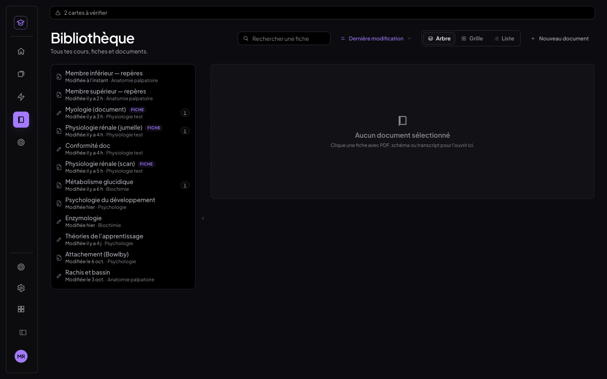 |  |

### Ce que « modifiée » veut dire (`src/medrevise/lib/datesFiches.js`, lecture seule)
Le plus récent `updatedAt` des enregistrements qui appartiennent à la fiche :
surlignages et annotations (y compris ceux de la **fiche jumelle**, espace `<cours>::fiche:<v>`),
texte du document et onglet Notes (`notes_doc`), texte d'un transcript (`docs`), sessions de
transcription, fiche jumelle importée (`companion_pdf`), tableau, dessins reçus du téléphone,
et la **création** de ses cartes (flashcards, QCM, notions créées dedans).

Volontairement exclus :
- la **révision** d'une carte (elle réécrit la carte, mais ne modifie pas le cours) ;
- `fiche.updatedAt` : un glisser-déposer réécrit l'ordre de toutes les fiches voisines, qui
  paraîtraient toutes « modifiées » ;
- la position de lecture (lire n'est pas modifier).
Plancher : la date d'ajout (une fiche jamais touchée est « modifiée » le jour de son ajout).
Limite : supprimer la *dernière* annotation d'une fiche ne la fait pas remonter (une suppression
ne laisse pas d'enregistrement local daté).

**Date d'ajout** : l'instant de création lu dans l'identifiant de la fiche (`genId` = préfixe +
horodatage en base 36) — `dateImport` ne garde que le jour, et deux fiches importées le même
jour doivent être départagées. Repli sur `dateImport` si l'identifiant ne porte pas d'instant.

**En direct** : `lib/storage.js` émet un simple événement `medrevise:ecriture` après chaque
écriture (rien de changé dans ce qui est écrit) ; la Bibliothèque relit le seul store touché.
Annoter une fiche ouverte la fait remonter en tête sans fermer le cours :

| Annoter « Membre inférieur » (11e) … | … elle est en tête, « Modifiée à l'instant » |
|---|---|
|  | 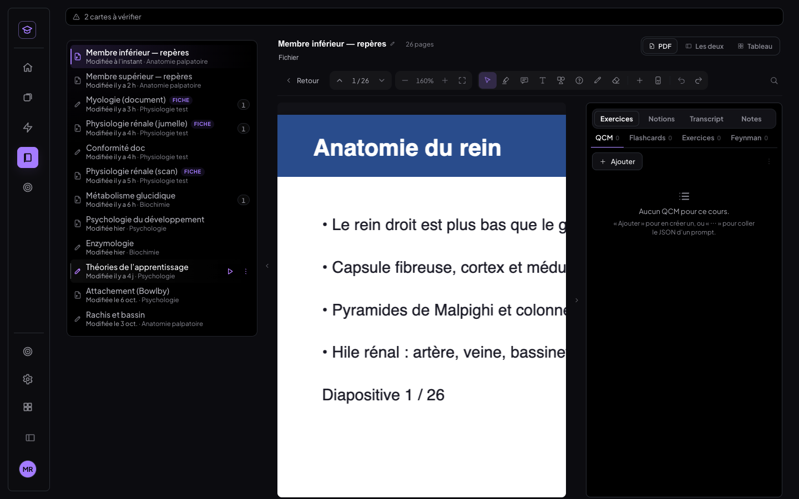 |

### Le reste
- **Importer un PDF en liste plate** : le déposer sur une ligne l'importe dans la matière (et le
  dossier) de cette fiche ; en tri « Date d'ajout », il apparaît en tête.
  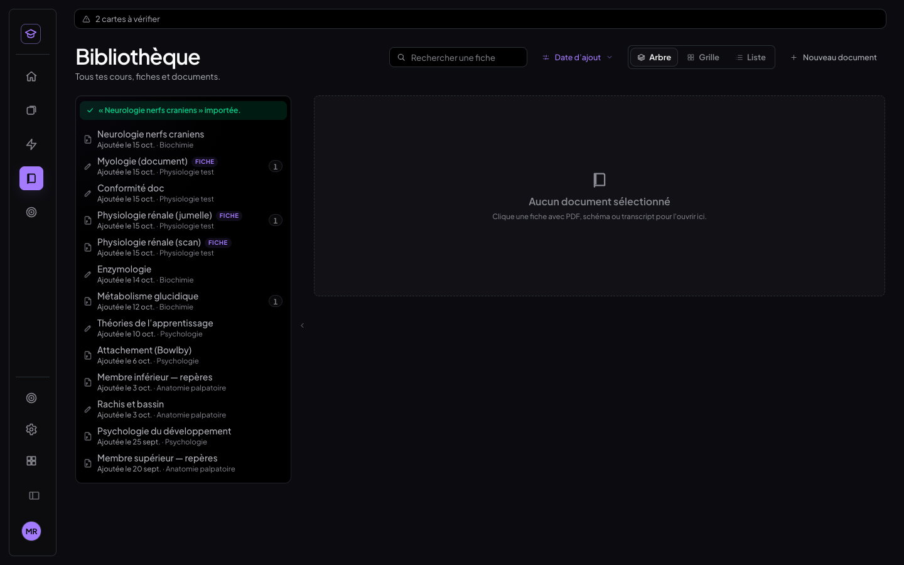
- **Mémorisé par appareil** (`localStorage`, clé `medrevise.biblio.tri`), pas synchronisé.
- **Aucune écriture** : un tri ne fait que lire et trier pour l'affichage. Revenir à l'ordre
  manuel rend exactement l'arborescence et l'ordre d'avant (test : matières, dossiers, `ordre`
  et état de dépliage identiques, arbre affiché identique).
  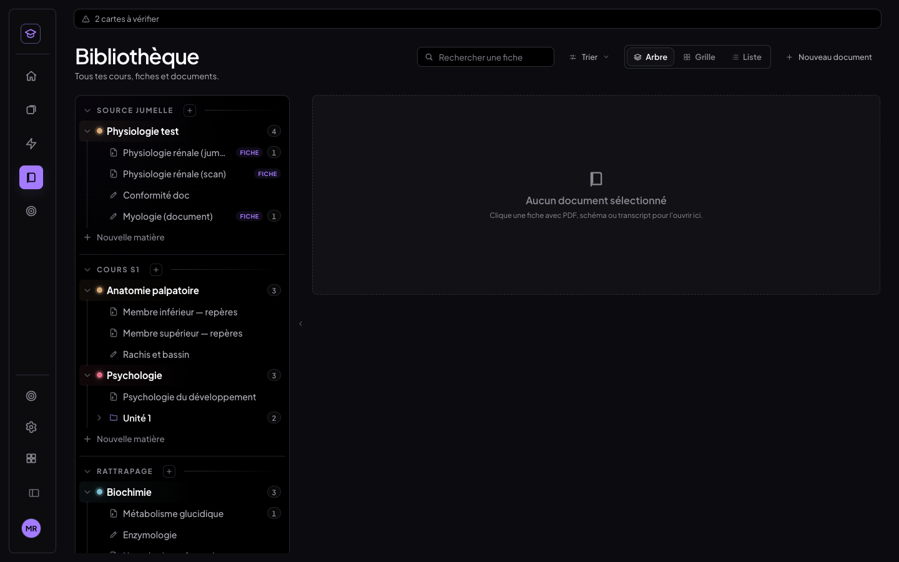
- **Grille et Liste** suivent le tri (même ordre, sans regroupement ; en Liste, la colonne de
  date devient « Modifiée » et le tri par colonne reste celui de l'ordre manuel).

| Grille · date d'ajout | Liste · dernière modification |
|---|---|
| 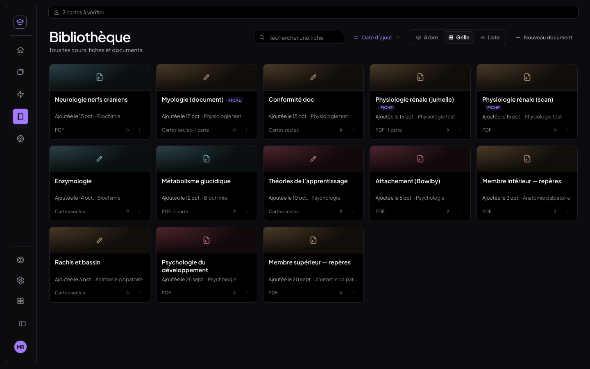 | 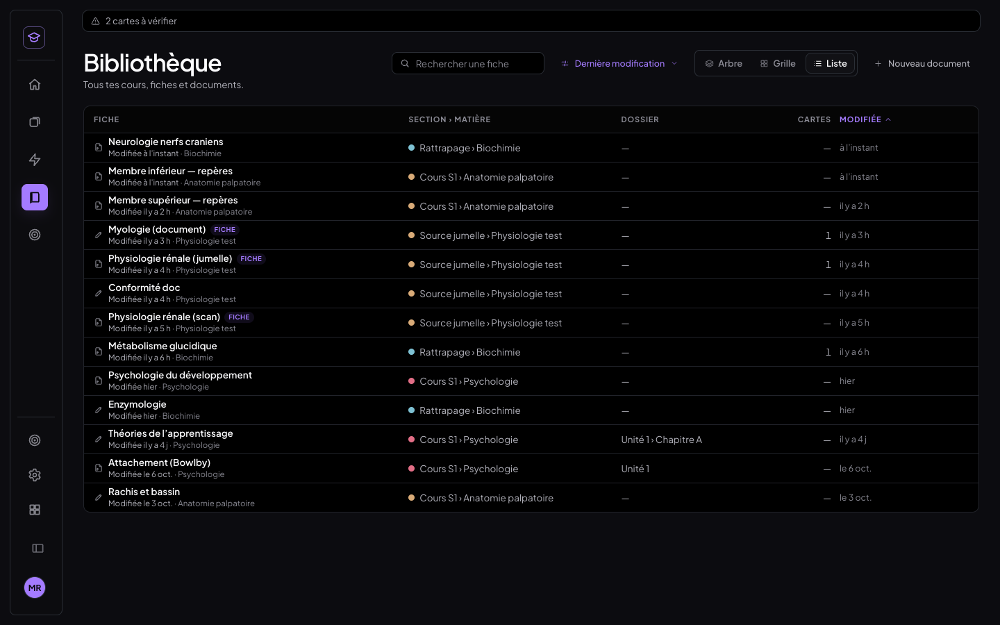 |

- **Recherche** (il n'y en avait pas : ajoutée, puisqu'elle devait être compatible) : titre,
  matière ou dossier, sans accents ni casse, dans les trois tris et les trois affichages. En
  ordre manuel, l'arbre est filtré et les branches utiles sont dépliées **pour l'affichage
  seulement** (le dépliage mémorisé n'est pas réécrit).
  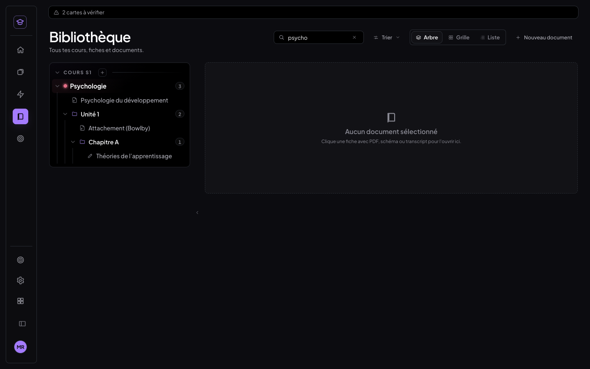
- **Rattrapage** : les fiches suivent le même filtre de section que l'arbre — sections et
  matières archivées exclues, fiches archivées exclues ; la section Rattrapage est incluse
  comme les autres (testé avec une section archivée et une fiche archivée dans le jeu de test).
- **Tablette** : sous 1 280 px, les actions passent sous le titre ; lignes de 48 px au doigt.
  Téléphone : shell mobile (pas de Bibliothèque), inchangé.
  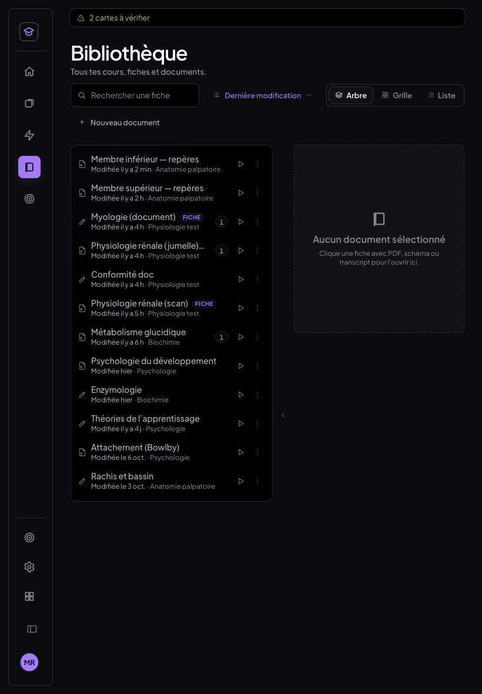

---

## 2. Menu « Fichier » identique partout

Un seul composant, `src/medrevise/pdf/MenuFichier.jsx`, pour **toutes** les pages du lecteur :
cours PDF, document créé dans l'app, fiche jumelle, onglet Notes — et aussi la fiche HTML.
La liste est un tableau fixe (`ENTREES_FICHIER`) : **même ordre, mêmes libellés, mêmes
icônes, mêmes raccourcis** partout, par construction.

1. Renommer — `F2`
2. Importer la fiche jumelle… / Remplacer la fiche jumelle… (selon l'état) — pastille **Pages** (correspondance) quand elle existe
3. Mise en page… (marges et fond de page)
4. Reconnaissance de texte… (état à droite : « terminée · 93 % », « inutile »…)
5. Exporter le PDF annoté — `⌘P` / `Ctrl+P`
6. Exporter — pastilles **.md** et **PNG par page**
7. Export spécial IA… — `⌘⇧E` / `Ctrl+Maj+E`
8. Textes d'annotations (JSON) — pastilles **Exporter** et **Importer**
9. séparateur
10. Supprimer… (rouge, en dernier)

Une entrée qui ne s'applique pas est **grisée, jamais masquée ni déplacée** : au survol, son
infobulle donne la raison (« Non disponible pour un document ») ; touchée au doigt, la raison
s'affiche en bas du menu, qui reste ouvert.

**Avant** — un menu différent sur chaque page (12 à 14 entrées pour un PDF, 10 pour un
document, dans un autre ordre, avec des lignes d'aide de hauteur variable) :

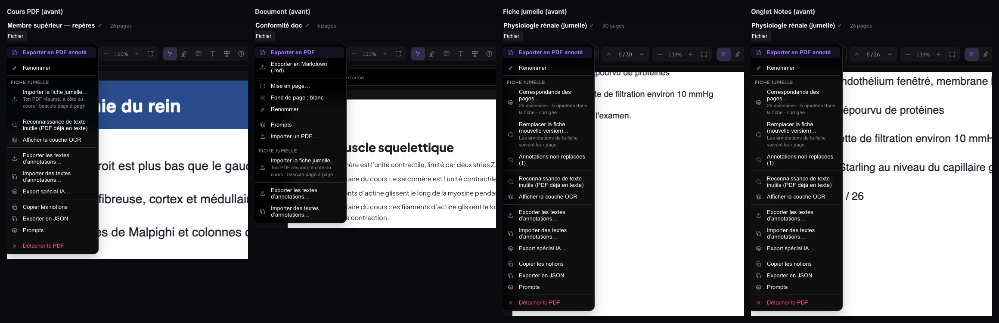

**Après** — le même menu, chaque bouton à la même place :

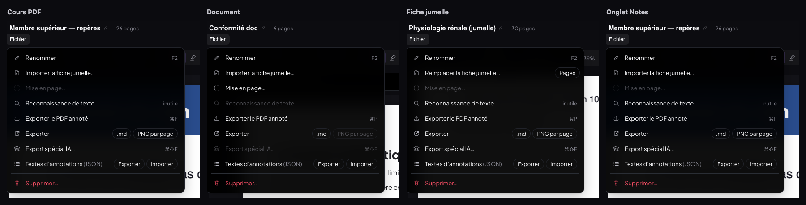

| | Cours PDF | Document | Fiche jumelle | Onglet Notes | Fiche HTML |
|---|---|---|---|---|---|
| Grisées | Mise en page | Reconnaissance de texte, PNG par page, Export spécial IA | Mise en page | Mise en page | tout sauf Renommer et Supprimer |
| Infobulle | « …pour un cours PDF » | « …pour un document » | « …pour la fiche jumelle » | « …pour un cours PDF » | « …pour une fiche HTML » |

**L'onglet Notes** est un onglet du panneau d'un cours : la page garde l'en-tête du cours, donc
exactement le même menu (testé onglet Notes ouvert). Son contenu est inclus dans l'export .md.

### En-têtes
Ordre identique partout : titre, nombre de pages, **Fichier**, puis les modes d'affichage
(à droite), puis thème et profil (menu de l'avatar sur ordinateur ; boutons en tablette). Le
bouton Fichier est au même endroit, même taille, même style sur les cinq pages (mesuré : 141,92
· 54×24 px). Sur la fiche HTML il était en 12,5 px/22 px (hors du conteneur `.pdfr-v2`) :
corrigé. Un cours qui a un PDF **et** une fiche HTML montre une bascule **PDF · HTML** avec
les modes d'affichage.

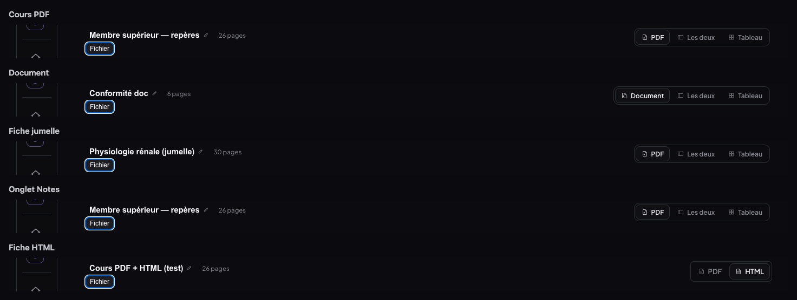

### Où sont passées les entrées qui n'étaient pas dans la liste
Rien n'est supprimé ; chaque action a rejoint sa place naturelle :

| Avant (menu Fichier) | Maintenant |
|---|---|
| Correspondance des pages… | pastille **Pages** de l'entrée 2 |
| Annotations non replacées (n) | bouton « Non replacées (n) » de l'éditeur de correspondance |
| Afficher la couche OCR | fenêtre Reconnaissance de texte (déjà là, avec « Relancer ») |
| Version des textes (IA / originale) | panneau des textes, volet « Affichage » |
| Fond de page : blanc / noir | panneau Mise en page |
| Copier les notions · Exporter en JSON · Prompts | panneau Export spécial IA, « Aussi pour une IA » |
| Prompts (document) | panneau › Exercices › ⋯ « Prompts (théorie et exercices)… » |
| Détacher le PDF | fenêtre « Supprimer… » (Annuler · Détacher le PDF… · Supprimer le cours) |
| Voir la fiche HTML / Voir le PDF | bascule PDF · HTML de l'en-tête |
| Remplacer la sélection | ⋯ de la barre d'outils, seulement quand du texte est sélectionné |
| Importer un PDF… (document) | Bibliothèque › ⋯ de la fiche › « Attacher un document » (même effet) |

| Export spécial IA | Mise en page | Supprimer… |
|---|---|---|
| 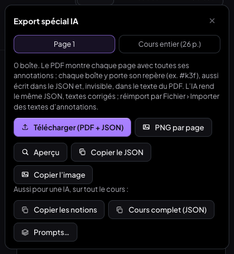 | 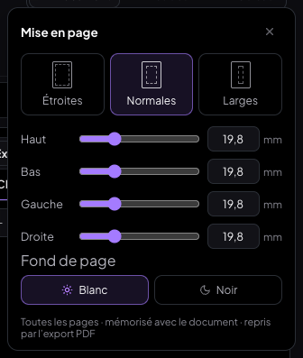 | 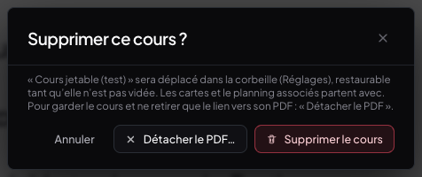 |

Nouveau : **Exporter › PNG par page** (le PDF annoté, une image par page à 2×, dans un .zip)
et **Exporter › .md** sur un cours PDF (texte structuré du cours, passages surlignés, puis
l'onglet Notes). **Supprimer** = la corbeille de la Bibliothèque (restaurable), avec confirmation.

### Raccourcis clavier (identiques sur toutes les pages)
| Raccourci | Action |
|---|---|
| `F2` | Renommer (hors champ de saisie) |
| `⌘P` / `Ctrl+P` | Exporter le PDF annoté (document : son export PDF) — remplace l'impression du navigateur |
| `⌘⇧E` / `Ctrl+Maj+E` | Export spécial IA |
| `↑` `↓` `Début` `Fin` | se déplacer dans le menu ouvert (les entrées grisées restent atteignables, à leur place) |
| `Entrée` | lancer l'entrée |
| `Échap` | fermer le menu (le focus revient au bouton Fichier) |
| `Tab` (hors texte) · `⌘⇧F` | basculer Original ⇄ Fiche (fiche jumelle, inchangé) |

Un raccourci d'une entrée grisée ne fait rien (et `⌘P` n'ouvre pas l'impression à la place).

### Tablette et téléphone
Même menu dans l'en-tête tablette (Retour · titre · **Fichier** · modes · Thème · Changer
d'app · Panneau), entrées de 42 px au doigt ; le menu se recale pour rester dans l'écran
(le bouton y est à droite). Téléphone : shell mobile sans lecteur, inchangé.

| Tablette portrait · document | Tablette paysage · fiche jumelle |
|---|---|
| 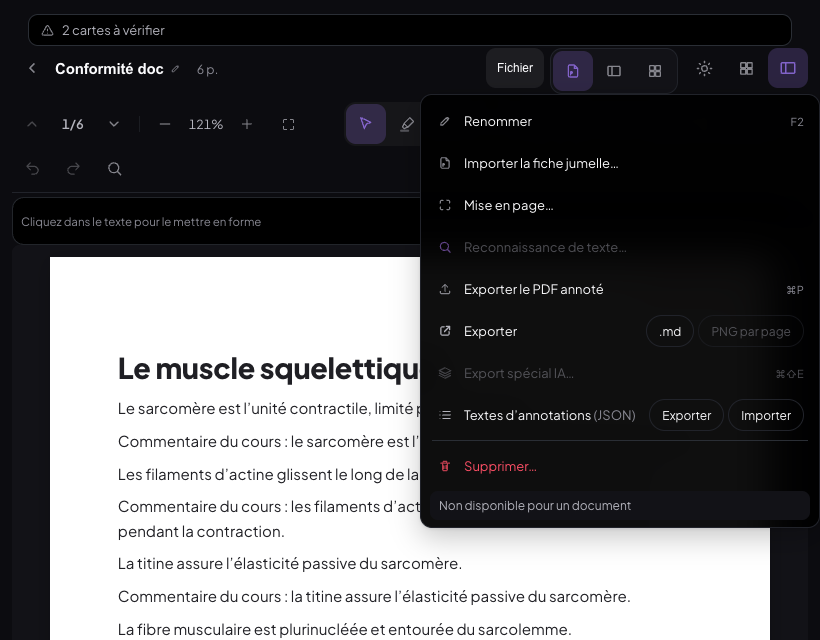 | 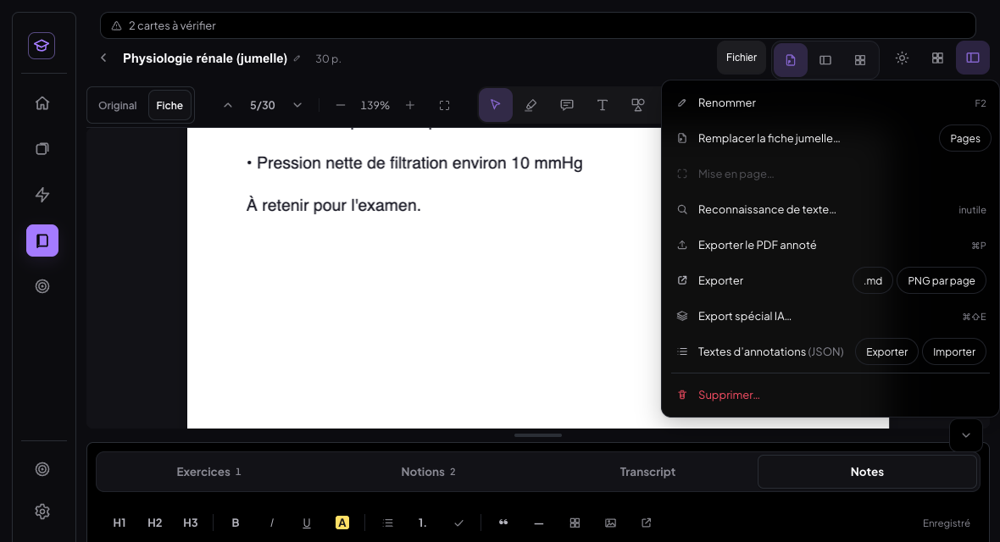 |

---

## 3. Tests (`scripts/tests-bibliotheque-fichier/`, base locale du banc)

Préalable : Vite `:5199` sans Supabase, Chrome headless `9333` ; `node seed-biblio.mjs` et
`node seed-menu.mjs` (jeu de test idempotent : 3 sections dont Rattrapage et une archivée,
dossiers, dates d'ajout et de modification échelonnées).

| Script | Ce qui est vérifié | Résultat |
|---|---|---|
| `t-biblio-tris.mjs <pdf>` | 3 tris, libellés, annoter → en tête (en direct), importer un PDF → en tête, mémorisation après rechargement, grille et liste, recherche (3 tris), sections archivées exclues / Rattrapage inclus, **aucune écriture** (matières, dossiers, `ordre`, dépliage identiques), arbre manuel identique | **29/29** (deux passages, dont `tout.sh` le 16/10) |
| `t-biblio-tablette.mjs` | tablette paysage 1 180 et portrait 820 au doigt (lignes 48 px, menu Trier, pas de débordement), téléphone | **13/13** |
| `t-menu-fichier.mjs` | 5 pages (PDF, document, fiche jumelle, onglet Notes, fiche HTML) : 9 entrées dans l'ordre fixe, grisées et infobulles attendues, chaque entrée à la même position, mêmes libellés/icônes/raccourcis, bouton Fichier même endroit/taille/style, ordre de l'en-tête | **39/39** |
| `t-menu-actions.mjs` | clavier (focus, ↑ ↓, Échap), grisée touchée = raison, F2, ⌘P (PDF, fiche, document), .md, PNG (.zip), ⌘⇧E, extras IA, prompts, textes, sélecteur de fiche jumelle, Pages, Non replacées, Mise en page + fond, Remplacer la sélection, Supprimer (annuler puis corbeille, sur un cours jetable remis ensuite) | **33/33** (deux passages) |
| `t-menu-tablette.mjs` | 3 pages × paysage/portrait au doigt : même menu, 42 px, menu dans l'écran, bouton Fichier même place, raison au doigt ; téléphone | **17/17** (deux passages) |

Rejouer : `./tout.sh <PDF sans espace dans le chemin>` (rejoue les jeux de test avant chaque script) — **131/131** au dernier passage.

**Non-régression** :
- tests du chantier fiche jumelle (`scripts/tests-fiche-jumelle/tout.sh`) : **201/201**, comme avant
  (seule l'aide `menuFichier` des tests a été adaptée au nouveau menu) ; correspondance 30/30
  sur les trois fiches.
- `tests-finitions/t-bureau.mjs` **non rejoué** : il exige le banc à deux appareils (Chrome 9335
  et ses jeux de données) qui n'était pas monté ; ce qu'il touche ici (textes d'annotations,
  export IA) est couvert par `t-menu-actions`.

---

## 4. Vérifications de fin de chantier

- `git diff 55a499f -- src/shared src/mealweek` : **aucun fichier** (rien touché depuis le début du chantier).
- `npm run build` : vert.
- Aucune écriture Supabase : banc sans Supabase ; aucune migration ; `lib/storage.js` n'a reçu
  qu'un événement local après écriture (contenu écrit inchangé).
- Aucune fiche, dossier ou matière modifiés par les tris (test « aucun tri n'a écrit »).

## 5. Commits

- `21305ef` feat : Bibliothèque — tris « Dernière modification » et « Date d'ajout », recherche
- `0145452` feat : menu « Fichier » unique
- (ce compte rendu) docs
