# Compte rendu — boîtes & tableaux (25/10/2026)

Cinq chantiers MedRevise : image dans une boîte, boîte → flashcard, page stable à la sélection sur tablette, choix des
pages à l'export, vrai système de tableau dans les boîtes. Tous livrés, testés dans Chrome (ordinateur 1440 × 900,
iPad émulé 1024 × 1366 tactile, téléphone 390 × 844 tactile), build vert, commités et poussés.

Tests sur une instance locale isolée (Vite :5199 sans Supabase, Chrome headless piloté en CDP, base locale du banc) :
**aucune écriture Supabase**. Banc : `scripts/tests-boites-tableaux/` (`tout.sh` rejoue tout).

## Suivi

| Chantier | État | Commit |
|---|---|---|
| 5. Tableaux dans les boîtes : système complet | livré, testé (ordinateur, iPad, doigt, tableau Miro, document) | f8f3f4c |
| 1. Image dans une boîte | livré, testé (ordinateur, iPad, document) | e0143da |
| 4. Exports : choix des pages | livré, testé (ordinateur, iPad) | dcb5ab4 |
| 2. Boîte → flashcard | livré, testé (ordinateur, iPad, téléphone) | df0904a |
| 3. Tablette : la page ne bouge plus à la sélection | livré, testé (iPad, avant / après) | 0a46ba7 |

Règles respectées : MealWeek et `src/shared/` intacts (aucun fichier modifié, capture de MealWeek **identique au
pixel** avant / après sur builds de production) ; boîtes, tableaux et cartes existants intacts (une grille d'avant
s'affiche exactement comme avant, une carte d'avant aussi) ; **un seul composant boîte / tableau** partagé par le
lecteur PDF, le document créé dans l'app, la fiche jumelle et le tableau Miro (`pdf/BoiteTableau.jsx`,
`pdf/ImageBoite.jsx`) ; DA existante (panneaux `mep-panneau`, mini barre, icônes du lecteur).

## 5. Tableaux dans les boîtes

### Le bug du débordement : cause

Mesure (banc `repro-debordement.mjs`, tableau 10 × 8 au texte long) :

| | Boîte (haut → bas) | Tableau (haut → bas) | Dépassement |
|---|---|---|---|
| Lecteur (zoom 60 %, 100 %, 200 %) | suit le tableau | | 0 px |
| **Tableau Miro, avant** | 258 → 418 | 269 → 1 550 | **1 132 px** |
| Tableau Miro, après | 258 → 1 561 | 269 → 1 550 | 0 px |

**Cause** : une carte du tableau Miro gardait sa **hauteur enregistrée** (`height: o.h`) et son contenu-tableau était en
`overflow: visible` ; chaque ligne ajoutée (ou un texte qui passe sur deux lignes) sortait de la carte. Dans le
lecteur, la hauteur enregistrée d'une boîte-tableau restait aussi un **minimum** : une boîte agrandie à la main
restait plus haute que son tableau.

**Règle désormais** : la hauteur d'une boîte-tableau (lecteur, document, fiche jumelle) et d'une carte-tableau (Miro)
**est** celle de son tableau ; dans le Miro, la hauteur mesurée est reportée dans la carte (cadre, flèches,
aimantation) sans entrée d'Annuler. Les filets, y compris les bordures extérieures et épaisses, sont dessinés dans la
boîte : dépassement mesuré ≤ 0 px dans tous les tests (bordures 3 px, fusions, collage, lignes ajoutées).

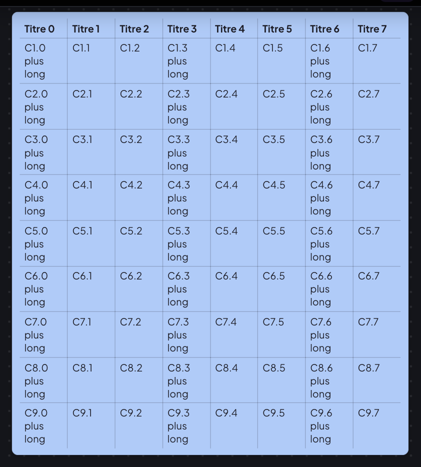

### Le système

Modèle pur `pdf/grille.js` (tests vitest `tests/grille`), composant `pdf/BoiteTableau.jsx`. Une grille d'avant
(`v: 1`) s'affiche exactement comme avant ; les nouveaux champs sont facultatifs : `formats` (fond, couleur, gras,
italique, taille en px, alignements), `fusions`, `bordures` (mode, couleur, épaisseur), `hauts` (hauteur des lignes),
`alterne`.

- **Sélection** : clic = la cellule (curseur dedans, même dans son remplissage) ; glisser ou Maj+clic = une plage ;
  clic dans la marge du haut / de gauche = la colonne / la ligne ; le coin = tout le tableau. Au doigt, le coin est
  remplacé par « Tout » du menu (il gênait la poignée de taille de la boîte), et les filets horizontaux n'apparaissent
  que sous les lignes sélectionnées (sinon, sur un petit tableau, le doigt qui vise une cellule attrapait un filet).
- **Menu Tableau** : un bouton « Tableau » de la mini barre (il remplace les cinq boutons + ligne, + colonne,
  − ligne, − colonne, en-tête), qui ouvre un panneau regroupé :
  Sélection · Lignes et colonnes (insérer au-dessus / en dessous / à gauche / à droite, supprimer, répartir) ·
  Cellules (fusionner, scinder, fond, couleur et style du texte, taille en px, alignement horizontal et vertical) ·
  Bordures (toutes / intérieures / extérieures / aucune, couleur, épaisseur) · Style (en-tête, alternées, aucun).
  Le panneau reste dans la zone visible (au-dessus du bouton s'il manque la place, défilant s'il ne tient nulle part).
- **Filets** : glisser un filet vertical = largeur de colonne, un filet horizontal = hauteur de ligne.
- **Clavier** : Tab / Maj+Tab (Tab dans la dernière cellule ajoute une ligne), flèches aux bords du texte (Maj+flèche
  étend la plage), Entrée = retour à la ligne, Suppr sur une plage = la vider, ⌘C sur une plage = TSV + HTML.
- **Coller depuis Excel, Sheets, Word, Numbers** : TSV (guillemets d'Excel compris) ou tableau HTML (fusions dépliées) ;
  le tableau grandit si besoin.
- **Annuler** : chaque opération est une entrée ; ⌘Z dans une cellule où rien n'est en cours de frappe va au journal
  (lecteur) ou à la pile du tableau Miro.
- **Export PDF** fidèle : couleurs, fusions, bordures, gras / italique, tailles, alignements ; la boîte a la hauteur de
  son tableau (écart de hauteur écran / PDF : 0,011 de la page).

| Menu Tableau | Tableau mis en forme |
|---|---|
| 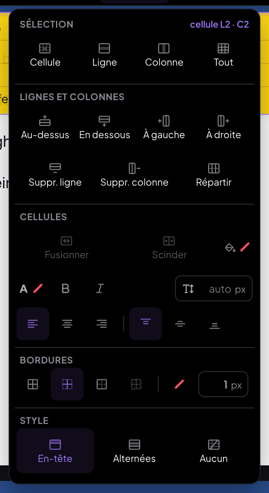 | 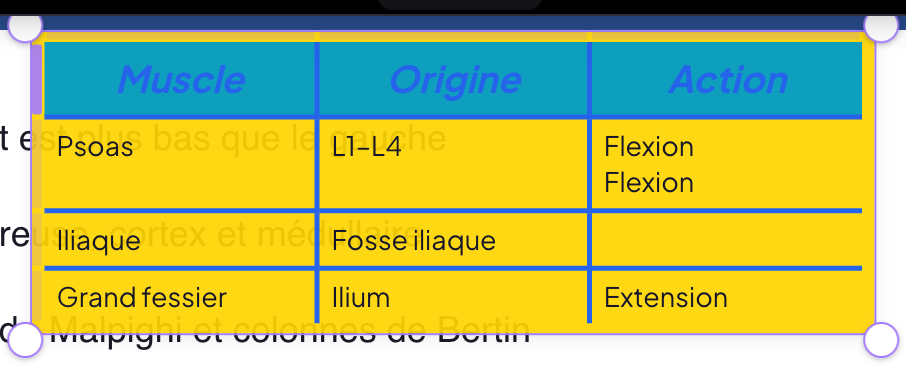 |

| Écran | Export PDF |
|---|---|
| 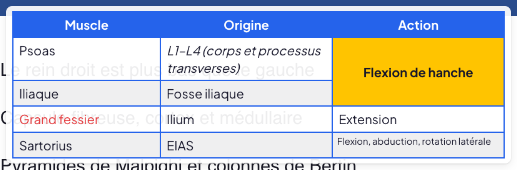 | 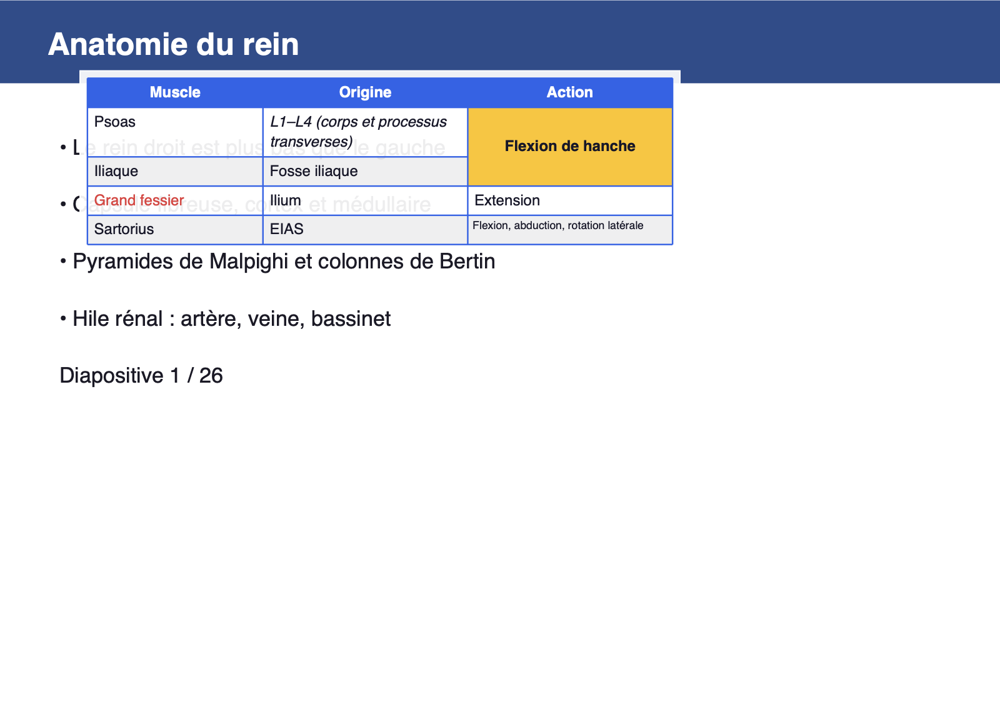 |

Fluidité sur un 10 × 8 au doigt (iPad émulé) : plage, filets et frappe sans aucune tâche longue (> 50 ms) ;
insérer une ligne affiché en ~18 ms, bordures en ~12 ms.

## 1. Image dans une boîte

Champ `image` de la boîte : `{ blobId, ratio, position: 'dessus' | 'dessous', nom }` ; composant `pdf/ImageBoite.jsx`.

- Poser : **⌘V** quand la boîte est sélectionnée ou en édition (l'image va dans la boîte, pas sur la page), **glisser-
  déposer** un fichier sur la boîte, ou **« Image »** dans la mini barre (choix d'un fichier).
- L'image occupe **toute la largeur intérieure** (marges de la boîte respectées), hauteur proportionnelle ; elle se
  réajuste quand on redimensionne la boîte ; la boîte prend une largeur fixe d'au moins 28 % de la page.
- Avec une image, le bouton « Image » ouvre : **Au-dessus du texte · En dessous du texte · Remplacer… · Retirer**.
- **OCR** comme les autres images (même moteur, même cache) : mots posés sur l'image, surlignables au Surligneur ;
  retirer l'image retire aussi ses surlignages (annulable).
- Export PDF : l'image est dessinée à sa place ; « → Tableau » la reporte sur la carte du tableau.

| Au-dessus du texte | En dessous du texte |
|---|---|
| 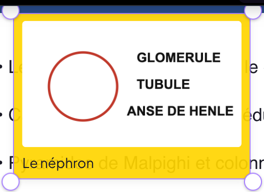 | 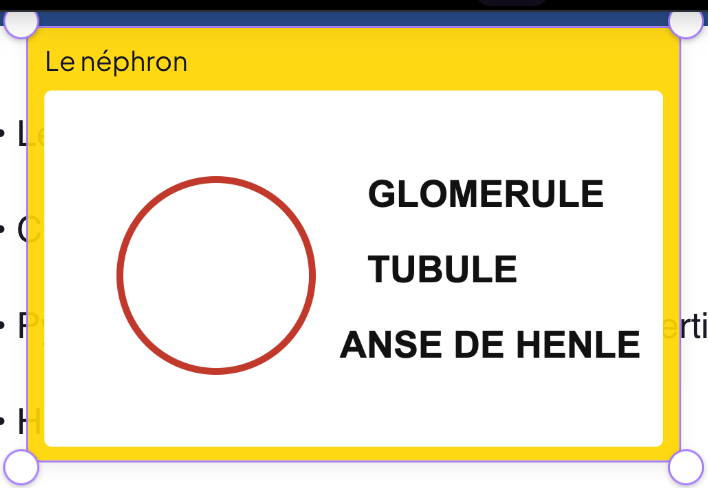 |

## 2. Boîte → flashcard

« → Flashcard » (mini barre de la boîte) ouvre un **aperçu modifiable** (`pdf/BoiteFlashcard.jsx`) : recto, verso
(et son rendu), image, thème (la catégorie de la carte, celui des cartes de la fiche par défaut), **date de départ**
(aujourd'hui par défaut, comme à l'import). La carte est rattachée au cours affiché.

**Règle de découpage** (`lib/boiteVersCarte.js`, tests vitest `tests/boite-carte`) :

1. le **recto** est le **premier passage en gras** s'il ouvre la boîte (« **Clairance** : volume… » → « Clairance »),
   sinon la **première ligne** de la boîte ;
2. le **verso** est **tout le reste**, dans l'ordre : la fin de la première ligne (sans le « : » / « — » qui suivait le
   gras), puis les lignes suivantes — explication, « Ex : », « Déf : », listes ;
3. la **mise en forme est conservée** en balisage léger : **gras** `**…**`, *italique* `*…*`, puces `- `, listes
   numérotées `1. `, une ligne par ligne ; la carte porte `versoFormat: 'leger'` et s'affiche mise en forme partout
   (panneau, séance, téléphone). Les cartes d'avant s'affichent exactement comme avant ;
4. l'**image** de la boîte devient l'image de la carte (au recto si elle était au-dessus du texte, au verso sinon,
   modifiable dans l'aperçu) ;
5. une **boîte-tableau** devient une carte **Tableau** : `tableau` (colonnes = ligne d'en-tête, limites du type) pour
   tout ce qui connaît déjà ce type, et `grille` (le tableau complet) révisé **tel quel** — couleurs, fusions,
   bordures ; l'en-tête reste visible, chaque autre cellule se révèle au toucher.

Un recto et un verso sont obligatoires (règle des cartes) : si la boîte n'a qu'une ligne, l'aperçu le dit et attend
la réponse. **Lien retour** : la carte garde `source: { boiteId, ns, page }` ; dans le panneau, l'icône de la carte
ramène à la page (fiche jumelle comprise) et sélectionne la boîte, qui clignote. **Conversion déjà faite** : le
bouton est marqué et ouvre la carte existante (aucun doublon).

| Aperçu | Carte Tableau (panneau) | Téléphone |
|---|---|---|
| 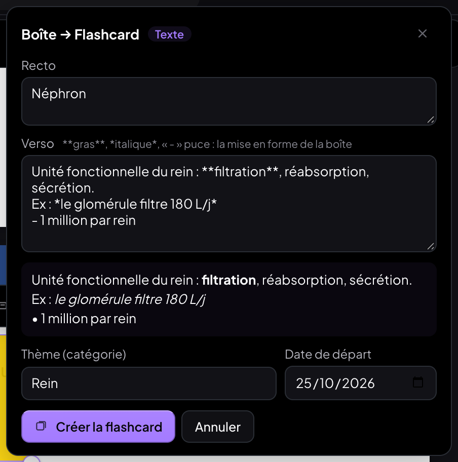 | 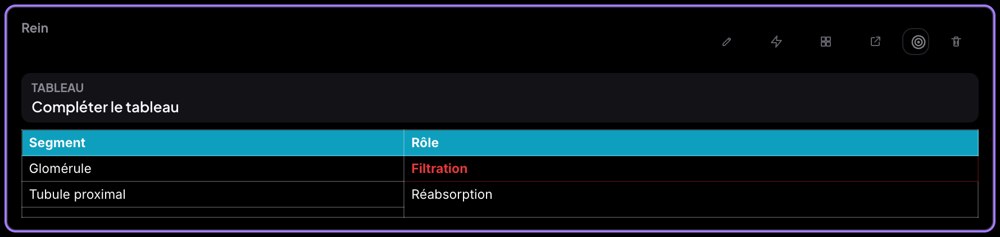 | 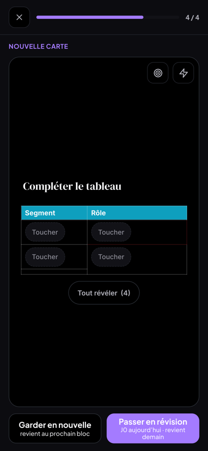 |

## 3. Tablette : la page ne bouge plus à la sélection

**Diagnostic** (sonde `sonde-tablette.mjs` : position de tout ce qui est au-dessus du lecteur, défilement du lecteur et
de la fenêtre, visualViewport, éléments ajoutés au DOM pendant une sélection) :

- **Cause principale** : le bouton « ⋯ Actions sur le document » de la barre **n'existait que lorsqu'un texte était
  sélectionné** (sa seule action est alors « Remplacer le texte sélectionné »). À chaque sélection il **entrait dans la
  barre** : la zone de droite passait de 122 à 163 px, et **tous les outils du haut se décalaient de 20 px** (et
  revenaient à la désélection). Sur iPad, où l'on sélectionne mot après mot, la barre tremblait en permanence.
- **Causes secondaires possibles sur iPad** : Safari fait défiler le lecteur ou la fenêtre pour « montrer » une
  sélection ou ses poignées ; l'ancrage de défilement du navigateur peut recaler la vue quand le DOM change.
  (Le clavier virtuel ne fait pas bouger la page : le lecteur suit la hauteur visible et ne fait défiler que si le
  curseur est caché — vérifié.) Le bouton « → carte » du tableau est déjà en superposition (fixe).

**Correctifs** :

- le bouton « ⋯ » est **toujours là**, grisé quand il n'y a pas d'action : plus aucune barre ni aucun bouton
  n'entre dans le flux pendant une sélection (barre ordinateur et barre tablette) ;
- pendant une sélection, un défilement du lecteur que l'utilisateur n'a pas demandé (ni doigt, ni molette, ni
  glisser, ni clavier depuis 450 ms) est **annulé au pixel près** — sauf si le bout de la sélection touche le bord de
  la zone visible (étirer la sélection doit pouvoir faire défiler) ; la **fenêtre** ne défile plus ;
- plus d'ancrage de défilement (`overflow-anchor: none`) dans le lecteur.

Banc `t-tablette-selection.mjs` (iPad émulé) : 20 mots sélectionnés sur la diapo, 20 dans une boîte affichée, 20 dans
une boîte en édition — après chaque mot, comparaison au pixel de tout le haut, de la page, des défilements et du
visualViewport.

| | Avant (code du 24/10) | Après |
|---|---|---|
| Diapo, 20 mots | ❌ la barre bouge (4 positions différentes), un bouton entre dans le flux | ✅ rien ne bouge |
| Boîte affichée / en édition, 20 mots | ✅ | ✅ |
| Défilement non demandé pendant une sélection | ❌ 60 → 200 px | ✅ annulé (60 → 60) |
| Vrai glisser du doigt | ✅ défile | ✅ défile |
| Clavier virtuel (hauteur visible 1 366 → 1 000) | ✅ | ✅ |

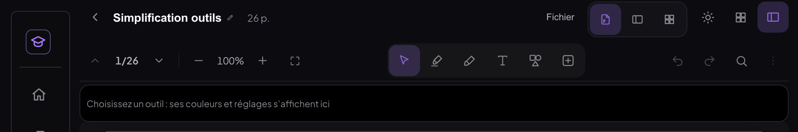

## 4. Exports : choix des pages

Un composant (`pdf/ChoixPages.jsx`, modèle `pdf/choixPages.js`, tests vitest `tests/export-pages`) pour **tous** les
exports : PDF annoté (diapo et **fiche jumelle**), **document** (impression), **PNG par page**, **.md** (PDF et document),
**export spécial IA**. **Toutes · Page courante · Plage (de X à Y) · Pages précises** (« 1-3, 7, 10-12 »), validation
en direct (page inexistante, plage à l'envers, saisie invalide : Exporter grisé), aperçu du nombre de pages
(« 4 pages : 2-4, 7 »), dernier choix **mémorisé par cours**. Le nom du fichier dit les pages (`…-annote-p2-4_7.pdf`).
Les pages suivent la numérotation du lecteur (pages ajoutées comprises).

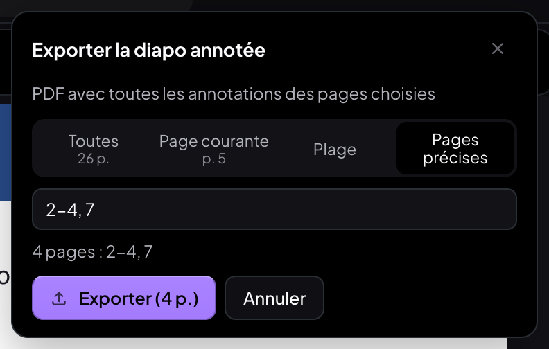

| Export | « 2-4, 7 » | Page courante | Toutes |
|---|---|---|---|
| PDF annoté (diapo) | 4 pages (diapos 2, 3, 4, 7 vérifiées au texte) | 1 | 26 |
| PDF annoté (fiche jumelle) | 4 | 1 | 30 |
| PNG par page (.zip) | 4 PNG | 1 | 26 |
| .md (PDF) | texte des diapos 2, 3, 4, 7 seulement | 1 | 26 |
| Export spécial IA | PDF + JSON des pages 2-4, 7 (4 boîtes) | « Copier l'image » | 5 boîtes |
| Document (impression) | 4 pages | 1 | 10 |
| .md (document) | exactement les paragraphes des pages 2, 3, 4, 7 | — | — |

## Tests

Suite du chantier (`scripts/tests-boites-tableaux/tout.sh`) : **18 journaux, 285 vérifications, 0 échec, 0 erreur JS**.

| Banc | Ordinateur | iPad | Téléphone |
|---|---|---|---|
| `t-tableau` (sélection, chaque action du menu, fusion / scission, couleurs, bordures, style, filets, ⌘Z / ⌘⇧Z, Tab, flèches, Entrée, collage TSV et HTML) | 44/44 | 44/44 | — |
| `t-tableau-miro` (bug du débordement, menu, fusion, fond, bordures, ⌘Z, Tab, collage) | 13/13 | 13/13 | — |
| `t-tableau-doigt` (au doigt, 10 × 8 : cellule, plage, marges, filets, menu, chronos, tâches longues) | — | 13/13 | — |
| `t-export-tableau` (export PDF fidèle, comparé à l'écran) | 4/4 | — | — |
| `t-image` (⌘V réel, bouton, glisser-déposer, redimension, dessus / dessous, remplacer, retirer, ⌘Z, OCR + surligneur, export) | 16/16 | 16/16 | — |
| `t-document` (image et menu Tableau dans un document créé dans l'app) | 5/5 | 5/5 | — |
| `t-flashcard` (titre + explication + « Ex : », gras, image, boîte-tableau, aperçu, lien retour, conversion déjà faite) | 16/16 | 16/16 | — |
| `t-mobile` (séance Nouvelles : verso mis en forme, image, carte Tableau) | — | — | 6/6 |
| `t-exports` (PDF, PNG, .md, export IA : « 2-4, 7 », page courante, toutes, plage ; validation ; mémoire) | 21/21 | 21/21 | — |
| `t-exports-doc` (fiche jumelle, document : impression et .md) | 10/10 | 10/10 | — |
| `t-tablette-selection` (20 mots × 3, défilement parasite, doigt, clavier virtuel ; avant / après) | — | 12/12 | — |

Vitest : 111 réussis dont 14 nouveaux (`tests/grille`, `tests/export-pages`, `tests/boite-carte`) ; 1 échec
préexistant (`tests/crayon`, voir limites). `npm run build` : vert ; aucun import manquant.

## Non-régression

- **MealWeek** : aucun fichier modifié ; s'ouvre sans erreur ; capture **identique au pixel** avant (0497999) /
  après (builds de production servis sur la même origine, chaque version stable d'une capture à l'autre).
- **`src/shared/`, `src/App.jsx`, `src/Selecteur.jsx`** : aucun changement (`git diff 0497999 HEAD`).
- Suite du chantier précédent (`scripts/tests-simplification-outils/tout.sh`, ordinateur + tablette) : barre, surligneur,
  mini barres, boîte-tableau, tableau Miro, document, texte, mobile, surlignage OCR — tout vert. Trois bancs ont été mis à
  jour pour les nouveautés voulues : la mini barre d'une boîte compte « Image » et « → Flashcard », les boutons « + ligne »
  etc. sont dans le menu Tableau, les exports passent par la fenêtre de choix des pages (aussi
  `tests-bibliotheque-fichier/t-menu-actions`, `tests-fichier-carnet-calendrier/t-menu-sections`).
- Boîtes, tableaux et cartes existants : une grille d'avant s'affiche comme avant (même DOM, mêmes filets), une boîte
  sans image garde exactement son DOM, une carte sans `versoFormat` s'affiche comme avant.
- Aucun fichier écrit dans ~/Downloads par les bancs (téléchargements interceptés dans la page).

## Limites et doutes

- Pas d'iPad réel dans cet environnement : tablette = Chrome en émulation iPad tactile. Les mécanismes propres à
  Safari (défilement pour montrer une sélection, poignées natives) sont simulés (défilement non demandé pendant une
  sélection) ; la cause mesurée (bouton qui entrait dans la barre) est indépendante du navigateur.
- Sur téléphone (< 760 px), MedRevise n'a ni lecteur ni tableau Miro (inchangé) : les boîtes ne s'y éditent pas ; le
  téléphone est testé sur les cartes issues des boîtes (séance : verso mis en forme, image, tableau en couleurs).
- Les bordures d'un tableau s'appliquent au tableau entier (pas à une sélection de cellules), comme la plupart des
  styles de tableau rapides.
- `tests/crayon/crayon.test.js` (vitest) échouait déjà avant ce chantier (`EPAISSEURS_CRAYON.dessin`) : hors périmètre,
  non modifié.

## Commits

- `0a46ba7` fix(medrevise): tablette — la page ne bouge plus à la sélection : le bouton « ⋯ » de la barre est toujours là (il entrait dans la barre à chaque sélection et décalait tous les outils), défilement parasite annulé et fenêtre figée pendant une sélection, plus d'ancrage de défilement
- `df0904a` feat(medrevise): boîte → flashcard — « → Flashcard » dans la mini barre, découpage automatique (1re ligne ou 1er passage en gras = recto, le reste = verso mis en forme), image de la boîte, boîte-tableau = carte Tableau (couleurs, fusions, bordures), aperçu modifiable avec thème et date de départ, lien retour vers la page et la boîte, conversion déjà faite = ouvrir la carte
- `dcb5ab4` feat(medrevise): exports — choix des pages (Toutes · Page courante · Plage · Pages précises « 1-3, 7, 10-12 ») avec validation et aperçu, même composant pour le PDF annoté, la fiche jumelle, le document, les PNG, le .md et l'export spécial IA ; dernier choix mémorisé par cours
- `e0143da` feat(medrevise): image dans une boîte — ⌘V (boîte sélectionnée ou en édition), glisser-déposer, bouton « Image » de la mini barre ; largeur intérieure, proportions, au-dessus / en dessous, remplacer / retirer, OCR et surligneur, export PDF
- `f8f3f4c` feat(medrevise): tableaux dans les boîtes — système complet (sélection cellule / plage / ligne / colonne / tout, menu Tableau regroupé, fusion, couleurs, bordures, style, filets, clavier, collage tableur) ; la boîte suit son tableau (carte Miro : débordement corrigé) ; export PDF fidèle
- (ce compte rendu et les bancs mis à jour : commit suivant)
