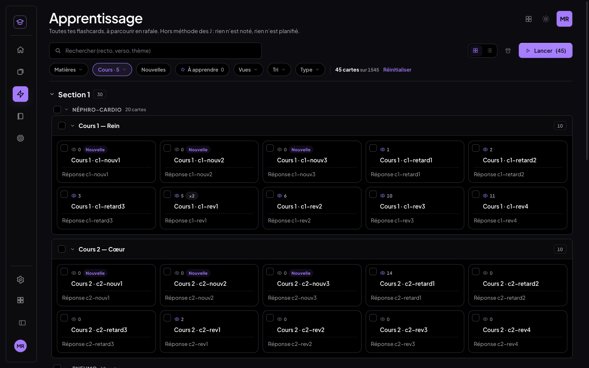
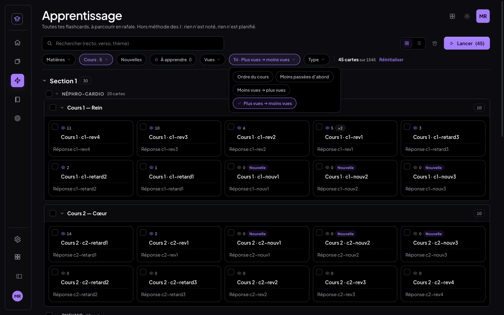
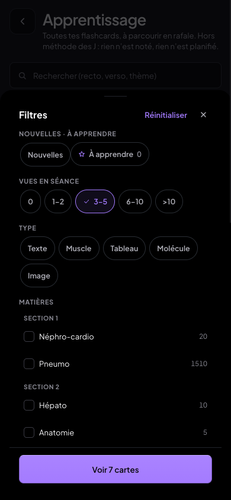
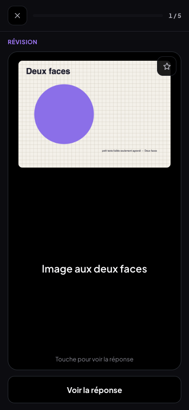
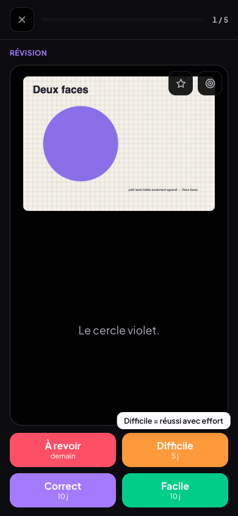
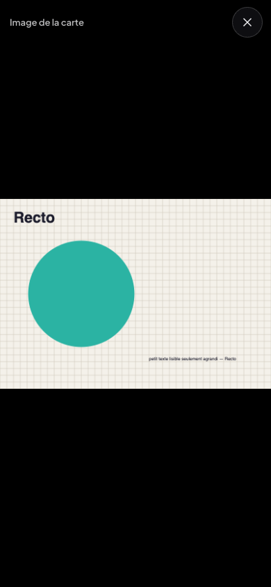
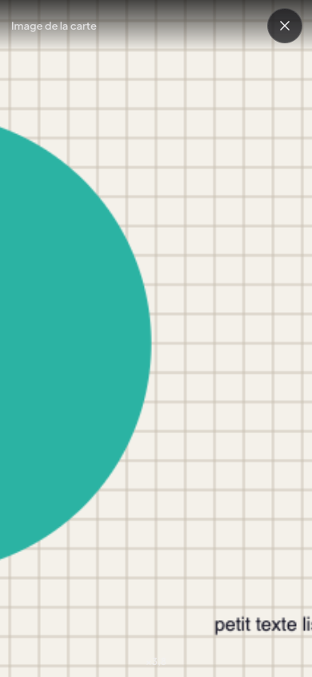
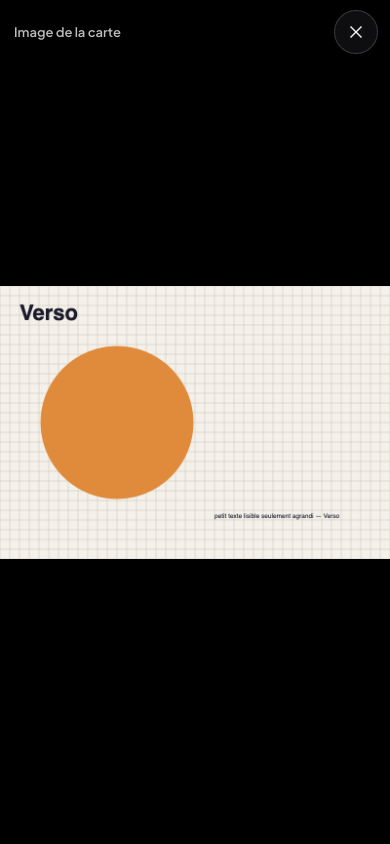
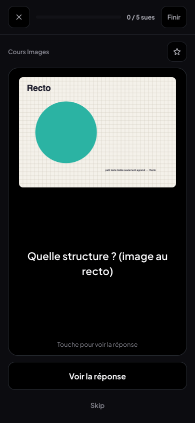

# Compteur de vues par carte et agrandissement des images en révision — compte rendu (07/11/2026)

Deux ajouts à MedRevise, rien d'autre :

1. un **compteur de vues** sur chaque carte du panneau **Apprendre** (œil + nombre), avec deux tris et un filtre par tranches ;
2. l'**agrandissement plein écran** des images d'une flashcard pendant les révisions, sans retourner la carte.

MealWeek et `src/shared/` n'ont pas été touchés. Rien n'a été écrit dans Supabase. Aucun champ n'a été ajouté au stockage.

---

## 1. Diagnostic du journal (avant de coder)

Source : la copie quotidienne de la production, `medrevise-backups` commit `d5ddbe0` (07/11, 16:14 UTC). Elle contient la copie serveur de la table `medrevise_review_log` (`data/review_log.jsonl`) et les cartes (`data/records.jsonl`). Lecture seule, dans un dossier temporaire hors du dépôt (le dépôt est public).

| Question | Réponse |
|---|---|
| Plus ancienne entrée du journal | **10/10/2026 à 19:12 UTC** (insérée côté serveur 3 s plus tard). C'est le jour de la mise en place de l'étape 2 FSRS. La plus récente : 04/11/2026 21:03. |
| Nombre d'entrées | **1 050** notations : 272 « À revoir », 163 « Difficile », 278 « Correct », 337 « Facile ». Dont 25 répétitions de séance (relearn). 1 048 viennent du téléphone, 2 de l'ordinateur. |
| Complet en local ou seulement côté Supabase ? | **Complet en local sur chaque appareil synchronisé.** Au premier passage, `journal/synchro.js` reçoit *toute* la table (curseur à 1970), puis seulement la suite. Chaque appareil a donc les 1 050 notations dans son IndexedDB (`medrevise-review_log`), en plus de ses propres entrées pas encore envoyées. Exception sans effet sur le compteur : les événements « Passer en révision » (`rating` null) restent dans la file locale tant que la migration `20261024_review_log_evenements.sql` n'est pas appliquée. Ils ne comptent pas comme vues. |
| Cartes concernées | 1 053 flashcards. 281 ont au moins une vue. Tranches : 0 → 772 · 1–2 → 117 · 3–5 → 137 · 6–10 → 22 · >10 → 5. Maximum : 19 vues. 92 entrées portent sur 25 cartes supprimées depuis : elles ne s'affichent nulle part. |

### Comparaison avec `reps` (état FSRS des cartes)

On compare `fsrs.reps` au nombre de vues du journal, sur les 319 cartes qui ont un bloc FSRS (734 n'en ont pas encore : jamais notées depuis la mise en place de l'ombre FSRS).

| `reps` − vues | Cartes | Explication |
|---|---|---|
| 0 | 197 | Concordance. |
| −1 (et une à −2, une à −4) | 20 | **Répétitions de séance** (relearn). Ce sont des notations aux 4 boutons, donc des vues, mais elles ne changent pas l'état FSRS. Sans les relearn, il ne reste qu'un seul écart de −1, sur une carte « Nouvelle » repassée en révision. |
| +2 / +3 (une à +1) | 102 | **Révisions antérieures au journal.** À la première notation après le 10/10, le bloc FSRS a été *initialisé à partir de l'historique maison* (`state_before.fsrs` vide dans 268 premières entrées). `reps` compte donc des révisions faites avant le 10/10, que le journal n'a jamais vues. |

**Conclusion** : comme demandé, la source de vérité du compteur est le journal. Il compte les notations **depuis le 10/10/2026**. Pour une carte révisée avant cette date, le nombre affiché est plus petit que le nombre réel de révisions. L'historique maison (`historique`) en garde une trace, mais il ne fait pas la différence entre la séance et les anciens modes. Il n'est donc pas utilisé, conformément à la définition décidée.

---

## 2. Compteur de vues (panneau Apprendre)

**Définition (décidée, appliquée telle quelle)** : une vue = une entrée du journal dont `rating` vaut 1, 2, 3 ou 4. C'est une notation en séance avec À revoir / Difficile / Correct / Facile.
- Les répétitions de séance comptent : ce sont des notations aux 4 boutons.
- Ne comptent pas : « Passer en révision » (`rating` null), « Garder en nouvelle » (rien n'est journalisé), le mode Apprentissage (il n'écrit jamais le journal), les aperçus.

**Un seul calcul** : `src/medrevise/lib/vuesCartes.js`.
- Une passe sur le journal local, lancée en tâche de fond 1,2 s après l'ouverture de MedRevise.
- Ensuite, mise à jour **incrémentale**. `journal/journal.js` transmet désormais à ses abonnés les entrées nouvelles (notation locale ou entrées reçues du cloud). Un même id n'est compté qu'une fois.
- Hook `useVues()` (store externe React) : le panneau se met à jour à chaque notation, sans rechargement.
- Lecture seule : aucune carte, aucune date, aucun état FSRS, aucune séance n'est écrit.

**Affichage** (`components/BadgeVues.jsx`) : sur chaque vignette, un œil + le nombre (0 pour une carte jamais révisée), avec l'infobulle « Révisée 12 fois en séance ».
- Sans fond ni bord, ce qui le distingue de la pastille « ×N » du mode Apprentissage.
- L'œil est dessiné en CSS (masque SVG) plutôt qu'en SVG dans la page. Avec 150 SVG, l'ouverture du panneau prenait environ +12 ms ; le masque supprime ce surcoût (voir § 4).
- Pendant la toute première lecture du journal, rien n'est affiché : pas de « 0 » trompeur.

**Tri** : la puce « Moins passées d'abord » devient un menu **Tri**, sans rien retirer :
- Ordre du cours ;
- Moins passées d'abord ;
- **Moins vues → plus vues** ;
- **Plus vues → moins vues**.

Le tri est stable et se fait dans chaque cours, comme le tri existant (le rangement Section → Matière → Cours reste en place). « Lancer » suit le même ordre. Sur téléphone, les quatre choix sont des puces dans la feuille Filtres.

**Filtre** : puce **Vues** avec les tranches **0 · 1–2 · 3–5 · 6–10 · >10**.
- Sélection multiple, combinable avec cours, matières, Nouvelles, À apprendre, type et recherche.
- Mêmes puces que les autres filtres, pas de cases natives.
- Mémorisé avec les autres filtres et compté dans « Réinitialiser ».

## 3. Agrandir une image pendant les révisions

**Avant**, sur téléphone, en séance : toucher l'image d'une carte la **retournait** (le verso et les boutons de note apparaissaient). Impossible d'agrandir.

| Avant : la carte au recto | Avant : après un toucher sur l'image, la carte s'est retournée |
|---|---|
|  |  |

**Après** : toucher (ou cliquer) une image, au recto comme au verso, ouvre la **visionneuse plein écran**. L'événement est arrêté avant d'atteindre la carte : elle ne se retourne pas et rien n'est noté. Toucher ailleurs sur la carte la retourne comme avant.

| Visionneuse (recto) | Zoom au pincement | Verso | Mode Apprentissage |
|---|---|---|---|
|  |  |  |  |

**Un seul visualiseur** : `components/Visionneuse.jsx`, avec le hook `useAgrandir`.
- Fond noir, image centrée.
- Zoom au **pincement**, au **double-tap** ou double-clic (×2,5), à la molette et aux touches + / − / 0, borné à **×5**.
- **Déplacement** au doigt ou à la souris quand on est zoomé.
- Fermeture par la **croix** en haut à droite, un **glissé vers le bas**, **Échap** ou un **tap sur le fond**.
- Ouverture et fermeture en 120 ms, sans rebond.
- En fermant, on retrouve la même carte, sur la même face, dans le même état. Le focus clavier revient où il était.

Il est utilisé par :
- **les images des flashcards** (`ImageFlashcard`, recto / verso / les deux) ;
- **les images à masques** (`OcclusionView`). L'image est montrée **dans l'état affiché** : masques opaques « ? » au recto, réponses au verso. Rien n'est révélé et la carte ne change pas d'état ;
- **les images Muscle** : l'ancienne visionneuse de `ImagesMuscle.jsx` passe par le même composant. Elle garde ses outils propres (« Texte », « Copier le texte », « Révéler » des mots masqués). En mode « Texte », les gestes de zoom sont coupés pour laisser sélectionner le texte.

Les cartes **Tableau** n'ont pas d'image : rien à faire.

**Tous les écrans de révision** utilisent ce composant :
- la séance du jour (`session/SeanceFC.jsx`, ordinateur et téléphone) ;
- l'ancienne session (`session/Session.jsx`) et la session téléphone (`mobile/MobileSession.jsx`) ;
- le mode Apprentissage (`apprentissageLibre/FaceCarte.jsx` : session et aperçu) ;
- par ricochet, « Agrandir » du panneau Flashcards (`VueAgrandie.jsx`, qui affiche la carte comme en séance). Il laisse maintenant Échap à la visionneuse quand elle est ouverte.

**Clavier** : visionneuse ouverte, toutes les touches sont arrêtées en phase de capture. Seuls Échap et le zoom agissent. Espace, Entrée et 1–4 ne retournent ni ne notent la carte. Une fois fermée, les raccourcis habituels reviennent tels quels.

## 4. Performance : ouverture du panneau Apprendre

Jeu de mesure : **1 545 cartes** (45 du jeu de test et 1 500 en 30 « gros cours ») et **9 063 entrées de journal**. On mesure le temps entre le clic sur l'onglet Apprendre et le panneau peint (2 images d'affichage), 9 fois par série, dans Chrome headless.

Pour une comparaison juste, le **code de départ** (`a336e4a`) a été servi **sur le même port, avec les mêmes données** que le nouveau code. Deux séries de 9 ont été faites de chaque côté (`scripts/tests-vues-zoom/mesure.mjs`, résultats bruts dans `mesures.json`).

| Scénario | Avant (médiane, n = 18) | Après (médiane, n = 18) | Écart |
|---|---|---|---|
| Ordinateur, tout (1 545 cartes, cours repliés) | 37,7 ms | 34,6 ms | −3,0 ms |
| Ordinateur, 150 cartes affichées | 77,0 ms | 79,7 ms | +2,7 ms |
| Tablette, tout | 29,6 ms | 32,0 ms (n = 45) | +2,4 ms |
| Tablette, 150 cartes affichées | 87,5 ms | 74,7 ms | −12,8 ms |

Les écarts restent dans le bruit d'une série à l'autre (jusqu'à ±20 ms entre deux séries du même code). **L'ouverture n'est pas plus lente.**

Au premier essai, l'œil était un SVG dans chaque vignette : +12 ms à 150 cartes. Il est passé en masque CSS.

La passe sur le journal (9 063 entrées) se fait en tâche de fond à l'ouverture de l'app, pas à l'ouverture du panneau.

## 5. Tests

**Unitaires** : `tests/vues-cartes/vuesCartes.test.js` (définition d'une vue, calcul incrémental sans double compte, tranches, filtre seul et combiné, tris, ordre de « Lancer »). Vitest : **261/263**. Les 2 échecs (crayon, emploi du temps) existaient déjà avant ce chantier.

**Bancs navigateur** `scripts/tests-vues-zoom/` :
- trois profils Chrome **neufs** : ordinateur 1440×900 à la souris, **tablette 1024×1366 tactile**, téléphone 390×844 tactile ;
- faux Supabase et faux GitHub locaux, jamais le vrai cloud.

| Banc | Ordinateur | Tablette | Téléphone |
|---|---|---|---|
| `t-vues.mjs` : compteur | 33 ✅ | 33 ✅ | 31 ✅ |
| `t-zoom.mjs` : agrandissement | 93 ✅ | 91 ✅ | 91 ✅ |

Ce que vérifient les bancs :
- **Compteur**
  - Chaque compteur affiché est égal au nombre de notations du journal local, 0 compris.
  - Répétition de séance comptée, « Passer en révision » non compté, œil distinct du « ×N ».
  - Noter une carte en séance donne +1 tout de suite, sans recharger la page.
  - Une session Apprentissage fait monter le « ×N » de 1 et laisse les vues inchangées.
  - Chacun des deux tris, chaque tranche seule (nombre de cartes) et combinée à un cours (ids exacts), deux tranches à la fois.
  - Puce touchée à la main.
- **Image**
  - Les 5 cartes image du jeu : image au recto, au verso, aux deux faces, image à masques, Muscle avec image.
  - Toucher l'image ouvre la visionneuse sans retourner ni noter la carte ; toucher hors de l'image retourne la carte.
  - Double-tap / double-clic, déplacement, pincement, borne ×5, molette, touches + et 0.
  - Espace, Entrée, 1–4 sans effet quand la visionneuse est ouverte.
  - Fermeture par la croix, le fond, Échap et le glissé vers le bas.
  - Masques : opaques au recto, réponses au verso, dans la visionneuse comme sur la carte.
  - Aucune entrée de journal en dehors des notations volontaires.
  - Même parcours en séance et en mode Apprentissage.
  - Aucune erreur console.
- **Non-régression**
  - Séances complètes, jusqu'à « Terminer », sur les trois appareils.
  - **Planification** : on prend une empreinte de toutes les flashcards (dueDate, j0, intervalle, bloc FSRS, historique, Nouvelle) avant et après. **Seule la carte notée volontairement change** ; le mode Apprentissage ne change rien.
  - Synchro : les compteurs du téléphone et de la tablette comptent les notations faites sur les autres appareils.
  - **MealWeek** : capture identique **octet pour octet** entre le code de départ et le nouveau code (même port, même profil, `capture-mealweek.mjs`), sans erreur console.

`npm run build` passe.

## 6. Ce qui n'a pas été fait / notes

- **Aucun stockage ajouté.** Un stockage n'était pas nécessaire : le calcul depuis le journal est instantané.
- Les vues comptent **depuis le 10/10/2026**, date de création du journal (voir § 1). Les révisions plus anciennes n'y figurent pas.
- Dans la visionneuse des images **Muscle**, le bouton existant « Révéler » des mots masqués a été gardé (c'est une fonction qui existait déjà). Il n'agit que dans la visionneuse, jamais sur la carte.
- Une image n'est agrandissable qu'une fois chargée. Toucher le cadre gris pendant le chargement retourne la carte, comme avant.

## 7. Commits

- `009298f` feat(medrevise): compteur de vues par carte dans Apprendre (œil + nombre, tris, filtre par tranches)
- `df416f6` feat(medrevise): agrandir une image de flashcard en plein écran pendant les révisions, sans retourner la carte
- `a403221` test(medrevise): bancs compteur de vues + agrandissement (ordinateur, tablette, téléphone), tests unitaires
- (ce document et ses captures) docs(medrevise): compte rendu compteur de vues et agrandissement des images
