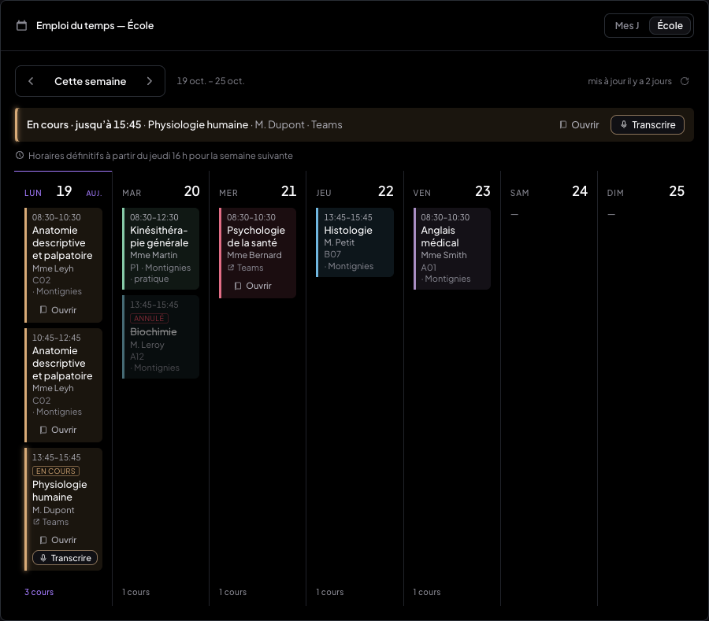
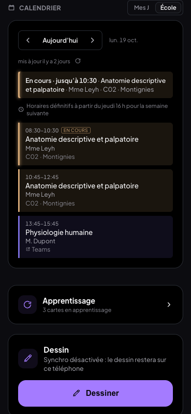
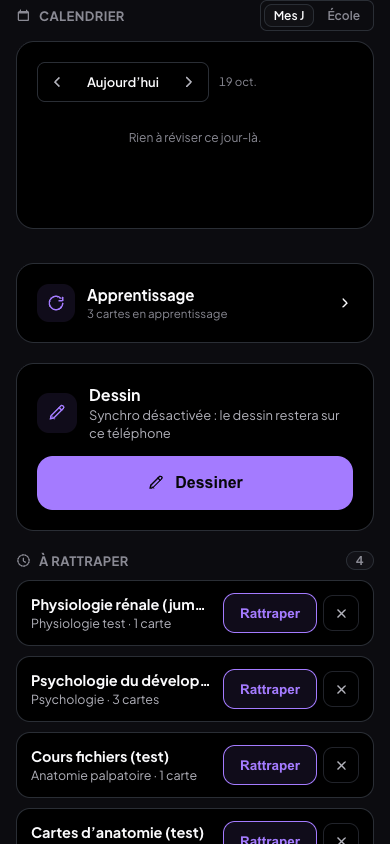
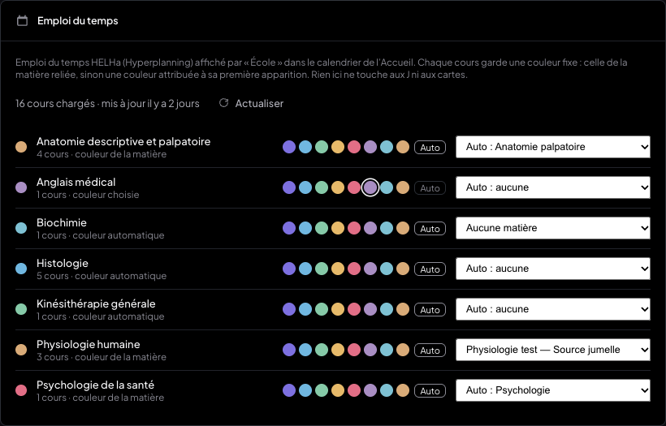
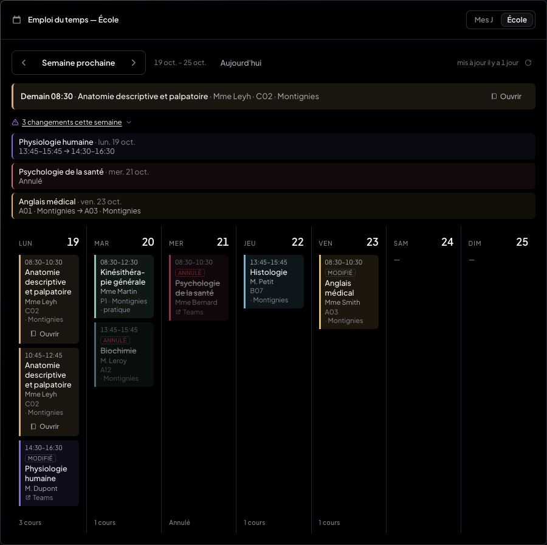

# Compte rendu — emploi du temps HELHa dans le calendrier de l'Accueil (17/10/2026)

L'emploi du temps Hyperplanning de la promo (lien iCal privé) s'affiche dans le calendrier de
l'Accueil de MedRevise, derrière un sélecteur « Mes J · École ». Le calendrier des J et la
séance du jour ne changent pas en mode « Mes J ». Tout a été testé dans Chrome (ordinateur,
tablette, téléphone), en local uniquement : faux Hyperplanning, aucun accès au vrai cloud.

## À faire de ton côté : la variable Vercel

| Variable | Où | Valeur |
|---|---|---|
| `HELHA_ICAL_URL` | Vercel → projet `my-org` → Settings → Environment Variables (Production, et Preview si tu veux) | le lien iCal **privé** de la promo dans Hyperplanning (export iCal / « Télécharger au format iCal »), en `https://…` (un `webcal://…` est aussi accepté) |

Ensuite, fais un **Redeploy**, comme pour toute variable. Tant qu'elle n'est pas posée, l'app affiche
« Emploi du temps non configuré » dans le sélecteur, et le reste fonctionne normalement.

Le lien n'existe **que** côté serveur. Il n'a pas de préfixe `VITE_`, il n'est pas dans le bundle
(vérifié dans `dist/`) et il n'est jamais renvoyé, même dans un message d'erreur (test automatique
avec un faux lien « SECRET123 »). Il n'est pas écrit non plus dans les logs : la fonction ne logge
rien. Pour tester en local, ajoute `HELHA_ICAL_URL=…` dans `.env.local` : le middleware de dev de
`vite.config.js` sert `/api/timetable`.

## Ce qui a été livré

### 1. Fonction `/api/timetable` (`api/timetable.js`, `api/_lib/emploiDuTemps.js`, `api/_lib/heures.js`)

**Lecture du fichier iCal**
- `HELHA_ICAL_URL` est analysée avec **ical.js 2.2.1**, version figée dans `package.json`.
- Pris en charge : récurrences (RRULE), exclusions (EXDATE), modifications d'une occurrence
  (RECURRENCE-ID), annulations (`STATUS:CANCELLED` ou « annulé » dans l'intitulé).
- Les champs Hyperplanning sont lus dans DESCRIPTION (« Matière : … », « Enseignant : … »,
  « Salle : … »). À défaut, la fonction lit l'intitulé « Matière - Prof - Promo - Salle ».

**Fuseau Europe/Brussels**
- Toute heure « murale » (TZID connu, TZID Windows inconnu, heure flottante) est lue comme
  une heure de Bruxelles, via Intl.
- Une heure UTC (`…Z`) reste en UTC.
- Le changement d'heure du **25/10** est donc juste dans les deux cas : 08:30 reste 08:30.

**Réponse JSON**
- Champs `{ uid, start, end, title, teacher, room, campus, modality, cancelled }`, plus `type`
  et `allDay`.
- `teacher` est réécrit : « LEYH Mme » devient « Mme Leyh ».
- `modality` vaut `teams`, `presentiel` ou `pratique`.
- Période couverte : la semaine passée, la semaine en cours et les 8 suivantes.

**Cache et protection**
- **Cache serveur de 60 min.**
- `?force=1` est limité à **1 par minute** ; au-delà, le cache est servi avec `forceLimite`.
- Si Hyperplanning est injoignable, le dernier cache est servi (`stale`).
- Origine et débit sont vérifiés comme pour les fonctions Deepgram (`_protection.js`), avec
  300 appels / 10 min / IP.

**Sans la variable :** la fonction répond `503 { code: 'not_configured', message: 'Emploi du temps non configuré' }`.

### 2. Calendrier de l'Accueil : « Mes J · École » (`components/EmploiDuTemps.jsx`)

**Le sélecteur**
- Deux segments en tête du calendrier. Le choix est mémorisé par appareil
  (`medrevise.accueil.calendrier`).
- En « Mes J », le contenu de la carte est **le même code qu'avant** ; seul le sélecteur
  s'ajoute à l'en-tête, à côté de la pastille « N cartes aujourd'hui ».

**Le mode « École »**
- **Même grille et mêmes gestes :** la grille reprend les classes `.wcal-*` du calendrier des
  J (colonnes, filets, en-têtes de jour, « Auj. »), avec les mêmes gestes : semaine
  précédente/suivante, « Aujourd'hui ».
- **Semaine ou jour :** vue semaine quand la carte fait au moins 640 px de large, vue jour
  en dessous (tablette portrait, téléphone).
- **En tête :** le cours en cours, sinon le prochain, par exemple « Dans 25 min · Anatomie
  descriptive et palpatoire · Mme Leyh · C02 · Montignies » ou « En cours · jusqu'à 10:30 · … ».
  Un cours annulé n'est jamais « le prochain ».
- **Cours en cours :** un liseré pulsant discret, sans animation si l'appareil demande moins de
  mouvement.
- **Cartes :** heure, intitulé, prof, salle · campus ou « Teams ». La couleur sert de bordure
  gauche (3 px) et de fond teinté à 12 %. Badges « Annulé » (barré), « Modifié » et
  « En cours ».
- **Pied de colonne :** le nombre de cours, ou « Annulé » quand tous les cours du jour le sont.
- **Fraîcheur :** « mis à jour il y a 2 h », avec un bouton pour actualiser maintenant
  (`force`).

### 3. Couleurs par cours (`lib/edtCouleurs.js`, Réglages → Emploi du temps)

**Couleur fixe par intitulé**
- Clé : l'intitulé normalisé (accents, casse, ponctuation).
- Elle est prise dans la **palette de la DA** (celle des matières), attribuée à la
  **première apparition** et enregistrée : elle ne change plus, même après un rafraîchissement.
- La couleur attribuée est la moins portée par les cours déjà affichés. Un cours sans matière
  ne reçoit donc pas la couleur d'une matière déjà à l'écran.

**Correspondance automatique avec la bibliothèque**
- Elle ignore les accents et la casse, et développe les abréviations (« anat. », « physio »,
  « kiné »…).
- Exemples : « Anatomie descriptive et palpatoire » → *Anatomie palpatoire* ;
  « Psychologie de la santé » → *Psychologie*.
- **Une matière archivée n'est jamais proposée.**

**Couleur affichée**, par ordre de priorité : celle choisie dans Réglages, puis la pastille de
la matière reliée, puis la couleur attribuée.

**Réglages → Emploi du temps**
- La carte liste les cours détectés, avec le nombre de cours, une palette (8 couleurs + « Auto »)
  et la matière reliée (« Auto : … », « Aucune matière », ou une matière choisie).
- Les modifications sont reprises partout (Accueil, téléphone).

**Stockage**
- Ces réglages forment **un seul enregistrement additionnel**, `edtReglages`, dans le store de
  réglages déjà synchronisé (`prompts`), comme `carnetPuces`.
- C'est la **seule** donnée écrite par ce chantier. L'emploi du temps lui-même n'est jamais
  écrit dans IndexedDB ni dans Supabase.

### 4. Lien avec l'app

- **« Ouvrir »** apparaît sur un cours relié à une matière. Il ouvre le **dernier cours ouvert
  de cette matière**, noté par le lecteur dans le localStorage de l'appareil
  (`lib/derniersCours.js`). À défaut, il ouvre le cours le plus récent de la matière, en
  privilégiant ceux qui ont un document.
- **« Transcrire »** n'apparaît que **pendant un cours Teams en cours**. Il ouvre ce même cours
  avec la feuille « Transcrire le cours » **pré-remplie sur « Onglet Chrome »**.
  - Le choix de source mémorisé n'est pas modifié.
  - La session ne démarre pas toute seule.
  - Si une transcription est déjà en cours, le bouton montre simplement le panneau Transcript.
- Aucun de ces boutons sur téléphone : le téléphone n'a pas de lecteur.

### 5. Rafraîchissement, cache local, changements, rappel

**Rafraîchissement**
- À l'ouverture de l'app, puis **toutes les 15 min** en tâche de fond.
- Aussi au retour du réseau, et quand l'onglet redevient visible après 15 min.

**Cache local**
- Le cache (`localStorage`, cet appareil seulement) donne un **affichage immédiat**, mesuré à
  4 ms après le chargement.
- Il permet aussi la consultation **hors ligne** : « Hors ligne · mis à jour il y a 2 h ».

**Changements**
- Ils sont détectés sur les **7 prochains jours** : horaire, salle, campus ou modalité,
  annulation, cours retiré ou ajouté.
- Un cours qu'Hyperplanning déplace en changeant son identifiant est reconnu comme un
  déplacement (même intitulé, même jour).
- Ils s'annoncent par une ligne discrète, « 3 changements cette semaine », en accent tant
  qu'ils ne sont pas vus. Un clic ouvre la liste **avant → après**.
- Ils disparaissent une fois passés, ou si le cours revient à l'identique.

**Rappel** « Horaires définitifs à partir du jeudi 16 h pour la semaine suivante » : affiché du
lundi 00:00 au jeudi 16:00 (Bruxelles), **en mode École seulement**.

### 6. Téléphone

**Le bloc « Calendrier »**
- Un bloc « Calendrier » s'ajoute à l'accueil du téléphone, sous la carte « N cartes dues ».
- Le sélecteur tient dans son en-tête, sur une ligne.

**Contenu**
- Vue jour par défaut.
- On passe d'un jour à l'autre en **glissant** ; un défilement vertical ne change pas de jour.
- Les cartes sont lisibles : intitulé en 14 px, détails en 12,5 px, pleine largeur.
- Rien ne déborde, même à 320 px.

**Le mode « Mes J » sur téléphone**
- Il montre les fiches dues du jour, calculées par `weekData` comme sur l'ordinateur.
- Le téléphone n'avait pas de calendrier jusqu'ici : ce bloc est nouveau. Les blocs existants
  sont inchangés (voir la non-régression ci-dessous).

## Captures

**Sélecteur, en « Mes J »** (en-tête du calendrier des J) :

**Semaine École sur ordinateur.** Lundi 19/10 à 14:00 : « Physiologie humaine » (Teams) est
en cours. Elle a été reliée à une matière dans Réglages, d'où « Ouvrir » et « Transcrire ».

**École sur téléphone** (390 px, vue jour) et **Mes J sur téléphone** :

 

**Réglages → Emploi du temps** (couleurs et matières reliées) :

**Changements détectés** (Hyperplanning publie une nouvelle version : horaire, annulation, salle) :

**Autres captures :**
- [Transcrire : feuille pré-remplie « Onglet Chrome »](img/emploi-du-temps/edt-transcrire.png)
- [Tablette 820 px](img/emploi-du-temps/edt-tablette.png)
- [Téléphone 320 px](img/emploi-du-temps/edt-mobile-320.png)
- [Hors ligne](img/emploi-du-temps/edt-hors-ligne.png)
- [Sans variable : « Emploi du temps non configuré »](img/emploi-du-temps/edt-non-configure.png)

## Tests

### Le banc

- **Vite :5199 sans Supabase**, avec `HELHA_ICAL_URL` pointant sur un **faux Hyperplanning**
  local (`scripts/tests-emploi-du-temps/faux-hyperplanning.mjs`).
- **Chrome headless** piloté en CDP.
- **Heure simulée** par un script injecté dans la page.
- **Fuseau de l'appareil** forcé par `Emulation.setTimezoneOverride`.
- **Le .ics de test** reproduit une vraie semaine 1BKINE12 au format Hyperplanning
  (`tests/emploi-du-temps/semaine-1bkine12.ics`, généré par `gen-ics.mjs`) :
  - un cours sur deux créneaux (Anatomie 08:30 et 10:45) ;
  - un cours Teams (Physiologie) ;
  - un cours pratique (Kiné) ;
  - un cours annulé (Biochimie) ;
  - une série hebdomadaire du jeudi 10:45 qui traverse le 25/10, avec une occurrence
    **modifiée** (13:45, B07) et une exclusion ;
  - des cours en UTC des deux côtés du changement d'heure.
- **La version 2 du .ics** change un horaire, une salle et annule un cours.

### Résultats

| Batterie | Résultat |
|---|---|
| vitest `tests/emploi-du-temps` (lecture iCal, fuseau/25-10, couleurs, correspondances, changements, API : 503, origine, cache, force, lien jamais renvoyé) | **22/22**, aussi sous `TZ=America/New_York` et `TZ=Asia/Tokyo` |
| vitest complet (`npm test`) | **81/81** |
| `t-ecole` — Mes J ↔ École, semaine, couleurs stables après 3 actualisations + 3 rechargements, prochain cours, liseré, 25/10, appareil à New York et à Tokyo, rappel du jeudi | **32/32** |
| `t-changements` — avant → après, badges, vus, purge | **11/11** |
| `t-reglages` — correspondances, couleur et matière modifiées et reprises partout, Ouvrir, Transcrire, aucune fiche/carte/matière modifiée | **18/18** |
| `t-mobile` — téléphone 390 et 320 px, tablette 820 px, fenêtre 1 000 px : sélecteur, vue jour, glissement, lisibilité, débordement | **20/20** |
| `t-hors-ligne` — cache local, « Hors ligne · mis à jour il y a 2 h » | **5/5** |
| `t-non-configure` (Vite relancé **sans** la variable) — 503, message dans le sélecteur, École propre, J intact | **8/8** |
| Non-régression au pixel contre `d418ec2` (avant le chantier, même serveur, mêmes données), mode « Mes J » | voir ci-dessous |
| Chantier précédent rejoué (`tests-fichiers-cours/tout.sh` : carnet, apprentissage, transcript, fichiers) | **97/97** |
| MealWeek, ordinateur et téléphone, avant/après | **identique au pixel** |

### Non-régression au pixel

**Sur ordinateur**, ces captures sont identiques à celles d'avant le chantier :
- la grille des J ;
- la séance du jour (`.today-cta`) ;
- la légende des matières ;
- la colonne de droite (carnet, cours à revoir) ;
- la fenêtre d'un jour.

Le basculement Mes J → École → Mes J laisse aussi la grille et la séance identiques au pixel.

**Sur téléphone**, les cartes « N cartes dues » et « séance du jour » sont identiques, à
l'exception de 14 pixels anti-crénelés dans leurs coins gauches. Ces pixels sont identiques
quand on masque le nouveau bloc « Calendrier » situé plus bas. C'est donc un effet de rendu dû à
l'ajout du bloc, pas un changement de ces cartes.

### Règles vérifiées en fin de chantier

- **MealWeek et `src/shared/` :** `git diff d418ec2 HEAD -- src/shared src/mealweek` donne
  **0 fichier**.
- **Supabase :**
  - aucune écriture Supabase ;
  - le banc tourne sans cloud ;
  - la seule donnée synchronisable ajoutée est l'enregistrement `edtReglages`, en ajout.
- **J et FSRS :** le chantier ne lit ni n'écrit aucune carte, et aucun calcul des J ni de FSRS.
  Le test « aucune fiche, carte, matière ni dossier modifié » compare la base avant et après un
  parcours complet (Réglages, Ouvrir, Transcrire).
- **Classes CSS :** toutes les nouvelles portent le préfixe `edt-`, sans collision.

## Limites et choix faits sans te demander

- **Format réel d'Hyperplanning :** je n'ai pas accès au vrai lien. Le parseur suit le format
  d'export Hyperplanning connu (DESCRIPTION « Matière / Enseignant / Salle », UID par
  occurrence) et se replie sur l'intitulé.
  - Si un champ s'affiche mal une fois la variable posée, il suffit d'ajuster `CLES` ou
    `champsDe` dans `api/_lib/emploiDuTemps.js`.
  - La détection « Teams » repose sur le mot « Teams » (ou « distanciel », « en ligne ») dans la
    salle, le mémo ou l'intitulé.
- **Le campus** vient de « Site : … » dans la description, ou de la salle « C02 (Montignies) ».
- **Tablette portrait :** la carte du calendrier y fait environ 620 px, donc l'École s'affiche en
  vue jour. Le calendrier des J garde ses 7 colonnes.
- **Matières de même couleur :** deux cours reliés à deux matières qui ont la même pastille
  partagent cette couleur. C'est le cas sur le banc, où *Anatomie palpatoire* et
  *Physiologie test* ont la même couleur par défaut. Il suffit de changer la couleur de l'une
  d'elles dans Réglages.
- **Dernier cours ouvert :** il est mémorisé par appareil, pas synchronisé, ce qui évite toute
  écriture en plus.
- **Glissement au doigt :** testé avec de vrais événements tactiles CDP, pas sur un vrai
  téléphone.

## Commits

- `5d643bb` feat(api): /api/timetable — emploi du temps HELHa (Hyperplanning iCal) normalisé
- `045b775` feat(medrevise): emploi du temps HELHa dans le calendrier de l'Accueil — « Mes J · École »
- `0fbcf71` test(medrevise): banc Chrome de l'emploi du temps (faux Hyperplanning, horloge et fuseau simulés)
- `899c77d` fix(medrevise): emploi du temps — pied de colonne « Annulé » quand tous les cours du jour le sont
- `b904f01` docs(medrevise): compte rendu de l'emploi du temps HELHa — variable Vercel HELHA_ICAL_URL, captures, tests, commits
