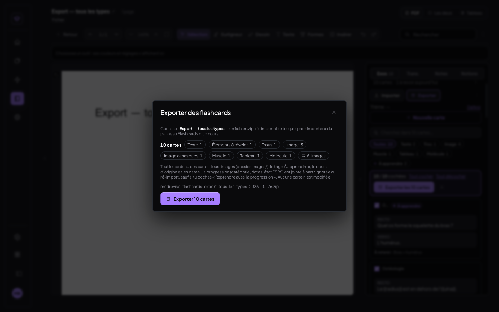
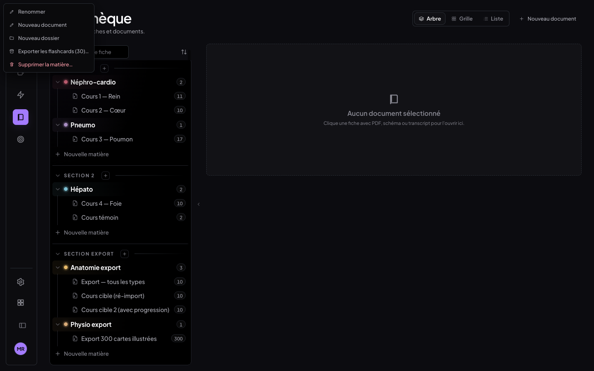
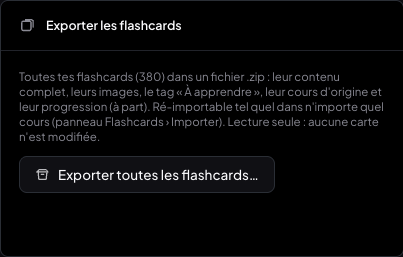
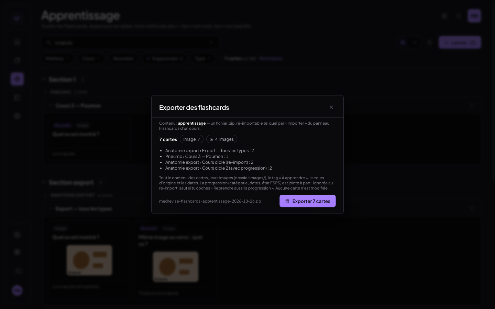
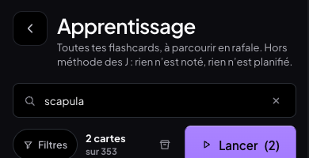
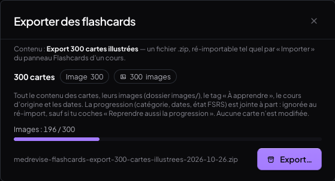
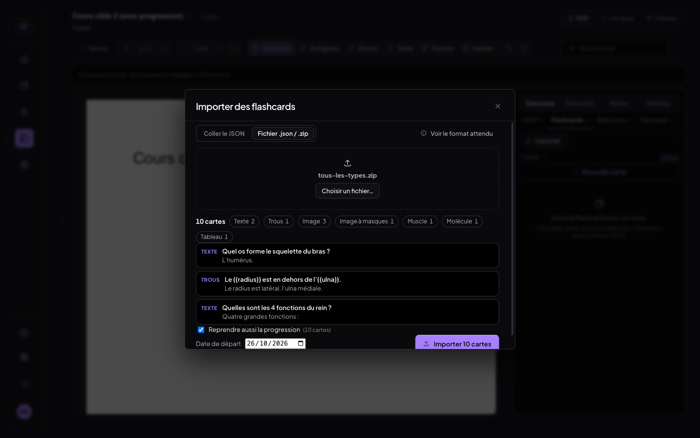
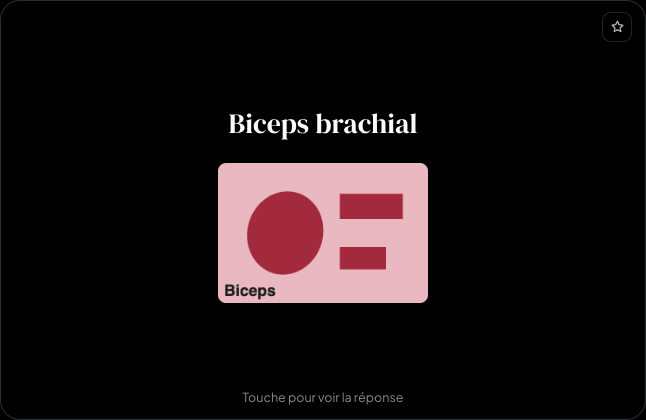

# Compte rendu — Export complet des flashcards (26/10/2026)

Les flashcards de MedRevise s'exportent en **un fichier .zip** qui contient tout : le contenu de chaque carte, ses
images, son tag « À apprendre », son cours d'origine, ses dates et sa progression. Ce .zip se **ré-importe tel quel**
par l'import existant du panneau Flashcards (aperçu, doublons, cours de destination — comme avant).

L'export est en **lecture seule** : aucune carte n'est modifiée, rien n'est écrit dans la base, aucune requête ne part
vers Supabase (prouvé au banc, §6.4).

---

## 1. Où exporter — un seul composant, quatre portes

Le composant `components/ExportFlashcards.jsx` (fenêtre « Exporter des flashcards ») est appelé depuis :

| Où | Quelles cartes | Nom du fichier |
|---|---|---|
| **Panneau Flashcards d'une fiche** › bouton « Exporter » (à côté d'« Importer ») | une case par carte, toutes cochées : « Exporter les N cartes », ou décocher pour « Exporter la sélection (k) » ; « Tout cocher / Tout décocher » | `medrevise-flashcards-<cours>-AAAA-MM-JJ.zip` |
| **Bibliothèque** › menu « … » d'un **cours** | « Exporter les flashcards (N)… » (seulement si le cours en a) | `…-<cours>-…` |
| **Bibliothèque** › menu « … » d'une **matière** | toutes les cartes des cours de la matière | `…-<matière>-…` |
| **Mode Apprentissage** › icône « Exporter » à côté de « Lancer » (ordinateur et téléphone) | les cartes **visibles** avec les filtres actuels (recherche, matières, cours, Nouvelles, À apprendre, type) | `…-<cours ou matière commun>-…`, sinon `…-apprentissage-…` |
| **Réglages** › carte « Exporter les flashcards » | toutes les flashcards | `medrevise-flashcards-toutes-AAAA-MM-JJ.zip` |

La fenêtre affiche un aperçu : nombre de cartes, un compteur par type, nombre d'images distinctes, cartes par cours
(quand il y en a plusieurs) et le nom du fichier. Pendant l'export, une **barre de progression** suit les étapes
Images / Cartes / Archive. À la fin, le fichier est remis par le même chemin que la sauvegarde (`deliverFile` : le
téléchargement, ou la feuille de partage sur iPhone / iPad).



| Sélection dans le panneau | Menu « … » d'une matière | Réglages |
|---|---|---|
|  |  |  |

| Mode Apprentissage (filtre « scapula ») | Téléphone : barre du mode Apprentissage | 300 cartes : progression |
|---|---|---|
|  |  |  |

---

## 2. Structure du ZIP

```
medrevise-flashcards-export-tous-les-types-2026-10-26.zip
├── flashcards.json      les cartes — schéma de l'import des flashcards, ré-importable tel quel
├── README.txt           contenu de l'archive, nombre de cartes par type et par cours
└── images/
    ├── bmvpfocl1jwan.png    une image par fichier, nom STABLE = l'id de l'image dans MedRevise
    ├── bmvpfoclh37u7.png    (+ l'extension de son type : png, jpg, webp…)
    └── …                    chaque image UNE seule fois, même si plusieurs cartes l'utilisent
```

- **Aucune image manquante** : chaque nom cité dans le JSON (`"fichier": "images/…"`) est dans `images/`.
- **Aucune en double** : une image partagée par deux cartes n'est écrite qu'une fois (dans l'archive, et à nouveau
  une seule fois au ré-import).
- Une image introuvable sur l'appareil au moment de l'export (jamais vu au banc) n'est pas inventée : la carte
  l'indique dans une clé commentaire `"_image_manquante"` (ignorée à l'import), le README la liste, et la fenêtre
  le signale.
- Archive « stockée » (sans compression : les images le sont déjà), construite par `lib/zipSimple.js`
  (`creerZipProgressif`, même format que `creerZip`, en rendant la main au navigateur toutes les ~30 ms).

`README.txt` réel de l'export du banc :

```
MedRevise — export de flashcards
================================
Contenu : Export — tous les types
Exporté le : 26/10/2026 16:52:19

Contenu de l’archive
  flashcards.json  les cartes (schéma de l’import des flashcards de MedRevise, ré-importable tel quel)
  images/          6 image(s) utilisée(s) par les cartes, référencée(s) par leur nom dans le JSON (« fichier »)
  README.txt       ce fichier

Ré-import : panneau d’un cours › Exercices › Flashcards › Importer › Fichier .json / .zip — déposer ce .zip.
Chaque carte porte un bloc « progress » (catégorie, dates, état FSRS, historique) : il est ignoré au ré-import,
sauf si « Reprendre aussi la progression » est coché.

10 carte(s) par type
  Texte                1
  Éléments à révéler   1
  Trous                1
  Image                3
  Image à masques      1
  Muscle               1
  Tableau              1
  Molécule             1

Par cours
  Anatomie export › Export — tous les types : 10
```

---

## 3. `flashcards.json` — le schéma de l'import, complété

Même document que l'import (`{ "items": [ { "type": "flashcard", … } ] }`), avec en tête
`format: "medrevise-flashcards"`, `version: "1.2"`, `exporte_le`, `contenu`, `nb_cartes` (lus pour information,
l'import ne lit que `items`). Chaque carte porte **tout son contenu** :

| Champ | Contenu | Déjà dans l'import ? |
|---|---|---|
| `theme`, `recto`, `verso`, `indice`, `a_retenir`, `difficulte`, `tags` | texte de la carte (verso omis pour Muscle / Tableau / Molécule : il est reconstruit) | oui |
| `cloze` | carte à trous | oui |
| `items: [{ text, masked }]` | éléments à révéler | oui |
| `image: { fichier, place }` | image d'une carte (recto / verso / deux) ; image générale d'un Muscle (`place` recto ou verso) | oui |
| `tableau: { colonnes, lignes }` | Tableau | oui |
| `muscle: { origine, trajet, insertion, action, innervation }` | Muscle | oui |
| `muscle.images: { <ligne>: { fichier, masques? } }` | **images par ligne** du Muscle, avec leurs masques « Masquer des mots » | **ajouté** |
| `occlusion: { fichier, largeur, hauteur, masques }` | **image à masques** : l'image, ses dimensions, ses masques et étiquettes tels que l'éditeur les enregistre | **ajouté** |
| `molecule: { nom, smiles, sens, molfile, formule, comparaison, biblio }` | Molécule : **SMILES + molfile** (le dessin d'origine, coordonnées comprises) | `molfile`, `formule`, `comparaison`, `biblio` **ajoutés** |
| `verso_format`, `verso_auto` | verso « léger » (carte faite d'une boîte), verso généré d'une image à masques | **ajoutés** |
| `a_apprendre: true` | tag « À apprendre » | **ajouté** |
| `origine: { section, matiere, cours, id, source? }` | cours et matière d'origine (+ l'id de la carte d'origine, la boîte dont elle vient) — informatif | **ajouté** |
| `cree_le`, `modifie_le` | dates de création (`createdAt`, sinon l'horodatage de l'id) et de dernière modification | **ajoutés** (`cree_le` est gardé sur la carte ré-importée) |
| `progress: { categorie, … }` | **bloc séparé** : catégorie au jour de l'export (`nouvelle`, `revision`, `retard`, `a_venir`, `terminee`) puis, tel quel, **tout le reste** de la carte : `dueDate`, `j0Date`, `intervalDays`, `historique`, `nouvelle`, `fsrs` (état FSRS), `learnState`, `capped`, `termine`, `missed`, `skippedOn`, carnet d'erreurs (`carnetAt`…) | **ajouté** |

Le bloc `progress` n'est pas une liste recopiée à la main : tout champ d'une carte qui n'est ni du contenu ni de
l'identité (`id`, `ficheId`, `srcId`, `updatedAt`…) y va. Un futur champ de planification sera donc exporté d'office.

L'id d'origine est rangé dans `origine.id`, **pas** dans `id` : sinon l'import le prendrait pour un id source et
ignorerait les cartes dans le cours d'origine même avec « Importer quand même ».

### Exemple (extrait réel de l'export du banc)

```json
{
  "format": "medrevise-flashcards",
  "version": "1.2",
  "exporte_le": "2026-10-26T15:52:19.796Z",
  "contenu": "Export — tous les types",
  "nb_cartes": 10,
  "items": [
    {
      "type": "flashcard",
      "theme": "Ostéologie",
      "recto": "Quel os forme le squelette du bras ?",
      "verso": "L’humérus.",
      "indice": "Un seul os",
      "a_retenir": "Bras = humérus",
      "difficulte": 2,
      "a_apprendre": true,
      "origine": { "section": "Section export", "matiere": "Anatomie export", "cours": "Export — tous les types", "id": "qmu2fzfmote01" },
      "cree_le": "2026-09-15T09:01:00.000Z",
      "modifie_le": "2026-10-26T15:50:47.535Z",
      "progress": {
        "categorie": "a_venir",
        "historique": [{ "date": "2026-10-17", "qualite": 4 }, { "date": "2026-10-23", "qualite": 3 }],
        "nouvelle": false, "learnState": "review", "intervalDays": 7,
        "dueDate": "2026-10-30", "j0Date": "2026-10-06", "capped": false, "termine": false, "missed": 0,
        "fsrs": { "state": 2, "stability": 8.4, "difficulty": 5.2, "due": "2026-10-30", "reps": 2, "lapses": 0, "last_review": "2026-10-23" }
      }
    },
    {
      "type": "flashcard",
      "theme": "Ostéologie",
      "recto": "Que cachent les masques ?",
      "verso": "Humérus · Radius",
      "verso_auto": true,
      "difficulte": 2,
      "occlusion": {
        "fichier": "images/bmvpfoclh37u7.png", "largeur": 480, "hauteur": 320,
        "masques": [
          { "id": "cmvpfoctrmk9h", "kind": "zone", "ancre": { "x": 0.29, "y": 0.5 }, "boite": { "x": 0.29, "y": 0.5 }, "texte": "Humérus",
            "reponses_acceptees": [], "type": null, "champs": {}, "couleur": "#8B6FE8", "numero": 1,
            "zone": { "shape": "rect", "rect": { "x": 0.14, "y": 0.3, "w": 0.3, "h": 0.4 }, "closed": true, "fill": "#8B6FE8", "fillOpacity": 0.25, "stroke": "#8B6FE8", "strokeWidth": 2 } },
          "… un masque « Radius », une étiquette « Vue antérieure »"
        ]
      },
      "origine": { "…": "…" }, "cree_le": "…", "progress": { "categorie": "nouvelle", "…": "…" }
    },
    {
      "type": "flashcard",
      "theme": "Myologie",
      "recto": "Biceps brachial",
      "difficulte": "intermediaire",
      "indice": "Deux chefs",
      "a_retenir": "Supinateur puissant",
      "muscle": {
        "origine": "Chef long : tubercule supra-glénoïdal\nChef court : processus coracoïde",
        "trajet": "Loge antérieure du bras",
        "insertion": "Tubérosité radiale",
        "action": "Flexion du coude, supination",
        "innervation": "Nerf musculo-cutané (C5–C6)",
        "images": {
          "origine": { "fichier": "images/bmvpfocmd3gld.png", "masques": [{ "id": "cmvpfoctq86y8", "kind": "zone", "texte": "coracoïde", "…": "…" }] },
          "insertion": { "fichier": "images/bmvpfocmu92mg.png" }
        }
      },
      "image": { "fichier": "images/bmvpfoclxs7op.png", "place": "recto" },
      "origine": { "…": "…" }, "cree_le": "…", "progress": { "categorie": "a_venir", "…": "…" }
    },
    {
      "type": "flashcard",
      "theme": "Pharmacologie",
      "recto": "Aspirine",
      "molecule": {
        "nom": "Aspirine", "smiles": "CC(Oc1ccccc1C(O)=O)=O", "sens": "nom-molecule",
        "molfile": "\nOCL MolfileCreator  2D\n\n 13 13  0  0  0  0  0  0  0  0999 V2000\n… (molfile V2000 complet : coordonnées des 13 atomes, 13 liaisons)",
        "formule": "C9H8O4", "comparaison": "constitution"
      },
      "origine": { "…": "…" }, "cree_le": "…", "progress": { "categorie": "nouvelle", "…": "…" }
    },
    {
      "type": "flashcard",
      "theme": "Physiologie rénale",
      "recto": "Quelles sont les 4 fonctions du rein ?",
      "verso": "Quatre grandes fonctions :",
      "items": [
        { "text": "Épuration des déchets azotés", "masked": true },
        { "text": "Équilibre hydro-électrolytique", "masked": true },
        { "text": "Équilibre acido-basique", "masked": false },
        { "text": "Fonctions endocrines (EPO, rénine)", "masked": true }
      ],
      "a_apprendre": true,
      "origine": { "…": "…" }, "cree_le": "…", "progress": { "categorie": "nouvelle", "…": "…" }
    }
  ]
}
```

(Les « … » abrègent ce compte rendu et les coordonnées sont arrondies ; le fichier réel est complet. Il est conservé par le banc dans
`<scratchpad>/export-fc/flashcards-exemple.json`.)

---

## 4. Ré-import

L'import existant (panneau d'un cours › Flashcards › **Importer** › « Fichier .json / .zip ») accepte ce .zip sans
changement de geste : il prend le `.json` de l'archive, lit les images par leur nom, montre l'aperçu (nombre de cartes
par type, 3 exemples), détecte les doublons (recto déjà présent dans le cours : « Ignorer » / « Importer quand
même ») et importe dans **le cours où on l'ouvre** — comme aujourd'hui.

Une seule nouveauté visible : quand les cartes du fichier portent un bloc `progress`, une case
**« Reprendre aussi la progression » (N cartes)**, **décochée par défaut** :

- **décochée** : les cartes arrivent neuves (Nouvelles, sans historique ni état FSRS) à la date de départ choisie,
  exactement comme des cartes créées à la main ;
- **cochée** : chaque carte reprend sa planification exportée (dates, J, FSRS, historique, catégorie de fait) au
  lieu de partir de la date de départ ; le message de fin dit « avec leur progression ».



Ce que l'import a appris (`lib/importFlashcards.js`, toujours aussi strict : un champ inconnu reste une erreur) :
`occlusion`, `muscle.images`, `molecule.molfile / formule / comparaison / biblio`, `verso_format`, `verso_auto`,
`a_apprendre`, `cree_le`, `origine` et `modifie_le` (informatifs), `progress` (uniquement avec l'option). Le JSON
d'aujourd'hui (« Voir le format attendu », prompts) s'importe exactement comme avant.

Au passage :
- **difficulté** : l'export écrit la valeur stockée (1, 2 ou 3) ; l'import ne connaissait que le texte
  (« facile »…) et aurait ramené une carte facile à 2 — il accepte maintenant aussi 1 / 2 / 3 ;
- **Muscle avec images** : le verso est reconstruit avec les images (`[image du muscle : …]`), exactement comme une
  carte faite à la main (avant, une image importée n'y figurait pas) ;
- **image partagée** : écrite une seule fois dans la base au ré-import (même fichier du .zip → même image).

---

## 5. Fichiers

| Fichier | Rôle |
|---|---|
| `src/medrevise/lib/exportFlashcards.js` (nouveau) | carte → entrée JSON (contenu, origine, dates, `progress`), images uniques, README, construction de l'archive avec progression. Module pur, lecture seule |
| `src/medrevise/components/ExportFlashcards.jsx` (nouveau) | LA fenêtre d'export (aperçu, barre de progression, remise du fichier) |
| `src/medrevise/lib/zipSimple.js` | `creerZipProgressif` (même archive que `creerZip`, par étapes) |
| `src/medrevise/lib/importFlashcards.js` | champs de l'export acceptés ; option `progression` ; images écrites une fois ; difficulté 1/2/3 |
| `src/medrevise/lib/import.js` | `appendItemsToFiche({ …, decorer })` : retouche facultative de la carte neuve (reprise de la progression) |
| `src/medrevise/components/ImportFlashcards.jsx` | case « Reprendre aussi la progression » |
| `src/medrevise/components/CourseItemsSidebar.jsx` | bouton « Exporter », cases à cocher, barre de sélection |
| `src/medrevise/pages/Bibliotheque.jsx` | « Exporter les flashcards (N)… » dans les menus « … » d'un cours et d'une matière |
| `src/medrevise/apprentissageLibre/EcranApprentissage.jsx` | icône « Exporter » (cartes visibles) |
| `src/medrevise/pages/Reglages.jsx` | carte « Exporter les flashcards » |
| `src/medrevise/lib/backupExport.js` | `deliverFile(blob, nom, type)` : type du fichier (le .zip) pour la feuille de partage iOS |
| `src/styles/import-flashcards.css` | barre de progression, cases, barre de sélection — jetons de la DA |

Rien dans `src/shared/` ni `src/mealweek/` (vérifié : `git diff` vide sur ces dossiers).

---

## 6. Tests

### 6.1 Tests automatiques (Vitest, `tests/export-flashcards/exportFlashcards.test.js`) — 9 / 9

Aller-retour complet en mémoire (IndexedDB simulé) : une fiche avec chaque type → export → .zip relu → analyse par
l'import existant → import dans un autre cours. Contenu identique champ par champ, images identiques octet pour octet
et écrites une seule fois, progression ignorée par défaut puis reprise avec l'option, aucune carte modifiée par
l'export, `creerZip` et `creerZipProgressif` équivalents, l'exemple du format attendu toujours importable.

Suite complète : **159 / 160** — le seul échec est le test `crayon` (épaisseurs du crayon du lecteur PDF), qui
échouait déjà avant ce chantier et ne touche pas aux flashcards.

### 6.2 Banc navigateur (`scripts/tests-export-flashcards/`, `tout.sh`) — 83 / 83

Vite :5302 **sans Supabase** + Chrome headless isolés (C ordinateur 1440 × 900, D téléphone 390 × 844 tactile),
vrais clics souris / taps (CDP), vrais téléchargements. Jeu de test (`seed.mjs`) : un cours avec **chaque type** et de
vraies images dessinées au canvas — texte (tag « À apprendre », progression FSRS), trous, éléments à révéler, image au
recto / aux deux / au verso (deux cartes partagent la même image), image à masques (2 masques + 1 étiquette), Muscle
(image générale + 2 images par ligne dont une avec masque), Tableau, Molécule (aspirine : SMILES et molfile calculés
par OpenChemLib) ; deux cours cibles vides ; une autre matière avec **300 cartes illustrées** (~100 Ko d'image chacune).

| Scénario | Vérifications | Ce qui est prouvé |
|---|---|---|
| `t-export.mjs` | 40 | export de la fiche depuis le panneau (toutes, puis une sélection de 3) ; **ouverture du ZIP** par `unzip` du système : archive intègre, JSON valide, 6 images pour 10 cartes, aucune manquante ni en double, identiques octet pour octet ; chaque type exporté (molfile tel quel, 3 masques, images par ligne…) ; README ; **ré-import dans un autre cours** ; **progression ignorée par défaut puis reprise** avec l'option ; cartes d'origine intactes |
| `t-portees.mjs` | 24 | une **matière** (30 cartes, 3 cours, 18 images), un **cours** (menus « … » de la Bibliothèque), un **filtre Apprentissage** (recherche « scapula » : 7 cartes ; puce « À apprendre » : 6 cartes, toutes taguées), **tout** depuis les Réglages (380 cartes, 319 images, 27,6 Mo, 2,2 s) ; noms de fichier ; aucune carte modifiée par ces 6 exports |
| `t-300.mjs` | 7 | 300 cartes / 300 images (26,7 Mo) en ~0,5 s ; **barre de progression** : 79 valeurs croissantes ; **aucune tâche longue** (> 50 ms) ; battement 16 ms : plus grand trou 35 ms ; un vrai clic pendant l'export traité en 18 ms |
| `t-mobile.mjs` | 4 | téléphone : l'icône tient dans la barre du mode Apprentissage (aucun débordement), export d'un tap |
| `t-nr-import.mjs` | 8 | **non-régression de l'import** : « Essayer cet exemple » (7 cartes, chaque type, dans les J), doublons (« Ignorer » par défaut), validation stricte (champ inconnu, image absente du .zip, `a_apprendre` invalide : un message par carte avec sa ligne), .zip « à l'ancienne » (JSON + image jointe) |

### 6.3 Résultat de l'aller-retour (le test demandé)

Fiche « Export — tous les types » (10 cartes, 8 types) exportée, puis ré-importée dans « Cours cible (ré-import) » :

| Contrôle | Résultat |
|---|---|
| Archive | intègre (`unzip -t` : *No errors detected*), `flashcards.json` valide, 10 cartes |
| Images | 6 fichiers pour 10 cartes (la partagée une fois), toutes référencées présentes, octets identiques aux originales ; au ré-import, 6 images écrites (la partagée une fois), identiques |
| Contenu | chaque carte retrouvée par son recto ; thème, verso, indice, à retenir, difficulté, trous, éléments, tableau, lignes du Muscle et leurs masques, masques de l'image à masques, SMILES + molfile, tag « À apprendre » identiques |
| **À l'écran** | les 10 cartes ré-importées capturées en vue agrandie (recto **et** verso, 20 captures) et comparées au pixel aux originales : **16 / 20 identiques au pixel** ; les 4 autres ne diffèrent que dans les photos (rééchantillonnage d'une image réduite, ≤ 15 sur 255, alors que leurs octets sont identiques) et dans l'anticrénelage des coins arrondis — exactement le bruit observé entre **deux captures de la même carte d'origine** (au pire 73 à 169 px selon les passes) |
| Images affichées | toutes chargées (480 × 320), au recto comme au verso |
| Progression par défaut | ignorée : 10 cartes Nouvelles, sans historique ni FSRS, départ aujourd'hui |
| Avec « Reprendre aussi la progression » | dans « Cours cible 2 » : `dueDate`, `j0Date`, `intervalDays`, `historique`, `nouvelle`, `fsrs`, `learnState`, `capped`, `termine`, `missed` identiques aux originales |

| Original (recto) | Ré-importé (recto) |
|---|---|
|  |  |
|  |  |

### 6.4 Aucune écriture Supabase (`t-cloud.mjs`, 3 / 3)

Sur le banc du **faux Supabase local** (`scripts/faux-supabase.mjs`, Vite :5300, Chrome A) : export des 203
flashcards depuis les Réglages. Entre le clic « Exporter » et la fin : **aucune requête vers le cloud** (ni écriture
ni lecture). Après une synchro relancée : enregistrements (211) et fichiers du cloud **identiques**. (La synchro
relancée envoie toujours un `medrevise_push` de routine, avec ou sans export — vérifié par un essai témoin sans
export.)

### 6.5 Non-régression

- Banc du chantier précédent « Regrouper par cours / éléments à révéler » (`scripts/tests-par-cours-elements/tout.sh`) :
  **84 / 84**.
- Banc « Flashcards : liste, Agrandir, À apprendre » (`scripts/tests-a-apprendre/tout.sh`, faux Supabase, synchro
  entre deux appareils) : **98 / 98** — la liste du panneau (où vivent le bouton Exporter et les cases) n'a pas bougé.
- `npm run build` : vert.
- **MealWeek** : build d'avant (HEAD, `git stash`) et d'après servis tour à tour, même capture : **0 pixel différent**.
- `src/shared/`, `src/mealweek/` : aucun fichier modifié.

Les données de test de l'export sont retirées des profils de banc à la fin (`nettoie.mjs`) : les autres bancs
comptent les cartes dues de tout le profil (c'est ce qui a d'abord fait échouer, à tort, le banc précédent).

---

## 7. Choix faits sans demander, et limites

- **Sélection dans le panneau** : il n'existait pas de cases à cocher ; « Exporter » les fait apparaître, **toutes
  cochées** (= toutes les cartes de la fiche, l'autre cas demandé). Le nom du fichier est celui du cours dans les
  deux cas.
- **Nom pour plusieurs cours** : le cours s'il est unique, sinon la matière si elle est unique, sinon `apprentissage`
  (mode Apprentissage filtré), `toutes` (Réglages, ou Apprentissage sans filtre) ou `selection`.
- **Journal FSRS** (`medrevise_review_log`) : non exporté — l'état FSRS de chaque carte et son historique sont dans
  `progress`, ce qui suffit à reprendre la progression ; le journal reste lié à l'appareil et au cloud.
- **Date de départ** : avec « Reprendre aussi la progression », elle ne s'applique qu'aux cartes sans bloc
  `progress` (JSON mixte).
- **Comparaison au pixel** : le Chrome headless ne rend pas deux fois une photo réduite au pixel près ; le critère
  est « octets des images identiques + écran identique au bruit de rendu près », bruit mesuré à chaque passe sur les
  cartes d'origine elles-mêmes (§6.3).
- **Carnet d'erreurs** (`carnetAt`…) : c'est de l'état, pas du contenu — il voyage dans `progress` et n'est repris
  qu'avec l'option.

---

## 8. Commits

- `1f551ef` feat — export complet (.zip ré-importable), les quatre portes, import complété (option de progression).
- `8965f84` test — Vitest (aller-retour) et banc navigateur `scripts/tests-export-flashcards/`.
- commit `docs` — ce compte rendu et ses captures (`docs/img/export-flashcards/`).
