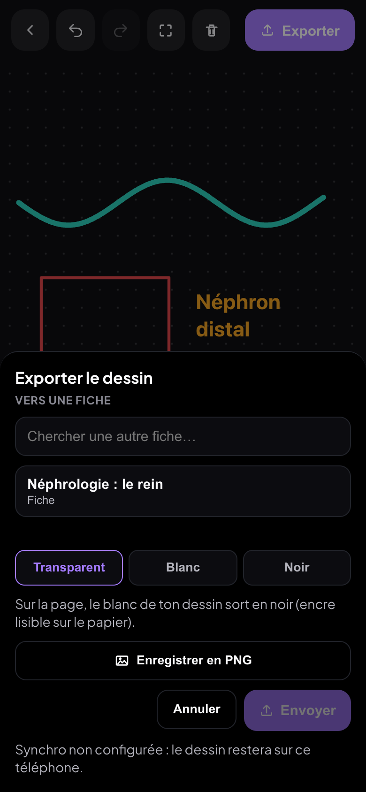
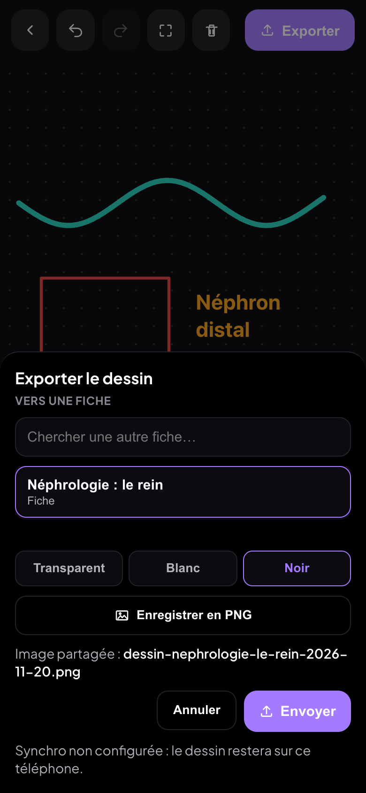
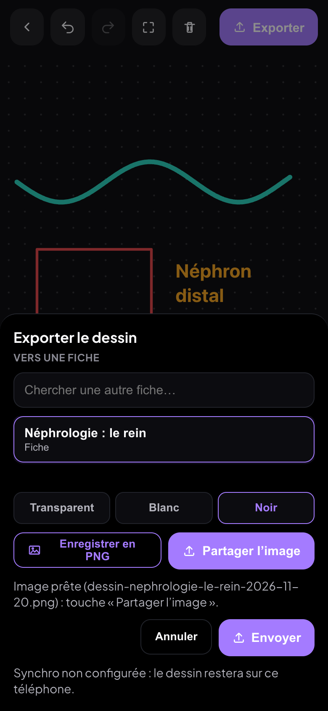
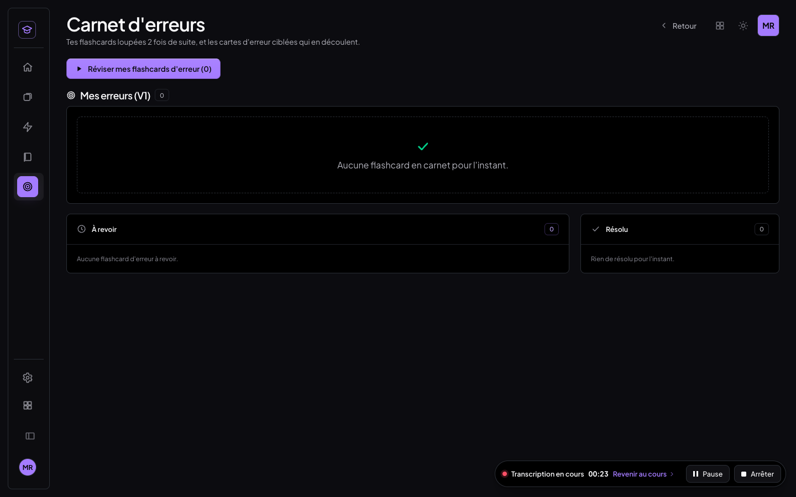
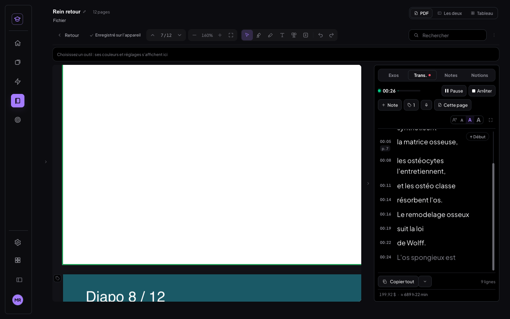
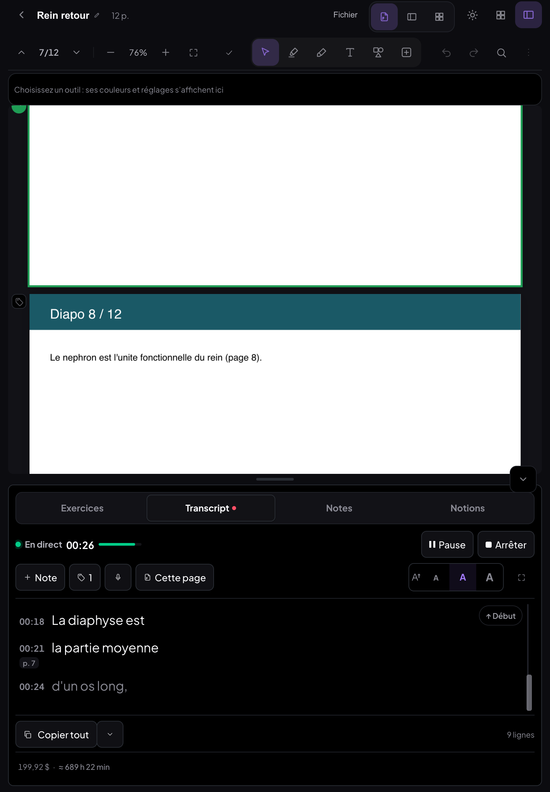

# Compte rendu — Enregistrer un dessin en PNG · revenir au cours depuis la barre « Transcription en cours »

_20/11/2026 — MedRevise uniquement (MealWeek et `src/shared/` non modifiés)._

## 1. Enregistrer un dessin en PNG

**Avant** : dans l'écran Dessin, le menu **Exporter** servait seulement à envoyer le dessin vers un cours (fond transparent, blanc ou noir).

**Maintenant** : la même feuille s'intitule « Exporter le dessin ». Elle garde le choix de la fiche et du fond, et ajoute un bouton **« Enregistrer en PNG »** (avec infobulle) :

- **Même rendu** que l'envoi vers un cours : `svgExport({ fond })` (MobileDessin) puis `svgVersPng` (EcranDessin), un seul code. Les deux exports partagent la règle de couleur : le trait « blanc » du canvas sort foncé sur fond transparent ou blanc, clair sur fond noir. `svgVersPng` reçoit seulement deux options : l'**échelle** et un rappel `peindre`.
- **Tout le dessin**, cadré sur son contenu avec la marge de `svgExport` (16 px du dessin), à **×3**. L'échelle descend seulement si le canvas l'impose (côté ≤ 8 192 px, 16,7 Mpx, plafonds de Safari iOS) ; un dessin courant sort donc en ×3.
- **Zones de texte comprises.** L'envoi vers un cours ne les met pas dans l'image : elles partent à part et deviennent des textes éditables sur l'ordi. Le PNG, lui, doit tout contenir. Chaque mot est donc **mesuré dans le DOM affiché** (`Range.getClientRects` : retours à la ligne, gras, taille, alignement exacts), ramené en coordonnées du dessin, puis peint avec `fillText` (`mobile/textesPng.js`). Pas de `<foreignObject>`, car Safari rendrait le canvas illisible.
- **iPhone / iPad** : feuille de partage du système (« Enregistrer l'image » dans Photos, Messages, AirDrop…). Si Safari a perdu le geste pendant le calcul (`NotAllowedError`), un bouton **« Partager l'image »** apparaît : un toucher de plus suffit.
- **Mac / ordinateur** : téléchargement. Même règle que la sauvegarde : Safari macOS expose `navigator.share`, mais on ne l'y utilise pas.
- **Nom** : `dessin-<cours>-<AAAA-MM-JJ>.png`, où le cours est la fiche choisie dans la feuille (par défaut celle ouverte sur l'ordi), sans accents. Sans fiche : `dessin-sans-cours-<date>.png`.
- **Aucune écriture** : ni dessin, ni fiche, ni annotation, ni session, ni synchro (vérifié par une empreinte de toutes les données avant et après).

Fichiers : `src/medrevise/mobile/EcranDessin.jsx`, `MobileDessin.jsx` (svgExport rend aussi `mots`), `exportPng.js` (échelle, nom, partage ou téléchargement), `textesPng.js`, `src/styles/medrevise-mobile.css`.

| Feuille Exporter | Après « Enregistrer en PNG » | Activation perdue (iPhone) |
|---|---|---|
|  |  |  |

PNG produits (iPhone, ×3 → 1377 × 1809 px) : [transparent](img/export-png-retour/png-transparent-tel.png) · [blanc](img/export-png-retour/png-blanc-tel.png) · [noir](img/export-png-retour/png-noir-tel.png) · [fichier réellement téléchargé sur ordinateur](img/export-png-retour/png-transparent-telecharge.png).

## 2. Barre « Transcription en cours » → retour au cours

**Avant** : en quittant un cours pendant une transcription, une barre flottante rappelait que le micro tournait (Pause / Arrêter), mais on ne pouvait pas revenir au cours depuis elle.

**Maintenant** : son libellé est un bouton, **« Transcription en cours · 00:23 · Revenir au cours › »**, avec l'infobulle « Revenir au cours « <titre> » (panneau Transcript) ». Pause et Arrêter gardent leur rôle.

- `transcription/retourCours.js` retient où le lecteur de chaque cours était affiché (Bibliothèque ou plein écran, Original ou Fiche). Le shell d'ordinateur (`MedReviseApp`) y déclare la navigation : il rouvre la Bibliothèque sur ce cours (`ctx.biblioDemande`, servie une seule fois) ou le lecteur plein écran (`openPdfReader`).
- **Même page, même endroit** : c'est la position de lecture mémorisée (`lib/positionLecture.js`) qui les restaure, comme à toute réouverture.
- **Panneau Transcript ouvert** : `PdfReader` consomme la demande une fois la position restaurée et appelle son `ouvrirTranscript()` habituel. `CourseHtmlView` fait de même pour une fiche HTML.
- **La transcription n'est jamais touchée** : c'est une simple navigation, et la session vit hors du lecteur (`engine.js`).
- **Téléphone** : ce shell n'a pas de lecteur de cours. La barre y reste un simple rappel, sans bouton qui ne mènerait nulle part.

| Barre (ordinateur) | Retour au cours (ordinateur) | Retour au cours (iPad) |
|---|---|---|
|  |  |  |

## 3. Tests

**Unitaires** (`tests/export-png-retour/`, 8 tests) : nom du fichier, échelle ≥ ×2 et plafonds, choix partage ou téléchargement (iPhone, iPad, Mac), partage réussi / annulé / geste perdu, couleurs calculées, peinture des mots (position, ligne de base, soulignement), retour au cours (origine mémorisée, demande de panneau consommée une seule fois, aucun retour sans shell d'ordinateur).
`npm test` : **343 / 345**. Les 2 échecs sont préexistants et hors chantier : `crayon` (trois épaisseurs) et `emploi-du-temps/api`. `npm run build` : vert.

**Banc Chrome** (`scripts/tests-export-png-retour/`, `tout.sh`) : Vite :5330 sans cloud avec une clé Deepgram de test, faux Deepgram :54400, Vite :5331 avec le code d'avant (cacheDir séparé), Chrome headless aux profils neufs.

| Passage | Résultat |
|---|---|
| `t-png tel` (iPhone 390 × 844, tactile) | **38 ✅ / 0 ❌** |
| `t-png ipad` (iPad mini 744 × 1133, tactile) | **36 ✅ / 0 ❌** |
| `t-png ordi-etroit` (Mac, fenêtre de 700 px, souris) | **35 ✅ / 0 ❌** |
| `t-retour ordi` (1440 × 900) | **22 ✅ / 0 ❌** |
| `t-retour tablette` (iPad 820 × 1180, tactile) | **22 ✅ / 0 ❌** |
| `t-retour tel` | **6 ✅ / 0 ❌** |
| `t-mealweek ordi` / `tel` | **4 ✅ / 4 ✅** |

Ce qui est vérifié :
- **PNG, pour les 3 fonds** : partage avec un fichier `image/png` nommé `dessin-nephrologie-le-rein-2026-11-20.png` (téléphone, iPad), téléchargement réel sur ordinateur (PNG valide sur disque, mêmes dimensions). ×3, cadrage à 17–29 px du dessin sur les 4 côtés, rien de coupé ; traits, forme et texte « Néphron distal » présents dans l'image. Transparent : 96 % de pixels à alpha 0. Blanc : coin 255,255,255. Noir : coin #111114. Trait « blanc » foncé ou clair selon le fond. Aucune donnée modifiée. L'**envoi vers un cours** marche toujours (même rendu ×2, zone de texte transmise à part). L'**outil crayon** trace toujours. 0 erreur console.
- **Retour au cours** : vraie session (micro simulé, faux Deepgram) lancée sur la page 7 à 35 %. On quitte le cours (Retour), puis Accueil, Réviser, Carnet ; la barre est affichée et la transcription continue (3 → 9 segments). Un toucher sur la barre ramène à la **Bibliothèque, sur « Rein retour », page 7, fraction 0,351 → 0,351** (iPad : 0,352 → 0,352), **panneau Transcript ouvert** sur la session en direct, et la barre disparaît. **Même id de session, une seule connexion Deepgram du début à la fin**, carte des crédits Deepgram affichée. Après l'arrêt : une seule session enregistrée, aucun segment « gap », **33 mots consécutifs du cours dicté sans aucune rupture**. Téléphone : barre sans bouton de retour, Arrêter fonctionne.
- **Build de production** (`vite preview`) : « Enregistrer en PNG » ouvre la feuille de partage, MedRevise sur ordinateur se charge, 0 erreur console.
- **MealWeek** : même texte, captures du hub et de MealWeek ouverte **identiques pixel par pixel** entre le code d'avant et celui d'après, sur ordinateur et téléphone.

Limites et remarques :
- La vraie feuille de partage d'iOS n'existe pas dans Chrome headless : `navigator.share` y est remplacé par un relais qui capture le fichier remis. Reste à essayer sur ton vrai iPhone / iPad (Safari).
- Le Chrome installé ignore `--use-file-for-fake-audio-capture`. Le micro simulé est donc le périphérique factice par défaut (des bips), que le faux Deepgram prend pour de la parole.
- MealWeek sur téléphone : comparé **à lui-même**, le code d'avant présente parfois du tramage dans les dégradés (≈ 60 660 px de 1 à 3 niveaux sur le hub, 2 px sur MealWeek). Le banc refait donc la comparaison (6 essais au plus) jusqu'à obtenir une capture strictement identique pour chaque écran.
- Le retour vers le lecteur **plein écran** (ouvert depuis Réviser ou l'emploi du temps) passe par `openPdfReader`. Il est couvert par les tests unitaires du module, pas par le banc Chrome.

## 4. Commits

- `3f03ced` feat(medrevise) : « Enregistrer en PNG » dans le menu Exporter du dessin
- `2f45a50` feat(medrevise) : la barre « Transcription en cours » ramène au cours
- `3e685d1` test(medrevise) : banc Chrome export PNG et retour au cours, non-régression MealWeek
- (ce compte rendu) docs(medrevise) : compte rendu export PNG et retour au cours

## 5. Correctif du 20/11 au soir — texte coloré absent du PNG sur iPhone

**Constat** (essai réel : PNG enregistré sur l'iPhone puis ouvert sur le Mac) : « Lombalgie » (encre noire) figure dans l'image, mais pas le texte coloré, alors que l'image est assez grande pour contenir les zones.

**Recherche** : le même chemin (vrai écran Dessin, svgExport → svgVersPng → zones peintes, mots colorés en ``, couleur de zone, couleurs de palette) donne un PNG complet dans Chrome **et dans Safari macOS** (WebKit). Pages de banc : `scripts/tests-export-png-retour/safari.html` et `safari-complet.html`, résultats renvoyés à `recepteur.mjs`. La différence ne peut donc venir que de l'iPhone. Or le relevé mesurait les mots dans la couche affichée, que la caméra du dessin déplace et zoome (transform) : les positions dépendaient du zoom à l'écran et des rectangles que WebKit iOS rend pour une plage de texte transformée. Un écart à cet endroit envoie les mots hors de l'image.

**Correctif** (`mobile/textesPng.js`) :
- les zones sont mesurées sur une **copie de la couche, sans caméra**, dans un conteneur invisible en (0, 0) : un px mesuré = un px du dessin, quel que soit le zoom ;
- un mot qui rend une boîte vide en plus (fin de ligne WebKit) n'est plus écarté ;
- **filet** : une zone qui a du texte mais dont aucun mot n'a pu être mesuré est peinte ligne par ligne, à sa place, dans sa couleur. Une zone ne peut plus disparaître du PNG.

**Vérifié** : Safari macOS avec une caméra extrême (zoom ×0,25, dessin décalé hors de l'écran) donne le même PNG, texte coloré compris, aux mêmes positions qu'au zoom 0,6. Banc Chrome `t-png` : tel 38 ✅, iPad 36 ✅, ordinateur 35 ✅. Tests unitaires 8/8, build vert. **Reste à confirmer sur ton vrai iPhone.**
