# Compte rendu — boîtes en fond plein, sélecteur de couleur réparé, fiche jumelle (15/10/2026)

Trois chantiers sur le PdfReader de MedRevise. Tout est testé dans Chrome (headless, vrais événements
souris / clavier / tactile) sur une instance locale : Vite **sans** Supabase, ou un **faux** Supabase local
pour la synchro. Le vrai cloud n'a jamais été touché.

Règles tenues :
- **MealWeek et `src/shared/` : 0 ligne modifiée** (`git diff 4ad6b91 -- src/shared src/mealweek` vide), et
  captures de MealWeek **identiques au pixel près** avant/après, ordinateur et téléphone, sur builds de production.
- **Aucune écriture Supabase destructive.** Un seul type nouveau, `companion_pdf`, en ajout. La migration SQL
  est préparée mais **non appliquée**.
- **Aucune annotation, boîte ou couleur existante modifiée.** Les boîtes d'avant gardent leur `fond` (ou son
  absence) et leur rendu, vérifiés en base comme à l'écran. Le remplacement de la fiche **recopie** les
  annotations : les originales restent intactes, octet pour octet.
- La DA est inchangée : mêmes jetons (`--accent`, `--card`…), mêmes composants (`seg`, `btn`, `Modal`).

---

## 1. Boîtes : fond plein par défaut

- Toute nouvelle boîte (outil Boîte, légende posée depuis une forme) naît en fond **plein** de sa couleur.
  Le texte passe en contraste automatique : sombre (`#16162a`) sur une couleur claire, blanc sur une couleur
  foncée.
- Le bouton **Fond** de la barre de la boîte (transparent → teinté → plein) reste là. Le **dernier choix**
  devient le défaut des boîtes suivantes, mémorisé par appareil (`localStorage` `medrevise.fondBoite`, rien
  au cloud).
- Les boîtes existantes ne changent pas.

| Nouvelle boîte, fond plein | Après « teinté » : la suivante naît teintée |
|---|---|
| 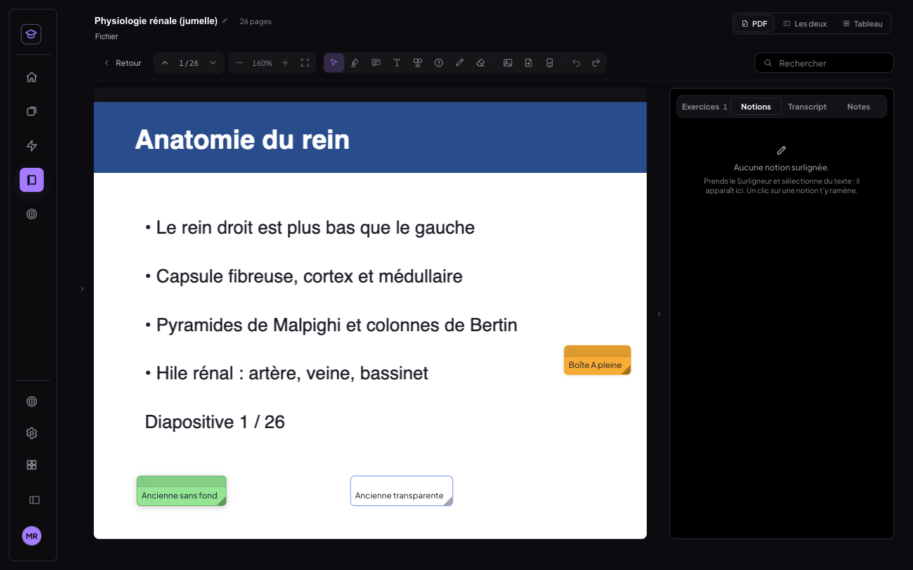 | 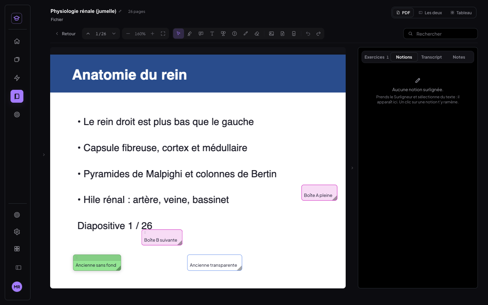 |

Tests (`t-couleurs-boite.mjs`) : boîte neuve `fond: "plein"`, ambre `rgba(245,165,36,.92)` et texte
`rgb(22,22,42)`. En bleu foncé, texte `rgb(255,255,255)`. Passage en teinté : la boîte suivante naît
`fond: "teinte"`. Deux boîtes « d'avant », l'une sans `fond`, l'autre transparente, restent identiques en
base et à l'écran.

Correctif en route : la barre d'une boîte placée en haut de l'écran passait **sous** l'en-tête du lecteur et
ses boutons étaient inaccessibles. Elle passe désormais sous la boîte quand le haut de la zone de lecture la
masquerait, et se replace au défilement.

---

## 2. Sélecteur de couleur : la cause du bug

Reproduit sur l'ancien code (`r-couleur-avant.mjs`, sur une boîte), puis tracé événement par événement.
Deux causes se cumulaient :

1. **Les événements avalés par le panneau flottant (cause principale).** La roue était rendue par un
   **portail React** à l'intérieur du petit panneau `.sc-pop` des barres flottantes (barre d'une boîte,
   d'une forme, mise en forme du texte). Or **les événements React remontent l'arbre des composants, pas
   celui du DOM**. Le `onMouseDown → preventDefault()` de `.sc-pop`, posé pour garder la sélection de
   l'éditeur, s'appliquait donc aussi au champ hex et au curseur de luminosité, pourtant placés ailleurs
   dans le DOM. Mesures sur l'ancien code :
   - clic dans le champ hex : `mousedown … defaultPrevented = true`. Le champ ne prend **jamais** le focus,
     qui reste dans l'éditeur de la boîte : **la frappe « 1e88e5 » partait dans le texte de la boîte**
     (« Boîte test1e88e5 couleur ») ;
   - curseur de luminosité glissé : valeur `96 → 96`, le pouce ne bouge pas (`preventDefault` sur le
     `mousedown` d'un `<input type=range>`).
2. **La fenêtre n'était pas bornée en hauteur.** Ouverte depuis une boîte du bas de l'écran, elle
   descendait jusqu'à y = 1 100 px sur un écran de 900 : champ hex et curseurs hors de l'écran, et viser à
   côté refermait tout.

   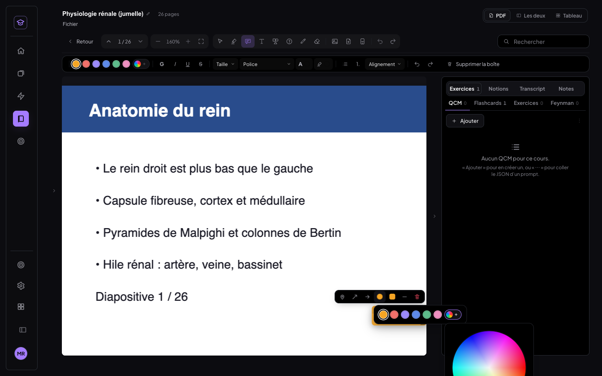

Les autres pistes ont été vérifiées et écartées : la conversion HSV ↔ hex était juste, et les gestionnaires
`onChange` existaient. L'input était contrôlé mais ne réécrivait la saisie qu'une fois un code valide.
Il a tout de même été refait pour ne plus jamais réécrire ce qu'on tape.

### Correction et nouveau comportement (`src/medrevise/pdf/Couleurs.jsx`)

- Le panneau **arrête la propagation React** de ses événements : aucun parent de l'arbre ne les voit. Il se
  **replace dans l'écran**, en dessous ou au-dessus de son bouton, et le petit panneau des barres aussi.
- Palette des **6 couleurs de base** + **Personnalisée**, qui ouvre un panneau type Figma : **carré
  saturation × luminosité**, **curseur de teinte**, **champ hex** (6 caractères, avec ou sans `#`,
  validation en direct, collage accepté, y compris « color: #E53935; »), aperçu avant / après.
- **Aperçu en direct** sur la boîte, la forme ou le texte sélectionné, sans rien écrire. **Entrée**, **OK**
  ou **clic ailleurs** valide, en une seule écriture donc une seule entrée d'annuler. **Échap** ou
  **Annuler** rend l'ancienne couleur.
- **Récentes** : les 5 dernières couleurs personnalisées, synchronisées comme avant.
- **Un seul composant** pour le crayon, le surligneur, les formes, les boîtes, le texte libre, la couleur
  **et la couleur de fond** du texte d'une boîte, le tableau et le dessin du téléphone.
- **Au doigt** : zones de prise de 36 px au moins (le bouton couleur de la barre faisait 35,7 px, corrigé),
  et pas de clavier virtuel qui surgit (le champ hex ne prend le focus qu'à la souris).

| Panneau « Personnalisée » | Curseurs + aperçu en direct sur la boîte | Au doigt (tablette) |
|---|---|---|
| 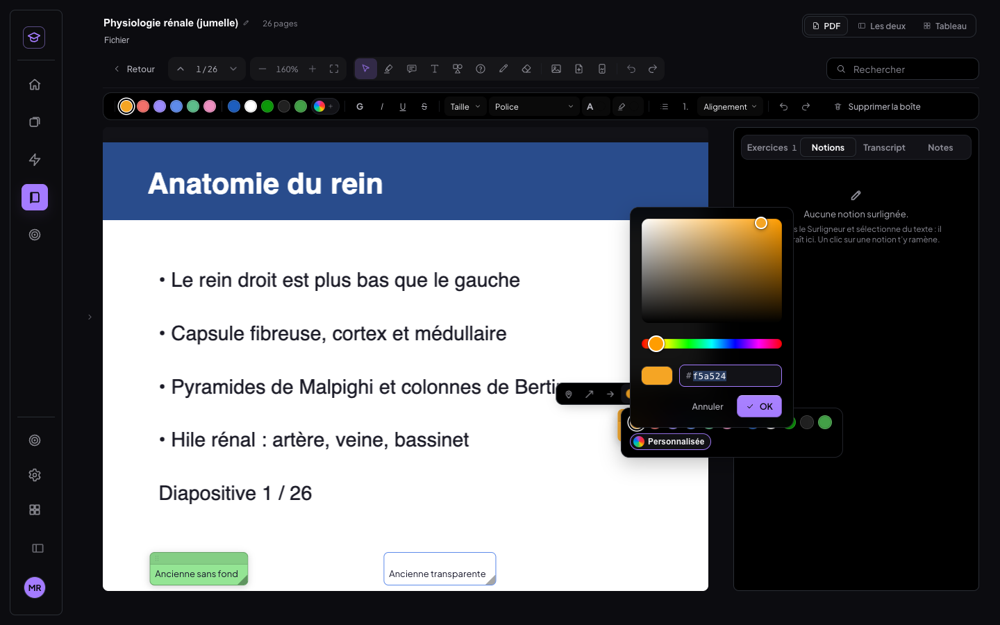 | 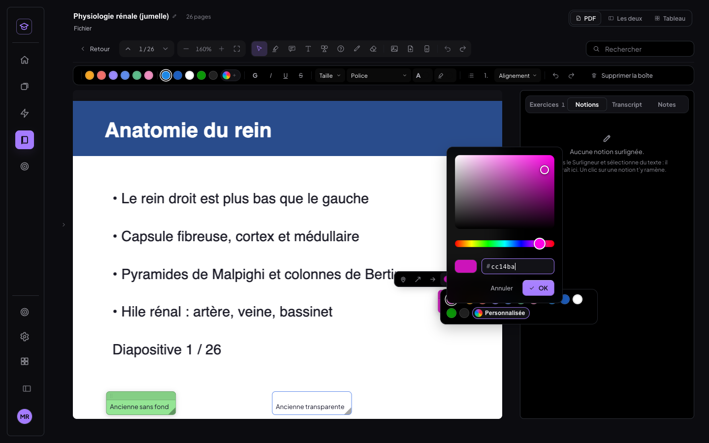 | 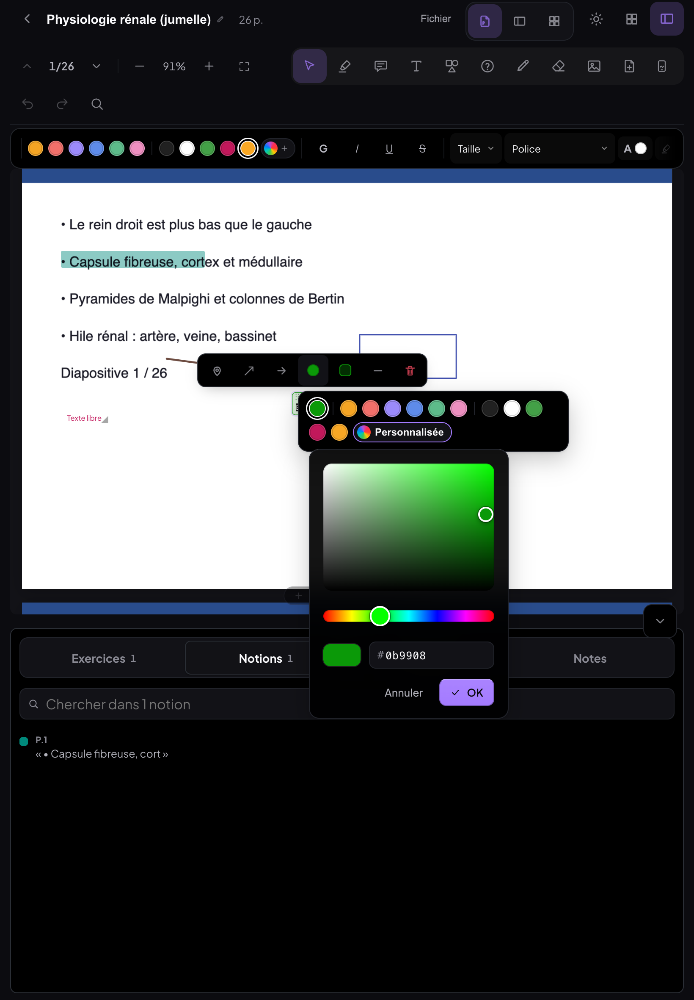 |

Tests :
- **`t-couleurs-boite.mjs`** (32/32) : hex tapé sans `#` → aperçu `rgba(30,136,229,.92)` sans écriture, et
  la frappe ne va plus dans la boîte ; Entrée → `#1e88e5` enregistré et ajouté aux Récentes ; ⌘Z → ambre,
  ⌘⇧Z → `#1e88e5` (une seule entrée d'annuler) ; collage « color: #E53935; » → `e53935` ; saisie invalide
  « 12x » signalée ; Échap → l'ancienne couleur revient, rien d'écrit ; teinte 208° → 306° ; carré à
  saturation 90 % / luminosité 80 % → `#cc14ba` ; clic ailleurs → validé.
- **`t-couleurs-outils.mjs`** (18/18) : couleur personnalisée tapée puis utilisée pour de vrai avec le
  surligneur, le crayon, la forme, l'outil Boîte et le texte libre. Forme sélectionnée : aperçu, Entrée,
  ⌘Z. Couleur **et fond** du texte d'une boîte.
- **`t-couleurs-doigt.mjs`** (11/11, tablette 820 px tactile) et **`t-telephone.mjs`** (7/7, dessin du
  téléphone en 390 px).

---

## 3. Fiche jumelle

### Données
Type additionnel synchronisé **`companion_pdf`**, un enregistrement par cours (`cp:<courseId>`) :

```
{ id, courseId, fileId, fileName, version, nsAnnot, nbPagesOrig, nbPagesFiche,
  pageMap: { versFiche[], versOrig[], scores[], methode, manuel },
  versions[], nonReplacees[], updatedAt }
```

- Le PDF de la fiche voyage par le **canal des blobs**, comme tous les PDF. Le champ `fileId` est couvert
  d'office par l'audit des blobs.
- Ses annotations sont des lignes `highlights` / `annotations` ordinaires avec
  `ficheId = '<courseId>::fiche:<version>'`. C'est un calque à part, sur le principe déjà utilisé par les
  documents de notes. Rien d'existant n'est réécrit.
- Supprimer définitivement un cours (`purgeFiche`) emporte aussi sa fiche jumelle, ses annotations et ses
  positions de lecture, pour ne pas laisser d'orphelins.

### Correspondance des pages : la méthode
1. **Texte de chaque page** : texte natif (pdf.js), sinon la **couche OCR existante** du fichier. Le
   **titre** est fait des lignes à la plus grande taille de police de la page.
2. **Mots** normalisés (minuscules, sans accents, mots vides retirés), pondérés **tf × idf** sur l'ensemble
   des pages des deux documents. Un mot rare compte beaucoup, un mot présent partout presque rien. Les mots
   du titre comptent triple.
3. **Similarité cosinus** de chaque diapositive avec chaque page de fiche.
4. **Alignement monotone** (programmation dynamique, comme un alignement de séquences) : on respecte l'ordre
   des deux documents et on maximise Σ (similarité − seuil 0,15). Une page de fiche restée seule est une
   **« page ajoutée dans la fiche »** ; une diapositive restée seule est une **« page sans équivalent »**.
5. **Pages déplacées** : deux pages restées seules mais très semblables (≥ 0,5) sont appariées même hors de
   l'ordre.
6. **Fusions** : une diapositive restée seule dont le texte se retrouve dans la page de fiche de sa voisine
   y est rattachée (deux diapositives résumées en une page).

Sans aucun texte d'un côté, la correspondance par défaut est page n ↔ page n.

### Taux de réussite sur le cours de test
Cours de test : 26 diapositives (physiologie rénale). Fiche de 30 pages : les diapositives 12 et 13
fusionnées, 5 pages ajoutées (synthèse, schéma, mnémotechniques, QCM, points clés). La vérité terrain est
dans `verite.json`.

| Jeu | Pages de fiche bien classées | Diapositives menant à la bonne page | Temps de calcul |
|---|---|---|---|
| fiche (texte natif) | **30/30 (100 %)** | **26/26 (100 %)** | 3 ms |
| fiche « difficile » (titre tronqué, 3 mots gardés par page, page ajoutée qui cite 16 notions) | **30/30 (100 %)** | **26/26 (100 %)** | 2,5 ms |
| cours **scanné** (images seules, texte venu de l'OCR de l'app : 26/26 pages, confiance 93 %) | **30/30 (100 %)** | — | — |
| nouvelle version de fiche (remplacement : page retirée, page déplacée, annexe) | **30/30 (100 %)** | **26/26 (100 %)** | 2 ms |

Marge mesurée sur le jeu difficile : le pire vrai appariement est à 0,33 ; la meilleure similarité d'une
page ajoutée avec une diapositive atteint 0,19, au-dessus du seuil de 0,15. Ce n'est pas le seuil qui l'écarte
mais l'alignement monotone, parce que les vraies paires voisines rapportent davantage. C'est le cas le plus
fragile de la méthode.

À ne pas surinterpréter : ces jeux sont **générés**. Une vraie fiche faite par Claude, très reformulée, peut
descendre sous ces chiffres. C'est l'usage de l'éditeur de correspondance, et l'import affiche toujours son
résumé (« 25 associées · 5 ajoutées ») avec un bouton « Vérifier la correspondance ».

### Interface
- **Menu Fichier** (section « Fiche jumelle ») : *Importer la fiche jumelle…* ; une fois importée :
  *Correspondance des pages…*, *Remplacer la fiche (nouvelle version)…*, *Annotations non replacées (n)*.
- **Barre du lecteur** : segment **Original · Fiche**, avec les raccourcis **Tab** (hors champ de saisie) et
  **⌘⇧F** / Ctrl+Maj+F. La bascule va à la page correspondante en gardant le **zoom**, la **position
  relative dans la page** et l'**outil actif**, avec un fondu court (180 ms). Depuis une page ajoutée ou sans
  équivalent, on arrive à la plus proche qui en a une, avec un avis. Les deux documents restent en mémoire :
  revenir est instantané.
- **Les deux** : l'autre document en lecture, à côté, avec son propre calque, synchronisé page à page dans
  les deux sens, et « Annoter ce côté » pour échanger. Sur ordinateur et tablette en paysage ; en tablette
  portrait ou sur un écran étroit, il n'y a que la bascule.
- **Bibliothèque** : petite marque **« fiche »** sur les cours qui en ont une (arbre, grille, liste). Sans
  fiche, rien ne change dans l'interface.

| Bascule : original p.9 | → fiche p.10, même zoom et même position, Surligneur gardé |
|---|---|
| 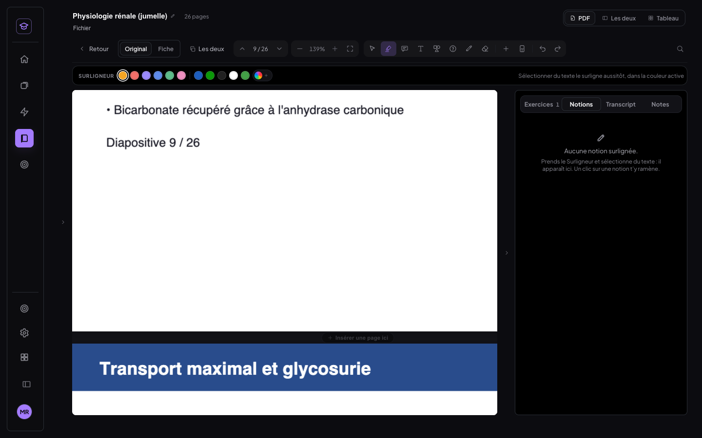 | 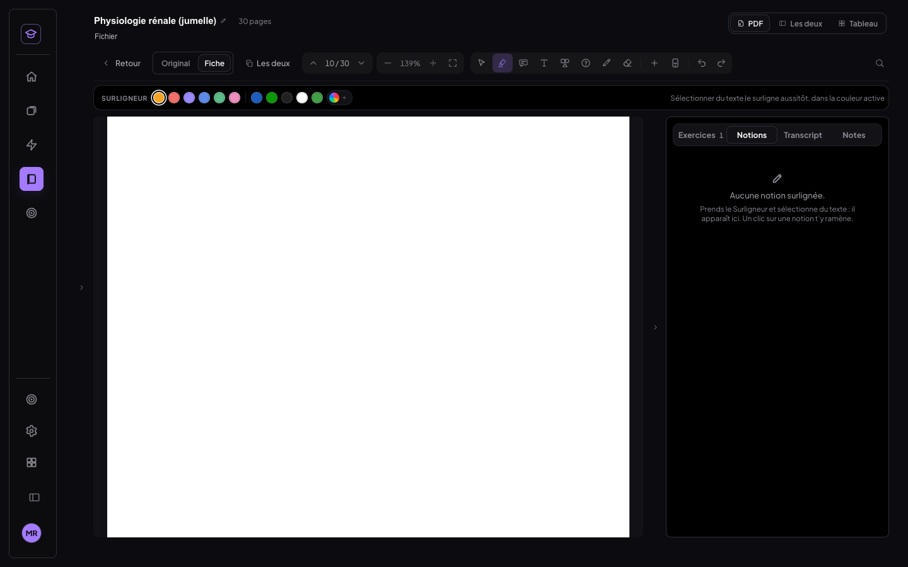 |

**Côte à côte** (original p.20 ↔ fiche p.22, après deux pages ajoutées) :
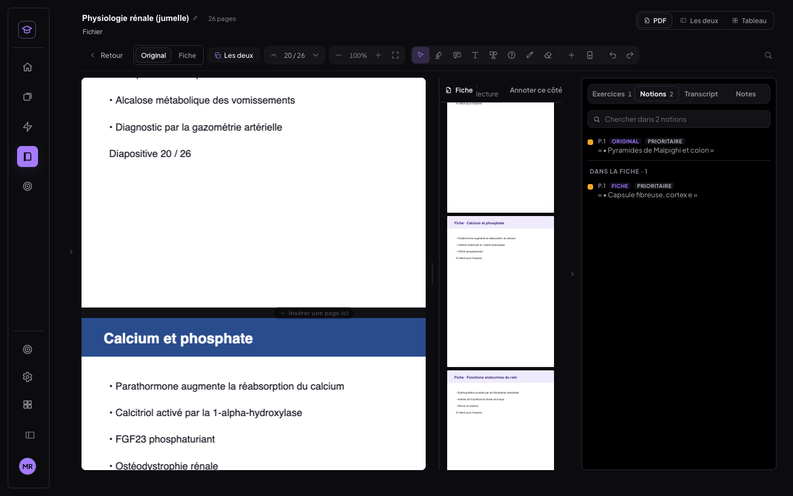

**Éditeur de correspondance** : glisser une page de fiche sur une diapositive, menu « — » de secours au
doigt, « Automatique » pour recalculer.
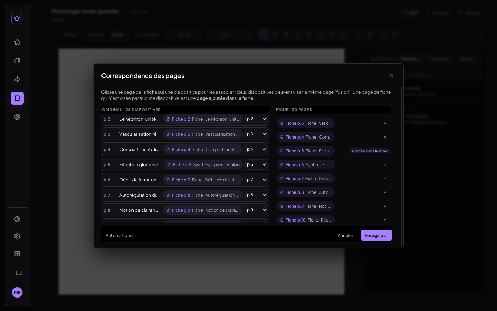

| Tablette paysage : les deux | Tablette portrait : bascule seule | Marque dans la Bibliothèque |
|---|---|---|
| 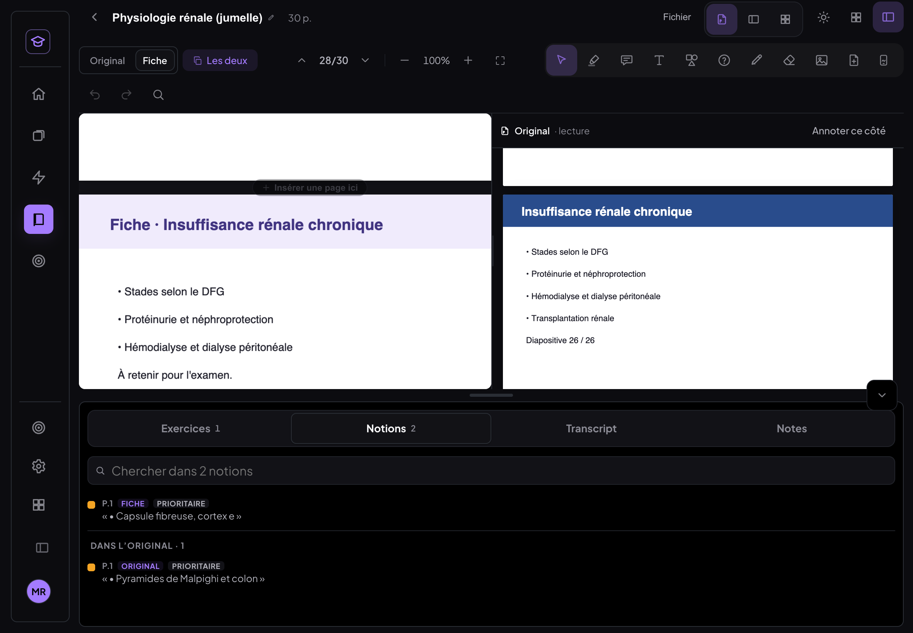 | 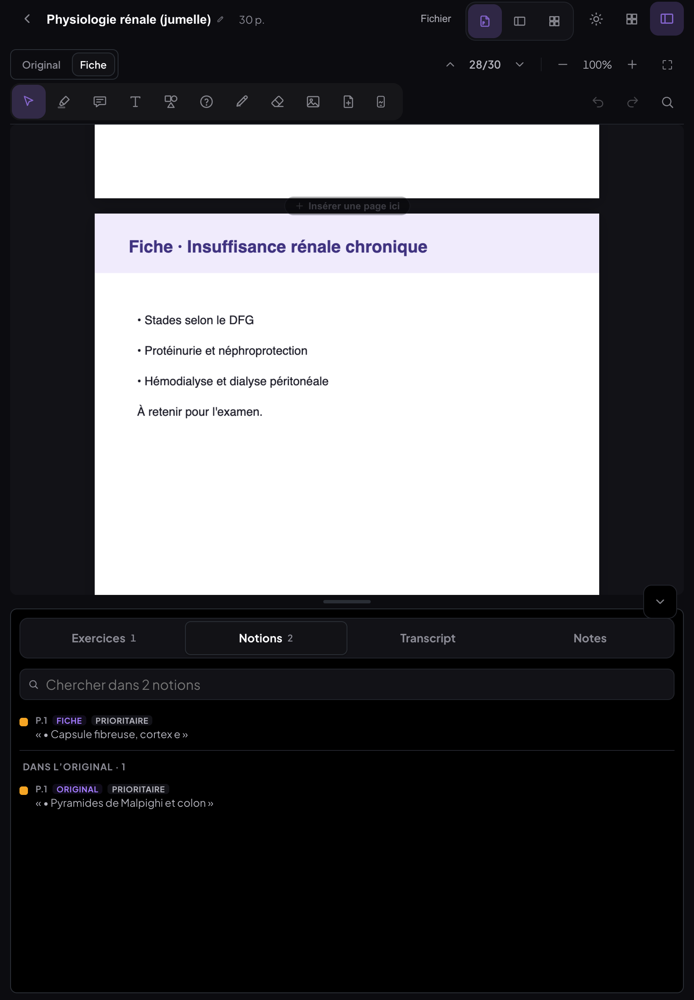 | 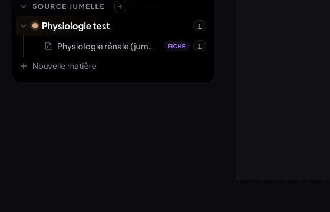 |

### Annotations, notions, positions
- Une annotation posée sur la fiche reste sur la fiche, et inversement (vérifié en base : calques `f-fj` et
  `f-fj::fiche:1`).
- **Notions** : le panneau liste celles des deux documents (section « Dans la fiche » / « Dans
  l'original »). Un clic bascule et amène sur le passage. **Flashcards** et **Transcript** sont ceux du
  cours, identiques des deux côtés.
- **Position de lecture par document** : `rp:f-fj` et `rp:f-fj::fiche:1`. Le cours rouvre sur le dernier
  document affiché par l'appareil, à sa position.
- L'historique d'annuler repart à zéro quand on change de document, car chaque calque a le sien.

### Remplacer la fiche
La nouvelle version est rapprochée de l'ancienne par la même similarité. Chaque annotation de l'ancienne est
**recopiée**, dans le calque `…::fiche:2`, sur la page retrouvée. Celles dont la page n'est pas retrouvée
sont **listées** (menu Fichier). Les anciennes **ne sont ni modifiées ni supprimées** : elles restent dans le
calque de la version précédente, gardée dans `versions`. Une correspondance corrigée à la main est recomposée
pour la nouvelle version.

Limite : l'ancre d'un surlignage (indices des morceaux de texte de la page) n'est gardée que si le texte de
la page est identique. Sinon il est replacé à la même position géométrique (`replaceApprox`).

| Résumé du remplacement | Annotations non replacées |
|---|---|
| 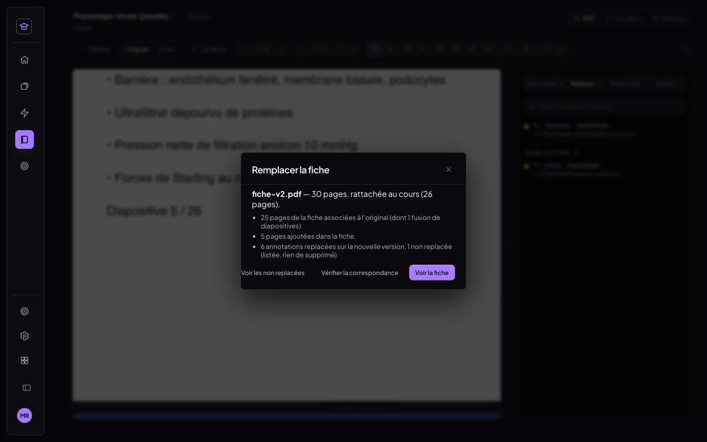 | 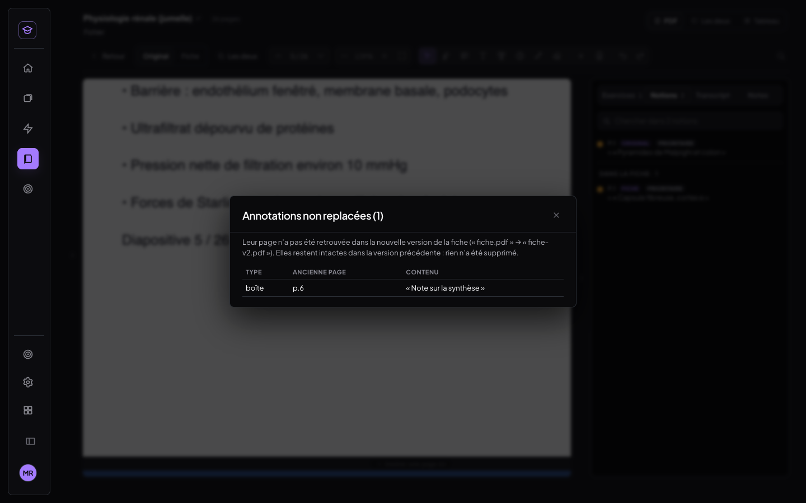 |

---

## 4. Tests (Chrome headless, `scripts/tests-fiche-jumelle/`, voir LISEZMOI.md)

| Test | Résultat |
|---|---|
| `tout.sh` : boîtes 32, outils 18, doigt 11, téléphone 7, import 11, bascule 13, calques 15, côte à côte 13, éditeur 11, tablette 6, remplacement 16 | **153/153** |
| `t-jumelle-synchro.mjs` : 2ᵉ appareil (faux Supabase, profils neufs) — 1 ligne `companion_pdf` au faux cloud, PDF de la fiche dans le bucket, même `pageMap` sur B, fiche affichée sur B, **SHA-256 identique** (`0f340f19…`), annotation posée sur A visible sur la fiche de B, marque dans la Bibliothèque de B | **11/11** |
| `t-jumelle-ocr.mjs` : cours scanné, OCR de l'app (26/26 pages, 93 %), correspondance par le texte OCR | **30/30 pages** |
| Non-régression des boîtes (`tests-finitions/t-bureau.mjs`) — ancien code **33/34**, nouveau **33/34** : seul échec des deux côtés, le 4b, qui demande le faux cloud sur ce port | identique |
| MealWeek, builds de production servis sur la même origine, ordinateur et téléphone | **identique au pixel** (`cmp`) |
| Build `npm run build` | vert |

Ce qui n'a **pas** été testé : un vrai iPad et un vrai téléphone (l'émulation CDP tactile les remplace), et
le vrai cloud Supabase (volontairement : faux Supabase local).

---

## 5. Migration SQL
`supabase/migrations/20261015_companion_pdf.sql` : **un index partiel** (`where store = 'companion_pdf'`),
additif et idempotent, **non appliqué**. Sans lui, l'app fonctionne exactement pareil :
`medrevise_records` est générique et `medrevise_push` n'a pas de liste blanche de stores. Pour l'appliquer :
Supabase → SQL Editor → coller le fichier → Run. Une requête de vérification en lecture seule est à la fin
du fichier.

## 6. Commits
- `479472e` feat(medrevise): boîtes en fond plein par défaut, dernier fond choisi mémorisé par appareil
- `a247279` fix(medrevise): sélecteur de couleur réparé — hex, curseurs, aperçu en direct, Entrée/Échap, récentes
- `e3248b5` feat(medrevise): fiche jumelle — PDF résumé à côté du cours, bascule Original ⇄ Fiche page à page
- `84860ad` test(medrevise): banc de la fiche jumelle et du sélecteur de couleur
- commit de ce compte rendu (docs + captures)
