# Compte rendu — menu Fichier en sections, carnet & apprentissage depuis la révision, calendrier horaire École (17/10)

Trois chantiers sur MedRevise, testés dans Chrome (banc local : Vite `:5199` **sans Supabase** +
Chrome headless 9333 + faux Hyperplanning `:54410`), jamais sur le vrai cloud. MealWeek et
`src/shared/` : **non touchés** (vérifié : `git diff 3c2d1a1 HEAD -- src/shared src/mealweek` vide).

Captures : `docs/img/fichier-carnet-calendrier/`. Tests : `scripts/tests-fichier-carnet-calendrier/`
(chantiers 1 et 2) et `scripts/tests-emploi-du-temps/t-grille.mjs` (chantier 3).

---

## 1. Menu Fichier : on sait toujours sur quoi on agit

`pdf/MenuFichier.jsx` (réécrit), branché dans `pdf/PdfReader.jsx` ; confirmation
`pdf/SuppressionDocument.jsx` ; `lib/fichiersCours.js#supprimerPrincipal` (nouveau).

**Trois sections nettement séparées**, chacune avec un en-tête (icône + rôle + nom du fichier) :

| Section | Entrées |
|---|---|
| **Cours** | Renommer le cours (F2) · Fichiers du cours… · Supprimer le cours… (rouge) |
| **Diapo originale — `cours.pdf`** | Exporter la diapo annotée (⌘P) · Autres formats (.md · PNG par page) · Export spécial IA… (⌘⇧E) · Textes d'annotations (JSON) Exporter · Importer · Reconnaissance de texte… · *[Mise en page… — document créé dans l'app]* · Remplacer ce fichier… · Supprimer la diapo originale… (rouge) |
| **Fiche — `fiche.pdf`** | mêmes entrées, même ordre (« Exporter la fiche annotée », « Supprimer la fiche… ») · *Correspondance des pages…* (propre à la fiche, avant « Remplacer ») |
| **Fiche — aucune** | Importer une fiche |

- **Document affiché mis en évidence** : sa section est teintée, marquée « affiché », et seule elle porte
  les raccourcis ⌘P / ⌘⇧E (qui agissent donc toujours sur le document affiché). L'autre est en retrait.
- **Action de l'autre section** : le lecteur affiche d'abord ce document (bascule Original ⇄ Fiche), attend
  qu'il soit prêt (PDF chargé, annotations de SON calque lues — ou l'éditeur pour un document de l'app),
  puis lance l'action. Remplacer, supprimer et correspondance agissent directement.
- **Suppressions** : une confirmation qui répète le **nom exact** du fichier et dit ce qui est **conservé**
  (annotations, flashcards et leur planning, notions, transcripts, sessions, onglet Notes) et ce qui part.
  `putBackup` avant toute suppression ; le fichier n'est jamais effacé (Réglages › Archives).
- **Refus** : « Supprimer la diapo originale » tant qu'une fiche existe ouvre une explication : *Importez
  d'abord un autre document principal ou remplacez-le* (bouton « Remplacer la diapo originale… »).
- Même menu, mêmes sections : cours PDF, **document créé dans l'app** (section « Document original »,
  « Exporter le document annoté » — formulation exacte pour un document qui n'est pas une diapo), **onglet
  Notes**, fiche HTML (« Fiche HTML — … », import de fiche grisé avec sa raison).
- Tablette / fenêtre étroite : le menu tient dans l'écran (recalé à 8 px du bord, défilant), cibles ≥ 42 px.

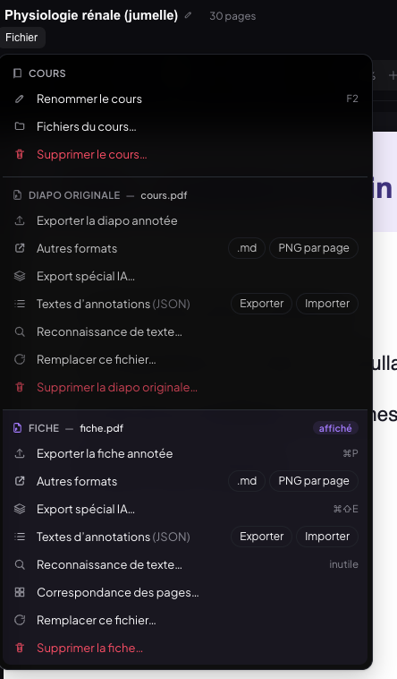
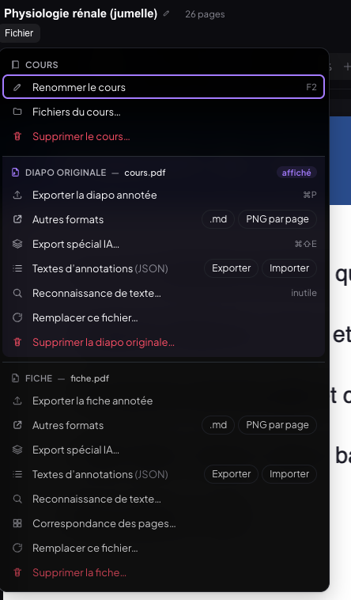
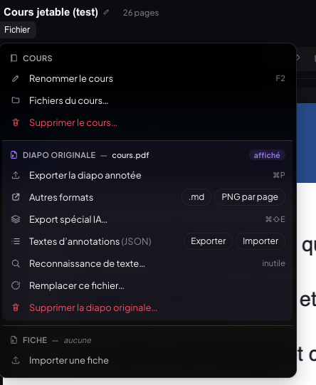
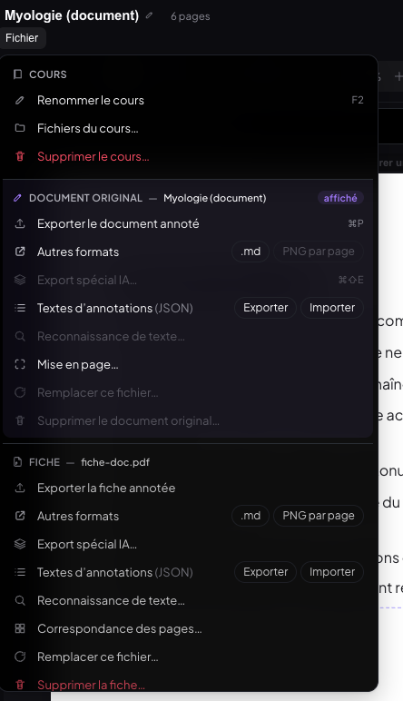
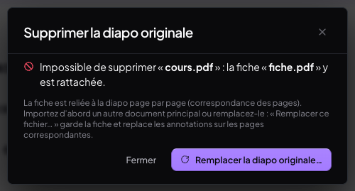
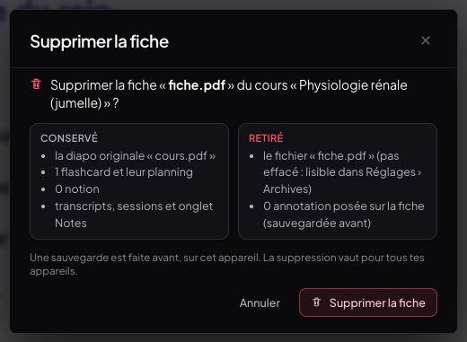
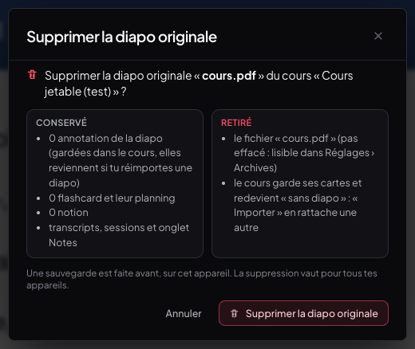
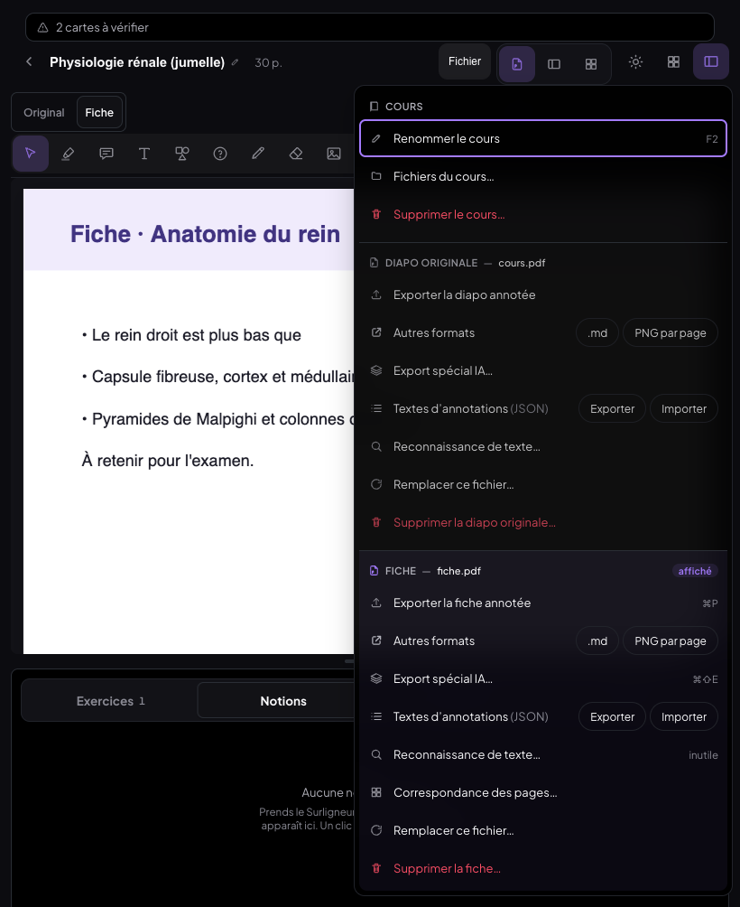

---

## 2. Révision → carnet d'erreurs et apprentissage en un geste

`components/SuiteNotation.jsx` (nouveau), `lib/carnetPreReponses.js` (nouveau), branché dans
`session/Session.jsx` (Réviser), `session/SeanceFC.jsx` (séance du jour, ordinateur et téléphone) et
`mobile/MobileSession.jsx`. Réglages › Carnet d'erreurs : section « Pré-réponses rapides ».

- Après une note, **deux actions discrètes** sous les boutons — « Carnet d'erreurs » et « Apprentissage » —
  pour la carte **qui vient d'être notée** (nommée : « Carte notée · … »). Visibles 2 s, puis repliées dans
  une icône qui les rouvre.
- **Carnet d'erreurs** : menu de pré-réponses à un tap — Je ne connais pas · Pas compris · Confusion avec une
  autre carte · Inversion (latéral/médial, origine/insertion…) · Oubli d'un élément · Faute d'orthographe du
  terme · Autre… (formulaire complet). L'entrée est créée tout de suite (la carte elle-même, avec son
  recto/verso ; `carnetType` = la pré-réponse ; `carnetAt` = la date ; note facultative), toast
  « Ajouté au carnet · Modifier ». Pré-réponses éditables (enregistrement additionnel `carnetPreReponses`
  du store `prompts`, synchronisé comme `carnetPuces`).
- **Apprentissage** : un tap ajoute la carte à `learning_set` — rangée par matière puis cours à l'affichage —
  toast « Ajoutée à l'apprentissage · Matière › Cours ». Ordinateur : la carte se **glisse** sur l'onglet
  Apprentissage de la barre latérale (Réviser et séance du jour).
- **Indépendance prouvée** : diagnostic (`lib/diagnosticExport.js` + champs bruts de planification +
  journal + séance du jour) relevé avant / après **chaque** action. Apprentissage : **strictement
  identique** (même `updatedAt` des cartes). Carnet : identique hors de ses propres champs.
- Téléphone : deux boutons pleine largeur (46 px), menu en **feuille du bas** (cibles 48 px).

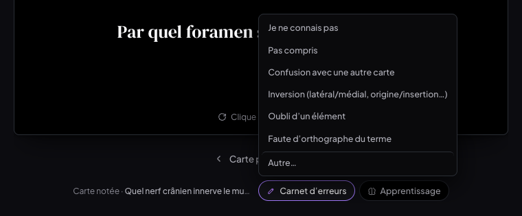

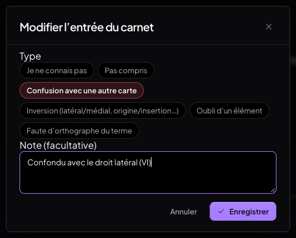
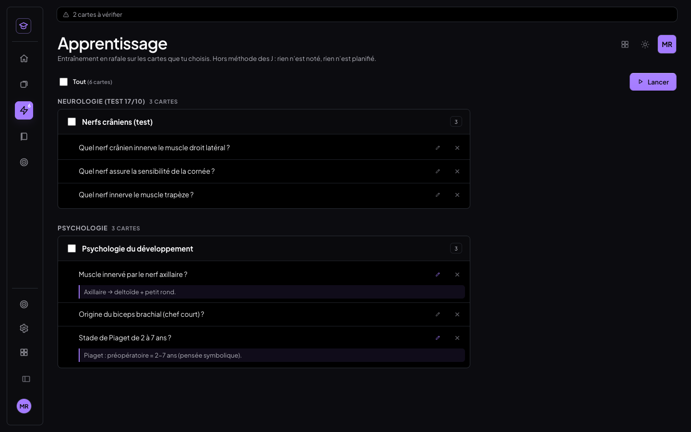
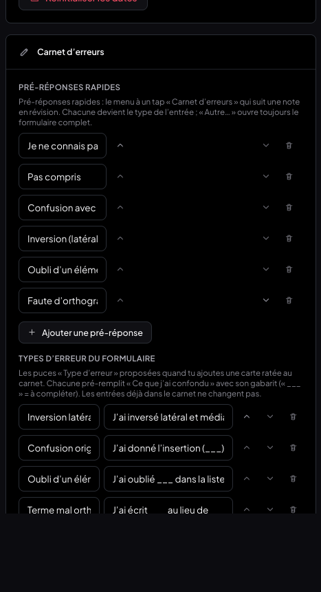
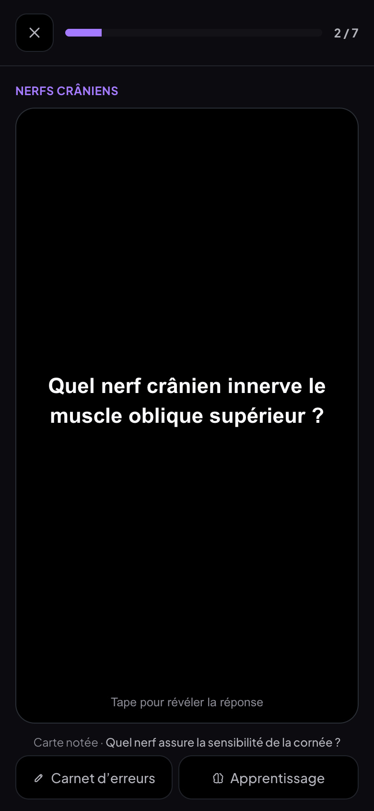
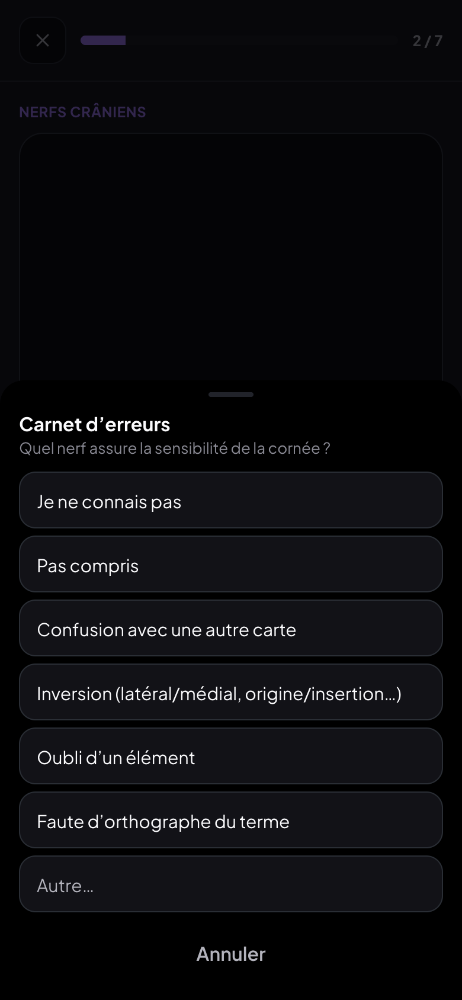

---

## 3. Emploi du temps École : un vrai calendrier horaire

`components/GrilleEcole.jsx` (nouveau) + `styles/edt-grille.css`, branché dans
`components/EmploiDuTemps.jsx#CalendrierEcole` (ordinateur, tablette, téléphone). **Mode « Mes J » :
rien ne change** (comparaison au pixel de la grille des J et de la séance du jour, `t-ecole.mjs`).

- Colonne des heures (première heure de cours de la semaine − 1 h → dernière + 1 h, au moins 8 h–19 h),
  jours en colonnes (lun → ven ; samedi / dimanche seulement s'il y a cours), lignes d'heure (et demi-heures
  en pointillé), **trous visibles**, cours à leur **hauteur exacte**, **chevauchements côte à côte**.
- **Ligne rouge** de l'heure actuelle (et l'heure dans la colonne des heures), **jour actuel surligné**,
  cours en cours au **liseré pulsant** ; cours annulé barré, modifié souligné d'un liseré.
- Bloc : couleur du cours (bordure gauche + fond teinté), intitulé, prof, salle / Teams, tronqués selon la
  hauteur (3 densités). **Tap → fiche détaillée** : horaire, prof, salle, matière reliée, Ouvrir, Transcrire
  (Teams en cours) — sans Ouvrir/Transcrire au téléphone, qui n'a pas de lecteur.
- Navigation : précédent / suivant, **glissement horizontal** (doigt, trackpad), « Aujourd'hui », sélecteur
  **Jour · 3 jours · Semaine** (défaut : téléphone → Jour, tablette → 3 jours, ordinateur → Semaine ;
  choix mémorisé par appareil). En-tête des jours et colonne des heures **collants**.
- Prochain cours, changements détectés et rappel « jeudi 16 h » restent **au-dessus** de la grille.
- Heures toujours celles de Bruxelles (appareil en New York / Tokyo : identiques), changement d'heure du 25/10 juste.

**Données** : le lien iCal réel n'est pas configuré (`HELHA_ICAL_URL` absente sur Vercel). Les tests
utilisent la semaine 1BKINE12 au format Hyperplanning du banc (`tests/emploi-du-temps/semaine-1bkine12*.ics`)
— et une **v3** ajoutée pour ce chantier : un cours qui chevauche les TP du mardi, un cours du soir jusqu'à
20:30 et un samedi.

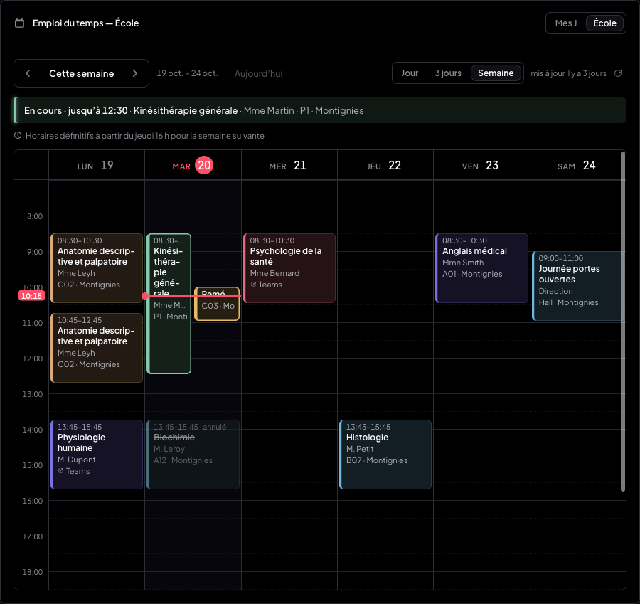
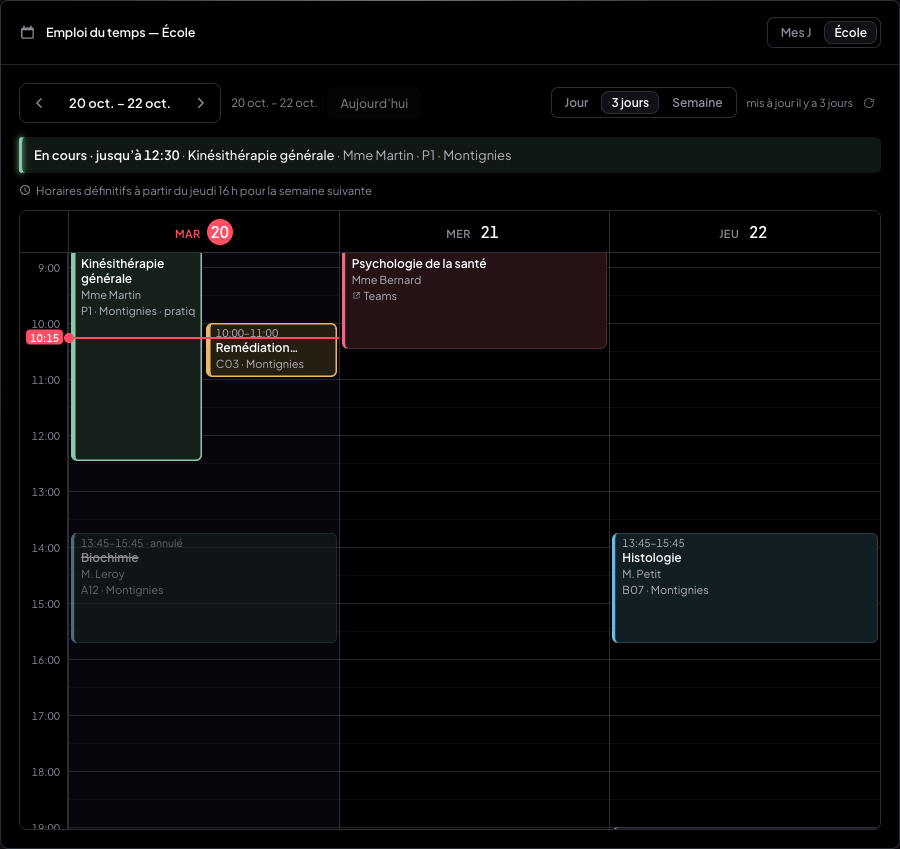
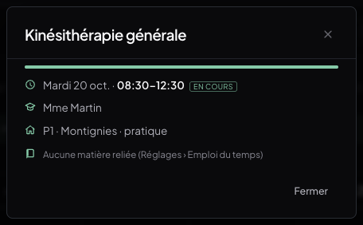
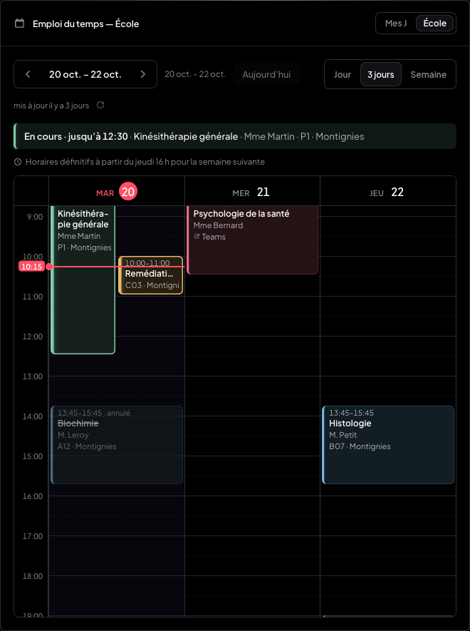
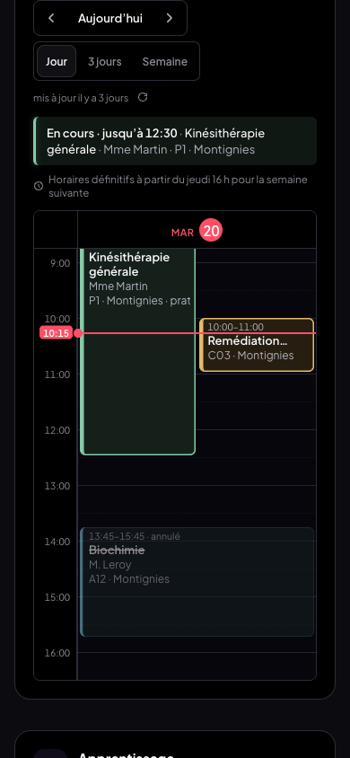
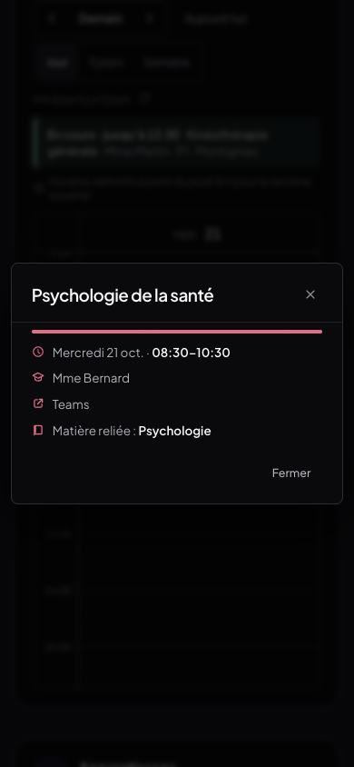

---

## Tests

| Suite | Résultat |
|---|---|
| `t-menu-sections.mjs` — sections, libellés, mise en évidence, action différée (PDF → fiche, fiche → document), ⌘P, refus, confirmations, suppressions réelles + putBackup, document, onglet Notes, HTML | **37/37** |
| `t-menu-sections-tablette.mjs` — 1 180, 1 024, 820 (portrait), 761 px | **21/21** |
| `t-revision-carnet.mjs` — Réviser : 5 cartes notées, 2 au carnet, 2 en apprentissage + 1 glissée, diagnostics avant/après | **21/21** |
| `t-revision-mobile.mjs` — téléphone : boutons 46 px, feuille du bas, séance du jour | **14/14** |
| `t-revision-seance-reglages.mjs` — séance du jour (ordinateur), pré-réponses éditées, « Autre… », glisser | **10/10** |
| `t-grille.mjs` — grille horaire (semaine, hauteurs, trous, chevauchement, maintenant, navigation, vues, tablette, téléphone) | **33/33** |
| Emploi du temps (mis à jour pour la grille) : t-ecole 32 · t-changements 11 · t-reglages 19 · t-mobile 20 · t-hors-ligne 5 | **87/87** |

**Non-régression** (même banc) : fiche jumelle et documents 198/198 + correspondance 3 × 30/30 · fichiers
d'un cours, carnet, apprentissage, transcript 97/97 (le carnet et la recherche de la fiche « Psychologie du
développement » corrigés côté TESTS : la fiche sortait de l'écran, la liste des pré-réponses partageait une
classe avec celle des puces — classe distincte désormais). Les trois anciens tests du menu unique
(`t-menu-fichier`, `t-menu-actions`, `t-menu-tablette`) sont remplacés par `t-menu-sections*`.
`t-non-configure` se lance sur un Vite démarré SANS `HELHA_ICAL_URL` (hors de `tout.sh`). MealWeek et
`src/shared/` : aucun fichier modifié.

## Commits

- `d44aa26` feat : menu Fichier en sections — Cours · Diapo originale · Fiche
- `e145a59` feat : après une note, carnet d'erreurs par pré-réponse et apprentissage en un geste
- `8bf2089` wip : grille horaire École + semaine de test v3
- (ce commit) feat : calendrier horaire École branché, tests mis à jour, compte rendu
