# Compte rendu — carnet d'erreurs · mode Apprentissage · menu « Copier » du transcript · fichiers d'un cours (16/10/2026)

Quatre chantiers MedRevise, livrés et testés dans Chrome sur un banc **local** (Vite sans Supabase +
Chrome headless ; jamais le vrai cloud) : ordinateur, tablette au doigt, téléphone.

**Règles tenues :**
- rien dans `src/shared/` ni dans MealWeek : `git diff 55a499f HEAD -- src/shared src/mealweek` ne
  donne aucun fichier, et MealWeek est **identique au pixel** avant/après (builds de production,
  ordinateur et téléphone) ;
- aucune écriture Supabase destructive sans action de l'utilisateur : les seules suppressions sont
  « Supprimer la fiche jumelle », avec confirmation et `putBackup` avant ;
- aucune migration ;
- DA existante ;
- le mode Apprentissage reste indépendant des J et de FSRS (preuve par test, §2).

---

## 1. Carnet d'erreurs : pré-réponses

La carte « Pourquoi tu l'as loupée ? » d'une séance (ordinateur : `session/Session.jsx` ; téléphone :
`mobile/MobileSession.jsx`) est désormais un composant commun, `components/SaisieCarnet.jsx` :

- **Puces « Type d'erreur »** :
  - liste : Inversion latéral/médial · Confusion origine/insertion · Oubli d'un élément de liste ·
    Terme mal orthographié · Mauvaise innervation · Mauvais chiffre/valeur · Raisonnement · Autre ;
  - une puce pré-remplit « Ce que j'ai confondu » avec son gabarit (« J'ai dit innervé par ___ au
    lieu de ___ ») ;
  - le premier `___` est sélectionné, on tape directement, et **Tab** passe au suivant.
- **« Astuce pour ne plus me tromper »** est suggérée depuis la flashcard ratée (recto + verso),
  modifiable ou effaçable.
- **Les puces sont éditables** dans Réglages › Carnet d'erreurs : ajouter, renommer, réordonner,
  supprimer, rétablir la liste. Elles sont stockées dans l'enregistrement additionnel
  `carnetPuces` (store `prompts`, synchronisé), sur le même modèle que `reglagesFC`.
- **Les entrées existantes ne changent pas** :
  - la note reste dans `carnetRaison` ;
  - `carnetType` et `carnetAstuce` sont *ajoutés* aux nouvelles entrées seulement ;
  - le carnet affiche les trois, et le prompt des flashcards d'erreur reçoit `type_erreur` et `astuce`.

| Puce choisie, gabarit en cours | Carnet | Réglages | Téléphone |
|---|---|---|---|
| 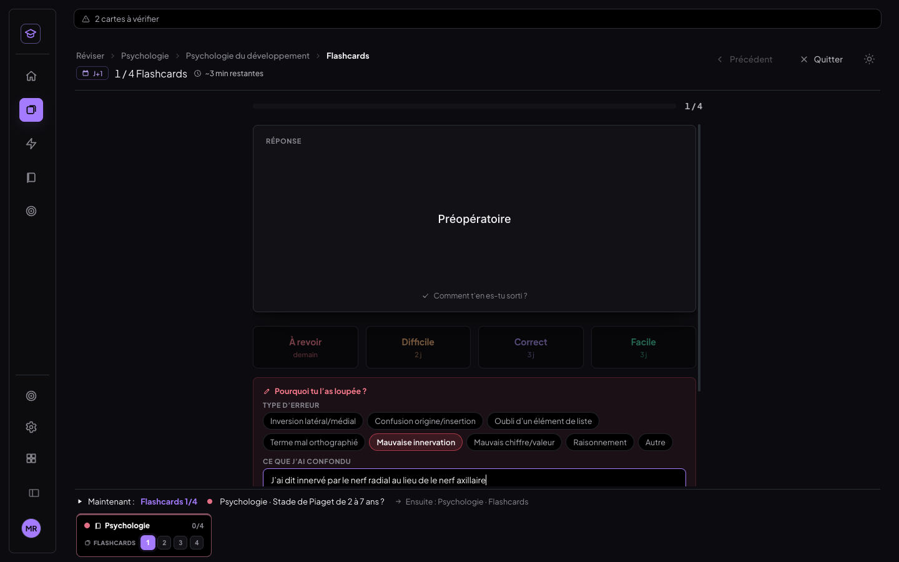 | 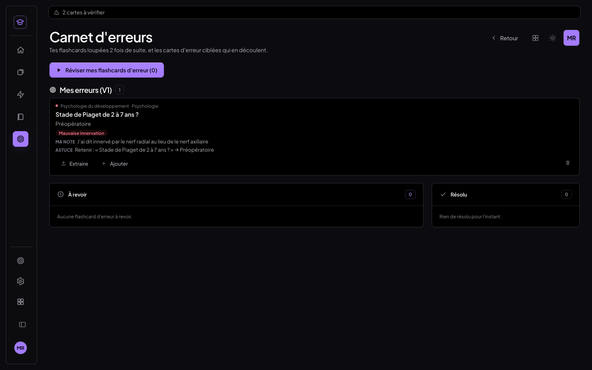 | 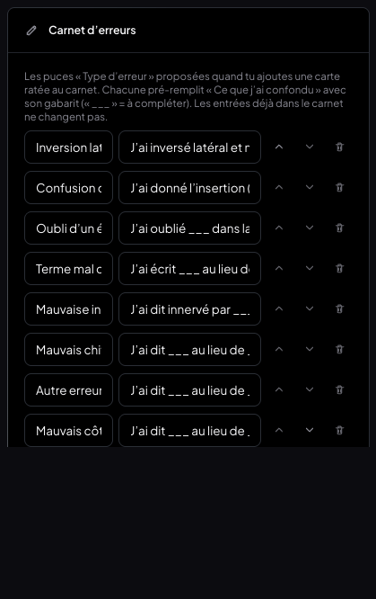 | 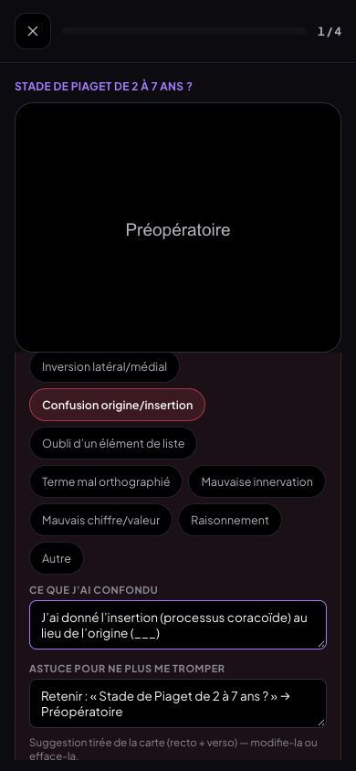 |

## 2. Mode Apprentissage : glisser-déposer et notes

- **Glisser-déposer** (HTML5 : souris, trackpad ; appui long au doigt sur iPad et Chrome tactile) :
  - on peut glisser une flashcard, ou toute la sélection si la carte en fait partie, depuis le
    panneau Flashcards d'une fiche ou depuis les cartes de la Bibliothèque, vers l'onglet
    **Apprentissage** de la barre latérale ;
  - l'onglet s'éclaire pendant le glisser et s'illumine à l'approche ;
  - son **compteur** (cartes en apprentissage) s'incrémente avec une petite impulsion ;
  - dans la Bibliothèque, saisir une carte ne déplace pas la fiche (le glisser-déposer des fiches
    ne démarre pas).
- **Rangement : toujours par matière, puis par cours**, quel que soit le chemin d'ajout. Une
  matière vidée disparaît d'elle-même, et la séance suit le même ordre.
- **Notes** : un crayon sur chaque carte ouvre un champ plein texte, sous la carte, à sauvegarde
  automatique (« Enregistré »). La note s'affiche aussi **en séance, après retournement, sous la
  réponse**. Elle est stockée dans `learning_set.notes[cardId]`, jamais sur la carte, et
  l'écriture de la liste conserve les notes.
- **Indépendance prouvée par test** : avant puis après tout le scénario, on compare une empreinte
  des cartes (`dueDate`, intervalles, champs FSRS, historique), du store `meta` (séance du jour),
  du journal des révisions (`review_log` et sa file d'envoi) et des sessions. Elle est
  **identique** ; aucune fiche n'a été déplacée.

| Glisser depuis le panneau (compteur 3) | Onglet Apprentissage : matières, cours, notes | Note en séance |
|---|---|---|
| 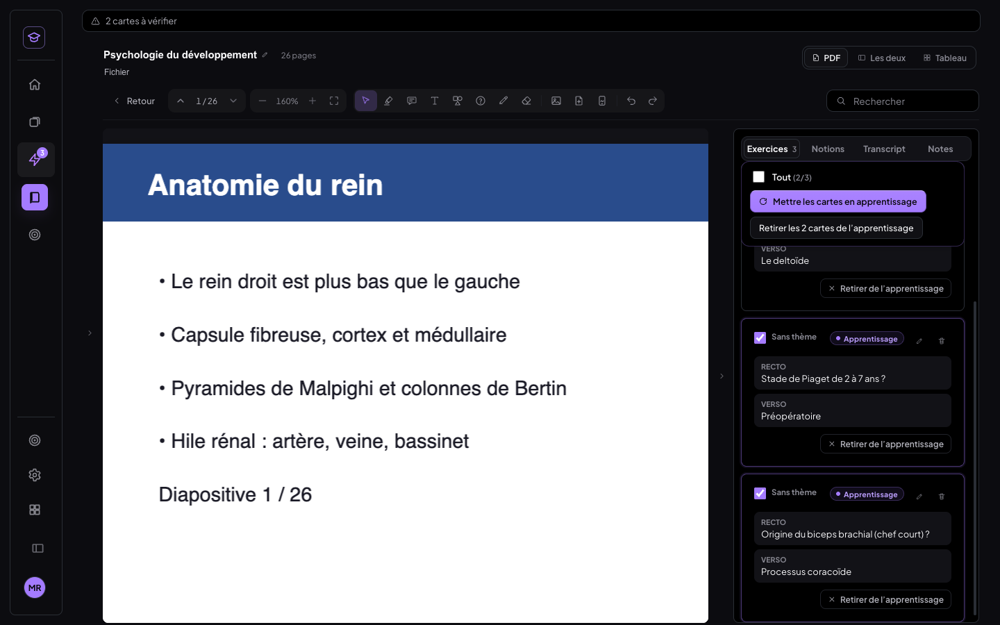 | 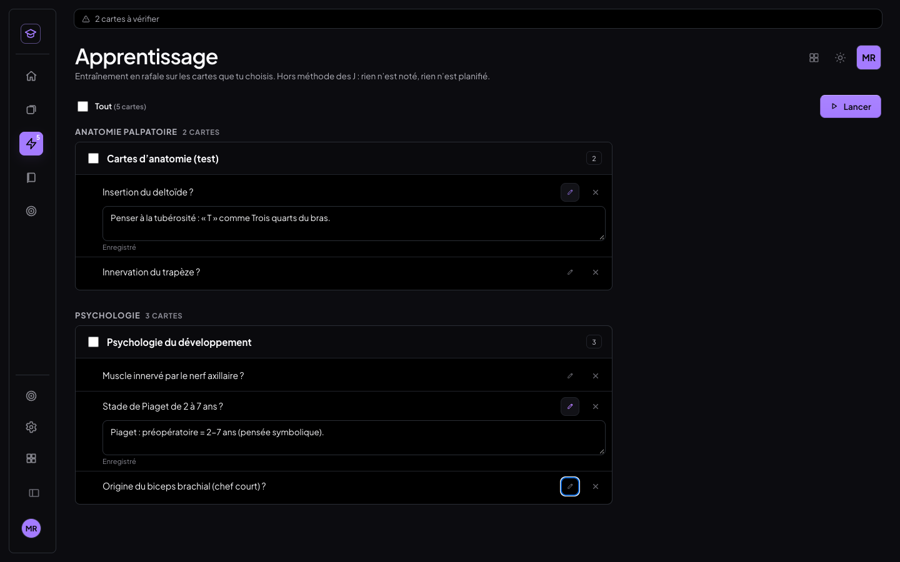 | 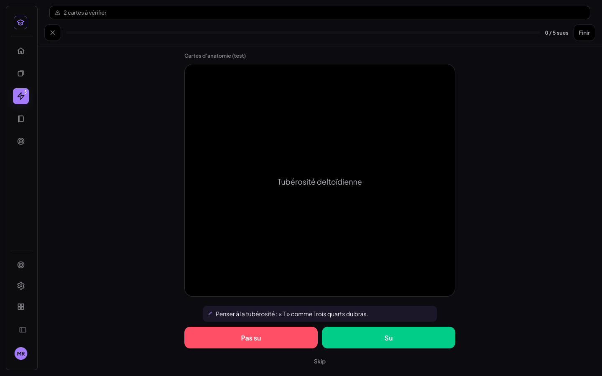 |

## 3. Transcript : menu « Copier » qui passait à travers — cause et correctif

**Ce qui a été examiné**, parmi les hypothèses données :
- *menu fermé au mousedown avant le click* : non, le `pointerdown` est arrêté sur le menu ;
- *z-index sous le panneau* : non, sur ordinateur le menu était bien au-dessus (`elementFromPoint`
  = l'option) ;
- **portail mal positionné : c'est la cause.**

**Cause** — le menu (`ContextMenu`, portail vers `<body>`) s'ouvrait toujours **sous** son bouton,
à `y = bas du bouton + 6`. Or « Copier tout » est dans le **pied** du panneau, collé au bas de
l'écran :
- « Copier sans horodatage » arrivait à cheval sur le bord de la fenêtre ;
- « Télécharger en .txt / .md » étaient **hors de l'écran** : c'est « les autres options
  disparaissent » ;
- un appui qui visait l'option touchait ce qu'il y avait dessous, et le menu se fermait ;
- en **tablette**, c'était pire : le pied du transcript (Copier tout) était poussé **hors du
  volet du bas**. La liste gardait une hauteur minimale de 120 px dans un volet d'environ 210 px.

**Correctif :**
- `ContextMenu` (`components/ui.jsx`, donc *tous* les menus du panneau : formats, choix des
  intervenants, source audio) :
  - il est mesuré avant d'être peint, et s'ouvre **au-dessus** du bouton s'il déborde en bas ;
  - il est ramené dans l'écran, à droite comme en bas ;
  - `z-index` 2000 ;
  - le `pointerdown`, le `mousedown` et le `touchstart` sont arrêtés sur le menu lui-même ;
  - il se ferme au choix, en cliquant dehors ou avec Échap.
- Le bouton affiche **« Copié ✓ » pendant 1,5 s**.
- Le pied du transcript reste toujours visible : la liste rétrécit, et si c'est encore trop
  bas, le panneau défile avec le pied collé en bas.

| Avant : menu sous le bord | Après : ordinateur | Après : tablette au doigt |
|---|---|---|
| 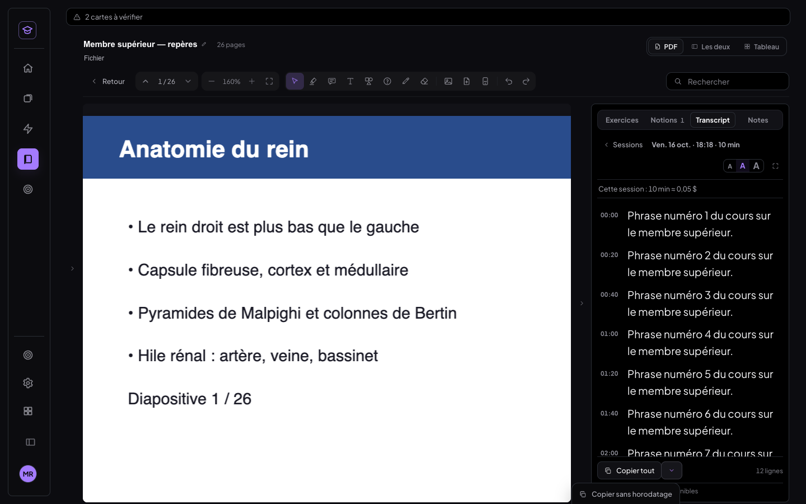 | 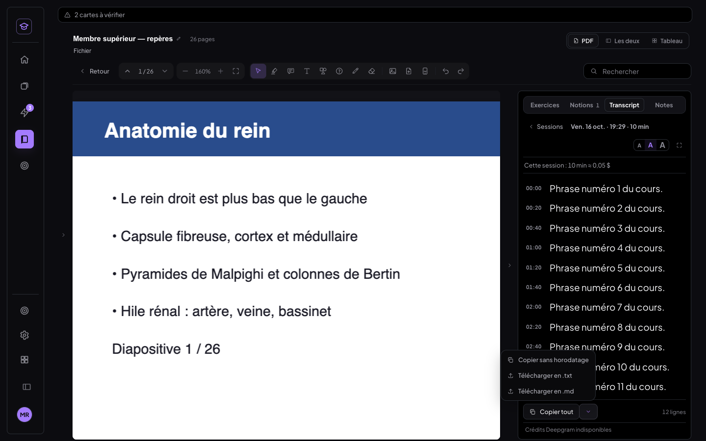 | 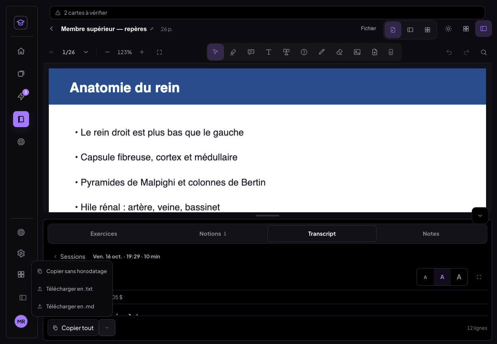 |

Test : 10 × « Copier tout » / « sans horodatage », sur ordinateur puis sur tablette au doigt.
- Le menu est dans l'écran et au-dessus de tout à chaque ouverture.
- Aucun clic ne traverse : une sonde vérifie qu'aucun clic hors du menu n'arrive pendant le choix
  d'une option.
- Le texte copié est juste, avec ou sans horodatage, et « Copié ✓ » disparaît après 1,5 s.

## 4. Fichiers d'un cours : un modèle simple et carré

**Modèle** (`lib/fichiersCours.js`) : un cours a **au plus un document principal** (PDF importé,
images converties en PDF, ou document créé dans l'app ; une fiche HTML *seule* reste son principal)
et **au plus une fiche jumelle** (PDF). Rien d'autre.

### Audit des chemins (avant → après)

| # | Chemin | Avant | Après |
|---|---|---|---|
| 1 | Dépôt d'un fichier sur l'arbre (Bibliothèque, Réviser), `TreeFileDrop.jsx` | crée un cours PDF **ou HTML** ; pas de limite de taille | crée un cours **PDF** (ou images → PDF) ; HTML refusé avec message ; 100 Mo max ; un import à la fois |
| 2 | Conversion d'images en PDF (`imageToPdf.js`) | utilisée par 1 | utilisée par 1 et par « Remplacer » / « Importer » le principal |
| 3 | Bibliothèque › ⋯ › « Attacher un document » | **remplaçait en silence** le PDF d'un cours (sans sauvegarde, ancien fichier orphelin, annotations restées sur le nouveau PDF) | **retiré** → « Fichiers du cours… » |
| 4 | Bibliothèque › ⋯ › « Remplacer le fichier HTML » | réécrivait `htmlId` | **retiré** (une fiche HTML seule se remplace par « Remplacer » du principal) |
| 4b | Bibliothèque › ⋯ › « Ouvrir en PDF / en HTML » | deux documents par cours | **retiré** |
| 5 | Réviser › « Importer une fiche » (cours sans document) | PDF ou HTML, sans contrôle | « Importer le document » : PDF ou images, contrôles, refus d'un second |
| 6 | Dashboard › import (ajout à un cours existant) | **remplaçait en silence** le PDF ; le meta de l'ajout pouvait être perdu (fiche périmée) | le document n'est **jamais joint** si le cours a déjà un principal, avec un message ; fiche relue après l'ajout |
| 7 | Rattrapage › import (ajout) | idem 6 | idem 6 |
| 8 | Structures d'anatomie (`anatstruct`) | PDF/HTML d'une structure | inchangé : ce n'est pas un cours |
| 9 | Schéma d'anatomie (images) | images du schéma | inchangé : pas un fichier de cours |
| 10 | Lecteur : état vide « Attacher un document », « Rattacher le fichier… » (PDF absent de l'appareil) | PDF ou HTML, sans contrôle | état vide = « Importer le document principal » (gardé) ; « Rattacher » = le même fichier, contrôlé, ancien identifiant noté (`fichiersRetires`) |
| 11 | Document › « Importer un PDF » (`importerPdfDansDocument`) | **code mort** | **supprimé** |
| 12 | Fichier › Supprimer… › « Détacher le PDF » | retirait le lien, fichier orphelin | **retiré** (Supprimer = le cours, à la corbeille) |
| 13 | Vue HTML › « Détacher le cours HTML », « Voir le PDF » | | **retirés** |
| 14 | Sauvegarde automatique du HTML édité | | inchangée (même fichier) |
| 15 | Fiche jumelle : importer / remplacer (Fichier) | pas de limite ; **aucun moyen de la supprimer** | « Fichiers du cours » : Importer / Remplacer · **Supprimer** · Exporter ; contrôles et verrou |
| 16 | Dessins envoyés du téléphone | images posées en annotations | inchangé : ce ne sont pas des fichiers de cours |
| 17 | Images collées dans un document / des notes | images du contenu | inchangé |
| 18 | Réglages › Archives (Prise de notes) | lecture | inchangé, plus une nouvelle carte « fichiers de cours » (ci-dessous) |
| 19 | Supprimer un cours (corbeille) | drapeau `archive` | inchangé |
| 20 | Vider la corbeille (`purgeFiche`) | fiche, jumelle, annotations ; fichiers gardés | inchangé |
| 21 | Sauvegarde / restauration | | inchangé |
| — | Bascule PDF · HTML de l'en-tête | deux documents par cours | **retirée** |

**Données hors modèle**, jamais effacées et listées en lecture dans **Réglages › Archives —
fichiers de cours** (Ouvrir / Télécharger) :
- une fiche HTML *en plus* d'un PDF ;
- un document principal remplacé ;
- une fiche jumelle supprimée ;
- les anciennes versions d'une fiche jumelle.

### L'écran « Fichiers du cours »

Il s'ouvre par Fichier › « Fichiers du cours… » : c'est l'entrée 2 du menu unique, qui garde la
pastille « Pages » de la correspondance. On l'atteint aussi par Bibliothèque › ⋯ › « Fichiers du
cours… ». Il présente deux lignes, rien d'autre :

- **Document principal** — nom (éditable), pages, date d'import, taille.
  Actions : Remplacer · Exporter (ou Importer, pour un cours à cartes seules).
- **Fiche jumelle** — même présentation, ou « Aucune ».
  Actions : Importer / Remplacer · Supprimer · Exporter.

| Cours PDF | Cours avec fiche jumelle | Document de l'app |
|---|---|---|
| 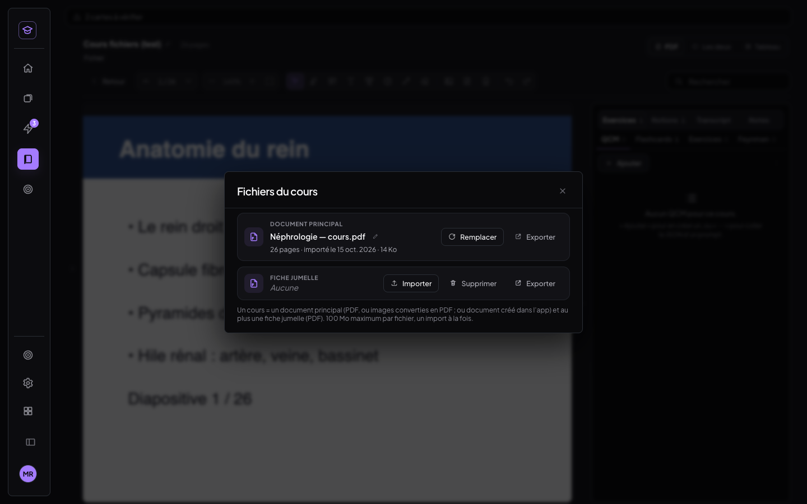 | 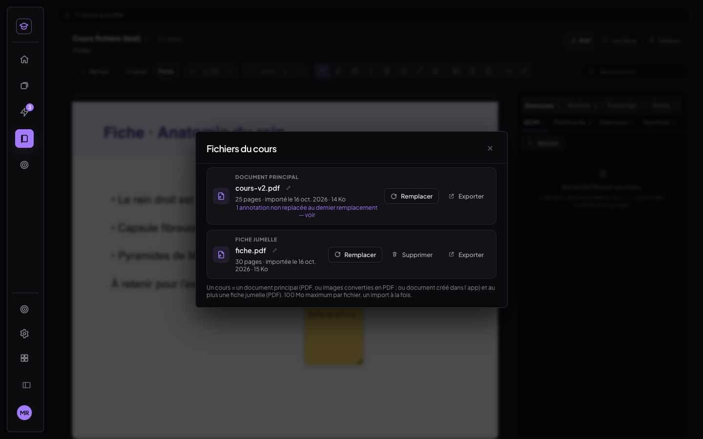 | 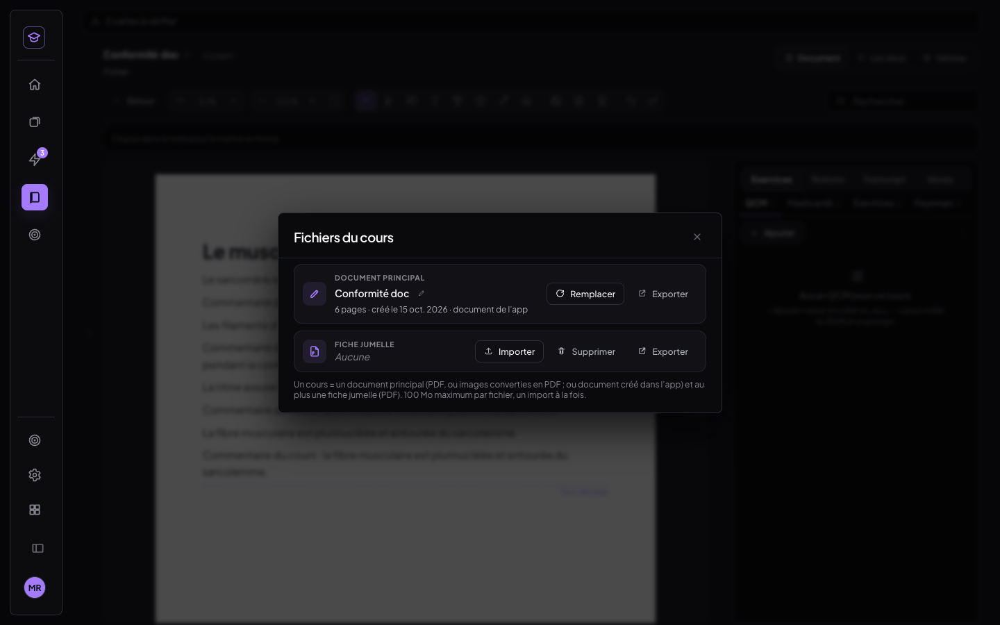 |

**Remplacer le principal** :
- **confirmation** explicite, puis `putBackup` (la fiche et toutes les annotations du cours) ;
- **correspondance des pages par le texte**. Elle est plus stricte que celle de la fiche
  jumelle : une page n'est replacée que sur une page au texte identique, ou sur sa paire de
  l'alignement si la similarité est forte (≥ 0,5), *jamais par fusion avec une voisine*. Les tests
  ont montré que la règle de fusion replaçait l'annotation d'une page *supprimée* sur la page
  suivante ;
- les annotations **non replacées** passent dans un calque d'archive : elles sont gardées et
  consultables (« Annotations non replacées ») ;
- l'ancien fichier est **marqué retiré** (`fichiersRetires`), pas effacé ;
- cartes, notions, transcripts, sessions, position de lecture et fiche jumelle restent rattachés
  au cours.

| Confirmation | Remplacé : 3 replacées, 1 non replacée | Non replacées |
|---|---|---|
| 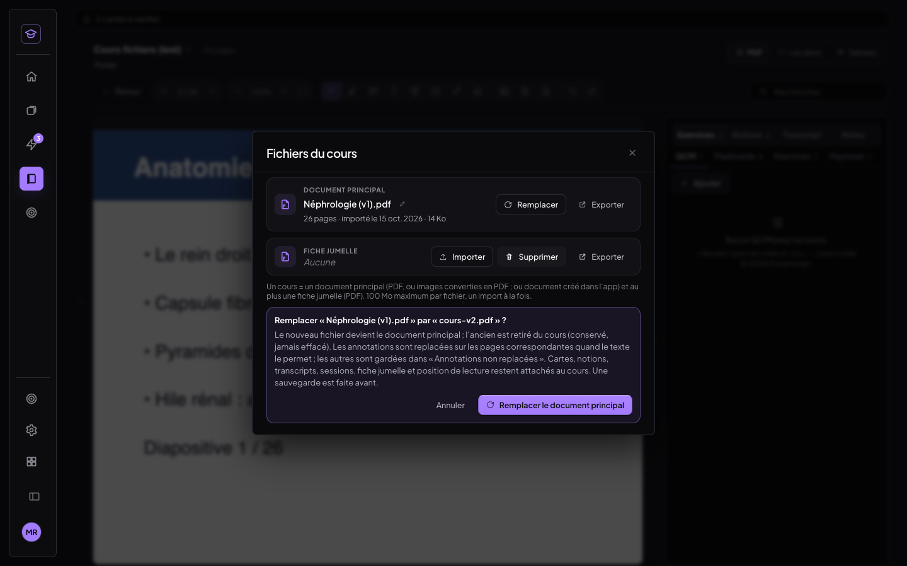 | 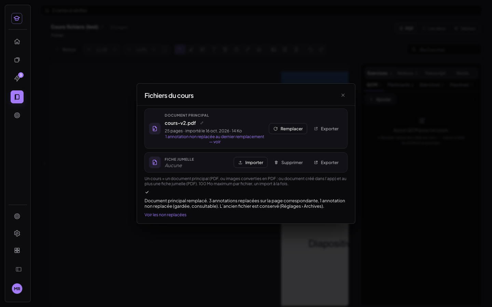 | 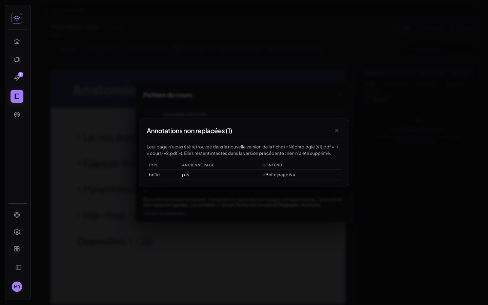 |

**Supprimer la fiche jumelle** : confirmation, puis `putBackup`. La fiche et ses annotations propres
sont retirées. Le cours revient « sans fiche » : la bascule Original/Fiche est masquée et le badge
« fiche » de la Bibliothèque disparaît. Le fichier reste lisible dans les Archives.

**Règles strictes** :
- un seul import à la fois (verrou commun au principal et à la fiche jumelle) ;
- formats : PDF, et images converties en PDF pour le principal ;
- **100 Mo maximum**, avec message (« Fichier trop lourd : 101 Mo (maximum 100 Mo). ») ;
- noms éditables ;
- jamais deux principaux ni deux fiches : refus propre (« Ce cours a déjà un document principal :
  « Remplacer » depuis Fichier › Fichiers du cours. ») ;
- dans la Bibliothèque, un cours = une carte, avec le badge « fiche » s'il en a une.

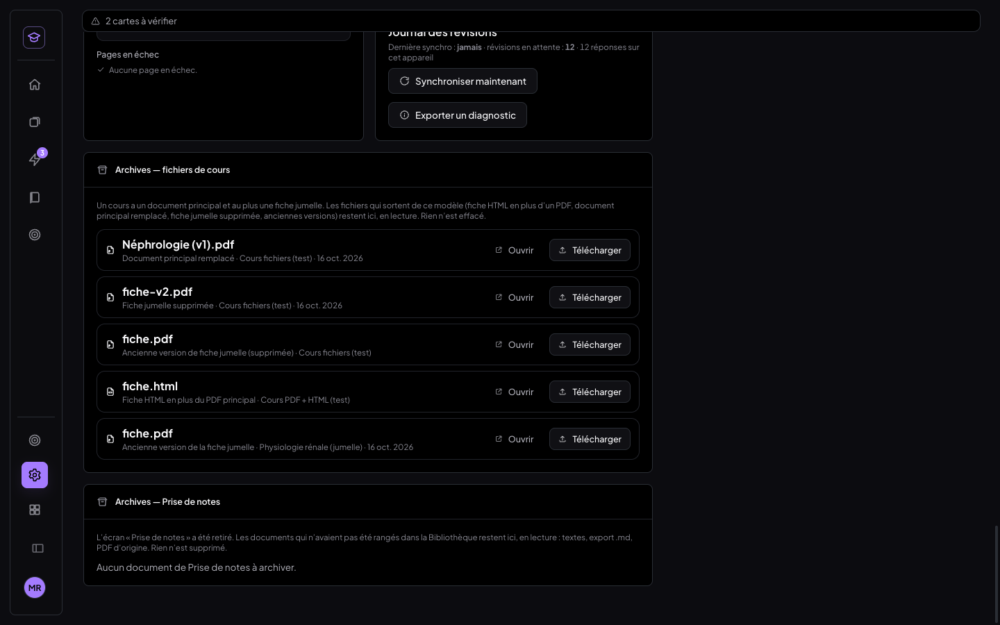

**Aucune donnée effacée en base** : comptes de la base locale du banc avant/après le scénario
complet (`t-fichiers.mjs`).

| | fiches | questions | highlights | annotations | companion_pdf | transcripts | positions | blobs | sauvegardes |
|---|---|---|---|---|---|---|---|---|---|
| avant | 18 | 9 | 7 | 30 | 3 | 2 | 13 | 60 | 9 |
| après | 18 | 9 | 7 | 30 | 3 | 2 | 13 | **63** | **11** |

Les fichiers ne font que s'ajouter (63, contre 60 avant). Les annotations restent au même nombre : celle posée sur la fiche jumelle pendant le
test est partie avec elle, après sauvegarde. La fiche jumelle importée puis supprimée laisse le même
compte.

---

## 5. Tests

Tous les tests sont dans `scripts/tests-fichiers-cours/` (`./tout.sh <dossier fx>` les rejoue avec
leurs jeux de test) :

| Script | Résultat |
|---|---|
| `t-carnet.mjs` (ordinateur : puces, gabarit, Tab, astuce suggérée, enregistrement, carnet, Réglages) | 12/12 |
| `t-carnet.mjs 1180 820 tablette` | 8/8 |
| `t-carnet-telephone.mjs` (390 × 844, au doigt) | 6/6 |
| `t-apprentissage.mjs` (3 cartes d'une fiche dont une sélection de 2, 2 de la Bibliothèque, rangement, notes, séance, matière vidée, **indépendance**) | 14/14 |
| `t-apprentissage-mobile.mjs` (tablette, téléphone) | 7/7 |
| `t-transcript-copie.mjs` (10 copies × 2, ordinateur + tablette au doigt) | 14/14 |
| `t-fichiers.mjs` (écran, export, nom, taille max, remplacer, non replacées, refus d'un second principal, verrou, fiche jumelle importer / remplacer / supprimer, document, Bibliothèque, Archives, comptes) | 30/30 |
| `t-fichiers-tablette.mjs` (paysage, portrait, téléphone) | 6/6 |

Soit **97/97** au dernier passage complet.

**Non-régression** :
- chantier fiche jumelle (`scripts/tests-fiche-jumelle/tout.sh`) : **201/201**, comme avant ;
  seule l'aide `menuFichier` des tests passe désormais par « Fichiers du cours » ;
- correspondance : 30/30 sur les trois fiches ;
- chantier précédent (tris de la Bibliothèque, menu Fichier unique) : 29 + 13 + 39 + 34 + 17,
  tous verts, tests adaptés à l'entrée « Fichiers du cours » et à la fenêtre Supprimer sans
  « Détacher » ;
- MealWeek identique au pixel (ordinateur et téléphone, builds de production d'avant et d'après
  servis sur la même origine).

**Limites** :
- le glisser-déposer vers l'onglet Apprentissage est testé à la souris (glisser HTML5 réel, par
  CDP). Au doigt, il repose sur l'appui long natif du navigateur (iPad Safari, Chrome tactile),
  que le banc headless ne simule pas ;
- le téléphone n'a ni barre latérale ni lecteur : pas de glisser-déposer, pas de « Fichiers du
  cours » ; les notes d'Apprentissage et le carnet y sont testés.

## 6. Commits

- `e69f1d6` fix : transcript, menu « Copier » toujours dans l'écran, au-dessus de tout, sans clic qui traverse
- `89ceda1` feat : carnet d'erreurs, pré-réponses (puces, gabarit, astuce suggérée)
- `6c8f7b0` feat : mode Apprentissage, glisser-déposer vers l'onglet, rangement par matière, notes par carte
- `4310dca` feat : fichiers d'un cours, un document principal + au plus une fiche jumelle
- (ce compte rendu) docs
