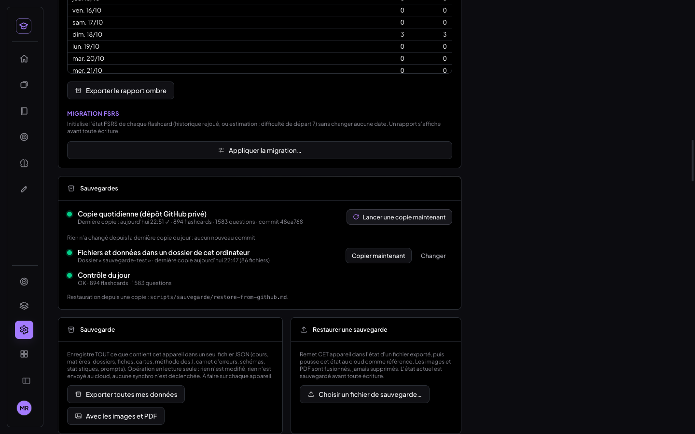
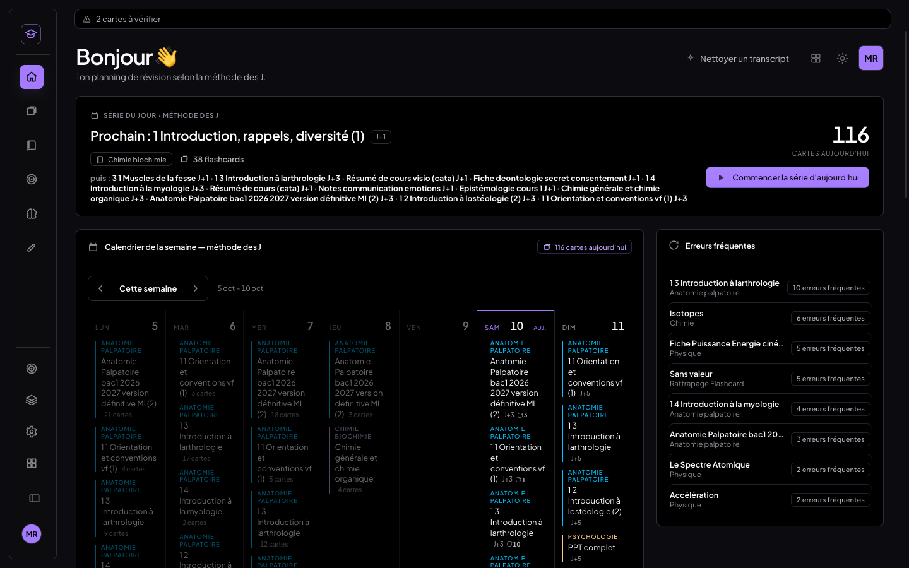
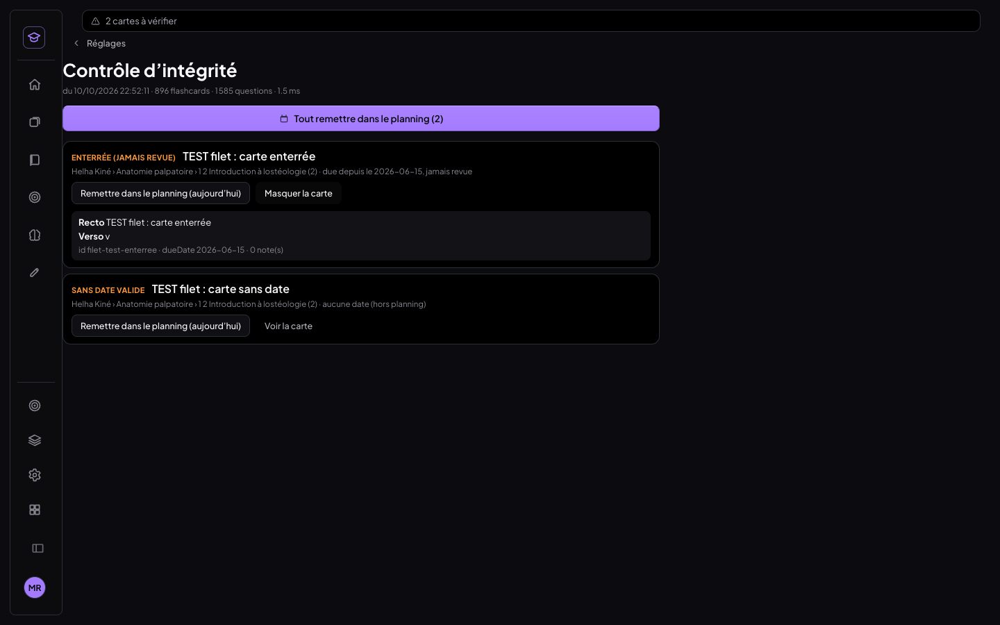

# Filet de sécurité de MedRevise (11/10/2026)

Trois mécanismes indépendants, **invisibles tant que tout va bien** :

1. une copie quotidienne automatique des données vers un dépôt GitHub privé, depuis Vercel ;
2. une copie des fichiers (PDF, images) et des données dans un dossier local choisi une fois ;
3. un contrôle d'intégrité silencieux à chaque ouverture.

Garanties du chantier :
- **Supabase est lu, jamais écrit.** Aucune migration.
- **Aucune donnée n'est corrigée sans clic.**
- **Le jeton GitHub n'existe que côté serveur.**
- **Non touchés** : MealWeek, `src/shared/`, le planificateur, FSRS, le journal, la synchro. Le
  contrôle `git diff --name-only pre-fsrs-2026-10-10 -- src/mealweek src/shared src/App.jsx src/Selecteur.jsx src/main.jsx`
  ne renvoie rien.

## Schéma

```
                         ┌────────────────────────── Vercel (serveur) ───────────────────────────┐
  cron 01:30 et 02:30 UTC│  /api/backup-daily  ── Authorization: Bearer CRON_SECRET (sinon 401)   │
  (= 03:30 Bruxelles,    │  /api/backup-now    ── bouton « Lancer une copie maintenant »          │
   été comme hiver)      │            │            (origine de l'app + 6 appels / 10 min)          │
                         │            ▼                                                           │
                         │  api/_lib/sauvegarde.js                                                │
                         │   1. LECTURE SEULE Supabase : medrevise_records (tout, paginé),        │
                         │      medrevise_review_log, liste du bucket (taille + eTag, sans        │
                         │      télécharger)                       src/medrevise/sauvegarde/lecture.js
                         │   2. export déterministe JSONL           src/medrevise/sauvegarde/export.js
                         │   3. commit « backup YYYY-MM-DD » (API Git Data) — rien si rien n'a    │
                         │      changé ; 3 tentatives               api/_lib/github.js            │
                         │  /api/backup-status ── dernier commit + manifest.json (lecture)        │
                         └────────────┬──────────────────────────────────────────────▲───────────┘
                                      ▼  GITHUB_BACKUP_TOKEN (contents R/W, ce seul dépôt)│
                         ┌─ GitHub : <user>/medrevise-backups (privé) ─┐                 │
                         │ data/records.jsonl · data/review_log.jsonl  │                 │
                         │ data/files-index.json · manifest.json       │                 │
                         └─────────────────────────────────────────────┘                 │
  ┌──────────────────────────── Navigateur (MedRevise) ─────────────────────────────────┼────────┐
  │ démarrage : synchro → migrations → (tâche de fond, +0,8 s)                            │        │
  │   • contrôle d'intégrité (integrite/) — lecture IndexedDB + empreinte cloud ; résultat │        │
  │     et instantané du jour dans `meta` (local)          → bandeau / écran Intégrité    │        │
  │   • état de la copie serveur ───────────────────────────────────────────────────────┘        │
  │     → Réglages › Sauvegardes, bandeau orange si > 36 h                                         │
  │   • copie hebdomadaire dans le dossier local (sauvegarde/dossierLocal.js, File System Access) │
  │     PDF / images : <cours>/<fichier> (incrémental, index caché) · données/YYYY-MM-DD/ (8 gardées)│
  └──────────────────────────────────────────────────────────────────────────────────────────────┘
  Restauration : scripts/sauvegarde/restore-from-github.mjs (commit GitHub ou dossier local → IndexedDB)
```

## 1. Copie quotidienne vers GitHub (serveur)

**Les fonctions :**

| Fonction | Rôle |
|---|---|
| `api/backup-daily.js` | appelée par les crons de `vercel.json` ; refuse tout appel sans `Authorization: Bearer <CRON_SECRET>` (401, vérifié) |
| `api/backup-now.js` | le bouton de Réglages, qui appelle la même copie côté serveur |
| `api/backup-status.js` | l'état lu sur GitHub |

**Horaire.** Vercel ne connaît que l'UTC. Deux crons quotidiens, `30 1 * * *` et `30 2 * * *`,
donnent 03:30 à Bruxelles en heure d'été et en heure d'hiver. Le second passage de la nuit ne crée
**aucun commit** si rien n'a changé.

Sur le plan Hobby, Vercel limite à une exécution par jour et par cron, avec une précision à l'heure
près (±59 min). La copie part donc entre 03:00 et 03:59.

**Export déterministe** (`src/medrevise/sauvegarde/export.js`) :
- **Même données → mêmes octets** : une ligne JSON par enregistrement, lignes triées (store, id),
  clés triées.
- **Seul `manifest.json` porte le jour.** Git ne stocke que les différences : sur le dépôt de test,
  entre deux copies, `data/records.jsonl +1 −1`.
- **Fichiers découpés au-delà de 40 Mo** : `records-001.jsonl`, etc. C'est sous la limite de 100 Mo
  par fichier de GitHub et sous la taille des requêtes de son API.
- **Les fichiers du bucket** apparaissent dans `files-index.json` (nom, taille, empreinte eTag, type),
  sans leur contenu.

**Robustesse :**
- **Échec** (jeton absent, réseau, GitHub indisponible) : 3 tentatives, puis un message clair. Le
  jeton est masqué dans tout message.
- **Rien n'est écrit dans Supabase.** L'état se lit sur le dépôt lui-même (dernier commit +
  `manifest.json`) via `/api/backup-status`.
- **Affichage** : « Dernière copie : hier 03:31 ✓ · 894 flashcards · 1 583 questions ».
- **Au-delà de 36 h** : bandeau orange « Pas de copie depuis N jours ».
- **Sans configuration** : la fonction répond une erreur claire, Réglages affiche « Copie serveur
  non configurée », rien ne casse.

## 2. Copie dans un dossier local (client)

**Mise en place et fréquence :**
- **Choix du dossier** : Réglages → Sauvegardes → « Choisir le dossier des fichiers »
  (`showDirectoryPicker`). La poignée est gardée dans `meta` (local), avec une demande de stockage
  persistant (`navigator.storage.persist`).
- **Quand** : à l'ouverture, au plus une fois par semaine, ou par « Copier maintenant ».

**Ce qui est écrit :**
- tous les PDF / images du cloud absents ou modifiés (empreinte du bucket), sous
  `<cours>/<fichier>` (nom lisible tiré des fiches et des cartes, `_autres/<id>` à défaut) ;
- l'export complet des données dans `données/YYYY-MM-DD/`, identique à la copie serveur.

**Incrémental** : un index caché `.medrevise-index.json` retient ce qui est déjà copié.

**Suppressions** : jamais, sauf les exports de données au-delà des 8 derniers. Ce sont les seuls
dossiers que la copie a créés elle-même.

**Permission** : si Chrome retire l'autorisation, une ligne discrète « Autoriser l'accès au dossier
de sauvegarde » apparaît avec un bouton. Jamais de fenêtre intempestive.

**Navigateur sans cette API** (Safari iOS) : la section est masquée, et la copie serveur suffit.

## 3. Contrôle d'intégrité à chaque ouverture (client)

**Exécution** : `src/medrevise/integrite/controle.js`, pur et en lecture seule. Il tourne après la
synchro de démarrage, en tâche de fond : **8 ms sur les 1 583 questions réelles** (1,3 ms sur le
téléphone de test). Pas besoin de Web Worker.

**Ce qu'il vérifie :**

| Contrôle | Règle |
|---|---|
| Sans date | flashcard non terminée sans `dueDate` valide |
| Orpheline | fiche, matière ou cours introuvable |
| Enterrée | carte **planifiée** due depuis plus de 60 jours et jamais revue. Les cours dont tu as coupé les rappels J ne comptent pas : c'est voulu |
| Doublon | id présent plusieurs fois |
| Baisse | nombre de questions par type inférieur à celui de la veille : instantané local (comptes + ids) dans `meta`, ids manquants listés |
| Écart cloud | empreinte locale ≠ empreinte cloud (`comparerAuCloud`, lecture) |
| Journal | réponse en attente d'envoi depuis plus de 7 jours |

**Affichage :**
- **Tout va bien** : un point vert dans Réglages → Sauvegardes (« Contrôle du jour : OK · 894
  flashcards »), et rien d'autre.
- **Anomalie** : bandeau discret « N cartes à vérifier » → écran listant chaque anomalie (carte,
  cours, problème).
  - Par carte : « Remettre dans le planning (aujourd'hui) » (dueDate = aujourd'hui, comme
    « Déplacer ») et « Voir la carte ».
  - Pour tout le lot : « Tout remettre dans le planning ».
  - **Aucune correction automatique.**
- **Baisse** : bandeau rouge « N cartes de moins qu'hier », avec la liste des ids manquants et le
  lien vers la procédure de restauration.

## Variables Vercel à créer (par toi)

Projet `my-org` → Settings → Environment Variables → **Production** :

| Variable | Valeur |
|---|---|
| `GITHUB_BACKUP_TOKEN` | le jeton GitHub « fine-grained » ci-dessous (secret) |
| `GITHUB_BACKUP_REPO` | `yoann735/medrevise-backups` |
| `CRON_SECRET` | une chaîne aléatoire d'au moins 32 caractères, par exemple la sortie de `openssl rand -hex 32` |

Facultatives : `GITHUB_BACKUP_BRANCH` (défaut `main`) et `BACKUP_MAX_OCTETS` (défaut 41 943 040).
La lecture de Supabase utilise `VITE_SUPABASE_URL` / `VITE_SUPABASE_ANON_KEY`, déjà présentes sur
le projet. Après ajout des variables : **Redeploy**.

### Créer le dépôt et le jeton GitHub (permissions minimales)

1. **Le dépôt** : <https://github.com/new>.
   - Owner `yoann735`, nom `medrevise-backups`, **Private**.
   - Pas besoin de README : la première copie initialise le dépôt vide.
2. **Le jeton** : <https://github.com/settings/personal-access-tokens/new> (*Fine-grained token*).
   - Nom : `medrevise-backups (Vercel)` ; expiration : 1 an (noter de le renouveler).
   - **Repository access : Only select repositories → `medrevise-backups`** ;
   - **Permissions → Repository permissions → Contents : Read and write**. *Metadata : Read-only*
     s'ajoute tout seul. Rien d'autre.
   - Generate token → coller la valeur dans `GITHUB_BACKUP_TOKEN` sur Vercel, et nulle part ailleurs.
3. **Vérifier** :
   - Vercel → Settings → **Cron Jobs** : deux tâches `/api/backup-daily` ;
   - dans l'app : Réglages → Sauvegardes → **« Lancer une copie maintenant »** → « Copie faite : commit … » ;
   - le dépôt contient `backup YYYY-MM-DD`.

## Procédure de restauration, testée

`scripts/sauvegarde/restore-from-github.md`, avec le script `restore-from-github.mjs`. Il prend un
commit GitHub, ou un export du dossier local. Il fait ceci :
1. contrôle des SHA-256 contre `manifest.json` ;
2. reconstruction des stores dans un Chrome **isolé**, sur un profil vide ;
3. relecture et comparaison, store par store, des comptes et des empreintes.

La procédure Supabase est documentée commande par commande (conversion testée en simulation), mais
**n'a pas été exécutée**.

Test réel du 10/10/2026, depuis le commit `3d879cf` du dépôt de **test** (sortie complète :
`docs/img/filet-securite/restauration-test.txt`) :

```
copie du 2026-10-10 — 2860 enregistrements, 894 flashcards, 1583 questions
empreintes SHA-256 : 3/3 conformes au manifeste
✅ medrevise-questions : 1583/1583 enregistrements · empreinte identique
… (19 stores)
RESTAURATION CONFORME : 19 stores, comptes et empreintes identiques
```

## Tests

**Automatiques** (`npm test`) : **42/42**, dont 16 pour le filet (`tests/filet/filet.test.js`).

| Exigence | Test |
|---|---|
| Export déterministe | mêmes données, ordre des lignes et des clés différent → mêmes octets ; seul le manifeste change d'un jour à l'autre |
| Découpage > 100 Mo | 110 Mo de lignes → 3 fichiers ≤ 40 Mo, aucune ligne coupée, contenu intégral |
| Idempotence | faux GitHub en mémoire : relance le même jour sans changement → pas de commit ; changement → commit ; lendemain → commit ; statut relu |
| Robustesse | sans variables → « non configurée », aucun appel réseau ; GitHub en panne → 3 tentatives, jeton jamais dans le message |
| Intégrité | carte sans date, enterrée (et pas si le cours est hors rappels), doublon, orpheline, baisse (ids manquants), écart cloud, journal > 7 j ; vraies données : OK en < 300 ms |
| Restauration | copie écrite sur disque → IndexedDB d'un Chrome isolé : comptes et empreintes identiques |

**Dans Chrome** (`scripts/tests-filet/`). Conditions :
- profil de test restauré depuis la sauvegarde ;
- faux Supabase local ;
- **dépôt GitHub de TEST `yoann735/medrevise-backups-test` (privé)** avec des variables de test passées
  à Vite. Jamais les variables de production, jamais le vrai cloud.

| Scénario | Résultat |
|---|---|
| `t-copie-serveur.mjs` (6/6) : statut avant ; « Lancer une copie maintenant » → commit visible sur GitHub avec `data/records.jsonl` (2 860 lignes), `review_log.jsonl`, `files-index.json`, `manifest.json` ; statut « Dernière copie : aujourd'hui 22:51 ✓ · 894 flashcards · 1 583 questions · commit 48ea768 » ; relance → « Rien n'a changé… aucun nouveau commit » ; contrôle du jour : point vert, aucun bandeau | ✅ (capture 01) |
| `curl` : `/api/backup-daily` sans secret ou mauvais secret → 401 ; avec le bon secret → `cree: false` (rien de neuf) | ✅ |
| `t-bandeaux.mjs` (11/11) : horloge +3 jours → « Pas de copie depuis 3 jours » ; deux anomalies injectées → « 2 cartes à vérifier », cartes inchangées tant qu'on ne clique pas ; écran (carte, cours, problème) ; « Voir la carte » ; « Remettre dans le planning (aujourd'hui) » ; « Tout remettre (2) » → « Tout est en ordre » ; baisse simulée → bandeau rouge « 2 cartes de moins qu'hier », ids manquants, lien vers la procédure | ✅ (captures 02 à 06) |
| `t-dossier.mjs` (11/11) : copie automatique à l'ouverture (86 fichiers) ; PDF sous « <cours>/<fichier> » ; `données/2026-10-10/` ; 8 exports gardés ; seconde copie incrémentale (0 nouveau) ; fichier modifié → 1 mis à jour ; pas de recopie avant une semaine ; permission expirée → ligne « Autoriser… » puis accès rétabli ; navigateur sans l'API → section masquée | ✅ (captures 07, 08) |
| `t-mobile.mjs` (6/6) : téléphone 390 px, contrôle OK (894 flashcards, 1,3 ms), aucun bandeau, aucune section dossier ; anomalie → bandeau mobile → écran → corrigée → bandeau disparu | ✅ (captures 09, 10) |
| Restauration réelle depuis le commit GitHub de test | ✅ 19 stores identiques |
| Non-régression : build vert, 42/42 tests, 0 erreur JavaScript ; MealWeek s'ouvre ; 0 fichier MealWeek / `src/shared/` modifié | ✅ |

**Limite du banc** : le sélecteur de dossier natif ne s'automatise pas dans Chrome headless. Le test
utilise une poignée de dossier de l'OPFS : même interface `FileSystemDirectoryHandle`, rangée
exactement là où « Choisir le dossier des fichiers » range la sienne. Le reste du chemin est
identique.

**À savoir** : le dépôt `yoann735/medrevise-backups-test` contient des copies **de la copie de test
de tes données**. Supprime-le quand tu veux :
```sh
gh repo delete yoann735/medrevise-backups-test --yes
```
Il n'est utilisé par aucune configuration de production.

## Captures (`docs/img/filet-securite/`)







Autres captures :
- `02-bandeau-pas-de-copie.png` ;
- `05-bandeau-baisse.png` et `06-ecran-baisse.png` ;
- `07-dossier-copie.png` et `08-dossier-permission.png` ;
- `09-mobile-ok.png` et `10-mobile-bandeau.png`.

## Commits

| Commit | Contenu |
|---|---|
| 3733efc | `feat(medrevise)` : filet de sécurité — copie quotidienne vers GitHub, copie dans un dossier local, contrôle d'intégrité à l'ouverture |
| (suivant) | `docs/test(medrevise)` : compte rendu, procédure de restauration, banc `scripts/tests-filet/`, faux Supabase (métadonnées du bucket), marge du bandeau |
