# Finitions : badge IA des boîtes, barre d'outils des boîtes, barre latérale — compte rendu (11/10/2026)

Trois chantiers de finition sur MedRevise. MealWeek et `src/shared/` : **aucune modification**
(`git diff --quiet -- src/shared src/mealweek` ✔). Aucune donnée supprimée : ce qui quitte l'interface
reste en base, synchronisé, et accessible là où c'est indiqué plus bas.

## 1. Badge « IA » des boîtes

| Avant | Après |
|---|---|
| 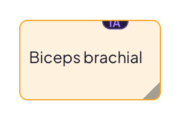 | 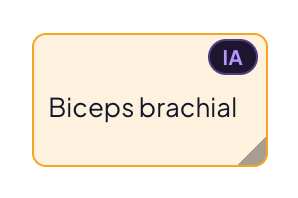 |
| 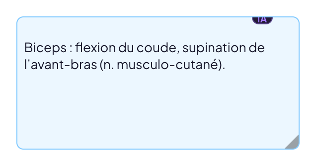 | 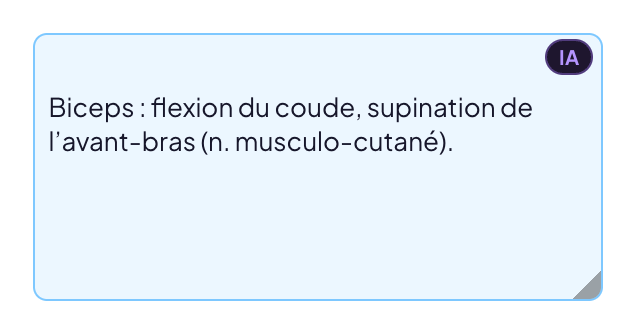 |

- **Avant** : une pastille de 14 px posée à cheval sur la bordure haute (elle débordait de la boîte).
- **Après** : le badge est **dans la boîte**, coin supérieur droit, sur la ligne de la poignée de
  déplacement (à gauche) ; le texte commence dessous. 18 px de haut, pastille discrète de la DA (teinte
  d'accent pour « IA », neutre pour « orig. »). Il n'apparaît que si la boîte a une version alternative.
- Sur les boîtes transparentes ou teintées, la poignée s'efface au repos, **pas le badge**.
- **Clic / toucher sur le badge** = bascule immédiate de CETTE boîte entre version originale et
  version IA ; le libellé suit (« IA » ↔ « orig. »). Pas de menu, la boîte n'est pas sélectionnée.
  ⌘Z / ⌘⇧Z annulent / rétablissent la bascule (même journal que le reste). La bascule globale
  (page / cours) reste dans le menu Fichier, inchangée.
- **Exports** : le badge est un élément d'écran, jamais dessiné. Vérifié en lisant le texte du PDF
  exporté : « Exporter en PDF annoté » contient le texte des boîtes et aucun « IA » / « orig. » ;
  l'export spécial IA ne contient que les repères « #ref — texte ».

Correctif trouvé en testant : après un clic sur le badge, le focus restait sur le badge (dans la boîte)
et ⌘Z partait vers l'éditeur de la boîte au lieu du journal. Le badge rend maintenant le focus.

## 2. Barre d'outils des boîtes

| Avant | Après |
|---|---|
| 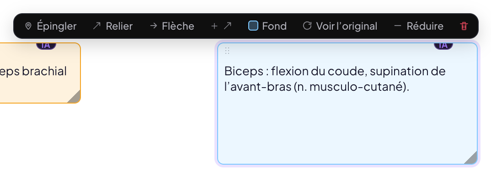 | 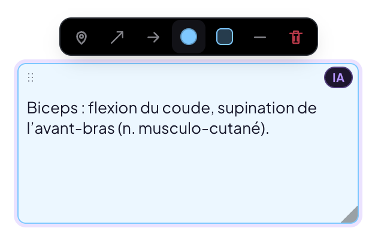 |

- **Forme** : petite barre flottante de **7 icônes** (28 px, infobulles), 32 px de haut, coins
  arrondis, ombre légère, fond de la DA, largeur fixe (216 px) : **Épingle · Relier · Flèche · Couleur
  (pastille → palette) · Fond (transparent → teinté → plein) · Réduire / Déployer · Supprimer**. Aucun
  texte : l'outil actif (épingle posée, lien, flèche) se lit à l'état de l'icône. « Voir l'original »
  a quitté la barre (c'est le badge qui le fait).
- **Apparition** : uniquement quand la boîte est **sélectionnée** (clic sur la boîte en mode Sélection,
  ou juste après sa création) — plus au survol. Animation 120 ms, sans saut de la page.
- **Disparition automatique** (la sélection est levée) : clic ailleurs sur la page, changement d'outil
  dans la barre principale (y compris re-cliquer « Sélection »), début d'un trait, passage en mode
  focus, Échap. Échap n'est plus nécessaire.
- **Position** : au-dessus de la boîte, en dessous s'il n'y a pas la place ; **bornée à la partie
  visible de la page**. Correctif trouvé en testant : une boîte au bord droit, quand la page est plus
  large que la zone de lecture (panneau ouvert), envoyait la barre sous le panneau, Supprimer devenait
  inaccessible.
- **Au doigt** (tablette) : mêmes icônes à 36 px, barre toujours dans l'écran.
- La visée (« Clique l'endroit à épingler… ») garde son bandeau dans la même barre.

Capture du lecteur après : `img/finitions/apres-lecteur.png` ; palette ouverte depuis la pastille :
`img/finitions/apres-barre-couleur.png` ; tablette 820 px, boîte au bord :
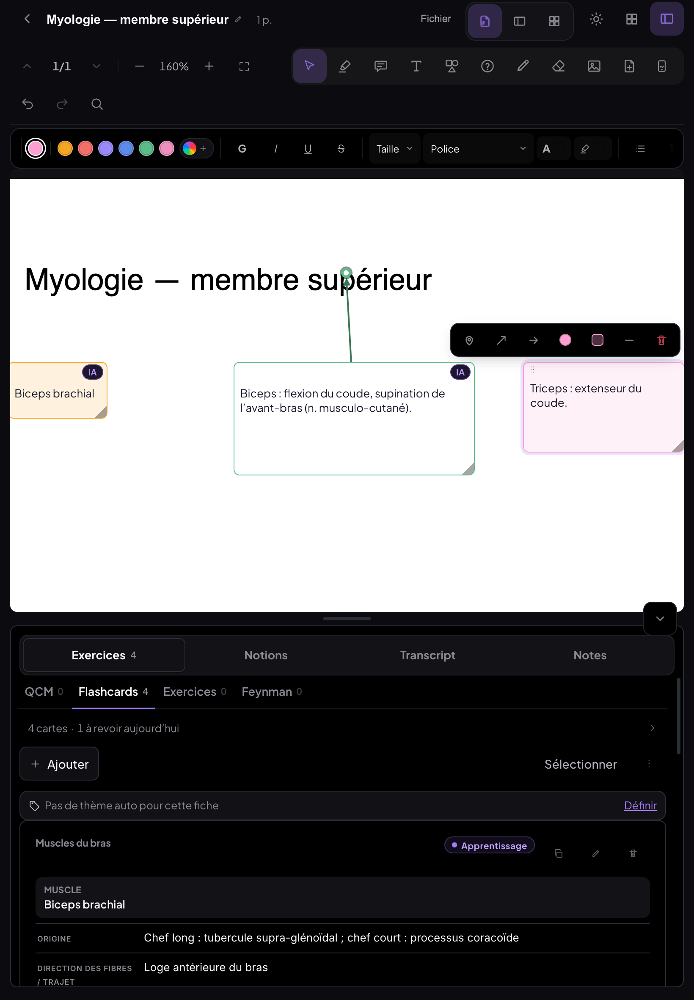

## 3. Barre latérale

| Avant | Après |
|---|---|
| 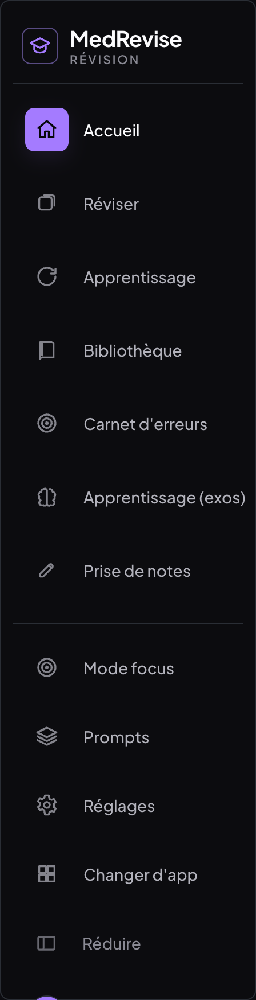 | 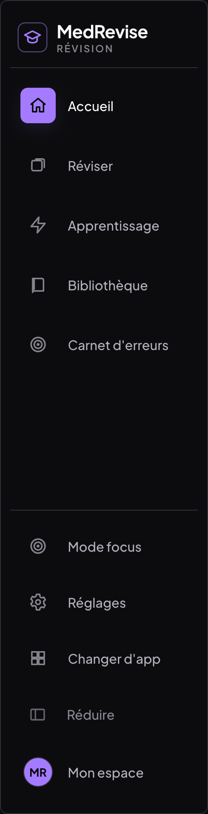 |

Ordre final : **Accueil · Réviser · Apprentissage · Bibliothèque · Carnet d'erreurs**, séparateur,
**Mode focus · Réglages · Changer d'app · Réduire · Mon espace**. « Apprentissage » (le mode en rafale)
a une icône **éclair** (tracé Lucide « zap », mêmes attributs que les autres icônes) ; elle est locale à
MedRevise (`components/IconeRafale.jsx`) pour ne pas toucher `src/shared/Icon.jsx`. Même icône dans la
barre du bas (tablette).

### Ce qui a été supprimé, et où restent les données

| Supprimé | Code retiré | Données |
|---|---|---|
| **« Apprentissage (exos) »** : entrée de la barre, écran, import « Apprentissage » de l'Accueil, écran splitté exos / PDF | `pages/Apprentissage.jsx`, `apprentissage/ExoApprentissage.jsx`, `apprentissage/UniteSplit.jsx`, `components/ImportApprentissage.jsx`, `lib/apprentissage.js`, le type d'import et l'écran de fin dans `pages/Dashboard.jsx`, règles CSS `appr-*` (83 règles orphelines retirées au total avec celles de Prise de notes). Aucun réglage dédié n'existait. | Store `apprentissage` **gardé** dans IndexedDB, dans la synchro et dans les sauvegardes (`lib/storage.js`). Plus rien ne l'affiche. Leurs surlignages éventuels (`highlights`, clé de l'unité) restent aussi. |
| **« Prise de notes »** : entrée, écran, import par glisser-déposer, dialogue « Ranger » | `pages/PriseDeNotes.jsx`, `components/ImportNote.jsx`, `components/RangerDialog.jsx`, `lib/notes.js`, `lib/noteImport.js` (sa seule fonction encore utile, `estBureautique`, est passée dans `TreeFileDrop.jsx`), règles CSS `pdn-*` / `ranger-*`. Le dessin envoyé du téléphone ne propose plus ces documents comme cible. | Store `notes` **gardé** (synchro, sauvegardes). Les documents **non rangés** se lisent dans **Réglages → Archives** : liste, « Lire » (surlignages, boîtes et textes), export **.md**, téléchargement du PDF d'origine. Les documents **déjà rangés** sont des fiches ordinaires : ils restent dans la Bibliothèque. |
| **« Prompts »** dans la barre | rien : déplacé | **Réglages → Prompts** : la même liste (3 groupes, 9 prompts), mêmes fonctions (copier, voir en entier, modifier, « Modifier les 4 »), même stockage. Les boutons « Voir les prompts » des cours sont inchangés. |

Tes données réelles : je n'y ai pas accès (elles sont dans ton navigateur et dans ton projet Supabase,
que je ne touche pas). Si tu avais écrit des notes dans Prise de notes, elles apparaissent dans
Réglages → Archives ; sinon la carte affiche « Aucun document de Prise de notes à archiver ».

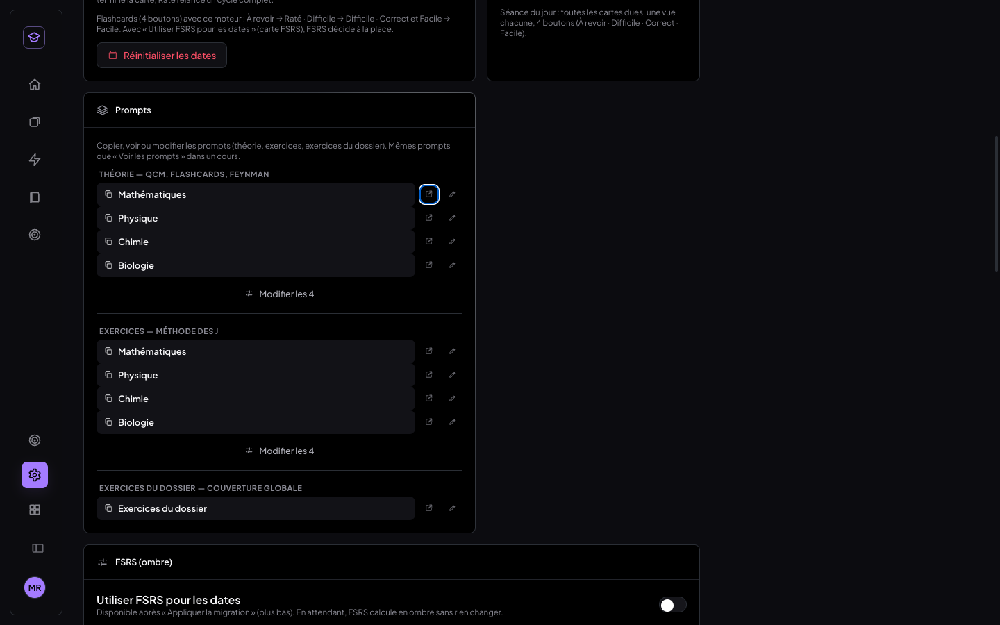
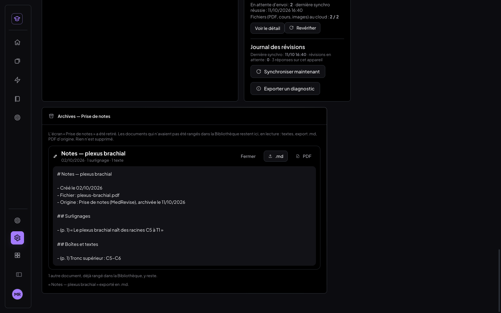

### Mode focus
Le mode focus ne servait qu'à « ne garder que Prise de notes ». Comme cet écran disparaît et que
l'entrée « Mode focus » reste demandée, il **ne garde plus que la Bibliothèque** (lire et annoter ses
cours). Même clé de stockage : un appareil déjà en focus le reste, et arrive sur la Bibliothèque.

### Anciennes adresses et liens
- `/medrevise/notes`, `/medrevise/prise-de-notes`, `/medrevise/apprentissage`, `/medrevise/apprentissage-exos`,
  `/medrevise/prompts`, et les mêmes en `#…` (y compris tapés sans recharger) : **Accueil + message
  discret** qui dit où est passée la fonction (7 s, fermable), adresse remise à `/medrevise`. Sur
  ordinateur comme sur téléphone.
- Tout lien interne oublié vers ces écrans (`ctx.go('notes')`…) mène à l'Accueil avec le même message.
- Aucun raccourci clavier ne visait ces écrans (vérifié dans le code).

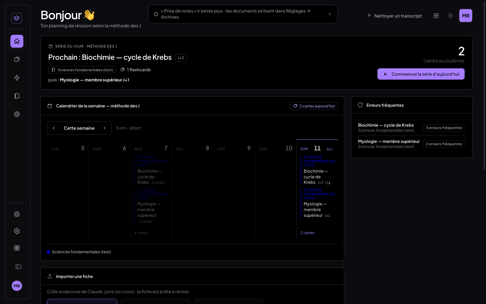

## 4. Tests (Chrome headless, profil de TEST, faux Supabase, vrais clics / touchers)

| Banc | Résultat | Couvre |
|---|---|---|
| `scripts/tests-finitions/t-bureau.mjs` (1440×900) | **34/34** | Badge : placement à 160 %, ≈ 105 % et ≈ 210 % sur 3 tailles de boîte, rien sans version IA ; bascule dans les deux sens, ⌘Z / ⌘⇧Z ; export PDF annoté sans badge. Barre : 32 px, 7 icônes de 28 px sans texte, juste au-dessus, 120 ms, pas de saut ; disparition au clic ailleurs, au changement d'outil, sur « Sélection », au début d'un trait, en mode focus, à Échap ; Épingle, Flèche, Relier, Couleur, Fond, Réduire (+ ⌘Z), Supprimer (+ ⌘Z). Barre latérale : ordre, éclair, entrées retirées absentes ; Réglages → Prompts (copie 16 698 car., « Voir en entier ») ; Archives (lecture, .md) ; 3 anciennes adresses. **Comptes de tous les stores et du diagnostic identiques avant / après** ; données retirées toujours au faux cloud ; 0 exception ni erreur console React. |
| `t-tactile.mjs` (tablette 820×1180 et 768×1024, téléphone 390×844) | **11/11** | Badge au toucher ; barre à 36 px dans l'écran et dans la zone de lecture, boîte au bord droit et au bord gauche ; disparition au toucher ailleurs ; téléphone : accueil sans entrée retirée, ancienne adresse redirigée avec un message qui tient dans l'écran. |
| `t-export-ia.mjs` | **2/2** | Export spécial IA : 4 repères « #ref — texte », aucun badge. |
| Non-régression | **30/30, 13/13, 5/5, 2/2** | Mode Apprentissage libre (bureau, téléphone et synchro), onglets, panneau Flashcards, séance du jour ; MealWeek. |
| `npm test` | **48/48** | |
| `npm run build` | vert | |

Comptes avant / après (`t-bureau.mjs`) : sources 1, matières 1, fiches 3, questions 7, highlights 1,
annotations 5, apprentissage 1, notes 1, liaison 1, reading_position 1, learning_set 1 (les autres 0) —
identiques ; diagnostic `{ cartes: 7, flashcards: 7 }`, journal 3 entrées — identiques. Les comptes
lisent IndexedDB directement : ils ne dépendent pas du code de l'interface.

Bancs plus anciens adaptés (le bouton « Voir l'original » de la mini barre est devenu le badge) :
`scripts/tests-images-json/t-json.mjs` et `t-tablette-json.mjs` cliquent désormais le badge. Ils
tournent sur un autre profil de test et n'ont **pas été relancés** ici ; la même bascule est couverte
par `t-bureau.mjs` (1d, 1e) et `t-tactile.mjs`.

## 5. Décisions prises sans toi

- **Mode focus → Bibliothèque** (voir plus haut).
- **Téléphone** : le shell téléphone (< 760 px) n'a pas de lecteur PDF, donc pas de boîtes. Les
  36 px « mobile » s'appliquent à tout écran tactile ; testés sur tablette 820 et 768 px.
- **Flèches supplémentaires** : l'ancien bouton « + flèche » n'est plus une 8ᵉ icône. L'icône Flèche fait
  tout : sans épingle, elle lance la visée ; avec épingle, elle trace la flèche ; si la flèche existe,
  un clic en ajoute une autre ; un clic droit retire la flèche principale. La croix d'un rond retire sa
  flèche, comme avant.
- **Texte libre** (variante sans cadre) : sa barre ne garde que Couleur et Supprimer, les autres outils
  ne s'y appliquaient pas.
- **Couleur** depuis la barre : la boîte suivante hérite de ce choix, comme avec la palette de la barre
  principale.

## 6. Commits

- `e76f21a` refactor(medrevise): barre latérale nettoyée — Apprentissage (exos) et Prise de notes retirés, Prompts dans Réglages
- `f18cf32` feat(medrevise): boîtes — badge IA cliquable dans la boîte, barre d'outils compacte qui part seule
- ce commit de documentation (compte rendu, captures avant / après)
