# Compte-rendu — Flashcards

## Carte Muscle (08/10/2026)

Nouveau type de flashcard pour l'anatomie des muscles :
- **recto** : le nom du muscle ;
- **verso** : un tableau à 5 lignes fixes, dans cet ordre : Origine · Direction des fibres / Trajet · Insertion · Action · Innervation.

### Utilisation

**Créer une carte**
- Dans un cours, panneau **Exercices › Flashcards › + Ajouter**, le sélecteur propose désormais **Texte · Image · Muscle**.
- En choisissant **Muscle**, le formulaire affiche :
  - le champ **Nom du muscle** ;
  - le tableau, avec ses 5 lignes déjà étiquetées ;
  - les champs Thème, Indice et À retenir, comme pour les autres cartes.
- Raccourcis du tableau :
  - **Entrée** = retour à la ligne ;
  - **Tab** / **Maj+Tab** = ligne suivante / précédente (depuis le nom, Tab va à Origine) ;
  - **⌘Entrée** = enregistrer ;
  - **Échap** = fermer.
- Chaque zone de texte grandit avec son contenu : rien ne se chevauche, ni à la création ni en modification.
- **Puces collées depuis un slide** : les puces PowerPoint/Word (« • », « ◦ », « ▪ », « – », « - », « * », caractère privé U+F0B7…), suivies d'une tabulation ou d'un espace, deviennent « • ». En révision, elles s'affichent en vraie liste.
- **Une ligne peut rester vide** : elle s'affiche « — » en révision et n'est jamais masquée.

**Pré-remplir depuis une capture**
- Bouton **Pré-remplir depuis une image**, ou ⌘V de la capture du tableau, ou glisser-déposer.
- L'OCR existant (Tesseract.js de l'app, dans son Web Worker, sans aucun service externe) lit l'image et cherche les étiquettes Origine / Trajet (ou « Direction ») / Insertion / Action / Innervation.
- Le texte de chaque bloc est placé dans la bonne ligne, puces comprises. Si le nom est vide et qu'une ligne « m. … » figure au-dessus du tableau, elle remplit le nom.
- Une étiquette introuvable laisse sa ligne telle quelle. Une image sans tableau affiche un message, sans jamais d'erreur bloquante.
- Mises en page reconnues :
  - tableau à 2 colonnes, étiquettes en haut de cellule ou centrées verticalement ;
  - tableau horizontal (étiquettes en en-tête) ;
  - étiquettes en titres.
- Quand l'OCR rate le « • » (fréquent), la puce est retrouvée grâce au **retrait** du texte.

**Réviser une carte**
- **Recto** : le nom, grand et centré.
- **Verso** : le nom en petit titre, puis le tableau :
  - deux colonnes : étiquette grise en petites capitales à gauche, contenu à droite ;
  - lignes séparées par un filet fin ;
  - un contenu long défile **dans** la carte, sans jamais être coupé.
- Sur téléphone, le tableau occupe toute la largeur de la carte, avec une colonne d'étiquettes de 86 px.
- **Ligne par ligne** (actif par défaut) : au retournement, les contenus sont masqués (« Toucher pour révéler »).
  - Toucher une ligne révèle son contenu. La carte ne se retourne pas.
  - **Tout révéler (n)** affiche le reste.
  - Ce mode se désactive dans **Réglages › Apprentissage des flashcards › Carte Muscle : révéler ligne par ligne**. Le réglage est synchronisé entre appareils.
- La notation (Raté / Difficile / Facile, Su / Pas su) et la logique Apprendre / J ne changent pas : une carte Muscle compte pour une carte.

**Copier et exporter**
- Le bouton **Copier** d'une carte Muscle (liste du panneau) donne :

  ```
  m. Grand glutéal (fessier)
  Origine :
    • Face postérieure de l'ilium, en arrière de la ligne glutéale postérieure
    …
  Direction des fibres / Trajet : Oblique en bas et en dehors, fibres parallèles
  …
  Innervation : Nerf glutéal inférieur (L5, S1, S2)
  ```

- L'export du cours (`cartes_manuelles`) inclut ce même texte en `verso`, plus le champ `muscle`.

### Données et compatibilité (aucune écriture destructive)

Une carte Muscle est une flashcard **ordinaire** : `type: 'flashcard'`, même création (`appendItemsToFiche` → `toInternalItem`), même planning, même synchro (`medrevise_records`, une ligne par carte). Ce qu'elle a en plus est **additif** :

```js
{ recto: 'm. Grand glutéal (fessier)',
  verso: 'Origine :\n  • …\nDirection des fibres / Trajet : …',   // tableau mis à plat
  muscle: { v: 1, lignes: { origine, trajet, insertion, action, innervation } } }
```

- Le `verso` texte rend la carte lisible partout où le type n'est pas connu : ancien appareil pas encore mis à jour, carnet d'erreurs, recherche, export.
- Aucune carte existante n'est touchée et aucune migration n'est nécessaire.
- Aucun changement de schéma Supabase.
- Le réglage `muscleLigneParLigne` est une clé ajoutée à l'enregistrement `reglagesFC` (déjà synchronisé). Absent, il vaut « actif ».

**Fichiers**
- `src/medrevise/lib/muscle.js` : modèle, puces, mise à plat, décodeur du tableau OCR (pur, testé sous Node).
- `src/medrevise/components/FlashcardMuscle.jsx` : formulaire (création et modification) et tableau de révision.
- `src/medrevise/ocr/ocrMuscle.js` : OCR d'une capture.
  - Même moteur et même préparation que `ocrImage.js`, dont `preparer` est maintenant exporté.
  - Garde les puces en début de ligne.
- Branchements :
  - `CarteAjoutFlashcard.jsx` (3ᵉ onglet) ;
  - `AddItemForm.jsx` (modification) ;
  - `CourseItemsSidebar.jsx` (liste + Copier) ;
  - `Session.jsx`, `SeanceFC.jsx`, `MobileSession.jsx` (révision) ;
  - `Reglages.jsx` et `apprentissageFC.js` (réglage) ;
  - `courseExport.js`.
- Styles : préfixe propre `mu-*` (les `fc-*` sont partagés avec `fenetre-creation.css`), dans `etudes.css` et `medrevise-mobile.css`.
- Changement visuel volontaire dans `panneau-modes.css` : les 3 onglets ont un padding de 7 px au lieu de 10 px. Avec le 3ᵉ onglet, l'en-tête de la carte d'ajout débordait de 19 px dans le panneau de 342 px et créait une barre de défilement horizontale ; c'est corrigé.

### Tests (Chrome réel en headless piloté par CDP, Vite local, faux Supabase local — jamais le cloud)

Banc de test :
- deux Chrome isolés : « ordinateur » 1 440 × 900 et « téléphone » 390 × 844 tactile ;
- serveur Vite avec `VITE_SUPABASE_URL=http://localhost:54399` (`scripts/faux-supabase.mjs`) ;
- cours de test « Muscles de la hanche » (PDF) avec une carte Texte et une carte Image existantes ;
- capture de tableau de cours générée : `00-capture-du-cours.png`.

Ce banc est simulé : ce n'est pas une capture de ton cours. Le jour où tu colles une vraie capture, le décodeur pourra demander un ajustement (voir Limites).

| Scénario | Résultat |
|---|---|
| Sélecteur « Texte · Image · Muscle », 5 lignes étiquetées dans l'ordre | ✅ |
| Nom, puis **Tab** → Origine ; vrai **⌘V** (presse-papier système) d'un contenu de slide à puces U+F0B7 + tabulation → 3 lignes « • » | ✅ |
| Tab Origine → Trajet → … → Innervation ; **Entrée** = retour à la ligne (3 lignes dans Action) | ✅ |
| Aucune zone tronquée ni chevauchement (création et modification) | ✅ |
| **⌘Entrée** : carte enregistrée (une seule), formulaire vidé, focus sur le nom pour enchaîner | ✅ |
| Liste du panneau : tableau compact ; **Copier** → texte structuré (lu dans le presse-papier) | ✅ |
| Rouvrir en **modification** : nom et 5 lignes rechargés, correction enregistrée, carte non dupliquée | ✅ |
| **⌘V de la capture du cours** → « 5/5 lignes pré-remplies » en 1 à 3 s ; les 5 lignes et le nom sont exacts, puces comprises (dont celles que Tesseract n'avait pas lues) ; sauvegarde | ✅ |
| ⌘V d'une image sans tableau → message, lignes vides, rien de bloquant | ✅ |
| Ligne vide → « — » dans la liste et en révision, jamais masquée ; « Tout révéler (1) » | ✅ |
| **Séance Apprendre** (bureau) : présentation (tableau complet), test recto → verso 5 lignes masquées, tap Origine → révélée seule et la carte reste au verso, Tout révéler, Su ; la carte sort de l'apprentissage comme les autres (échéance J+1) | ✅ |
| **J+1** (horloge décalée) : la carte est dans les **Révisions** ; ligne par ligne ; notation Raté/Difficile/Facile inchangée ; Facile → échéance repoussée (moteur des J inchangé) | ✅ |
| **Séance classique** (carte qui se retourne) : verso masqué, tap sur une ligne → révélée, la carte ne se retourne pas ; Tout révéler ; Difficile appliqué | ✅ |
| Réglage décoché → verso complet d'emblée ; recoché → 5 lignes masquées ; valeur enregistrée dans `reglagesFC` | ✅ |
| **Synchro vers un 2ᵉ appareil** : le téléphone reçoit les 2 cartes Muscle, empreinte SHA-256 identique à l'ordinateur ; en retour, l'ordinateur reçoit l'état d'apprentissage fait sur le téléphone | ✅ |
| **Mobile** : séance Apprendre (FaceFC) et série du jour (MobileSession) — tableau pleine largeur, contenu qui défile dans la carte (rien de coupé), boutons de notation visibles, pas de défilement horizontal de la page | ✅ |
| Non-régression : création d'une carte **Texte** et d'une carte **Image + texte** (⌘V de l'image dans le volet Image, non intercepté par le volet Muscle) → enregistrements identiques à avant (pas de champ `muscle`) ; modifier une carte Texte → formulaire Texte habituel | ✅ |
| Non-régression au pixel : recto et verso d'une carte Texte en séance classique, avant (HEAD) et après → **PNG identiques octet pour octet** | ✅ |
| **MealWeek** : capture de l'accueil MealWeek avant et après → identiques octet pour octet ; `git status` : rien dans `src/mealweek/` ni `src/shared/` | ✅ |
| Erreurs console pendant tous les scénarios | aucune |
| `npm run build` | ✅ vert |
| `node scripts/tests-muscle/test-tableau.mjs` (vrais mots OCR de la capture, figés + tableaux simulés : étiquettes centrées, horizontal, étiquettes manquantes, entrées vides ; puces ; mise à plat) | ✅ 16/16 |

**Limites et doutes**
- **L'OCR a été validé sur une capture générée** (police nette, tableau à 2 colonnes) et sur des tableaux simulés, pas sur une vraie capture de ton cours.
  - Des slides très chargés (fond coloré, étiquettes en biais, cellules fusionnées) peuvent mal découper une ligne.
  - Le pré-remplissage reste un brouillon à relire : c'est le principe demandé.
- **Création sur téléphone** : le panneau Exercices n'existe pas sous 760 px (shell mobile de révision). La création se fait sur ordinateur ou tablette, comme pour les cartes Texte et Image.
- **Faux problème de synchro vu pendant les tests, puis compris** : en rechargeant un onglet avec l'horloge avancée d'un jour, des réponses de séance pas encore envoyées ont été écrasées par la version du cloud.
  - C'est le piège déjà connu des horloges décalées sur le banc.
  - Rejoué sans ce raccourci, avec un vrai 2ᵉ appareil : tout est parti au cloud et revenu à l'identique.
  - Rien à voir avec la carte Muscle.

### Captures

**Capture de cours utilisée pour l'OCR (générée)**


**Création**

| Formulaire vide | Collé depuis un slide | Pré-rempli par l'OCR |
|---|---|---|
|  |  |  |

| Modification (aucun chevauchement) | Liste du panneau (Copier, Éditer, Supprimer) |
|---|---|
|  |  |

**Révision — bureau**

| Recto | Verso complet (séance des J) |
|---|---|
|  |  |

| Ligne par ligne (Trajet révélé) | Tout révélé (séance classique) |
|---|---|
|  |  |

| Lignes vides « — » | Réglage |
|---|---|
|  |  |

**Révision — téléphone (390 px)**

| Recto | Ligne par ligne | Verso long : défile dans la carte | Série du jour |
|---|---|---|---|
|  |  |  |  |

### Commits

| Commit | Contenu |
|---|---|
| fde61e1 | `feat(medrevise)` : flashcard « Muscle » (création, OCR, révision ligne par ligne, réglage, copie, export) |
| c005f2d | `test(medrevise)` : décodeur du tableau Muscle (vrais mots OCR + cas simulés) |
| 3766856 | `docs(medrevise)` : ce compte-rendu et ses captures |
| 2ca4b1a | `docs(medrevise)` : liste des commits (dernier hash complété dans le commit qui suit) |

## Collage d'image au survol (11/10/2026)

**Le but** : coller une image (⌘V / Ctrl+V) **là où se trouve la souris**, sans passer par le
sélecteur de fichier. Ça vaut pour les cartes Muscle et pour la carte standard.

### Comportement

**Un seul écouteur de collage par formulaire** (`src/medrevise/lib/collerAuSurvol.js`). Quand le
presse-papiers porte une image, la cible est, dans cet ordre :

1. **La zone image survolée par la souris.**
   - Carte Muscle : une ligne du tableau, l'image du muscle, ou le bloc « Pré-remplir ». Coller sur
     ce bloc lance l'OCR du tableau, comme son bouton.
   - Carte standard : Recto → image affichée au recto, Verso → au verso, champ Image → image (place
     inchangée).
2. **Sinon, la zone du champ qui a le focus** : le texte d'une ligne Muscle, ou le recto / verso
   d'une carte standard.
3. **Sinon, la zone par défaut** : l'image du muscle, ou le champ Image de la carte standard.

**Autres règles :**
- **Traitement de l'image** : la zone la reçoit exactement comme par le bouton (même champ, même
  vignette, même enregistrement à la validation). L'**OCR « Texte en direct » démarre aussitôt**,
  affiché « Lecture du texte… » puis « Texte lu · N mots ». Le résultat est réutilisé par « Masquer
  des mots » et la visionneuse.
- **Remplacer** une image existante est **annulable** :
  - par ⌘Z / Ctrl+Z ;
  - ou par « Annuler » dans le message « Image remplacée dans … ».
  - Si l'on a retapé du texte dans un champ depuis le collage, ⌘Z dans ce champ annule le texte,
    comme d'habitude, et l'image reste.
- **Texte seul dans le presse-papiers** : aucune interception, collage normal dans le champ.
  - **Image + texte** (une image copiée sur le web arrive souvent avec du texte), focus dans un champ
    et aucune zone survolée : le texte est collé, comme avant.
  - Si une zone est survolée, c'est l'image qui y va.
- **Indication visuelle** (ordinateur à souris seulement) :
  - au survol, la zone prend un léger contour de la couleur d'accent et un libellé « ⌘V pour coller » ;
  - pendant le collage, un spinner court (au moins 300 ms) ;
  - puis la vignette apparaît.
- **Glisser-déposer** : même règle. L'image va dans la zone au-dessus de laquelle on la lâche ; hors
  de toute zone, règles 2 puis 3.

  **Ce qui change** : avant, une image lâchée ou collée sans ligne focalisée pré-remplissait le
  tableau par OCR. Ce pré-remplissage se fait désormais au survol du bloc « Pré-remplir » et par son
  bouton.
- **Tablette** (pas de survol) : règles 2 puis 3 au clavier externe, et un bouton **« Coller »** dans
  chaque zone, visible seulement sur écran tactile.
  - Il lit le presse-papiers avec `navigator.clipboard.read`.
  - Si le navigateur refuse : « Le navigateur a refusé l'accès au presse-papiers. Autorise-le dans
    les réglages du site, ou utilise « Image ». »
  - Si le presse-papiers n'a pas d'image : « Le presse-papiers ne contient pas d'image. »
- **Téléphone** : le shell mobile (< 760 px) n'a **pas de formulaire de carte**, il n'y avait donc
  rien à adapter.
- **Carte Molécule** : son formulaire **n'a pas de zone image** (seul l'éditeur de structure), il
  n'y avait rien à brancher.
- **Garde-fous** :
  - un formulaire masqué (la carte standard reste montée derrière la carte Muscle) ne prend jamais
    le collage ;
  - une zone survolée dans un autre formulaire non plus ;
  - le lecteur PDF ne pose pas l'image en plus sur la page.

**Fichiers :**
- `lib/collerAuSurvol.js` (nouveau) ;
- `components/CollageImage.jsx` (nouveau : bouton « Coller », message) ;
- `FlashcardMuscle.jsx` (zones `data-zone-image` / `data-zone-focus`) ;
- `ImagesMuscle.jsx` (bouton « Coller », OCR direct) ;
- `AddItemForm.jsx` et `FlashcardImage.jsx` (carte standard) ;
- `ocr/ocrImage.js` (résultat gardé pour une image pas encore enregistrée) ;
- `styles/muscle-images.css`.

Ni FSRS, ni le journal, ni la synchro, ni MealWeek, ni `src/shared/` n'ont été touchés : le contrôle
`git diff --name-only -- src/mealweek src/shared` ne renvoie rien. Aucune carte existante n'est
modifiée.

### Tests dans Chrome

Le banc est dans `scripts/tests-collage/`. Il tourne sur un **profil de test** restauré depuis la
sauvegarde, avec le faux Supabase local, jamais le vrai cloud. Il envoie de vrais événements
souris, toucher et clavier, et un vrai ⌘V (presse-papiers autorisé).

| Test | Résultat |
|---|---|
| **Ordinateur** (`t-bureau.mjs`, 17/17) : survol d'Insertion → contour + « ⌘V pour coller » ; ⌘V → image dans Insertion seulement, alors que le focus est dans le nom | ✅ (capture 01 → 02) |
| Survol de l'image du muscle, ⌘V → image générale | ✅ |
| Curseur dans le texte d'Origine, souris hors de toute zone, ⌘V → image d'Origine | ✅ |
| Texte seul collé dans Action → texte dans le champ, aucune image | ✅ |
| Remplacer l'image d'Insertion → message « Image remplacée… Annuler », puis ⌘Z → l'ancienne revient ; texte tapé après coup → ⌘Z annule le texte, l'image reste | ✅ (capture 03) |
| OCR démarré sur l'image collée (« Texte lu · 5 mots ») ; spinner pendant le collage | ✅ |
| Fichier déposé sur la ligne Trajet → image de Trajet | ✅ |
| Enregistrer → en base : Insertion, Origine, Trajet et image générale aux bonnes lignes (tailles vérifiées), Action sans image | ✅ |
| Carte standard : survol du recto → image au recto ; survol du verso → au verso (remplace) ; ⌘Z → image et place d'avant | ✅ (captures 04, 05) |
| **Rouvrir et réviser** (`t-relecture.mjs`, 6/6) : carte rouverte avec les images aux bonnes lignes ; bouton « Image » toujours là ; en séance, verso : images sur Origine, Direction des fibres / trajet, Insertion, plus l'image générale | ✅ (captures 06, 07) |
| **Tablette tactile** 820 px (`t-tactile.mjs`, 9/9) : un « Coller » par zone (6), pas de contour au doigt ; « Coller » d'Insertion → image d'Insertion ; clavier externe : focus Action → Action, rien de focalisé → image générale ; refus du navigateur → message clair ; presse-papiers sans image → message | ✅ (captures 08, 09) |
| **Synchro vers un 2ᵉ appareil** (`t-synchro.mjs`, 2/2) : profil vide, carte reçue, images aux mêmes lignes, fichiers identiques au SHA-256 | ✅ |
| Non-régression : `npm test` 26/26, build vert, 0 erreur JavaScript ; MealWeek s'ouvre (capture 10), 0 fichier MealWeek / `src/shared/` modifié | ✅ |

**Captures** (`docs/img/collage-survol/`) :


Autres captures :
- `03-remplacement-message.png` : message « Image remplacée… Annuler ⌘Z » ;
- `04-standard-survol-recto.png` et `05-standard-verso.png` : carte standard ;
- `06-carte-rouverte.png` et `07-revision-images.png` : carte rouverte, puis révision ;
- `08-tablette-coller.png` et `09-tablette-refus.png` : tablette ;
- `10-mealweek.png`.

### Commits

| Commit | Contenu |
|---|---|
| ae23efe | `feat(medrevise)` : coller une image (⌘V) dans la zone survolée — cartes Muscle et carte standard |
| bb490e5 | `docs(medrevise)` : section « Collage d'image au survol », captures, banc `scripts/tests-collage/` |

## Zones image v2 (11/10/2026)

**Le but** : un seul style pour ajouter, voir, remplacer et retirer une image dans toute l'app
(cartes Muscle, standard et Molécule), plus discret et mieux aligné. Le **comportement du collage
ne change pas** : la zone survolée reçoit toujours l'image (`lib/collerAuSurvol.js` n'a pas été
modifié).

### Ce qui change

**1. Survol discret.** Plus de contour bleu arrondi, plus de bulle « ⌘V pour coller ». Au survol
d'une zone, son bouton « Image » passe de pointillés à un trait plein légèrement plus clair, en
120 ms. Rien d'autre.

**2. Un seul composant** : `components/ZoneImage.jsx`.

- **Zone vide** : un petit bouton « Image » en pointillés.
  - 32 px de haut, icône + libellé, gris moyen, aligné à gauche sous le texte.
  - Parcourir, coller et glisser restent indiqués dans le tooltip.
- **Zone avec image** :
  - **Vignette** : coins arrondis, sans bordure, 96 px de haut au plus, largeur proportionnelle,
    jamais plus large que la cellule.
  - **Actions** : à droite de la vignette, trois icônes de 28 px avec tooltip.
    - **Remplacer**.
    - **Masquer des mots** : visible seulement si l'OCR a trouvé du texte. Une pastille compte les
      masques ; une icône « Ôter les masques » n'apparaît que s'il y en a.
    - **Retirer** : rouge discret.
  - **Supprimé** : les liens soulignés « Masquer des mots / Remplacer / Retirer » et la ligne
    « Texte lu · N mots ».
  - **État de l'OCR** : porté par le seul petit indicateur en bas à droite de la vignette. Spinner
    pendant la lecture, puis icône « texte » si des mots ont été lus, rien sinon. Pour une image déjà
    enregistrée, l'OCR relit le résultat mis en cache sur l'appareil.
- **Clic sur la vignette** : aperçu plein écran (la visionneuse existante, avec texte reconnu et
  masques), fermé par Échap ou par un clic sur le fond.
- **Image générale du muscle** :
  - même composant, placé en tête du formulaire, juste sous le nom ;
  - vignette de 140 px au plus ;
  - case **« Montrer au recto »** sur une seule ligne à côté. L'info « sinon : au verso » est passée
    dans le tooltip.

**3. Tableau Muscle.**

- **Colonne des étiquettes** :
  - largeur fixe (132 px), petites capitales grises, alignées en haut ;
  - « Direction des fibres / Trajet » tient sur deux lignes.
  - Avant, l'étiquette était alignée sur la ligne de base : « ORIGINE » tombait en bas de la cellule
    quand la ligne n'avait qu'une image. On voit ce défaut sur la capture mobile « avant ».
- **Cellule de contenu** : le texte, puis l'image sur sa propre ligne, environ 8 px dessous (la
  marge basse du champ). L'image n'est jamais entre deux lignes de texte.
- **Arrivée d'une image** : sa place (96 px) est réservée pendant le chargement, le texte ne bouge
  jamais. Une image plus large que la cellule s'affiche ensuite un peu moins haute (par exemple 53 px
  dans le panneau étroit) : la cellule raccourcit alors une seule fois, vers le haut, sans rien
  déplacer au-dessus. J'ai préféré cela à une hauteur fixe de 96 px, qui laissait un grand vide entre
  une image large et ses icônes.
- **Formulaire très étroit** (moins de 270 px) : l'étiquette passe au-dessus et la cellule prend
  toute la largeur.
- **Révision (verso)** : même vignette, même taille, cliquable pour agrandir. Le toucher ne retourne
  pas la carte.
- **Mobile** :
  - vignettes de ligne de 72 px au plus ;
  - icônes d'action de 36 px sur écran tactile ;
  - rien ne déborde.

**4. Harmonisation.**

- **Carte standard** : même composant, sans « Masquer des mots » (cette carte n'a pas de masques sur
  son image). Le réglage « Afficher au Recto / Verso / Les deux » est posé à côté.
- **Carte Molécule** : son formulaire **n'avait pas de zone image**, alors que son modèle prévoyait
  déjà `imageId` / `imagePlace` (toujours vides).
  - Je l'ai ajoutée avec le même champ que la carte standard, collage au survol compris.
  - L'image s'affiche en révision (séance du jour, carte qui se retourne, mobile) et dans la liste
    du panneau.
  - Les cartes Molécule existantes n'ont pas d'image et ne changent pas.
- Il ne reste qu'un seul style d'image dans l'app. **La révision des cartes standard n'est pas
  modifiée** : leur grande image (jusqu'à 220 px) se touche pour retourner la carte, comme avant.

**Fichiers :**
- `components/ZoneImage.jsx` (nouveau) ;
- `ImagesMuscle.jsx` : ne garde que la visionneuse et deux raccourcis vers `ZoneImage` ;
- `FlashcardImage.jsx`, `FlashcardMuscle.jsx` ;
- `molecule/FormulaireMolecule.jsx`, `molecule/carte.js` ;
- `SeanceFC.jsx`, `Session.jsx`, `CourseItemsSidebar.jsx` (image des cartes Molécule) ;
- `styles/muscle-images.css`, `styles/etudes.css`.

**Vérifications** :
- aucune écriture Supabase ajoutée ;
- aucune carte ni image existante modifiée ;
- `git diff --name-only -- src/mealweek src/shared` est vide.

### Tests dans Chrome

Banc : `scripts/tests-zones/`, plus le banc du collage `scripts/tests-collage/`, mis à jour pour les
nouveaux sélecteurs. Il tourne sur le **profil de test** restauré et le faux Supabase local, jamais
le vrai cloud. Il envoie de vrais événements souris, toucher et clavier, et un vrai ⌘V.

**Ordinateur** (`t-zones.mjs`, 25/25) :

| Vérification | Résultat |
|---|---|
| Survol d'une zone vide : pointillés → trait plein, ni contour (`outline: none`) ni bulle (`::after` vide), 32 px, transition 120 ms | ✅ |
| ⌘V au survol : vignette dans Insertion, sur sa propre ligne, 9 px sous le texte, texte non déplacé ; hauteur réservée 96 px dès l'arrivée, jamais dépassée | ✅ |
| Coins arrondis, sans bordure, aucun lien texte ni « Texte lu » ; indicateur OCR : spinner → icône texte | ✅ |
| Trois icônes de 28 px avec tooltip | ✅ |
| Masquer des mots → fenêtre des masques, 1 masque posé (pastille) | ✅ |
| Remplacer → sélecteur de fichiers, nouvelle image | ✅ |
| Retirer → bouton « Image » | ✅ |
| Visionneuse : clic, fermée par Échap et par un clic sur le fond | ✅ |
| Image générale : 140 px, en tête, « Montrer au recto » sur une ligne, info en tooltip | ✅ |
| Carte enregistrée (images Insertion, Origine, générale au recto) ; liste du panneau : vignettes ≤ 96 px | ✅ |
| **Formulaire en modification identique à la création** : mêmes zones, mêmes actions, dans le même ordre | ✅ |
| Carte standard : même bouton, même vignette avec indicateur OCR, Remplacer / Retirer, « Afficher au » | ✅ |
| Carte Molécule : même composant (survol, collage, vignette, icônes) ; enregistrée avec son image (« Les deux ») ; visible dans la liste | ✅ |
| 0 erreur JavaScript | ✅ |

**Révision, tablette, téléphone** (`t-revision.mjs`, 9/9) :

| Appareil | Résultat |
|---|---|
| **Ordinateur** : séance du jour, verso → vignettes Origine / Insertion de 96 px, image générale, étiquettes alignées en haut ; vignette cliquable → aperçu, la carte reste au verso | ✅ |
| **Tablette** 820 px tactile : « Coller » → vignette ; icônes de 36 px ; un « Coller » par zone ; rien ne déborde ; aucun survol au doigt | ✅ |
| **Téléphone** 390 px : séance du jour, verso → vignettes de 72 px cliquables, rien ne déborde | ✅ |

**Non-régression :**

| Banc | Résultat |
|---|---|
| Collage au survol (`t-bureau.mjs`) — attente du survol mise à jour : trait plein, ni contour ni bulle | 17/17 ✅ |
| Rouvrir et réviser (`t-relecture.mjs`) | 6/6 ✅ |
| Tablette (`t-tactile.mjs`) | 9/9 ✅ |
| Synchro vers un 2ᵉ appareil, fichiers identiques au SHA-256 (`t-synchro.mjs`) | 2/2 ✅ |
| MealWeek s'ouvre (`t-mealweek.mjs`) | 2/2 ✅ |
| `npx vitest run` | 42/42 ✅ |
| `npm run build` | vert ✅ |

Pour la séance du jour, le banc note « Correct » les cartes qui précèdent la carte de test. Cela ne
concerne que le profil de test.

### Avant / après

Les captures sont dans `docs/img/zones-image-v2/`. Le panneau du bureau est celui de 342 px.

| | Avant | Après |
|---|---|---|
| Zone vide survolée | 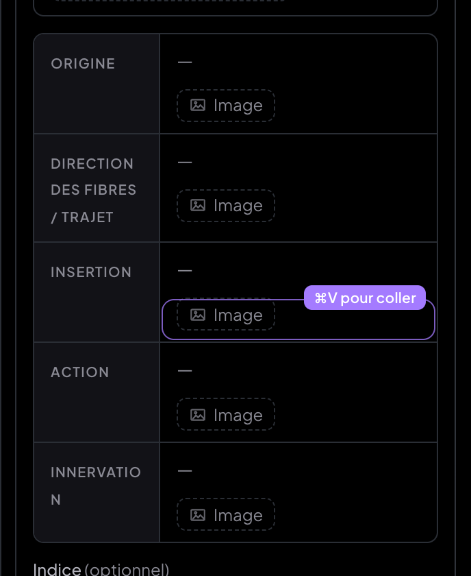 | 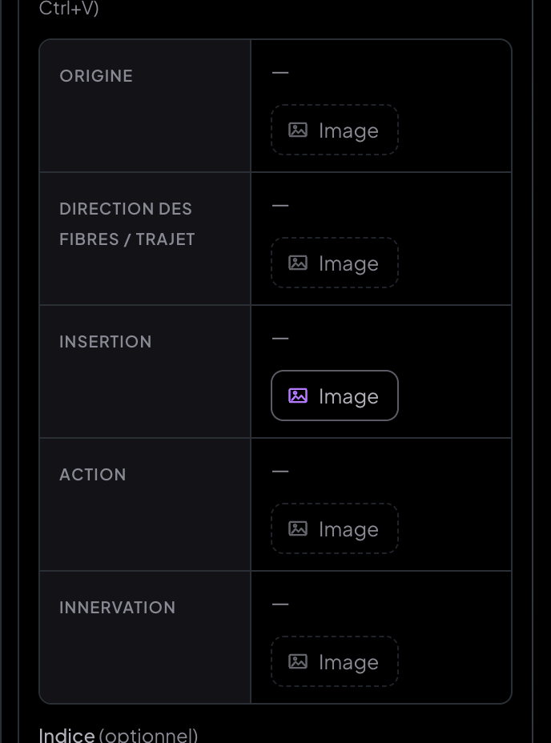 |
| Zone avec image | 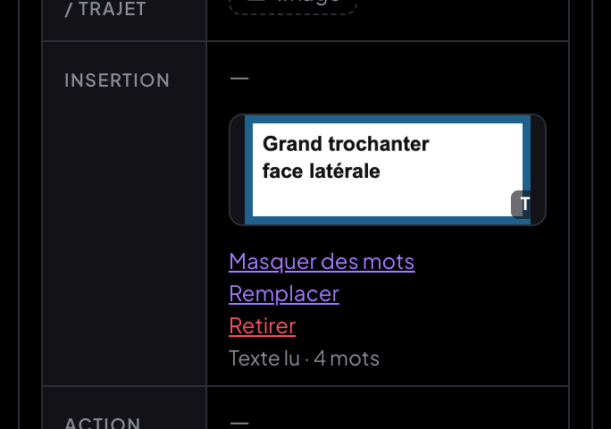 | 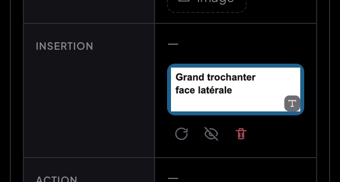 |
| Image générale | 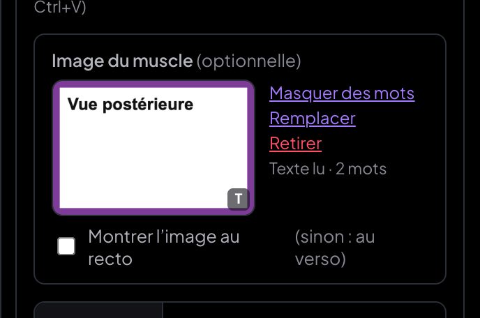 | 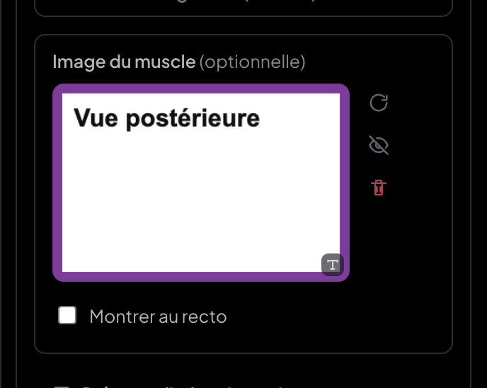 |
| Tableau Muscle (formulaire) | 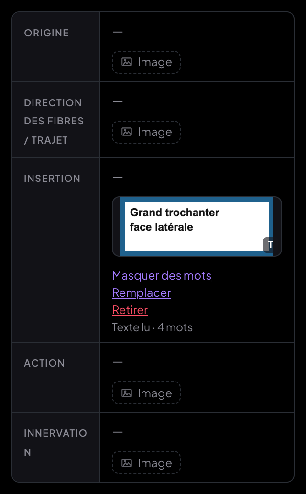 | 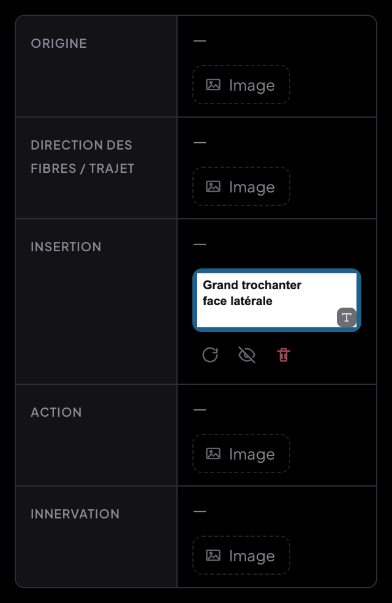 |
| Carte standard | 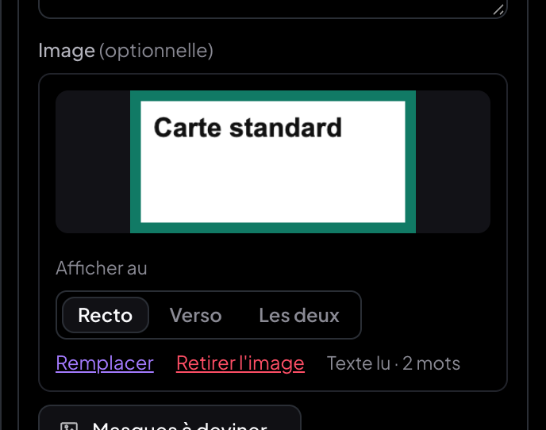 | 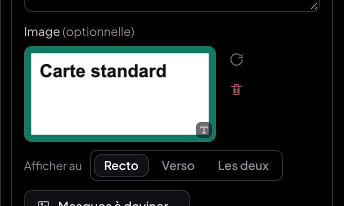 |
| Tablette | 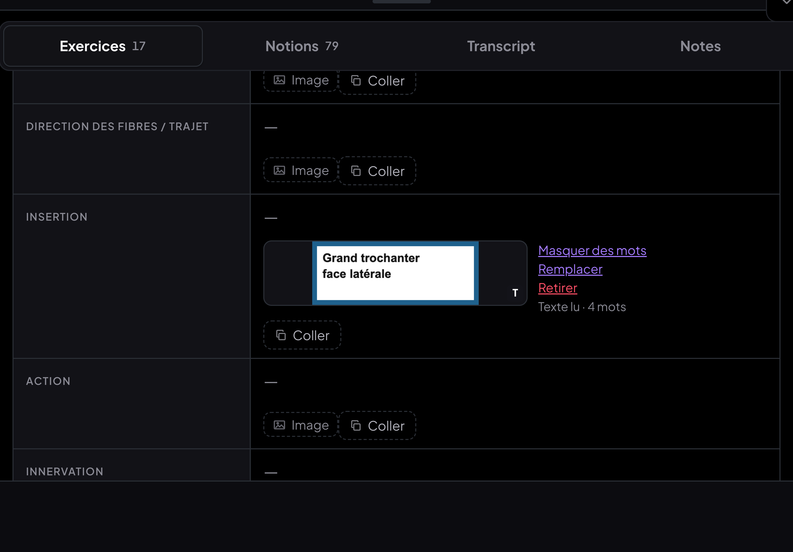 | 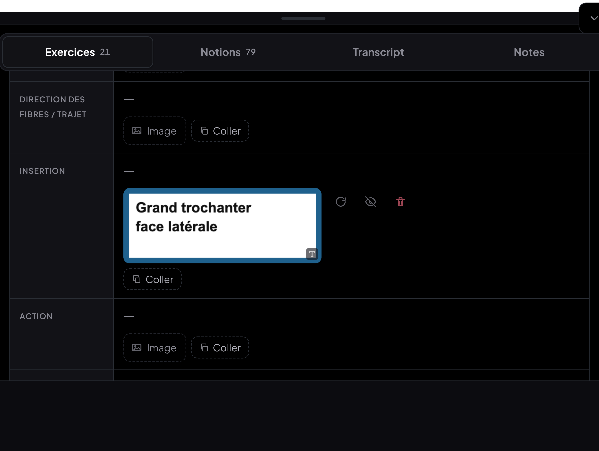 |
| Mobile (verso en révision) | 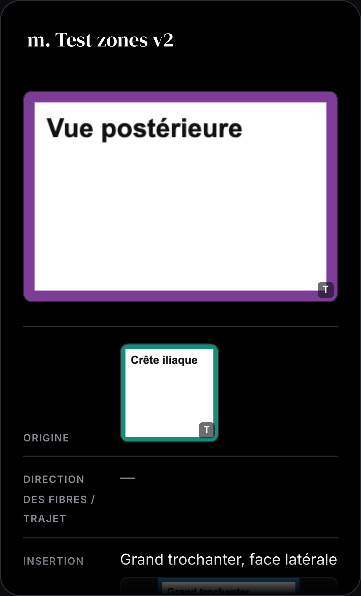 | 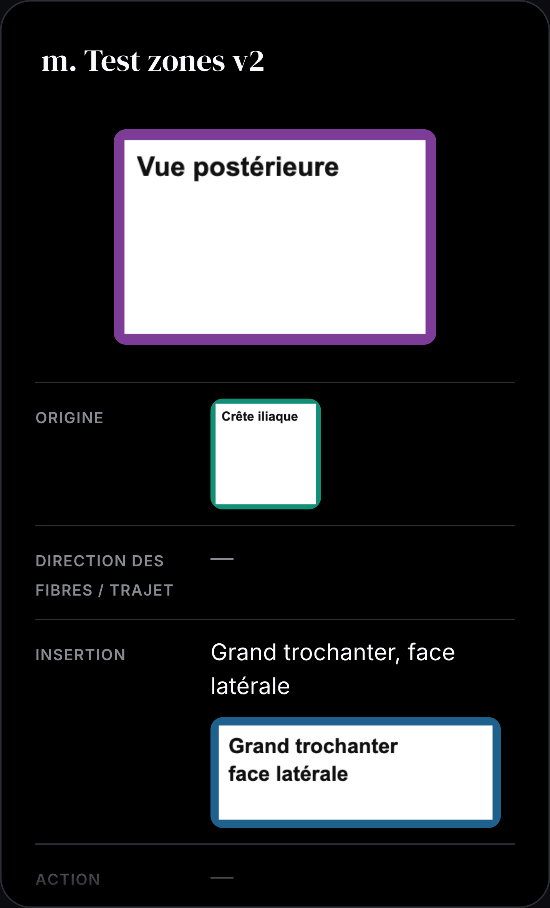 |

Autres captures :
- `08-apres-molecule.png` : carte Molécule ;
- `09-apres-revision-verso.png` : verso au bureau ;
- `10-apres-visionneuse.png` : aperçu plein écran ;
- `11-mealweek.png`.

**Limite** : le téléphone n'a pas de formulaire de carte (le shell mobile n'a ni lecteur ni panneau).
Sur téléphone, seule la révision est concernée, et elle est testée.

### Commits

| Commit | Contenu |
|---|---|
| ffb7373 | `feat(medrevise)` : zones image v2 — composant unique, survol discret, actions en icônes, tableau Muscle aligné, image des cartes Molécule, bancs `scripts/tests-zones/` |
| ac9f488 | `docs(medrevise)` : section « Zones image v2 », captures avant / après |

## Liste, « Agrandir » et tag « À apprendre » (26/10/2026)

### Ce qui a changé

**Onglet Flashcards du panneau**
- Le formulaire de création est en tête de la liste. Quand on ne s'en sert pas, il est replié en une ligne
  « + Nouvelle carte ». Un clic le déplie au même endroit. « Annuler » le replie.
- En dessous : la liste de toutes les cartes du cours, avec la recherche et les filtres de sorte existants.
- Un nouveau filtre « ★ À apprendre N » apparaît dès qu'une carte est taguée. Il se combine avec la sorte et
  la recherche.
- Chaque carte a deux nouvelles icônes, avec infobulle :
  - **Agrandir** (⛶) ouvre la carte en grand ;
  - **À apprendre** (★) pose ou retire le tag.
- Une carte taguée porte l'étiquette « ★ À apprendre » à côté de son thème.

**Agrandir** (`components/VueAgrandie.jsx`)
- La carte s'affiche avec **le composant de la séance du jour** (`FaceFC`, désormais exporté de
  `session/SeanceFC.jsx`), dans le même cadre `.sfc-carte`.
- On y retrouve le recto, le geste pour retourner, le verso, et les champs Muscle / Tableau qui se révèlent un
  par un (« Tout révéler » inclus). La rangée d'icônes est aussi la même : l'étoile tout le temps, le carnet
  d'erreurs une fois la carte retournée.
- Échap ou un clic dehors ferment la vue. Les flèches ← → passent à la carte précédente ou suivante **de la
  liste affichée**, filtres compris. Espace / Entrée retournent la carte.
- Rien n'est noté.

**Tag « À apprendre »** (`lib/aApprendre.js`, `components/BoutonAApprendre.jsx`)
- C'est un booléen `aApprendre`, ajouté sur la carte (champ en plus, aucune autre donnée touchée). Il se
  synchronise avec la carte, comme le carnet d'erreurs.
- L'écriture relit la carte enregistrée et ne change **que** ce champ.
- La même étoile apparaît partout où une carte est affichée :
  - liste du panneau ;
  - vue agrandie ;
  - séances de révision : séance du jour, séance d'un cours, séance mobile. L'étoile est dans la rangée
    d'icônes de l'en-tête, à côté du carnet, **dès le recto** ;
  - mode Apprentissage : vignettes, aperçu et session.
- Chaque bascule affiche un toast « Ajoutée à À apprendre » ou « Retirée d’À apprendre », avec « Annuler »,
  pendant 4,5 s.
- Mode Apprentissage : une puce « ★ À apprendre N » est placée juste après « Nouvelles » (dans la feuille
  Filtres sur téléphone). Elle se combine avec les autres filtres. Son compteur donne le nombre de cartes
  taguées qui passent les autres filtres.

### Trois défauts trouvés par les tests et corrigés
1. **Une note donnée après le tag l'effaçait.** Les séances notent la copie de la carte prise à l'affichage.
   Le tag posé entre-temps était donc réécrit à faux.
   - Correctif : `garderTagEnBase` reprend le tag de la version enregistrée au moment d'enregistrer la note.
   - Il est appliqué dans `SeanceFC`, `Session` et `MobileSession`.
   - Le planificateur n'est pas touché.
2. **Sur téléphone, le toast recouvrait les boutons de notation** pendant 4,5 s. Un tap de notation tombait
   sur « Annuler ». Le toast de l'étoile s'affiche maintenant **en haut** de l'écran sur téléphone.
3. **Avec le filtre « À apprendre » actif**, retirer l'étoile faisait disparaître la carte, et son toast
   avec elle : il n'y avait plus d'« Annuler ».
   - Le toast vit maintenant dans un hôte unique, indépendant de la carte.
   - Il s'affiche au-dessus de l'aperçu et de la vue agrandie.

Autre correctif : Échap ne fermait pas la vue agrandie quand le focus était sur l'étoile, parce que la rangée
d'icônes arrête la propagation du clavier. L'écouteur passe maintenant en phase de capture.

### Tests

Le banc est dans `scripts/tests-a-apprendre/` (`tout.sh`), sans le vrai cloud :
- faux Supabase sur le port 54399 ;
- Vite sur le port 5300 ;
- deux Chrome headless aux profils neufs : A (ordinateur) et B (téléphone).

Le jeu de test compte 200 cartes de toutes les sortes dans un cours (`seed.mjs`).

Résultat : **94 vérifications, toutes vertes** (dernière passe complète sur le code commité).

| Banc | Contenu | Résultat |
|---|---|---|
| `t-liste.mjs` (ordinateur) | formulaire replié et déplié ; défilement de 200 cartes ; Agrandir pour les 6 sortes, ← →, Échap, clic dehors, liste filtrée ; tag depuis la liste et la vue agrandie, toast, Annuler ; filtre combiné ; preuve d'indépendance ; faux cloud | 56 ✅ |
| `t-mobile.mjs` (téléphone 390 px) | synchro A → B ; étoile en séance (40 px, recto et verso) ; tag conservé après la note ; filtre de la feuille, combiné avec « Nouvelles » ; Annuler sur une carte qui sort du filtre ; session ; synchro B → A | 17 ✅ |
| `t-tablette.mjs` (820 px tactile) | icônes toujours visibles au doigt ; formulaire ; Agrandir au doigt ; champ Muscle révélé ; › ; étoile ; toucher dehors | 10 ✅ |
| `t-apprentissage.mjs` (ordinateur) | puce après « Nouvelles », compteur qui suit les filtres ; étoile au survol d'une vignette ; aperçu (toast cliquable au-dessus) ; session | 11 ✅ |
| `npm test` (`tests/a-apprendre/`) | `ecrireAApprendre` ne change que le tag ; filtre du tableau de bord ; `garderTagEnBase` | 6 ✅ |

**Preuve d'indépendance.** Empreintes SHA-256 relevées avant et après avoir tagué 10 cartes (8 depuis la
liste, 2 depuis la vue agrandie) :

| Empreinte | Avant | Après |
|---|---|---|
| Planification (dueDate, J0, intervalle, état, nouvelle, FSRS, historique, carnet) | `8146fd64a7e4d92c` | `8146fd64a7e4d92c` |
| Cartes entières, hors `aApprendre` et horodatage | `2bec2a64616929b8` | `2bec2a64616929b8` |
| Journal des révisions | `4f53cda18c2baa0c` | `4f53cda18c2baa0c` |
| Séance du jour | `74234e98afe7498f` | `74234e98afe7498f` |

**Défilement de 200 cartes.** Aucune tâche longue pendant 120 crans de molette. Les images au-delà de 34 ms
relevées par le rAF en headless (5 à 9 sur environ 125 en isolé, jusqu'à 16 en fin de batterie) sont **les mêmes avec l'ancien code** : mesures
alternées avec `t-defil.mjs`, ancien code par `git stash`.

**Non-régression**
- `npm test` : 137 tests verts sur 138. Le seul échec (`crayon › trois épaisseurs par mode`) existait déjà
  avant ce chantier.
- `vite build` : vert.
- `src/shared/` et `src/mealweek/` : non modifiés.
- MealWeek : identique au pixel entre les builds avant et après (`cmp` des captures).
- L'avertissement de dev `validateDOMNesting` (boutons « Toucher » d'un tableau dans la carte-bouton) est déjà
  émis par la séance du jour. La vue agrandie le reprend puisqu'elle utilise le même composant.

### Captures (`docs/img/a-apprendre/`)

| | |
|---|---|
| Liste avec icônes (survol) | 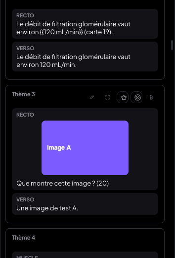 |
| Carte taguée (étiquette) | 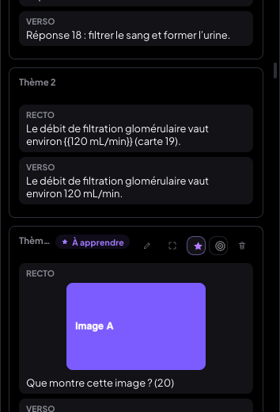 |
| Formulaire replié / déplié | 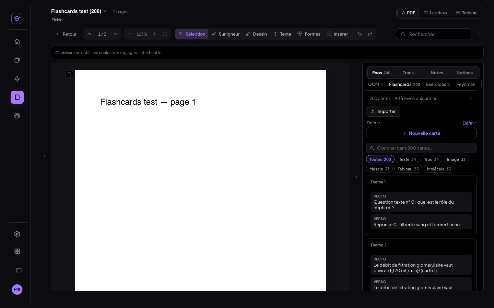 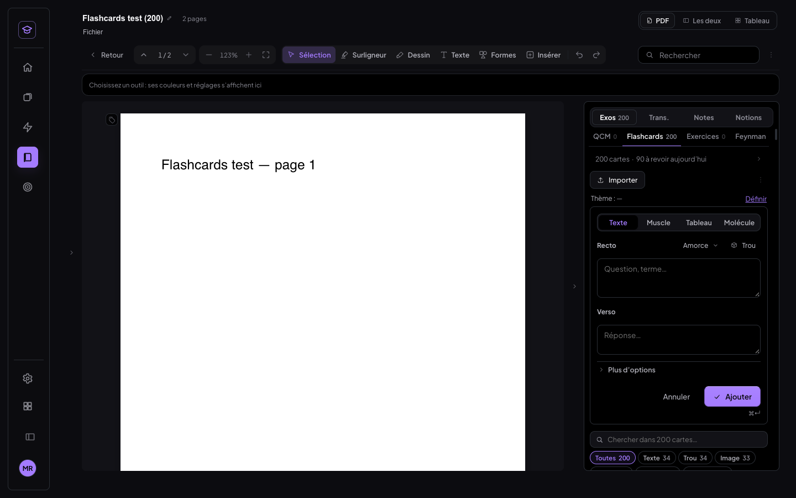 |
| Filtre « À apprendre » du panneau | 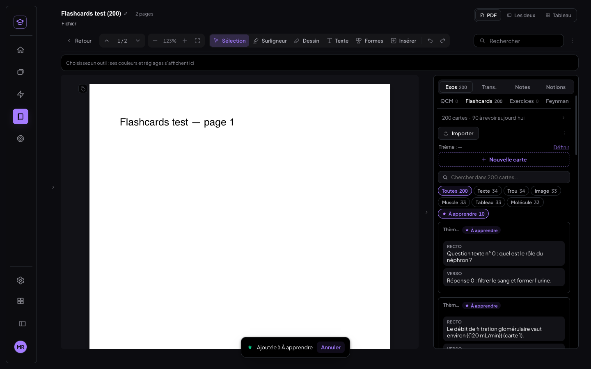 |
| Vue agrandie : texte (recto), Muscle et Tableau (verso, champs révélables) | 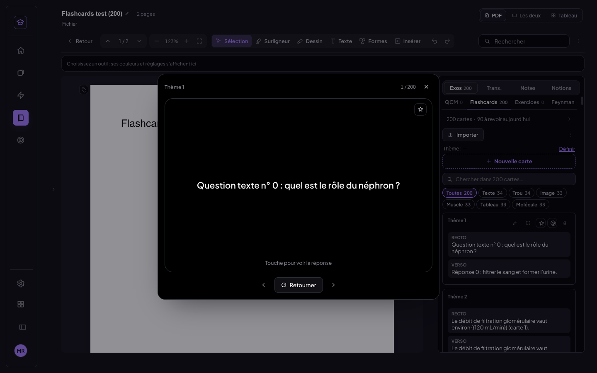 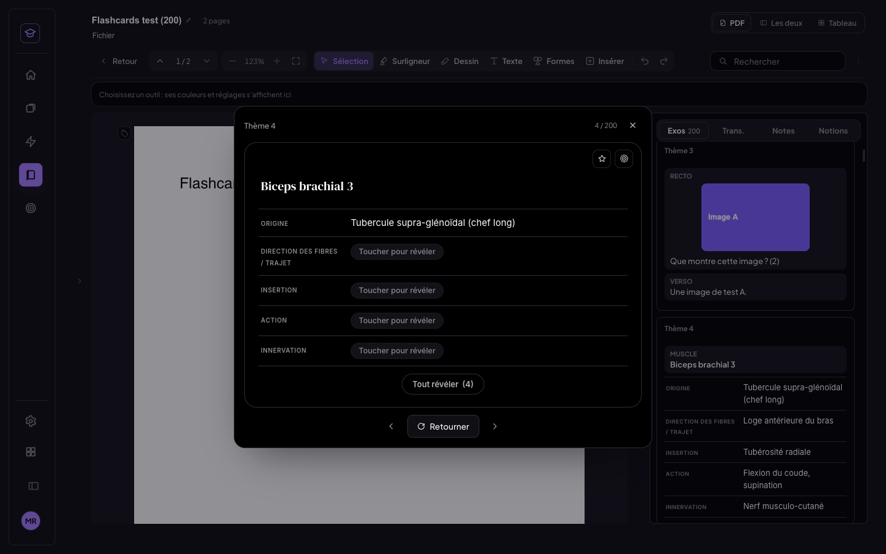 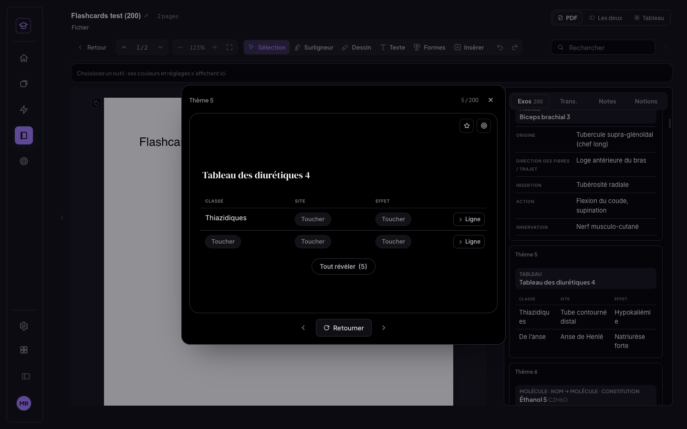 |
| Vue agrandie d'une carte taguée ; tablette | 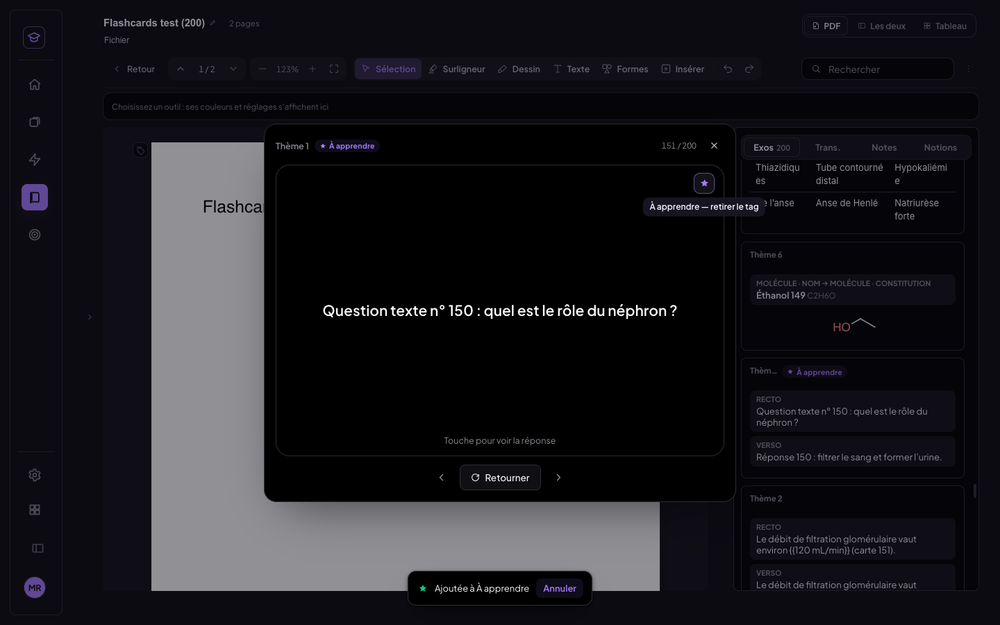 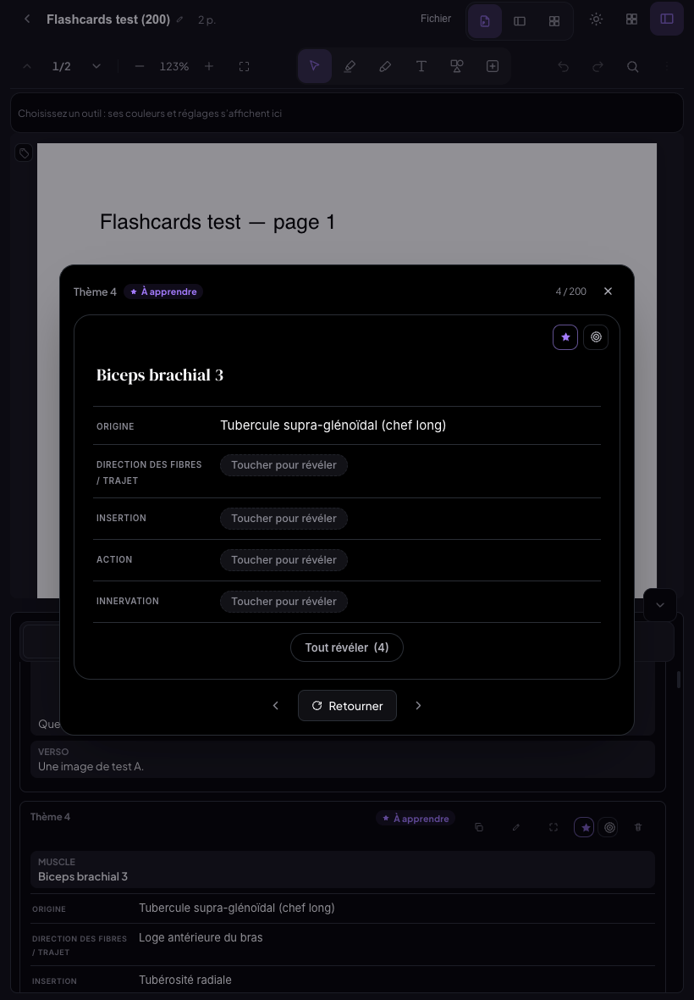 |
| Icône en révision mobile (recto avec toast en haut, verso à côté du carnet) | 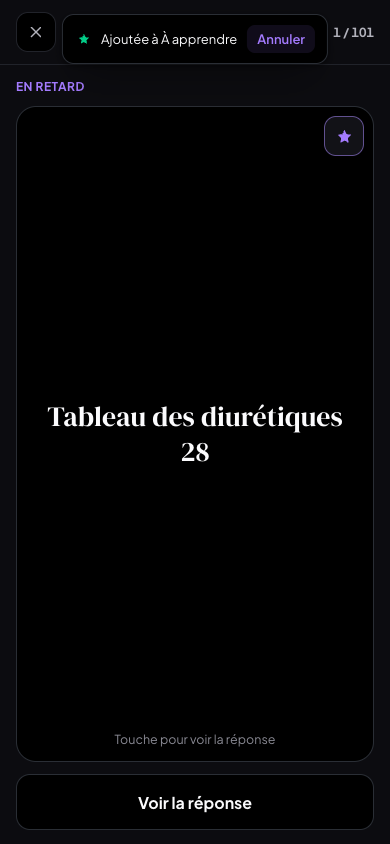 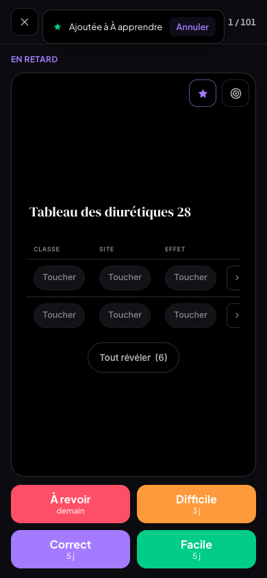 |
| Filtre du mode Apprentissage (ordinateur, téléphone) | 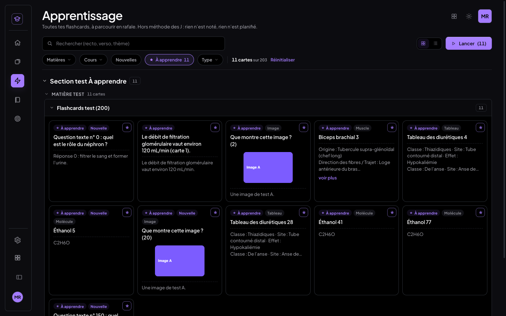 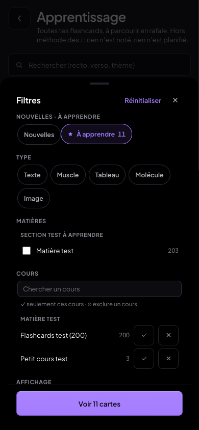 |
| Étoile sur les vignettes ; session mobile | 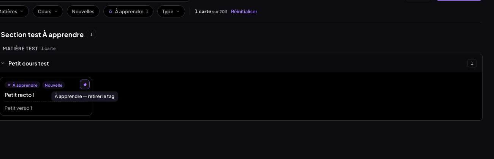 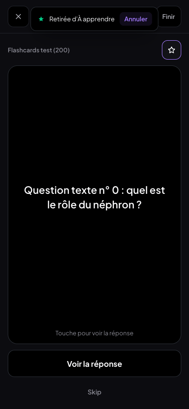 |
| MealWeek (après, identique à avant) | 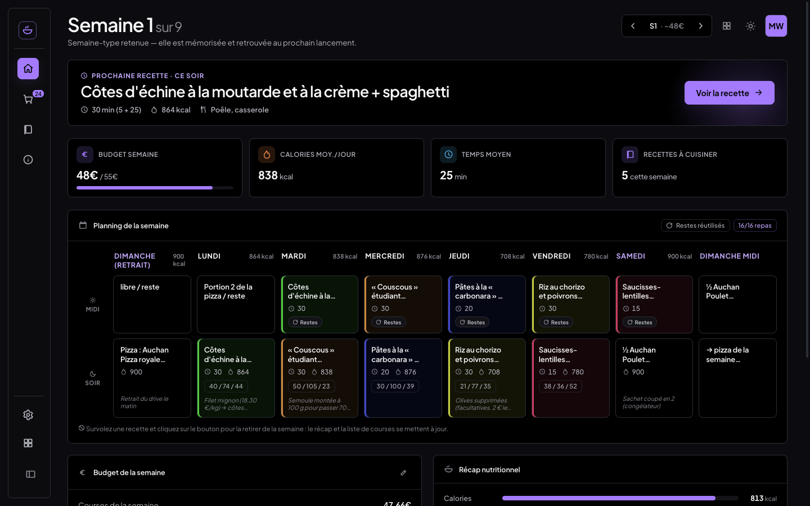 |

### Commits

| Commit | Contenu |
|---|---|
| 976a7ae | `feat(medrevise)` : formulaire en tête de la liste, Agrandir, tag « À apprendre » partout, filtres, conservation du tag à la notation |
| 056aaa2 | `test(medrevise)` : banc `scripts/tests-a-apprendre/` |
| (ce commit) | `docs(medrevise)` : cette section et ses captures |

## Carte Texte : éléments à révéler au verso (26/10/2026)

### Fonctionnement

**Formulaire.** Le formulaire Texte reste celui d'avant : recto, verso. Sous le champ Verso, un bouton discret
**« + Élément »** ajoute un champ d'élément, autant de fois qu'on veut. Entrée dans un élément en ajoute un
autre juste après.

Chaque élément a :
- son texte ;
- une poignée pour le réordonner en glissant (souris ou doigt) ;
- un **œil** : masqué par défaut, ouvert = toujours visible ;
- une corbeille.

Le champ Verso reste disponible : il devient un texte d'introduction facultatif, affiché au-dessus des
éléments. Une carte avec au moins un élément n'a pas besoin de verso. La même carte sert à la modification.

**Affichage.** Au retournement, le texte du verso s'affiche, puis la liste numérotée des éléments. Les éléments
masqués affichent « Toucher pour révéler » et se révèlent un par un au clic ou au tap. « Tout révéler (n) »
révèle le reste.
- **Aucune nouvelle mécanique** : c'est le composant de révélation des cartes Muscle. Il est factorisé en
  `LignesARevelerer` (components/FlashcardMuscle.jsx) et `TableauMuscle` l'utilise lui-même.
- Le rendu Muscle est vérifié **identique au pixel** à l'ancien code (voir plus bas).
- Les éléments s'affichent dans :
  - les trois séances (séance du jour, séance d'un cours, séance mobile) ;
  - la vue agrandie ;
  - le mode Apprentissage (session ; aperçu et vignette tout visibles) ;
  - la liste du panneau (tout visible).

**Stockage.** Le champ ajouté est `items: [{ text, masked }]`, sur la carte Texte (lib/schema.js
`normElements`). Une carte **sans éléments est inchangée** : le champ n'est jamais ajouté, ni à la création,
ni à la modification d'une carte qui n'en avait pas.

### Format JSON (import du panneau, « Voir le format attendu », prompt)

```json
{
  "type": "flashcard",
  "theme": "Physiologie rénale",
  "recto": "Quelles sont les 4 fonctions du rein ?",
  "verso": "Quatre grandes fonctions :",
  "items": [
    { "text": "Épuration des déchets azotés (urée, créatinine)", "masked": true },
    { "text": "Équilibre hydro-électrolytique", "masked": true },
    { "text": "Équilibre acido-basique", "masked": false },
    { "text": "Fonctions endocrines (EPO, rénine, calcitriol)", "masked": true }
  ]
}
```

- `masked` est facultatif et vaut `true` par défaut ; `false` signifie toujours visible.
- `verso` devient facultatif quand il y a des `items`.
- Les erreurs sont signalées précisément : liste attendue, champ inconnu, `masked` autre que true / false,
  texte manquant, `items` sur une carte Muscle / Molécule / Tableau.
- L'exemple « Voir le format attendu » contient cette carte et se réimporte sans erreur.
- Le complément du prompt de génération décrit le champ.
- **Export** : la sauvegarde (records JSONL, `sauvegarde/export.js`) contient la carte telle quelle. Les
  éléments sont relus à l'identique (clés triées).

### Tests

Banc `scripts/tests-par-cours-elements/` : Vite sur le port 5302 sans Supabase, Chrome C et Chrome D.

| Banc | Contenu | Résultat |
|---|---|---|
| `t-elements.mjs` (ordinateur) | carte « Quelles sont les 4 fonctions du rein ? » : création (4 éléments, 3 masqués, 1 visible), modification (élément 4 glissé en tête, œils), planification inchangée, liste du panneau, vue agrandie (3 masqués, un par un, Tout révéler), vignette et session Apprentissage, format attendu, import réel de l'exemple, export puis relecture, cartes témoins identiques octet pour octet | 21 ✅ |
| `t-session-cours.mjs` (ordinateur) | séance d'un cours (`Session.jsx`, carte 3D) : 3 masqués → 2, Tout révéler | 5 ✅ |
| `t-elements-mobile.mjs` (téléphone) | séance du jour : verso avec introduction, 3 masqués, un par un au doigt sans retourner la carte, Tout révéler, boutons Nouvelle inchangés ; session Apprentissage | 9 ✅ |
| `npm test` (`tests/elements/`) | schéma (verso facultatif, défauts, cartes anciennes identiques), modification qui garde la planification, import (exemple et 6 erreurs), versoTexte, aller-retour JSON | 7 ✅ |

**Cartes Texte anciennes et Muscle identiques au pixel** (`t-pixel.mjs` + `px-diff.mjs`). Méthode : ancien code
par `git stash`, même page, même port. Cas comparés : vue agrandie au verso, aperçu Apprentissage, carte de la
liste.

| Capture | Ancien ↔ nouveau | Nouveau ↔ nouveau (bruit) |
|---|---|---|
| Muscle, vue agrandie (champs masqués) | 0 px | 0 px |
| Muscle, aperçu Apprentissage | 0 px | 0 px (ancien ↔ ancien : 5 px) |
| Muscle, liste du panneau | 0 px | 40 px (écart ≤ 3) |
| Texte ancienne, aperçu Apprentissage | 0 px | 0 px |
| Texte ancienne, vue agrandie | 8 px (écart ≤ 3) | 8 px (écart ≤ 3) |
| Texte ancienne, liste | 57 px (écart ≤ 3) | 57 px (écart ≤ 3) |

Les écarts restants sont ceux de deux captures de la **même** version : de l'anticrénelage.

### Non-régression

- `npm test` : 150 tests verts sur 151. Le seul échec (`crayon`) existait déjà avant.
- `vite build` : vert.
- Banc « À apprendre » rejoué : 94 vérifications vertes.
- `src/shared/` et `src/mealweek/` : non modifiés.
- MealWeek : identique au pixel entre les builds avant et après (`cmp`).

**Incident de banc.** Une première relance du banc « À apprendre » a échoué sans erreur dans l'app : toast
absent, liste non rafraîchie. Cause : le serveur Vite de dev (port 5300) était resté périmé après des
`vite build` lancés pendant qu'il tournait. Après redémarrage, tout est vert. Le code n'était pas en cause.

### Captures (`docs/img/par-cours-elements/`)

| | |
|---|---|
| Formulaire : verso, 4 éléments, œils (3 masqués, 1 visible), « + Élément » | 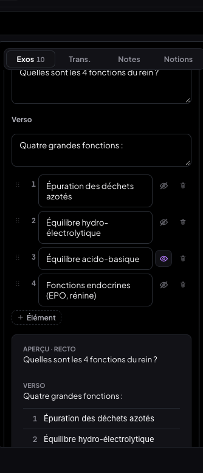 |
| Réordonnement en glissant la poignée | 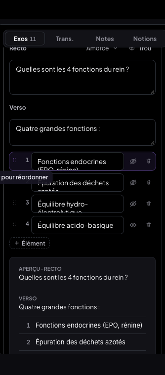 |
| Liste du panneau | 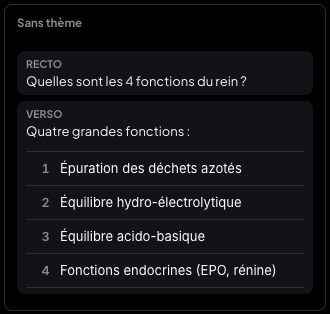 |
| Vue agrandie : masqués, puis tout révélé | 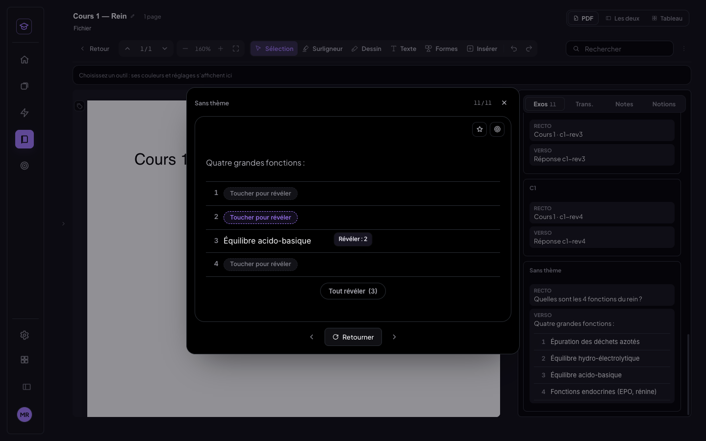 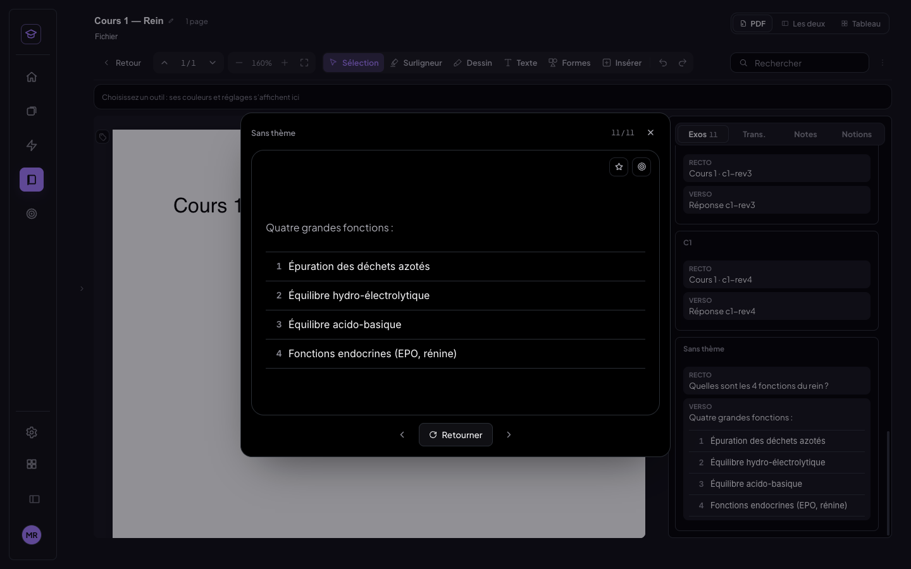 |
| Séance d'un cours (carte 3D) | 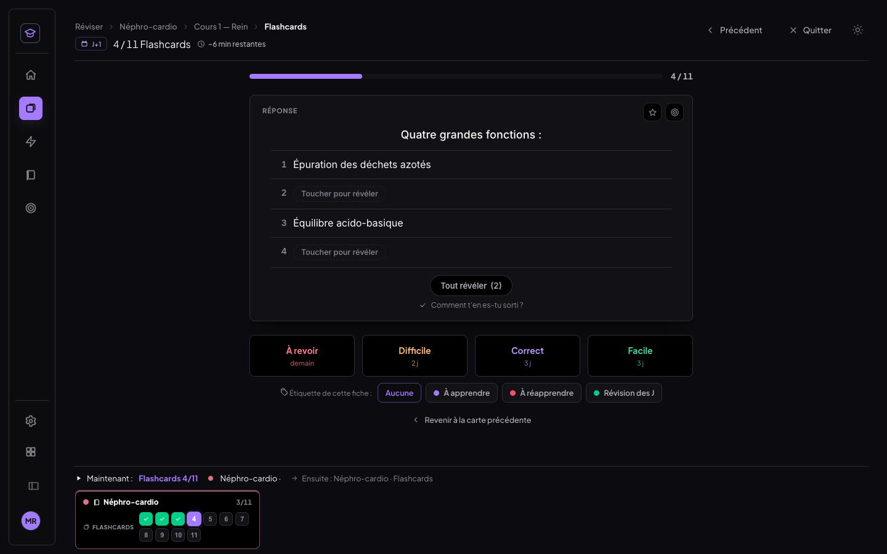 |
| Téléphone : masqués, un par un, tout | 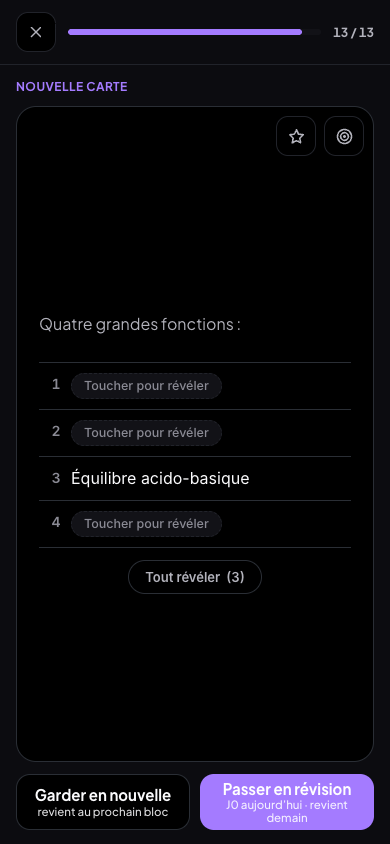 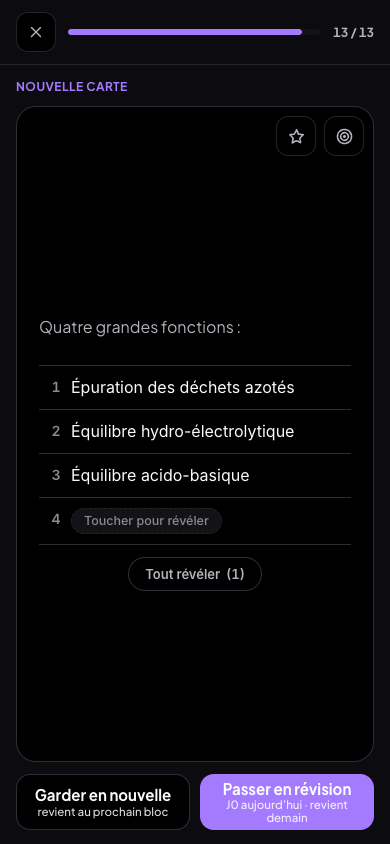  |
| Mode Apprentissage (ordinateur, téléphone) | 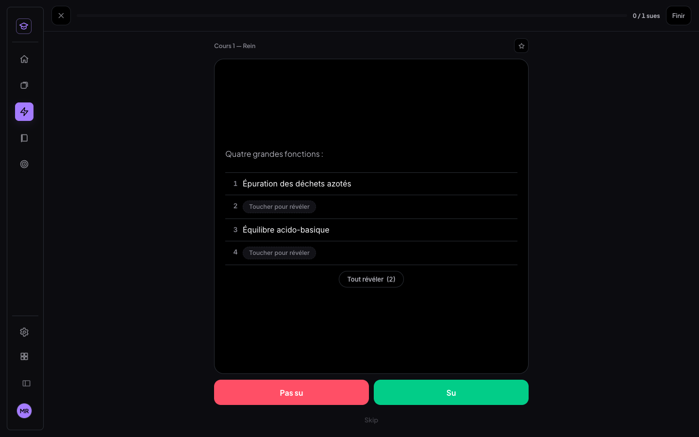 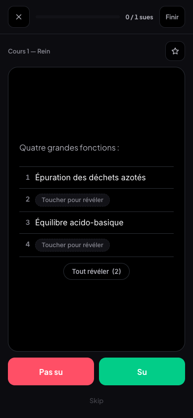 |
| « Voir le format attendu » | 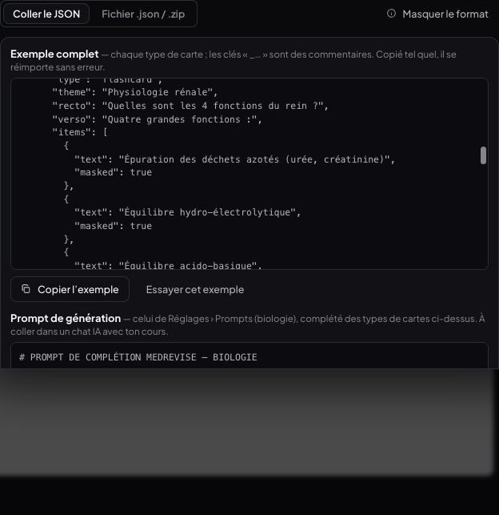 |
| MealWeek (après) |  |

### Commits (Regrouper par cours + éléments à révéler)

| Commit | Contenu |
|---|---|
| fb5670a | `feat(medrevise)` : « Regrouper par cours » et éléments à révéler (formulaire, affichage partout, composant Muscle factorisé, import / format / prompt) |
| 584d432 | `test(medrevise)` : banc `scripts/tests-par-cours-elements/` |
| (ce commit) | `docs(medrevise)` : sections « Regrouper par cours » (compte-rendu-seance-categories.md) et « éléments à révéler » (ce fichier), captures |


## Échap n'annule plus · ligne « Topographie » des cartes Muscle (28/10/2026)

### 1. Échap ne fait plus perdre le brouillon

**Avant.** Dans le formulaire de flashcard du panneau, Échap appelait « Annuler », pour les quatre sortes
(Texte, Muscle, Tableau, Molécule) et aussi en modification. Un appui de trop, et la saisie était perdue.

**Maintenant.** Dans le formulaire, Échap fait seulement deux choses :

- il ferme le menu ouvert (« Amorce », liste de suggestions de la Molécule…). Ces menus écoutent Échap en phase de
  capture et le consomment avant le formulaire, comme avant ;
- sinon, il fait sortir du champ (le curseur quitte la zone de texte).

Le brouillon n'est jamais perdu. Seul le bouton « Annuler » ferme le formulaire. Un clic ou un tap en dehors
(page du cours, barre du panneau) ne le ferme pas non plus. C'était déjà le cas, et c'est maintenant vérifié.

La fenêtre « Boîte → Flashcard » du lecteur (créer une carte depuis une boîte) suivait la même règle : Échap la
fermait. Elle se comporte maintenant comme le formulaire. Échap quitte le champ, et « Annuler » ou ✕ ferment la
fenêtre.

Code : `echapDansFormulaire(e)` (`components/AddItemForm.jsx`), appelé par `FlashcardForm`, `FormulaireMuscle`,
`FormulaireTableau` et `FormulaireMolecule` à la place de `onCancel()`. Le gestionnaire Échap de `pdf/BoiteFlashcard.jsx`
a été modifié de la même façon. Les infobulles « Échap = annuler » disent maintenant « Échap = quitter le champ ».

### 2. Carte Muscle : 6ᵉ ligne « Topographie »

- **Modèle** (`lib/muscle.js`) : `LIGNES_MUSCLE` a une 6ᵉ entrée, `{ id: 'topographie', label: 'Topographie' }`,
  après Innervation. Le formulaire, le tableau de révision, la liste, la vue agrandie, le mode Apprentissage, les
  séances, l'export et l'import lisent tous cette liste. La nouvelle ligne a donc le même rendu et le même
  comportement que les autres : texte à puces, image par ligne (`muscle.images.topographie`) et révélation ligne
  par ligne.
- **Aucune ligne obligatoire** : le formulaire n'exige que le nom du muscle, comme avant. L'import n'exige plus
  « au moins un des 5 champs ». Le tableau n'affiche aucune mention « optionnel ».
- **Ligne vide** : « — » en révision, comme les autres, et elle n'est pas comptée dans « Tout révéler (n) ».
- **Cartes existantes** : rien n'est réécrit, il n'y a pas de migration. Une carte sans clé `topographie` est lue
  avec une Topographie vide (`lignesDe`). Elle affiche donc une 6ᵉ ligne « — », et le reste est inchangé.
  L'empreinte de la carte témoin en base est identique avant et après affichage, modification annulée et export.
  Aucune écriture Supabase n'a été faite : c'est un champ en ajout, synchronisé avec la carte comme les autres.
- **Import / export JSON** : `muscle.topographie` est accepté à l'import, et toujours écrit à l'export (`""` pour
  une ancienne carte). L'exemple de « Voir le format attendu » et le complément du prompt le contiennent :

```json
{ "type": "flashcard", "theme": "Muscles du bras", "recto": "Biceps brachial",
  "muscle": { "origine": "…", "trajet": "Loge antérieure du bras", "insertion": "Tubérosité radiale",
              "action": "Flexion du coude, supination", "innervation": "Nerf musculo-cutané (C5–C6)",
              "topographie": "Loge antérieure du bras, superficiel au brachial" } }
```

- **Pré-remplissage depuis une capture (OCR)** : « Topographie » est reconnue comme étiquette. Sans cela, le
  contenu de cette ligne d'un tableau de cours aurait été versé dans Innervation. Le compteur affiche « n/6 ».

### Tests

Banc `scripts/tests-topographie-echap/` (`tout.sh`) : Vite :5302 **sans Supabase**, Chrome headless isolés
(9337 ordinateur, 9338 téléphone), profils neufs. Les vraies données et le cloud n'ont jamais été touchés, et aucun
fichier n'a été écrit dans ~/Downloads (téléchargement intercepté).

| Scénario | Résultat |
|---|---|
| `t-echap.mjs` (ordinateur 1440×900) : Échap ×2 pendant la saisie de chaque sorte (Texte, Muscle, Tableau, Molécule) → formulaire présent, saisie intacte, focus sorti du champ ; Échap avec « Amorce » ouvert → seul le menu se ferme ; liste de la Molécule → se ferme, nom gardé ; clics dehors (page du cours, barre du panneau) après chaque sorte ; retour sur chaque sorte → rien perdu ; aucune carte créée ; « Annuler » ferme ; **modification** d'une carte Texte et de l'ancienne carte Muscle : mêmes vérifications, base inchangée | 29 ✅ |
| `t-echap.mjs tablette` (820×1180, taps au doigt, panneau en volet) : la même chose | 29 ✅ |
| **Avant / après** : `t-echap.mjs` rejoué sur l'ancien code (`git stash -- src/`) | ❌ dès le 1er Échap (formulaire fermé, saisie perdue) |
| `t-topographie.mjs` : 6 lignes, Topographie en bas, aucun « optionnel » ; carte avec la **Topographie seule** (texte + image collée ⌘V) → base `topographie` + `images.topographie` ; carte avec le **nom seul** → créée, 6 lignes vides ; vue agrandie : 5 « — », Topographie masquée, « Tout révéler (1) », un toucher révèle texte et image ; carte nom seul : 6 « — », rien à révéler ; **ancienne carte Muscle** : 5 lignes masquées comme avant + Topographie « — », révélation ligne par ligne, empreinte identique ; mode Apprentissage : 6 lignes ; « Voir le format attendu » ; import de l'exemple ; JSON collé (Topographie seule / aucune ligne) ; **export .zip** du cours (UI) → `topographie` sur chaque carte (`""` pour l'ancienne), image exportée → **ré-import** du .zip dans un autre cours : topographie et image retrouvées | 25 ✅ |
| `t-mobile.mjs` (téléphone 390×844, tactile) : séance du jour, carte Muscle (Topographie + 2 lignes remplies) : 6 lignes, vides « — », un tap révèle la Topographie seule (la carte ne se retourne pas), « Tout révéler » ; ancienne carte identique | 6 ✅ |
| `t-boite.mjs` : fenêtre « Boîte → Flashcard » : Échap (×3) → reste ouverte, saisie gardée ; clic sur la page → reste ; « Annuler » ferme ; aucune carte créée | 6 ✅ |
| Vitest `tests/muscle-topographie/` (9) : modèle, ancienne carte non modifiée, verso construit, image de ligne, OCR, import sans ligne obligatoire, format attendu ré-importable, export | ✅ |

Le téléphone (< 760 px) n'a pas de panneau, donc pas de formulaire de création. Le « mobile » du formulaire est la
tablette, et la révision est testée sur téléphone.

### Non-régression

- `npm test` : 168 tests verts sur 169. Le seul échec (`crayon`) existait déjà avant ce chantier. Le test d'export
  attend maintenant `topographie: ""` pour une carte d'avant.
- `vite build` : vert.
- Banc `scripts/tests-par-cours-elements/tout.sh` (formulaire, éléments à révéler, séances) : 84 vérifications
  vertes.
- `src/shared/` et `src/mealweek/` : aucun fichier modifié (`git status` vide).
- **MealWeek** : builds avant (HEAD) et après, servis sur la même origine. Les captures sont identiques octet pour
  octet (`cmp`), et deux captures de l'ancien build le sont aussi.

### Captures (`docs/img/topographie-echap/`)

| | |
|---|---|
| Échap avec le menu « Amorce » ouvert (ordinateur, tablette) | 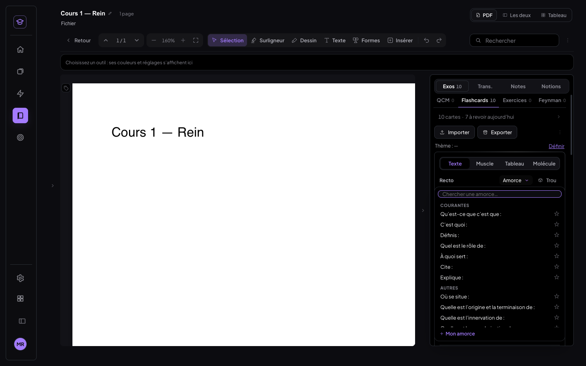 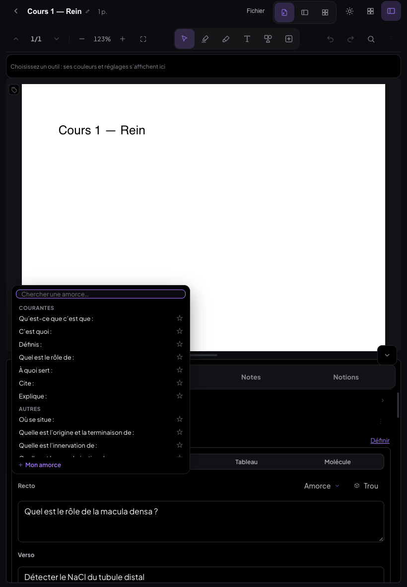 |
| Brouillon intact après Échap et clics dehors | 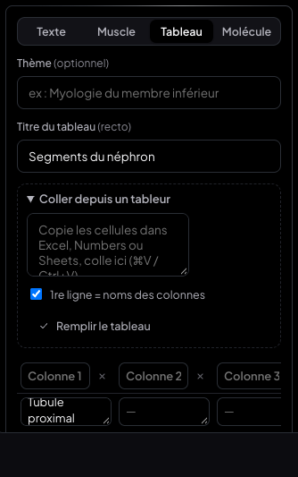 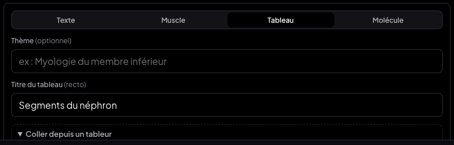 |
| Ancienne carte Muscle en modification (6 lignes) | 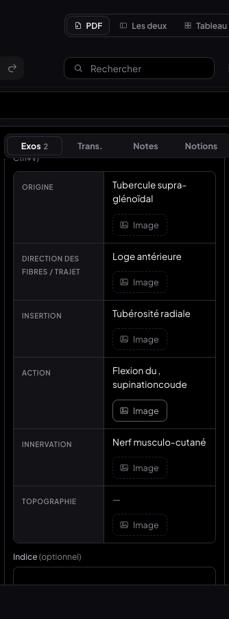 |
| Formulaire : ligne Topographie | 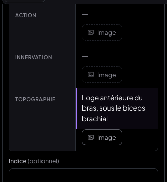 |
| Vue agrandie : Topographie masquée, puis révélée (texte + image) | 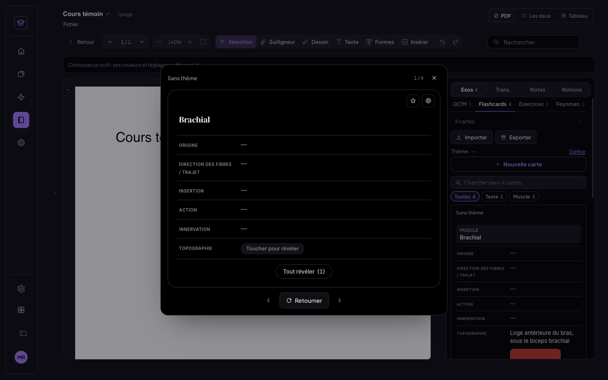 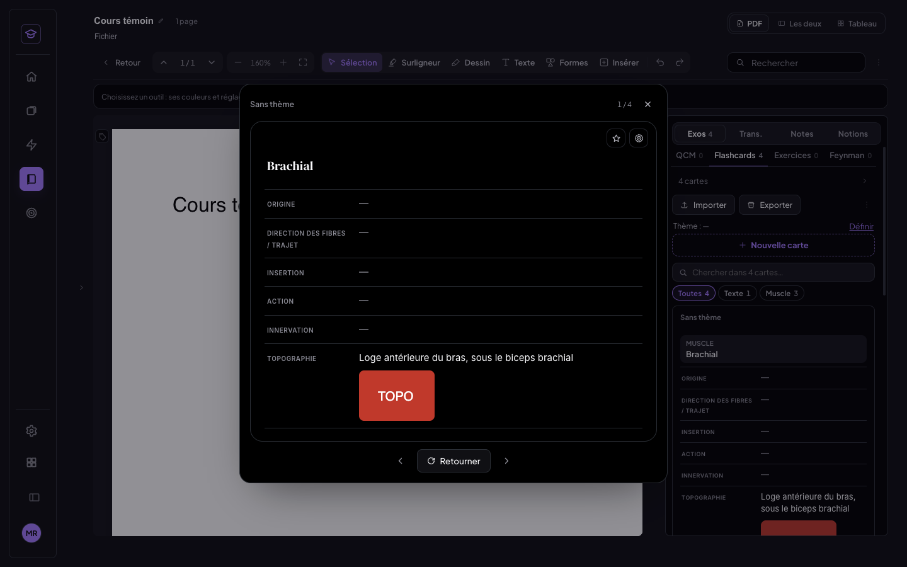 |
| Ancienne carte Muscle en révision |  |
| « Voir le format attendu » |  |
| Téléphone : masquée, une ligne, tout |    |
| MealWeek (après) |  |

### Commits (Échap · Topographie)

| Commit | Contenu |
|---|---|
| 51fdc19 | `fix(medrevise)` : Échap n'annule plus la création / modification (4 sortes + fenêtre Boîte → Flashcard) |
| fb4859d | `feat(medrevise)` : 6ᵉ ligne « Topographie » des cartes Muscle, import / export / format attendu, tests Vitest |
| cf3f22d | `test(medrevise)` : banc `scripts/tests-topographie-echap/` |
| (ce commit) | `docs(medrevise)` : cette section et ses captures |

## Tableau : choisir ce qui est masqué (31/10/2026)

Avant, une carte Tableau cachait toujours **toutes** ses cases en révision, et laissait voir les noms de colonnes.
Désormais, on choisit case par case ce qui est caché : une case, une ligne, une colonne ou un nom de colonne.

### Dans l'éditeur (création et modification)

- **Un œil par case**, en haut à droite du champ. Barré = la case sera cachée en révision. L'œil ne prend pas le focus
  (Tab passe toujours d'une case à l'autre) et ne gêne pas la saisie.
- **Un œil par ligne** (colonne de gauche, avec le numéro) et **un œil par colonne** (rangée « Colonne » au-dessus des
  noms) : ils masquent ou affichent toutes les cases de la ligne ou de la colonne. On peut ensuite rendre une case
  visible à part, ou l'inverse. L'œil d'une ligne ou d'une colonne mixte est en pointillés (« en partie masquée »).
- **Un œil sur chaque nom de colonne** : il masque le nom lui-même.
- L'œil du coin masque ou affiche tout le tableau.
- **Les cases masquées sont légèrement hachurées.** Une légende le rappelle au-dessus du tableau. Toutes les infobulles
  disent l'état et l'action : « Colonne 3 : en partie masquée — clic pour tout masquer », « Case : visible en
  révision — clic pour masquer ».
- **Menu « Masquage »** au-dessus du tableau : Tout masquer, Tout afficher, Masquer la colonne et Masquer la ligne de la
  dernière case touchée (avec son nom ou son numéro). Le libellé devient « Afficher la colonne / la ligne » si elle est
  déjà masquée. Échap ferme le menu, pas le formulaire.
- **Par défaut**, comme avant : toutes les cases sont masquées et les noms de colonnes visibles, y compris pour une
  ligne ou une colonne ajoutée et pour un collage depuis un tableur.

### En révision (séance, vue agrandie, mode Apprentissage)

- Seules les cases masquées sont cachées (« Toucher »). Les autres s'affichent directement.
- Un nom de colonne masqué devient une pastille « Colonne N », qui se révèle au toucher.
- Les révélations utilisent le composant existant : une case au toucher, « Ligne » pour les cases cachées d'une ligne
  (le bouton n'apparaît que sur les lignes concernées), « Tout révéler (n) » pour les cases et noms restants. La carte
  ne se retourne pas.
- Dans la liste du panneau et dans les aperçus, rien n'est masqué, comme avant.

### Données (champ additif, aucune écriture destructive)

```json
"tableau": { "colonnes": [...], "lignes": [[...], ...],
             "masque": { "cellules": [[true, false, ...], ...], "noms": [false, true, ...] } }
```

- `true` = masqué en révision. Le champ `masque` **n'est écrit que s'il diffère du défaut**. Une carte d'avant, ou un
  tableau laissé tel quel, reste identique octet pour octet.
- Une ligne entièrement vide est retirée à l'enregistrement, et le masque suit les lignes gardées.
- Synchronisation : le masque fait partie de la carte (store `questions`), avec le même chemin qu'avant. Rien de
  nouveau côté Supabase.
- Le verso texte (tableau mis à plat) est inchangé : un appareil pas encore à jour montre la carte comme avant.
- **Import JSON** : `masque` est facultatif. Un masque partiel est complété avec le défaut, et 1 / 0 sont acceptés.
  Les erreurs sont précises (`tableau.masque.cellules[0] : 5 booléens au plus`, champ inconnu, plus de lignes que le
  tableau…).
- **Export** : le masque est écrit s'il y en a un. « Voir le format attendu » contient un exemple « tableau (masque
  choisi) », réimportable tel quel. Le prompt de génération le décrit aussi.

Code : `lib/carteTableau.js` (`masqueDe`, `masqueParDefaut`, validation), `components/FlashcardTableau.jsx`
(`TableauSimple`, `FormulaireTableau`, `MenuMasquage`), `styles/flashcard-tableau.css`, `lib/importFlashcards.js`,
`lib/exportFlashcards.js`. L'œil de `ElementsVerso.jsx` est réutilisé, puisque le jeu d'icônes partagé n'en a pas et
que `src/shared/` n'est pas touché.

### Tests

Banc `scripts/tests-tableau-masque/` (`tout.sh`). Il tourne sur Vite :5302 **sans Supabase**, avec des Chrome headless
isolés (9337 pour l'ordinateur, 9338 pour le téléphone) aux profils neufs : jamais le vrai cloud. Tableau 4 × 5 testé :
colonne « Insertion » masquée, ligne 2 masquée, 3 cases isolées (0:4, 2:0, 3:3), case 3:2 rendue visible dans la colonne
masquée, nom « Origine » masqué. Cela fait 10 cases cachées sur 20, plus 1 nom.

| Banc | Vérifie | Résultat |
|---|---|---|
| `t-editeur.mjs` (ordinateur 1440×900) | défaut 3 × 3 tout masqué, hachurage ; 4 × 5 né masqué ; 20 cases saisies ; menu : Tout masquer (grisé) / Tout afficher / Masquer + Afficher la colonne / Masquer + Afficher la ligne ; Échap ferme le menu seul ; œils (colonne, ligne, 3 cases, case visible dans la colonne masquée, nom) ; infobulles ; saisie dans une case masquée ; base `tableau.masque` exacte ; verso texte ; réouverture fidèle (œils « masquée » / « en partie ») ; enregistrer sans changement ; planification inchangée ; témoins identiques | 25 ✅ |
| `t-editeur.mjs tablette` (820×1180, au doigt) | le même parcours au toucher | 25 ✅ |
| `t-revision.mjs` (ordinateur) | liste lisible ; vue agrandie : seules les 10 cases et le nom cachés, cases visibles affichées, « Ligne » × 4, « Tout révéler (11) », une case, une ligne, le nom, tout ; ancienne carte : tout caché, noms visibles ; **HTML du nouveau rendu = HTML de l'ancien code** (698d539, rendus côte à côte) pour une ancienne carte, avant et après case / ligne / tout, en compact et en aperçu ; séance du jour (SeanceFC) ; session Apprentissage ; format attendu ; import réel de l'exemple ; export → ré-import ; sauvegarde JSONL ; témoins identiques | 27 ✅ |
| `t-mobile.mjs` (téléphone 390×844, tactile) | séance du jour : 10 cases + 1 nom cachés, 10 visibles ; défilement horizontal interne sans débordement de page ; un tap, « Ligne », nom, « Tout révéler » ; boutons Nouvelle inchangés ; session Apprentissage ; ancienne carte comme avant ; témoins identiques | 15 ✅ |
| Vitest `tests/tableau-masque/` | modèle, défaut non écrit, ancienne carte inchangée par `toInternalItem`, 4 × 5, ligne vide retirée, masque partiel / 1-0, erreurs, format attendu réimportable, erreur d'import | 8 ✅ |

Le téléphone (< 760 px) n'a pas de panneau, donc pas d'éditeur de cartes. L'éditeur au doigt est testé sur tablette,
et la révision sur téléphone.

### Non-régression

- `npm test` : 235 tests verts sur 236. Le seul échec (`crayon › trois épaisseurs`) existait avant ce chantier.
- `vite build` : vert. `/verify` sur le build de production (`vite preview`, sans clés cloud) : hub, MedRevise et
  MealWeek s'ouvrent. Les seules erreurs sont les 404 attendus des fonctions serveur `/api/*`, absentes de
  `vite preview`.
- Bancs `tests-topographie-echap/t-echap.mjs` (Échap dans les 4 sortes, dont Tableau) : 29 ✅.
  `tests-par-cours-elements/t-elements.mjs` (éléments à révéler, œil partagé) : 21 ✅.
- `src/shared/` et `src/mealweek/` : aucun fichier modifié (`git status -- src/mealweek src/shared` vide). Les tests
  Vitest MealWeek sont verts.
- Planification et journal : aucun code touché. La planification de la carte modifiée est vérifiée inchangée.

### Captures (`docs/img/tableau-masque/`)

| | |
|---|---|
| Éditeur (panneau) : œils, hachurage, légende |  |
| Menu « Masquage » |  |
| Réouverture en modification |  |
| Éditeur sur tablette (au doigt) |  |
| Vue agrandie : seules les cases masquées cachées, nom « Colonne 2 » |  |
| Vue agrandie : une case, la ligne 2 et le nom révélés |  |
| Séance du jour (ordinateur) |  |
| Session Apprentissage (ordinateur) |  |
| Ancienne carte Tableau (inchangée) |  |
| « Voir le format attendu » |  |
| Téléphone : séance, puis révélations |   |
| Téléphone : Apprentissage, ancienne carte |   |

### Commits (Tableau : masque choisi)

| Commit | Contenu |
|---|---|
| b6a5b83 | `feat(medrevise)` : masque par case des cartes Tableau (modèle, éditeur, révision, import / export, Vitest) |
| f17aa2f | `test(medrevise)` : banc `scripts/tests-tableau-masque/` |
| (ce commit) | `docs(medrevise)` : cette section, ses captures, passation |
