# Compte rendu — Images dans les documents, re-surlignage, textes d'annotations en JSON (10/10/2026)

Trois chantiers sur MedRevise. Tout a été testé dans un Chrome isolé piloté en CDP (sans extension), devant
le serveur Vite local **sans Supabase** (`VITE_SUPABASE_URL=` vide). Le test « deux appareils » passe par le
faux Supabase du dépôt (`scripts/faux-supabase.mjs`). **Le vrai cloud n'a jamais été touché.**

Règles respectées :

- **MealWeek et `src/shared/` intacts.** `git diff e872af5 -- src/mealweek src/shared` est vide. MealWeek est
  identique au pixel près avant/après (builds de production servis sur la même origine, ordinateur et
  téléphone : fichiers PNG identiques).
- **Aucune écriture Supabase destructive.** Tous les champs nouveaux sont **ajoutés**. Aucun enregistrement
  n'est supprimé, pas même les images flottantes converties : elles sont seulement marquées.
- **Pas de migration SQL.** Les enregistrements sont du JSONB. Une requête de comptage **en lecture seule** est
  préparée, mais pas exécutée : `supabase/compte-images-textes-annotations.sql`.
- **Aucune annotation, image ou surlignage perdu ou déplacé.**
  - Page d'un PDF avec boîtes et surlignage d'avant, rendue par l'ancienne puis la nouvelle version : captures
    identiques octet pour octet.
  - Conversion des images : sauvegarde `putBackup` d'abord.
- **Direction artistique existante.** Le panneau reprend la facture de « Mise en page ». Les boutons, la
  palette et les icônes sont ceux de l'app.

Bilan des tests : sur la passe finale, **86 vérifications automatiques sur 87 ont réussi du premier coup**. La
87ᵉ a échoué à cause de l'assertion du test, pas de l'app. Le test a été corrigé et relancé : réussi (4/4).
Détail plus bas.

---

## 1. Documents : une image s'insère toujours dans le flux

### Ce qui change

Dans un **document créé dans l'app**, les quatre chemins d'ajout produisent un **bloc image du texte** :

- le bouton Image de la barre d'annotation ;
- ⌘V ;
- le glisser-déposer d'un fichier ;
- le menu **Dessins** : « Poser » ou glisser une carte.

Ce bloc a le comportement déjà en place : déplaçable entre blocs, redimensionnable, paginé automatiquement,
avec texte reconnu (OCR). L'image arrive à l'un de ces endroits :

| Situation | Où arrive l'image |
|---|---|
| Le curseur est dans le texte, sur la page visée | À la position du curseur, sans couper le paragraphe |
| Le curseur n'est pas sur cette page | À la fin de la page affichée |
| Glisser-déposer, dans le texte ou dans la marge | À la limite de bloc la plus proche du point de dépôt |

L'infobulle du bouton devient : « Image — l'insérer dans le texte, au curseur ».

L'**onglet Notes** d'un cours insère aussi un bloc du flux, avec le même bloc image :

- ⌘V ;
- le glisser d'un fichier ;
- le glisser d'un dessin depuis le menu Dessins.

Sur un **PDF importé**, rien ne change : le bouton Image et ⌘V posent une image-annotation flottante.

Les zones de texte d'un dessin reçu du téléphone deviennent des paragraphes sous l'image. Dans un document,
rien ne flotte.

### Conversion des images flottantes déjà posées dans un document

La conversion a lieu **une seule fois**, à l'ouverture du document, dès que son texte est chargé et paginé.

1. `putBackup('pre-images-flux-…')` sauvegarde les images, leurs surlignages et le flux.
2. Chaque image est insérée à la **limite de bloc la plus proche de son centre**.
   - Sa **taille est conservée** : largeur = largeur d'origine × largeur de page. La hauteur est fixée
     seulement si les proportions avaient été changées.
   - Une **rotation** est appliquée aux pixels : un nouveau blob est créé, l'original n'est pas touché.
   - Les mots surlignés de l'image deviennent des notions de l'image.
3. L'annotation d'origine reçoit le champ ajouté `convertieEnFlux` (date) et n'est plus affichée. Elle n'est
   pas supprimée.
4. Le bloc porte `deAnnotation` (l'id d'origine). Si un autre appareil ouvre le document, il ne convertit pas
   une seconde fois.
5. Compte gardé sur l'appareil (meta `images-flux-converties`, par document), plus une ligne en console :
   `[MedRevise] N image(s) flottante(s) convertie(s) en blocs du flux`.

**Nombre d'images converties**

- **Jeu de test :** 2 images, dans 1 document (« Document ancien J » : une droite, une pivotée à 90°).
  Résultat : 2 blocs (largeurs 298 et 89 unités de page), 0 image flottante restante, 2 images enregistrées
  dans le flux.
- **Tes vraies données :** elles n'ont pas été lues, puisque le cloud n'est pas touché. Chaque document est
  converti à sa première ouverture. Pour connaître le nombre à l'avance :
  `supabase/compte-images-textes-annotations.sql`, requête 1, en lecture seule.

Le **2ᵉ appareil** (faux Supabase) reçoit le flux avec les 2 blocs et les annotations marquées : 0 image
flottante, aucune conversion en double.

| Avant (image flottante, posée sur le texte) | Après (bloc du flux, même largeur) |
|---|---|
| 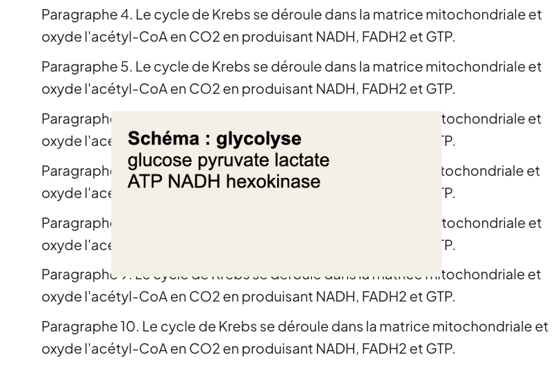 | 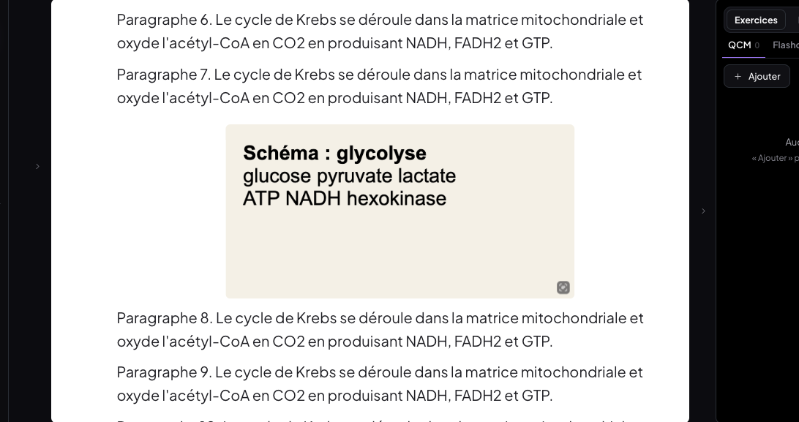 |
| 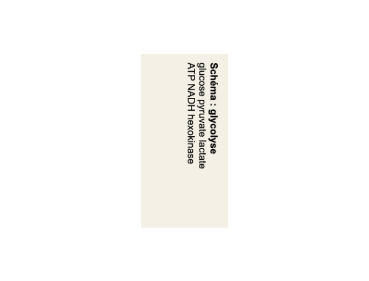 | 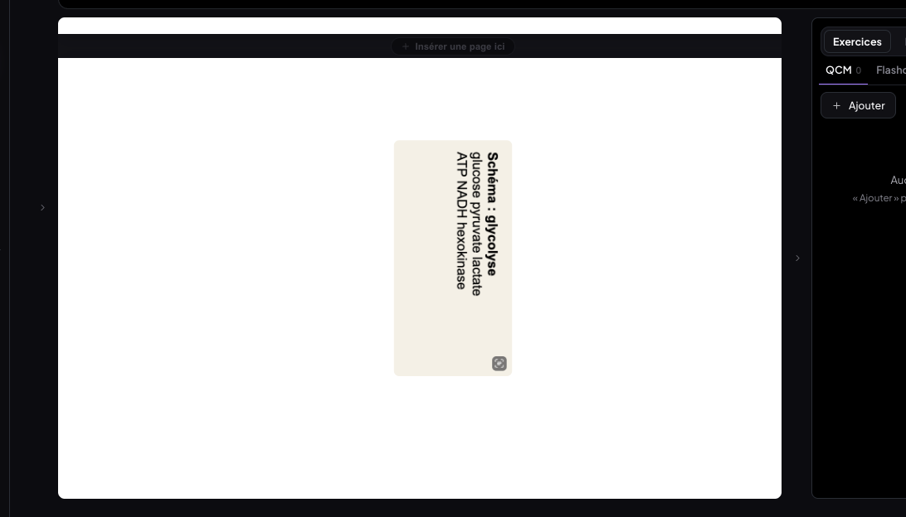 |

### Tests (ordinateur 1 440 × 900)

Les résultats ci-dessous viennent de `scripts/tests-images-json/`. Les deux premiers groupes concernent
« Document neuf J ».

**Les quatre chemins d'ajout**

| Test | Résultat |
|---|---|
| A. Bouton de la barre, curseur dans P2 | ✅ bloc juste sous P2 |
| B. ⌘V, curseur dans P4 | ✅ bloc sous P4 |
| B2. ⌘V après un clic hors du texte | ✅ bloc du flux (au curseur conservé) |
| C. Glisser un fichier entre P1 et P2 | ✅ bloc à cet endroit |
| C2. Glisser un fichier dans la **marge**, au niveau de P3 | ✅ bloc sous P3 |
| D. Dessins › Poser | ✅ bloc au curseur |
| D2. Dessins › glisser la carte (vrai glisser HTML5) entre P2 et P3 | ✅ bloc à cet endroit |

**Comportement des blocs**

| Test | Résultat |
|---|---|
| Pagination | ✅ chaque image a sa page (3 pages) |
| Flux enregistré | ✅ 7 images, comme à l'écran |
| E. Curseur sur la page 1, page 3 affichée | ✅ image en fin de page affichée |
| F. Déplacer un bloc image au pointeur (au-dessus de P1) | ✅ |
| G. ⌘Z sur ce déplacement | ✅ annulé |

**PDF importé et onglet Notes**

| Test | Résultat |
|---|---|
| PDF importé : bouton Image | ✅ image-annotation flottante (0 → 1) |
| PDF importé : ⌘V | ✅ image-annotation flottante (1 → 2) |
| Onglet Notes : ⌘V | ✅ bloc du flux des notes, aucune annotation |

Aucune exception JS.

| Bouton Image (bloc sous le paragraphe) | Dessins (poser / glisser) | PDF importé : toujours flottante |
|---|---|---|
| 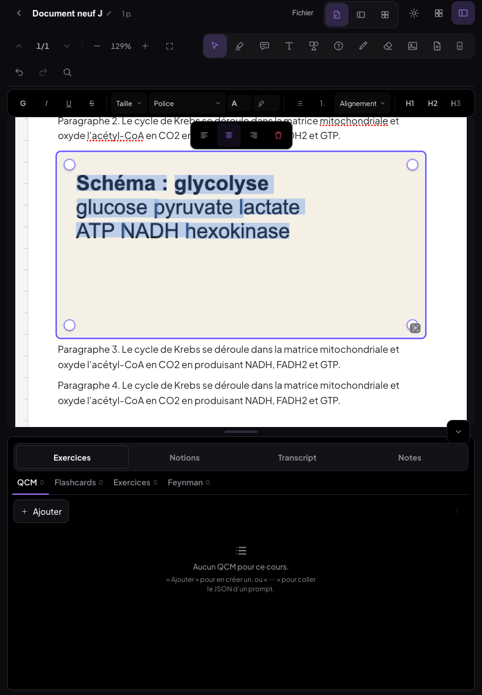 | 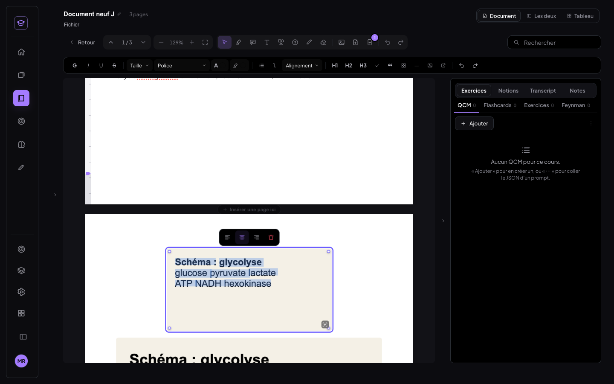 | 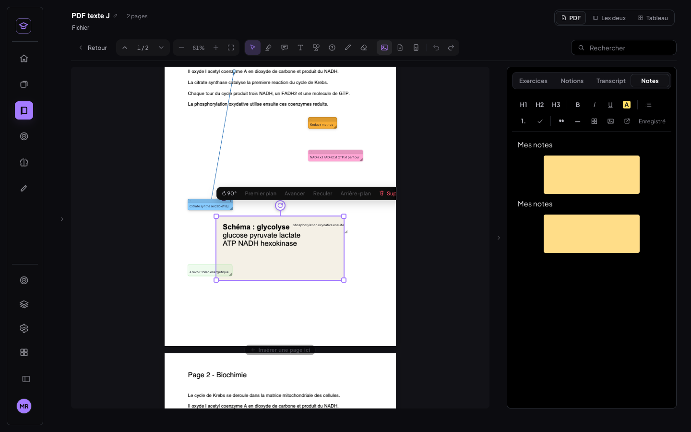 |

---

## 2. Re-surlignage : même couleur = retire, autre couleur = remplace

### La règle (un seul calcul pour toutes les surfaces)

Tout passe par un seul module pur, `lib/resurlignage.js`, avec deux fonctions :

- `planSurlignage` travaille sur des **ancres de texte** ;
- `planMots` travaille sur des **indices de mots OCR**.

Comportement :

- **Même couleur sur un passage entièrement déjà de cette couleur → retiré** sur la seule portion repassée. Si
  on retire le milieu, le surlignage est **scindé** en deux.
- **Autre couleur → la portion repassée change de couleur.** Les surlignages d'une autre couleur sont rognés :
  **jamais deux couches superposées**.
- **Deux surlignages adjacents de même couleur fusionnent.** Ils fusionnent aussi quand seul un blanc les
  sépare.
- Le surlignage conservé **garde son id**, donc sa note et les boîtes qui lui sont reliées. Un morceau détaché
  par une scission reçoit un id neuf.
- Un geste = **une entrée d'annulation**.

### Surfaces couvertes

| Surface | Stockage | Branché dans |
|---|---|---|
| Texte natif d'un PDF | `highlights` (ancre item/char) | PdfPage → PdfReader |
| Texte OCR d'un PDF image | `highlights` (même couche de texte) | idem |
| Texte d'un document | marques `notion` du flux | `documents/lib/notionMarks.js` (DocumentFlux, PageTexte) |
| Mots d'une image de document | `notions` du nœud image | `documents/lib/imageVue.js` |
| Mots d'une image collée sur un PDF | `highlights` + `imageId`/`mots` | PdfReader |
| Soulignement (barre de mise en forme) | marque `underline` | déjà « toggle » à la portion, vérifié |
| Surligneur de fond (barre de mise en forme) | `textStyle.backgroundColor` | PdfPage (EditToolbar) |

Cas particulier : les très anciens surlignages **sans ancre** (avant le 30/09) gardent la règle d'avant. Ils
sont retirés ou recolorés en entier, faute de pouvoir les découper.

### Tests

Chaque surface a été testée avec la même suite d'étapes :

1. surligner en ambre ;
2. repasser le **milieu** en ambre ;
3. repasser une portion en vert sauge ;
4. resurligner le milieu en ambre ;
5. ⌘Z × 4, puis ⇧⌘Z × 4.

**Texte natif d'un PDF** (« Il oxyde l acetyl coenzyme A en dioxyde… »)

| Étape | Résultat |
|---|---|
| 1 | ✅ `ambre:«oxyde l acetyl coenzyme»` |
| 2 | ✅ scindé : `ambre:«oxyde l» \| ambre:«coenzyme»` |
| 3 | ✅ une seule couche : `ambre:«oxyde l» \| sauge:«coenzyme A en dioxyde»` |
| 4 | ✅ fusion : `ambre:«oxyde l acetyl» \| sauge:«coenzyme A en dioxyde»` |
| Rendu | ✅ 0 rectangle superposé à l'écran |
| 5 | ✅ ⌘Z × 4 → état de départ ; ⇧⌘Z × 4 → état final |

**Texte OCR (PDF image)**

| Étape | Résultat |
|---|---|
| 1 à 4 | ✅ mêmes résultats sur les mots reconnus (`«oxyde l'» \| «coenzyme»` → … → fusion) |
| 5 | ✅ annuler / rétablir |

**Texte d'un document**

| Étape | Résultat |
|---|---|
| 1 | ✅ `«cycle de Krebs se déroule dans la matrice»` |
| 2 | ✅ deux notions, **ids distincts** |
| 3 | ✅ portion recolorée |
| 4 | ✅ fusion : `ambre:«cycle de Krebs se» \| sauge:«déroule dans la matrice mitochondriale»` |
| Panneau Notions | ✅ les notions enregistrées sont identiques aux passages surlignés |
| 5 | ✅ annuler / rétablir |

**Mots OCR d'une image de document, puis d'une image collée sur un PDF**

| Étape | Résultat |
|---|---|
| 1 | ✅ `«glucose pyruvate lactate»` |
| 2 | ✅ `«glucose» \| «lactate»` |
| 3 | ✅ `ambre:«glucose» \| sauge:«lactate»` |
| 4 | ✅ fusion : `ambre:«glucose pyruvate» \| sauge:«lactate»` |
| 5 | ✅ annuler / rétablir |

**Soulignement et surligneur de fond (barre de mise en forme)**

| Étape | Résultat |
|---|---|
| Souligné | ✅ appliqué |
| Resouligner le milieu | ✅ scindé |
| Resouligner l'ensemble | ✅ fusionné |
| Fond ambre | ✅ appliqué |
| Même couleur au milieu | ✅ retiré sur la portion |
| Vert sur une portion | ✅ remplacé, une seule couche |

| Milieu retiré (scindé) | Autre couleur + fusion | Texte d'un document |
|---|---|---|
|  | 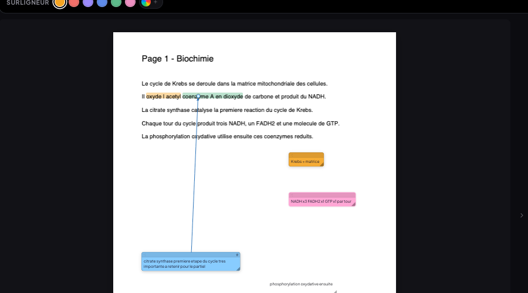 | 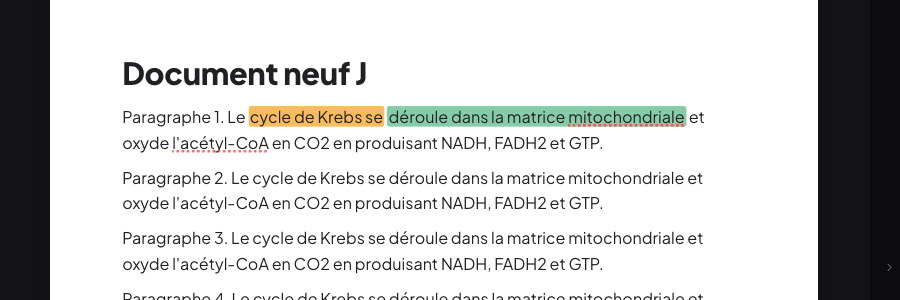 |

| Texte OCR : scindé | Texte OCR : fusion | Souligné / fond |
|---|---|---|
| 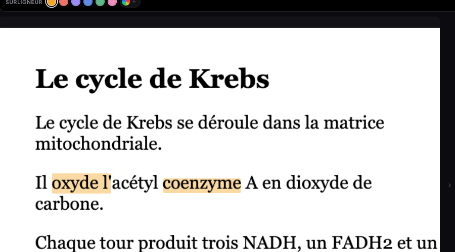 | 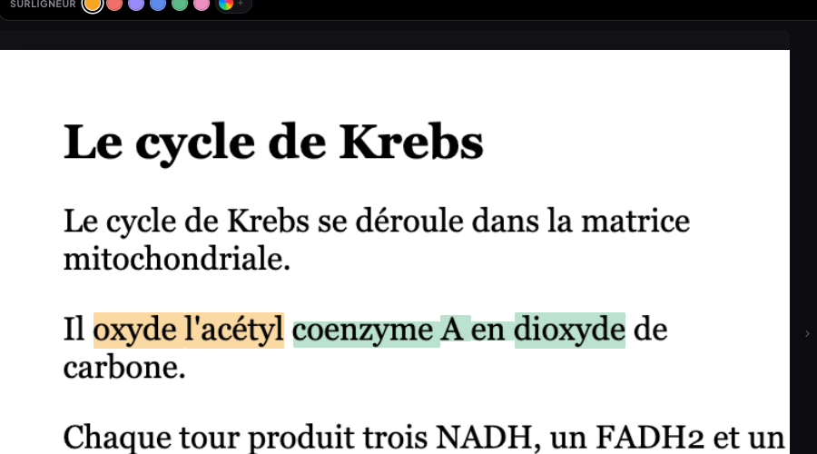 | 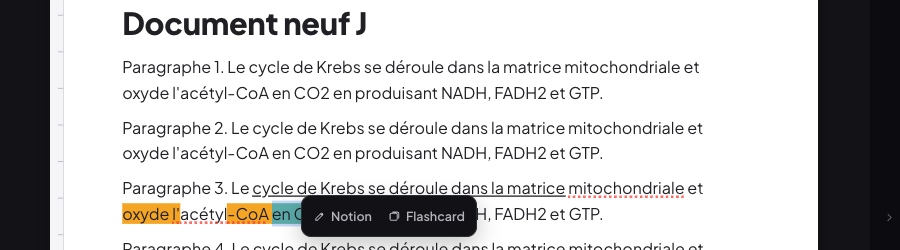 |

---

## 3. Aller-retour JSON des textes d'annotations, avec double version

### Identifiants stables

Chaque boîte (`kind: 'libre'`) et chaque texte libre (`kind: 'texte'`) reçoit son `id` **à la création**
(`genId('an')`, `lib/storage.js`). Cet id est la clé de synchro (`record_id`). Aucun code ne le recalcule, ni
au déplacement, ni à l'édition, ni à la synchro. **Aucune migration n'était nécessaire.**

### Format du JSON

On y accède par **Fichier › « Exporter les textes d'annotations… »**. Portée : page courante ou cours entier.
Deux sorties : un fichier `.json`, ou « Copier le JSON » dans le presse-papiers.

```json
{
  "course": "PDF texte J",
  "page": 1,
  "boxes": [
    { "id": "an-b1", "text": "Krebs = matrice" },
    { "id": "an-b2", "text": "NADH x3 FADH2 x1 GTP x1 par tour" },
    { "id": "an-b3", "text": "citrate synthase premiere etape du cycle tres importante a retenir pour le partiel" },
    { "id": "an-b4", "text": "phosphorylation oxydative ensuite" },
    { "id": "an-b5", "text": "a revoir : bilan energetique" }
  ]
}
```

Règles du format :

- `page` est absent pour l'export du cours entier.
- Le fichier ne contient **rien d'autre** : ni coordonnées, ni style, ni flèche.
- L'ordre est l'ordre de lecture : page, puis haut, puis gauche.
- `text` = texte brut de la boîte ; un paragraphe par ligne (`\n`).

### Import

On y accède par **Fichier › « Importer des textes d'annotations… »**, par collage ou par fichier.

- Formats acceptés : l'objet ci-dessus, la liste `boxes` seule, ou un JSON entouré de ```` ``` ````.
- Chaque entrée est retrouvée par son **id**. Seul le **texte** est remplacé, et le style de base de la boîte
  (taille, police, couleur du premier mot) est réappliqué au nouveau texte.
- Restent **strictement intacts** : position, taille, couleur, fond, flèches, épingle, page et ordre.
- Une boîte absente du fichier n'est pas modifiée.
- Un id inconnu est ignoré et listé.
- Résumé affiché : « 1 boîte mise à jour, 4 inchangées, 1 id inconnu ignoré · Id ignoré : an-inconnu-42 ».
- L'import entier = **une entrée d'annulation**.

### Deux versions par boîte

Tous ces champs sont **ajoutés** au même enregistrement ; aucun champ existant n'est retiré.

| Champ | Rôle |
|---|---|
| `textOriginal` / `contentOriginal` | Texte d'origine, **figé au premier import**. Un réimport ne l'écrase jamais. |
| `textAlt` / `contentAlt` | Texte importé, **remplacé à chaque import**. |
| `displayVersion` | `original` ou `alt`. |
| `content` | Reste le contenu **affiché** : le rendu, l'export PDF annoté, la synchro et les anciens clients lisent toujours la version affichée. |

Bascule de version :

- **Par boîte** : bouton « Voir l'original » / « Voir la version IA » dans la mini barre de la boîte. Il
  n'apparaît que si une version IA existe.
- **Globale** : Fichier › « Version des textes (IA / originale)… » › Page ou Cours entier › « Tout afficher en
  version IA » ou « Tout afficher en version originale ».

La bascule est un simple affichage : réversible à l'infini, et annulable.

- **Édition à la main** : elle s'applique à la version affichée.
- **Badge discret** « IA » ou « orig. » sur la boîte quand les deux versions existent.
- **Exports** : tout ce qui lit le texte d'une boîte lit `content`, donc la version affichée. C'est le cas du
  rendu, de l'export PDF annoté et de la sélection dans la boîte ouverte (« Flashcard »). Les exports
  « Copier les notions » et « Exporter en JSON » du cours ne contiennent pas les textes des boîtes,
  aujourd'hui comme avant.
- **Lecteur ouvert** : il relit désormais les boîtes après une synchro (correctif `7cf315e`). Un import ou une
  bascule faits sur un autre appareil s'affichent sans rouvrir le cours.

### Tests (« PDF texte J », 5 boîtes sur la page 1 : boîtes, post-it, texte libre, flèche)

**Export**

| Test | Résultat |
|---|---|
| 1. Copier le JSON (page) | ✅ clés exactement `course,page,boxes` ; chaque boîte exactement `id,text` |
| 1b. Exporter le JSON (cours entier) | ✅ fichier `PDF-texte-J-textes-annotations.json`, sans `page` |

**Import d'un fichier où une seule boîte est modifiée (plus un id inconnu)**

| Test | Résultat |
|---|---|
| 2. Résumé | ✅ « 1 boîte mise à jour, 4 inchangées, 1 id inconnu ignoré » |
| 3a. Les 4 autres boîtes | ✅ enregistrements **strictement identiques** (JSON complet) |
| 3b. an-b3 : géométrie, couleur, flèche, épingle, page | ✅ intactes |
| 3c. an-b3 : versions | ✅ `textOriginal` figé, `textAlt` importé, `displayVersion: alt` |
| 3d. an-b3 : style | ✅ taille de police conservée |
| **3e. Capture avant / après de la page** | ✅ 6 476 pixels changent, **tous dans la boîte an-b3 et sa flèche** (la flèche part du bord de la boîte, qui a rapetissé). **Ailleurs : identique au pixel près.** |

**Bascules**

| Test | Résultat |
|---|---|
| 4a. Bascule par boîte | ✅ texte d'origine, badge « IA » → « orig. » |
| 4b. Après retour à l'original | ✅ seuls **87 pixels** diffèrent de la capture d'avant import : le badge « orig. » |
| 4c. Retour en version IA | ✅ |
| 5. « Tout afficher en version originale » (page), puis « … IA » (cours) | ✅ dans les deux sens |

**Réimport, édition, annulation**

| Test | Résultat |
|---|---|
| 6. Réimport d'une nouvelle version | ✅ `textAlt` remplacé, `textOriginal` et `contentOriginal` intacts |
| 7. Édition à la main en version IA | ✅ seule `textAlt` change |
| 8. ⌘Z / ⇧⌘Z | ✅ |

**Synchro deux appareils** (faux Supabase, deux Chrome à profils séparés)

| Test | Résultat |
|---|---|
| Cloud | ✅ la ligne `annotations/an-b3` porte `textOriginal`, `textAlt` et `displayVersion: alt` |
| 2ᵉ appareil | ✅ les deux versions sont conservées, la version IA est affichée avec le badge « IA » |
| Bascule faite sur le 2ᵉ appareil | ✅ l'ordi affiche l'original (badge « orig. ») ; la version IA reste |

| Avant import | Après import (seule an-b3 change) | Retour à l'original |
|---|---|---|
| 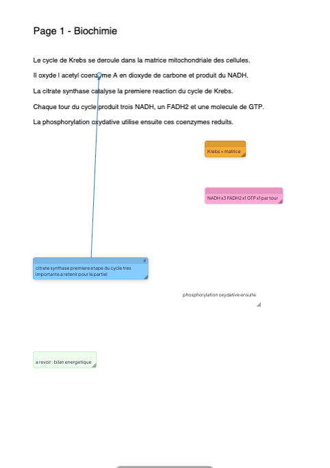 | 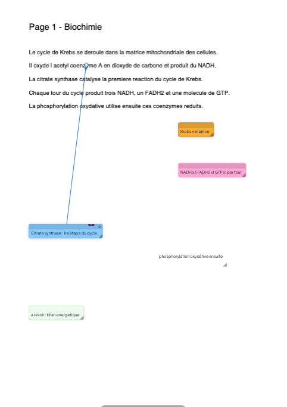 | 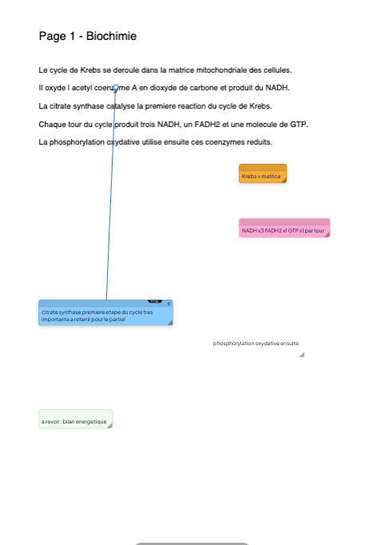 |

| Exporter | Importer (résumé) | Affichage | Mini barre et badge |
|---|---|---|---|
| 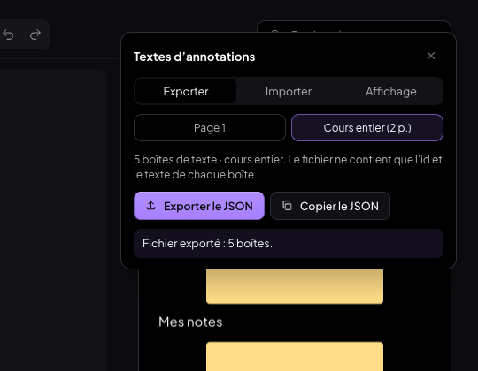 | 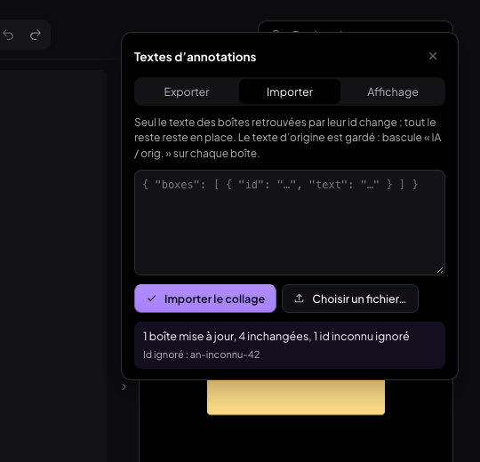 | 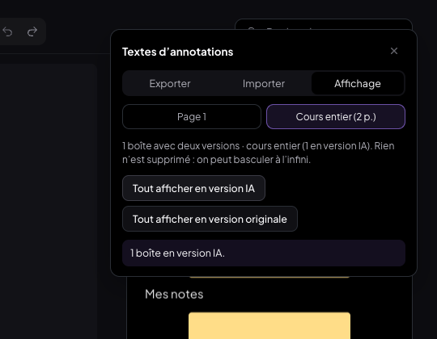 | 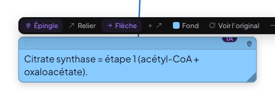 |

| 2ᵉ appareil : version IA reçue | Ordi : original après bascule faite sur le 2ᵉ appareil |
|---|---|
|  | 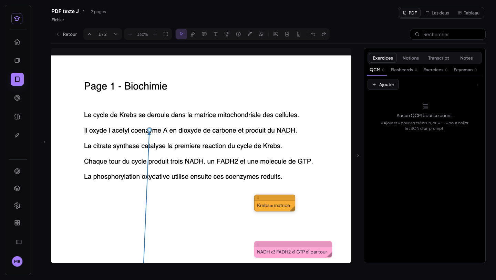 |

---

## Tablette (820 × 1 180, tactile émulé)

| Test | Résultat |
|---|---|
| Document : tap dans P2, puis tap sur « Insérer une image » | ✅ bloc sous P2 |
| Surligneur **au stylet** sur le texte du document | ✅ surligné → milieu retiré (scindé) → portion recolorée |
| Panneau « Textes d'annotations » | ✅ entièrement à l'écran |
| Import au doigt | ✅ « 1 boîte mise à jour » |
| Bascule par boîte au doigt | ✅ alt → original → alt |

Aucune exception JS.

| Image au doigt | Surligneur au stylet | Import | Bascule |
|---|---|---|---|
|  | 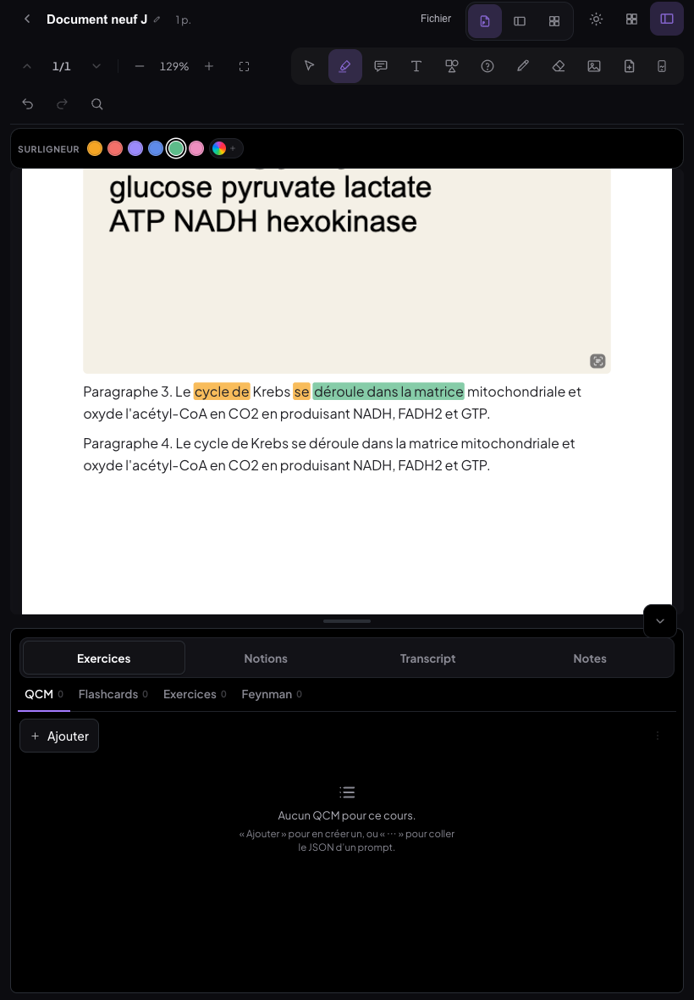 | 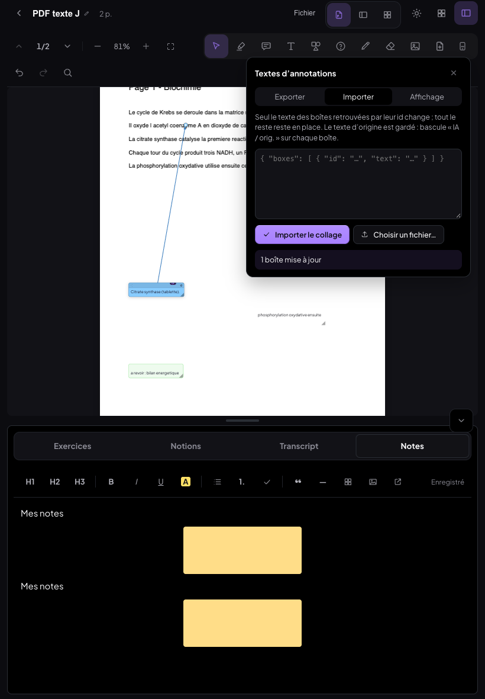 | 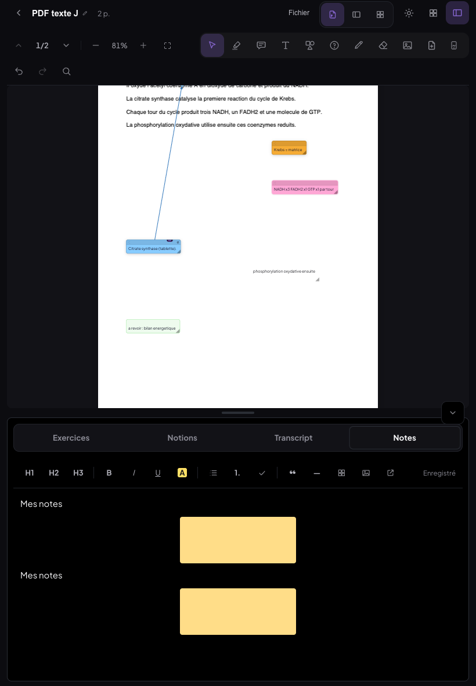 |

---

## Non-régression

- **Annotations d'avant inchangées.** La page 1 de « PDF texte J » a été rendue par l'ancienne version
  (`e872af5`, servie par `git worktree` sur le même port) puis par la nouvelle. Elle porte 5 boîtes, dont une
  avec flèche, et un surlignage posé avec l'ancienne version. Les deux captures sont **identiques octet pour
  octet** (`nr-avant.png` / `nr-apres.png`).
- **MealWeek** : builds de production des deux versions, servis tour à tour sur la même origine. Ordinateur et
  téléphone : **PNG identiques**, et chaque version est stable d'une capture à l'autre.
  - En mode dev, la capture ordinateur variait de 4 pixels entre les deux versions. C'est un artefact : les
    styles de MedRevise restent injectés après la navigation. Il n'apparaît pas sur les builds.
- **Tests du lecteur v2 rejoués** :
  - `t1-boite` : mise en forme d'une boîte, fermeture au clic dehors ;
  - `t-annuler doc` : annuler / rétablir la frappe ;
  - `t1-barre` : 20 bascules, 0 barre manquée, 0 saut.

  Tous passent.
- **Builds** : `npm run build` vert à chaque commit. Les états intermédiaires ont aussi été vérifiés.

**Passe finale** : `journal-final` du banc, 86 ✅ et 1 ❌. Le ❌ venait de l'assertion « onglet Notes ». Elle
comptait les images en absolu alors que les notes en gardaient une d'un passage précédent. L'image avait bien
été insérée en bloc. Le test a été corrigé pour compter l'écart, puis relancé : 4/4 ✅.

## Ce qui reste simulé ou non couvert

- Le « tactile » est l'émulation de Chrome (taps, stylet `pointerType: pen`), pas un iPad réel.
- Le glisser de sélection au **doigt** n'a pas été testé. Le surligneur sur tablette a été testé au stylet.
- Le décompte des images converties porte sur le jeu de test. Sur tes données, chaque document est converti à
  sa première ouverture. Le comptage préalable se fait avec la requête en lecture seule fournie.
- Les surlignages « sans ancre » (avant le 30/09) gardent l'ancienne règle, puisqu'on ne peut pas les découper.

## Commits

| Hash | Message |
|---|---|
| `51c90fa` | feat(medrevise): dans un document, toute image ajoutée devient un bloc du flux |
| `4fd4409` | fix(medrevise): repasser au surligneur — même couleur retire, autre couleur remplace, à la portion près |
| `430b9b4` | feat(medrevise): aller-retour JSON des textes d'annotations, avec version d'origine et version IA |
| `7cf315e` | fix(medrevise): lecteur ouvert — les boîtes changées sur un autre appareil s'affichent après la synchro |
| `756fb00` | style(medrevise): badge IA / orig. décalé pour ne pas couvrir l'épingle de la boîte |
| `f7adaea` | docs(medrevise): compte rendu images / surlignage / JSON, tests et requête SQL en lecture seule |

Fichiers nouveaux :

- `src/medrevise/lib/resurlignage.js`
- `src/medrevise/documents/lib/notionMarks.js`
- `src/medrevise/lib/textesAnnotations.js`
- `src/medrevise/pdf/TextesAnnotations.jsx`
- `scripts/tests-images-json/`
- `supabase/compte-images-textes-annotations.sql`

---

# Export spécial IA · surlignage document · images Muscle (10/10/2026, soir)

Mêmes conditions de test que plus haut :

- Chrome isolé piloté en CDP, devant Vite local **sans Supabase** ;
- synchro testée avec le faux Supabase du dépôt, deux Chrome à profils séparés ;
- le vrai cloud n'a jamais été touché.

Règles vérifiées en fin de chantier :

- `git diff 928f6c0 -- src/mealweek src/shared` est **vide**.
- MealWeek est **identique au pixel près** : builds de production avant / après servis sur la même origine,
  ordinateur et téléphone.
- L'**export PDF annoté normal** est inchangé : pages 1 et 2 de « Cours 12 pages IA » rendues avant / après,
  **PNG identiques octet pour octet**.
- L'**import JSON** existant est inchangé : `t-json` est rejoué, 16/16.
- **Aucune annotation ni carte n'est modifiée.**
  - L'export ne fait que lire.
  - Une carte Muscle sans image a un **HTML rendu identique octet pour octet** avant / après. La capture de
    pixels de ce panneau n'est pas stable : l'ancienne version diffère d'elle-même de 38 pixels, et l'écart
    avant / après est exactement le même.

## A. Export spécial IA

### Ce que c'est

L'entrée **Fichier › « Export spécial IA… »** existe sur un PDF importé. Elle est distincte de « Exporter en PDF
annoté », qui ne change pas. Portée : page courante ou cours entier.

| Action | Résultat |
|---|---|
| **Aperçu** | Le visuel exactement tel qu'il sera exporté, page par page, pour vérifier les repères avant de télécharger |
| **Télécharger (.zip)** | `<cours>-export-IA[-pNN].zip` (contenu ci-dessous) |
| **Copier le JSON** | `annotations.json` dans le presse-papiers |
| **Copier l'image** (portée page) | Le PNG de la page dans le presse-papiers, à coller dans un chat |

Contenu du `.zip` :

- `annotations.json`
- `LISEZMOI.txt` : le format de retour attendu, et le rôle des flèches
- `visuel.pdf`
- `page-01.png`, …, `page-12.png` : **2 × la taille de page**, soit 1 190 × 1 684 px pour l'A4

### Format exact de `annotations.json`

```json
{
  "course": "Cours 12 pages IA",
  "page": 1,
  "instructions": "Corrige et raccourcis le texte de chaque boîte (champ \"text\"). Rends EXACTEMENT ce même JSON : mêmes \"id\" et \"ref\", même ordre, seuls les \"text\" modifiés, rien d'autre (ni champ ajouté, ni commentaire). Sur le visuel, chaque boîte porte son repère (ref) dans un coin ; la flèche d'une boîte désigne la zone de l'image du cours dont parle son texte.",
  "boxes": [
    { "id": "anmv3a0k1a7q", "ref": "#a7q", "text": "Krebs" },
    { "id": "anmv3a0k7j4u", "ref": "#j4u", "text": "GTP x1\npar tour" },
    { "id": "anmv3a0k2c9w", "ref": "#c9w", "text": "x" }
  ]
}
```

- `page` est absent pour le cours entier.
- `instructions` est le seul champ ajouté par rapport à l'export JSON existant ; l'import l'ignore.

**Repère (`ref`)** : `#` + la fin de l'id, en lettres et chiffres.

- Il fait 3 caractères au moins, et s'allonge jusqu'à être unique dans tout le cours.
- Il est donc stable, puisqu'il dérive de l'id (attribué à la création).
- Il est le même dans l'export d'une page et dans l'export du cours.

**Import** (le même menu qu'avant) :

- Une entrée peut donner son `id` **ou** seulement sa `ref`.
- Une ref qui désigne plusieurs boîtes est ignorée et signalée, par exemple : « 1 ref ambiguë ignorée · Ref
  ambiguë : #xyz ».

### Le visuel avec les repères

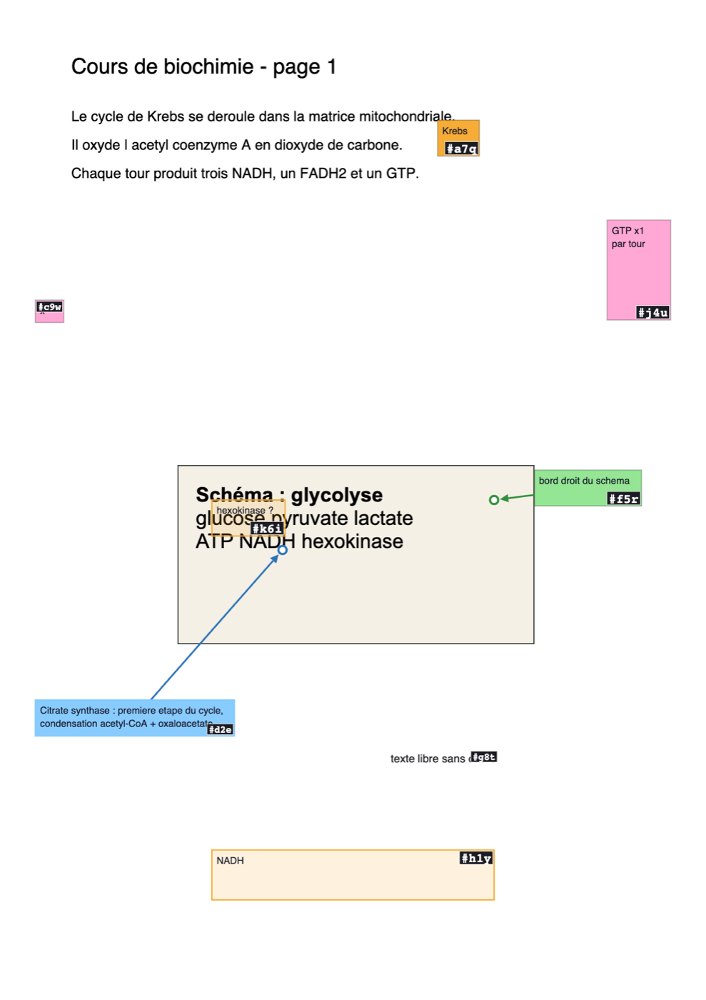

Le visuel est le **même rendu** que l'export PDF annoté : même code (`pdf/exportAnnote.js`), page, annotations et
flèches comprises. Seule l'étiquette de chaque boîte s'y ajoute (option `reperes`).

Mesure sur la page de test (8 boîtes) :

- **0 pixel différent de l'export normal en dehors des étiquettes** ;
- 9 859 pixels différents, tous à l'intérieur des étiquettes.

Règles de placement de l'étiquette :

- **Toujours à l'intérieur du cadre de la boîte** : jamais sur l'image du cours, jamais dehors.
  - Mesure : 8 / 8 étiquettes dans leur boîte.
  - Pour un texte libre (sans cadre visible), le cadre est l'étendue de son texte.
- **Coin haut droit par défaut**, sinon le premier coin où elle ne recouvre aucune ligne de texte : bas droit,
  bas gauche, haut gauche. La boîte n'est ni agrandie ni décalée.
- Corps **10,5 → 8 pt** (pas de 0,5) tant qu'aucun coin n'est libre.
- Sinon, corps 8, **en superposition sur le texte de la boîte uniquement**, au coin qui en masque le moins.
- Style : Courier gras blanc sur fond sombre opaque, liseré blanc fin, lisible sur toute couleur de boîte.

Résultat sur la page de test :

| Boîte | Placement |
|---|---|
| 5 boîtes | Dans une marge, en 10,5 pt (haut droit ou bas droit) |
| Boîte minuscule (24 × 19 pt) | Superposition en 8 pt |
| Boîte longue sans place libre | Superposition en 8 pt, au coin bas droit |
| Texte libre | Superposition en 8 pt |

**Chaque ref du visuel = ref du JSON = bon id.** Le texte du PDF exporté, lu par pdf.js, contient chaque ref, et
sa position tombe dans l'étiquette de la bonne boîte : 8 / 8.

| Panneau | Aperçu (ordinateur) | Aperçu (tablette) |
|---|---|---|
| 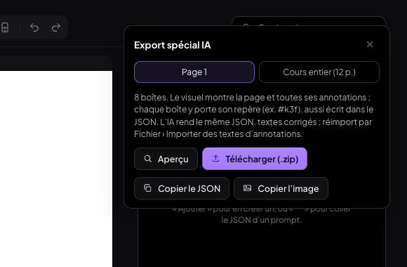 | 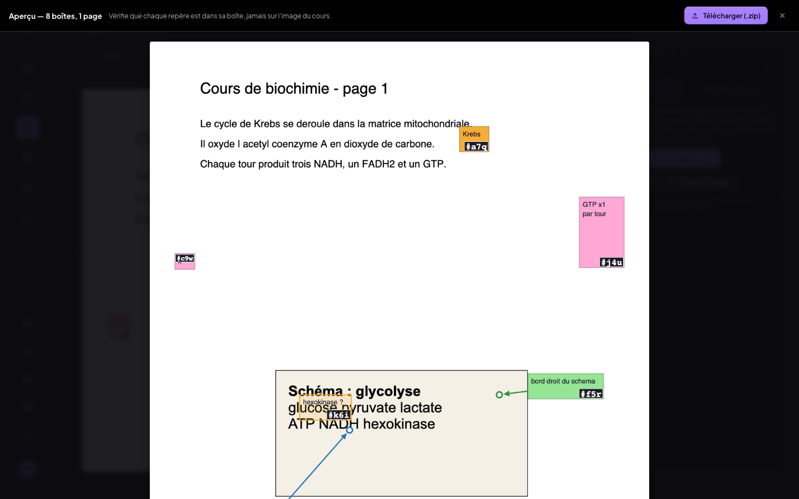 | 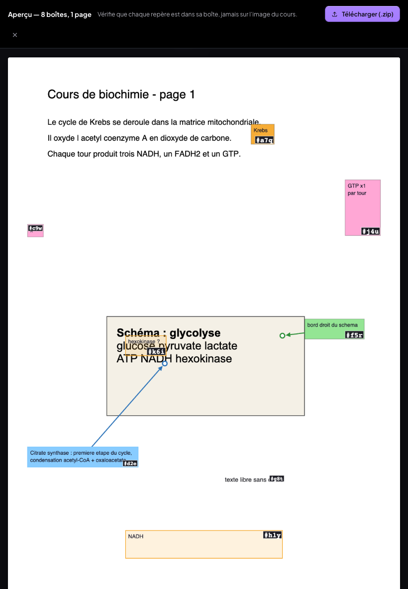 |

### Tests (`scripts/tests-images-json/t-export-ia.mjs`, `t-export-ia-tablette.mjs`, `ia-labo.mjs`)

Jeu de test : « Cours 12 pages IA ».

- La page 1 porte 8 boîtes de tailles variées, dont :
  - une minuscule ;
  - une au bord du schéma ;
  - une posée sur le schéma ;
  - un texte libre.
- Les pages 2, 5 et 12 portent aussi des boîtes, dont deux « jumelles » dont les ids finissent pareil.

| Test | Résultat |
|---|---|
| Menu Fichier | ✅ « Export spécial IA… » à côté de « Exporter en PDF annoté » |
| Aperçu | ✅ PNG 1 190 × 1 684 avec les repères |
| `.zip` de la page | ✅ `Cours-12-pages-IA-export-IA-p01.zip` → `LISEZMOI.txt`, `annotations.json`, `page-01.png`, `visuel.pdf` |
| `annotations.json` | ✅ 8 boîtes `{ id, ref, text }`, ref = fin de l'id, consignes incluses |
| Copier le JSON | ✅ identique au fichier du `.zip` |
| Copier l'image | ✅ PNG 1 190 × 1 684 dans le presse-papiers |
| Cours entier | ✅ `Cours-12-pages-IA-export-IA.zip` : `page-01.png` … `page-12.png`, `visuel.pdf` de 12 pages, 13 boîtes, mêmes repères que l'export de la page |
| Réimport avec la **seule ref** | ✅ seule cette boîte change (version IA, original gardé) ; ref ambiguë et ref inconnue ignorées et signalées |
| Bascule de version | ✅ conservée (« Tout afficher en version originale » → la version IA reste) |
| Tablette | ✅ panneau entièrement à l'écran, aperçu ajusté à la largeur |
| Téléphone | Le lecteur PDF n'existe pas sous 760 px (shell mobile de révision) : pas d'export spécial sur téléphone, comme pour l'export PDF annoté |

Limite : l'export spécial concerne les **PDF importés**. Un document créé dans l'app n'a pas de PDF de fond. Son
export reste le JSON (Fichier › Exporter les textes d'annotations) et l'impression PDF.

## B. Surlignage dans un document : cause et correction

### Mesure du bug

Sonde : glisser au surligneur de « cytosol » (paragraphe 14, bas de la page 1) à « glucose » (paragraphe 15,
haut de la page 2). La longueur de la sélection est relevée à chaque pas de souris.

| | Pendant la traversée de la marge du bas, de l'écart entre pages et de la marge du haut |
|---|---|
| **Avant** | 86 … 86 → **708** → 708 → 708 → **86** … 86 → 129 : la sélection saute jusqu'à la fin du document (« toute la page en dessous »), puis revient (le « flash ») |
| **Après** | 84 … 84 (constant, sans aucun saut) → 128, la valeur attendue |

### Cause exacte

Dans un document, les couches sont superposées ainsi :

1. le **texte** (un seul flux ProseMirror, z 1) ;
2. au-dessus, les **calques d'annotations des pages** (z 2) ;
3. au-dessus encore, le bouton « **Insérer une page ici** », qui occupe l'écart entre deux pages (z 3).

Pendant un glisser natif, ProseMirror cherche la position sous le pointeur avec `elementFromPoint`. Dès que le
pointeur passe dans une marge ou entre deux pages, il tombe sur ces éléments, qui sont **hors de l'éditeur**. Il
retombe alors sur une position fausse : la fin du document. La sélection native et celle de ProseMirror sautent
jusque-là, puis reviennent au pas suivant.

Les autres pistes envisagées ont été vérifiées et écartées :

- **Repagination pendant le geste** : aucune. Seule la sélection change, et le document ne bouge pas.
- **`user-select`** : les deux extrémités de la sélection restaient dans le texte.

### Correction (`pdf/DocumentFlux.jsx`)

Avec le surligneur, le geste est désormais géré par le document lui-même, à la souris, au stylet et au doigt
(Pointer Events).

- Pas de sélection native, pas de glisser ProseMirror.
- La position est calculée par la **géométrie du texte seul** : blocs du flux et `coordsAtPos`, sans jamais
  interroger ce qui est sous le pointeur.
  - Le blanc après un bloc lui appartient (marge, écart entre deux pages).
  - Le caractère le plus proche est retenu.
- Seule la sélection ProseMirror change pendant le geste. Le document n'est pas modifié, et la pagination est
  suspendue (`gesteDocument`).
- Défilement automatique près des bords de la zone de lecture.
- Au relâchement, la notion est posée avec la règle de re-surlignage déjà en place : même couleur → retirée,
  autre couleur → remplacée, adjacents fusionnés. Ce sont des **marques du texte**, qui suivent le texte quand
  il se repagine.

### Tests (`t-surl-doc2.mjs` sur « Document long J », 18 paragraphes sur 2 pages ; ordinateur puis tablette au doigt)

| Test | Ordinateur | Tablette (doigt) |
|---|---|---|
| Un mot (« glucose ») | ✅ 0 flash | ✅ |
| Une phrase sur deux lignes | ✅ max = fin = 125 car., 0 flash | ✅ |
| Passage à cheval sur deux pages (paragraphes 14 → 15) | ✅ max 136 / fin 135, 0 flash, sélection toujours dans le texte | ✅ |
| Même couleur au milieu → retiré, scindé | ✅ | ✅ |
| Autre couleur → remplacée (une couche) | ✅ | ✅ |
| ⌘Z / ⇧⌘Z | ✅ | ✅ |
| Texte inséré au début (le paragraphe 14 passe en page 2) → les surlignages suivent leurs mots | ✅ | ✅ |
| Panneau Notions : une notion par passage | ✅ 6 / 6 | ✅ |

Non-régression des tests de surlignage précédents : `t-surl-doc`, `t-surl-mots doc` (mots d'une image, qui gardent
leur propre geste) et `t-tablette-doc` (stylet). Tous passent.

| Phrase sur deux lignes | À cheval sur deux pages | Tablette |
|---|---|---|
| 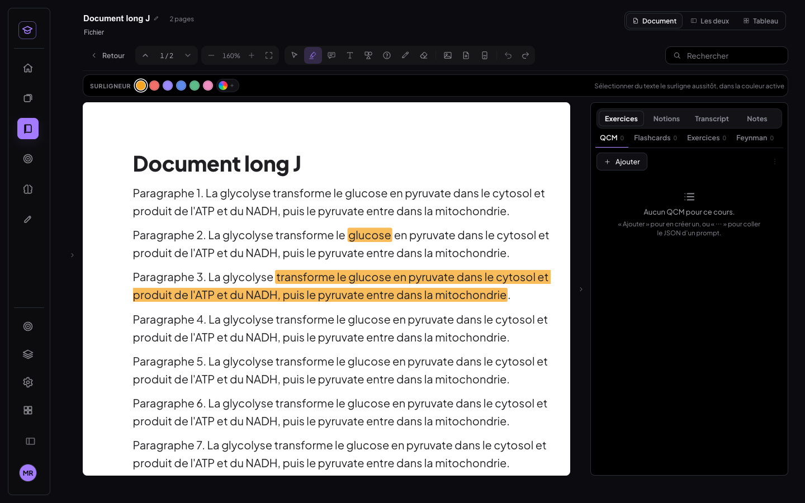 | 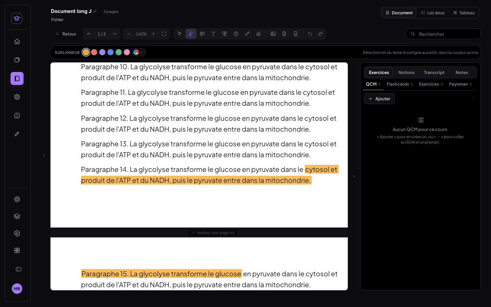 | 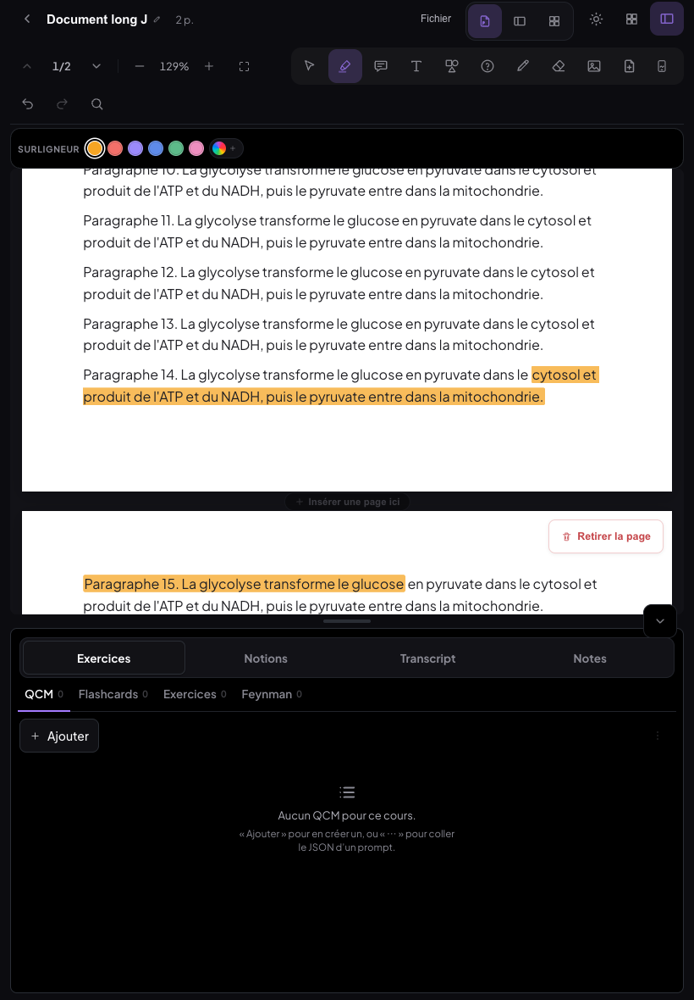 |

## C. Images dans les cartes Muscle

### Ce qui change

**Formulaire**

- **Image par ligne** (Origine, Trajet, Insertion, Action, Innervation), avec trois façons de l'ajouter :
  - parcourir (bouton « Image » de la ligne) ;
  - ⌘V **avec le curseur dans la ligne** ;
  - glisser sur la ligne.
- ⌘V ailleurs dans le formulaire garde le **pré-remplissage OCR** du tableau.
- **Image générale** du muscle en haut (optionnelle), avec la case « Montrer l'image au recto », **décochée par
  défaut** : l'image est alors au verso.
- **« Masquer des mots »** sur l'image d'une ligne : la même fenêtre OCR que pour une flashcard image. Les mots
  choisis sont couverts en révision jusqu'à « Révéler ».
- Remplacer, retirer, ôter les masques.
- Les fichiers ne sont écrits qu'à l'enregistrement.

**Révision** (séance Apprendre / J, séance classique, téléphone, panneau du cours)

- La vignette est dans la ligne. En **ligne par ligne**, elle est cachée avec sa ligne et révélée avec elle.
- Un toucher l'agrandit dans la **visionneuse**, sans retourner la carte ni révéler une autre ligne. La
  visionneuse propose :
  - **Texte** : texte reconnu, sélectionnable ;
  - **Copier le texte** ;
  - **Révéler** les mots masqués.
- L'icône « T » sur la vignette signale le texte reconnu.

**Stockage** (champs ajoutés ; une carte sans image reste identique)

| Champ | Contenu |
|---|---|
| `muscle.images[ligne]` | `{ imageId, masques? }` |
| `muscle.imageGenerale` | `{ imageId, auRecto }` |

- Ce sont des blobs ordinaires, avec la même synchro que les autres images.
- Le verso texte, « Copier » et les exports listent les images en pièces : `[image du muscle : image-<id>.png]`,
  `[image : image-<id>.png]` sous la ligne.

### Tests

**Création** (`t-muscle-form.mjs`)

| Test | Résultat |
|---|---|
| ⌘V dans la ligne Origine | ✅ image de cette ligne, sans pré-remplissage |
| Parcourir sur la ligne Action | ✅ |
| Glisser sur « Image du muscle » | ✅ ; option « au recto » décochée par défaut |
| Masquer des mots | ✅ 72 mots lus, 2 choisis → 2 masques |
| Enregistrement | ✅ images Origine (2 masques) et Action, image générale ; verso texte avec les pièces ; 3 blobs |

**Révision** (`t-muscle-seance.mjs`)

| Test | Ordinateur | Tablette | Téléphone |
|---|---|---|---|
| Recto | ✅ nom seul (image générale au verso) | ✅ nom + image générale (option cochée) | ✅ nom + image générale (option cochée) |
| Verso, ligne par ligne | ✅ image générale ; 3 lignes cachées avec leurs images | ✅ | ✅ |
| Toucher Origine | ✅ texte + image (2 mots masqués), les autres lignes restent cachées | ✅ | ✅ |
| Visionneuse | ✅ OCR, 72 mots sélectionnables ; sélection « Grand glutéal (fessier) » ; Révéler ; la carte reste au verso | ✅ | ✅ |
| Tout révéler | ✅ image de la ligne Action | ✅ | ✅ |
| Rien de coupé | — | — | ✅ pas de défilement horizontal (390 / 390), aucune image coupée |

**Modification et synchro**

| Test | Résultat |
|---|---|
| Modification (`t-muscle-edit.mjs`) : cocher « au recto » | ✅ mêmes blobs, mêmes masques |
| Synchro vers un 2ᵉ appareil (`t-muscle-synchro.mjs`) | ✅ la carte arrive au faux cloud avec ses 3 blobs ; sur le 2ᵉ appareil, masques présents, blobs rapatriés (92 242 / 20 350 / 20 350 octets), image générale et 2 vignettes affichées |

| Formulaire | Masquer des mots | Présentation |
|---|---|---|
| 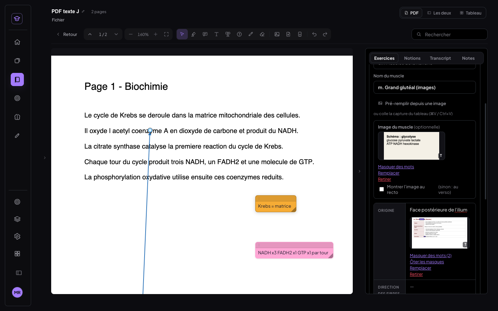 | 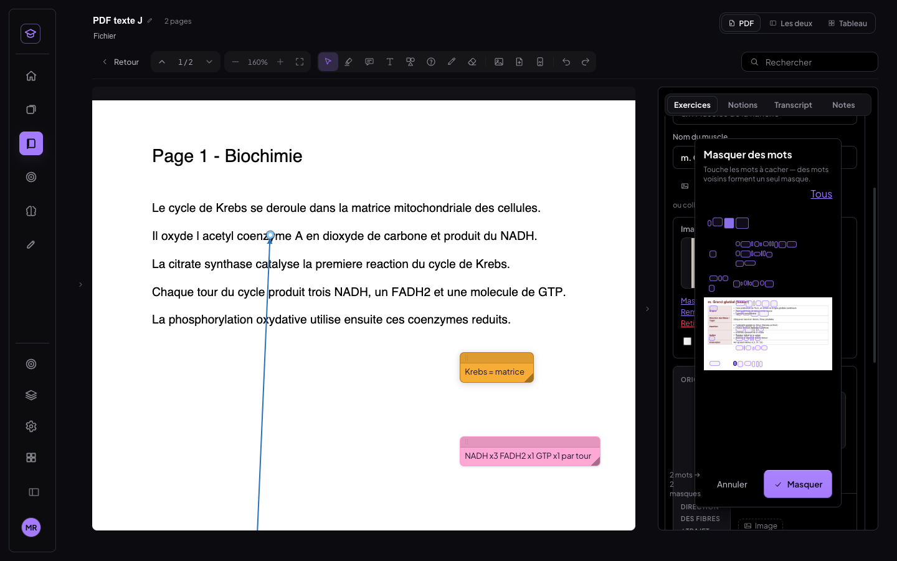 | 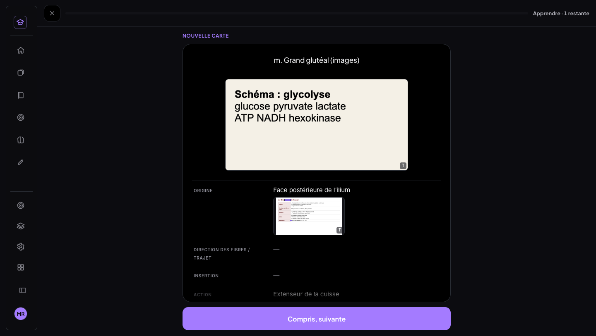 |

| Verso ligne par ligne | Origine révélée | Visionneuse (texte reconnu) | Tout révélé |
|---|---|---|---|
| 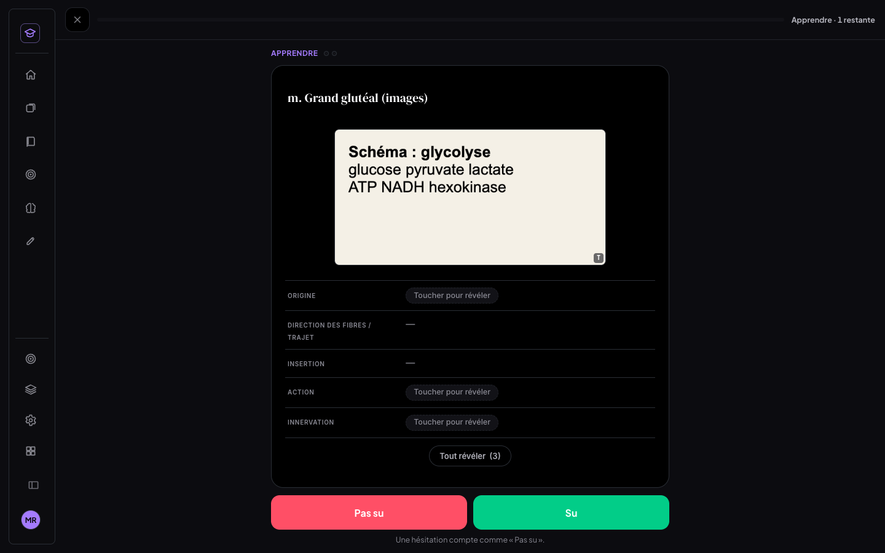 | 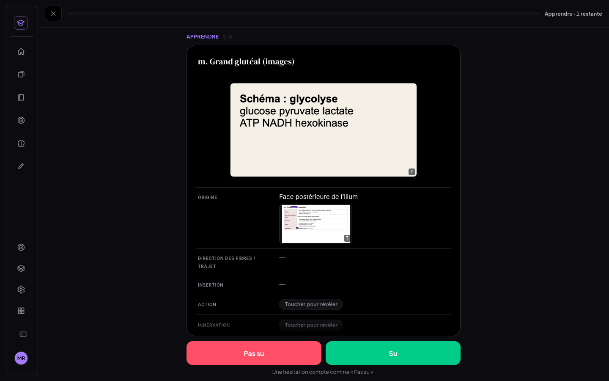 | 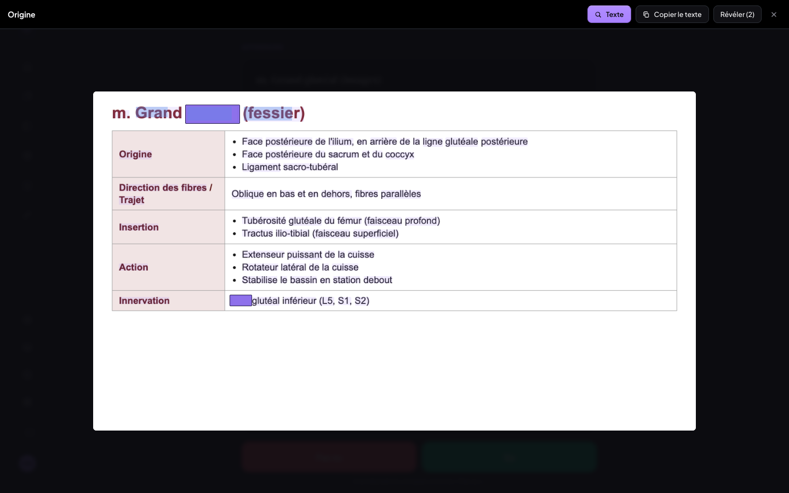 | 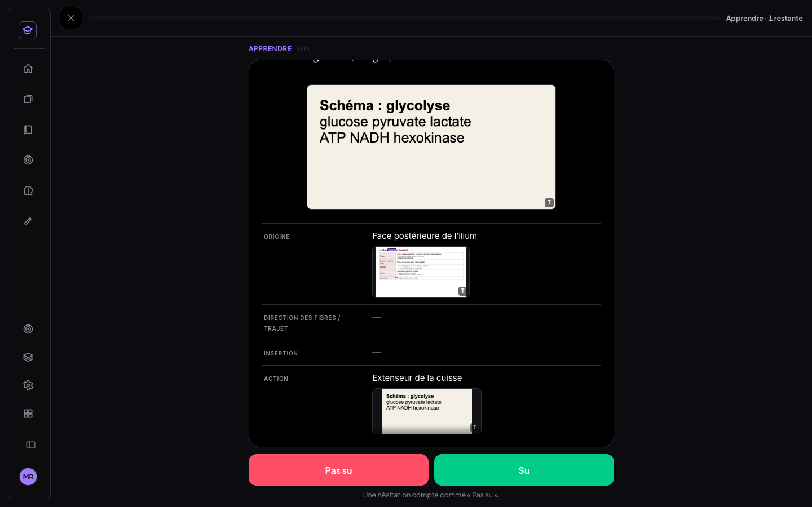 |

| Téléphone : recto (image au recto) | Téléphone : verso | Tablette | 2ᵉ appareil | Panneau du cours |
|---|---|---|---|---|
| 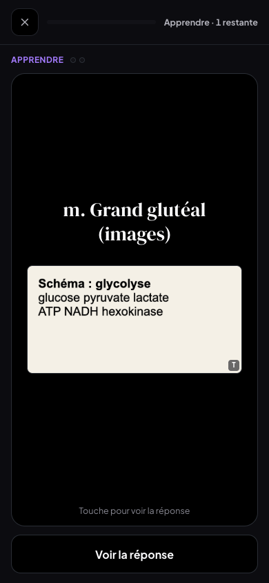 | 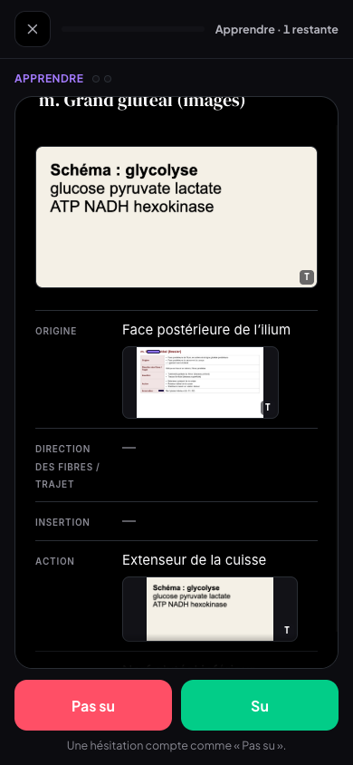 | 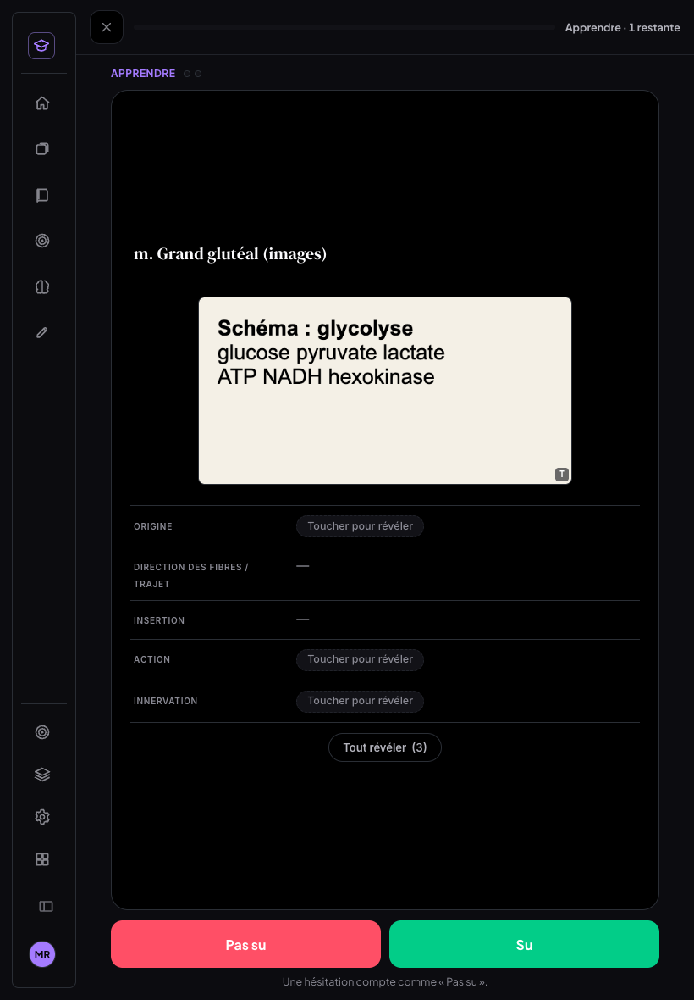 | 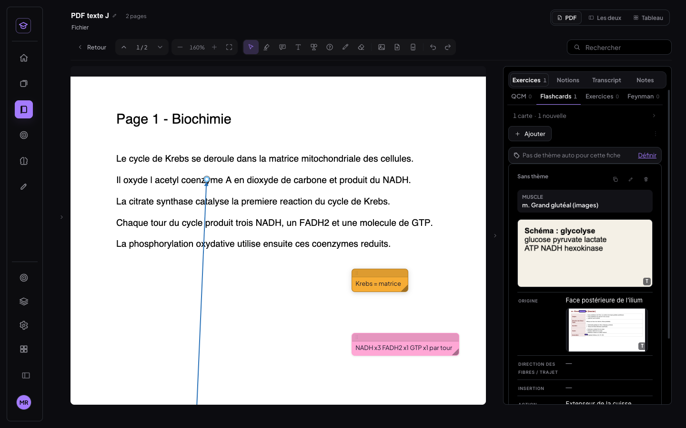 | 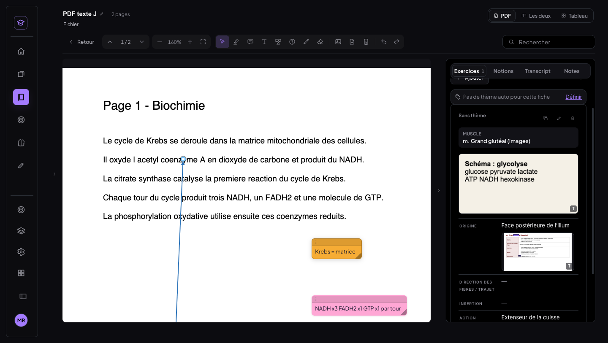 |

Ce qui n'a pas été testé à part : la séance « classique » de l'ordinateur (`Session.jsx`). Elle reçoit les mêmes
composants (image générale au recto / verso, tableau avec vignettes), mais aucun scénario dédié n'a été joué.

## Commits de cette partie

| Hash | Message |
|---|---|
| `ccf2f83` | feat(medrevise): export spécial IA — visuel des pages avec le repère de chaque boîte + JSON { id, ref, text } |
| `be8e2cd` | fix(medrevise): surligneur dans un document — sélection limitée au texte, sans flash ni extension à la page |
| `a2ce4f2` | feat(medrevise): images dans les cartes Muscle — une par ligne du tableau + image générale du muscle |
| `70e8811` | docs(medrevise): compte rendu — export spécial IA, surlignage document, images Muscle |

## Export IA en PDF (11/10/2026)

**Le but** : l'« Export spécial IA » produit **un seul fichier PDF**, facile à donner à une IA, au lieu
d'une archive de PNG. Les PNG restent disponibles.

### Ce qui change

Fichier › « Export spécial IA… », pour la page courante ou le cours entier.

- **Télécharger (PDF + JSON)**, le bouton principal. Un clic télécharge trois fichiers :
  - `<cours>-export-ia.pdf` (ou `<cours>-export-ia-p03.pdf` pour la seule page 3) ;
  - `annotations.json` (inchangé : `{ course, page?, instructions, boxes: [{ id, ref, text }] }`) ;
  - `LISEZMOI.txt`, qui nomme le PDF et explique sa couche texte.
- **Le PDF** : une page PDF par page de cours.
  - Chaque page est l'**image exacte du rendu actuel** : la page, toutes les annotations, les flèches
    et l'étiquette de repère de chaque boîte. C'est le même rendu que l'export d'avant, aux
    étiquettes près.
  - Format de la page d'origine ; **150 dpi** (A4 → image de 1 240 × 1 754 px) ; **JPEG qualité 85**.
  - **Repli** : une page qui dépasse 1 Mo à 150 dpi est refaite à **120 dpi**, et un cours qui
    dépasse 40 Mo est refait entièrement à 120 dpi. Le message le dit (« Pages 1, 2 : plus de 1 Mo
    à 150 dpi, refaites à 120 dpi »).
  - **Couche texte invisible**, en mode de rendu 3 (comme l'OCR d'un scan) :
    - dans chaque boîte, son repère et son texte, par exemple « #d2e — Citrate synthase : première
      étape… », placé à l'emplacement de la boîte ;
    - en pied de page, « Page 5 / 12 — <cours> ».
  - Une IA qui ne lit que le texte retrouve donc le lien repère ↔ texte, et une IA qui regarde
    l'image voit les étiquettes. Rien de tout cela n'est visible à l'œil.
- **PNG par page** : un `.zip` avec un `page-XX.png` par page (2× la taille de page),
  `annotations.json` et `LISEZMOI.txt`. Aperçu, « Copier le JSON » et « Copier l'image » restent.
- **Pas de gel de l'interface** : génération page par page, avec une barre de progression
  (« Pages du PDF : 9 / 26 ») et un bouton **Annuler**, qui ne télécharge aucun fichier.
- **Message de fin** : nombre de pages, poids, poids moyen par page et dpi.
- **Inchangés** : « Exporter en PDF annoté », l'import des textes et toutes les annotations.

**Fichiers :**
- `pdf/exportIA.js` : `preparerSourceIA` (la source commune : PDF annoté vectoriel avec repères,
  boîtes, JSON), `pdfIA`, `pngsIA`, `zipPngsIA` ;
- `pdf/ExportIA.jsx` (le panneau) et `PdfReader.jsx` (branchement) ;
- `pdf/exportAnnote.js` : seul changement, le nettoyeur de caractères est **exporté** (réutilisé
  pour la couche texte), l'export normal ne bouge pas ;
- `lib/textesAnnotations.js` : texte du LISEZMOI ;
- `styles/pdfreader-v2.css` (barre de progression).

### Poids mesurés

| Export | Pages | Poids | Par page | Résolution |
|---|---|---|---|---|
| Page unique (`Cours-12-pages-IA-export-ia-p01.pdf`) | 1 | 182 191 octets (0,17 Mo) | 178 Ko | 150 dpi, 1 240 × 1 754 |
| Cours de 12 pages, 13 boîtes | 12 | 1 946 580 octets (1,86 Mo) | ≈ 158 Ko | 150 dpi |
| Cours de 26 pages, 34 boîtes | 26 | 4 421 428 octets (4,22 Mo), généré en 1,6 s | ≈ 166 Ko | 150 dpi |
| Cours « bruit » (2 pages couvertes d'une photo de bruit aléatoire) | 2 | 1 703 921 octets (1,62 Mo) | ≈ 831 Ko | **repli à 120 dpi**, 992 × 1 403, signalé |

On est loin des plafonds (1 Mo par page, 40 Mo par cours). Les pages de cours testées sont du texte
avec un schéma coloré. Une page couverte d'une photo très détaillée pèse davantage, d'où le repli.

### Tests

Le banc est dans `scripts/tests-images-json/`. Il tourne sur le **profil de test** et le faux
Supabase local, jamais le vrai cloud, avec de vrais clics.
- Fixtures et données de test : `fixtures-ia-pdf.mjs`, `seed-ia.mjs`, `seed-ia26.mjs`,
  `seed-ia-bruit.mjs`.
- Les téléchargements sont interceptés puis analysés : avec le pdf.js de l'app, et en lisant la
  structure du fichier.

**Cours de 12 pages** (`t-export-ia-pdf.mjs`, 20/20) :

| Vérification | Résultat |
|---|---|
| Panneau : « Télécharger (PDF + JSON) », « PNG par page », Aperçu, Copier le JSON | ✅ |
| **Page unique** : un clic → `Cours-12-pages-IA-export-ia-p01.pdf` + `annotations.json` + `LISEZMOI.txt` ; PDF d'**une page**, 595 × 842 pt, une image JPEG 1 240 × 1 754 | ✅ |
| Couche texte de la page : « #ref — texte » pour les 8 boîtes et « Page 1 / 12 » | ✅ |
| **Cours entier** : barre de progression ; PDF de 12 pages au format d'origine, une image JPEG 1 240 × 1 754 par page ; 1,86 Mo | ✅ |
| **JSON cohérent** : 13 boîtes, mêmes repères dans le JSON et dans le texte du PDF ; chaque repère sur sa page (#m7p → p. 5, #n2a → p. 12) ; « Copier le JSON » = fichier téléchargé | ✅ |
| **PNG par page** : `…-export-ia-png.zip` = page-01…page-12.png + annotations.json + LISEZMOI.txt | ✅ |

**Cours de 26 pages, PdfReader, réimport, export normal** (`t-export-ia-pdf-26.mjs`, 8/8) :

| Vérification | Résultat |
|---|---|
| Progression « Pages du PDF : 6 / 26 » ; **Annuler** → arrêt en ~120 ms, « Export annulé : aucun fichier téléchargé » | ✅ |
| Export complet : 26 pages, 4,22 Mo, 1,6 s | ✅ |
| Interface fluide : le lecteur défile pendant la génération ; plus long blocage du fil principal **52 ms** (aucune pause de plus de 250 ms) | ✅ |
| **PdfReader de l'app** : le PDF exporté, ajouté comme cours de test, s'ouvre (« 1 / 12 »), pages rendues, aucune erreur | ✅ |
| **Réimport** du `annotations.json` de l'export avec un texte modifié : « 1 boîte mise à jour, 12 inchangées » ; seule la boîte #1xyz change | ✅ |
| « Exporter en PDF annoté » : PDF vectoriel comme avant (pas d'image de page) | ✅ |

**Repli** (`t-export-ia-pdf-repli.mjs`, 2/2) : pages de bruit → 120 dpi (992 × 1 403), 1,62 Mo,
signalé ✅

**Aperçu (macOS)** : vérifié avec **PDFKit**, le moteur d'Aperçu, par un script Swift qui fait la
même recherche que ⌘F.

| Vérification | Résultat |
|---|---|
| Le PDF de 12 pages s'ouvre, 12 pages de 595 × 842 pt | ✅ |
| Recherche « #d2e » → p. 1 ; « #m7p » → p. 5 ; « #n2a » → p. 12 ; « #1xyz » → p. 2 ; « Citrate synthase » → p. 1 ; « Page 5 / 12 » → p. 5 | ✅ |
| Cours de 26 pages : « #07a » → p. 7, « #09b » → p. 9, « #26a » → p. 26 | ✅ |
| Page unique : 1 page | ✅ |
| Rendu PDFKit de la page 1 : le texte invisible ne se voit pas, étiquettes nettes | ✅ (capture ci-dessous) |

**Autres vérifications :**

| Vérification | Résultat |
|---|---|
| **Chrome** : le lecteur PDF intégré ouvre le fichier (« 1 / 12 », titre « Cours 12 pages IA — export IA ») ; étiquettes lisibles **à 100 %** | ✅ |
| Non-régression de l'export IA (`t-export-ia.mjs`, 12/12, adapté au « PNG par page ») | ✅ |
| `ia-labo.mjs` : le visuel ne diffère de l'export normal **qu'à l'intérieur des étiquettes** (0 pixel dehors) | ✅ |
| Tablette (`t-export-ia-tablette.mjs`) | 3/3 ✅ |
| `npx vitest run` | 42/42 ✅ |
| Build | vert ✅ |
| MealWeek s'ouvre ; aucun fichier MealWeek ni `src/shared/` modifié | ✅ |

**Ce que je n'ai pas pu faire** : ouvrir l'application Aperçu elle-même et taper ⌘F au clavier. Ce
serait du pilotage d'interface macOS, qui demande des autorisations d'accessibilité. La vérification
passe par PDFKit, la bibliothèque qu'Aperçu utilise pour ouvrir, rendre et chercher dans un PDF.

### Captures

**Page 1 du PDF, rendue par PDFKit (Aperçu) à 150 dpi** : repères visibles, texte invisible absent du
rendu.

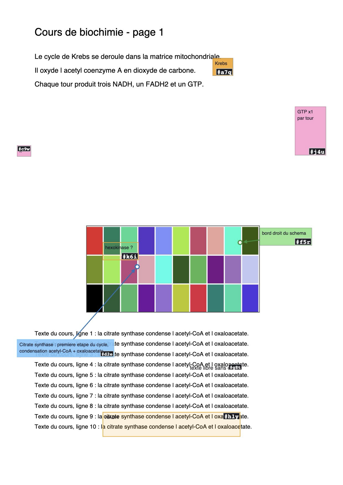

| Le PDF dans Chrome (100 %) | Progression et Annuler (26 pages) |
|---|---|
| 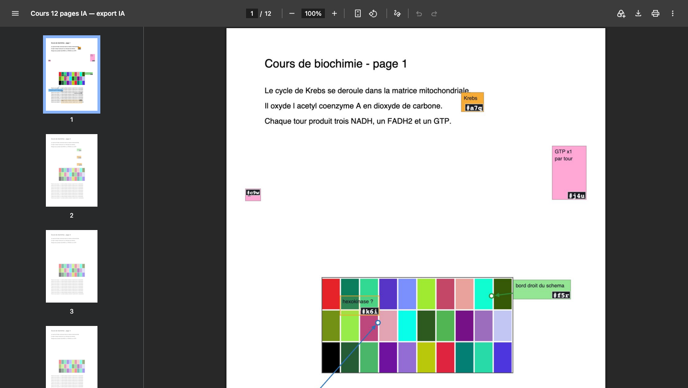 | 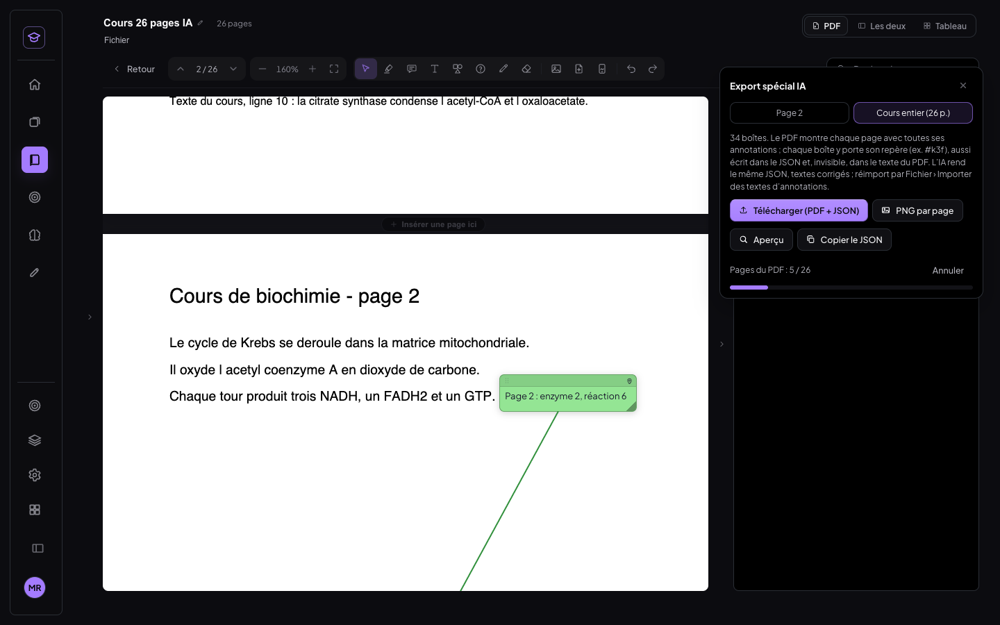 |

| Panneau | Le PDF exporté ouvert dans le PdfReader de l'app |
|---|---|
| 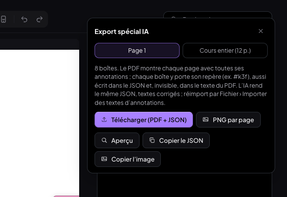 | 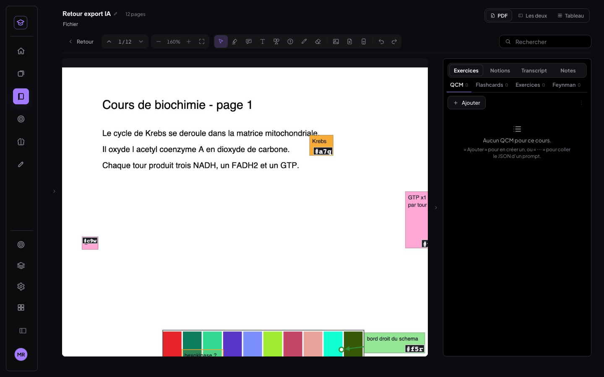 |

### Commits

| Hash | Message |
|---|---|
| `8f2ee1a` | feat(medrevise): export spécial IA en un seul PDF — image de chaque page annotée + couche texte invisible |
| `d6e7989` | docs(medrevise): section « Export IA en PDF » |
