# Compte rendu — import JSON, glissement, carte Tableau, netteté des PDF, icônes de révision (17/10 soir)

Six chantiers sur MedRevise, testés dans Chrome (banc local : Vite `:5199` **sans Supabase** + Chrome
headless 9333), jamais sur le vrai cloud. MealWeek et `src/shared/` : **aucun fichier modifié**
(vérifié en fin de chantier, voir « Non-régression »). Aucune écriture Supabase destructive : les seules
écritures nouvelles sont des cartes ajoutées (import, Tableau) et la liste `learning_set`.

Tests : `scripts/tests-import-tableau-nettete/` et `scripts/tests-fichier-carnet-calendrier/`
(icônes de révision). Captures : `docs/img/import-tableau-nettete/`.

---

## 1. Import de flashcards (JSON) depuis le panneau

`lib/importFlashcards.js`, `lib/zipLecture.js`, `components/ImportFlashcards.jsx`.
Panneau d'une fiche › Exercices › Flashcards : bouton **« Importer »** juste à côté de « + Ajouter ».

- **Entrées** : fichier **.json**, fichier **.zip** (le JSON + ses images, référencées par
  `image.fichier`), ou **collage** direct. Tolérant à l'emballage (fences, texte autour, virgules finales).
- **Validation stricte**, un message par carte avec **son numéro et sa ligne** dans le JSON : champ
  manquant, type inconnu, champ inconnu, limites (colonnes, lignes), SMILES illisible, image absente du
  zip… **Rien n'est importé tant qu'il reste une erreur.** Les items QCM / Feynman / exercice sont
  signalés et laissés de côté (ils se collent par « ⋯ › Coller du JSON »).
- **Aperçu** : nombre de cartes par type (Texte, Trous, Image, Muscle, Molécule, Tableau), 3 exemples,
  **doublons** (recto identique — normalisé — à une carte de la fiche ou du même import :
  « Ignorer » par défaut / « Importer quand même »), **date de départ** (défaut : aujourd'hui).
- Les cartes passent par `appendItemsToFiche` : **exactement le chemin d'une carte créée à la main**
  (mêmes J, J0 = la date choisie ; images via `putBlob`, même stockage, même synchro).
- **« Voir le format attendu »** : l'exemple complet et commenté ci-dessous (copié d'un clic,
  **réimporté tel quel sans erreur** — testé), et le **prompt de génération** de Réglages › Prompts
  (biologie, avec la surcharge éventuelle) complété des types en plus.

### Schéma d'import (v1.1 étendu) — l'exemple complet

Les clés qui commencent par `_` sont des commentaires (ignorées). `type` vaut toujours `flashcard`.

```json
{
  "_commentaire": "Import de flashcards MedRevise — schéma v1.1 étendu. Les clés qui commencent par « _ » sont des commentaires (ignorés). Un item = une carte ; « type » vaut toujours « flashcard ».",
  "items": [
    { "_sorte": "texte", "type": "flashcard", "theme": "Nerfs crâniens",
      "recto": "Quel nerf innerve le muscle oblique supérieur ?", "verso": "Le nerf trochléaire (IV).",
      "indice": "Le plus fin des nerfs crâniens", "a_retenir": "SO4 : oblique supérieur → IV" },
    { "_sorte": "trous (cloze)", "_aide": "le recto contient {{…}} ; « cloze » liste les mots masqués",
      "type": "flashcard", "theme": "Nerfs crâniens",
      "recto": "Le nerf {{abducens}} innerve le muscle droit latéral.",
      "verso": "Le nerf abducens (VI) innerve le muscle droit latéral.", "cloze": ["abducens"] },
    { "_sorte": "image", "_aide": "image.data = URL de donnée, ou image.fichier = nom d’un fichier joint dans un .zip ; place : recto, verso ou deux",
      "type": "flashcard", "theme": "Ostéologie", "recto": "Quel os est montré ?", "verso": "La scapula.",
      "image": { "data": "data:image/png;base64,iVBORw0KGgo…", "place": "recto" } },
    { "_sorte": "muscle", "_aide": "recto = nom du muscle ; les 5 champs du tableau Muscle (au moins un rempli) ; verso construit",
      "type": "flashcard", "theme": "Muscles du bras", "recto": "Biceps brachial",
      "muscle": { "origine": "Chef long : tubercule supra-glénoïdal ; chef court : processus coracoïde",
                  "trajet": "Loge antérieure du bras", "insertion": "Tubérosité radiale",
                  "action": "Flexion du coude, supination", "innervation": "Nerf musculo-cutané (C5–C6)" } },
    { "_sorte": "molécule", "_aide": "molecule.smiles (obligatoire), nom, sens : nom-molecule (recto = nom) ou molecule-nom",
      "type": "flashcard", "theme": "Biochimie", "molecule": { "nom": "Éthanol", "smiles": "CCO", "sens": "nom-molecule" } },
    { "_sorte": "tableau", "_aide": "recto = titre ; 2 à 6 colonnes, 1 à 12 lignes ; en révision les cellules se révèlent une par une",
      "type": "flashcard", "theme": "Myologie", "recto": "Muscles de la fesse — insertions",
      "tableau": { "colonnes": ["Muscle", "Origine", "Insertion"],
                   "lignes": [["Grand glutéal", "Ilium, sacrum, coccyx", "Tubérosité glutéale"],
                              ["Moyen glutéal", "Face glutéale de l’ilium", "Grand trochanter"],
                              ["Piriforme", "Face pelvienne du sacrum", "Bord supérieur du grand trochanter"]] } }
  ]
}
```

(Dans l'app, l'image d'exemple est une vraie image PNG en base64 ; elle est abrégée ici.)

| Champ | Règle |
|---|---|
| `type` | obligatoire, `flashcard` (`qcm` / `feynman` / `exercice` : laissés de côté, signalés) |
| `recto`, `verso` | obligatoires pour une carte texte / à trous / image ; `recto` = nom (Muscle) ou titre (Tableau) ; verso construit pour Muscle, Molécule, Tableau |
| `theme`, `indice`, `a_retenir`, `difficulte`, `tags`, `id` | facultatifs |
| `cloze` | liste des mots masqués (recto avec `{{…}}`) |
| `image` | `{ data }` ou `{ fichier }` (+ `place` : `recto` · `verso` · `deux`) |
| `muscle` | `origine`, `trajet`, `insertion`, `action`, `innervation` (au moins un) |
| `molecule` | `smiles` (obligatoire, validé par OpenChemLib), `nom`, `sens` |
| `tableau` | `colonnes` (2 à 6, nommées), `lignes` (1 à 12, au plus autant de cellules que de colonnes) |
| autre clé | **erreur** « champ inconnu » (sauf `_…`) |

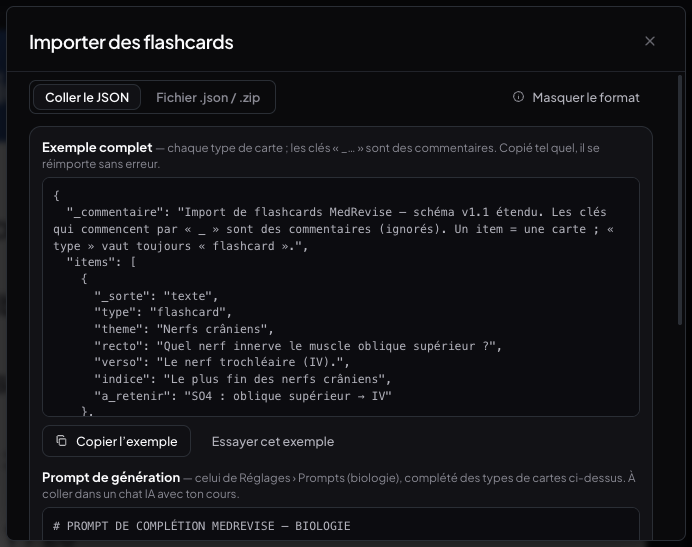
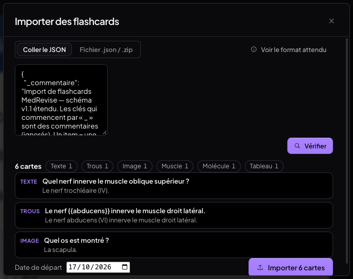
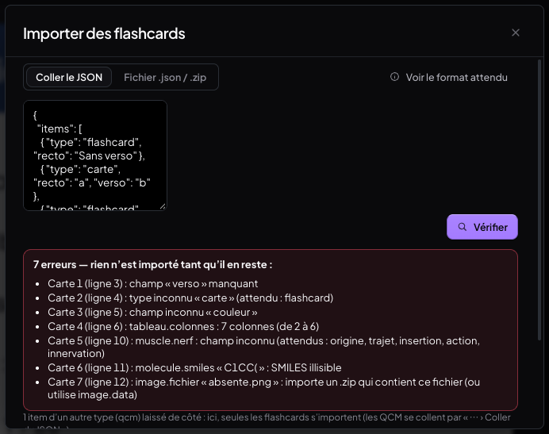
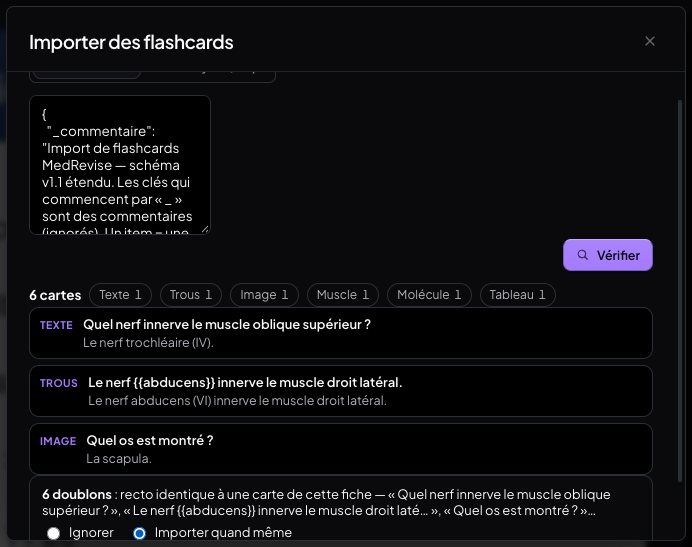

---

## 2. Glissement entre les modes du panneau : simple, rapide, sans rebond

`components/glissementModes.js`, `components/CourseItemsSidebar.jsx`, `styles/panneau-modes.css`.

- **Plus d'élastique ni de rebond** : la piste s'arrête net aux extrémités ; aimantation
  **120 ms, ease-out `cubic-bezier(0, 0, .58, 1)`** (aucune valeur au-delà de la cible) — avant :
  200 ms et un élastique de 0,12 à 0,16 largeur de mode aux bords.
- Suivi direct (transform écrit une fois par image, hors React — inchangé) ; un **nouveau geste est
  accepté immédiatement**, même pendant l'aimantation (la piste repart de sa position réelle).
- Fenêtre anti-inertie du trackpad : **250 → 150 ms**.
- **Nouvel ordre** : **Exercices · Transcript · Notes · Notions** (sélecteur et glissement). Le mode est
  mémorisé par cours **par son identifiant** : il reste valide quel que soit l'ordre (rien à migrer).

**Mesures** (Chrome headless, rAF, cours « Physiologie rénale », 20 allers-retours rapides) :

| | Trackpad avant | Trackpad après | Doigt avant | Doigt après |
|---|---|---|---|---|
| Durée d'une aimantation | 200 ms (12 images) | **133 ms (8 images)** | 200 ms (12 images) | **133 ms (8 images)** |
| Dépassement au bord (élastique) | 0,118 | **0** | 0,159 | **0** |
| Dépassement de la cible (rebond) | 0 | **0** | 0 | **0** |
| 20 allers-retours → changements | 20 | 20 | 20 | 20 |
| Images / s · intervalle max | 60,1 · 17 ms | **60,1 · 17 ms** | 59,8 · **83 ms** | **60,1 · 17 ms** |
| Images sautées (> 25 ms) · tâches longues | 0 · 0 | **0 · 0** | **1** · 0 | **0 · 0** |
| Double switch Exercices → Transcript → Notes (2e geste pendant l'aimantation du 1er) | — (ancien ordre) | posé **95 ms** après le 2e relâchement | — | posé **2 ms** après |

Tablette (1 180 × 820, au doigt) : mêmes valeurs (133 ms, 0 dépassement, 0 image sautée).
« 0 frame > 16 ms » : à 60 Hz l'intervalle normal est 16,7 ms — le critère retenu est donc « aucune
image sautée » (intervalle > 25 ms) et aucune tâche longue : **0 et 0**.

---

## 3. Flashcards « Tableau »

`lib/carteTableau.js`, `components/FlashcardTableau.jsx`, `styles/flashcard-tableau.css` ; branché dans
le formulaire unifié (« + Tableau », à côté de « + Tableau muscle » et « + Molécule »), la modification,
le panneau, Réviser, la séance du jour, le téléphone et le mode Apprentissage.

- Colonnes **2 à 6** (nommées), lignes **1 à 12** ; **collage depuis un tableur** (TSV, cellules
  « entre guillemets » d'Excel / Numbers / Sheets comprises) — dans la zone prévue (« 1re ligne = noms
  des colonnes ») ou directement dans la grille.
- Recto = titre ; verso = le tableau : **noms de colonnes toujours visibles**, cellules masquées
  révélées **au tap**, **« Révéler la ligne »**, **« Tout révéler »** ; même rendu que la carte Muscle ;
  au téléphone, **défilement horizontal interne** (la page ne déborde pas).
- Carte ordinaire (`type: 'flashcard'` + `tableau`) : mêmes J, FSRS, apprentissage, synchro ; le
  verso **texte** est le tableau mis à plat (lisible partout).

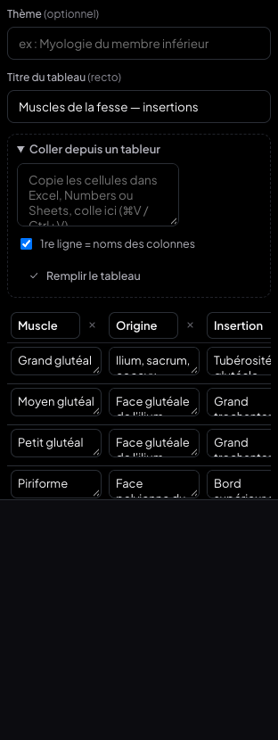
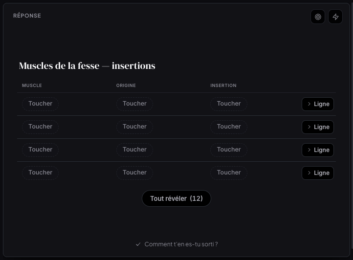
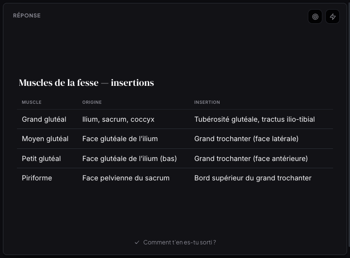
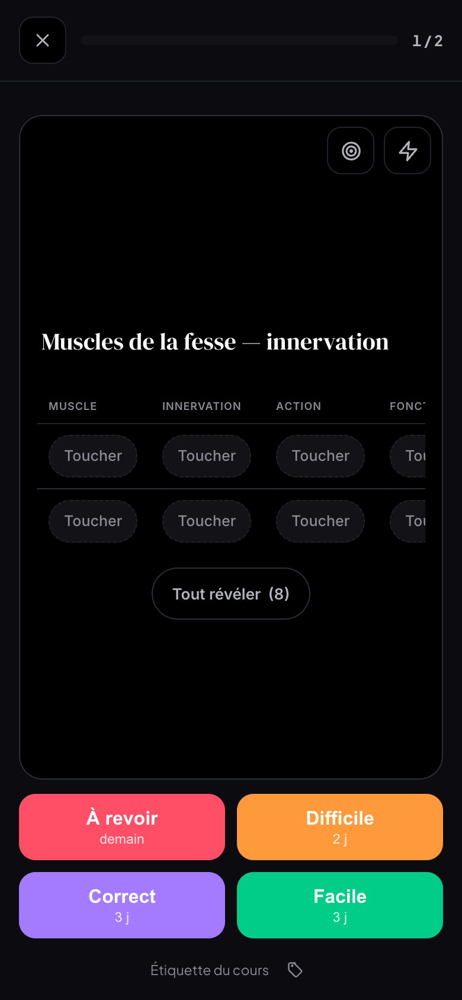

---

## 4. Netteté des PDF importés

`pdf/PdfPage.jsx`, `pdf/rendusPages.js` (nouveau), `pdf/pdfjsSetup.js`.

**Cause trouvée** : le canvas avait bien la densité de l'écran (×2), mais au **zoom par défaut**
(ajusté à la largeur : 105 %, 160 %…) la page tombait sur des **fractions de pixel** — canvas de
1 764 px réels affiché sur 1 764,81, décalé à x = 231,594 px réels sur iPad — et le navigateur
**ré-échantillonnait toute l'image** : texte mou, sauf aux zooms « ronds ». Correctifs :

- densité = **zoom × devicePixelRatio**, plafonnée à **3×** (et au plafond de pixels d'un canvas) ;
  dimensions **entières**, pdf.js dessine exactement dedans ;
- canvas affiché **1 pour 1** et **calé sur la grille des pixels de l'écran** (recalé après rendu,
  fin de défilement, redimensionnement de la zone de lecture) ;
- pendant un zoom : l'image en place s'étire (**mise à l'échelle CSS**), le **rendu net suit 150 ms**
  après le dernier cran ;
- **cache des pages rendues** par document, page, zoom et densité (**LRU, 20 pages**) ;
- **file de rendu** : au plus 2 rendus pdf.js à la fois, **pages visibles d'abord**.

**Mesures** (même zone de la page 1 capturée en pixels réels ; « netteté » = énergie des gradients) :

| | Densité | Canvas / affiché (px réels) | Position x | Netteté |
|---|---|---|---|---|
| iPad (1 024 × 1 366, ×2) — zoom ajusté 105 %, **avant** | 2 | 1 764 / **1 764,81** | **231,594** | 2 443 |
| iPad — zoom ajusté 105 %, **après** | 2 | 1 765 / **1 765** | **232** | **2 551 (+4,4 %)** |
| Retina (1 440 × 900, ×2) — zoom 160 %, **avant** | 2 | 2 694 / **2 694,38** | 296 | 1 994 |
| Retina — zoom 160 %, **après** | 2 | 2 694 / **2 694** | 296 | 1 994 |
| Retina et iPad — 100 / 150 / 200 %, avant **et** après | 2 | identiques (1 684, 2 526, 3 368) | entière | 3 007 / 1 989 / 1 363 |

Défilement (3 s, 14 px par image) : **60 img/s, 0 image sautée, 0 tâche longue**, avant comme après.


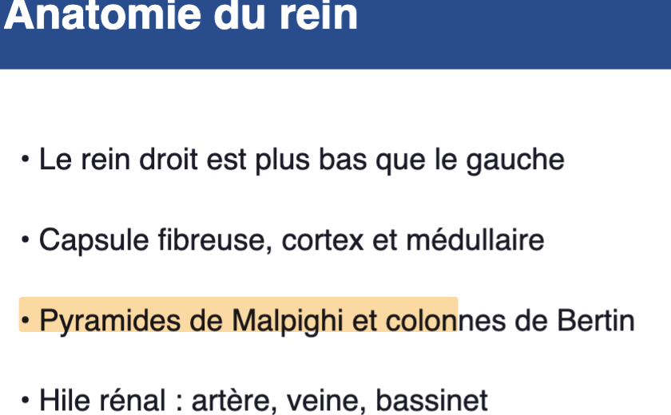
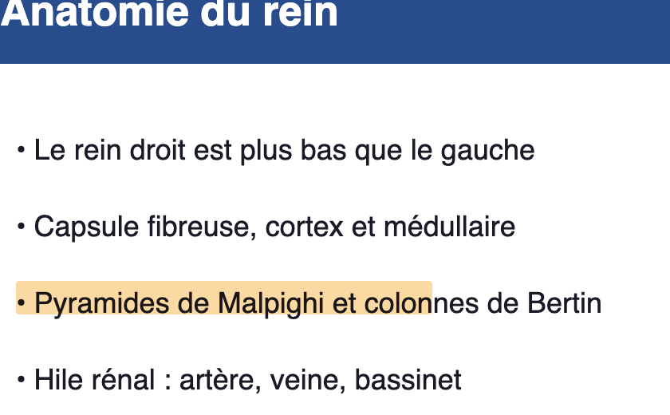
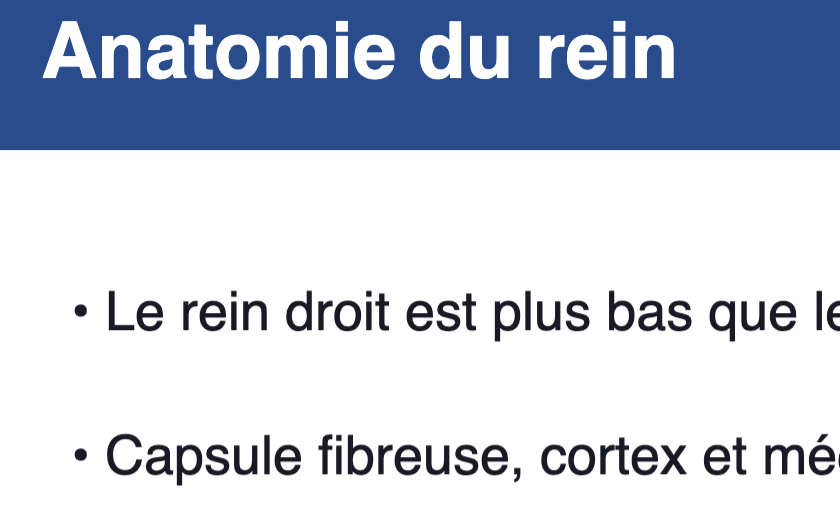
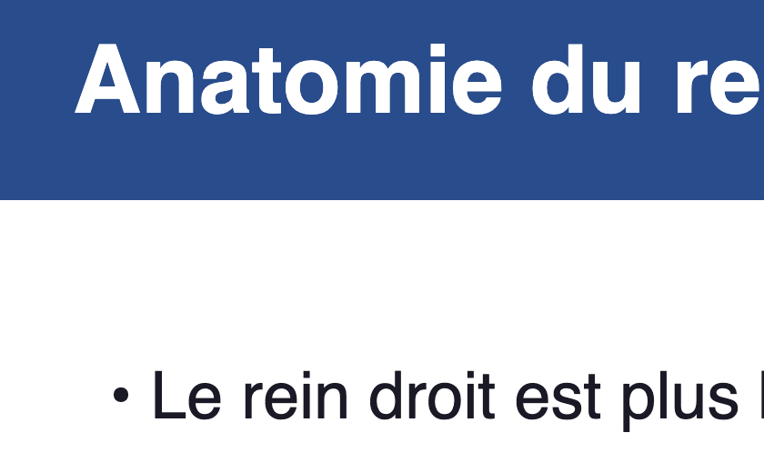

**Limite** : mesuré en Chrome émulé (densité ×2), sur le PDF de test (texte vectoriel). Aux zooms
ronds, l'ancien rendu était déjà net ; le gain porte sur le zoom ajusté (celui de l'ouverture).
Je n'ai ni Mac Retina ni iPad physiques pour confirmer le ressenti : si un PDF reste flou, c'est
probablement une image (diapositive exportée en bitmap), dont la netteté est celle du fichier.

---

## 5. Carnet d'erreurs / Apprentissage en révision : à la bonne place, pour la bonne carte

`components/ActionsCarte.jsx` (remplace `SuiteNotation.jsx`), `styles/actions-carte.css` ; Réviser,
séance du jour, téléphone.

- **Bug corrigé** : les actions s'affichaient pour la carte PRÉCÉDENTE et suivaient le défilement.
  Désormais : une **rangée d'icônes dans l'en-tête de la carte affichée** (coin supérieur droit, cible =
  carnet, rafale = apprentissage — les icônes de la barre latérale), **dès qu'elle est retournée**
  (avant même de noter), **remplacée à la carte suivante**, **hors du flux** : fixe quel que soit le
  défilement interne (testé sur un verso long défilé jusqu'en bas).
- Ordinateur 30 px, **téléphone 40 px** ; le menu de pré-réponses s'ouvre depuis l'icône
  (**feuille du bas** au téléphone) ; « Modifier » et « Autre… » en fenêtres au-dessus de tout.
- Indépendance : « Apprentissage » → diagnostic **strictement identique** avant/après (même `updatedAt`
  des cartes) ; carnet → J / FSRS / journal inchangés.

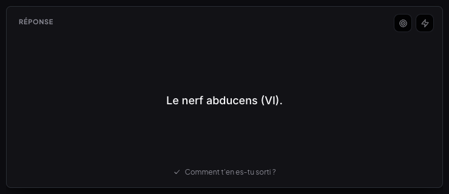
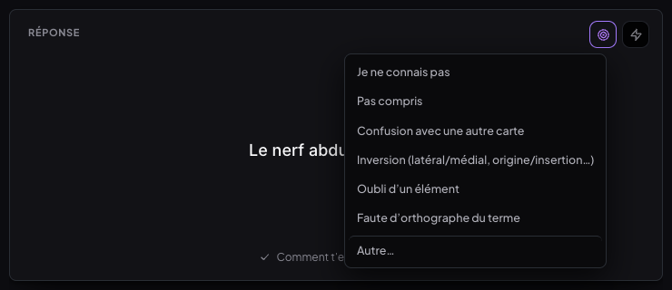
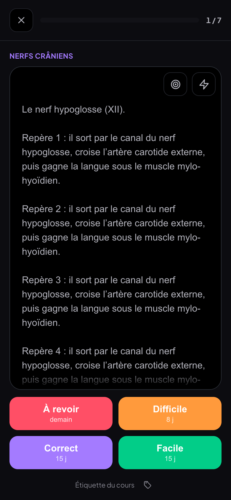
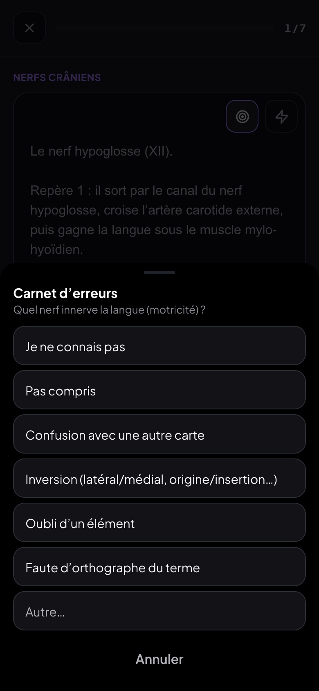
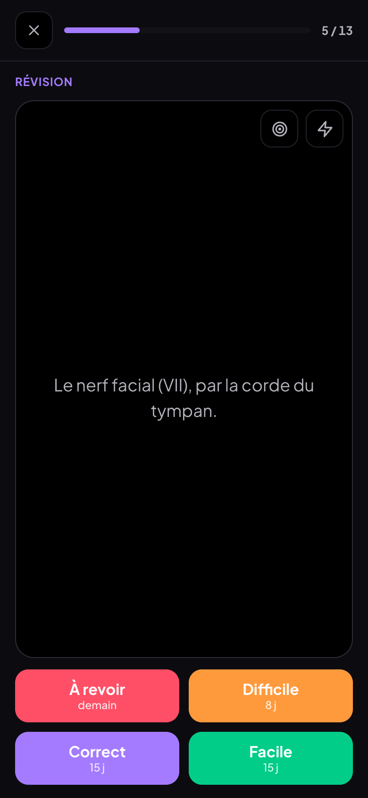

## 6. Boutons de notation au téléphone

Vérifié à chaque étape (Réviser au téléphone, séance du jour, carte Tableau) : les boutons de notation
restent **visibles** (dans l'écran, ≥ 44 px) et **libres** (aucun élément — icônes comprises — ne les
recouvre : test au point central de chacun).

---

## Tests

| Suite | Résultat |
|---|---|
| `t-import.mjs` — format copié et réimporté tel quel (6 types), erreurs par ligne, doublons, date de départ, cartes dans les J, .json et .zip (image jointe) | **22/22** |
| `t-import-tablette.mjs` — tablette 1 180 px et fenêtre 761 px | **5/5** |
| `t-glissement.mjs` — ordre, aucun dépassement, double switch, 20 allers-retours trackpad / doigt, images | **9/9** (×3 : trackpad, doigt, tablette) |
| `t-tableau.mjs` — 3 × 4, TSV (zone et grille), J, panneau, révision cellule / ligne / tout | **16/16** |
| `t-tableau-mobile.mjs` — téléphone, défilement horizontal interne, boutons libres | **9/9** |
| `t-nettete.mjs` — Retina et iPad, ajusté / 100 / 150 / 200 %, défilement | **10/10** ×2 |
| `t-revision-carnet.mjs` — icônes de la carte affichée, bon recto, défilement interne, 5 diagnostics | **24/24** |
| `t-revision-mobile.mjs` — 40 px, feuille du bas, bonne carte, boutons de notation libres | **19/19** |
| `t-revision-seance-reglages.mjs` — séance du jour, pré-réponses éditées, « Autre… », glisser | **11/11** |

## Non-régression

Même banc, après les six chantiers (tout rejoué) :

| Suite | Résultat |
|---|---|
| Fiche jumelle et documents (couleurs, téléphone, import, bascule, calques, éditeur, tablette, remplacer, sans-les-deux, doc ×5) | **207/207** + correspondance 3 × 30/30 |
| Fichiers d'un cours, carnet (ordinateur, tablette, téléphone), apprentissage, transcript | **97/97** |
| Emploi du temps (école, changements, réglages, téléphone, hors ligne, grille horaire) | **120/120** |
| Menu Fichier en sections (ordinateur, tablette) | **37/37 · 21/21** |
| Raccourcis ⌘1–9, tri de la Bibliothèque | **33/33 · 33/33** |

- `t-menu-sections` lisait un nom de fiche figé (`fiche.pdf`) : la suite fiche jumelle le remplace par
  `fiche-v2.pdf` — le test lit désormais le nom en base (rien à changer dans l'app).
- **MealWeek** : build de référence `3c2d1a1` et build actuel servis côte à côte, capturés avec le même
  profil Chrome, l'un juste après l'autre : **identiques au pixel** (ordinateur 1 440 × 900 et téléphone
  390 × 844). `git diff 3c2d1a1 HEAD -- src/shared src/mealweek` : **aucun fichier**.

## Commits

- `d1889c2` fix : carnet / apprentissage liés à la carte affichée, icônes dans l'en-tête de la carte
- `2f46fc7` perf : glissement sans rebond, aimantation 120 ms, ordre Exercices · Transcript · Notes · Notions
- `05d1733` feat : flashcard « Tableau »
- `dac7759` feat : importer des flashcards (JSON, .zip) depuis le panneau
- `8d6b122` perf : netteté des PDF (pixels réels, 1 pour 1, calage, cache, file de rendu)
- `a83b227` docs : compte rendu
