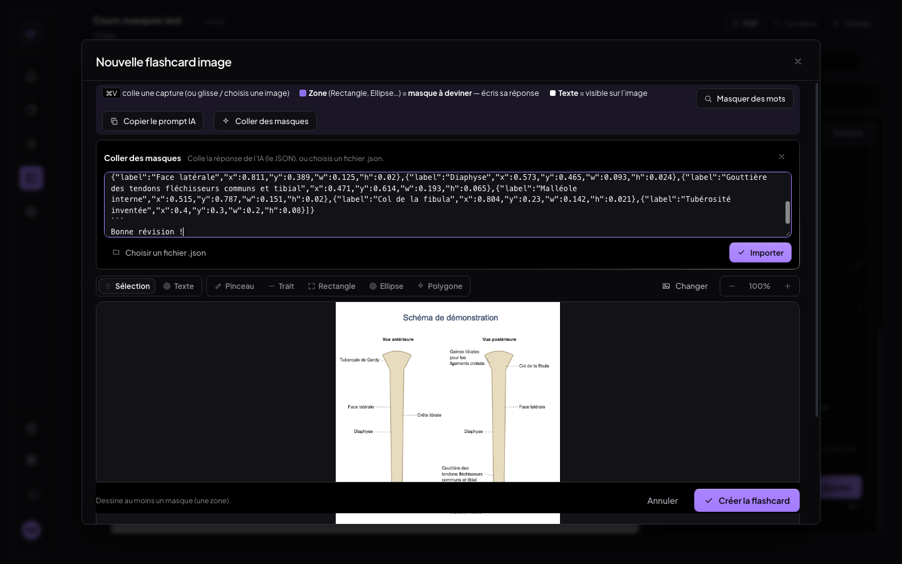
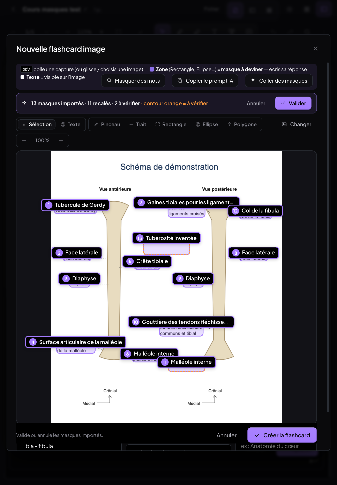
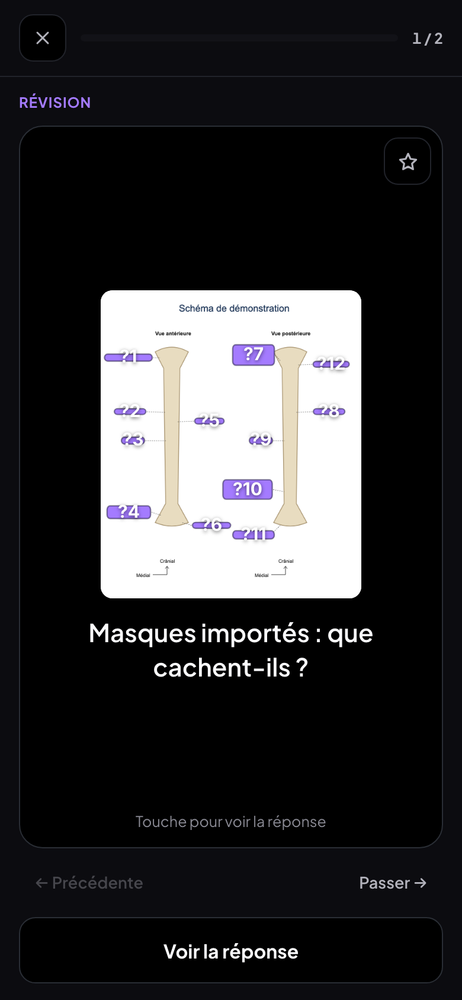

# Compte rendu — masques d’une flashcard image produits par une IA (22/11/2026)

**Test tibia/fibula : 40/40 étiquettes masquées, 0 à vérifier** (0 oubliée, 0 réponse visible, 0 titre masqué).

## Ce qui a été livré

Dans l’**éditeur de flashcard image existant** (`components/OcclusionImage.jsx`, `SchemaEditor`), deux boutons de plus, chacun
avec son infobulle, à côté de « Masquer des mots » :

1. **« Copier le prompt IA »** : copie un prompt autonome à coller avec l’image dans n’importe quelle IA
   ([prompt-masques-ia.md](prompt-masques-ia.md)). Retour « Prompt copié ». Repli `execCommand('copy')` pour les anciens Safari.
2. **« Coller des masques »** : un panneau avec une zone de collage (un simple champ texte, donc le collage natif de l’iPhone /
   iPad marche) et « Choisir un fichier .json ». « Importer » :
   - lit le JSON de façon tolérante ([format-masques-ia.md](format-masques-ia.md)) : texte autour, balises ```` ```json ````,
     valeurs hors image ramenées dedans, doublons et chevauchements forts signalés, message clair si le JSON est invalide ;
   - fait lire l’image par l’**OCR existant** (`ocr/ocrImage.js` : Tesseract.js, même worker, même chargement, même cache) ;
   - **recale** chaque masque sur les mots de son label (contour des mots + 4 px), sinon le laisse à la place donnée par l’IA,
     avec un **contour orange « à vérifier »** ;
   - ajoute les masques **en aperçu dans l’éditeur**, avec un bandeau d’une ligne, par exemple
     « 40 masques importés · 40 recalés · 0 à vérifier ». Les masques se déplacent, se redimensionnent et se suppriment comme des
     masques dessinés (même code). Un masque orange déplacé ou redimensionné perd son contour orange : il a été vérifié.
   - **« Valider »** garde les masques ; **« Annuler »** les retire tous (aucune trace). Tant que l’aperçu est ouvert,
     « Créer la flashcard » est désactivé : rien n’est enregistré avant validation.
3. Ensuite, **« Créer la flashcard » / « Enregistrer »** sans changement : même carte, mêmes champs, même synchro.

Fonctionne sur une **page de PDF** (image d’une boîte d’annotation → « → Flashcard » → « Masques à deviner ») et sur une
**image importée** (collée ou choisie, pas encore enregistrée), comme le créateur existant.

**Stockage** : les masques importés sont créés par **la même fonction** que les zones dessinées
(`pages/ImportAnatomieVisuel.jsx#nouvelleZone`, extraite de `addZone` sans changer son résultat). Le banc compare un masque importé
et un masque dessiné dans la même carte enregistrée : mêmes champs de coche et de zone. Aucun nouveau format, aucune migration,
aucune écriture Supabase nouvelle. Le contour orange n’est jamais stocké.

### Correctif OCR trouvé en chemin (bug existant)

Le service OCR des PDF (`ocr/service.js`) libère le moteur Tesseract partagé **une minute après sa dernière page**, sans savoir
qu’une image peut être en train d’être lue sur le même worker (« Masquer des mots » existant, masques d’une IA). Le worker était
alors arrêté en pleine reconnaissance et la lecture restait **en attente pour toujours** : sablier infini. C’est arrivé dans le banc
avec synchro. Correctif minimal dans `ocr/moteurTesseract.js` : la libération attend la fin des lectures en cours. Vérifié par
`scripts/tests-masques-ia/t-ocr-pdf.mjs` : **bloquée 60 s (délai du test) sur le code d’avant, terminée en 1,9 s après**.
L’OCR automatique des PDF produit toujours sa couche de mots.

## Test réel du prompt — fiche tibia/fibula

Image : page 2 de `~/Downloads/TP_osteo_membre_inferieur_bassin.pdf` (fiche tirée d’un manuel), rendue en 1191 × 1684 px
**en local uniquement**, hors du dépôt (dossier de travail de la session). Jamais commitée, aucune capture publiée.

**Méthode.** J’ai suivi uniquement le prompt copié depuis l’app (`prompt-copie.txt`, identique au texte ci-dessous) : j’ai regardé
l’image, compté les étiquettes zone par zone, estimé à l’œil le rectangle de chacune, puis converti en fractions. Le JSON
(40 masques) a été collé dans l’éditeur. La **vérité** vient de la couche texte du PDF (position exacte de chaque ligne) et le
script `mesure.mjs` la compare aux masques obtenus.

> Réserve honnête : avant de répondre au prompt, j’avais vu les positions de la couche texte du PDF pour compter les étiquettes,
> ce qui a pu rendre mes rectangles plus précis que ceux d’une IA qui découvre l’image. Pour compenser, j’ai rejoué le même JSON
> avec des rectangles **décalés au hasard** (±1, ±2 et ±3 % de l’image, taille ±10 %, 5 tirages chacun). Le résultat est le même
> à chaque fois.

| Mesure | Résultat |
|---|---|
| Étiquettes sur la fiche (comptées, titres et repères exclus) | **40** (19 vue antérieure, 21 vue postérieure) |
| Masques obtenus | **40** |
| Masques recalés par l’OCR | **40** |
| À vérifier (orange) | **0** |
| Étiquettes oubliées | **0** |
| Masques laissant voir une partie de la réponse | **0** (couverture de chaque ligne ≥ 99,5 %, au pixel) |
| Titres ou repères masqués par erreur (Tibia - Fibula, Vue antérieure ×2, Vue postérieure ×2, Crânial ×2, Médial ×2, « 3 ») | **0** |
| Masques en trop | **0** |
| Variantes décalées (15 tirages jusqu’à ±3 %) | 40/40 recalés, 0 oubli, 0 réponse visible, 0 titre, à chaque tirage |
| Même JSON sur l’image collée (pas la page de PDF) | 40 importés · 40 recalés · 0 à vérifier |

Cas demandés, vérifiés sur la vraie fiche :
- **plusieurs lignes** : « Gaines tibiales pour les ligaments croisés » (3 lignes), « Gouttière des tendons fléchisseurs communs et
  tibial » (3 lignes visibles ; la 4e, « postérieur », est cachée sous le dessin dans le PDF), « Fosse malléolaire pour les
  collatéraux fibulaires » et « Gouttière pour le passage des tendons péronniens » (4 lignes) : **un seul masque** chacune, qui
  couvre toutes ses lignes ;
- **doublons** : « Face latérale » (×3), « Face médiale » (×2), « Diaphyse » (×2), « Malléole interne » (×2),
  « Bord latéral interosseux » (×2), « Face postérieure » (×2), « Surface articulaire de la malléole » (×2) : chacune masquée
  **à sa place**.

**Itération.** Le premier essai donnait 40/40 recalés mais **1 réponse en partie visible** : les deux « Malléole interne » sont
l’une au-dessus de l’autre, à 27 px. Le masque de la vue postérieure avait pris « Malléole » chez lui et « interne » chez la voisine.
J’ai donc ajouté au recalage l’**ordre de lecture** (le mot suivant du label est à droite sur la même ligne ou au début de la ligne
en dessous), plusieurs ancrages essayés, et l’obligation de recouper le rectangle de l’IA. Résultat : 0 réponse visible. Sur la fiche
de démonstration, un « interne » collé au trait pointillé n’était pas lu par l’OCR et la position de l’IA laissait dépasser le « M ».
D’où le **recalage partiel** : un masque orange couvre à la fois la position de l’IA et les mots lus. Le prompt n’a pas eu besoin
de changer.

## Tests

**Unitaires** (`tests/masques-ia`, 19) : JSON nu, texte autour, balises ```` ```json ````, accolade dans un label, réparations,
JSON invalide (où et quoi), sans JSON, vide, sans `masques`, hors limites, ignorés, pixels, doublons et chevauchements, recalage
exact (+4 px), accents, casse et faute, plusieurs lignes, doublons dans deux vues, mot collé, chiffre lu pour une lettre, mot coupé,
introuvable, trop loin, partiel, sans OCR, conflit, résumé, prompt.

**Chrome headless** (Vite sans cloud, profils neufs ; `scripts/tests-masques-ia/`) :

| Banc | Ordinateur 1440×900 | iPad 820×1180 tactile | Téléphone 390×844 tactile |
|---|---|---|---|
| `t-masques.mjs` (fiche de démo : prompt, erreurs, import collé et fichier, aperçu, oranges, Annuler, déplacer / redimensionner / supprimer, Valider, création, structure stockée, image collée) | ✅ 34/34 contrôles | ✅ 34/34 | — (voir ci-dessous) |
| `REEL=1 t-masques.mjs` (fiche tibia/fibula, captures hors dépôt) | ✅ 21/21 | | |
| `t-seance.mjs` (carte aux masques importés en séance, comparée à une carte au masque dessiné) | ✅ | ✅ | ✅ |
| `t-synchro.mjs` (après `t-masques` branché sur une copie du faux Supabase) | ✅ carte, 13 masques et image au faux cloud | | |
| `t-ocr-pdf.mjs` (OCR auto d’un PDF scanné + libération du moteur pendant une lecture) | ✅ (❌ sur le code d’avant : c’est le bug corrigé) | | |

**Téléphone / iPhone.** Le shell téléphone (largeur ≤ 760 px, ou téléphone à l’horizontale) sert seulement à réviser : il n’a pas
d’éditeur de flashcard image. C’est l’existant, et je n’en ai pas ajouté, puisque rien d’autre que ce qui était listé ne devait être
fait. Sur téléphone, j’ai vérifié la **carte en séance** (recto opaque, verso avec les réponses), identique à une carte au masque
dessiné. Le **collage façon iPhone** est testé sur iPad tactile avec l’agent Safari : texte inséré dans le champ comme le fait le
collage natif iOS (`Input.insertText`), sans passer par l’API presse-papiers, que l’iPhone refuse sans geste. Pas d’essai sur un vrai
iPhone ni sur un vrai iPad.

**Non-régression**
- Éditeur de masques manuel : banc existant `tests-seance-passer-precedente/t-boite.mjs` (boîte → flashcard, masque dessiné,
  création, carte ≡ carte du panneau) ✅ ordinateur et iPad.
- Séance avec cartes image : `t-seance.mjs` ✅ sur les trois appareils.
- OCR du lecteur PDF : `t-ocr-pdf.mjs` ✅ (couche de mots produite).
- Synchro : `t-synchro.mjs` ✅ (faux Supabase seulement, jamais le vrai cloud).
- **MealWeek** : `tests-export-png-retour/t-mealweek.mjs` contre le code d’avant (1daefc9) : **0 pixel différent** (hub et
  MealWeek ouverte), même texte, 0 erreur console, sur ordinateur et téléphone. Captures `img/masques-ia/mealweek-*`.
- `npm test` : 361/364. Échouent `crayon` et `emploi-du-temps/api` (déjà en échec avant) et `filet` (test de durée < 300 ms,
  lent pendant la suite complète avec trois Chrome ouverts ; passe 3 fois sur 3 lancé seul). `npm run build` : vert.
- Aucun fichier de MealWeek ni de `src/shared/` touché.

## Captures (fiche de démonstration dessinée par le banc)

| Avant import | Après recalage (11 recalés, 2 orange) | Carte en séance |
|---|---|---|
|  |  |  |

Aussi : `02-apres-recalage-ordi.png`, `01-avant-import-tablette.png`, verso en séance `04-carte-en-seance-verso-*.png`
(ordinateur, iPad, téléphone). Les captures de la vraie fiche restent hors du dépôt (image d’un manuel).

## Limites et suites possibles (non faites)

- **Zoom à la molette absent** dans l’éditeur de flashcard image quand l’image arrive après l’ouverture de la fenêtre (cas de la
  boîte d’annotation et de l’image choisie ou collée) : l’écouteur est posé au montage, alors que le cadre n’existe pas encore
  (`SchemaEditor`, `useEffect([])`). Bug existant, hors périmètre ; les boutons + / − marchent.
- Sur une image affichée petite, la pastille du libellé et le panneau d’un masque sélectionné recouvrent un petit masque et ses
  poignées. Comportement existant des masques dessinés, inchangé : on zoome.
- Le résultat dépend de la lecture OCR : un mot collé à un trait peut ne pas être lu (le masque reste alors orange, agrandi). L’OCR
  peut varier d’un masque recalé entre deux lectures du même dessin.

## Texte final du prompt

```text
Tu prépares des flashcards à masques (occlusion d'image) à partir de l'image jointe : un schéma dont les étiquettes (les noms des structures) doivent être cachées par des rectangles.

RÉPONDS UNIQUEMENT AVEC LE JSON CI-DESSOUS : pas de phrase avant ou après, pas d'explication, pas de balise de code.

{"format":"medrevise-masques","version":1,"masques":[{"label":"Tubercule de Gerdy","x":0.012,"y":0.171,"w":0.180,"h":0.024}]}

COORDONNÉES
- Un masque = un rectangle : x, y = son coin HAUT-GAUCHE ; w = sa largeur ; h = sa hauteur.
- Toutes les valeurs sont des FRACTIONS de l'image entière, entre 0 et 1 : x et w divisés par la largeur de l'image, y et h divisés par sa hauteur. Origine en haut à gauche. 3 décimales.
- Exemple : une étiquette qui commence à 10 % de la largeur et à 50 % de la hauteur, large de 15 % et haute de 2 % → "x":0.100,"y":0.500,"w":0.150,"h":0.020.

QUOI MASQUER
1. Un masque par étiquette. Une étiquette = le nom d'UNE structure, relié en général à l'image par un trait (plein ou pointillé).
2. Une étiquette écrite sur plusieurs lignes (ex. « Gaines tibiales / pour les / ligaments croisés ») = UN SEUL masque qui couvre toutes ses lignes, de la première à la dernière.
3. Le rectangle couvre TOUT le texte de l'étiquette (première et dernière lettre, accents, lettres qui descendent comme p, g, q) avec une petite marge, sans couvrir le trait de rappel ni le dessin.
4. Une même étiquette présente à plusieurs endroits (ex. dans deux vues) = un masque à CHAQUE endroit, chacun à sa place.

NE MASQUE JAMAIS
- les titres et sous-titres (titre de la page, « Vue antérieure », « Vue postérieure »…) ;
- les repères d'orientation (Crânial, Caudal, Médial, Latéral, flèches…) ;
- les numéros de page, les légendes, les sources, les copyrights.

LABEL
- "label" = le texte EXACT de l'étiquette, recopié lettre par lettre tel qu'il est écrit sur l'image, même s'il contient une faute ; les lignes d'une étiquette sont réunies avec une espace.

AVANT DE RÉPONDRE
1. Compte toutes les étiquettes de l'image, zone par zone (de haut en bas, à gauche puis à droite de chaque dessin).
2. Vérifie que la liste "masques" contient exactement ce nombre d'éléments, qu'aucune étiquette n'est oubliée et qu'aucun titre ni repère n'a été pris.
3. Vérifie chaque rectangle : il contient tout le texte de son étiquette et rien d'autre.
Puis réponds UNIQUEMENT avec le JSON.
```

## Commits

- `2388754` fix(medrevise): OCR — la libération du moteur attend la fin des lectures d’image en cours
- `1c2351d` feat(medrevise): masques d’une flashcard image produits par une IA
- `0e5d9a1` test(medrevise): banc Chrome des masques IA (ordinateur, iPad, téléphone), test réel et mesure
- (ce commit) docs(medrevise): format, prompt, compte rendu et captures des masques IA

## Relancer les bancs

Vite `medrevise-banc` (:5302, sans cloud), Chrome headless 9345 / 9346 / 9347 (profils neufs), `TRAVAIL=<dossier hors dépôt>` :
`node rendu.mjs` (rend la fiche et lance l’OCR) → réponse IA dans `$TRAVAIL/reponse-ia.json` → `node mesure.mjs [--decaler=0.03 --graine=1]` ;
`node t-masques.mjs ordi|tablette`, `REEL=1 node t-masques.mjs ordi`, `node t-seance.mjs ordi|tablette|tel`, `node t-ocr-pdf.mjs`.
