# Mode « Apprentissage » libre — compte rendu (11/10/2026)

Un espace d'entraînement en rafale pour les cartes lourdes, **totalement indépendant de la méthode
des J et de FSRS**. Je remplis et je vide la liste à la main ; une session ne laisse aucune trace.

## 1. Ce qui est livré

| Où | Quoi |
|---|---|
| Panneau Flashcards d'une fiche | Sur chaque carte, en pied : **« Mettre en apprentissage »** (icône + libellé, discret). Une carte de la liste porte la pastille **« Apprentissage »** et le bouton devient **« Retirer de l'apprentissage »**. **« Sélectionner »** fait apparaître des cases à cocher et une barre : « Tout », **« Mettre les N cartes en apprentissage »**, **« Retirer les N cartes de l'apprentissage »**. |
| Navigation | Nouvel onglet **« Apprentissage »** juste sous « Réviser » (icône ↻). Sur tablette (barre du bas) : « Apprendre ». Sur téléphone : une carte « Apprentissage · N cartes en apprentissage » sur l'accueil. |
| Onglet Apprentissage | Les cartes de la liste **rangées par cours** (en-tête + compteur ; cours dans l'ordre de la Bibliothèque, cartes dans l'ordre de la fiche). Retrait d'un clic (×). Une case par cours + « Tout », puis **« Lancer (N) »** : toutes les cartes des cours cochés, dans l'ordre des cours puis des cartes, **sans mélange**. |
| Session | Question → retourner → réponse. Cartes Muscle : au verso, les 5 champs sont **masqués et se révèlent un par un** au clic / toucher (même composant d'affichage que la révision, `TableauMuscle`), « Tout révéler » reste là. **« Pas su » / « Su »** ; **« Skip »** discret ; **« Finir »** en haut à droite. |
| Fin de session | Écran sobre : « **5 cartes vues · 2 sues · 3 à retravailler** », puis **« Retirer de l'apprentissage les cartes sues »** (avec confirmation) et **« Terminer »**. |
| Téléphone | Session plein écran ; toucher la carte = retourner ; au verso, **glisser à droite = Su, à gauche = Pas su** ; tous les boutons ≥ 44 px ; aucun texte coupé (la carte défile si elle est longue). |
| Ordinateur | Raccourcis : Espace = retourner ; → ou 2 = Su ; ← ou 1 = Pas su ; S = Skip. |

### Règles de la session (logique pure, `src/medrevise/apprentissageLibre/session.js`)
- « Su » : +1 à la suite de la carte. **2 « Su » d'affilée → carte « sue »** : elle n'est plus présentée
  dans cette session, mais **reste dans la liste** jusqu'à ce que je la retire. Après un 1er « Su », la
  carte revient plus loin (pastille « 1 Su sur 2 »).
- « Pas su » : la suite retombe à 0, la carte revient **après les autres, en gardant l'ordre**.
- « Skip » : la carte passe en fin de file, rien n'est noté.
- Quitter (×) en cours de session = session abandonnée : rien à reprendre, rien enregistré.

## 2. Ce qui est stocké — et rien d'autre

Un seul enregistrement, type additionnel synchronisé par le mécanisme existant (table générique
`medrevise_records`, LWW par `updated_at`) :

```json
{ "id": "learning_set", "cardIds": ["qBiceps", "qTriceps", "qCoiffe", "qCitrate", "qAKG"], "updatedAt": "…" }
```

Pas de compteur, pas de date, pas d'historique. La session vit en mémoire (état React) et disparaît
avec elle. Une carte supprimée ailleurs est simplement ignorée à l'affichage (son id reste dans la
liste ; rien ne sort automatiquement).

**Migration SQL** : `supabase/migrations/20261011_learning_set.sql` — un index partiel, **préparé et
NON appliqué**. Elle n'est pas nécessaire : la table est générique et `medrevise_push` n'a pas de liste
blanche de stores, l'app fonctionne en local et synchronise sans elle (vérifié avec le faux Supabase).

## 3. Indépendance — par construction

- Le mode n'écrit **que** `learning_set` (`apprentissageLibre/liste.js` → `put('learning_set', …)`).
  Aucun import de `scheduler/`, `journal/`, `sm2.js`, `planning.js`, ni de `setMeta` (séance du jour)
  dans `src/medrevise/apprentissageLibre/` (vérifié par grep).
- Il lit des cartes leur id, leur fiche, leur type et leur contenu (affichage). Jamais `dueDate`,
  états, `streak`, bloc FSRS, historique.
- Les composants d'affichage sont réutilisés (Tex, `TableauMuscle`, images, flashcard image, Molécule)
  dans une face écrite à part (`FaceCarte.jsx`) : **`session/SeanceFC.jsx` n'est pas modifié**, ni le
  planificateur, ni FSRS, ni le journal, ni la synchro (`data/sync.js`), ni le calendrier.
- Fichiers existants modifiés : `lib/storage.js` (déclaration du store + ajout à la liste synchronisée),
  `MedReviseApp.jsx` (lecture de la liste, `ctx.setLearningSet`, écran), `components/ui.jsx`
  (onglet), `components/CourseItemsSidebar.jsx` (boutons, pastille, sélection), `mobile/MobileApp.jsx`
  et `mobile/MobileHome.jsx` (entrée téléphone). `src/shared/` et MealWeek : **aucune modification**
  (`git diff --quiet -- src/shared src/mealweek` ✔).

## 4. Preuve d'indépendance (diff avant / après)

Banc isolé : profil Chrome de TEST, faux Supabase local (`scripts/faux-supabase.mjs`, table du journal
active), jamais le vrai cloud. Jeu de test : 2 cours, 7 cartes, dont 2 Muscle, des dates variées et des
blocs FSRS. Avant l'instantané, **une vraie réponse dans la séance du jour** (journal non vide).

**Instantané** (`scripts/tests-apprentissage-libre/commun.mjs` → `instantane`) :
- l'**export de diagnostic** (`construireDiagnostic`, le contenu du bouton « Exporter le diagnostic ») :
  chaque carte (dueDate, prochaine date, intervalle, notations, bloc FSRS, `updatedAt`), plan du
  jour, séance du jour enregistrée, mesures, réglages ;
- les enregistrements `questions` **bruts** (tous les champs) ;
- le **journal des révisions** local (toutes les entrées) et sa file d'envoi ;
- le **calendrier** (nombre de cartes par jour) ; les stats ;
- au faux cloud : les lignes `questions` et la table du journal.

**Entre les deux instantanés** : 5 cartes mises en apprentissage (dont 2 Muscle), session 1 complète
(10 réponses, Skip, réinsertions, jusqu'à « toutes sues »), session 2 au clavier puis « Finir »,
retrait des sues confirmé, retrait manuel, une session abandonnée.

**Résultat : `diff avant.json apres.json` est vide**, les deux fichiers ont la même empreinte :

```
a7279dac67a490957e08bb6a02eff5922d12776a04714cf1bbdae94445469ddb  avant.json
a7279dac67a490957e08bb6a02eff5922d12776a04714cf1bbdae94445469ddb  apres.json
```

Fichiers : `docs/preuves/apprentissage-libre/avant.json` et `apres.json`. Valeurs des cartes concernées
(identiques avant et après) :

| Carte | Cours | dueDate | Prochaine date | Intervalle | Notations J | Bloc FSRS | updatedAt |
|---|---|---|---|---|---|---|---|
| qBiceps | Myologie | 2026-10-29 | 2026-10-29 | 18 | 3 | S 19.96 · D 5.09 · due 2026-11-01 | 13:32:49.740Z |
| qTriceps | Myologie | 2026-10-13 | 2026-10-13 | 4 | 2 | S 4.2 · D 6.3 · due 2026-10-14 | 13:32:36.553Z |
| qCoiffe | Myologie | 2026-10-11 | 2026-10-11 | 1 | 0 | — | 13:32:36.553Z |
| qCitrate | Krebs | 2026-10-11 | 2026-10-11 | 3 | 2 | — | 13:32:36.553Z |
| qAKG | Krebs | 2026-10-12 | 2026-10-12 | 2 | 2 | — | 13:32:36.553Z |

- Journal des révisions : 3 entrées en local, 3 au faux cloud — **avant comme après** (aucune ligne ajoutée).
- Plan du jour : 2 cartes dues (qCitrate, qCoiffe) — inchangé ; séance du jour enregistrée inchangée ;
  bloc « Aujourd'hui » de Réviser : même texte avant et après.
- Calendrier : `{10-11: 2, 10-12: 1, 10-13: 1, 10-16: 1, 10-19: 1, 10-29: 1}` — inchangé.
- Sur le téléphone aussi : cartes, journal, calendrier et diagnostic identiques avant / après une session.
- Seul écart au faux cloud : la ligne `learning_set` (la liste elle-même).

## 5. Tests

Tous dans Chrome (headless, profils de TEST, vrais événements souris / tactiles via CDP).

| Banc | Résultat | Couvre |
|---|---|---|
| `t-bureau.mjs` (ordinateur 1440×900) | **30/30** | Pastille et bouton qui basculent ; sélection multiple (mettre, mixte, retirer) ; 5 cartes de 2 cours dont 2 Muscle ; onglet rangé par cours ; Lancer désactivé sans case ; session 1 : ordre conservé, champs Muscle révélés un par un (5 → 4 → 3), Su / Pas su / Skip, « 1 Su sur 2 », Pas su remet à zéro, 2 Su = sue, ordre exact `Biceps → Coiffe → Triceps(skip) → Biceps → Coiffe → Triceps → Biceps → Coiffe → Triceps → Biceps` ; fin « 3 cartes vues · 3 sues · 0 à retravailler » ; sue ≠ retirée ; session 2 « Tout » au clavier, « Finir » → « 5 vues · 2 sues · 3 à retravailler » ; confirmation puis retrait des sues ; retrait d'un clic ; abandon ; **preuve d'indépendance** ; 0 exception |
| `t-telephone.mjs` (téléphone 390×844 tactile + ordinateur) | **13/13** | Synchro de la liste vers le 2ᵉ appareil (faux cloud : un seul enregistrement `learning_set`) ; accueil « 5 cartes en apprentissage » ; onglet, cibles ≥ 44 px, rien ne déborde ; session plein écran ; toucher = retourner ; champs révélés au toucher ; glisser droite = Su, gauche = Pas su ; aucun texte coupé ; fin ; cartes / journal de B inchangés ; retrait sur le téléphone → l'ordinateur le voit après synchro |
| `t-non-regression.mjs` | **5/5** | Chaque onglet s'ouvre (dont « Apprentissage (exos) ») ; un seul onglet allumé ; Éditer / Supprimer du panneau intacts ; la séance du jour s'ouvre et se quitte |
| `tests-zones/t-mealweek.mjs` | **2/2** | MealWeek s'ouvre depuis le hub, sans erreur |
| `npm test` (vitest) | **48/48** | dont 6 nouveaux (`tests/apprentissage-libre/session.test.js`) : règles Su / Pas su / Skip / Finir, liste et regroupement |
| `npm run build` | vert | |

Relancer : `scripts/tests-fsrs/lancer.sh <dépôt> <profil-ordi> <profil-téléphone>`, puis `seed.mjs`,
`t-bureau.mjs <captures> <preuve>`, `t-telephone.mjs <captures>`, `t-non-regression.mjs`.

## 6. Captures

| | |
|---|---|
| Fiche : pastilles, boutons par carte | 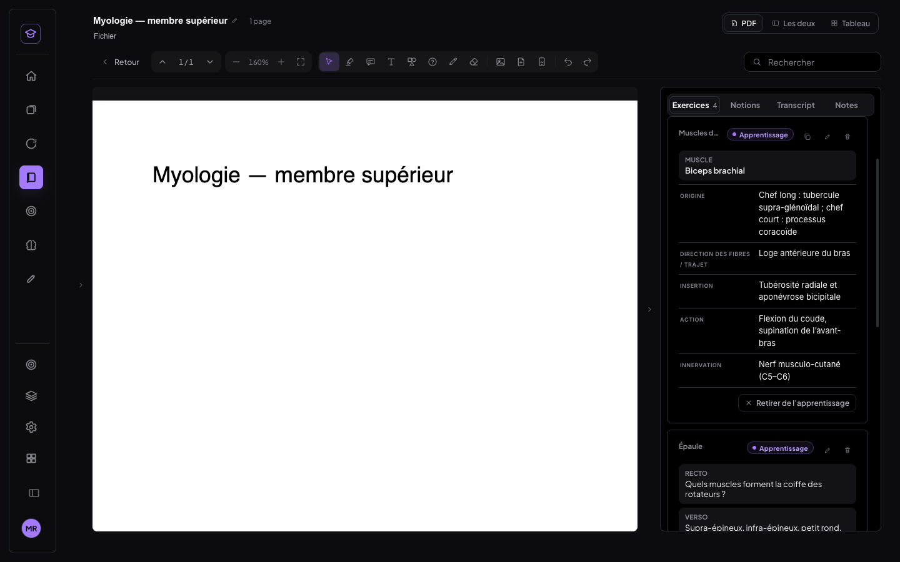 |
| Fiche : sélection multiple | 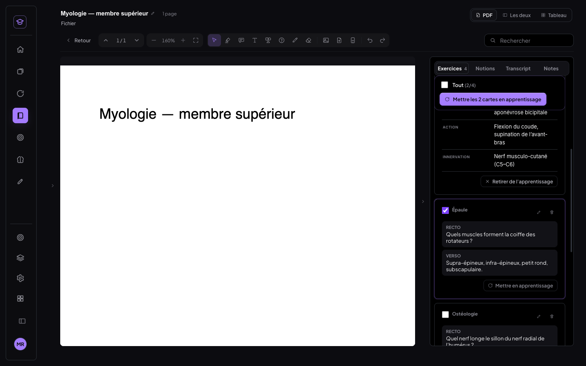 |
| Onglet Apprentissage (un cours coché) | 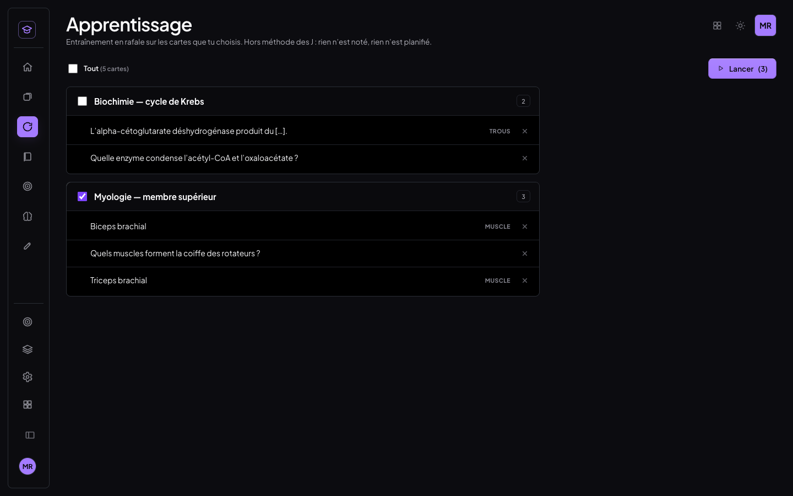 |
| Session : carte Muscle, champs révélés un par un | 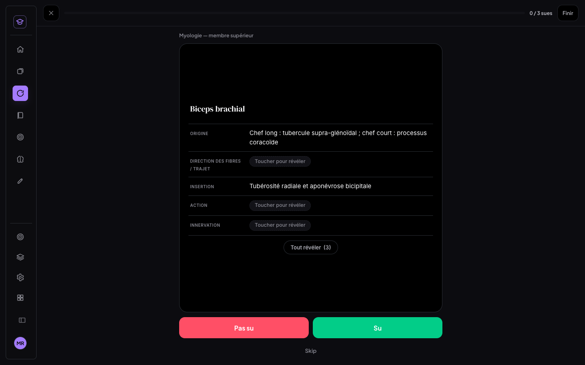 |
| Fin de session | 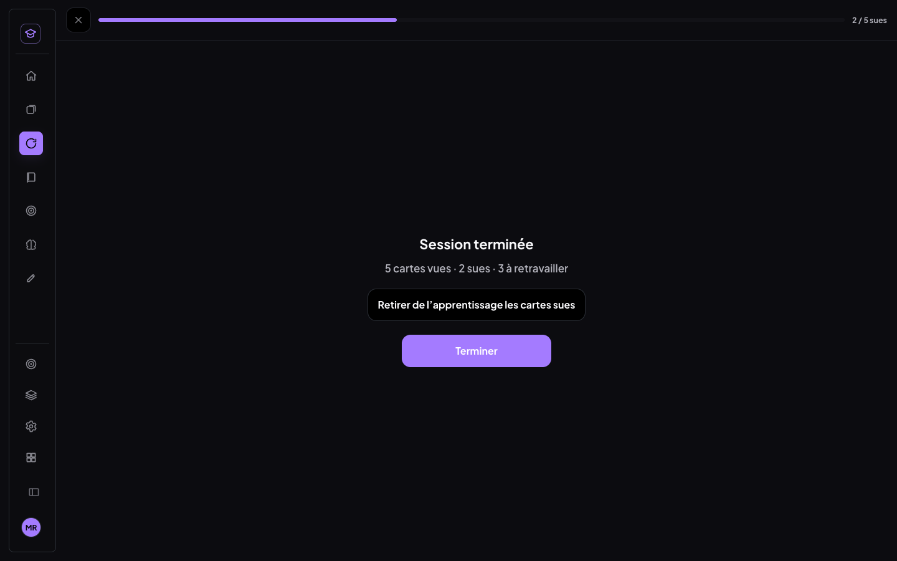 |
| Confirmation du retrait des sues | 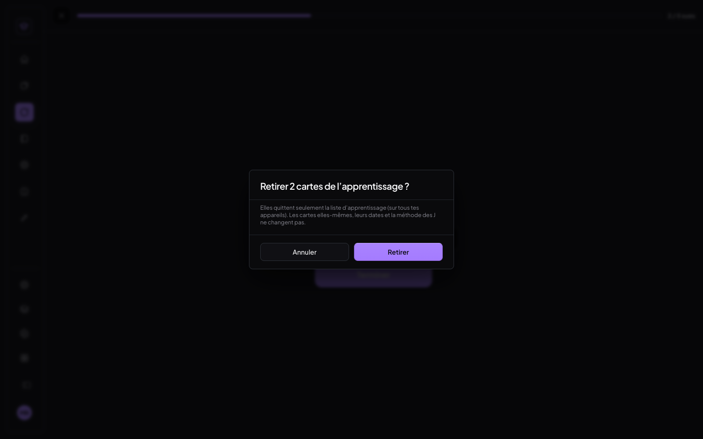 |
| Téléphone : accueil | 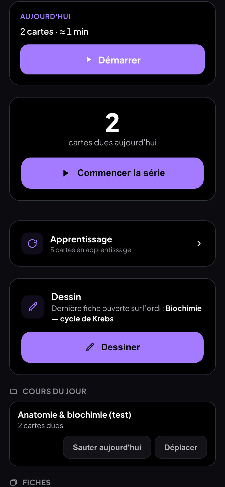 |
| Téléphone : onglet | 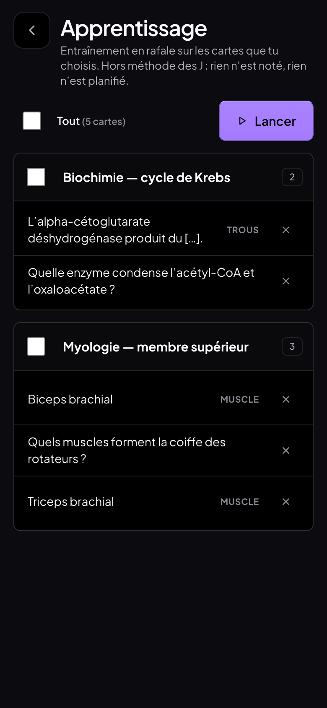 |
| Téléphone : session Muscle | 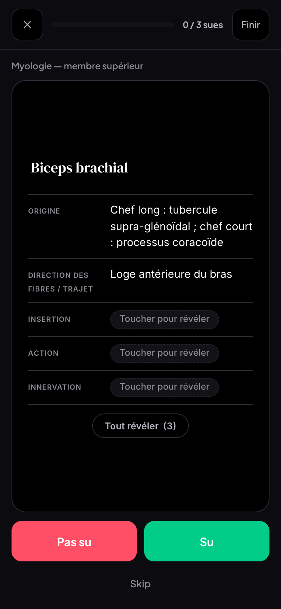 |
| Téléphone : verso d'une carte texte (texte entier) | 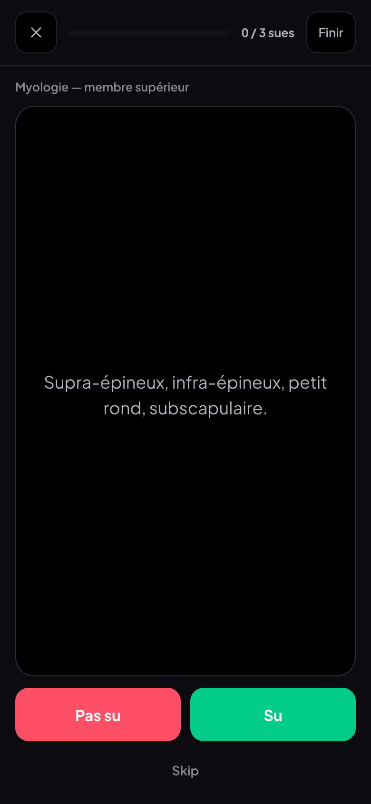 |
| Téléphone : fin de session | 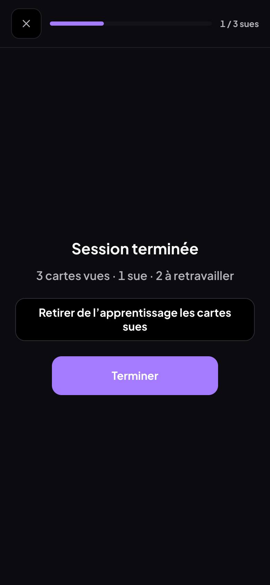 |

## 7. Décisions prises sans toi

- **Nom de l'onglet** : un onglet « Apprentissage » existait déjà (unités exos + PDF). Le nouveau prend
  le nom « Apprentissage », juste sous Réviser ; l'ancien devient **« Apprentissage (exos) »** dans la
  barre (son écran, lui, est inchangé).
- **« Finir »** : avec la règle « 2 Su d'affilée », une session ne s'arrête seule que quand tout est su,
  et « à retravailler » vaudrait toujours 0. Un bouton « Finir » mène à l'écran de fin quand je veux ;
  « à retravailler » = cartes notées au moins une fois et pas sues.
- **« vues »** = cartes notées au moins une fois (Su ou Pas su) ; une carte seulement « skippée » ne compte pas.
- **Skip** renvoie la carte en fin de file (elle revient) ; désactivé quand il ne reste qu'une carte.
- Cases des cours **décochées** au départ ; Lancer désactivé tant que rien n'est coché.
- La révélation champ par champ suit le réglage existant « ligne par ligne » (activé par défaut),
  comme la révision normale.
- Carte à trous dans la liste : les réponses sont masquées (« […] »).
- Synchro : un seul enregistrement en dernier-écrit-gagne. Si je modifie la liste **au même moment** sur
  deux appareils hors ligne, la dernière modification synchronisée l'emporte (choix assumé : un seul
  enregistrement, comme demandé).

## 8. Limites

- Tests sur Chrome headless avec émulation téléphone (390×844, tactile) et faux Supabase : pas sur un
  vrai téléphone ni sur le vrai cloud (règle du projet).
- Le jeu de test a d'abord eu des blocs FSRS au mauvais format (dates ISO au lieu de jours civils) :
  le planificateur a levé une exception pendant la réponse de séance du jour. Cela venait de mes données
  de test (corrigées), pas du mode Apprentissage, et ne touche pas les vraies cartes.

## 9. Commits

- `ae1bb59` feat(medrevise): mode Apprentissage libre — entraînement en rafale hors J et FSRS
- ce commit de documentation (compte rendu, captures, instantanés avant / après)
