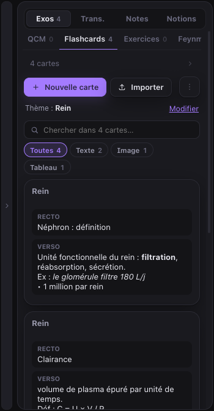
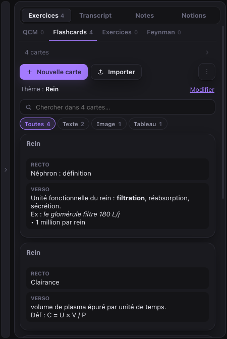
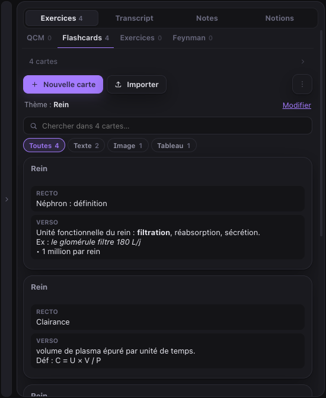
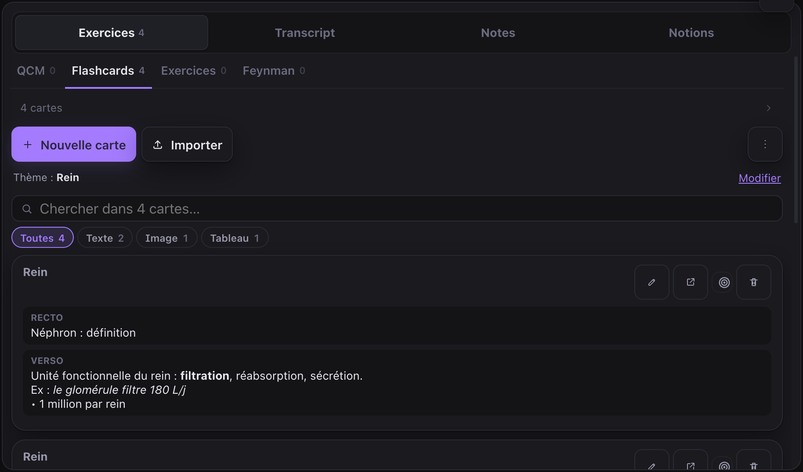
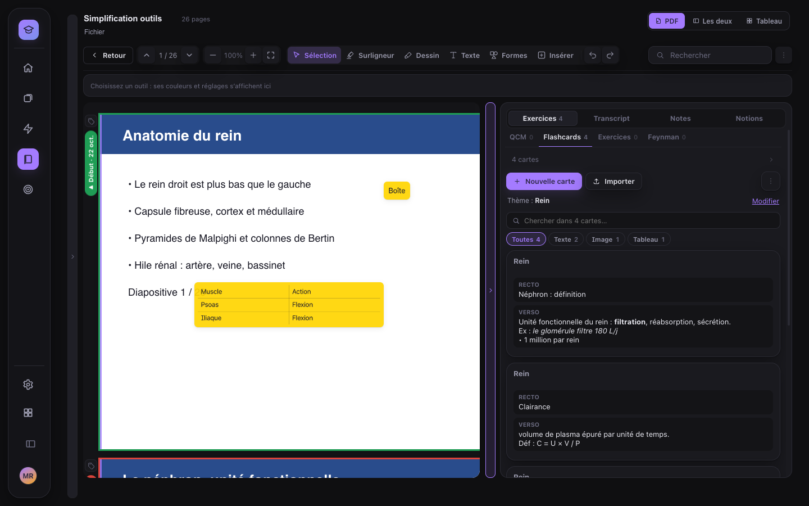
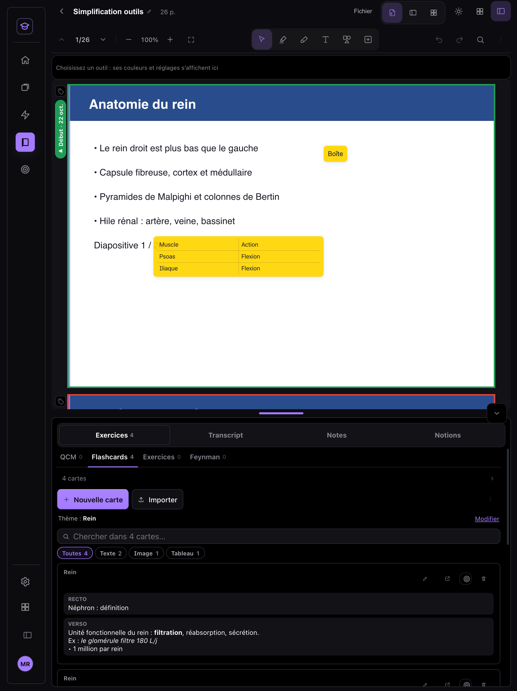
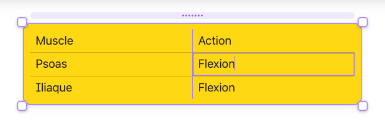
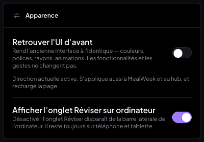
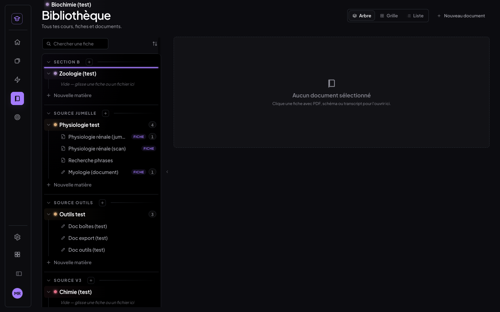

# Compte rendu — corrections et nettoyage de MedRevise v2 (26/10/2026)

Sept points, livrés, testés dans Chrome (ordinateur 1440 × 900, tablette 1024 × 1366 au toucher, téléphone 390 × 844),
commités et poussés. MealWeek et `src/shared/` sont intacts. Aucune écriture Supabase destructive, et aucune donnée
supprimée : les tableaux, les tags et l'ancien réglage « focus » restent en base ou dans l'appareil.

## Sommaire

1. [Panneau latéral cassé : cause et correction](#1-panneau-latéral-cassé--cause-et-correction)
2. [Onglets « Tableau » et « Pages », actions « → Tableau »](#2-onglets--tableau--et--pages--actions---tableau-)
3. [Tags Début / Fin de cours : dans la marge, avec un cadre de couleur](#3-tags-début--fin-de-cours--dans-la-marge-avec-un-cadre-de-couleur)
4. [Boîte-tableau : bande de prise](#4-boîte-tableau--bande-de-prise)
5. [Réglages → Apparence : « Afficher l'onglet Réviser sur ordinateur »](#5-réglages--apparence--afficher-longlet-réviser-sur-ordinateur-)
6. [Mode focus supprimé](#6-mode-focus-supprimé)
7. [Bibliothèque : matières glissées-déposées](#7-bibliothèque--matières-glissées-déposées)
8. [Tests et non-régression](#8-tests-et-non-régression)
9. [Commits](#9-commits)

---

## 1. Panneau latéral cassé : cause et correction

**Symptôme.** Le contenu de l'onglet Exos était décalé et coupé à gauche, et les vignettes de pages s'affichaient
par-dessus.

**Diagnostic** (mesuré dans Chrome) :

- la piste des modes (`.pm-piste`) et chaque volet avaient bien la largeur du panneau (352 px) ;
- mais le volet actif commençait à x = −238, alors que le corps du panneau commençait à x = 1057 ;
- le conteneur `.pm-corps` était **défilé horizontalement** : `scrollLeft = 1295`.

**Cause.** Le volet « Pages » (vignettes), monté hors écran à droite comme tous les modes, appelait
`scrollIntoView({ block: 'nearest' })` sur la vignette de la page courante à chaque changement de page.

`scrollIntoView` fait défiler **tous les ancêtres défilables** pour amener l'élément à l'écran. Un conteneur en
`overflow: hidden` en fait partie : il ne montre pas de barre, mais il reste défilable par code. Le navigateur a donc
fait glisser `.pm-corps` d'environ quatre largeurs de panneau vers la droite. Résultat : la piste décalée, l'onglet Exos
coupé à gauche, les vignettes du volet « Pages » par-dessus.

**Correction** :

- le volet « Pages », source du défilement, est supprimé (§ 2) ;
- `.pm-corps` passe en **`overflow: clip`** (`styles/panneau-modes.css`). Contrairement à `hidden`, `clip` interdit
  **tout** défilement, y compris par code : plus aucun `scrollIntoView` lancé dans un volet hors écran ne peut décaler
  la piste ;
- **filet de sécurité** pour les navigateurs sans `overflow: clip` : un écouteur remet `scrollLeft` à 0
  (`components/CourseItemsSidebar.jsx`).

**Vérification.** Dans Chrome, le banc force exactement la cause : un `scrollIntoView` lancé dans le volet Notions,
caché. Le panneau reste en place à 320, 420 et 520 px sur ordinateur, ainsi que sur tablette : `scrollLeft` = 0, et le
volet Exos coïncide avec le panneau au pixel près.

| 320 px | 420 px | 520 px |
|---|---|---|
|  |  |  |

Tablette (volet du bas) : 

## 2. Onglets « Tableau » et « Pages », actions « → Tableau »

- **Panneau latéral** : il ne garde que Exercices · Transcript · Notes · Notions. Le composant du panneau des pages est
  supprimé.
- **Mini barre des boîtes** : « → Tableau » est retiré.
- **Flashcards du panneau** : l'icône « → Tableau » et le mode « Sélectionner » sont retirés. Ce mode ne servait plus
  qu'à poser plusieurs cartes sur le tableau. Le glisser d'une carte vers le tableau est retiré aussi.
- **Tableaux existants** : ils restent en base (type `board`, rien de supprimé). Ils restent visibles par la bascule
  « PDF · Les deux · Tableau » de l'en-tête du cours, qui n'était pas dans la liste.

## 3. Tags Début / Fin de cours : dans la marge, avec un cadre de couleur

- **Suppression** : le bouton « … » qui apparaissait en haut au centre de la page au survol est retiré.
- **Nouvelle icône** :
  - une petite icône « étiquette », **toujours visible**, est posée dans la **marge à gauche** de chaque page, hors de
    la page ;
  - elle ouvre le menu des tags (le même qu'au clic droit) : marquer début, marquer fin, date et transcript, retirer.
- **Page taguée** :
  - un **cadre de couleur** l'entoure : **vert** pour un début, **rouge** pour une fin, les deux anneaux si la page
    porte les deux ;
  - une **étiquette lisible** est posée dans la marge, sous l'icône : « ▶ Début · 22 oct. » ou « ■ Fin · 22 oct. ».
    Elle est écrite à la verticale le long de la page, de la couleur du cadre ;
  - un clic sur l'étiquette ouvre le transcript lié, ou la fenêtre du tag s'il n'y en a pas.
- **Marge réservée** : une gouttière fixe de 30 px est réservée de chaque côté des pages, à tous les zooms. L'icône et
  l'étiquette sont donc toujours hors de la page et jamais coupées. « Ajuster à la largeur » en tient compte : la page
  ajustée est un peu moins large qu'avant (36 px de moins).

| Page « début » (cadre vert, étiquette dans la marge) | Tablette |
|---|---|
|  |  |

## 4. Boîte-tableau : bande de prise

Une **bande fine** est posée juste au-dessus du bord haut de la boîte-tableau, au-dessus des marges de sélection des colonnes : 11 px, et 16 px au doigt. Elle est
visible au survol et à la sélection, avec un curseur main et de petits points de prise.

- **Glisser la bande déplace la boîte**, même quand une cellule est en cours d'édition.
- **Un clic sur la bande** sélectionne la boîte ; il n'ouvre jamais l'écriture.
- **Les cellules et les marges de sélection ne sont pas gênées** : la bande est au-dessus des marges de colonnes, hors des cellules, et la mini barre se pose au-dessus d'elle. Un clic dans
  une cellule l'édite toujours, et la grille n'est pas modifiée par un déplacement.

## 5. Réglages → Apparence : « Afficher l'onglet Réviser sur ordinateur »

Un interrupteur est ajouté sous « Retrouver l'UI d'avant ». Il est **ON par défaut**.

- **OFF** : l'onglet Réviser disparaît de la barre latérale de l'ordinateur.
- **Tablette** (écran tactile) : l'onglet reste, même OFF.
- **Téléphone** : le shell mobile, dont l'accueil est la révision, n'est pas concerné.
- **Stockage** : c'est un réglage de l'**appareil** (localStorage `medrevise.onglet.reviser.ordinateur`, dans
  `lib/ongletReviser.js`), non synchronisé, comme l'interface classique. Un stockage illisible vaut ON.

| Le réglage | Barre latérale, réglage OFF (ordinateur) |
|---|---|
|  |  |

## 6. Mode focus supprimé

- **Bouton** : l'icône cible du bas de la barre latérale est retirée.
- **Code** : `lib/focusMode.js` est supprimé, ainsi que la garde d'écran de `MedReviseApp`, la barre du bas réduite à
  la Bibliothèque et l'écouteur `medrevise:focus` du lecteur.
- **Réglage** : un appareil qui avait le focus activé garde sa clé `medrevise.focus.notes` (rien n'est supprimé), mais
  elle n'est plus lue. Tous les onglets sont là au démarrage (vérifié avec la clé posée).

## 7. Bibliothèque : matières glissées-déposées

Les matières se déplacent **comme les cours**, avec le même moteur (@dnd-kit) et le même indicateur de dépôt (barre
d'insertion violette) :

- **Geste** : maintenir, glisser, déposer. À la souris, le glisser démarre après 6 px ; au doigt, après un appui de
  180 ms.
- **Où déposer** :
  - avant une autre matière, pour **réordonner** ;
  - dans une **autre section** (avant une de ses matières, ou en fin de section, même repliée), pour **changer de
    section**.
- **Ce qui est écrit** : un champ `ordre` est ajouté aux matières de la section d'arrivée, et la matière déplacée reçoit
  son nouveau `sourceId`. Ses cours, dossiers et cartes ne bougent pas : ils suivent leur matière.
- **Même ordre partout** : la Bibliothèque, Réviser et le tableau de bord Apprentissage le lisent tous
  (`lib/ordreMatieres.js`). Sans `ordre`, c'est l'ordre d'avant.
- **Pas de mélange** : pendant le glisser d'une matière, les cibles des cours sont inactives, et inversement.

---

## 8. Tests et non-régression

Les tests tournent dans un Chrome headless isolé, piloté en CDP avec de vrais événements souris, toucher et clavier, sur un Vite local **sans Supabase** (base locale du banc, jamais le vrai cloud). Les formats testés :

- **ordinateur** 1440 × 900 ;
- **tablette** 1024 × 1366 au toucher ;
- **téléphone** 390 × 844.

### 8.1 Bancs du nettoyage (`scripts/tests-nettoyage-v2/`)

| Banc | Ordinateur | Tablette | Téléphone |
|---|---|---|---|
| `t-panneau.mjs` — §1 à §4 : panneau à 320 / 420 / 520 px, onglets, « → Tableau », tags dans la marge, bande de prise | 15 ✅ | 13 ✅ | sans objet (pas de lecteur sur téléphone) |
| `t-shell.mjs` — §5 à §7 : réglage Réviser, mode focus, matières glissées | 12 ✅ | 12 ✅ | 4 ✅ |

**`t-panneau.mjs` vérifie :**

- **Panneau** : il montre Exercices · Transcript · Notes · Notions. À 320, 420 et 520 px (ordinateur) et sur tablette, le volet Exos coïncide avec le panneau au pixel près, et `scrollLeft` vaut 0. Le banc provoque exactement la cause du bug : un `scrollIntoView` lancé dans un volet caché.
- **« → Tableau »** : plus aucune trace dans les flashcards ni dans la mini barre d'une boîte.
- **Tags** :
  - le bouton « … » du haut de page a disparu ;
  - l'icône est visible et entièrement hors de la page, dans la marge gauche ;
  - page « début » : cadre vert + « ▶ Début · 22 oct. » ; page « fin » : cadre rouge + « ■ Fin · 22 oct. ». Les étiquettes sont dans la marge, à la verticale.
- **Bande de prise** : visible au survol, curseur main, 7 à 11 px de haut. Une cellule s'édite toujours au clic. Glisser la bande pendant l'édition déplace la boîte (0,200 ; 0,500 → 0,295 ; 0,601) sans modifier la grille.

**`t-shell.mjs` vérifie :**

- **Mode focus** : plus de bouton. Avec l'ancienne clé `medrevise.focus.notes` posée, tous les onglets sont là.
- **Interrupteur Réviser** :
  - ON par défaut ;
  - OFF : l'onglet disparaît sur ordinateur, et le réglage tient au rechargement ;
  - tablette : l'onglet reste ;
  - téléphone, réglage OFF : la révision est toujours là ;
  - de nouveau ON : l'onglet revient.
- **Matières** :
  - « Chimie » est glissée avant « Anatomie » (ordre changé), avec l'indicateur de dépôt vu pendant le glisser ;
  - « Biochimie » est glissée dans une autre section (`sourceId` changé) ;
  - les cours suivent leur matière ;
  - à la souris et au doigt (appui maintenu).

### 8.2 Non-régression

- **Bancs des chantiers du 25/10, passage sur le code final** :

  | Banc | Résultat |
  |---|---|
  | `t-tableau-bord` (Apprentissage, vraies données) | 28 / 28 / 27 ✅ |
  | `t-recherche` | 20 / 20 ✅ |
  | `t-boites` | 24 / 23 ✅ |
  | `t-infobulles` | 28 ✅ |
  | `t-tags` (adapté au nouvel affichage dans la marge) | 15 ✅ |

- **Suite « boîtes & tableaux »** : toute verte (ordinateur et tablette). Le détail :
  - `t-tableau` 44 / 44, `t-tableau-miro` 13 / 13, `t-tableau-doigt` 13 ;
  - `t-image` 16 / 16, `t-flashcard` 16 / 16, `t-exports` 21 / 21, `t-exports-doc` 10 / 10 ;
  - `t-document` 5 / 5, `t-mobile` 6, `t-export-tableau` 4, `t-tablette-selection` 12.
- **Suite « simplification des outils »** : verte (ordinateur et tablette), à une exception près. `t-barre › Formes` échoue **aussi sur l'ancien code** (vérifié) : c'est un banc obsolète, sans lien avec ce chantier.
- **Une régression trouvée et corrigée.** Dans sa première position, la bande de prise recouvrait les **marges de sélection des colonnes** du tableau, qui sont à la même hauteur. Les clics sur une marge tombaient sur la bande, et `t-tableau` montrait 10 échecs en cascade. La bande est maintenant juste au-dessus de ces marges, et la mini barre se pose au-dessus d'elle. Les suites repassent au vert.
- **Bancs alignés sur les retraits demandés** : `t-mini-barres`, `t-boite-tableau`, `t-texte`, `t-tableau-miro`. Ils attendaient « → Tableau » ; ils vérifient maintenant son absence. Le message du tableau vide ne propose plus de « glisser une flashcard ici », ce geste n'existant plus.
- **Un échec intermittent.** `t-tablette-selection › boîte en édition : rien ne bouge` a échoué 2 fois dans la suite complète. Il n'a pas été reproduit en 9 passages isolés ou enchaînés comme dans la suite (12 / 12 à chaque fois), ni sur l'ancien code (1 passage). Je le signale sans pouvoir conclure.
- **MealWeek et `src/shared/`** : le diff est vide. **MealWeek est identique au pixel** entre un build d'avant (1c5ccec) et le build final, tous deux sans Supabase.
- **Build et tests automatiques** : `npm run build` est vert. `npm test` passe 131 tests sur 132 ; le seul échec (`crayon`) est préexistant.

## 9. Commits

- `bc5d43c` fix(medrevise): panneau latéral (cause : défilement du conteneur des modes) ; onglets Tableau et Pages et « → Tableau » retirés ; tags dans la marge (icône, étiquette, cadre vert / rouge) ; bande de prise de la boîte-tableau
- `40cfe66` feat(medrevise): « Afficher l'onglet Réviser sur ordinateur » ; mode focus supprimé ; matières glissées-déposées dans la Bibliothèque
- `1293084` test(medrevise): bancs du nettoyage v2 ; anciens bancs alignés sur le retrait de « → Tableau »
- (ce compte rendu et ses captures : le commit « docs » qui suit)

