# Compte rendu — harmonisation du lecteur PDF (21/10/2026)

Suite de la réparation du 21/10 (`docs/compte-rendu-pdfreader-reparation.md`). Objectif : une seule façon de
sélectionner, déplacer, redimensionner et régler chaque objet ; une seule implémentation des flèches ; un seul
composant de mini barre ; des contrôles entre / sur les pages à l'échelle du zoom ; la reprise d'un transcript
arrêté (section « Reprise de session » de `docs/compte-rendu-transcription-directe.md`). Tests sur une instance
locale isolée (Vite :5199 sans Supabase, Chrome headless en CDP) : aucune écriture Supabase.

## Audit de cohérence — AVANT (écrit avant de coder)

Vocabulaire : dans MedRevise, « commentaire » et « post-it » sont **le même objet**, la boîte (outil Boîte, icône de
bulle ; réduite, elle devient une pastille). La zone de texte (outil Texte) et le « ? » sont les deux autres objets de
texte.

Contextes : le PDF, le document éditable et la fiche jumelle affichent leurs pages avec le **même** composant
(`PdfPageContent`) ; la tablette est le même lecteur au toucher. Sur téléphone (< 760 px) le lecteur n'existe pas
(shell mobile) : le contexte « mobile » est donc le lecteur à sa plus petite largeur (760 px, tactile). Les colonnes
de contexte étaient déjà identiques entre elles — sauf la tablette, où trois gestes n'avaient pas d'équivalent
(marqués ✱). Les défauts sont surtout **entre objets** : chaque objet avait sa propre règle.

| Objet | Sélectionner | Déplacer | Redimensionner | Options affichées |
|---|---|---|---|---|
| Boîte (commentaire / post-it) | pas d'état « sélectionnée » : un clic ouvre l'édition | languette bleue au-dessus (boîte « un mot ») ou bandeau à poignée (boîtes d'avant) | coin bas droit seul | barre flottante : flèche, couleur, fond, réduire, supprimer |
| Zone de texte | un clic ouvre l'édition | languette au-dessus | coin bas droit seul (caché) | barre flottante : couleur, supprimer |
| « ? » | focus au clic | glisser n'importe où | — | croix au survol |
| Flèche d'une boîte | clic sur le trait | **impossible** (glisser le trait ne fait rien) ; le rond du bout seulement | — | rangée en haut de l'écran (BarreFleche) + croix flottante sur le trait |
| Flèche / ligne (Formes) | clic sur le trait | glisser le trait déplace la forme ; ronds aux bouts | — | barre flottante (Texte, Légende, couleur, supprimer) + rangée en haut |
| Rectangle, ellipse, triangle… | par le **tracé** seulement | par le tracé seulement | 4 coins | barre flottante : Texte, Légende, couleur, remplir, supprimer |
| Image | clic n'importe où | glisser n'importe où | 4 coins + poignée de rotation | barre flottante : 90°, premier plan, avancer, reculer, arrière-plan, supprimer |
| Trait de crayon | **non sélectionnable** | — | — | — |
| Surlignage | non sélectionnable (ancré au texte : se recolore / se retire en repassant au surligneur) | — (ancré) | — (ancré) | — |
| ✱ Tablette | appui long = point de flèche (au lieu du double-clic) | idem | idem | barres agrandies |

Implémentations en double relevées : 3 poignées de déplacement (languette, bandeau, aucune), 2 poignées de taille
(coin seul, 4 coins), 5 barres d'options codées à la main (boîte, zone de texte, forme, image, flèche en rangée),
2 façons d'afficher la croix « retirer » d'une flèche, 3 placements de barre (`placeBarre` de la boîte, `pf-actions`
de la forme, `pi-actions` de l'image), 2 rendus des points de contrôle (carrés `nb-ctl`), 2 jeux de bouts de flèche
(`nb-ancre` ronds, `pf-bout`), le bouton « Insérer une page » en pixels d'écran, le badge transcript en pixels
d'écran.

## Décisions

1. **Une règle de sélection** pour tous les objets (outil Sélection) : un clic sélectionne, cliquer-glisser n'importe
   où sur l'objet le déplace ; boîte et zone de texte : double-clic (ou clic quand elle est déjà sélectionnée) = édition
   du texte, Échap = sortie de l'édition (un 2ᵉ Échap désélectionne). Un état de sélection unique dans le lecteur.
2. **Un cadre de sélection** (`CadreSelection`) : contour 1,5 px d'accent + 4 poignées d'angle, les mêmes pour tous.
3. **Une mini barre** (`MiniBarre`) : un composant, une grammaire d'icônes, l'ordre apparence → actions → supprimer, le
   même placement (au-dessus, en dessous s'il n'y a pas la place, jamais sur l'objet).
4. **Une flèche** : connecteurs de boîte, flèches et lignes de l'outil Formes = le même composant, le même modèle
   (points de contrôle en fractions de page, droite / courbe), les mêmes gestes (trait = toute la flèche, point = ce
   point, extrémité = l'extrémité, qui se rattache à une boîte si on la relâche dessus) et la même mini barre.
5. **Contrôles à l'échelle** : bouton d'insertion et badges posés sur / entre les pages dimensionnés en unités de
   page, bornés (≥ 18 px de haut, sinon une fine ligne « + »).

Écarts assumés, faute de place dans la liste d'options demandée :
- l'image perd sa poignée de rotation et ses quatre boutons de calque. Une image déjà pivotée garde son angle (affichage
  et export inchangés) ;
- la forme perd « Texte » et « Légende » dans sa barre. Le double-clic sur une forme fermée écrit toujours son étiquette ;
- en mode Sélection, le texte reconnu d'une image ne se sélectionne plus : glisser dessus déplace l'image. Ses mots
  restent surlignables à l'outil Surligneur.

## Audit de cohérence — APRÈS

Même grille, après le chantier. Chaque ligne vaut pour les **cinq contextes** : PDF, document, fiche jumelle, tablette
(iPad, au doigt) et mobile (lecteur à 768 px, tactile). Les 9 combinaisons contexte × appareil sont rejouées par
`t-objets.mjs`. Deux exceptions de contexte, qui ne relèvent pas de la règle :
- **document** : une image collée devient un bloc du texte (conversion du 01/10), pas un objet posé sur la page ; la
  ligne « Image » n'y existe donc pas ;
- **tablette** : l'appui long remplace le double-clic pour ajouter un point de flèche (le doigt n'a pas de double-clic).

| Objet | Sélectionner | Déplacer | Redimensionner | Sélection visible | Mini barre (apparence → actions → supprimer) |
|---|---|---|---|---|---|
| Boîte (commentaire / post-it) | clic | glisser n'importe où | 4 coins | contour 1,5 px + 4 coins | couleur · fond │ flèche · réduire │ supprimer |
| Zone de texte | clic | glisser n'importe où | 4 coins | contour 1,5 px + 4 coins | couleur │ supprimer |
| « ? » | clic | glisser n'importe où | 4 coins (taille) | contour 1,5 px (rond) + 4 coins | supprimer |
| Rectangle, ellipse, triangle… | clic | glisser n'importe où (toute la surface) | 4 coins | contour 1,5 px + 4 coins | trait · remplissage · épaisseur · couleur │ supprimer |
| Image | clic | glisser n'importe où | 4 coins (proportions gardées) ; en mode rogner : 4 coins rognent | contour 1,5 px + 4 coins | rogner · verrouiller │ supprimer |
| Trait de crayon | clic | glisser n'importe où | 4 coins | contour 1,5 px + 4 coins | couleur · épaisseur │ supprimer |
| Flèche de boîte | clic sur le trait | glisser le trait = toute la flèche | 2 bouts + points | trait éclairé, bouts et points en cercles de 8 px | type · début · fin · style · épaisseur · couleur │ supprimer |
| Flèche / ligne de Formes | clic sur le trait | glisser le trait = toute la flèche | 2 bouts + points | trait éclairé, bouts et points en cercles de 8 px | type · début · fin · style · épaisseur · couleur │ supprimer |
| Surlignage | (ancré au texte, inchangé) | — | — | — | — |

Boîte et zone de texte : double-clic (ou clic sur l'objet déjà sélectionné) = édition du texte ; Échap = sortie de
l'édition ; second Échap = désélection. Pour tous les objets : la barre disparaît au clic ailleurs, au changement d'outil
et dès qu'on dessine ; Suppr supprime la sélection.

Pendant un glisser, l'objet garde sa taille à chaque image (mesuré : écart ≤ 1 px), passe au-dessus des autres, et sa
mini barre le suit sans jamais le recouvrir (au-dessus, en dessous s'il n'y a pas la place).

## Implémentations supprimées (une seule pour chaque chose)

| Avant | Après |
|---|---|
| 3 poignées de déplacement : languette bleue (« coche »), bandeau à poignée des boîtes d'avant, aucune (formes, par le tracé seulement) | aucune poignée : glisser n'importe où sur l'objet |
| 2 poignées de taille : coin bas droit seul (boîte, zone de texte), 4 coins (forme, image) | `CadreSelection` : 4 coins pour tous (`pdf/Selection.jsx`) |
| 5 barres d'options codées à la main (boîte, zone de texte, forme, image, flèche en rangée) | `MiniBarre` (`pdf/Selection.jsx`) |
| `BarreFleche.jsx` (rangée en haut de l'écran) + croix flottante sur le trait | supprimé ; options de flèche dans `MiniBarre` (`Fleche.jsx#itemsFleche`) |
| 3 placements de barre (`placeBarre`, `pf-actions`, `pi-actions`) et leur CSS | un placement, celui de `MiniBarre` |
| 2 rendus des points de contrôle (carrés `nb-ctl` de 12 px, ronds `pf-bout`) | cercles de 8 px, bord d'accent, fond blanc (`.nb-ctl`, `.fl-bout`) |
| 2 jeux de bouts de flèche (`nb-ancre` ronds, `pf-bout`) | `.fl-bout` pour les flèches harmonisées. Les flèches d'avant gardent leur rond, pour rester identiques au pixel |
| états de sélection séparés (`activeEditId`, `formeActiveId`, `imageActiveId`, `flecheSel`) et 4 gestionnaires Échap / Suppr / clic ailleurs | un état `sel { kind, id, conn }`, un Échap, un Suppr, un clic ailleurs (`PdfReader.jsx`) |
| poignée de rotation et boutons de calque de l'image | retirés (voir « Écarts assumés ») |
| bouton « Insérer une page » et badge transcript en pixels d'écran | en unités de page (`pdfShared.js#echelleControles`) |

## Flèches : un modèle, un dessin

- **Modèle unique** (`geo: 3`) pour les connecteurs de boîte et les flèches / lignes de Formes : points de contrôle en
  fractions de page, type droite ou courbe (la courbe passe par chaque point, sans poignée fantôme), pointes de début et
  de fin (aucune / ouverte / pleine), style (continu / tirets / pointillés), 3 épaisseurs, couleur.
- **Dessin** : épaisseur par défaut = celle d'une bordure de boîte (1,5 px au zoom 160 %, en unités de page) ; pointe
  nette proportionnelle à l'épaisseur ; couleur de la boîte quand la flèche en part (modifiable) ; SVG vectoriel à tous
  les zooms. Mesuré : même `stroke-width` (0,9375 px à 100 %) et même pointe (écart 0,2 px) depuis une boîte ou
  depuis Formes.
- **Rattachement** : un bout relâché sur une boîte s'y accroche (`boiteCible` pour un connecteur, `attaches` pour une
  forme). Il part alors du bord de la boîte et la suit quand elle bouge.
- **Anciennes flèches** : `geo` absent ou 2 → leur rendu d'alors. `t-anciennes` donne 0 pixel d'écart aux deux zooms,
  une fois masquées dans l'ancien code les poignées que la règle retire.
- **Export PDF** : le même calcul qu'à l'écran. Flèches harmonisées à la couleur de la boîte, bouts rattachés au bord de
  leur boîte, images rognées découpées au cadre visible.

## Défauts trouvés et corrigés pendant le chantier

1. **« Déplacer la flèche déplace le point »** : la prise d'un point débordait sur le trait. La prise d'un point fait
   désormais 8 px de rayon, et au-delà l'appui va au trait. Au doigt, Chrome « aimante » le toucher vers le point le
   plus proche : `PoigneesFleche` mesure la distance au centre et renvoie l'appui au trait au-delà de 8 px.
2. **Glisser le trait d'une flèche de boîte ne déplaçait que son bout** : `patchTranslater` recopiait l'ancienne flèche
   par-dessus les points déjà déplacés.
3. **Les points d'une flèche de Formes étaient perdus au déplacement** : `majForme` ne recopiait pas `fleche`.
4. Formes au doigt : sans `touch-action: none`, le navigateur reprenait le geste pour défiler.

Défaut **préexistant, hors chantier, non corrigé** : dans un document, au doigt, un premier toucher dans la page
éditable place le curseur et fait défiler jusqu'à la fin du texte. Le même comportement existe sans ce chantier
(vérifié en remisant les changements).

## Contrôles posés sur / entre les pages, à l'échelle du zoom

Une règle (`pdfShared.js#echelleControles`) pour le bouton « Insérer une page ici », le badge du transcript et
l'étiquette d'une page ajoutée (« Page ajoutée · Retirer la page ») :
- leur taille au zoom de référence (160 %) × zoom ÷ 160 % ;
- au plus 1,25 × ;
- jamais sous 18 px de haut. En dessous, chacun prend sa forme réduite : une fine ligne « + » cliquable entre les pages,
  un badge réduit au nombre, « Retirer » réduit à l'icône.

Le lecteur n'affiche ni badge OCR ni numéro de page **sur** les pages (l'état OCR et le numéro de page sont dans la
barre d'outils) : la règle s'applique donc aux trois contrôles ci-dessus. Mesures (`t-zoom.mjs`) :

| Zoom | Hauteur de page | Insérer une page | Badge transcript | « Retirer la page » |
|---|---|---|---|---|
| 25 % | 238 | ligne « + » | 18 px « 3 » | 18 px (icône) |
| 50 % | 297,5 | ligne « + » | 18 px « 3 » | 18 px (icône) |
| 75 % | 446,3 | ligne « + » | 18 px « 3 » | 18 px (icône) |
| 100 % | 595 | ligne « + » | 18 px « 3 » | 18 px (icône) |
| 125 % | 743,8 | ligne « + » | 18 px « 3 » | 21,9 px |
| 160 % | 952 | 22 px | 22 px « 3 lignes » | 28 px |
| 200 % | 1190 | 27,5 px | 27,5 px « 3 lignes » | 35 px |
| 250 % | 1487,5 | 27,5 px | 27,5 px « 3 lignes » | 35 px |
| 300 % | 1785 | 27,5 px | 27,5 px « 3 lignes » | 35 px |

(Le lecteur borne lui-même le zoom bas : 25 % s'affiche comme 40 %.) À 50 %, un clic sur la fine ligne « + » insère
bien une page.

## Reprise d'un transcript arrêté

Voir la section « Reprise de session » de `docs/compte-rendu-transcription-directe.md` (banc `t-reprise.mjs`, 17/17).

## Tests (Chrome headless en CDP, base locale, aucune écriture Supabase)

| Banc | Résultat |
|---|---|
| `t-objets` (10 types d'objets × PDF, document, fiche jumelle × ordinateur, iPad, mobile 768 px). Chaque objet : sélection, options exactes, 10 glisser n'importe où (taille à chaque image), aucun recouvrement par la barre, édition / Échap, clic ailleurs | 33/33 · 33/33 · 33/33 (PDF), 30/30 ×3 (document, sans image), 33/33 ×3 (fiche jumelle) |
| `t-fleches` (boîte et Formes : options, éclairage, courbe, points au clic, prise à 12 px d'un point = trait, point seul, retrait, rattachement, boîte qui bouge, annuler / rétablir, même trait et même pointe) | 18/18 ordinateur, 18/18 iPad |
| `t-zoom` (25 % → 300 %, bornes, formes réduites, clic sur la ligne « + ») | 11/11 ordinateur, 11/11 iPad |
| `t-reprise` (partie B) | 17/17 |
| Non-régression : `t-crayon` (×2), `t-dock`, `t-export`, `t-telephone`, `t-boites` (×2, mis à la règle unique), `t-contextes`, `v4/t-clignotement`, `v3/t-zoom`, `v3/t-couleurs`, `v3/t-transcript`, `v3/t-transcript-fiche`, fiche jumelle `tout.sh` (couleurs, import, bascule, calques, éditeur, tablette, remplacer, sans-les-deux, document ×5, correspondance 30/30 ×3) | tout passe |
| `t-anciennes` (anciennes annotations, au pixel) | 160 % : 0 px d'écart. 100 % : seuls diffèrent les 310 px de la pastille « Insérer une page » au bas de la page, devenue la fine ligne « + » (A6) |

Échecs restants, tous connus avant ce chantier ou voulus :
- `v3/t-stylet` (pression, réglage « Pression ») et `v4/t-palette` (dock à 12 couleurs) : fonctions retirées par la
  réparation du 21/10. Dans `t-palette`, « couleurs déjà posées » ne diffère plus que par le petit coin de
  redimensionnement des anciennes boîtes, retiré par la règle unique ; les couleurs sont identiques ;
- `v3/t-connecteurs` : il vise la croix flottante et la rangée `BarreFleche`, supprimées. Les mêmes gestes sont couverts
  par `t-fleches` ;
- `t-jumelle-ocr` (9/30 pages classées par l'OCR) et `v2/t5-export` (fichier de référence absent) : déjà en échec avant
  ce chantier.

Défaut corrigé pendant la non-régression : le « clic ailleurs » unique désélectionnait la boîte, ce qui démontait le
sélecteur de couleur avant qu'il ait validé la case choisie (`v3/t-couleurs`, `t-couleurs-boite`). Désormais, tant
qu'un sélecteur de couleur est ouvert, le premier clic ailleurs le valide et le ferme.

Instabilité de minutage constatée une fois sur `t-doc-bascule` (8 pages au lieu de 7). Rejoué sur l'ancien code, sur
les commits intermédiaires et sur la version finale : 19/19 à chaque fois.

MealWeek et `src/shared/` : `git diff 22807b9..HEAD -- src/mealweek src/shared` est vide.

## Captures

| Sélection d'une boîte (cadre + 4 coins, mini barre) | Zone de texte | Forme |
|---|---|---|
| 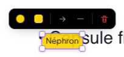 | 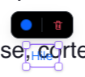 | 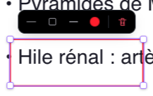 |
| **Flèche** | **Image** | **Trait de crayon** |
| 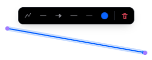 | 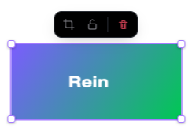 | 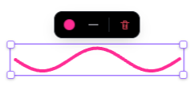 |

| Flèche courbe : points ajoutés au double-clic | Points glissés : la courbe passe par eux |
|---|---|
| 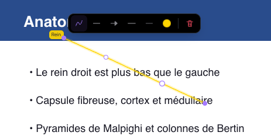 | 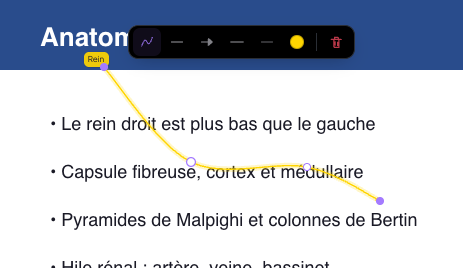 |

| Zoom | Insérer une page | Badge du transcript |
|---|---|---|
| 50 % | 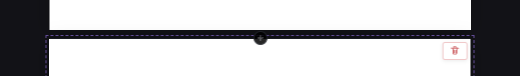 |  |
| 160 % | 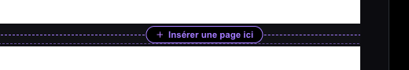 | 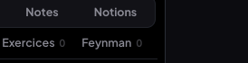 |
| 300 % |  |  |

## Commits

| Commit | Message |
|---|---|
| `9c3a682` | feat(medrevise): lecteur — une règle de sélection et de déplacement, un cadre, une mini barre, une flèche pour tous les objets |
| `f7f074a` | fix(medrevise): flèches — glisser le trait déplace aussi les points, prise d'un point à 8 px, même trait et même pointe depuis Formes, export des bouts rattachés et du rognage |
| `f07d492` | feat(medrevise): contrôles sur et entre les pages à l'échelle du zoom |
| `94cbff6` | feat(medrevise): reprendre un transcript arrêté |
| (ce commit) | fix + docs : sélecteur de couleur au clic ailleurs, bancs mis à la règle unique, compte-rendu |
