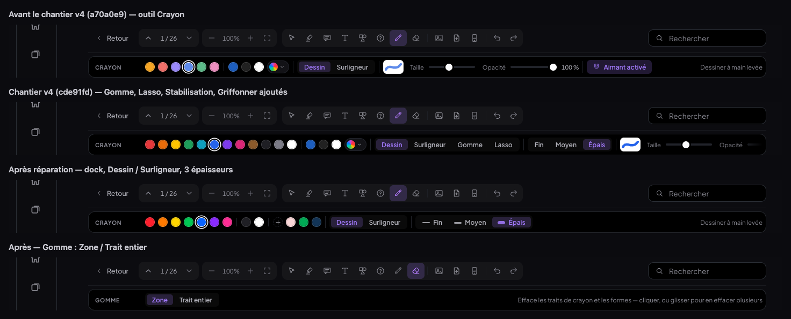
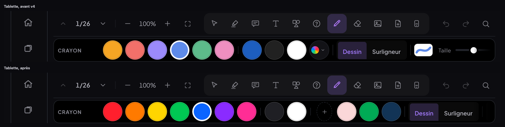
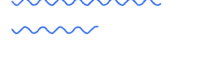
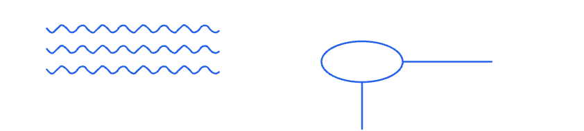
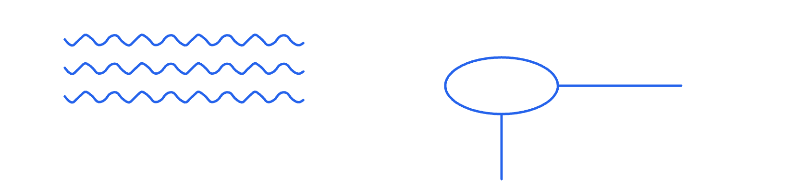
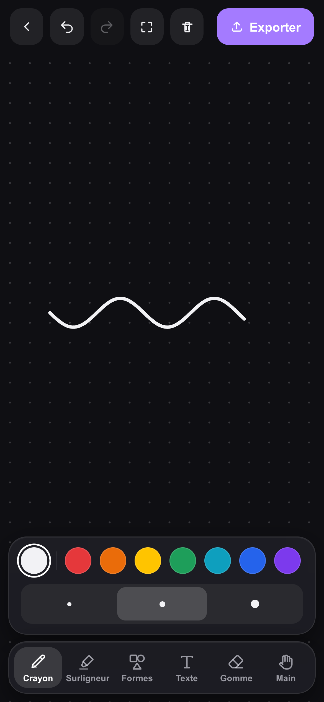
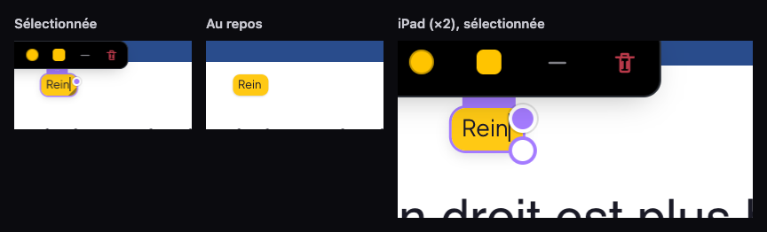
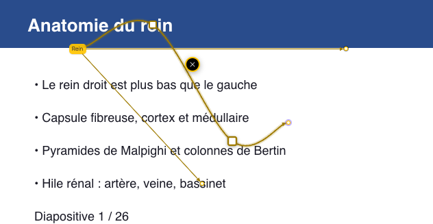
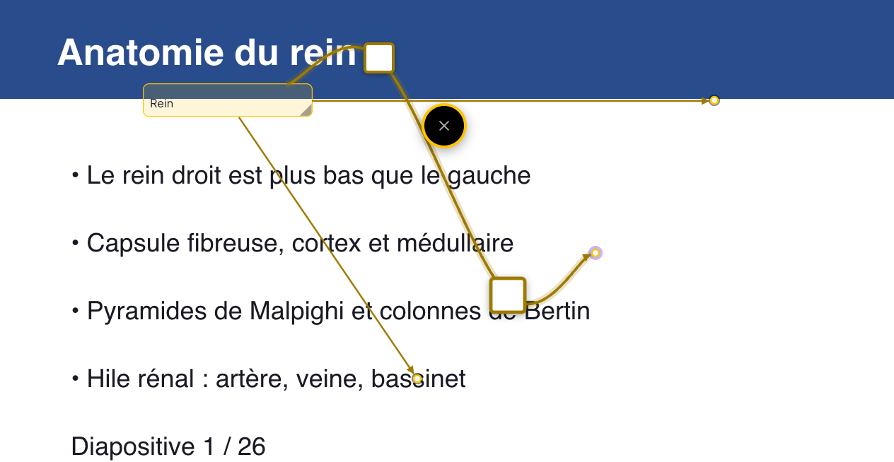
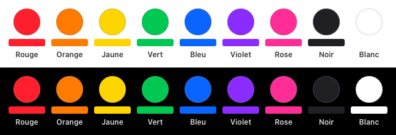

# Compte rendu — réparation et nettoyage du lecteur PDF (21/10/2026)

Chantier de réparation après le lecteur v4 (`docs/compte-rendu-pdfreader-v4.md`) : un seul moteur d'annotation,
retrait de ce qui n'avait pas été demandé, crayon refait simple, boîtes et flèches réparées, dock de couleurs.
Tests sur une instance **locale isolée** (Vite :5199 avec `VITE_SUPABASE_URL` vide, Chrome headless piloté en CDP) :
aucune écriture Supabase. Bancs : `scripts/tests-pdfreader-reparation/`.

## Étape 1 — Audit des doublons (écrit avant tout code)

Référence « avant le dernier chantier » = commit `a70a0e9` (dernier commit avant le v4). Comparaison mesurée par
`t-barre.mjs` : la barre principale (ordinateur et tablette) et les raccourcis ⌘1–8 sont **identiques** entre
`a70a0e9` et `cde91fd` (v4) ; seule la rangée du crayon a changé :

| | Rangée du crayon |
|---|---|
| avant v4 (`a70a0e9`) | Couleur · Dessin / Surligneur · Taille · Opacité · Aimant (+ tablette : Pression, Dessiner au doigt) |
| v4 (`cde91fd`) | Couleur · Dessin / Surligneur / **Gomme** / **Lasso** · Fin / Moyen / Épais · Taille · Opacité · **Stabilisation** · **Griffonner pour effacer** · Aimant (+ tablette : Pression, Dessiner au doigt) ; en plus, sans bouton : **maintenir pour redresser** |

### Inventaire de ce qui dessine, stocke ou manipule une annotation

| Domaine | Chemins de code trouvés | Doublon ? |
|---|---|---|
| **Modèle (stockage)** | un store `annotations` (IndexedDB, synchro LWW), un enregistrement par annotation, `kind` = `trait` · `libre` (boîte) · `texte` · `question` · `image` · `forme` · (aucun) bloc ; tout en **fractions de page** | non — c'est le bon modèle, il reste |
| **Flèches — stockage** | 3 formes : boîte « principale » (`ancre` + `fleche` + `flechePrincipale` v4), boîte `fleches[]` (+ style v4 sur l'entrée), forme `fleche`/`ligne`/`double` (cadre `x,y,width,height,fx,fy` + sous-objet `fleche` v4) | **oui** (×3) |
| **Flèches — rendu écran** | boîte sans style : `<line>` + `<marker>` (`PdfPage.jsx`, NoteBox) ; boîte stylée : `cheminFleche` (`flechesGeo.js`) ; forme sans style : `cheminForme` (`formes.js`) ; forme stylée : `cheminFleche` | **oui** (×4) |
| **Flèches — export PDF** | `dessinerFleche` (ancienne) et `dessinerStylee` pour les boîtes, `cheminForme` et `cheminFleche` pour les formes (`exportAnnote.js`) | **oui** (×4) |
| **Flèches — points de contrôle** | NoteBox : `ajouterPoint` / `glisserCtl` / `retirerPoint` ; Forme : `ajouterPointFormeA` / `glisserCtlForme` / retrait en ligne ; 2 appuis longs au doigt | **oui** (×2) |
| **Flèches — réglages** | `BarreFleche` (rangée contextuelle, boîtes) et une 2ᵉ rangée de boutons dans la barre flottante d'une forme | **oui** (×2) |
| **Crayon — lissage** | `suivreEnDouceur` (streamline réglable), `lisserTrait` (aimant : redresse), `chaikin` (passes selon la stabilisation), `reconnaitreForme` (maintenir pour redresser), `estGriffonnage` | **oui** (×5 traitements, aucun fixe) |
| **Crayon — tracé** | aperçu : Catmull-Rom recodé à la main sur le canvas (`peindreApercu`) ; trait posé : `cheminCatmull` (`crayon.js`) ; anciens traits : `cheminLisse` (`pdfShared.js`) et `cheminDroit` | **oui** (aperçu ≠ trait posé) |
| **Gommes** | outil Gomme, mode « Gomme » du crayon (même fonction), griffonner (2ᵉ détection), bout gomme du stylet | **oui** (×3 entrées) |
| **Sélection** | outil Sélection (boîtes, formes, images) + **Lasso** du crayon (2ᵉ sélection, traits seulement, sa barre, son Suppr) | **oui** (×2) |
| **Gestionnaires de pointeur** | 13 fonctions qui refont chacune : filtre du pointeur, doigt qui défile, `getBoundingClientRect`, écouteurs `window`, seuil de 3–4 px (`demarrerTrace`, `demarrerForme`, `demarrerTrait`, `demarrerGomme`, `demarrerLasso`, couche de pose, `poserAncre`, NoteBox `demarrer` / `glisserPoint` / `glisserCtl`, Forme `demarrer` / `glisserCtlForme`, `deplacerSel`) | **oui** |
| **Conversion PDF ↔ écran** | `(clientX - r.left) / r.width` recopié une quinzaine de fois ; repère de référence 160 % des boîtes (`refW`, `k`) ; pixels du cadre d'une forme ; pixels de page des flèches | **oui** |
| **Calques de rendu** | traits : 2 `<svg>` (surligneurs en `multiply` dessous, dessins dessus — un seul calque logique, deux groupes de fusion) + canvas d'aperçu ; une `<svg>` de flèches par boîte ; une `<svg>` par forme | partiel |
| **Réglages du stylet** | Pression (v3), Dessiner au doigt (v3), Aimant, Stabilisation, Griffonner (v4) | options en trop |
| **Palettes** | `PALETTE_VIVE` (12, dock v4), `PALETTE_BASE` (6, 09/10), `PALETTE_CRAYON`, `COULEURS_HISTORIQUES` — les 3 dernières ne servent qu'au rendu de ce qui est déjà posé | dock à refaire |
| **Téléphone (Dessins mobiles)** | `MobileDessin.jsx` : moteur à part (perfect-freehand, pression, épaisseur variable) | **oui** (2ᵉ crayon) |

### Décisions — ce qui reste

1. **Un modèle** : le store `annotations` en fractions de page, inchangé. Rien n'est réécrit : les champs anciens
   (`ancre`/`fleche`, `fleches[]`, `flechePrincipale`, `fleche` d'une forme, `rendu`, `opacite`…) restent lus tels quels.
2. **Une flèche** : *sommets* (départ, points de contrôle, arrivée) en fractions de page, `type` droite (segments) ou
   courbe (spline Catmull-Rom qui passe PAR chaque point). Un seul module (`fleches.js`) donne les sommets d'un
   connecteur de boîte ou d'une flèche de l'outil Formes, un seul tracé (`cheminFleche`) sert à l'écran, à l'aperçu
   et à l'export, un seul composant (`FlecheSvg`) dessine et édite (double-clic = point à l'endroit cliqué, glisser
   = déplacer, double-clic sur un point = le retirer), une seule rangée de réglages (`BarreFleche`). Les anciennes
   flèches passent par le même tracé avec leurs anciennes proportions (rendu identique, vérifié au pixel).
3. **Un crayon** : moyenne mobile fixe sur 3 points, aperçu et trait posé tracés par **le même chemin**
   (`cheminCatmull`, dessiné sur le canvas d'aperçu par `Path2D`), commit en fractions de page. Tout le reste
   (stabilisation, aimant, redresser, griffonner, lasso, pression) est supprimé. Les anciens rendus
   (`cheminLisse`, `cheminDroit`) restent seulement pour AFFICHER les traits déjà posés.
4. **Une gomme** : l'outil Gomme, deux modes (Zone / Trait entier) ; le bout gomme du stylet l'utilise.
5. **Un gestionnaire de pointeur** : `suivrePointeur` (`pdf/pointeur.js`) — filtre du pointeur, doigt qui défile,
   écouteurs, seuil, événements coalescés — et **une conversion** `versPage(ev, rect)` / `pageVersPx`, utilisés par
   tous les outils de la page, les boîtes, les formes et les flèches.
6. **Un dock** : 7 couleurs + noir et blanc + « + » + 3 favoris, partagé par tous les outils.
7. **Téléphone** : le crayon du dessin mobile pose ses nouveaux traits avec le même lissage et le même tracé
   (épaisseur constante) ; les dessins déjà faits gardent leur rendu.

Ce qui a été supprimé / fusionné : voir la section « Bilan des suppressions » plus bas.

## Étape 2 — Ce qui n'avait pas été demandé, retiré

La barre principale n'avait pas bougé pendant le v4 : elle reste **identique** à celle d'avant (mesuré, ordinateur et
tablette), raccourcis ⌘1–8 dans le même ordre (1 Sélection · 2 Surligneur · 3 Boîte — l'outil « commentaire » à l'icône
de bulle · 4 Texte · 5 Forme · 6 ? · 7 Crayon · 8 Gomme ; ⌘9 = Image). Retiré de la rangée du crayon : les modes
**Gomme** et **Lasso**, **Stabilisation**, **Griffonner pour effacer**, le **maintenir pour redresser**, ainsi que
Taille / Opacité, **Aimant** et **Pression** (l'épaisseur est maintenant fixe).

## Étape 3 — Crayon refait de zéro

`pdf/crayon.js` (168 → 113 lignes) : `lisser3` (moyenne mobile sur 3 points, les deux bouts restent en place : le
trait finit sous le pointeur), `cheminCatmull` (le **même** chemin dessine l'aperçu sur le canvas, par `Path2D`, et le
trait posé en SVG), 3 épaisseurs par mode, commit en fractions de page au relâchement. Rangée : couleur · Dessin /
Surligneur · Fin / Moyen / Épais · (surligneur) Tracer en ligne droite · (écran tactile) Dessiner au doigt. Le
surligneur est le même moteur à 40 %, en `multiply`. Gomme : **Zone** (par défaut : coupe le trait sous la gomme, les
morceaux gardent le style) et **Trait entier** ; une forme touchée s'efface en entier ; le bout gomme du stylet utilise
le mode choisi. Le dessin du téléphone pose ses nouveaux traits avec le même lissage et le même chemin (épaisseur
constante, plus de réglage « Lissage » ni de pression, 3 épaisseurs).

Mesures (`t-crayon.mjs`) : aperçu peint **dès le 1er point** (6/6 gestes) et **sous le pointeur à chaque mesure, dans
l'événement** (62/62 ; au doigt, après l'image suivante — Chrome cale les touchmove sur l'image) ; tremblement
atténué 0,414 → 0,265 ; épaisseur 0,0042 de la hauteur de page à 70 %, 100 % et 180 %.

| Trait en cours (aperçu direct) | 3 lignes + schéma | iPad (doigt) | Téléphone |
|---|---|---|---|
|  |  |  |  |

## Étape 4 — Boîtes et flèches

**Cause du bug « poser une flèche fait disparaître la boîte ».** Le clic qui pose le bout de la flèche tombe sur la
couche de visée (`.pdfr-ancrage`), absente de la liste des zones « dans la boîte » de l'écouteur qui désélectionne une
boîte au clic extérieur. La boîte était donc désélectionnée **avant** que la flèche soit posée : une boîte neuve encore
vide était retirée comme « boîte vide », la flèche visait une boîte disparue, et le clic suivant (outil Boîte encore
actif) créait une nouvelle boîte. Une boîte avec du texte perdait sa sélection et pouvait voir ses 400 dernières ms de
frappe réécrites. Correctif (`PdfReader.jsx`) : la visée fait partie de la boîte ; Échap pendant la visée n'annule que
la flèche ; une boîte qui a une flèche n'est jamais « vide ». Reproduit par le banc avant correctif, corrigé après.

**Un modèle de flèche** (`pdf/flechesGeo.js`, `pdf/Fleche.jsx`) : sommets = départ + points de contrôle (fractions de
page) + arrivée ; Droite (segments) ou Courbe (Catmull-Rom qui passe par chaque point). Connecteurs des boîtes et
flèches de l'outil Formes : mêmes sommets, même tracé, même composant, mêmes gestes (double-clic = point **à l'endroit
cliqué**, inséré dans le bon segment de la courbe — l'ancien calcul visait les cordes, d'où des points mal ordonnés ;
glisser ; double-clic sur un point = le retirer), une seule rangée de réglages ; `cheminForme` et l'export délèguent au
même tracé. Les anciennes flèches gardent leur rendu au pixel : la pointe « classique » est posée en marqueur SVG comme
avant (même géométrie ; c'est la présence du marqueur qui change l'anticrénelage du trait).

**Boîtes « un mot »** (champ `gabarit: 'mot'` sur les boîtes, légendes et zones de texte créées désormais) : vide =
40 × 23,6 px (une ligne de 17,6 px + 6), un mot = largeur du mot + 12 px, grandit avec le texte jusqu'à 45 % de la
page puis passe à la ligne ; fond plein (texte en contraste automatique), coins 8 px, pas de bordure, anneau de
sélection 1,5 px d'accent (en ombre portée : Chrome arrondit tout contour de 1,5 px à 1 px), ombre légère, 13 px ;
languette de déplacement, coin et **épingle de flèche** (point sur le bord droit) visibles au survol / à la sélection.
Les boîtes d'avant (y compris les « compactes » du 20/10) gardent gabarit et dessin.

| Boîte « un mot » | Flèche courbe (2 points ajoutés au double-clic, déplacés) | iPad |
|---|---|---|
|  |  |  |

## Étape 5 — Dock de couleurs

7 couleurs franches (saturation HSL 100 % ; v4 : 68 à 100 %) │ noir, blanc │ « + » (sélecteur complet) puis jusqu'à 3
favoris (les couleurs choisies au « + », retirables). Rien d'autre (la pastille « couleur actuelle hors liste » est
retirée). Nouveaux ids : les annotations posées gardent leur teinte. Animation des pastilles inchangée (0,15 s).

| Couleur | Hex | Contraste blanc / noir |
|---|---|---|
| Rouge | `#FF1F2D` | 3,83 / 5,49 |
| Orange | `#FF7A00` | 2,61 / 8,04 |
| Jaune (prioritaire, défaut) | `#FFD500` | 1,42 / 14,77 |
| Vert | `#00C853` | 2,24 / 9,39 |
| Bleu | `#0A64FF` | 4,91 / 4,28 |
| Violet | `#8A2BFF` | 5,43 / 3,87 |
| Rose (cloze) | `#FF2D95` | 3,46 / 6,06 |
| Noir · Blanc | `#1F1F24` · `#FFFFFF` | 16,41 / 1,28 · 1 / 21 |

## Tests (Chrome headless, base locale, ✅ / ❌)

| Banc | Ordinateur | iPad / tablette |
|---|---|---|
| `t-barre` (barre, raccourcis, identique à `a70a0e9`) | 4 / 0 | (inclus) |
| `t-crayon` | 15 / 0 | 17 / 0 (doigt + stylet) |
| `t-boites` | 13 / 0 | 13 / 0 |
| `t-fleches` | 17 / 0 | 17 / 0 |
| `t-dock` | 11 / 0 | — |
| `t-contextes` (PDF, fiche jumelle, document × ordinateur, tablette 820 px) | 19 / 0 | |
| `t-telephone` (dessin mobile, même moteur) | 6 / 0 | |
| `t-anciennes` (anciennes annotations au pixel, 100 % et 160 %) | écart max 1/255 | |
| `t-export` (export PDF annoté, anciennes + nouvelles) | 3 / 0 | |
| fiche jumelle + document `tout.sh` (16 bancs) | 173 / 0 (dont `t-couleurs-boite` 33 / 0 après adaptation), correspondance 30/30 × 3 | |
| v3 `t-transcript` / `t-transcript-fiche` (faux Deepgram, micro simulé) | 24 / 0 · 6 / 0 | |
| OCR (`t-jumelle-ocr`, cours scanné) | 30/30 pages, comme l'ancien code | |
| v4 `t-clignotement` (zoom image par image) | 6 / 0 | 6 / 0 |
| v3 `t-connecteurs` · `t-couleurs` | 21 / 0 · 27 / 0 | |
| Unitaires `vitest` | 89 / 0 | |

Notes honnêtes :
- **Zoom, images perdues** (v3 `t-zoom`, seuil 5 %) : échoue avec le nouveau code **comme avec l'ancien** dans ce Chrome
  headless. Trois passages alternés : ancien 6,1 / 11,5 / 13,6 %, nouveau 12,0 / 10,4 / 2,1 % — même dispersion, pas de
  régression ; aucun clignotement (`t-clignotement` 6/6).
- Bancs du v4 qui vérifient ce que la demande a remplacé (gabarit 120 px, dock de 12, pression du stylet) : `v4
  t-boites`, `v4 t-palette`, 3 tests « Pression » de `v3 t-stylet` échouent par construction. Le bout gomme du stylet
  coupe désormais le trait (mode Zone par défaut) au lieu de l'effacer en entier.
- Tests adaptés (sélecteurs seulement) : `v4 t-fleches` (réglages dans la rangée commune), `v3 t-couleurs` (« + » et
  favoris), `fiche-jumelle t-couleurs-boite` (jaune par défaut du dock).
- Contour de sélection : 1,5 px mesuré en ombre portée ; un vrai `outline` de 1,5 px est rendu à 1 px par Chrome.
- La capture de référence initiale à 160 % n'était pas reproductible (l'ancien code lui-même en différait) : la
  référence a été recapturée avec l'ancien code (`anciennes-*-avant`) ; écart ancien ↔ nouveau ≤ 1/255.

**MealWeek** : builds de production avant (`cde91fd`) et après servis sur la même origine — captures ordinateur
1 440 × 900 et téléphone 390 × 844 **identiques octet pour octet**. `git diff cde91fd -- src/mealweek src/shared` : vide.

## Bilan des suppressions / fusions

| Supprimé | Remplacé par |
|---|---|
| Modes Gomme et Lasso du crayon, lasso (sélection, déplacement, recoloration de traits), sa barre, son CSS | outil Gomme (Zone / Trait entier), outil Sélection |
| Stabilisation réglable (`suivreEnDouceur`, `forceStabilisation`), Chaikin, aimant (`lisserTrait`, RDP) | `lisser3` fixe |
| Maintenir pour redresser (`reconnaitreForme`), griffonner (`estGriffonnage`) | — |
| Pression du stylet (`pressionActive`, `facteurPression`…), réglage Taille / Opacité (`ReglagesTrait`) | 3 épaisseurs, opacité fixe |
| Catmull-Rom recodé pour l'aperçu | `cheminCatmull` → `Path2D` |
| 4 rendus de flèche à l'écran, 4 à l'export, 2 jeux de points de contrôle, 2 rangées de réglages | `flechesGeo.js` + `Fleche.jsx` + `BarreFleche` |
| 13 gestionnaires de pointeur, ~15 conversions recopiées | `pdf/pointeur.js` (`suivrePointeur`, `versPage`, `rectPage`) |
| Lissage perfect-freehand des nouveaux traits du téléphone, réglage « Lissage » | le crayon commun (les anciens dessins gardent leur rendu) |

Bilan du code : `git diff --stat cde91fd -- src` : 22 fichiers, +881 / −1 216 lignes.

Doutes tranchés sans question : « Commentaire » = l'outil Boîte (icône de bulle, déjà à cette place) ; « Tracer en
ligne droite » est né au v4 mais la demande le garde, il reste ; « Dessiner au doigt » (réglage d'appareil d'avant le
v4) reste sur écran tactile, sans quoi le doigt ne dessine pas ; le nouveau dessin des boîtes ne s'applique qu'aux
boîtes créées désormais, pour que les annotations existantes restent affichées à l'identique.

## Commits

- `10be01a` refactor(medrevise): crayon refait simple — un moteur, 3 épaisseurs, gomme Zone / Trait entier
- `a5efbfe` fix(medrevise): flèches — poser une flèche ne fait plus disparaître la boîte ; un seul modèle de flèche
- `aafd903` feat(medrevise): boîtes et zones de texte « un mot » ; un seul gestionnaire de pointeur
- `533ffe8` feat(medrevise): dock de couleurs — 7 couleurs franches, noir et blanc, « + » et 3 favoris
