# Compte rendu — Lecteur PDF v3 et transcript (20/10/2026)

Six chantiers sur le lecteur PDF et le transcript de MedRevise. Tout a été testé dans un Chrome headless
isolé piloté en CDP, devant le serveur Vite local **sans Supabase** (`VITE_SUPABASE_URL=` vide) : le cloud
n'a jamais été touché. La transcription a été testée avec le faux Deepgram du dépôt
(`scripts/faux-deepgram.mjs`) et un micro simulé (voix française générée par `say`).

Appareils simulés : **ordinateur** (1 440 × 900, Retina ×2 pour le zoom), **iPad** (1 024 × 1 366, ×2,
tactile, stylet simulé `pointerType: "pen"` avec pression), **téléphone** (390 × 844, shell mobile).
Bancs : `scripts/tests-pdfreader-v3/` (voir l'en-tête de chaque fichier).

Règles respectées :
- `git diff 505372b -- src/mealweek src/shared` est **vide** ; MealWeek identique au pixel (§ 8) ;
- aucune écriture Supabase ; les segments de transcript reçoivent des champs **en ajout** seulement
  (`page`, `pageCle`, `doc`) ;
- aucune annotation existante modifiée : les anciennes boîtes sont converties **à la lecture**, leur rendu
  est identique octet pour octet à l'ancien code (§ 2) ;
- direction artistique conservée (tokens, palette, typographies existants).

---

## 1. Transcript ↔ diapo

**Enregistrement.** Le lecteur déclare au moteur de transcription une fonction qui rend la page affichée
(`engine.js#definirPageCourante`). Chaque segment **validé** (et chaque note, chaque segment « incertain »)
enregistre la page du moment :

| Champ | Contenu |
|---|---|
| `page` | n° de la page dans le lecteur (1, 2, …) |
| `pageCle` | clé de la page : n° de la page du PDF, ou id d'une page ajoutée |
| `doc` | `original` ou `fiche` (fiche jumelle) |

Lecteur fermé, autre cours : rien n'est ajouté. Les sessions d'avant n'ont aucun de ces champs et
s'affichent comme avant, sans numéro.

**Panneau Transcript.**
- Sous l'horodatage de chaque ligne, une pastille **« p. 14 »** cliquable : le lecteur défile jusqu'à cette
  page (en basculant sur la fiche jumelle si la ligne y a été dite — « fiche p. 3 »).
- Bouton **« Cette page »** : seules les lignes dites sur la page affichée ; le filtre **suit le défilement**
  (« Aucune ligne sur la page 5 » quand rien n'y a été dit). En direct comme en relecture.
- Menu de copie : **« Copier tout, avec numéros de page »** → `[00:12] [p. 3] texte…`. « Copier tout »
  reste inchangé.

**Lecteur.** Un badge discret **« 12 lignes »** en haut à droite de chaque page qui a des lignes (point rouge
en direct). Il compte les lignes de la **session de référence** : la session en direct sur ce cours, sinon la
plus récente qui porte des numéros de page. Clic → le lecteur va à la page, le panneau Transcript s'ouvre sur
cette session, filtré sur la page.


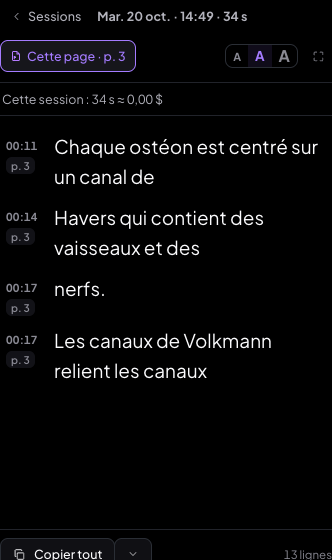

---

## 2. Boîtes : toutes les flèches se retirent de la même façon

### Modèle de connecteurs retenu

Une boîte a une **liste de connecteurs** (0 à n), tous des flèches du même type
(`pdf/connecteurs.js`) :

```
connecteursDe(boite) = [ principale ?, ...fleches ]
  principale = { id: 'principale', x, y, texte, surlignageId?, formeId? }   ← ancre + fleche: true (avant le 20/10)
  fleches[i] = { id, x, y, texte, surlignageId?, formeId? }                  ← inchangé
```

- **Conversion à la lecture**, pure et idempotente : la flèche « principale » d'avant (`ancre` + `fleche`)
  devient le premier connecteur de la liste. Rien n'est réécrit tant qu'on ne touche pas la boîte.
- **Écritures au champ d'origine** du connecteur visé : retirer la principale efface `ancre` / `fleche` /
  `surlignageId` / `formeId` ; retirer une autre filtre `fleches` ; **toute nouvelle flèche s'ajoute à
  `fleches`** (la première comme les suivantes) ; déplacer un bout le délie du surlignage ou de la forme.
- Pourquoi pas une migration vers un nouveau champ `connecteurs` : l'export PDF annoté, la fiche jumelle
  (replacement des annotations), le déplacement / la suppression des formes reliées et la synchro lisent
  déjà `ancre` / `fleche` / `fleches`. Garder ces champs évite toute réécriture des données et tout risque
  sur ces chemins ; la liste unifiée n'existe qu'à l'affichage et dans l'interface.
- Une boîte seulement **épinglée** (ancre sans flèche, ancien modèle) garde son repère rond, à l'identique ;
  quand la boîte est sélectionnée, une petite croix sur le repère le retire.

### Interface

- **Clic sur une flèche** (zone de prise large et invisible) ou sur son bout : halo + **croix à son milieu** ;
  la croix ou **Suppr / ⌫** la retire. Échap ou un clic ailleurs : désélection. La boîte n'est jamais
  supprimée avec la flèche (Suppr est intercepté avant le bandeau de la boîte).
- La barre de la boîte passe de 7 à 5 icônes : l'épingle, « Relier » et « Flèche » sont remplacés par un seul
  **« Ajouter une flèche »** (avec le nombre de flèches) : viser un endroit, un surlignage ou une forme.
- Les flèches ne captent rien hors de l'outil Sélection (le crayon et la gomme passent au travers).
- Annuler / Rétablir : chaque retrait, chaque ajout = une entrée.

| Ancienne boîte : 1re flèche sélectionnée (halo + croix) | Nouvelle boîte à 3 flèches |
|---|---|
| 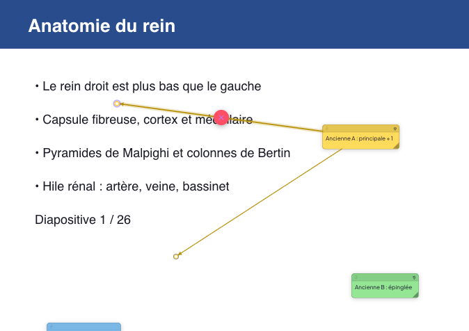 | 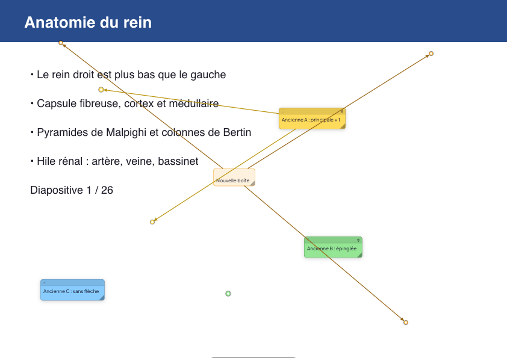 |

---

## 3. Barre de couleurs : le document ne bouge plus

La rangée contextuelle (couleurs, épaisseur, réglages) a désormais un **emplacement fixe et réservé en
permanence** sous la barre d'outils, PDF compris (avant : seulement en mode document). Son contenu change en
fondu (150 ms) ; vide, elle affiche une aide (« Choisissez un outil : ses couleurs et réglages s'affichent
ici »). Le titre de l'outil a une largeur fixe : les pastilles commencent toujours au même endroit.

| Mesure (position d'un mot de la page, 10 changements d'outil) | Avant | Après |
|---|---|---|
| Ordinateur : décalage vertical max | **44 px** | **0 px** |
| Tablette : décalage vertical / horizontal max | **44 px / 10,5 px** | **0 / 0 px** |
| Position de la 1re pastille (Surligneur, Boîte, Crayon) | 243 / 205 / 219 px | 254 / 254 / 254 px |

| Avant : Crayon (la rangée est apparue, la page est descendue de 44 px) |
|---|
| 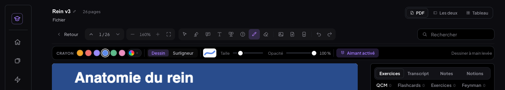 |

| Après : rangée vide, réservée (Sélection) | Après : Crayon (même position de la page) |
|---|---|
| 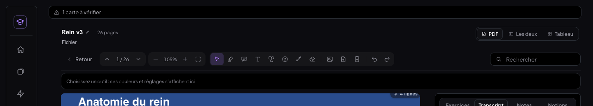 | 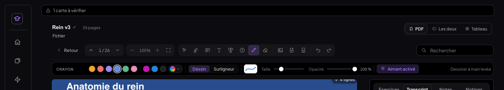 |

Tablette : 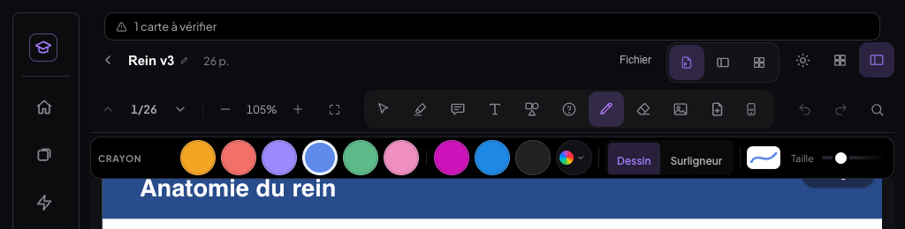

---

## 4. iPad + Apple Pencil : priorité au stylet

- **Stylet** (`pointerType: "pen"`) : dessine et annote avec l'outil actif. **Pression** → épaisseur
  légèrement modulée (facteur 0,6 à 1,4 selon la pression moyenne du trait), réglage « Pression activée /
  désactivée » dans la rangée du crayon (activée par défaut).
- **Doigt** : ne dessine **jamais** avec un outil d'annotation (crayon, surligneur, gomme, forme, boîte,
  texte, « ? ») — rejet de la paume. Il fait **défiler** (avec inertie) et **zoome** (pincement). Réglage
  **« Dessiner au doigt : non »** par défaut, mémorisé par appareil.
- Les calques de dessin sont en `touch-action: none` : iPadOS ne fait plus défiler la page sous le Pencil ;
  le défilement au doigt y est fait à la main (`lib/tablette.js#defilerAuDoigt`), et s'arrête dès qu'un
  2ᵉ doigt se pose (le pincement prend la main).
- **Latence** : le trait en cours est peint sur un **canvas d'aperçu** dans l'événement du pointeur lui-même
  (plus de rendu React à chaque image) ; au relâchement, le trait est enregistré avec le lissage existant et
  l'aperçu s'efface quand le trait enregistré est à l'écran.
- **Double-tap du Pencil** : Safari ne transmet pas ce geste aux pages web (aucune API) — impossible à
  brancher. Ce qui l'est : le **bout gomme / bouton gomme** des stylets qui l'exposent (bouton 5 des Pointer
  Events, Surface Pen…) gomme sans changer d'outil.
- **Barre au doigt** : toutes les cibles de la barre et de la rangée font **≥ 40 px** en tablette (les
  pastilles gardent un rond de 24 px au centre d'une cible de 40 px).

Vérifié en simulation (Chrome tactile + stylet simulé) : voir § 7. Ce qui ne peut l'être que sur un vrai iPad
est listé ci-dessous.

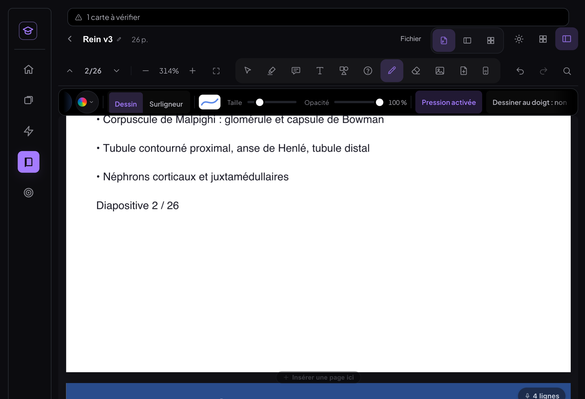

### Liste de contrôle sur un VRAI iPad + Apple Pencil

Ce qui suit ne peut être vérifié qu'à la main : Chrome simule un stylet (`pointerType: "pen"`, pression) et
des doigts, mais ni la latence réelle du Pencil, ni le rejet de paume d'iPadOS, ni Safari.
Ouvrir MedRevise dans **Safari** sur l'iPad (et, si possible, refaire dans la PWA « Sur l'écran d'accueil »),
un cours PDF avec une diapositive image, en mode tablette.

**Stylet**
- [ ] Crayon : le Pencil dessine dès qu'il touche l'écran, sans que la page défile sous la pointe.
- [ ] Le trait suit la pointe sans retard visible (aperçu en direct) ; au lever, il ne « saute » pas (le lissage final est léger).
- [ ] Appuyer plus fort épaissit légèrement le trait ; « Pression désactivée » (rangée du crayon) → épaisseur fixe.
- [ ] Surligneur à main levée, Gomme, Forme, Boîte, Texte, « ? » : tous fonctionnent au Pencil.
- [ ] Écrire vite (petites lettres) : aucun trait perdu ni coupé.
- [ ] Scribble d'iPadOS (écriture manuscrite convertie en texte) ne s'active PAS sur la page (il ne doit agir que dans les champs de saisie).

**Doigt et paume**
- [ ] Outil Crayon actif : un doigt fait défiler la page (avec inertie), ne dessine jamais.
- [ ] Main posée sur l'écran pendant l'écriture au Pencil : aucun trait parasite, la page ne bouge pas.
- [ ] Pincement à deux doigts : zoom fluide, sans page blanche, la diapositive reste nette après le geste.
- [ ] « Dessiner au doigt : oui » → le doigt dessine ; « non » → il refait défiler. Le réglage est retrouvé après fermeture.
- [ ] Outil Sélection : le doigt défile nativement, le Pencil sélectionne du texte.

**Double-tap du Pencil (2ᵉ génération / Pro)**
- [ ] Le double-tap latéral n'est PAS transmis aux pages web par Safari (aucune API) : vérifier qu'il ne provoque rien
      d'inattendu. La bascule crayon ⇄ gomme reste au bouton « Gomme » (⌘8 avec un clavier).
- [ ] Stylets qui exposent un bout gomme ou un bouton (Surface Pen, certains stylets USI) : le bout gomme efface (bouton 5).

**Barre et sélecteur**
- [ ] Tous les boutons de la barre et de la rangée se touchent facilement au doigt (40 px) et au Pencil.
- [ ] La rangée de réglages défile à l'horizontale d'un glissement quand elle dépasse.
- [ ] Changer d'outil 10 fois : la page ne bouge pas.
- [ ] Sélecteur de couleur : cases de 32 px, aperçu au toucher, « Autres couleurs » (roue) manipulable au doigt.
- [ ] Pipette : sur Safari iPad, pas d'API EyeDropper → mode « toucher la page pour prélever » ; vérifier qu'il prélève bien la couleur touchée.

**Zoom et mémoire**
- [ ] 20 pincements avant / arrière sur une diapositive image lourde : jamais de page blanche, ni pendant ni après.
- [ ] Après une longue séance (40 pages parcourues à plusieurs zooms) : pas de page qui reste blanche
      (le cache est désormais borné à 32 Mpx ; Safari vide les canvas au-delà de sa limite mémoire).
- [ ] Annotations (boîtes, flèches, surlignages, traits) restent collées au texte à chaque niveau de zoom.

**Transcript**
- [ ] Transcription en direct en changeant de page : les lignes portent la bonne page, les badges « N lignes » apparaissent.
- [ ] Toucher « p. 14 » dans le volet : le lecteur va à la page 14.


---

## 5. Sélecteur de couleur façon Word

Un seul composant (`pdf/Couleurs.jsx#PanneauCouleurs`) pour **toutes** les couleurs : crayon, surligneur,
formes, boîtes, texte libre, couleur et fond du texte d'une boîte, cartes du tableau. La rangée de l'outil
garde les 6 couleurs de base et les 3 dernières récentes ; le bouton « ▾ » ouvre le panneau :

- **Couleurs du thème** : 10 teintes de la DA en colonnes — encre, gris, ambre, corail, rose poudré, violet
  doux, indigo (l'accent de la DA), bleu ardoise, sarcelle, vert sauge — chacune avec **5 variantes** en
  dessous (plus claire 80 / 60 / 40 %, plus foncée 25 / 50 %). Les 6 couleurs de base gardent leur id (ambre
  reste « prioritaire », rose poudré « cloze »).
- **Couleurs récentes** : les 8 dernières (synchronisées entre appareils, comme avant).
- **Pipette** : l'API EyeDropper quand le navigateur l'a (Chrome, Edge) ; sinon (Safari) un mode
  « toucher / cliquer la page » qui prélève le pixel du canvas du PDF, avec une loupe et l'aperçu en direct.
- **Autres couleurs** : la roue déjà corrigée (carré saturation × luminosité, teinte, hex).
- **Aucune** : pour le fond du texte.
- Aperçu **en direct** au survol et au clavier (flèches), clic = valide, **Entrée** valide la case choisie
  au clavier, **Échap** annule (l'ancienne couleur revient, rien n'est écrit), **clic ailleurs** valide la
  case choisie au clavier (ou referme sans rien changer). Une seule écriture par choix → un seul Annuler.
- Au doigt : cases de **32 px**, actions de 40 px.

| Ordinateur | iPad | Pipette | Autres couleurs |
|---|---|---|---|
| 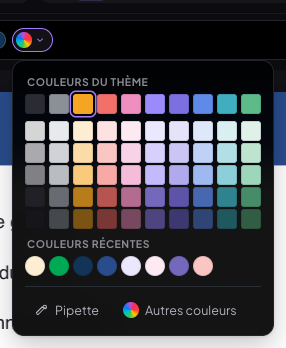 | 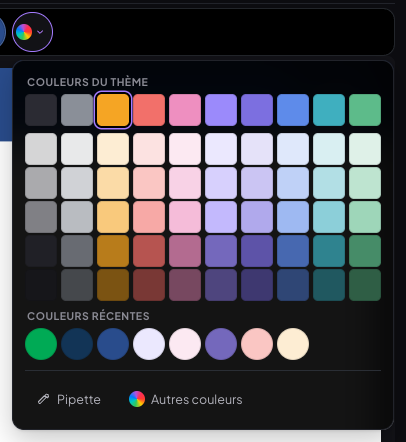 | 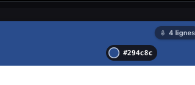 | 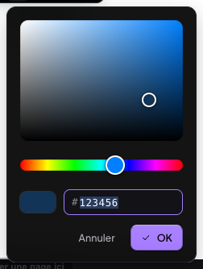 |

---

## 6. Zoom : plus de flash blanc

### Ce qui change

1. **Pendant le geste** (pincement de trackpad, Ctrl + molette, ⌘+ / ⌘−, boutons, pincement à deux doigts,
   geste Safari) : le conteneur des pages — pages, couches de texte, annotations — est mis à l'échelle par un
   **`transform` CSS** autour du point visé. Plus de rendu React ni de mise en page à chaque événement.
2. **Fin du geste** (140 ms sans événement) : le vrai zoom est posé **une seule fois** ; la transformation est
   retirée et le défilement recalé **dans la même image** (`useLayoutEffect`) — la page ne bouge pas. Si le
   défilement est borné (bord du document, contenu redevenu plus étroit que la zone), le reste glisse en
   160 ms au lieu de sauter.
3. **Double tampon** : chaque page a deux canvas superposés ; pdf.js dessine dans celui de **derrière**
   (masqué), puis bascule de visibilité instantanée. Jamais un canvas vidé ou à moitié dessiné à l'écran.
4. L'image en place est **étirée avant la peinture** à la nouvelle taille ; une page qui revient à l'écran
   reçoit aussitôt un rendu d'un autre zoom en cache (étiré) plutôt qu'une page blanche ; pendant un dézoom,
   les pages qui entrent dans la zone sont montées.
5. **Cache borné en mémoire** : 20 pages **et 32 Mpx** (≈ 128 Mo) au plus. Avant, 20 rendus zoomés d'une
   diapositive 4K pouvaient garder plus de 250 Mpx de canvas — au-delà de ce que Safari accepte sur iPad, qui
   rend alors des canvas **vides** : c'est la cause la plus probable des pages blanches observées sur un vrai
   appareil (non reproductible dans Chrome desktop, qui a plus de mémoire graphique).

### Mesures avant / après

Diapositive **image 4K** (PNG 3 840 × 2 160, PDF de 9 Mo, `gen-lourd.mjs`), 20 zooms / dézooms (10 pincements
sur la diapo 1, 10 ⌘± sur la diapo 3), `t-zoom.mjs` : toutes les images peintes enregistrées
(`Page.startScreencast`) et trace Performance (`Display::FrameDisplayed`, tâches du fil principal).

Trois passes par version et par appareil, même banc, même PDF ; « avant » = le code du lecteur au commit
`6abe2c5` (remis depuis git le temps des mesures), « après » = la version livrée.

| 20 zooms / dézooms | Ordinateur Retina — avant | Ordinateur Retina — après | iPad tactile — avant | iPad tactile — après |
|---|---|---|---|---|
| Images peintes avec la page **blanche** | 0 / 1 472 | **0 / 1 325** | 0 / 1 304 | **0 / 1 468** |
| Images par seconde pendant le geste (moyenne) | 55,3 – 57,1 | **60,2 – 60,9** | 55,6 – 56,0 | **60,3 – 61,4** |
| Pire geste (i/s) | 44,8 – 50,3 | **57,5 – 59,4** | 40,6 – 47,1 | **54,7 – 59,1** |
| Images perdues pendant les gestes | 6,6 – 10,3 % | **0 – 0,4 %** | 9,0 – 10,0 % | **1,0 – 2,7 %** |
| Fil principal occupé par geste | ≈ 180 ms | **≈ 34 ms** | ≈ 170 ms | **≈ 34 ms** |
| Saut de la page à la fin du geste | — | **≤ 0,9 px** | — | **≤ 0,7 px** |
| Annotations décalées de plus de 1 px (20 niveaux mesurés) | 0 | **0** | 0 | **0** |
| Page nette après le geste (canvas à la densité de l'écran) | 20 / 20 | **20 / 20** | 20 / 20 | **20 / 20** |

Méthode : « page blanche » = une image du screencast dont le centre de la zone de lecture est uniforme
(écart-type de luminance < 10) ou à plus de 50 % blanc ; fluidité = écarts entre images affichées
(`Display::FrameDisplayed`) pendant les 240 ms d'événements de chaque geste ; saut = déplacement d'une boîte de
repère entre l'image d'avant et celle d'après le retrait de la transformation (sonde rAF).
Mémoire : le cache d'avant pouvait atteindre 20 × 13 Mpx (diapo 4K à 250 %, ×2) ≈ 260 Mpx ; il est plafonné à
32 Mpx.

Dans Chrome headless, l'ancien code ne montrait **déjà aucune image blanche** (0 / 495) : le flash dépend de
la mémoire graphique de l'appareil (voir point 5). Ce qui est mesuré et prouvé ici : aucune frame blanche
après, fluidité (60 i/s, quasi aucune image perdue), pas de saut, annotations alignées et page nette à chaque
niveau. La vérification sur un vrai iPad est dans la liste de contrôle (§ 4).

| Pendant un pincement (Retina) | Pendant un pincement (iPad) |
|---|---|
| 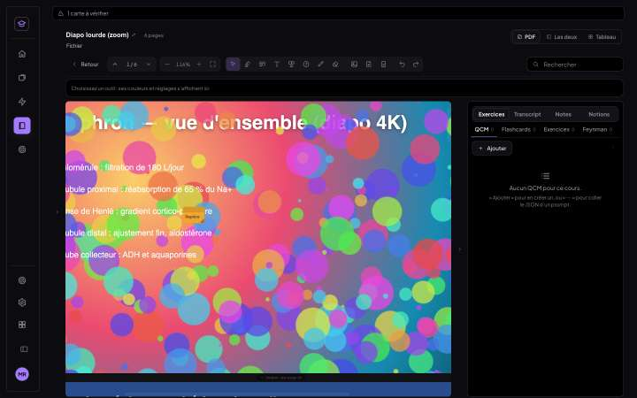 | 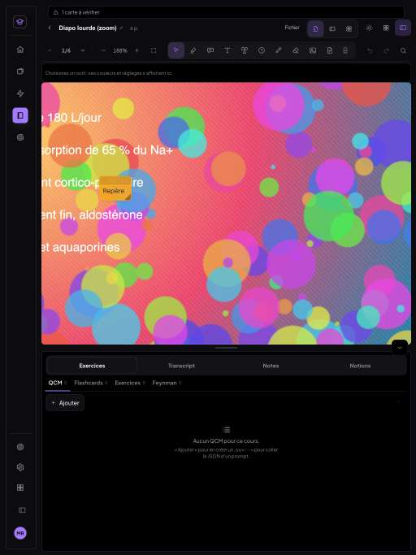 |

---

## 7. Tests (tous rejoués sur la version finale)

| Banc | Vérifications |
|---|---|
| `t-transcript.mjs` — vraie session (faux Deepgram, micro simulé) sur les pages 1, 3, 7 : pages enregistrées, « p. N » → page, « Cette page » qui suit le défilement, badges, clic sur un badge, copie avec pages, ancienne session intacte | **24 / 24** |
| `t-transcript-fiche.mjs` — lignes dites sur la fiche jumelle : « fiche p. 4 » bascule sur la fiche, « p. 6 » revient à l'original, badges par document | **6 / 6** |
| `t-connecteurs.mjs` — ancienne boîte (principale + 1) : retrait de la 1re, Annuler / Rétablir ; nouvelle boîte à 3 flèches retirées dans le désordre (Suppr, croix, Suppr) ; boîte sans flèche ; ré-ajout ; Échap ; crayon au travers ; boîte épinglée jamais réécrite | **21 / 21** |
| `t-connecteurs.mjs captures-seules` sur l'ancien code (`git stash`) puis le nouveau : anciennes boîtes à l'écran | **capture identique octet pour octet** |
| `t-barre.mjs` — 10 changements d'outil, position d'un mot ; pastilles à la même place — ordinateur / tablette | **3 / 3** · **3 / 3** |
| `t-couleurs.mjs` — grille 10 × 6, récentes, aperçu, Échap, clic, Annuler, clavier, clic ailleurs, pipette (canvas et EyeDropper simulé), roue + hex, Aucune — ordinateur / iPad (cases 32 px) | **27 / 27** · **27 / 27** |
| `t-stylet.mjs` — iPad : cibles ≥ 40 px, aperçu en direct, pression et son réglage, doigt qui défile sans dessiner, paume, pincement, « Dessiner au doigt », bout gomme | **19 / 19** |
| `t-zoom.mjs apres` / `apres ipad` — 20 zooms, voir § 6 | **6 / 6** · **6 / 6** |
| **Total banc v3** | **142 / 142** |

## 8. Non-régression

- `git diff 505372b -- src/mealweek src/shared` : **vide**.
- **MealWeek au pixel** : builds de production SANS Supabase de l'ancien (`505372b`) et du nouveau code
  (`85c9d17`), servis tour à tour sur le même port (`vite preview`), même Chrome : captures **identiques**
  (`cmp`) sur ordinateur (1 440 × 900) et téléphone (390 × 844) — deux captures de l'ancienne version
  identiques entre elles d'abord. Même résultat pour l'accueil de MedRevise (ordinateur et shell mobile).
- **Batterie du 15/10** (`tests-fiche-jumelle/tout.sh`) : fiche jumelle (import, bascule, calques, éditeur,
  tablette, remplacement, sans les deux), téléphone, couleurs au doigt, cours document (import, éditeur,
  bascule, panneau, tablette) : **tout passe** ; correspondance des pages 30/30 sur les 3 fiches.
  `t-couleurs-boite` et `t-couleurs-outils` ont été mis à jour pour le nouveau chemin vers la roue
  (« ▾ › Autres couleurs ») et l'Échap à deux temps (roue → panneau → fermé) : **33 / 33** et **18 / 18**
  (couleur hex tapée et utilisée pour de vrai sur chaque outil, aperçu, Annuler).
- **Netteté du 17/10** (`t-nettete.mjs`, qui lit le canvas des pages, désormais en double tampon) :
  **10 / 10** sur Retina et sur iPad (canvas aux pixels réels, affiché 1 pour 1, calé au pixel).
- `npm run build` vert à chaque commit ; aucune erreur JavaScript dans aucun test.

Doutes / limites :
- Le flash blanc d'origine n'a pas pu être reproduit dans Chrome headless (0 image blanche avant comme après) :
  la correction porte sur toutes les causes possibles (canvas vidé, remontage de page, mémoire) et la mesure
  prouve l'absence de frame blanche et la fluidité ; la confirmation sur l'iPad réel est dans la liste.
- Le double-tap du Pencil n'est pas exposé par Safari : non branché (voir § 4).
- Rejet de paume : le doigt ne dessine plus du tout avec un outil d'annotation (comportement demandé). Sans
  Pencil, pour annoter au doigt, il faut activer « Dessiner au doigt ».

## 9. Commits

| Commit | Contenu |
|---|---|
| `229fa46` | fix : rangée de couleurs à emplacement fixe (chantier 3) + banc v3 |
| `d11977f` | feat : connecteurs de boîtes unifiés (chantier 2) |
| `5e0fd57` | feat : sélecteur de couleur façon Word (chantier 5) |
| `6abe2c5` | feat : transcript ↔ diapo (chantier 1) |
| `d9d19f5` | perf : zoom sans flash blanc (chantier 6) |
| `85c9d17` | feat : iPad + Apple Pencil (chantier 4) |
| `91cd8c3` | test : transcript ↔ fiche jumelle, tests de couleur du 15/10 mis à jour |
| `7221b1d` | docs : ce compte rendu et ses captures |
| (suivant) | test : t-couleurs tablette (rangée qui défile) + hash du commit de doc |
