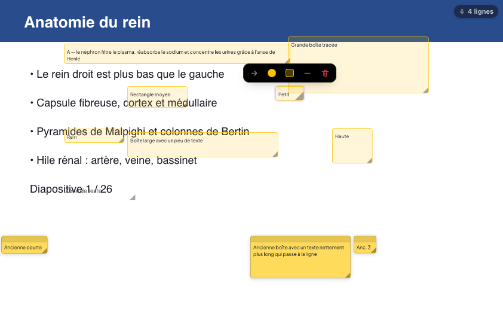
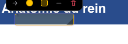
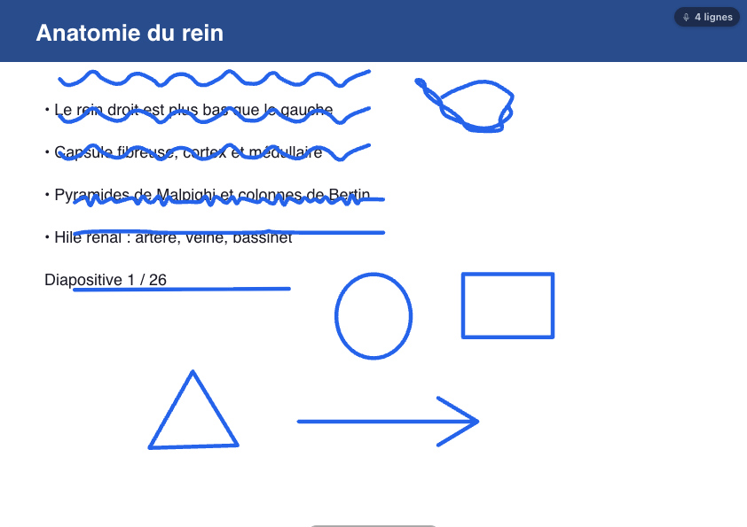
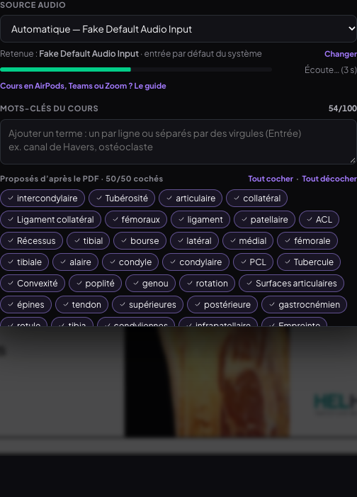
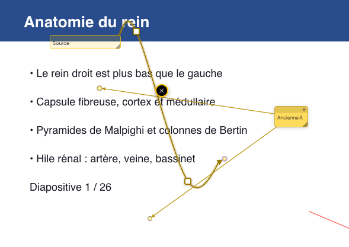
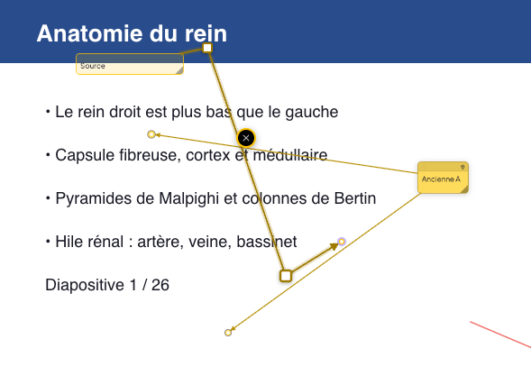
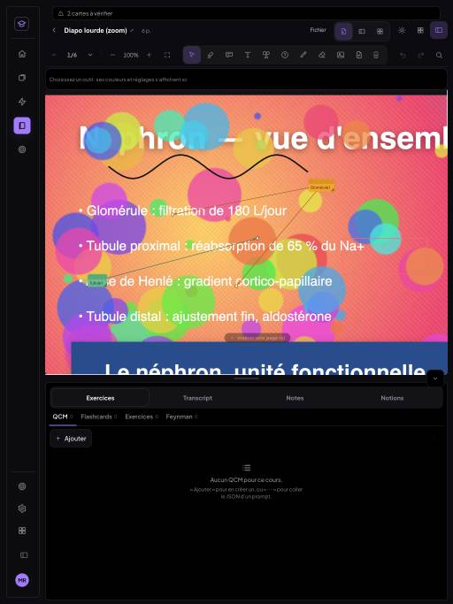
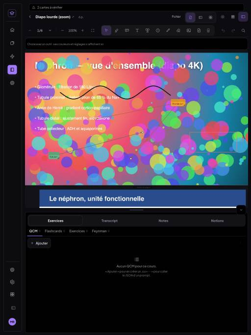
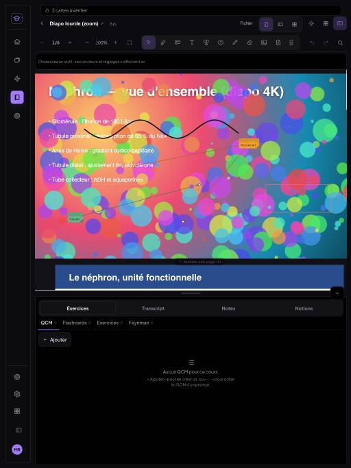
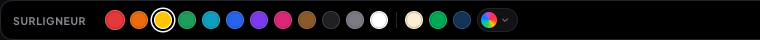

# Compte rendu — lecteur PDF et transcript MedRevise, v4 (20/10/2026)

Six chantiers, tous livrés, testés dans Chrome (ordinateur + iPad émulé au toucher / au stylet), build vert,
commités et poussés sur `main`. Tous les tests tournent sur une instance **locale isolée** (`VITE_SUPABASE_URL`
vide) : aucune écriture Supabase. MealWeek et `src/shared/` n'ont pas été touchés
(`git diff 505372b -- src/mealweek src/shared` est vide). Les annotations existantes gardent leur rendu à
l'identique (vérifié au pixel pour les flèches et les couleurs, voir plus bas).

| # | Chantier | Commit |
|---|---|---|
| 1 | Boîtes : taille stable au glisser, gabarit compact | `4cc9ed6` |
| 2 | Crayon refait | `d582954` |
| 3 | Mots-clés automatiques mieux choisis | `943f5e6` |
| 4 | Flèches souples / dures, points de contrôle | `2adf9d6` |
| 5 | Zoom sans rafraîchissement au relâchement | `81ad8fa` |
| 6 | Dock de couleurs vives (12) | `7185ce7`, `b34e417` |

---

## 1. Boîtes — cause du bug de taille

**Cause.** Une boîte dont la largeur s'ajuste à son texte (largeur `max-content`, bornée) perdait cet
ajustement pendant **tout** geste : la condition était `!apercu`, et `apercu` est posé aussi bien pendant un
déplacement que pendant une redimension. Pendant le glisser, la boîte reprenait donc sa largeur
enregistrée (qui n'est qu'un maximum), puis se resserrait au relâchement : jusqu'à **175 px** d'écart
mesuré entre « pendant » et « après ».

**Correctif** (`PdfPage.jsx`, `NoteBox`) : un état `redim` distinct ; seule une **redimension** montre la
largeur exacte (`ajustee = !compacte && !redim && !largeurFixe && texte`). Mesuré après : **0 px** d'écart.

**Gabarit compact** (`pdfShared.js`, `COMPACT`) : boîte vide = une ligne de ~**120 px** à 100 % ; la largeur
suit le texte jusqu'à 45 % de la page ; minimum **48 × 24 px** à 100 % (redimension bloquée en dessous) ;
un rectangle tracé à la souris fixe la largeur. Les boîtes d'avant ne sont pas converties.
Au doigt (iPad), le glisser s'arrêtait après ~19 px : `touch-action: none` sur les poignées.

 

---

## 2. Architecture du crayon (`src/medrevise/pdf/crayon.js`)

Chaîne d'un trait, du pointeur à l'enregistrement :

1. **Capture à pleine fréquence** : tous les `getCoalescedEvents()` du pointeur (souris, stylet, doigt si
   « Dessiner au doigt » est activé). L'inclinaison est ignorée ; la pression est optionnelle (bouton
   « Pression », épaissit légèrement).
2. **Stabilisation en direct**, réglage 0–100 % (défaut **30 %**, mémorisé) : chaque point ne rejoint qu'une
   fraction du chemin vers le pointeur (`force = 0,82 × s`) — 0 % = trait brut.
3. **Aperçu sans latence** : un canvas posé sur la page est repeint **dans l'événement même** (pas d'état
   React, pas d'attente d'image). Le trait enregistré remplace l'aperçu dès qu'il est à l'écran.
4. **Au relâchement** : simplification sous-pixel (RDP), lissage final de Chaikin proportionnel à la
   stabilisation (0, 1 ou 2 passes), puis **enregistrement vectoriel** : `points` en fractions de page,
   `epaisseur` en fraction de la hauteur de page (donc constante en unités PDF quel que soit le zoom),
   `couleur`, `opacite`, `rendu` (`'cr'` ou `'droit'`).
5. **Rendu** SVG en courbes Catmull-Rom → Bézier (qui passent par chaque point), `stroke-linecap: round`.
   Un trait d'avant (sans `rendu`) garde son ancien tracé par les milieux. L'export PDF utilise le même
   chemin.

Gestes et modes (l'outil reste toujours le crayon) :

| Fonction | Comportement |
|---|---|
| **Maintenir pour redresser** | pointeur immobile 450 ms à la fin d'un trait de dessin → `reconnaitreForme` : ligne, cercle / ellipse, rectangle, triangle, flèche. La forme s'affiche aussitôt à l'aperçu et remplace le trait (`formeReconnue`). Un gribouillis libre n'est pas redressé. |
| **3 épaisseurs + réglage fin** | Fin / Moyen / Épais (dessin : 0,0024 / 0,0042 / 0,0075 de la hauteur de page ; surligneur : 0,011 / 0,017 / 0,026) + curseur « Taille ». |
| **Surligneur « Tracer en ligne droite »** | activé par défaut : du point de départ au pointeur, angle aimanté (horizontale) ; 2 points. Rendu en `mix-blend-mode: multiply`, donc sous le texte, qui reste lisible. |
| **Gomme** (mode du crayon) | touche ou balaie un trait : il s'efface en entier. Le bouton gomme du Pencil marche toujours. |
| **Griffonner pour effacer** | désactivé par défaut. Activé : un zigzag serré (≥ 5 changements de sens, tracé > 3,5 × sa diagonale) efface les traits qu'il recouvre et ne pose rien. |
| **Lasso** (mode du crayon) | entourer des traits (≥ 60 % de leurs points dedans) ou toucher un trait ; cadre en pointillés : glisser = déplacer, pastille de couleur = recolorer, corbeille / Suppr = supprimer, Échap = désélectionner. Chaque geste = une entrée d'Annuler. |



Sur la capture : 3 lignes écrites et une boucle de schéma ; ligne 4 = tracé tremblé à 0 % de
stabilisation, ligne 5 = même tracé à 80 % ; souligné redressé, cercle, rectangle, triangle, flèche.

---

## 3. Mots-clés automatiques — règle de scoring

Texte de tout le cours (couche native + OCR), `transcription/keyterms.js#proposerTermesDetail` :

```
score = rareté × (1 + log2 n) × (1 + Σ bonus)
```

- **rareté** : 0 si le mot est dans les mots très fréquents du français (exclu), 0,25 s'il est courant,
  1 sinon (`motsFrequents.js`, liste embarquée, aucun appel réseau) ; légèrement relevée pour les mots longs ;
- **n** : nombre d'occurrences dans le cours ;
- **bonus** : suffixe médical (+1) ou savant (+0,4), préfixe médical (+0,5), sigle (+0,6), terme de deux mots
  répété (n ≥ 3 et ≥ 30 % d'association, +1), éponyme, latin (+0,8), nom propre (+0,6), majuscule interne.

Exclus : mots vides, nombres, vocabulaire de mise en page, lignes de crédits de figures, mots anglais de
légende, **éléments fixes de la maquette** (mot revenu à la même place, grille de 12 unités, sur ≥ 35 % des
pages : logo, en-tête, pied de page de l'école, variantes OCR comprises), noms après Dr / Pr / Mme…,
fragments d'OCR, doublons aux accents près. Au plus 50 termes, tous cochés, « Pourquoi ? » au survol.

**Exemple** : `intercondylaire` → `score 7,26 = rareté 1,15 × fréquence 5 fois (×3,32) × (1 + suffixe savant 0,4 + préfixe médical 0,5)`.

**Avant / après sur deux vrais cours** (`scripts/cap/motscles-comparaison.json`) :

| Cours | Avant (extrait) | Après (tête de liste) |
|---|---|---|
| Anatomie du genou (63 p., OCR) | MONTIGNIES-SUR-SAMBRE, intercondylaires, Louvain, Hainaut, Ecole, articulaires, épines, Shirazi-Adl, École, … Moglo, TECHNOIQOCIES, Louvai, Full, internal, IGNIES-SUR-SAMBRE, NON-COMMERCIAL | intercondylaire, Tubérosité, articulaire, collatéral, Ligament collatéral, fémoraux, ligament, patellaire, ACL, Récessus, tibial, bourse… |
| Macromolécules (16 p.) | 129 termes dont base, briques, petite, scientifiques, Deoxyribonucleic, Hydrophobic, Storage, Head, est-à-dire… | 50 termes : acides aminés, glucose, monosaccharide, polysaccharide, triglycéride, acides nucléiques, acides gras, phospholipide, ADN, ARN, lipide, nucléotide… |



---

## 4. Modèle des flèches (`pdf/flechesGeo.js`, `pdf/connecteurs.js`)

Champs **facultatifs** d'une flèche, tous absents sur une flèche d'avant (qui garde exactement son rendu —
0 pixel d'écart mesuré) :

| Champ | Valeurs |
|---|---|
| `type` | `'dure'` (segments droits, coudes) · `'souple'` (Catmull-Rom → Bézier passant par les points) — défaut dure |
| `points` | `[{x, y}]` points de contrôle intermédiaires, en fractions de page, du départ vers la pointe |
| `pointes` | `{ debut, fin }` : `aucune` · `ouverte` · `pleine` (défaut aucune → pleine) |
| `trait` | `continu` · `tirets` · `pointilles` |
| `epaisseur` | facteur 0,5 à 3 (1 = épaisseur d'avant) |
| `couleur` | id de palette ou hex (défaut : couleur foncée de la boîte / de la forme) |

Où c'est stocké : connecteur supplémentaire → sur son entrée de `fleches` ; flèche principale d'une boîte →
`flechePrincipale` ; flèche libre (forme) → sous-objet `fleche` (la forme a déjà ses propres
`type`/`couleur`/`epaisseur`). La conversion vers une liste de connecteurs (`connecteursDe`) se fait **à la
lecture**, pure et idempotente, sans réécrire les données.

Gestes : double-clic ou appui long (550 ms au doigt) sur une flèche = un point ; glisser un point = courber
ou couder ; double-clic sur un point = le retirer. Réglages dans la rangée contextuelle (`BarreFleche`).
Les flèches restent accrochées à leur boîte. Corrigé au passage : au doigt, la croix « retirer » apparaissait
sous le doigt et le clic fantôme supprimait la flèche.

 

---

## 5. Zoom — preuve image par image

**Cause.** Après la pose du zoom, le défilement change (surtout l'horizontal, sur iPad) et le recalage
différé des canvas (100 ms) remettait l'image étirée de l'ancien zoom à sa **taille en pixels d'avant** :
diapo réduite dans un coin, blanc autour, pendant une image, jusqu'au rendu net.
**Correctif** (`rendusPages.js#alignerCanvas`) : un canvas dont la taille ne correspond pas à sa page reste
étiré à 100 %. Passage au rendu net en **fondu croisé de 80 ms** entre deux canvas (l'un toujours opaque
dessous) ; calque des pages permanent.

Mesure (`scripts/tests-pdfreader-v4/t-clignotement.mjs`) : capture écran continue (screencast CDP) pendant
50 zooms (pincement, molette, boutons) ; est « transitoire » une image qui diffère de ses deux voisines
alors que celles-ci se ressemblent, entre 100 et 650 ms après un relâchement.

| Appareil | Avant | Après |
|---|---|---|
| iPad (1024 × 1366, ×2) | **40** images transitoires / 1 137 | **0** / 1 419 |
| Ordinateur retina | 0 / 995 | 0 / 1 208 |
| Témoin (défaut réintroduit, `FLASH=1`) | 50 / 1 042 — le détecteur voit bien le défaut | — |

Avant, iPad, relâchement n°5 : images consécutives — la 2ᵉ est le transitoire (+137 ms).

| | | |
|---|---|---|
|  |  |  |

Après, iPad, relâchement n°5 : 6 images consécutives, aucune rupture.

| | | |
|---|---|---|
|  |  |  |
|  |  |  |

Les annotations et les canvas ne sont jamais re-montés (mêmes nœuds DOM avant / après chaque zoom).

---

## 6. Palette finale du dock (`src/medrevise/lib/palette.js`, `PALETTE_VIVE`)

| Couleur | Hex | Contraste blanc / noir |
|---|---|---|
| Rouge | `#E5383B` | 4,23 / 4,96 |
| Orange vif | `#EA6C0A` | 3,16 / 6,65 |
| **Jaune vif** (défaut, surligneur) | `#FFC400` | 1,60 / 13,15 |
| Vert | `#1E9E5A` | 3,45 / 6,09 |
| Cyan | `#0E9FBE` | 3,12 / 6,72 |
| Bleu | `#2563EB` | 5,17 / 4,06 |
| Violet | `#7C3AED` | 5,70 / 3,69 |
| Magenta (texte à trous) | `#DB2777` | 4,60 / 4,57 |
| Marron | `#8B5A2B` | 5,84 / 3,60 |
| Noir | `#1F1F24` | 16,41 / 1,28 |
| Gris | `#7A7A85` | 4,24 / 4,95 |
| Blanc | `#FFFFFF` | 1,00 / 21 |

Surlignage en `alpha 0,4`. Les anciennes couleurs enregistrées restent reconnues et gardent leur rendu
(capture des anciennes annotations : 0 pixel d'écart, tolérance 2/255).



---

## Tests

Bancs : `scripts/tests-pdfreader-v4/` (`t-boites`, `t-palette`, `t-fleches`, `t-motscles`, `t-crayon`,
`t-clignotement`, chacun en ordinateur et `ipad`) et non-régression `scripts/tests-pdfreader-v3/`,
`scripts/tests-fiche-jumelle/`, `scripts/tests-import-tableau-nettete/`. Unitaires : `npx vitest run`
(90 tests, dont `tests/crayon/crayon.test.js` et `tests/transcription/keyterms.test.js`).

Crayon (`t-crayon.mjs`) : **26/26** ordinateur, **26/26** iPad (stylet) — aperçu dès l'événement, 3 lignes +
schéma vectoriels en Catmull-Rom, rugosité 110,7 → 7,4 entre 0 % et 80 % de stabilisation, 5 formes
redressées, surligneur droit et sous le texte, gomme, griffonnage (OFF par défaut puis efficace), lasso
(sélection, déplacement, recoloration, suppression, Annuler), 3 épaisseurs, épaisseur 0,0075 identique à
70 %, 100 % et 180 %.

Batterie finale (après le correctif `c662c34`, ✅ / ❌) :

| Banc | Ordinateur | iPad / tablette |
|---|---|---|
| v4 `t-boites` | 10 / 0 | 10 / 0 |
| v4 `t-palette` | 10 / 0 | — |
| v4 `t-fleches` | 18 / 0 | 17 / 0 |
| v4 `t-clignotement` (après) | 6 / 0 | 6 / 0 |
| v4 `t-crayon` | 26 / 0 | 26 / 0 |
| v4 `t-motscles` | 9 / 0 | — |
| v3 `t-connecteurs` | 21 / 0 | — |
| v3 `t-transcript` (faux Deepgram + micro simulé) | 24 / 0 | — |
| v3 `t-transcript-fiche` | 6 / 0 | — |
| v3 `t-zoom` (après) | 6 / 0 | 6 / 0 |
| v3 `t-stylet` | 19 / 0 | — |
| v3 `t-barre` | 3 / 0 | 3 / 0 |
| v3 `t-couleurs` | 27 / 0 | 27 / 0 |
| fiche jumelle `tout.sh` (16 bancs) | 191 / 0, correspondance des fiches 30/30 × 3 | |
| netteté import tableau | 10 / 0 (retina) | 10 / 0 |

**Incident (corrigé).** Le commit du crayon (`d582954`) avait mis en commentaire, par un commentaire placé au
mauvais endroit, la prop `onDemanderAncrage` de `PdfPage` : tout cours **contenant une boîte** plantait à
l'ouverture (`ReferenceError`). Le build passait ; le bug n'apparaissait pas dans `t-crayon`, qui vide les
annotations avant de commencer. La batterie de non-régression l'a vu (cours « non ouvert » dans
t-boites, t-fleches, fiche jumelle…). Corrigé et poussé dans `c662c34`, puis toute la batterie a été relancée
(tableau ci-dessus). Il est resté environ une heure sur `main`.

MealWeek : build de production avant (`505372b`) et après (`d582954`) servis côte à côte, écrans MealWeek
comparés au pixel : **identiques octet pour octet** (captures PNG bureau 1440 × 900 et téléphone 390 × 844).
`git diff 505372b -- src/mealweek src/shared` : vide.

## Commits (v4, dans l'ordre)

- `81ad8fa` fix(medrevise): zoom — plus de clignotement au relâchement (cause trouvée), fondu croisé 80 ms
- `4cc9ed6` fix(medrevise): boîtes et zones de texte — taille stable au glisser, gabarit compact
- `7185ce7` feat(medrevise): dock de couleurs — 12 couleurs vives et standard
- `b34e417` test(medrevise): tests de couleur mis à jour pour la palette vive (défaut jaune vif)
- `2adf9d6` feat(medrevise): flèches souples ou dures, points de contrôle, pointes et styles
- `943f5e6` feat(medrevise): mots-clés du transcript mieux choisis — rareté × fréquence × bonus
- `d582954` feat(medrevise): crayon refait — stabilisation, maintenir pour redresser, gomme, griffonner, lasso
- `c662c34` fix(medrevise): lecteur — prop onDemanderAncrage rétablie (mise en commentaire par d582954)
- (puis ce compte rendu : `docs(medrevise): compte rendu lecteur v4`)
