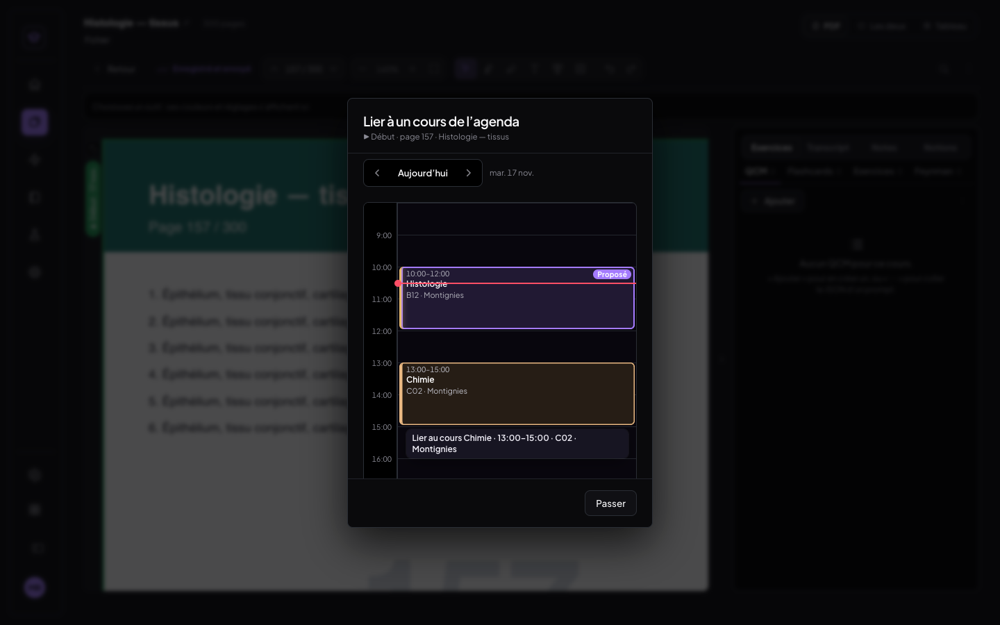
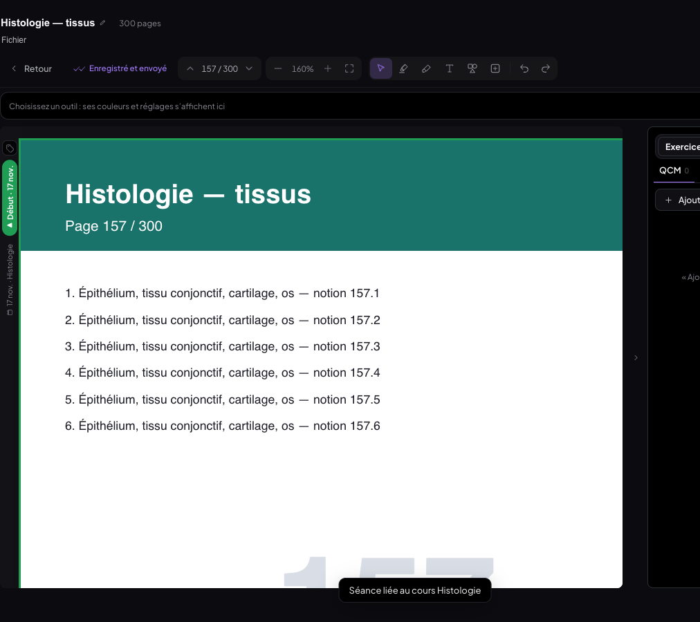
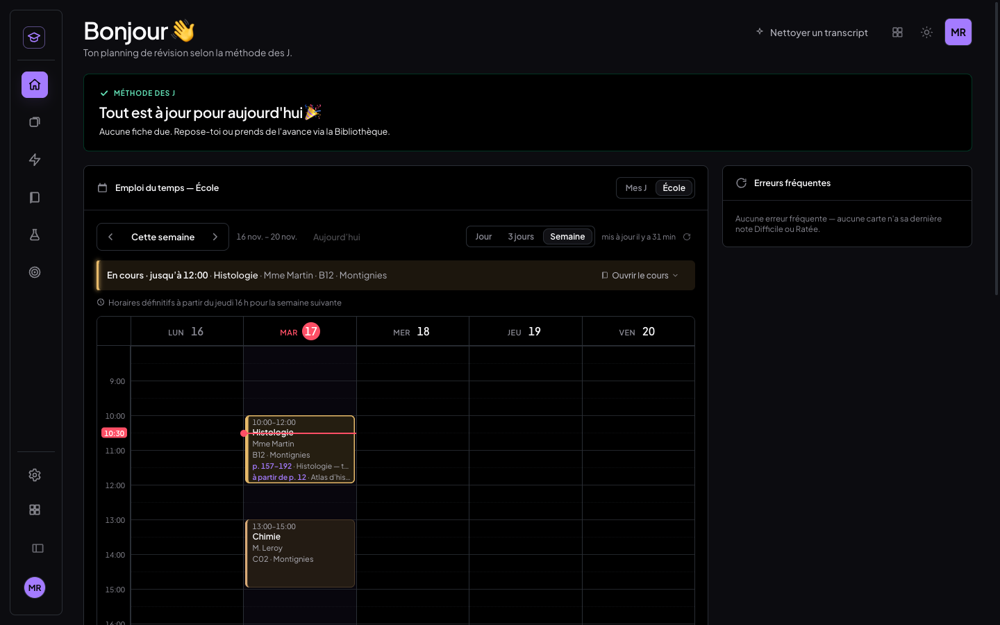

# Séances liées à l'agenda (26/11/2026)

Quand tu notes un **début de cours** dans un document, tu peux le lier à un créneau de l'agenda. L'agenda affiche alors les pages vues à ce cours (« p. 157–192 · Histologie — tissus »). Sur ce créneau, « Ouvrir le cours » ouvre le document à la page du début de la séance.

## Le système début / fin existant (réutilisé tel quel)

1. Un marqueur est un **tag de page** du store synchronisé `page_tag` (`src/medrevise/lib/tagsPages.js`) : `{ id, courseId, document: 'original' | 'fiche', page, pageCle, kind: 'debut' | 'fin', date, transcriptSessionId }`.
2. On le pose par le menu de la page (icône d'étiquette dans la marge, ou clic droit) : « Marquer début de cours » ou « Marquer fin de cours », puis la fenêtre du tag (date, transcript lié). « Transcrire le cours » peut aussi le poser au démarrage et à l'arrêt (`transcription/marquerCours.js`).
3. Une **séance** est un Début suivi de la Fin la plus proche dans le même document (`seances()`). Elle porte une page de début et une page de fin. Sans Fin, la séance reste ouverte.
4. Retirer un tag le marque `supprime: true`. Rien n'est effacé au cloud.
5. Affichage : étiquette verticale dans la marge gauche, cadre vert ou rouge, liseré sur les pages de la séance, liste Fichier › Séances. Il n'existe pas de « lecteur par séances » distinct (seule l'étude `docs/prototypes/lecteur-seances/` porte ce nom), donc c'est bien ce système qui est réutilisé.

## Ce qui est stocké

Le lien est **un champ ajouté au tag Début existant**, `agenda`, et rien d'autre ne change dans le tag. Il passe par le même store `page_tag`, avec la même synchro (`medrevise_records`, enregistrement JSON complet). **Aucune migration SQL n'est nécessaire**, et aucune n'a été préparée.

```js
agenda: {
  cle:     'Cours-HISTO-…-Index-Education|2026-11-17T09:00:00.000Z', // UID iCal + date/heure de début : stable, une clé par semaine
  uid:     'Cours-HISTO-…-Index-Education@20261117T090000Z',          // identifiant de l'occurrence servi par /api/timetable
  uidIcal: 'Cours-HISTO-…-Index-Education',
  titre: 'Histologie', date: '2026-11-17',                            // COPIE du créneau
  debut: '2026-11-17T09:00:00.000Z', fin: '2026-11-17T11:00:00.000Z',
  salle: 'B12 · Montignies',                                          // ou null
  lieLe: '2026-11-17T09:31:02.000Z',
}
```

- Une séance est liée à **un seul** créneau, puisque le lien est porté par son tag Début. Un créneau peut porter **plusieurs** séances, par exemple plusieurs documents vus au même cours.
- « Délier » met `agenda: null`. Le marqueur reste, et rien n'est effacé.
- `putBackup` est appelé avant chaque écriture (`pre-lien-agenda-<tag>-<horodatage>` et `pre-delier-agenda-…`).
- Les tags Fin, les documents, les annotations et les transcripts ne sont jamais touchés. L'agenda reste en lecture seule : rien n'est écrit dans Hyperplanning, et `HELHA_ICAL_URL` reste côté serveur.
- **Le créneau disparaît ou bouge dans Hyperplanning** : la séance garde sa copie.
  - Créneau introuvable dans la période chargée : un bloc « copie » en pointillés apparaît à l'ancien horaire, avec la mention « cours retiré de l'agenda ».
  - Même occurrence retrouvée (même `uid`) mais à un autre horaire : les lignes suivent le cours, avec la mention « horaire modifié ». La fiche du créneau rappelle l'horaire d'origine.
  - Hors de la période chargée : la copie est affichée sans mention.

## Règle du créneau proposé d'office

`proposerCreneau()` dans `src/medrevise/lib/seancesAgenda.js`. Le créneau est choisi dans la journée affichée (cours annulés et « toute la journée » exclus), dans cet ordre :

1. le créneau **en cours** de la **même matière** que le document (la matière reliée au cours de l'agenda, réglages de l'emploi du temps compris) ;
2. sinon, le créneau de la même matière **le plus proche** de maintenant. Pour un autre jour, c'est le plus proche de la même heure ce jour-là ;
3. sinon, le créneau **en cours**, quelle que soit sa matière ;
4. sinon, aucun.

Le créneau proposé est **mis en évidence** (liseré teal et étiquette « Proposé »), mais **jamais validé seul** : il faut toucher un créneau pour le lier. « Passer » ne crée aucun lien, et le marqueur reste exactement celui d'avant (aucun champ ajouté).

## À l'écran

- **Fenêtre « Lier à un cours de l'agenda »** (`components/LienAgenda.jsx`). Elle s'ouvre juste après la pose d'un Début, que ce soit par le menu de la page ou par « Transcrire le cours ». Elle affiche la journée de l'agenda à la date du marqueur (aujourd'hui par défaut), avec les mêmes blocs et couleurs que l'agenda, des flèches jour précédent et suivant, et « Aujourd'hui ». Elle ne s'ouvre pas si l'emploi du temps n'est pas configuré.
- **Menu du tag Début** : « Lier à l'agenda » quand il n'est pas lié ; « Changer le cours lié » et « Délier » quand il l'est.
- **Marqueur lié** : sous l'étiquette « ▶ Début », une mention discrète « 📅 17 nov. · Histologie », écrite à la verticale. Son infobulle donne le jour, l'heure et la salle du créneau. Un clic ouvre la fenêtre de changement.
- **Agenda** (`components/GrilleEcole.jsx`, `EmploiDuTemps.jsx`) : une ligne par séance liée sur le bloc, « p. 157–192 · <document> », ou « à partir de p. 157 » si la fin n'est pas notée. Les mêmes lignes apparaissent dans la fiche du créneau.
- **« Ouvrir le cours »** sur un créneau lié ouvre le document à la page de début de la séance. S'il y a plusieurs séances, un petit choix du document s'affiche. Sur un créneau non lié, rien ne change : « Ouvrir » ouvre le dernier cours de la matière.
- **Téléphone** : il n'a pas de lecteur (révision seulement), donc on n'y note pas de début de cours. Les lignes des séances s'affichent sur l'agenda et dans la fiche du créneau. Pas de bouton « Ouvrir » sur téléphone, comme avant.

## Code

| Fichier | Rôle |
|---|---|
| `src/medrevise/lib/seancesAgenda.js` (nouveau) | copie du créneau, clé, créneau proposé, retrouver / ranger sur l'agenda, `lierSeance` / `delierSeance` (putBackup), `useSeancesLiees` |
| `src/medrevise/components/LienAgenda.jsx` (nouveau) | fenêtre de liaison + mention du marqueur lié |
| `src/styles/seances-agenda.css` (nouveau) | styles (préfixe `sea-`, lignes `edtg-seance`) |
| `src/medrevise/pdf/PdfReader.jsx` | fenêtre après un Début, menu du tag, mention, ouverture à la page demandée |
| `src/medrevise/components/GrilleEcole.jsx`, `EmploiDuTemps.jsx` | lignes, copies, mentions, « Ouvrir le cours » et choix du document |
| `src/medrevise/MedReviseApp.jsx` | `openPdfReader(…, { page })` |

MealWeek et `src/shared/` ne sont pas modifiés.

## Tests

**Banc navigateur** : `scripts/tests-seances-agenda/` (voir son `LISEZMOI.md`). Données de test uniquement, Chrome headless **muet**, faux Supabase local, agenda de test calculé par le **vrai** analyseur iCal du serveur. Horloge simulée au 17 nov. à 10 h 30. Résultat de la série finale (`tout.sh`) : **160 vérifications sur 161**, 0 erreur console sur chaque appareil. L'unique écart était une capture MealWeek téléphone différente, sur une page visuellement identique. Cette comparaison a tourné juste après les trois appareils en parallèle. Relancée seule deux fois, elle donne des captures identiques octet pour octet, comme dans la série précédente.

| Scénario | Ordinateur (souris) | iPad (tactile) | Téléphone |
|---|---|---|---|
| Agenda de test : Histologie les 10 et 17 nov. de 10 h à 12 h (même UID, cours répété), Chimie le 17 de 13 h à 15 h | ✅ | ✅ | ✅ |
| Le 17 à 10 h 30, début p. 157 sur le PDF d'histologie de 300 pages : la fenêtre s'ouvre sur le 17, Histologie est proposé d'office mais pas validé, flèches jour précédent / suivant, toucher = lier | ✅ | ✅ | — (pas de lecteur) |
| Lien stocké (clé UID + début, copie titre / date / heures / salle), tag Début inchangé par ailleurs, mention « 17 nov. · Histologie » et son infobulle (heure du créneau) | ✅ | ✅ | — |
| Fin p. 192 (sans fenêtre) : l'agenda du 17 affiche « p. 157–192 · Histologie — tissus » ; « Ouvrir le cours » ouvre la page 157 | ✅ | ✅ | ligne ✅, pas de bouton (comme avant) |
| Le 10 nov., séance p. 120–156 liée : fenêtre ouverte sur le 10, autre clé, les deux semaines restent distinctes | ✅ | ✅ | ✅ |
| « Passer » : marqueur créé comme avant, sans champ ajouté. Puis « Lier à l'agenda » depuis le menu | ✅ | ✅ | — |
| Deux documents liés au même créneau : deux lignes (« à partir de p. 12 » sans fin) ; « Ouvrir le cours » propose le choix du document, et l'Atlas s'ouvre p. 12 | ✅ | ✅ | ✅ (lignes) |
| « Changer le cours lié » (vers Chimie), puis « Délier » (`agenda: null`, le marqueur reste) ; putBackup avant chaque écriture | ✅ | ✅ | — |
| Créneau **supprimé** dans l'iCal de test : bloc « copie » à 10:00–12:00, « cours retiré de l'agenda », séances gardées, jamais « en cours » | ✅ | ✅ | ✅ |
| Créneau **déplacé** (15 h–17 h) : les lignes suivent le cours, « horaire modifié », horaire d'origine dans la fiche, copie stockée non réécrite | ✅ | ✅ | — |
| iCal revenu à l'identique : plus aucune mention | ✅ | ✅ | — |
| Non-régression : « Ouvrir » d'un créneau non lié = dernier cours de la matière ; tags Début / Fin existants et étiquettes ; tags Fin sans champ ajouté | ✅ | ✅ | fiche non liée inchangée ✅ |

- **Synchro** (`t-synchro.mjs`) : l'ordinateur A et un ordinateur B neuf passent par le faux Supabase. B reçoit les trois liens, les lignes de l'agenda, le PDF, l'ouverture à la page 157 et la mention du marqueur. B délie l'Atlas et A reçoit le changement.
- **MealWeek** (`t-mealweek.mjs`) : on compare le build d'avant le chantier (07ba376) au build d'après. Les captures sont **identiques octet pour octet** sur ordinateur et sur téléphone, sans erreur console. `src/mealweek/` et `src/shared/` n'ont pas été modifiés (`git diff --stat`).
- **Vitest** : `tests/seances-agenda/seancesAgenda.test.js` passe à 9 sur 9. Il couvre l'agenda de test (vrai analyseur), la clé, les états retrouvé / modifié / retiré / hors période, les trois règles du créneau proposé, le rangement sur l'agenda, et le fait que lier puis délier ne touche que le champ `agenda`. Suite complète : 383 tests sur 385. Les deux échecs existaient déjà, à l'identique, sur le code d'avant le chantier :
  - `crayon` ;
  - `api.test.js` de l'emploi du temps, dont la semaine de test d'octobre est sortie de la période servie.
- **Build** : vert (`npm run build`).
- **Pas testé dans le navigateur** : l'ouverture de la fenêtre après « Transcrire le cours ». Le Chrome de test n'a plus accès à l'audio, comme déjà noté dans `docs/compte-rendu-transcription-marque-cours.md`. Le code passe par la même fonction que le menu de la page (`proposerLienAgenda`, après `marquerDebutCours`).
- **Écart de méthode** : le banc intercepte `/api/timetable` dans Chrome au lieu de passer par le serveur Vite. La période servie par le vrai serveur dépend de la date réelle (semaine passée + 8), et le 10 nov. en est sorti aujourd'hui. Le chemin serveur reste couvert par le banc de l'emploi du temps.

## Captures

Toutes dans `docs/img/seances-liees-agenda/`.

| | Ordinateur | iPad | Téléphone |
|---|---|---|---|
| Fenêtre « Lier à un cours de l'agenda » (Histologie proposé) | `fenetre-ordinateur.png` | `fenetre-ipad.png` | — |
| Fenêtre « Changer le cours lié » (Lié, Délier) | `fenetre-changer-ordinateur.png` | `fenetre-changer-ipad.png` | — |
| Marqueur lié « 17 nov. · Histologie » | `marqueur-lie-ordinateur.png` | `marqueur-lie-ipad.png` | — |
| Agenda du 17 : « p. 157–192 » | `agenda-ordinateur.png` | `agenda-ipad.png` | `agenda-telephone.png` (2 lignes) |
| Deux documents sur le même créneau | `agenda-deux-ordinateur.png` | `agenda-deux-ipad.png` | — |
| Fiche du créneau + « Ouvrir le cours » | `fiche-cours-ordinateur.png` | `fiche-cours-ipad.png` | `fiche-cours-telephone.png` |
| Choix du document | `choix-document-ordinateur.png` | `choix-document-ipad.png` | — |
| Le 10 nov. « p. 120–156 » | `agenda-10nov-ordinateur.png` | `agenda-10nov-ipad.png` | — |
| Créneau supprimé (copie) | `agenda-retire-ordinateur.png` | `agenda-retire-ipad.png` | `agenda-retire-telephone.png` |
| Créneau déplacé (horaire modifié) | `agenda-deplace-ordinateur.png` | `agenda-deplace-ipad.png` | — |
| Autre appareil (synchro) | `agenda-appareil-b.png` | | |
| MealWeek avant / après | `mealweek-ordi-avant.png` / `-apres.png` | | `mealweek-tel-avant.png` / `-apres.png` |





## Commits

- `05645be` feat(medrevise) : séances liées à l'agenda (code, tests Vitest, banc navigateur)
- le commit de ce compte rendu, des captures et de la passation (docs(medrevise), juste après)

Aucune migration SQL : le lien voyage dans l'enregistrement JSON du tag (`medrevise_records`), comme les autres champs.
