# Compte rendu — simplification et harmonisation des outils (lecteur PDF + tableau)

Chantier du 22/10/2026. Lecteur (`src/medrevise/pdf/`), document créé dans l'app, fiche jumelle et tableau Miro
(`src/medrevise/tableau/`) : un seul moteur (mêmes composants `MiniBarre`, `BoutonTaille`, `BoiteTableau`).
MealWeek et `src/shared/` : non touchés (vérifié en fin de chantier, voir « Non-régression »).

## Étape 0 — Audit des options (avant → après)

Écrit AVANT de coder, à partir du code de `94efb32…556127d` (PdfToolbar.jsx, PdfReader.jsx, PdfPage.jsx, Fleche.jsx,
Board.jsx, PageTexte.jsx, DocumentFlux.jsx). « Inchangé » = même place, même comportement.

### Barre principale

| Option (avant) | Où | Doublon ? | Après |
|---|---|---|---|
| Retour, bascule Original / Fiche, pages ◀ n/N ▶, zoom − % + Ajuster | barre, gauche | non | inchangé |
| Sélection ⌘1 | outils | non | **Sélection ⌘1** |
| Surligneur ⌘2 (texte seulement) | outils | non | **Surligneur ⌘2** : texte (natif / OCR) ou main levée selon l'endroit où le geste commence |
| Boîte ⌘3 | outils | non | **Texte ⌘4** › Boîte |
| Texte ⌘4 (texte libre) | outils | non | **Texte ⌘4** › Texte libre |
| Forme ⌘5 | outils | non | **Formes ⌘5** |
| « ? » ⌘6 | outils | oui : un post-it dit la même chose (« je n'ai pas compris ») avec du texte en plus | **supprimé : doublon de Texte › Post-it**. Les « ? » déjà posés restent affichés, déplaçables, redimensionnables et supprimables (mini barre) |
| Crayon ⌘7 | outils | non | **Dessin ⌘3** › Crayon |
| Gomme ⌘8 | outils | non | **Dessin ⌘3** › Gomme (n'est plus un outil séparé) |
| Image ⌘9 | à côté des outils | non | **Insérer ⌘6** › Image |
| Page | à côté des outils | doublon partiel du « + » entre deux pages (gardé) | **Insérer ⌘6** › Page |
| Dessins du téléphone | à côté des outils | non | **Insérer ⌘6** › Dessins du téléphone (la pastille « nouveau dessin » passe sur le bouton Insérer) |
| « + » Insérer (barre étroite) | outils, mode compact | oui : Image / Page | **supprimé : doublon de Insérer** |
| « Commentaire » | — | n'existe pas dans le code (le « ? » en tenait lieu) | voir « ? » → Post-it |
| Annuler / Rétablir | après les outils | non | inchangé (après les 6 outils) |
| Recherche (⌘F) | droite | non | inchangé |
| Disposition PDF / Les deux / Tableau | droite | non | inchangé |
| ⋯ Actions sur le document | droite | non | inchangé |

### Sous-barres (rangée sous la barre, « barre contextuelle »)

| Option (avant) | Outil (avant) | Doublon ? | Après |
|---|---|---|---|
| Couleur de la boîte | Boîte | non | Texte › Boîte / Post-it / Boîte-tableau : couleur |
| Couleur du texte | Texte | non | Texte › Texte libre : couleur |
| 12 formes | Forme | non | Formes : Rectangle · Ellipse · Triangle · Ligne · Flèche + « … » (rectangle arrondi, losange, étoile, double flèche, accolade, crochet, croix) |
| Couleur de la forme, Remplie / Vide | Forme | non | Formes : inchangés |
| Couleur du surligneur | Surligneur | non | Surligneur : couleurs |
| Couleur du crayon | Crayon | non | Dessin › Crayon : couleurs |
| Segment Dessin / Surligneur du crayon | Crayon | oui : deux surligneurs (texte et main levée) | **supprimé : doublon de Surligneur** (le main levée est dans Surligneur) |
| Épaisseur (sélecteur commun) | Crayon | non | Dessin › Crayon : épaisseur ; Surligneur : épaisseur du trait libre |
| Tracer en ligne droite | Crayon (mode surligneur) | non | Surligneur : « Ligne droite » |
| Dessiner au doigt (tablette) | Crayon | non | Dessin › Crayon : inchangé |
| Gomme Zone / Trait entier | Gomme | non | Dessin › Gomme : Standard / Trait entier |
| Texte d'aide de l'outil | toutes | non | inchangé |

### Grande barre de format (rangée « texte » au-dessus de la diapo) — disparaît

| Option (avant) | Contexte | Doublon ? | Après (mini barre de l'objet) |
|---|---|---|---|
| Couleur de la boîte | boîte en édition | oui (mini barre « couleur ») | Fond (couleur + plein / teinté / transparent) |
| Couleur du texte (zone de texte) | texte libre en édition | oui (mini barre « couleur ») | Couleur du texte |
| Gras, Italique | boîte / texte / bloc | non | mini barre |
| Souligné, Barré | idem | non | « … » |
| Taille (liste) | idem | oui : sélecteur de taille de la mini barre | Taille du texte (sélecteur commun) — appliquée à la sélection s'il y en a une, sinon à la boîte |
| Police | idem | non | « … » |
| Couleur du texte sélectionné | idem | non | Couleur du texte (sélection, sinon toute la boîte) |
| Surligneur de fond du texte | idem | non | « … » |
| Liste à puces, numérotée | idem | non | « … » |
| Alignement | idem | non | Alignement |
| Annuler / Rétablir de la rangée | idem | oui : ⌘Z / ⇧⌘Z et ↶ ↷ de la barre | **supprimés : doublons** |
| Supprimer la boîte / le texte | idem | oui : poubelle de la mini barre | poubelle |
| Réinitialiser (texte d'origine) | bloc de texte remplacé | non | mini barre du bloc |
| (nouveau) → Tableau, Verrouiller | boîte | — | mini barre / « … » |

Document créé dans l'app (texte du flux ou d'une page) — la même rangée affichait aussi : G I U S, Taille, Police,
couleur, fond, listes, alignement, H1 H2 H3, cases à cocher, citation, tableau (+ ligne, + colonne, supprimer),
séparateur, image, lien, annuler / rétablir. **Après** : mini barre au-dessus de la sélection de texte (et dans un
tableau du document) : G · I · U · H1 · H2 · listes · alignement · couleur · « … » (barré, H3, taille, police, fond,
cases, citation, tableau et ses lignes / colonnes, séparateur, lien) puis Notion · Flashcard (l'ancienne bulle de
sélection, fusionnée). Image : **supprimée de la rangée, doublon de Insérer › Image** (qui l'insère au curseur).
Annuler / Rétablir : doublons de la barre.

### Mini barres (au-dessus de l'objet sélectionné)

| Objet | Avant | Après |
|---|---|---|
| Boîte | couleur · taille · fond · bordure · flèche · réduire · supprimer | Taille · Couleur du texte · Fond · G · I · Alignement · Flèche · → Tableau · « … » (police, souligné, barré, surligneur de fond, listes, bordure, réduire, verrouiller) · Supprimer |
| Post-it (nouveau) | — | comme la boîte |
| Boîte-tableau (nouveau) | — | Taille · Couleur du texte · Fond · G · I · + ligne · + colonne · − ligne · − colonne · En-tête · Flèche · → Tableau · « … » · Supprimer |
| Texte libre | couleur · taille · supprimer | Taille · Couleur du texte · G · I · Alignement · « … » (police, souligné, barré, surligneur de fond, listes, verrouiller) · Supprimer |
| Bloc de texte remplacé | (rangée de format seulement) | Taille · Couleur du texte · G · I · Alignement · « … » · Réinitialiser |
| Flèche, trait, forme, image, « ? » | inchangées | inchangées (même composant) |
| Tableau Miro : carte, sélection multiple, image, flèche | inchangées | + « Boîte-tableau » pour une carte-tableau (lignes, colonnes, en-tête) |

### Menus

| Menu | Après |
|---|---|
| ⋯ Actions sur le document, menu Fichier | inchangés |
| Menu « + » Insérer (barre étroite) | supprimé : doublon de Insérer |
| Menu des dessins du téléphone | inchangé, ouvert depuis Insérer › Dessins du téléphone |

### Tableau (Miro) — barre

« + Carte » (déjà présent), double-clic sur le fond (déjà présent), message du tableau vide réécrit ; ajout d'un
bouton « Boîte-tableau » (carte contenant un tableau, même composant que dans le lecteur).

## Ce qui a été fait

### 1) Barre principale : 6 outils (`pdf/PdfToolbar.jsx`)

`OUTILS` = Sélection · Surligneur · Dessin · Texte · Formes · Insérer, puis Annuler / Rétablir, Recherche, disposition,
« ⋯ ». Le moteur garde ses outils internes (crayon, gomme, boite, texte, postit, boiteTableau) : `groupeDe(outil)`
donne l'outil de la barre ; Dessin et Texte retrouvent leur dernier sous-outil (`PdfReader.jsx#choisirOutil`,
`dernierSous`). ⌘1–6 (Ctrl+1–6 hors Mac, touche physique `Digit1…6`, donc aussi en AZERTY) sélectionnent les
6 outils dans l'ordre ; infobulles « Texte · ⌘4 — … » et chiffres affichés en maintenant ⌘ ; `RACCOURCIS_OUTILS`
(liste des raccourcis) mise à jour. Insérer n'est pas un mode de la page : il ouvre sa sous-barre (Image · Page ·
Dessins du téléphone), la page reste en Sélection ; la pastille « nouveau dessin » et l'animation d'arrivée passent sur
le bouton Insérer. Tablette : les 6 mêmes boutons (icônes), mêmes sous-barres.

| 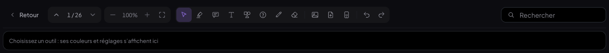 | 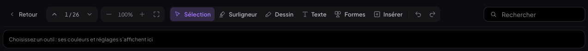 |
|---|---|
| avant : 8 outils + Image, Page, Dessins, et la grande barre de format | après : 6 outils, la rangée ne montre que la sous-barre de l'outil |

Sous-barres : Surligneur (couleurs · épaisseur du trait libre · Ligne droite), Dessin (Crayon · Gomme ;
épaisseur, couleurs, Dessiner au doigt sur écran tactile ; gomme Standard / Trait entier), Texte (Boîte · Texte libre ·
Post-it · Boîte-tableau, couleur de ce qui sera posé), Formes (Rectangle · Ellipse · Triangle · Ligne · Flèche ·
« … » pour les sept autres, couleur, Remplie / Vide), Insérer (Image · Page · Dessins).

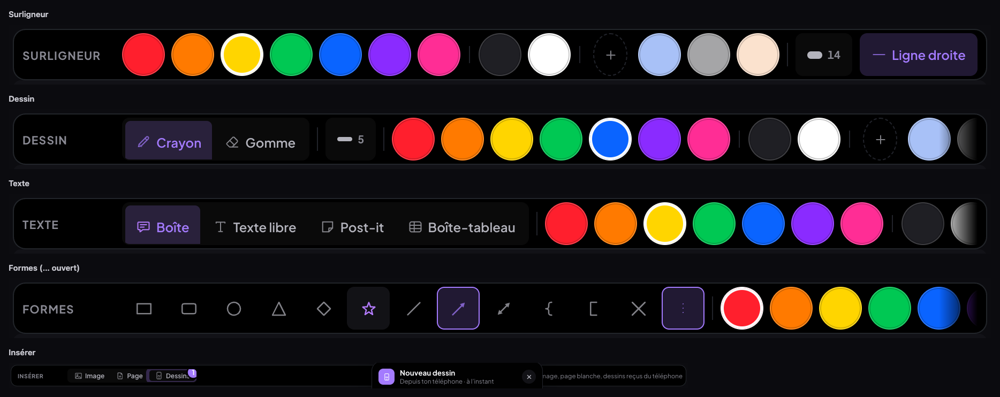

### Surligneur unique (`pdf/PdfPage.jsx`, `surDuTexte`)

Un geste qui commence SUR un caractère de la couche de texte (span pdf.js ou mot OCR) sélectionne et surligne au
relâchement (moteur d'avant, règle « même couleur retire / autre couleur remplace » inchangée) ; un geste qui commence
ailleurs trace un surlignage à main levée (moteur du crayon, couleur et épaisseur du Surligneur, « Ligne droite »).
Curseur : croix hors du texte, curseur texte sur le texte.

### 2) La grande barre de format disparaît

`EditToolbar` (rangée au-dessus de la diapo) et `OutilsTexteDocument` sont supprimés. La mise en forme passe dans LA
mini barre (`pdf/Selection.jsx#MiniBarre`, nouveau menu « … » `BoutonPlus`) avec un module commun
`pdf/FormatTexte.jsx#elementsFormat` : sur une boîte en édition, l'action vaut pour la sélection (sinon tout le texte,
curseur remis en place) ; sur une boîte seulement sélectionnée, le texte enregistré est transformé par un éditeur TipTap
sans affichage (même moteur `RICH_EXTENSIONS`) — une entrée d'Annuler par réglage, version affichée respectée pour une
boîte à deux versions (`avecContenuEdite`). Nouvelle option « Verrouiller » (champ additif `verrouille` : ni déplacée
ni redimensionnée, texte modifiable).

| 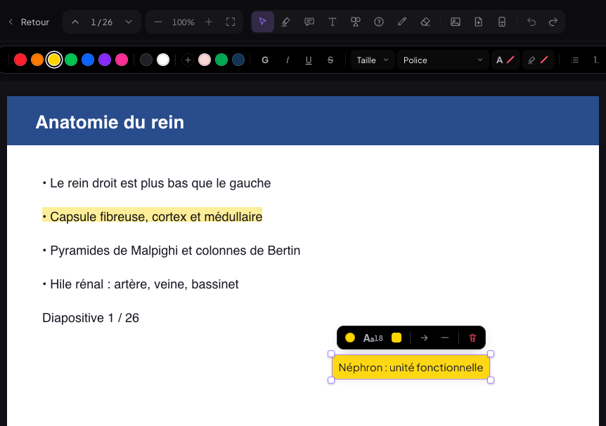 | 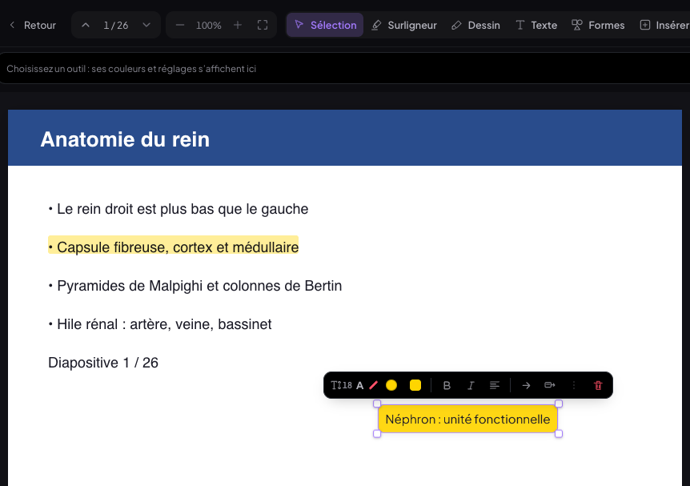 |
|---|---|
| avant : boîte en édition, grande barre au-dessus de la diapo | après : tout dans la mini barre au-dessus de la boîte |

Mini barres : 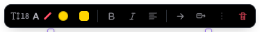 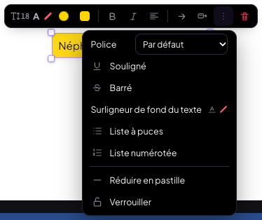
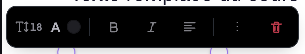 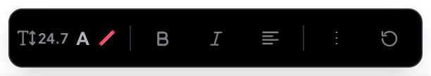
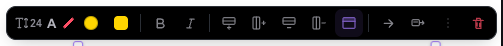

Document créé dans l'app : `pdf/FormatTexte.jsx#BarreTexteDocument` (texte du flux `DocumentFlux.jsx` et d'une page
`PageTexte.jsx`), au-dessus de la sélection (et quand le curseur est dans un tableau du document), suit la sélection
au défilement ; l'ancienne bulle Notion · Flashcard y est fusionnée.

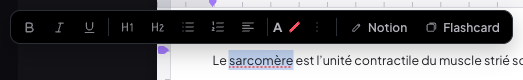

### 3) Sélecteur de taille (`pdf/ChoixTaille.jsx`, `pdfreader-v2.css`)

Même panneau (préréglages avec aperçu à l'échelle, champ en px, liste), ~30 % plus compact : 244 × 161 px → 176 ×
115 px (marges, hauteur des lignes, largeur), texte à la même taille. Le bouton « Aa18 » devient l'icône « T ↕ »
suivie de la valeur en petit, infobulle « Taille du texte ».

| 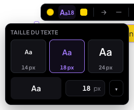 | 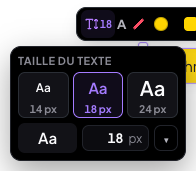 |
|---|---|
| avant | après |

### 4) Boîte-tableau (`pdf/BoiteTableau.jsx`, un composant pour le lecteur et le tableau Miro)

Champ additif `grille: { v: 1, cols: [fractions], lignes: [[cellules]], entete }` sur une boîte (ou une carte du
tableau) ; son texte à plat est aussi écrit dans `content` (« Muscle | Origine | Action » : exports, IA, recherche,
version précédente de l'app). Le tableau occupe la largeur intérieure de la boîte, hérite de son fond, de ses marges,
de ses arrondis et de sa typographie ; filets intérieurs 1 px de la couleur du texte à 24 % d'opacité, `border-style:
hidden` (pas de bordure extérieure) ; en-tête en gras. Édition : cellules `contenteditable="plaintext-only"`, Tab /
Maj+Tab, Entrée = retour à la ligne, Échap ; une cellule modifiée = une entrée d'Annuler (à sa sortie, ou à la sortie
d'édition par un clic ailleurs). Mini barre : + ligne · + colonne · − ligne · − colonne (à la cellule du curseur en
édition, sinon à la fin) · en-tête. Redimensionner la boîte garde les proportions des colonnes ; glisser un filet
vertical ajuste deux colonnes voisines.

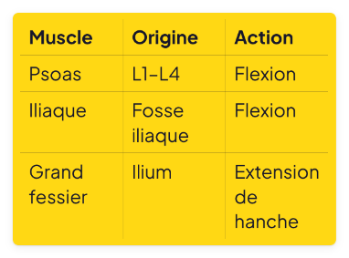 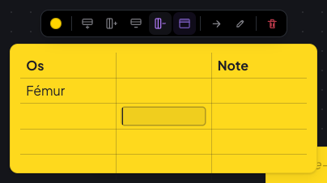

### 5) Surlignage modernisé (`pdfShared.js#lignesSurlignage`, rendu seulement)

Les rectangles enregistrés (un par mot / span) sont fusionnés ligne par ligne au rendu : un rectangle continu du premier
au dernier caractère, espaces compris, coins de 3 px, 1 px de débord en haut et en bas, multiply ; opacité de la
couleur inchangée (couleurs franches à 40 %). Même rendu sur le texte natif, la couche OCR et les mots d'une image
collée. Le stockage (`anchor`, `rects`) ne change pas.

| 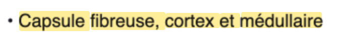 | 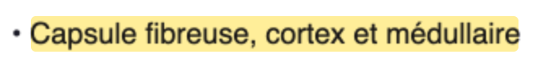 |
|---|---|
| avant (OCR) : 5 rectangles mot par mot, hauteurs inégales, espaces non couverts | après : 1 rectangle continu arrondi |

### 6) Tableau (Miro) : ajout de cartes et curseurs (`tableau/Board.jsx`, `lib/board.js`)

« + Carte » (déjà présent) et un bouton « Boîte-tableau » dans la barre du tableau ; double-clic sur le fond = une carte
à cet endroit (déjà présent) ; tableau vide : « Double-cliquez pour ajouter une carte, ou glissez une flashcard ici »,
centré. « → Tableau » dans la mini barre d'une boîte (et d'un post-it, d'une boîte-tableau) : la boîte devient une carte
du tableau de la fiche (`carteDepuisBoite` : même texte, même couleur, le tableau pour une boîte-tableau,
`source.boiteId`) — par la pile d'annulation du tableau s'il est affiché ; déjà posée, l'action est marquée et ouvre le
tableau centré sur sa carte. Curseurs : `grab` au survol de tout objet déplaçable (boîte, forme, trait, image, « ? »,
carte), `grabbing` pendant un glisser (classe `mr-glisse` posée par le gestionnaire de pointeur unique
`pdf/pointeur.js#suivrePointeur`, option `glisser`), `text` seulement en édition — mêmes règles dans le lecteur et le
tableau.

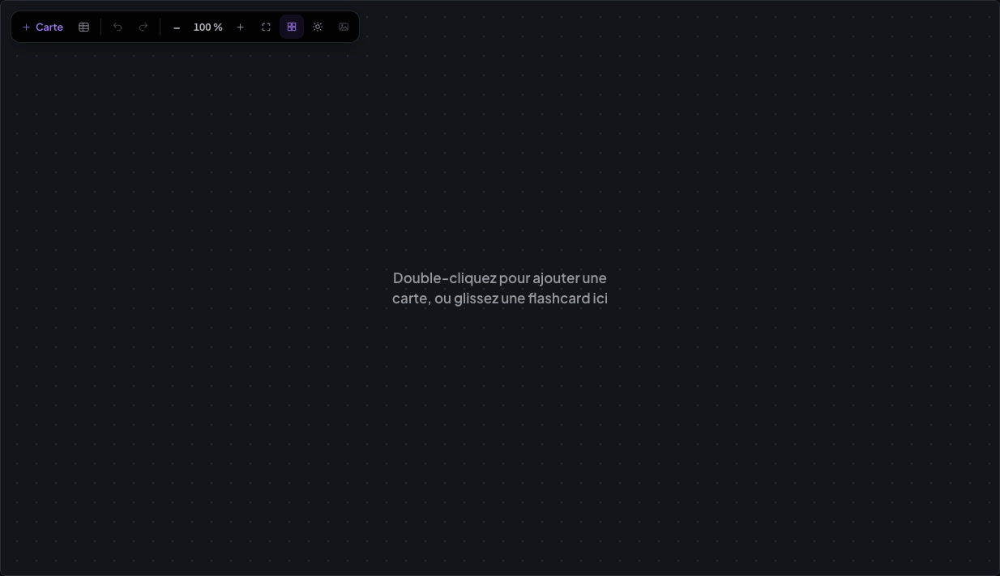

## Tests (Chrome headless, base locale, Vite sans Supabase — jamais le vrai cloud)

Banc : `scripts/tests-simplification-outils/` (`tout.sh` lance tout). Ordinateur 1440 × 900, tablette 1024 × 1366
tactile, téléphone 390 × 844. Résultat final : **207 ✅, 0 ❌, 0 erreur JavaScript**.

| Banc | Ce qui est vérifié | Ordinateur | Tablette |
|---|---|---|---|
| `t-barre` | 6 outils dans l'ordre, ⌘1–6, infobulles, plus de « ? » / Crayon / Gomme / Boîte séparés, chaque sous-barre, sous-outil mémorisé, Formes « … » (12 formes), Insérer laisse la page en Sélection | 15 ✅ | 15 ✅ |
| `t-surligneur` | texte natif surligné, même couleur retire, autre couleur remplace, rendu (3 px, débord 1 px, multiply), main levée hors du texte (mode et couleur du Surligneur), Ligne droite | 8 ✅ | 8 ✅ |
| `t-surlignage-ocr` | couche OCR : 5 mots enregistrés → 1 rectangle affiché, avant / après | ✅ | — |
| `t-mini-barres` | plus de grande barre ; boîte, « … », Verrouiller, G / alignement sur toute la boîte, une entrée d'Annuler par réglage, taille, italique sur la seule sélection en édition ; texte libre, forme, trait, bloc remplacé | 16 ✅ | 16 ✅ |
| `t-boite-tableau` | 3 × 4 avec en-tête, Tab / Maj+Tab, Entrée dans la cellule, rendu (pleine largeur, pas de bordure extérieure, en-tête gras), + / − lignes et colonnes, en-tête on/off, redimension proportionnelle, filet, ⌘Z | 16 ✅ | 16 ✅ |
| `t-tableau-miro` | curseurs grab / grabbing / text (lecteur et tableau), « → Tableau » (ajout, marque, déjà posée = montrée centrée), boîte-tableau → carte-tableau, tableau vide (texte exact, centré), « + Carte », double-clic, boîte-tableau dans le tableau (Tab, + ligne, + colonne) | 18 ✅ | 18 ✅ |
| `t-document` | document : plus de barre permanente, mini barre au-dessus de la sélection (pas sur un simple clic), G, H1, « … », tableau du document (+ ligne) | 9 ✅ | 9 ✅ |
| `t-texte` | anciens « ? » affichés et manipulables, Boîte / Texte libre / Post-it posés d'un clic, post-it carré jaune avec ombre, sa mini barre, Formes « … » › Étoile, Dessin › Gomme | 8 ✅ | 8 ✅ |
| `t-mobile` | téléphone : l'app mobile s'ouvre sans erreur (ni lecteur ni tableau sur ce format, inchangé) ; un dessin envoyé par la fonction du téléphone arrive dans Insérer › Dessins (pastille « 1 »), « Poser » | 7 ✅ | — |

## Non-régression

- **Annotations existantes** (`tests-pdfreader-reparation/t-anciennes`, 16 sortes d'annotations d'avant) : ancien code
  (HEAD 556127d) contre nouveau, même banc : 100 % → 0 pixel différent ; 160 % → écart maximal 1/255 (anticrénelage).
  iPad : 0 pixel à 100 % ; à 160 %, l'écart (293 px) est inférieur au bruit de l'ancien code contre lui-même
  (1 442 px, écart 36). **Géométrie** (`tests-tableau-v11/t-tailles geo avant|apres`) : 5 ✅, rien ne bouge.
- Seul changement visible voulu sur l'existant : le **surlignage** (un rectangle par ligne, coins de 3 px), stockage inchangé.
- Anciens bancs relancés : réparation `t-boites` 13 ✅, `t-contextes` 19 ✅, `t-dock` 11 ✅, `t-telephone` 6 ✅, `t-export`
  3 ✅ ; harmonisation `t-inserer` 9 ✅, `t-fleches` 18 ✅, `t-objets` 31 ✅ ; tableau `t-tableau` 25 ✅ ; v1.1
  `t-vers-tableau` 8 ✅, `t-entete-panneau` 9 ✅, `t-amorce` 6 ✅, `t-tailles uniforme` 2 ✅. Échecs **voulus** (le banc
  décrit l'ancienne interface) : `t-objets` (2, l'ancienne mini barre de boîte et de texte libre), `t-crayon` (segment
  Dessin / Surligneur du crayon, devenu l'outil Surligneur), `t-barre` de la réparation (ancienne barre). L'aide de banc
  commune `b.outil('Crayon' | 'Gomme' | 'Boîte' | 'Texte' | 'Image')` ouvre désormais le bon groupe puis le sous-outil.
- **MealWeek** : ouverte depuis le sélecteur après MedRevise, 0 erreur ; capture ancien code / nouveau code
  **identique octet pour octet** (`cmp`). **`src/shared/` et `src/mealweek/`** : aucune modification (`git status`).
- Aucune écriture Supabase (Vite lancé avec `VITE_SUPABASE_URL=` vide) ; aucun fichier écrit dans ~/Downloads.
- `npm run build` : vert, aucun « not exported ».

## Points d'attention / décisions

- **« Commentaire »** n'existait pas dans le code : le « ? » en tenait lieu ; il fusionne avec le Post-it (les « ? »
  existants restent visibles et modifiables, on n'en pose plus de nouveaux).
- **Formes** : les cinq demandées sont affichées ; les sept autres restent accessibles par « … » (aucune fonction perdue).
- **Opacité du surlignage** : celle de chaque couleur est gardée (couleurs franches à 40 % en multiply, pastels d'avant
  pleins comme avant) pour que les surlignages existants gardent leur teinte.
- Dans une boîte **en édition**, ⌘Z va d'abord au texte (TipTap), comme avant ; une mise en forme faite boîte fermée
  est une entrée d'Annuler du lecteur.
- Boîte-tableau : en édition, « − ligne / − colonne » retirent la ligne / colonne du curseur (comme un traitement de
  texte) ; boîte seulement sélectionnée, les ajouts et retraits se font à la fin.
- Téléphone : le lecteur et le tableau n'existent pas sous 760 px (inchangé) ; le test mobile couvre l'app mobile et
  l'envoi d'un dessin vers Insérer › Dessins du téléphone.

## Commits

- `51a6c7a` feat(medrevise): mini barre — menu « … », barre flottante au-dessus d'une sélection, mise en forme du texte commune (FormatTexte)
- `e7c8521` feat(medrevise): curseur « main fermée » pendant le glisser d'un objet (option glisser du gestionnaire de pointeur)
- `29637fb` feat(medrevise): boîte-tableau — composant partagé lecteur / tableau (cellules, Tab, filets, lignes et colonnes)
- `1f53cf0` feat(medrevise): surlignage continu — fusion des rectangles par ligne (rendu seulement)
- `66a662b` feat(medrevise): sélecteur de taille — icône « T ↕ » + valeur, infobulle « Taille du texte »
- `6a84030` feat(medrevise): lecteur — barre à 6 outils (⌘1–6) et sous-barres, Surligneur unique (texte ou main levée), plus de grande barre de format : mise en forme dans la mini barre de chaque objet et au-dessus de la sélection d'un document, post-it, boîte-tableau, verrou, « → Tableau », surlignage arrondi, sélecteur compact, curseurs
- `59418d9` feat(medrevise): tableau — boîte-tableau (même composant que le lecteur), message du tableau vide, « → Tableau » depuis une boîte (montrée si déjà posée), curseurs grab / grabbing
- `350f40b` test(medrevise): banc de la simplification des outils (ordinateur, tablette, téléphone) ; b.outil() des anciens bancs suit la barre à 6 outils
- (ce compte rendu et ses captures : le commit `docs` qui suit)
