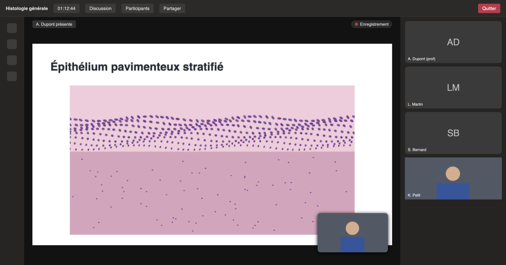
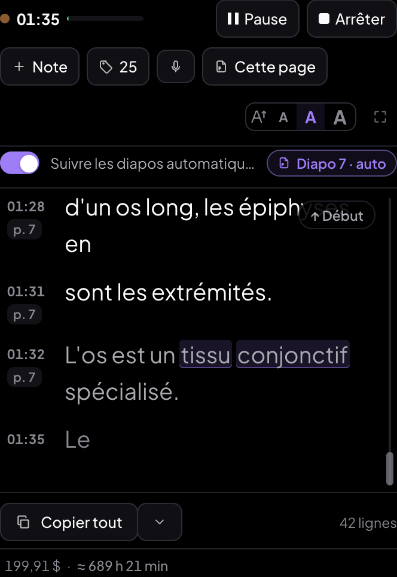
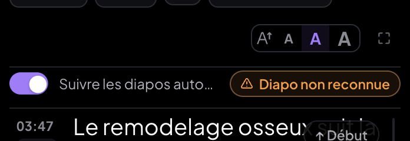
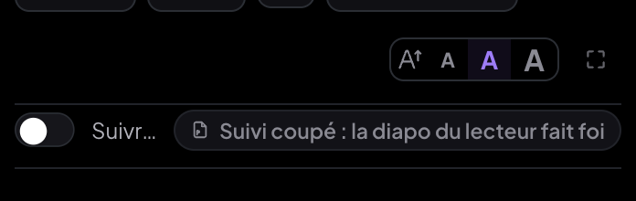
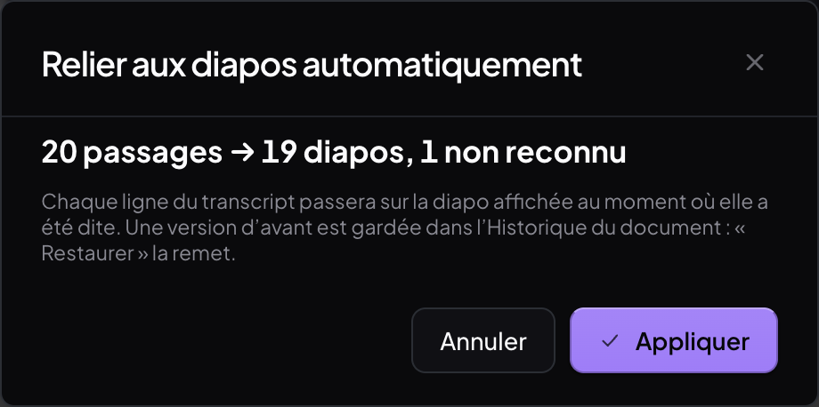
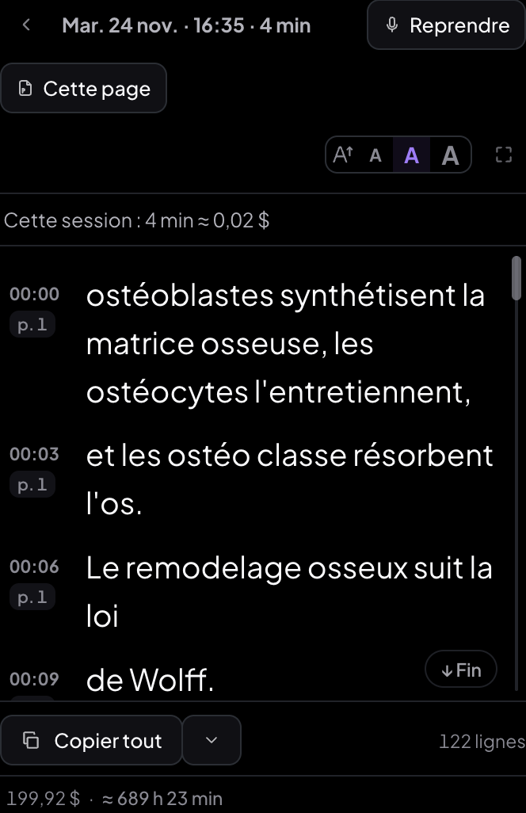

# Suivi automatique des diapos pendant une transcription — compte rendu (24/11/2026)

Pendant une transcription dont la source est un **onglet** (Teams, Zoom, YouTube dans Chrome), MedRevise reconnaît la
diapo que le prof affiche dans la vidéo de ce même partage d'onglet, et range le transcript sur la bonne page du PDF du
cours. Ça marche quel que soit l'écran ouvert dans l'app, et l'affichage ne bouge jamais tout seul. Une **répartition
après coup** relance la même reconnaissance quand le PDF n'arrive qu'après le cours.

**Résultats (Chrome, vrai partage d'onglet, faux cours Teams de 29 passages) :**
- **Passages : 100 %** liés à la bonne diapo (29/29).
- **Lignes : 98,4 %** sur la bonne diapo (180/183).
- **Diapos au même titre ou à fond noir : 0 mauvais changement.**
- **Délai moyen : 2,66 s** (max 8,2 s).
- **Aucun mot perdu**, avec ou sans le suivi.
- Après coup : **100 %** des passages et des lignes.

---

## 1. Ce que voit l'étudiant

- **Panneau Transcript, en direct, source onglet** : une ligne sous la barre, avec l'interrupteur **« Suivre les diapos
  automatiquement »** (actif par défaut, mémorisé sur l'appareil) et l'indication **« Diapo 12 · auto »**. Selon le cas,
  elle affiche aussi « Diapo non reconnue », « Préparation des diapos… », « Pas de PDF : changements mémorisés »,
  « Partage arrêté » ou « Suivi coupé : la diapo du lecteur fait foi ». Chaque élément a son infobulle.
- **Les lignes** portent le « p. N » de la diapo reconnue (pastilles, filtre « Cette page », badges du lecteur, copie
  avec numéros : le mécanisme existant, inchangé). Le lecteur n'est jamais déplacé.
- **Diapo hors du PDF, prof qui montre autre chose, partage coupé côté Teams** : le texte reste sur la dernière diapo
  reconnue, l'indication passe à « Diapo non reconnue ».
- **Menu ▾ d'une session terminée** : **« Relier aux diapos automatiquement »**. Une fenêtre analyse les diapos gardées
  pendant le cours contre le PDF **actuel** du document, puis affiche l'aperçu (« 20 passages → 19 diapos, 1 non
  reconnu »). Deux boutons : **Appliquer** (`putBackup`, puis une version « Avant « Relier aux diapos automatiquement » »
  dans l'Historique du document, restaurable) ou **Annuler**.

| | |
|---|---|
| Faux cours Teams du banc (diapo partagée, bandeaux, vignettes caméra, bulle d'enregistrement) |  |
| Panneau en direct : « Diapo 7 · auto », lignes en « p. 7 » |  |
| Diapo hors du PDF |  |
| Interrupteur coupé |  |
| Répartition après coup : aperçu |  |
| Après « Appliquer » |  |

Les captures montrent le PDF **synthétique** du banc (voir § 6), jamais un vrai cours.

---

## 2. Comment c'est fait (un seul code)

```
partage d'onglet (UNE demande, celle de la transcription)
 ├─ piste audio ──▶ audio.js (inchangé : flux audio seul) ──▶ Deepgram
 └─ piste vidéo (gardée au lieu d'être arrêtée)
      └─ MediaStreamTrackProcessor ─(flux transféré)─▶ Web Worker diapos/worker.js
           1 image / s (4 / s pendant un changement) → petite image ≈ 160 px de la zone de la diapo
           changement ? → stable 1,5 s ? → zone → recadrage → moteur.js (scores, décision)
           hésitation ? → OCR de l'app (même worker Tesseract) → texte
      ◀── { heure du changement, page, image 480 px JPEG, masque }
 suivi.js (fil principal, < 0,5 ms par message) → engine.js : session.diapos[] + page des lignes depuis cet instant
```

| Fichier | Rôle |
|---|---|
| `transcription/diapos/moteur.js` | **le moteur unique** (fonctions pures) : signatures, ressemblance, texte, décision, zone, changement, affectation au temps |
| `transcription/diapos/worker.js` | Web Worker : images de l'onglet, détection, zone, recadrage, scores ; **rendu des pages du PDF** (pdf.js de l'app sur OffscreenCanvas) ; rejouer une capture gardée |
| `transcription/diapos/suivi.js` | pilote : flux vidéo → worker, OCR si hésitation, images gardées, état de l'indication |
| `transcription/diapos/pagesCours.js` | pages du PDF du cours préparées **une fois** (cache local `meta`), texte natif + couche OCR, numérotation avec pages ajoutées |
| `transcription/diapos/repartition.js` | « Relier aux diapos automatiquement » : même worker, même décision, aperçu, `putBackup` + Historique |
| `transcription/diapos/SuiviDiapos.jsx` | interrupteur, indication, fenêtre d'aperçu |
| `transcription/audio.js` | la piste vidéo du partage d'onglet est gardée et rendue à part (le son ne change pas) |
| `transcription/engine.js` | `champsPage(t)` : page reconnue à l'instant où la ligne commence ; `recevoirDiapo` ; démarrage, arrêt et bascule de source du suivi |
| `lib/historiqueDoc.js`, `pdf/HistoriqueDoc.jsx` | une version peut porter la session de transcript ; « Restaurer » la remet |
| `pdf/pdfjsSetup.js` | `openPdf(data, options)` : options en plus (rendu dans un worker) |
| `vite.config.js` | `worker: { format: 'es' }` (le worker charge pdf.js à la demande) |

**Liaison au transcript.** C'est le mécanisme existant (`page`, `pageCle`, `doc` sur chaque segment et chaque note) :
- seule la source de la page change. Avec le suivi actif, c'est la diapo reconnue à l'instant de cours `t0` où la ligne
  commence ;
- un changement reconnu jusqu'à ~3 s après coup corrige les lignes déjà validées depuis l'heure du changement (session
  en direct seulement) ;
- avant la première reconnaissance, et quand l'interrupteur est coupé, c'est la page du lecteur, comme avant.

**Mémoire des changements.** Chaque changement détecté est rangé dans `session.diapos[]` (en ajout) : `{ n, t, le,
page, pageCle, nonReconnue, score, marge, delaiMs, img, masque, zone, texte? }`. L'image recadrée est un JPEG d'environ
480 px rangé dans le store **local** `meta` (`diapos.img:<session>:<n>`). Elle n'est jamais envoyée au cloud ni à un
service externe : seule la liste (sans image) suit la session dans la synchro.

**Aucune migration, aucune écriture Supabase destructive**, aucune session, annotation, document ou carte existant
modifié, sauf par « Appliquer » de la répartition après coup.

---

## 3. Méthode de comparaison et seuils retenus

### Détection du changement
- **Petite image :** ≈ 160 px de large, en couleur, de la zone de la diapo (de tout l'onglet tant qu'elle est inconnue),
  1 fois par seconde au repos, 4 fois par seconde pendant un changement. Grille de 32 × 18 cases.
- **Case « changée » :** plus de 20 % de ses pixels ont bougé de plus de 0,05 (canal le plus changé). Une photo
  remplacée par une autre de même teinte moyenne est ainsi bien vue.
- **Cases vivantes :** une case qui bouge sans cesse (vidéo de la caméra, bulle qui clignote) est apprise par moyenne
  glissante (seuil 0,2) et ignorée, ainsi que ses voisines, pour la détection comme pour la comparaison.
- **Changement :** plus de 4 % des cases non vivantes diffèrent de la diapo reconnue. Il est **retenu** quand moins de
  1,5 % des cases bougent pendant **1,5 s** (12 s au plus pour une diapo animée sans fin). L'heure retenue est le
  milieu entre les deux contrôles qui l'encadrent.

### Zone de la diapo
- **Recherche :** sommes cumulées des contours sur une image de 240 px. On cherche les 5 meilleurs rectangles au format
  des pages du PDF (± 1,5 %), à quatre bords nets.
- **Choix :** on garde la zone connue (la mise en page de Teams est stable). On n'en change que si elle ne reconnaît
  rien et qu'un autre rectangle fait nettement mieux, jamais un rectangle nettement plus petit : une photo *dans* la
  diapo ressemblerait à une diapo « photo seule ».

### Ressemblance d'image (critère principal), capture ↔ page
Grossière, sur des grilles :

| Élément | Poids | Mesure |
|---|---|---|
| Luminance, grille 48 × 36 | 0,30 | corrélation |
| Contours, 16 × 12 | 0,15 | corrélation |
| Texture (écart-type local), 16 × 12 | 0,20 | corrélation |
| Couleur moyenne (axes rouge-vert, jaune-bleu), 16 × 12 | 0,15 | exp(−écart / 0,06) |
| Histogramme 3 × 3 × 3 par case | 0,20 | intersection |

- **Écart à la page moyenne du PDF :** luminance, contours et texture sont comparés en *écart* à cette page moyenne.
  Ce que toutes les pages partagent (bandeau de titre, fond blanc, logo) ne compte plus : deux diapos au même titre ne
  se ressemblent que par leurs photos.
- **Comparaison fine (pixel à pixel) :** images 160 × 90 en niveaux de gris, en écart à la page moyenne, meilleure
  corrélation sur un décalage de ± 1 px. Elle compte pour **0,4** du score d'image, et seulement sur les 8 pages les
  plus proches. Deux photos du même tissu ont la même allure, mais pas leurs cellules aux mêmes endroits.
- **Garde-fou de couleur :** score × (0,55 + 0,45 × accord des couleurs). Une galerie de visages grise ne « ressemble »
  plus à une coupe rose (0,68 → 0,38).
- **Rendu des pages :** 480 px. À 160 px, les fibres fines disparaissaient du rendu alors que la capture les gardait :
  la photo pleine page sans titre passait de 0,36 à 0,84.

### Texte (OCR) et proximité
- **Quand :** l'OCR (Tesseract de l'app, même worker) ne tourne que si l'image hésite.
- **Mesure :** part des mots reconnus qui existent dans le PDF, pondérés par leur rareté. Un titre répété sur 5 diapos
  pèse presque rien, une URL ou un sous-titre propre à une page pèse lourd.
- **Score :** 0,7 image + 0,3 texte.
- **Bonus de proximité :** + 0,02 pour la page suivante, + 0,012 pour la page actuelle, + 0,01 pour les pages à ± 2.

### Décision (`moteur.js#PARAMS`)
| Seuil | Valeur | Sens |
|---|---|---|
| `SEUIL` | **0,50** | score minimal d'une page retenue |
| `MARGE` | **0,03** | avance minimale sur la deuxième page |
| `NON_RECONNU` | **0,50** | sans page nette, meilleur score sous cette valeur = la diapo n'est pas dans le PDF |

Sans page nette mais avec deux pages fortes, c'est une hésitation : on garde la diapo actuelle et l'indication ne change
pas.

**Réglage.** `scripts/tests-suivi-diapos/reglage.mjs` rejoue le moteur sur les 31 captures gardées par le banc :
- les vraies pages sont toutes en tête, entre 0,59 et 0,93 ;
- les marges vont de 0,03 (deux coupes de muscle strié presque identiques, caméra passant dessus) à 0,61 ;
- tout ce qui n'est pas dans le PDF reste sous 0,39 (diapo « Questions ? » 0,32, galerie de Teams 0,38).

---

## 4. Tests (Chrome)

**Banc** (`scripts/tests-suivi-diapos/`, outils de test jamais chargés par l'app) :
- `faux-teams.html` imite une réunion de visio sombre :
  - bandeau et rail, panneau des participants, vignettes caméra **animées** ;
  - « A. Dupont présente », bulle **Enregistrement** qui clignote, curseur ;
  - la diapo partagée est rendue par pdf.js à 1 200 px puis en **JPEG 55 %** avec un léger flou et des couleurs
    décalées, comme dans une vidéo.
- **Capture par le vrai partage d'onglet de Chrome :** Chrome fenêtré **hors écran** (la capture d'onglet ne marche pas
  en headless), choix automatique de l'onglet (`--auto-select-tab-capture-source-by-title`), piloté en CDP. Le reste de
  l'app est inchangé.
- **Faux Deepgram local :** `/__mots` renvoie la liste des mots validés, pour prouver qu'aucun ne manque.
- **Aucun son ne sort :** le son du faux Teams est très faible (≈ −50 dB) et le banc ajoute `suppressLocalAudioPlayback`
  à la demande de partage. Le micro est un périphérique factice.

**PDF d'histologie : aucun dans ~/Downloads le 24/11.** Le banc utilise donc `gen-histo.mjs`, qui génère hors du dépôt
32 pages qui imitent ce qui rend l'histologie difficile :
- 5 « Épithélium pavimenteux stratifié », 4 « Peau », 2 « Cartilage hyalin » et 2 « Muscle strié » avec des photos
  différentes du même tissu ;
- 5 photos pleine page sans titre ;
- 4 diapos à fond noir sur le fond sombre de Teams ;
- une page de titre avec URL, deux pages de texte.

Pour le vrai PDF : `PDF_HISTO=~/Downloads/xxx.pdf node t-suivi.mjs` (lu en local, jamais copié ; aucune capture n'est
alors publiée).

### Cours en direct — `t-suivi.mjs` (29 passages de 14 s, 7 min, TOUT VERT)

| Scénario | Passages | Lignes |
|---|---|---|
| Défilement normal | 100 % | 42/43 |
| Même titre, photos différentes (3→7, 27→30) | 100 % · **0 mauvais changement** | 54/55 |
| Sans titre (photo seule) | 100 % | 13/13 |
| Fond noir (os compact ×3 + photo noire) | 100 % · 0 mauvais changement | (dans « normal ») |
| Retour en arrière (10 → 7) | 100 % | 6/6 |
| Saut de 10 diapos (8 → 18) | 100 % | 6/7 |
| Animation (photo qui apparaît en fondu) | 100 % | 6/6 |
| Vignette caméra qui traverse la diapo | 100 % | 11/11 |
| Diapo absente du PDF | « Diapo non reconnue », texte gardé sur la diapo d'avant | 7/7 |
| Partage coupé (galerie) puis repris | « Diapo non reconnue », puis la diapo reprise reconnue | 5/5 + 9/9 |
| Moi dans un autre cours de l'app pendant 3 diapos | 100 % | 21/21 |
| **Total** | **29/29 = 100 %** | **180/183 = 98,4 %** |

Les 3 lignes « fausses » commencent dans la seconde qui suit un changement : elles ont été dites sur la diapo d'avant,
la vérité du banc les compte sur la nouvelle.

**Les autres vérifications du passage :**
- délai changement → liaison : **moyen 2,66 s**, max 8,2 s (cas avec OCR) ;
- une seule demande de partage ;
- le lecteur n'a jamais bougé (page 1 → 1) ;
- console sans erreur.

**Aucun mot perdu.** Les mots du transcript sont *identiques et dans le même ordre* que ceux que Deepgram a validés, et
cela avec le suivi (863 jetons, 855 mots) comme sans le suivi (221 et 219). Les deux chiffres diffèrent parce qu'un mot
validé peut contenir une espace (« ostéo classe »). Le débit est le même : 2,07 mot/s dans les deux cas, et la session
ne contient aucun trou.

Les réglages ont été faits sur des passages successifs. Avant les corrections, le premier passage complet donnait 69 %,
ce qui a conduit aux corrections du § 3 (pages prêtes après la 1re diapo, détection par part de pixels, zone stable,
écart à la page moyenne, comparaison fine, garde-fou de couleur, rendu à 480 px, rendu dans le worker).

### Répartition après coup — `t-repartition.mjs` (TOUT VERT)
1. **Pendant le cours :** même faux cours (20 passages) transcrit dans un **document vierge** créé dans l'app.
   L'indication affiche « Pas de PDF : changements mémorisés » ; 20 changements sont gardés, aucun reconnu.
2. **Remplacement :** Fichier › « Remplacer par un PDF » (même fonction que le menu) avec le PDF du prof.
3. **Aperçu :** menu ▾ › « Relier aux diapos automatiquement ». L'aperçu met **4,2 s** et annonce
   « **20 passages → 19 diapos, 1 non reconnu** », exactement le scénario joué. La session n'est pas modifiée avant le
   clic.
4. **Appliquer :** `putBackup` puis la version « Avant… » dans l'Historique. Résultat : **passages 100 % (20/20),
   lignes 100 % (122/122)**.
5. **Restaurer :** « Restaurer » cette version remet la session d'avant (lignes et diapos identiques), et le PDF reste
   rattaché.

### Non-régression
- **Transcript** (`t-nonreg.mjs`, TOUT VERT) :
  - lecteur PDF : ouverture, défilement, numéro de page ;
  - source **micro** : transcription, aucune ligne de suivi, lignes sur la page du lecteur comme avant ;
  - crédits Deepgram affichés ;
  - **reprise** d'une session terminée depuis l'onglet : même session, marque « reprise à … », le suivi reconnaît la
    diapo, les lignes d'avant ne bougent pas ;
  - console sans erreur.
- **Tests** (vitest) :
  - `tests/suivi-diapos` : **12/12** ;
  - `npm test` : **374/376**. Les 2 échecs (crayon, emploi-du-temps/api) existaient avant le chantier.
- **Build vert.**
- **MealWeek :** aucun fichier MealWeek ni `src/shared/` touché. Code d'avant (08e9ac4) et d'après comparés : **même
  texte, capture identique au pixel près** sur ordinateur et téléphone, 0 erreur console
  (`img/suivi-auto-diapos/mealweek-*`).
- **Non refait ici :** son du Mac (BlackHole n'est pas installé : même chemin que le micro) et synchro à deux appareils.
  La synchro n'est pas modifiée : seule la liste `diapos[]` s'ajoute à la session, qui suit déjà la synchro ciblée.

---

## 5. Performance et stockage (mesurés pendant le passage de 7 min)

| Mesure | Résultat |
|---|---|
| Fil principal, travail du suivi | **0,4 ms au plus** par message (0,08 ms en moyenne, 63 messages) : il ne touche jamais une image |
| Préparation des 32 pages du PDF | **dans le Web Worker** (pdf.js sur OffscreenCanvas) : 0,57 s en tout, 91 ms au plus par page, **0 tâche longue** sur le fil principal (mesuré : 0). Faite une fois par PDF, gardée en local |
| Images > 25 ms sur le fil principal pendant le cours | 7 sur 16 582 (5 > 50 ms). Aucune n'est imputable au suivi, dont tout le travail sur ce fil tient sous 0,4 ms. La mesure « sans suivi » à comparer n'a pas pu être relevée (onglet en arrière-plan) |
| CPU de tout Chrome (onglet Teams compris) | **0,62 cœur** avec le suivi, **0,44** sans : **≈ + 0,18 cœur** ajouté (lecture des images à 5 i/s, détection, analyses) |
| Délai changement → liaison | **moyen 2,66 s** (1,5 s de stabilité exigée + ≤ 1 s de cadence + calcul), max 8,2 s quand l'OCR départage |
| OCR lancés | 2 sur 30 changements |
| Stockage | **13,3 Ko** par changement (JPEG 480 px), soit **3,4 Mo/heure** au rythme du banc (une diapo toutes les 14 s). Un cours réel (≈ 1 diapo/min) fait ≈ **0,8 Mo/heure**. Liste `diapos[]` dans la session : 44 Ko en JSON |

---

## 6. Limites connues

- **PDF d'histologie réel non testé.** Aucun PDF d'histologie n'était dans ~/Downloads : les chiffres viennent du PDF
  synthétique. Le relancer avec `PDF_HISTO=…` dès qu'il est là ; `reglage.mjs` montre alors les marges réelles.
- **Teams en application (pas dans Chrome) :** pas de vidéo d'onglet, donc pas de suivi. La source micro ou BlackHole
  marche comme avant, sur la page du lecteur.
- **Photos presque identiques :** deux coupes du même tissu, ou la même photo recadrée, peuvent rester trop proches
  (marge < 0,03). On garde alors la diapo actuelle : jamais de mauvais changement, mais le passage peut rester sur la
  diapo d'avant.
- **Diapo sombre dès le départ :** si la toute première diapo est sombre sur le fond sombre de Teams, la zone se trouve
  moins bien. Elle se cale à la première diapo claire.
- **Changements très rapides :** une diapo affichée moins de 1,5 s n'est pas retenue (règle demandée).
- **Images des changements :** gardées sur l'appareil qui a enregistré. Sur un autre appareil, la répartition après
  coup dit « N images absentes de cet appareil ».
- **Pages ajoutées dans l'app :** le numéro affiché est calculé avec les pages ajoutées. Le lien de chaque ligne passe
  par `pageCle` (n° de page du PDF), donc il reste juste.
- **Restaurer :** comme toute restauration de l'Historique, une version « Avant… » remet aussi les annotations du
  document dans l'état de ce moment.
- **Le banc** pilote un Chrome fenêtré hors écran (la capture d'onglet ne marche pas en headless). Certains clics CDP
  hors écran se perdent : le banc les réessaie, ou clique par le DOM quand aucun geste n'est requis.

---

## 7. Commits

| Commit | Message |
|---|---|
| `faed3c0` | feat(medrevise): suivi automatique des diapos pendant une transcription d'onglet |
| `b9d0e5f` | fix(medrevise): suivi des diapos — pages préparées dans le worker, comparaison fine et garde-fou de couleur |
| (ce commit) | test + docs : banc Chrome du suivi des diapos (faux Teams, répartition après coup, non-régression), compte rendu et captures |

Les « sync auto » intercalés commitent et poussent automatiquement `progression.md` et ce qui traîne. Le code ci-dessus
est sur `main`.

**Reproduire.** Lancer `faux-deepgram-diapos`, `faux-teams` et `medrevise-banc-diapos` (`.claude/launch.json`), puis :

```sh
node scripts/tests-suivi-diapos/gen-histo.mjs     # PDF synthétique, hors dépôt (sinon PDF_HISTO=…)
node scripts/tests-suivi-diapos/t-suivi.mjs       # cours en direct (COURT=1 : 3 passages)
node scripts/tests-suivi-diapos/t-repartition.mjs
node scripts/tests-suivi-diapos/t-nonreg.mjs
node scripts/tests-suivi-diapos/reglage.mjs       # scores hors ligne des captures gardées
npx vitest run tests/suivi-diapos
```
