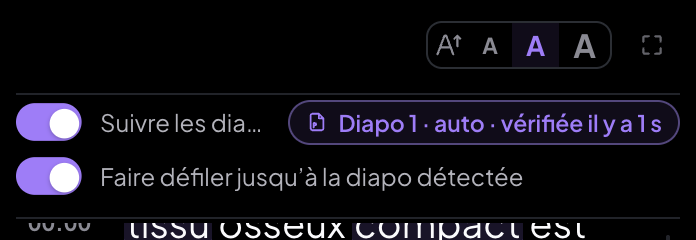
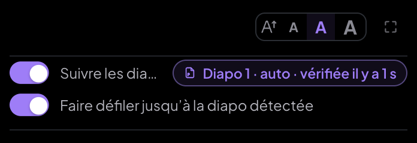
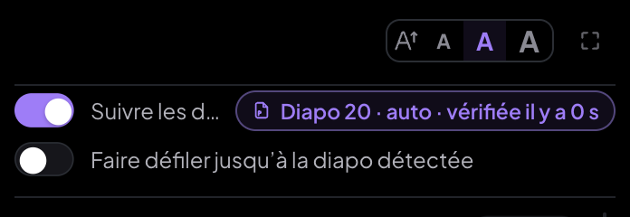

# Suivi des diapos sans interruption + « Faire défiler jusqu'à la diapo détectée » — compte rendu (26/11/2026)

Deux demandes :
1. trouver pourquoi la reconnaissance des diapos restait bloquée sur une diapo dépassée quand l'élève est ailleurs (un
   autre cours, un autre onglet, la fenêtre réduite), et la corriger à la racine ;
2. ajouter l'option « Faire défiler jusqu'à la diapo détectée ».

**Résultats (Chrome non headless, vrai partage d'onglet, faux cours Teams, ralentissement des onglets en arrière-plan
LAISSÉ ACTIF) :**
- **20 min onglet caché : 9/9 changements détectés.**
- 20 min autre cours de l'app : 9/9 · 20 min fenêtre réduite : 10/10 · 20 min en alternance : 11/11.
- Délai moyen 2,1 s ; **38/39 changements en ≤ 2,5 s**, le dernier en 3,6 s (diapo départagée par la lecture de son texte, qui
  prend 1,4 s). Plus grand trou du journal : 5,2 s (un « pouls » toutes les 5 s).
- Panne injectée (l'OCR de l'app ne répond plus) : **avant 0/4 diapos reconnues ensuite, et une indication
  « Diapo 1 · auto » fausse ; après 4/4**, délai de 2,0 à 3,4 s.
- Partage sans image pendant 25 s : orange « Vérification arrêtée : partage arrêté » en 0,5 s, puis reprise seule.
- Défilement : tous les cas demandés sont verts sur ordinateur et tablette, et la ligne de suivi sur téléphone.
- Aucun mot perdu. MealWeek identique au pixel près. Build vert.

---

## 1. Diagnostic

### 1.1 Méthode
Un **journal horodaté des analyses** a d'abord été ajouté seul, sans changer le comportement (`worker.js#noterJ`, gardé
par `suivi.js#journalSuivi`). Il note :
- chaque analyse : heure, page retenue, score, marge, délai ;
- les demandes et réponses d'OCR ;
- un **« pouls » toutes les 5 s** : mode de la boucle, heure de la dernière image vérifiée, nombre d'images reçues ;
- la visibilité de la page.

Le code d'avant (`13e8d9a` + ce journal) a été figé dans une copie servie à part : port 5305, son propre cache Vite et
son propre faux Deepgram. Le nouveau banc `t-continu.mjs` y a été joué, chaque hypothèse vérifiée une par une.

Un **premier essai a été écarté**. Le serveur du code d'avant partageait le cache de dépendances Vite du dépôt (lien
`node_modules`). Le banc du nouveau code a réoptimisé ce cache, ce qui a **rechargé la page de l'app** en plein cours
d'avant. Le banc vérifie désormais que la page n'est jamais rechargée (`window.__idPageBanc`).

### 1.2 Hypothèses vérifiées (code d'avant)

| Hypothèse | Test | Résultat | Preuve |
|---|---|---|---|
| La détection est attachée à la page du cours | 12 min dans un autre cours de l'app | **écartée** : 5/5 changements | pouls réguliers (≤ 5,3 s), suivi lancé par `engine.js` et non par un écran |
| Chrome ralentit les minuteries de l'onglet caché (1 par minute après 5 min), suspend `requestAnimationFrame` ou n'actualise plus la vidéo cachée | 12 min avec un autre onglet devant, puis 12 min fenêtre réduite | **écartée** : 6/6 et 6/6, 5 images/s reçues tout du long | la boucle tourne dans un **Web Worker**, non ralenti (4 contrôles/s mesurés caché). Les images viennent de `MediaStreamTrackProcessor`, pas d'un élément vidéo |
| La piste vidéo se met en pause quand l'onglet Teams change d'état | sonde : l'onglet Teams capturé est bien `hidden`, rAF = 0/s | **écartée** : la capture continue (5 images/s) | même avec une variante où la diapo arrive par une **vidéo WebRTC** (`faux-teams.html?video=1`), les résultats sont identiques Teams devant ou derrière (2 ratés au démarrage de la vidéo dans les deux cas : artefact du faux Teams) |
| Le worker est arrêté, ou l'OCR libéré pendant une analyse | panne injectée : l'OCR ne répond plus (`t-ocr-bloque.mjs`) | **CONFIRMÉE** : 0/4 diapos reconnues ensuite, indication « Diapo 1 · auto » | journal ci-dessous |
| Une erreur silencieuse arrête la boucle | lecture du code + journal | **CONFIRMÉE en partie** | si le lecteur d'images s'arrête, rien ne le relance (`image = null` pour toujours) ; état jamais remis à zéro entre deux sessions ou deux sources |

### 1.3 Cause exacte
**L'analyse d'une diapo ambiguë attendait la réponse de l'OCR de l'app sans aucune limite.** Pendant cette attente, la
boucle du worker reste en mode `analyse` et ne regarde plus aucune image : `tic()` sort aussitôt. Rien ne la
relançait :
- pas de chien de garde ;
- aucun délai maximal sur l'OCR ;
- un `arret` qui ne remettait pas l'état à zéro : une session ou une source suivante héritait d'une analyse bloquée,
  car la réponse OCR arrivée après l'arrêt était jetée (`surMessage = null`) ;
- un lecteur d'images arrêté jamais relu.

L'indication, elle, gardait « Diapo N · auto » : **un faux « OK »**. Le transcript continuait normalement, puisque le son
ne passe pas par là.

**Pourquoi c'est arrivé quand l'élève révise un autre cours.** Le moteur OCR est **partagé** avec l'OCR des cours
ouverts (`ocr/service.js`, couches des PDF image). Ouvrir et réviser un autre cours occupe ce moteur, et une diapo
ambiguë (galerie de Teams, écran noir, deux coupes presque identiques) attend derrière lui. Si le moteur ne répond pas,
ou si la réponse se perd à un changement de source, le suivi est figé pour le reste du cours.

Le déclencheur réel n'a pas été vu sur le Mac de Yoann. Le journal est maintenant dans « Exporter un diagnostic » :
la prochaine fois, il montrera la raison exacte d'un arrêt.

**Extrait du journal — AVANT** (panne injectée à 17:16:48, heure de Paris) :
```
17:16:47 analyse        page 1, score 0,894
17:16:47 changement-vu  (le prof coupe son partage : galerie)
17:16:50 ocr-demande    id 1                      ← plus jamais de réponse
pouls 17:17:04 mode analyse · 17:17:24 analyse · 17:17:44 analyse · … · 17:19:06 analyse
→ diapos 5, 6, 7, 9 montrées : AUCUNE vue ; indication « Diapo 1 · auto » (faux OK)
```
**Extrait du journal — APRÈS** (même panne) :
```
17:50:25 ocr-demande      id 1
17:50:33 ocr-sans-reponse id 1, 8000 ms           ← délai maximal : on décide à l'image seule
17:50:33 analyse          non reconnue (galerie), score 0,398
17:50:45 analyse          page 5, score 0,708     (vue en 2,6 s)
17:50:53 analyse          page 6 · 17:51:00 page 7 · 17:51:07 page 9
→ 4/4, indication « Diapo 9 · auto · vérifiée il y a 0 s »
```

---

## 2. Correction (un seul moteur, une seule fonction de navigation)

La méthode de reconnaissance n'a pas changé : mêmes signatures, même score image + texte + ordre, mêmes seuils
(`moteur.js` non modifié). Seul son fonctionnement continu est corrigé.

| | Avant | Après |
|---|---|---|
| Où vit le suivi | `engine.js` (déjà au niveau de la session) | inchangé : **au même niveau que la capture audio**, aucun écran ne le démarre ni ne l'arrête |
| Lecture des images | `MediaStreamTrackProcessor` sur la piste du partage → worker | sur une **copie** de la piste (`track.clone()`) : elle peut être relue sans jamais toucher au partage ni au son. Ni élément vidéo, ni `requestAnimationFrame`, ni minuterie de la page |
| Rythme | minuterie du worker | **arrivée des images ET minuterie du worker** : une image arrivée = un battement |
| OCR d'une diapo ambiguë | attente sans limite | **8 s au plus**, puis décision à l'image seule (comme quand l'OCR ne trouve rien) |
| Chien de garde | aucun | dans le worker : aucune image analysée depuis **10 s**, partage actif → la boucle redémarre seule (`chien-de-garde … redémarrage`). Aucune nouvelle image depuis 10 s, ou lecteur arrêté → nouvelle copie de la piste (`relance-flux`). L'incident est noté dans le journal |
| Fin de session / changement de source | état gardé (analyse bloquée héritée) | **tout repart de zéro**. Une réponse OCR après l'arrêt reçoit quand même une réponse vide. Un ancien flux remplacé est ignoré (`fluxId`) |
| Piste en pause / arrêtée | non vu | `mute` / `unmute` / `ended` notés et affichés |
| Contrôle de la diapo au repos | 1 s | **500 ms** (contrôle seul, ≈ 1 ms). L'apprentissage des cases vivantes garde sa cadence d'une seconde : la détection reste identique |

**Indication (panneau Transcript) :**
- « Diapo 12 · auto · vérifiée il y a 3 s ».
- Vérification arrêtée → **orange avec la raison** en une ligne : « Vérification arrêtée : partage arrêté »,
  « … partage en pause (aucune image) », « … aucune image analysée depuis 14 s ». Jamais un faux « OK ».
- « Diapo non reconnue · vérifiée il y a 1 s » quand le prof montre autre chose (galerie, diapo hors PDF).

**Journal** : 3 000 derniers événements (≈ 4 h), **sans image**, inclus dans « Exporter un diagnostic » (champ
`suiviDiapos` : état, puis journal horodaté avec page retenue, score, raison d'un arrêt ou d'une relance).

| Fichier | Changement |
|---|---|
| `transcription/diapos/worker.js` | rythme par les images + minuterie, chien de garde, OCR borné, `repartir()`, `fluxId`, journal, contrôle à 500 ms |
| `transcription/diapos/suivi.js` | copie de la piste, relance, état de la piste, `verifieeA`, journal, cible du défilement |
| `transcription/diapos/SuiviDiapos.jsx` | indication « vérifiée il y a », orange avec raison, 2ᵉ interrupteur |
| `transcription/diapos/defilement.js` | **nouveau** : option, cible, consommation |
| `pdf/PdfReader.jsx` | `allerALaPage(n, { doux })`, application de la cible, ouverture à la dernière diapo détectée |
| `lib/diagnosticExport.js` | `suiviDiapos` (état + journal) |
| `transcription/engine.js` | accès de banc (`journalSuivi`, `couperImagesPourBanc`) |
| `styles/transcription.css` | 2ᵉ ligne du suivi |

---

## 3. « Faire défiler jusqu'à la diapo détectée »

- **Où :** dans le panneau Transcript, sous « Suivre les diapos automatiquement ». Interrupteur **actif par défaut**,
  mémorisé sur l'appareil (`medrevise.transcription.defilerDiapos`), avec une infobulle.
- **Cible :** chaque nouvelle diapo reconnue devient la cible du lecteur du cours transcrit (`defilement.js`).
- **Le cours est à l'écran** (onglet visible, document original) : le document défile jusqu'à la page.
  - Il passe par la seule fonction de navigation du PdfReader, `allerALaPage(n, { doux: true })`.
  - Le défilement est doux : ≈ 200 ms, courbe « ease-out ».
  - Seul le défilement vertical change : **zoom et position horizontale restent ceux de l'élève**.
  - La cible est ensuite consommée : **entre deux changements, l'élève fait défiler librement sans être ramené**.
- **L'élève est ailleurs** (autre document, autre écran, autre onglet, fenêtre réduite) : rien ne bouge, la cible
  attend.
  - Au retour sur l'onglet : défilement vers la dernière diapo détectée.
  - À la réouverture du document du cours : il s'ouvre **directement à la dernière diapo détectée**, au zoom mémorisé.
- **Geste en cours** (dessin ou glisser souris/doigt enfoncé, écriture dans une boîte, sélection de texte) : rien ne
  bouge. Le défilement se fait dès la fin du geste (vérifié toutes les 300 ms).
- **Option coupée :** aucune cible, comportement d'avant strictement identique (le lecteur ne bouge jamais).

---

## 4. Tests (Chrome non headless, faux cours Teams, AUCUN drapeau anti-ralentissement)

Le banc (`scripts/tests-suivi-diapos/`) :
- tourne **sans aucun drapeau anti-ralentissement** : le drapeau `--disable-background-timer-throttling` qui traînait dans
  un commentaire de `commun.mjs` a été retiré ;
- lance Chrome avec `--mute-audio` (jamais de son). La piste audio du partage est donc remplacée, dans la page de l'app
  seulement, par une « voix » synthétique jamais reliée aux haut-parleurs (`INJECTION_PARTAGE`). La piste vidéo reste
  le vrai partage d'onglet de Chrome.

### 4.1 Avant / après : 4 scénarios de 20 min (`t-continu.mjs`)
Un changement de diapo toutes les 1 à 3 min (tirage reproductible).

| Scénario (20 min) | Avant (code figé, 12 min) | **Après (20 min)** | Délai moyen / max | Plus grand trou | CPU de tout Chrome |
|---|---|---|---|---|---|
| (a) autre cours de l'app | 5/5 | **9/9** | 2,17 s / 2,46 s | 5,2 s | 0,65 cœur |
| (b) autre onglet du navigateur | 6/6 | **9/9** | 2,06 s / 2,29 s | 5,2 s | 0,50 cœur |
| (c) fenêtre réduite | 6/6 | **10/10** | 2,05 s / 2,52 s | 5,2 s | 0,50 cœur |
| (d) alternance a → b → c → cours à l'écran | — | **11/11** | 2,27 s / 3,63 s (OCR) | 5,2 s | 0,58 cœur |
| Panne : l'OCR ne répond plus (`t-ocr-bloque.mjs`) | **0/4**, indication fausse | **4/4** | 2,5 s / 3,4 s | — | — |

Dans les 4 scénarios : la page n'est jamais rechargée, aucun mot n'est perdu (mots du transcript = mots validés par le
faux Deepgram) et la console reste sans erreur.

Série de référence : nuit du 26 au 27/11, code final, fausse caméra corrigée (voir ci-dessous).

**Délai : 38/39 changements en ≤ 2,5 s.** Le délai normal est de 1,8 à 2,3 s : le changement est vu en 0,25 s, puis la
méthode attend que l'image reste stable 1,5 s avant d'analyser. **Le seul cas au-dessus de 3 s (3,6 s, diapo 15)** est une
diapo que l'image seule ne départage pas : la méthode lit alors son texte (`ocr-demande` 00:29:12.007 → `ocr-reponse`
00:29:13.450, soit 1,4 s ; 1,15 s mesuré à chaud sur une image de test). Cette lecture fait partie de la méthode « image +
texte », qui ne devait pas changer.

**Fausse caméra du banc corrigée (27/11).** Une première série de 20 min avait 4 délais entre 3,1 et 3,5 s, sans OCR. Le
journal ajouté pour l'occasion (`stabilite-relancee`) a montré un reste de mouvement, 1 s environ après le changement, qui
relançait l'attente de stabilité (`19:26:14 stabilite-relancee apresMs 999 mvt 0.023` → délai 2852 ms). La cause est dans
le **banc**, pas dans l'app. La vignette caméra du faux Teams était animée par un `setInterval` de page : Chrome le
ralentit à 1/s puis 1/min quand l'onglet Teams est caché, si bien que la fausse caméra restait figée puis « sautait ». Une
vraie vignette Teams est une vidéo WebRTC qui bouge sans cesse. L'horloge de la fausse caméra est désormais tenue par un
Worker (`faux-teams.html`). Résultat : 22/22 en 10 min de fenêtre réduite (max 2,35 s), puis la série de 20 min
ci-dessus ; les relances ne se voient plus qu'au démarrage, le temps que la méthode apprenne les cases vivantes.

**Historique du réglage.** Une première série avec contrôle à 500 ms et apprentissage des cases vivantes à 500 ms donnait des
maxima de 5,1 s, fenêtre réduite. Dans l'onglet Teams caché, la vignette caméra ne bouge plus qu'une fois par seconde :
elle n'était plus reconnue comme « vivante » et retardait la stabilité. L'apprentissage a donc retrouvé sa cadence
d'avant.

### 4.2 Partage arrêté puis repris (`PARTAGE=1`)
| Étape | Indication |
|---|---|
| Le prof arrête de partager (galerie de Teams) | orange « Diapo non reconnue · vérifiée il y a 1 s » |
| Plus aucune image du partage pendant 25 s (copie de la piste coupée, relecture bloquée) | orange **« Vérification arrêtée : partage arrêté »** en 0,5 s |
| Partage de nouveau disponible | **reprise seule** (chien de garde, relecture de la piste) 33,8 s après la coupure, soit ≤ 10 s après la fin du blocage |

### 4.3 Défilement (`t-defilement.mjs`, ordinateur 1440 × 900 · tablette 1024 × 1366 tactile · téléphone 390 × 844)

| Cas | Ordinateur | Tablette |
|---|---|---|
| Cours à l'écran → la page suit (1 → 5) | ✅ | ✅ |
| Défilement doux | ✅ (≈ 200 ms) | ✅ 201 ms |
| Zoom (160 %) et position horizontale (60 px) gardés | ✅ | ✅ |
| Défilement libre jusqu'à la p. 11, 15 s sans changement → pas ramené | ✅ | ✅ |
| Écriture dans une boîte → pas de défilement ; boîte finie → p. 8 | ✅ | ✅ |
| Trait de crayon en cours → jamais interrompu ; trait fini → p. 10 | ✅ | ✅ |
| Sélection de texte → pas de défilement ; finie → p. 11 | ✅ | ✅ |
| Autre document pendant 3 changements → rien ne bouge ; retour → **p. 15** | ✅ | ✅ |
| Autre onglet devant → rien ne bouge ; retour → p. 17 | ✅ | ✅ |
| Option coupée → le lecteur ne bouge pas, état retenu | ✅ | ✅ |

**Téléphone** (affichage seul, pas de lecteur) :
- la ligne de suivi et les deux interrupteurs s'affichent ;
- « Diapo 4 · auto · vérifiée il y a 1 s » ;
- pas de barre de défilement horizontale, une infobulle sur chaque élément, console sans erreur.

| | |
|---|---|
| Ordinateur : indication et option |  |
| Tablette |  |
| Téléphone |  |
| Option coupée |  |

### 4.4 CPU
CPU de **tout Chrome** (onglet Teams compris), mesuré sur les 20 min de chaque scénario :
- **onglet de l'app visible** (autre cours) : 0,65 cœur ;
- **onglet caché** (autre onglet) : 0,50 cœur ;
- **fenêtre réduite** : 0,50 cœur.

Avant, même machine : 0,61 visible, 0,42 caché, 0,46 réduite. La comparaison juste est celle à fausse caméra égale (série du
26/11, caméra encore ralentie) : 0,58 contre 0,61 visible, 0,44 contre 0,42 caché, 0,41 contre 0,46 réduite. **Le surcoût
de la correction (contrôle à 500 ms, chien de garde, journal) est donc nul à la mesure près.** Les +0,06 à +0,09 de la
série de nuit viennent de la fausse caméra, qui s'anime maintenant 15 fois par seconde même cachée, comme une vraie. Le suivi lui-même coûte toujours ≈ 0,18 cœur (mesure du 24/11).

### 4.5 Non-régression
- **Précision de la reconnaissance** (`t-suivi.mjs`, mêmes 29 passages que le 24/11, code final, option de défilement
  coupée pour vérifier « coupée = comme avant ») :
  - **passages liés à la bonne diapo : 100 % (29/29)**, comme le 24/11 ;
  - lignes sur la bonne diapo : 95,5 % (96 % le 24/11 ; l'écart est d'une ligne, au bord d'un changement) ;
  - 0 mauvais changement sur les diapos au même titre ;
  - délai moyen 2,41 s (2,66 s le 24/11). Max 8,45 s (8,2 s le 24/11) : scénario « caméra qui se promène sur la diapo »,
    où l'image n'est jamais stable et la méthode attend sa durée d'animation maximale ;
  - le lecteur n'a jamais bougé tout seul.
- **Transcript, lecteur PDF, source micro, reprise** (`t-nonreg.mjs`, code final) : tout vert.
- **Rejoués sur le code final, nuit du 26 au 27/11** :
  - partage arrêté puis repris : orange avec la raison, reprise en 32,8 s ;
  - panne OCR : 4/4, de 2,2 à 2,5 s ;
  - défilement sur ordinateur, tablette et téléphone : tout vert. Le téléphone a raté son démarrage de transcription une
    fois (Chrome de banc) ; la relance est verte.
- **Tests vitest** : `tests/suivi-diapos` 17/17 (5 nouveaux : `defilement.test.js`) ; `npm test` : 387/390. Les 2 échecs viennent d'avant le chantier et n'ont pas de lien avec lui : `crayon.test.js` (épaisseurs) et `emploi-du-temps/api.test.js` (dépend de la date).
- **Build vert.**
- **MealWeek** : build du code d'avant le chantier (`13e8d9a`) et build d'après, sans cloud, même heure simulée. Même
  texte, **capture identique au pixel près** sur ordinateur et téléphone, 0 erreur console. Aucun fichier MealWeek ni
  `src/shared/` touché.
- Aucune écriture Supabase (bancs sans cloud).
- Aucun transcript, lien diapo, document ou annotation existant modifié.
- Aucune nouvelle demande de partage d'écran (une seule par session, vérifiée).

---

## 5. Limites
- **Faux Deepgram** : il ne garde que les 20 000 derniers mots. Après environ 2 h de bancs enchaînés, le comptage « aucun
  mot perdu » devient faux : il faut relancer le serveur entre deux séries.
- **Déclencheur réel non observé sur le Mac de Yoann.** La cause du blocage est démontrée par panne injectée ; les
  autres hypothèses sont écartées par le banc. Si le suivi s'arrête encore en vrai, « Exporter un diagnostic » donnera la
  raison exacte (journal).
- **Teams en application (hors Chrome)** : toujours pas de vidéo d'onglet, donc pas de suivi (inchangé).
- **Image figée dans l'onglet Teams** : si Teams lui-même cessait d'afficher la nouvelle diapo, des images continueraient
  d'arriver, toutes identiques. Le suivi les vérifie et l'indication reste verte : MedRevise ne peut pas voir une diapo
  que l'onglet partagé n'affiche pas.
- **OCR > 8 s** : la diapo ambiguë est décidée à l'image seule. Avec deux pages trop proches, on garde la diapo actuelle
  (jamais de mauvais changement), comme avant quand l'OCR ne trouvait rien.

## 6. Commits
Sauvegardes automatiques « sync auto » : `b3ab559`, `ac6f20a`, `18c2c3f`, `3303477`, `a4774cf`, `70f3835`. Commit final de clôture : voir `git log` (`docs: compte rendu suivi des diapos continu + défilement`).

**Reproduire :**
1. Lancer `faux-deepgram-diapos`, `faux-teams` et `medrevise-banc-diapos` (`.claude/launch.json`).
2. Puis :
```sh
node scripts/tests-suivi-diapos/gen-histo.mjs
MODE=onglet MINUTES=20 node scripts/tests-suivi-diapos/t-continu.mjs      # ailleurs | onglet | reduite | alterne ; PARTAGE=1
node scripts/tests-suivi-diapos/t-ocr-bloque.mjs
APPAREIL=ordinateur node scripts/tests-suivi-diapos/t-defilement.mjs    # tablette | telephone
```
3. Code d'avant :
   - copie figée servie par `medrevise-banc-diapos-avant` (:5305, cache Vite à part) avec `faux-deepgram-diapos-avant`
     (:54412) ;
   - lancer les bancs avec `BASE=http://localhost:5305 DEEPGRAM=http://localhost:54412 PORT_CHROME=9404 PROFIL=chrome-avant`.
