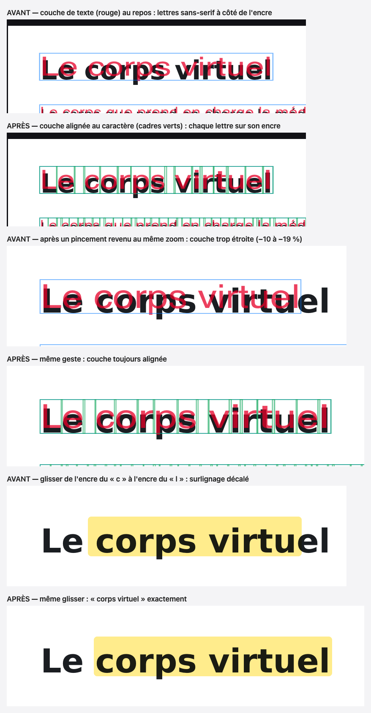
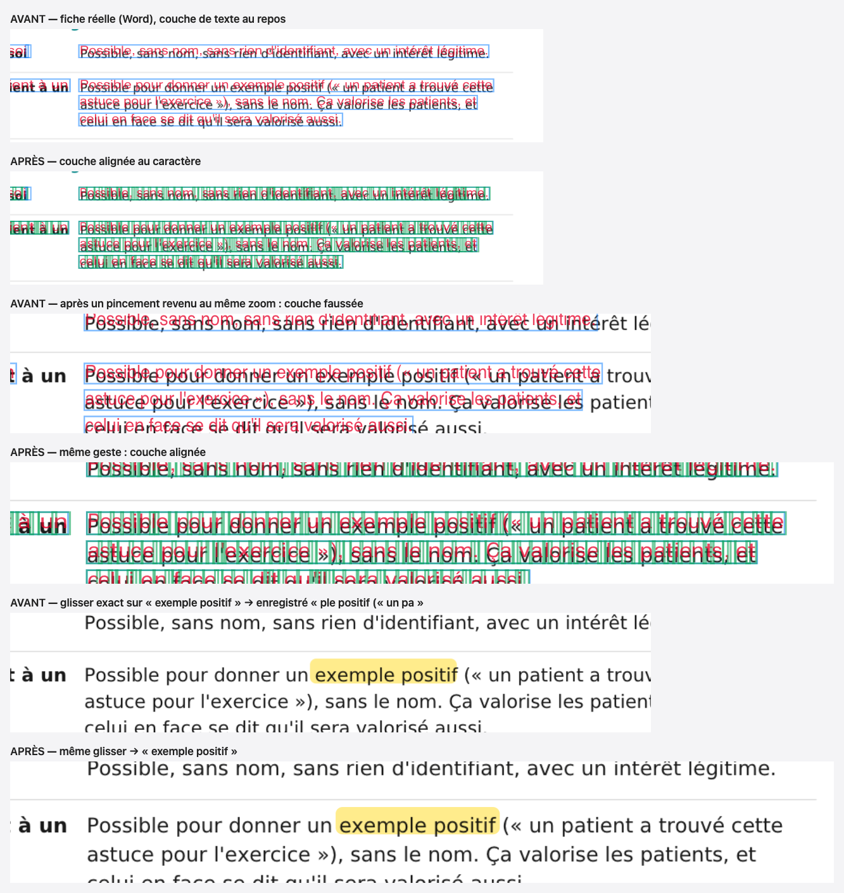
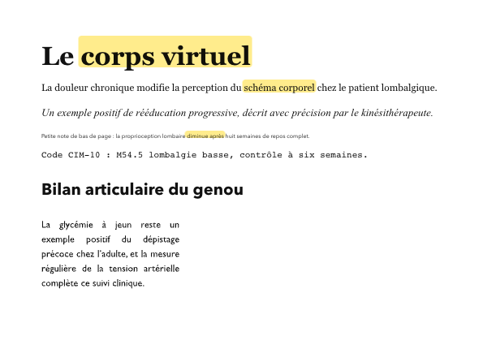
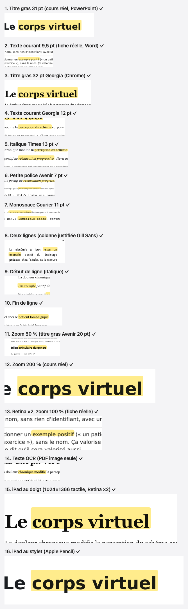
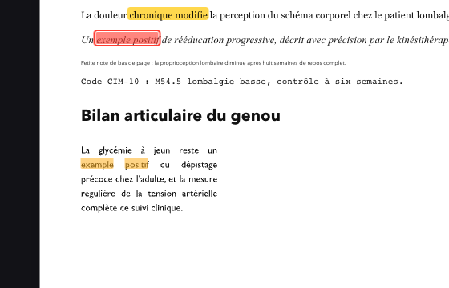

# Surlignage aligné au caractère (02/11/2026)

Constat : sur le titre « Le corps virtuel » (cours d'anthropologie, p. 41, gras 31 pt), une sélection exacte de
« corps virtuel » donnait un surlignage « rps virt ». Sur « exemple positif » (fiche de déontologie, p. 3), le « e »
initial restait dehors.

## Commits

| Commit | Contenu |
|---|---|
| `cf5acd6` | couche de texte alignée au caractère, largeurs lues sans transformation, rectangles depuis `Range.getClientRects` |
| `e42bdf4` | banc des 16 cas, relecture des surlignages existants ; ponctuation prise à mi-largeur au bout d'un glisser |
| `f142bdf` | l'export (PDF annoté, PNG, IA) dessine les surlignages sur leurs caractères ; banc de non-régression |
| (ce commit) | compte rendu, passation |

## 1. Cause exacte

Le surlignage est enregistré en **plage de caractères** (`{ item, char }` : n° du morceau pdf.js, n° du caractère).
La plage vient de la couche de texte invisible posée sur la page. Cette couche avait deux défauts.

### 1.1 Les lettres de la couche n'étaient pas sur l'encre

Chaque morceau pdf.js était **un seul nœud texte en `sans-serif`**, étiré (`scaleX`) à la largeur du morceau. Seule la
largeur totale était juste. À l'intérieur, les lettres `sans-serif` n'ont pas la largeur des lettres du PDF.

Mesure sur « Le corps virtuel » à 100 % (sonde `scripts/tests-surlignage-alignement/sonde.mjs`, bord gauche de chaque
lettre) :

| Lettre | Encre (canvas) | Ancienne couche | Nouvelle couche |
|---|---|---|---|
| c | 269 px | 272,6 px (+3,6) | 268,3 px |
| o | 288 px | 292,8 px (+4,8) | 286,7 px |
| v | 376 px | 382,7 px (+6,7) | 375,3 px |
| l | 482 px | 481,6 px | 479,9 px |

L'écart double à 200 %. Le correctif du 29/10 recalculait les bornes **à côté** du DOM, pour le glisser à la souris
seulement. La sélection du navigateur restait celle des fausses lettres : au doigt, au stylet hors glisser, Maj+clic.
C'est le « e » de « exemple positif » perdu.

### 1.2 Une couche construite pendant un geste de zoom restait fausse

L'étirement était calculé avec `getBoundingClientRect`, qui **compte les transformations des parents**. Pendant un
pincement (ou Ctrl+molette au trackpad), le conteneur des pages est en `transform: scale(k)` (`PdfReader#zoomGeste`).
Si la page finit de se redessiner à ce moment, sa couche est construite avec des largeurs fausses d'un facteur k.

Si le geste revient au même zoom, rien ne reconstruit la couche : elle reste fausse. Mesuré : morceaux **trop étroits
de 10 à 19 %** après un 2ᵉ pincement ouvert pendant le rendu puis revenu au point de départ. Pire écart mesuré : 19 %,
avec un pincement à ×1,7 tenu pendant le rendu.

Sur cette couche faussée, la sélection et le surlignage sont faux **ensemble**. La bande s'affiche donc au bon endroit
pendant le geste, mais les caractères enregistrés sont décalés. Exemple reproduit sur la fiche réelle : sélection exacte
de « exemple positif », plage enregistrée **« ple positif (« un pa »**.

À la reconstruction suivante de la couche (zoom, rechargement), la bande se recale sur ces caractères-là. On voit alors
un surlignage tronqué et décalé : c'est le « rps virt ».

### 1.3 Captures de la couche (rouge : texte de la couche ; cadres verts : un par caractère)





Hypothèses écartées :
- **échelle de rendu (devicePixelRatio)** : la couche est en px CSS, indépendante de la densité ; mesuré juste à ×1 et ×2 ;
- **plage tronquée à l'enregistrement** : l'enregistrement recopie fidèlement la sélection ; c'est la couche qui la
  faussait (§ 1.2).

## 2. Correction (`src/medrevise/pdf/pdfShared.js`)

**Couche alignée au caractère** (`buildTextLayer`, « COUCHE ALIGNÉE AU CARACTÈRE ») :
- un `<span>` par morceau pdf.js, enfant direct de la couche, à la position, la largeur et la hauteur exactes du
  morceau. Même index et même texte qu'avant : les ancres ne changent pas ;
- dedans, un `<span>` par caractère, posé à la position exacte de son glyphe (largeurs de la police du PDF,
  `fractionsGlyphes`) et étiré à sa largeur exacte. La sélection du navigateur tombe sur l'encre, au doigt comme à la
  souris ;
- largeurs naturelles lues **hors transformation** (`getBoundingClientRect ÷ échelle réelle de la couche`) : justes
  même au milieu d'un geste. Couche pas encore à l'écran : nouvel essai à l'image suivante ;
- page reprise du cache d'images (polices pas encore chargées) : `getOperatorList()` charge les polices avant la
  construction.

Restent sur un seul nœud texte étiré, comme avant : le texte pivoté et une police illisible.

**Couche OCR** : même structure. Les lettres d'un mot sont réparties sur la boîte du mot reconnue par l'OCR.

**Rectangles** (`rectsTexteEcran`, `rectsFromRange`, `computeMatchRectsFromDom`) : rectangles **réels** des caractères
(`Range.getClientRects` sur la couche alignée), fusionnés par morceau et par ligne. Ils sont convertis en fractions de
page, sans aucune estimation. Cela vaut pour l'aperçu de la sélection, le surlignage, la recherche ⌘F et l'OCR.

**Bornes d'un glisser** (`positionExacte`) : lues sur les boîtes réelles des caractères. Une lettre est prise à 20 % de
sa largeur, une ponctuation ou une espace à mi-largeur. Sans cette règle, l'encre penchée d'une italique faisait
prendre la virgule qui suit.

**Accès à la couche** : `itemsCouche` (morceaux), `pointDeChar` (caractère → point DOM) et `itemDeNoeud` remplacent
partout `querySelectorAll('span')` / `firstChild` :
- `pdfShared.js` : ancres, recherche, fin de texte de la sélection ;
- `PdfPage.jsx` : repasser au surligneur, test « sur du texte », texte proche d'une boîte.

**Export** (`surlignagesAlignes`, `PdfReader.jsx`) : l'export dessinait les `rects` enregistrés à la création.
Désormais, au moment d'exporter, chaque surlignage ancré est remis sur ses caractères dans une couche alignée
construite hors écran. C'est le même calcul et le même garde-fou que l'affichage. **Rien n'est réécrit en base.**

## 3. Surlignages existants

Les ancres n'ont pas changé de format. À l'affichage, chaque surlignage est recalculé depuis son ancre sur la nouvelle
couche, donc sur l'encre de ses caractères.

Vérifié (`t-anciens.mjs`) : 5 surlignages posés avec l'**ancien code** (worktree de `34c9531`, état d’avant ce chantier, Vite :5303) sur trois PDF,
puis relus par le nouveau. Résultat : **5/5** sur leurs caractères, texte identique, bande au bord exact de la 1ʳᵉ et
de la dernière lettre.

Vérifié aussi (`t-nonreg.mjs`) : un ancien surlignage aux `rects` enregistrés faux (décalés de 8 % de page) s'affiche
**et s'exporte** sur ses lettres.



**Limite** : un surlignage dont la **plage elle-même** a été enregistrée fausse avant ce correctif (§ 1.2, par exemple
« ple positif (« un pa ») se réaffiche sur les caractères enregistrés. Le texte de la notion est le même. Le corriger
demanderait de deviner ce qui avait été visé, ce qui n'est pas fait. Le repasser au surligneur sur le mot entier suffit.

## 4. Tests

Banc : Vite :5302 sans Supabase, Chrome headless 9337 (profil neuf), base locale seulement. Chaque cas est joué comme
un utilisateur : outil Surligneur, glisser du **bord gauche de l'encre** du 1ᵉʳ caractère au **bord droit de l'encre**
du dernier (encre lue sur le canvas de la page).

Vérifié pour chaque cas :
- le texte enregistré est exactement le passage ;
- la bande couvre l'encre de la 1ʳᵉ et de la dernière lettre, sans toucher celle des lettres voisines (2 px de débord
  voulus, `pdfreader-v2.css`).

PDF utilisés :
- le cours réel (PowerPoint) ;
- la fiche réelle (Word) ;
- un PDF imprimé par Chrome (Georgia, Times italique, Avenir 7 pt, Courier, Gill Sans justifié) et sa version image
  seule, dont le texte vient de l'OCR de l'app (Tesseract local).

`node t-cas.mjs` : **16/16** (résultats dans `scripts/tests-surlignage-alignement/resultats-cas.json`).

| # | Cas | Mode | Zoom | Densité | | Détail |
|---|---|---|---|---|---|---|
| 1 | Titre gras 31 pt (cours réel, PowerPoint) | souris | 100 % | 1 | ✅ | « corps virtuel » ; bande −2,8 / +4,5 px de l'encre |
| 2 | Texte courant 9,5 pt (fiche réelle, Word) | souris | 100 % | 1 | ✅ | « exemple positif » ; −1,5 / +2,7 px |
| 3 | Titre gras 32 pt Georgia | souris | 100 % | 1 | ✅ | « corps virtuel » ; −3,1 / +2,1 px |
| 4 | Texte courant Georgia 12 pt | souris | 100 % | 1 | ✅ | « perception du schéma » ; −2,4 / +2,1 px |
| 5 | Italique Times 13 pt | souris | 100 % | 1 | ✅ | « rééducation progressive » ; −2,5 / +0,2 px |
| 6 | Petite police Avenir 7 pt | souris | 100 % | 1 | ✅ | « proprioception lombaire » ; −2,6 / +2,1 px |
| 7 | Monospace Courier 11 pt | souris | 100 % | 1 | ✅ | « lombalgie basse » ; −3,5 / +2,4 px |
| 8 | Deux lignes (colonne justifiée) | souris | 100 % | 1 | ✅ | « reste un exemple » ; −3,1 / +1,3 px |
| 9 | Début de ligne (italique) | souris | 100 % | 1 | ✅ | « Un exemple » ; −3,5 / +1,1 px |
| 10 | Fin de ligne | souris | 100 % | 1 | ✅ | « patient lombalgique » ; −2,2 / +2,0 px |
| 11 | Zoom 50 % (titre gras 20 pt) | souris | 50 % | 1 | ✅ | « articulaire du genou » ; −1,4 / +3,2 px |
| 12 | Zoom 200 % (cours réel) | souris | 200 % | 1 | ✅ | « corps virtuel » ; −4,5 / +7,1 px (approche du « l ») |
| 13 | Retina (fiche réelle) | souris | 100 % | 2 | ✅ | « exemple positif » ; −2,5 / +1,2 px |
| 14 | Texte OCR (PDF image seule) | souris | 100 % | 1 | ✅ | « chronique modifie » ; −2,0 / +1,6 px |
| 15 | iPad au doigt (1024×1366 tactile) | doigt | 100 % | 2 | ✅ | « corps virtuel » ; −3,1 / +2,6 px |
| 16 | iPad au stylet (Apple Pencil) | stylet | 100 % | 2 | ✅ | « corps virtuel » ; −3,3 / +4,5 px |

- **Au doigt** : la sélection est celle du système. Le banc pose chaque borne là où le navigateur place le curseur
  sous le doigt (`caretRangeFromPoint`, le même calcul que les poignées d'iPadOS), puis relâche.
- **Au stylet** : glisser avec `pointerType: 'pen'`.
- Ces deux modes sont joués dans Chrome en émulation tablette, **pas sur un iPad réel**.
- **Gestes de zoom** (`avant.mjs`) : après deux pincements enchaînés, l'écart de largeur de la couche tombe de 10 à
  19 % à **0,02 %** au plus.



### Non-régression

`node t-nonreg.mjs` : **14/14**.
- **Recherche ⌘F** : 3 rectangles pour « exemple positif », dont un passage à cheval sur deux lignes. Le rectangle de
  l'occurrence en italique va du bord du « e » au bord du « f », au pixel.
- **Sélection → notion** : texte enregistré exact, notion visible dans le panneau.
- **Sélection → carte du tableau** : outil Sélection, bulle « Ajouter au tableau », carte au texte exact.
- **Export PDF annoté** (fichier exporté rendu, couleur cherchée sous l'encre) : surlignage récent et ancien
  surlignage aux `rects` faux, tous deux sur leurs lettres (≤ 0,6 px à 2×).
- **Construction de la couche** sur une page dense du cours réel : 6 à 31 ms (519 caractères au plus).
- **Console** : 0 erreur.



`node t-mealweek.mjs` : MealWeek s'ouvre, planning affiché, 0 erreur console. `git diff 34c9531 -- src/mealweek
src/shared` est vide.

`npm test` : 244/246. Deux échecs, déjà présents avant ce chantier et vérifiés sur `34c9531` :
- `crayon › trois épaisseurs` ;
- `/api/timetable › cache 60 min`.

Build vert.

Les anciens bancs `tests-surlignage-listes/{t-surlignage,t-deux-lignes,sonde-bornes}.mjs` lisaient la couche comme un
nœud texte par morceau. Ils sont remplacés par `tests-surlignage-alignement/` (cas 8 : deux lignes avec l'espace).

## 5. Commandes

```
# banc : preview_start « medrevise-banc » (:5302) + Chrome headless 9337 (profil neuf)
export CDP_PORT=9337 CDP_FILTRE=5302 FX=<dossier contenant anthropo.pdf, deonto.pdf, polices.pdf, scan.pdf>
node scripts/tests-surlignage-alignement/t-cas.mjs        # 16 cas (ou : t-cas.mjs 1 12 15)
node scripts/tests-surlignage-alignement/t-nonreg.mjs     # non-régression
node scripts/tests-surlignage-alignement/t-mealweek.mjs
node scripts/tests-surlignage-alignement/avant.mjs apres [corps|exemple]   # captures de la couche
# surlignages existants : poser avec l'ancien code (worktree de 34c9531 sur :5303, Chrome 9338), relire ici
CDP_PORT=9338 CDP_FILTRE=5303 node scripts/tests-surlignage-alignement/t-anciens.mjs poser
node scripts/tests-surlignage-alignement/t-anciens.mjs relire
```

Fichiers de test :
- `anthropo.pdf` = `ANTHROPOLOGIE_01_Chap_1.pdf` ;
- `deonto.pdf` = `Deonto_Secret_et_respect_du_patient_fiche.pdf` (Téléchargements) ;
- `polices.pdf` : HTML imprimé par Chrome (`--print-to-pdf`) ;
- `scan.pdf` : capture du même HTML, mise en PDF par `scan-pdf.mjs`.

## 6. À vérifier par toi

1. Sur un iPad réel, au doigt puis au stylet : sélectionne « corps virtuel » sur la p. 41 du cours d'anthropologie.
   La bande doit couvrir exactement le passage.
2. Pince pour zoomer, reviens au zoom de départ, puis surligne un mot : il doit être exact.
3. Un ancien surlignage qui affiche encore un mot tronqué a une **plage** enregistrée tronquée (§ 3). Repasse-le au
   surligneur.
