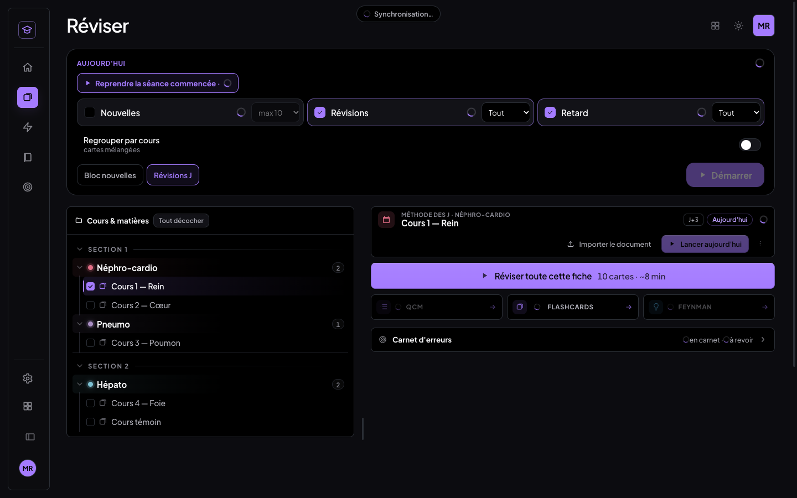
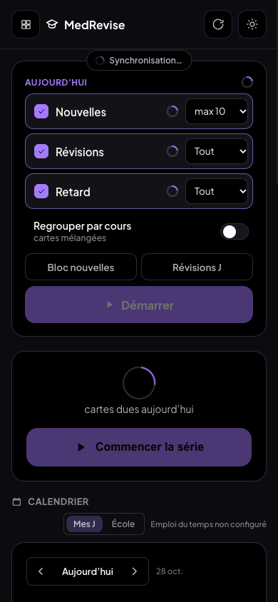
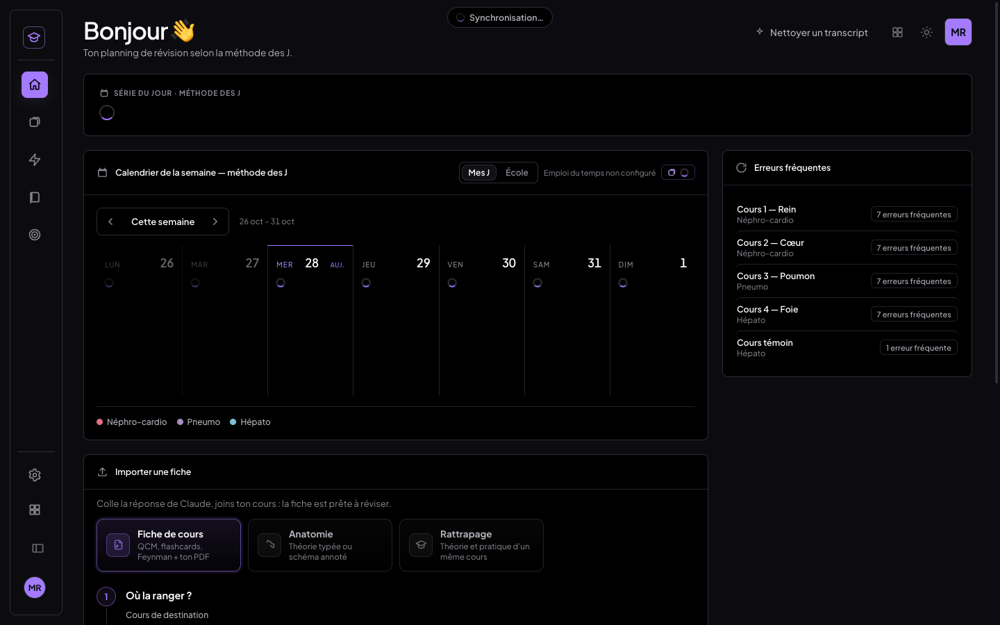
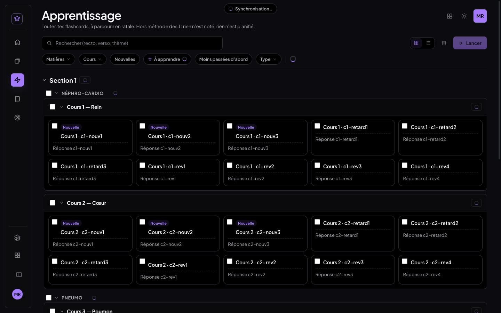
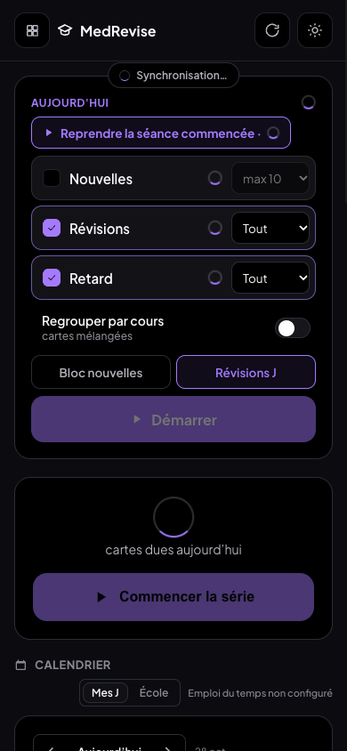
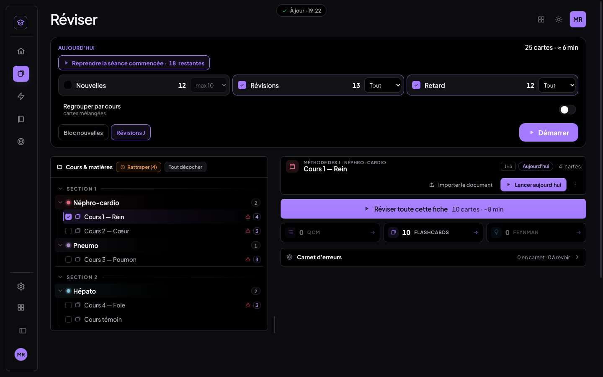
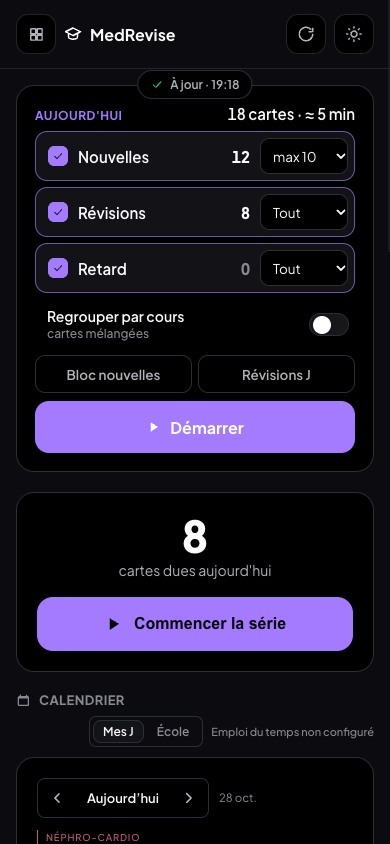
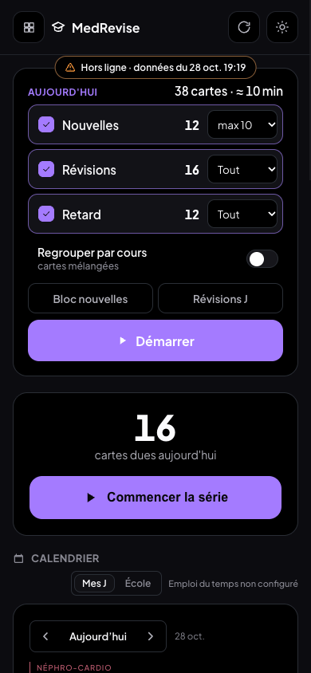
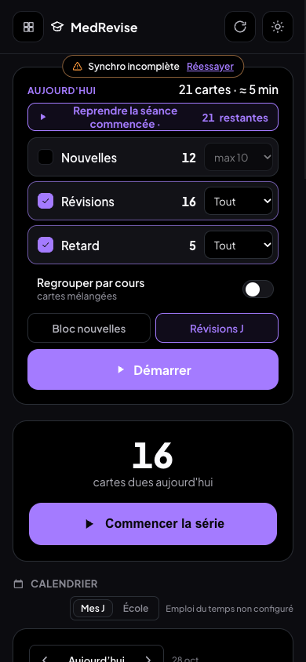
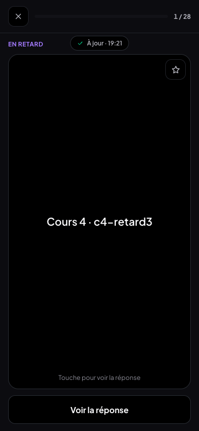

# Synchro complète avant affichage (28/10/2026)

**Point de départ** : `docs/diagnostic-retard-26.md`. Ce matin, un appareil a affiché « 26 en retard ». Ce chiffre était
calculé sur son état local, avant d'avoir reçu les réponses données la veille au soir sur un autre appareil. Il est
redescendu à 1 dès la fin de la synchro.

**Le principe** : on change **quand** on affiche, pas **comment** on fusionne. Les mécanismes existants sont réutilisés
tels quels :

- `syncNow` : outbox, tirage complet paginé, fusion « dernier qui écrit gagne » gardée par `updated_at`, envoi ;
- `synchroniserJournal` : journal idempotent, envoi de la file, réception, application aux cartes.

Rien n'a changé dans `lib/storage.js`, `data/sync.js` ni `journal/`.

## 1. Séquence de démarrage

À l'ouverture de l'app, au retour au premier plan (`visibilitychange`, `focus`) et au retour du réseau (`online`), une
**passe complète** s'exécute (`MedReviseApp.jsx`, orchestrée par `lib/synchroAffichage.js`) :

| Étape | Ce qui se passe | Code |
|---|---|---|
| 0 | Lecture de l'état **local** (IndexedDB). L'écran se monte, mais chaque chiffre calculé affiche un indicateur, et le bandeau dit « Synchronisation… » | `reload()`, `SynchroContext` → phase `attente` |
| 1 | **Envoi** de tout ce qui attend : enregistrements (outbox) | `syncNow` → `flushOutbox` |
| 2 | **Tirage complet** des enregistrements (pagination jusqu'à la dernière page, tout ou rien), fusion, envoi du reste | `syncNow` → `reconcileAll`, `queueAllLocalForPush`, `flushOutbox` |
| 2 bis | **Journal** : envoi de la file, puis réception de tout ce qui a été inséré depuis le curseur, pagination complète | `synchroniserJournal` |
| 3 | **Application du journal** à l'état des cartes | `appliquerJournalAuxCartes`, dans la même passe |
| 3 bis | Au 1er démarrage seulement : migrations (comme avant, après la synchro) | `runMigrations` |
| 4 | **Rechargement** : le plan du jour est recalculé | `reload()` |
| 5 | **Vérification** : empreinte locale contre empreinte cloud (même calcul que l'indicateur de Réglages) et outbox vide. Si l'écart persiste, **une** relance des étapes 1 à 4, puis « Synchro incomplète » si l'écart demeure | `etatLocal`, `etatCloud`, `outboxCount` (`lib/syncStatus.js`) |
| 6 | **Affichage** : les chiffres apparaissent, et le bandeau dit « À jour · 18:42 » puis disparaît en fondu (2,2 s, fondu de 0,6 s) | phase `ajour` |

Une seule passe tourne à la fois. Si l'ouverture, `visibilitychange` et `focus` arrivent ensemble, elles partagent la
même passe. Le test vitest « une seule passe à la fois » le vérifie.

**Hors ligne ou lenteur** : si la passe échoue, ou n'a pas abouti après **8 s**, les données locales s'affichent avec le
marqueur « Hors ligne · données du 28 oct. 18:26 ». C'est l'heure de la dernière synchro réussie de cet appareil. Un
nouvel essai part en fond toutes les 30 s, et aussi au retour du réseau. Dès qu'une passe aboutit, l'écran se met à
jour. Les réponses données hors ligne restent en file (outbox et file du journal) et partent au retour du réseau.

**Synchro incomplète** : si les empreintes diffèrent encore après la relance, le bandeau affiche « Synchro incomplète »
avec un bouton « Réessayer ». Les chiffres sont alors affichés : la passe a eu lieu, mais un envoi n'est pas passé.

**Synchro non configurée** (pas de `VITE_SUPABASE_URL`) : rien n'attend, rien ne s'affiche, comportement inchangé.

## 2. Ce qui attend pendant la passe

| Écran | Remplacé par un indicateur ou désactivé |
|---|---|
| Lanceur « Aujourd'hui » (Réviser sur ordinateur, accueil téléphone) | total « N cartes · ≈ M min », Nouvelles, Révisions, Retard, « Reprendre · N restantes » ; **Démarrer** et **Reprendre** désactivés ; jamais « Rien à faire aujourd'hui » sur un état périmé |
| Accueil ordinateur | « N cartes aujourd'hui », carte « Série du jour », les 7 jours du calendrier de la semaine (non cliquables) |
| Réviser | « Rattraper (N) » masqué, alertes de retard et pastilles « dues aujourd'hui » de l'arbre masquées, « Aujourd'hui · N cartes », **Lancer aujourd'hui** désactivé |
| Accueil téléphone | chiffre du jour, **Commencer la série** désactivé, calendrier « Mes J », nombre de cartes de l'entrée Apprentissage |
| Apprentissage | compteur de cartes, « À apprendre N », badges « ×n », **Lancer** (sans nombre) désactivé, ainsi que le Lancer de la barre de sélection |
| Tout autre chiffre tabulaire (`.tnum`) de MedRevise | repli CSS : texte masqué, même indicateur à sa place (`styles/synchro-affichage.css`) |

Composants : `Chiffre`, `useEnSynchro`, `BandeauSynchro` et `SynchroContext` (`components/Chiffre.jsx`).

**Une séance déjà ouverte n'est jamais modifiée sous les yeux.** Ni le repli CSS ni les indicateurs ne s'appliquent
dans une séance. Avant ce chantier, `SeanceFC` recomposait sa file à chaque rechargement de la base : une carte notée sur
l'autre appareil disparaissait de la séance en cours, et la progression changeait. Désormais :

- seul le contenu des cartes est rafraîchi (la version la plus récente gagne, comme avant) ;
- la file, la carte affichée et la progression ne bougent pas ;
- tout se remet d'accord à la **reprise suivante** (règle existante : `reprendreSeanceChoix`) ;
- seule exception : une carte encore à faire a été supprimée ailleurs.

## 3. Tests

Banc `scripts/tests-synchro-affichage/` (`tout.sh`), sans le vrai cloud :

- faux Supabase local (`scripts/faux-supabase.mjs`, journal actif) ;
- Vite :5300 ;
- **2 appareils** : Chrome headless A (Mac, 1440×900) et B (téléphone simulé, 390×844, tactile), profils neufs.

Le jeu de test est `tests-selection-passages/seed.mjs` : 4 cours de 10 cartes (3 Retard, 4 Révisions, 3 Nouvelles).

**Preuve « jamais de valeur intermédiaire »** : sur B, un enregistreur (`MutationObserver`) est injecté **avant** le
chargement de la page. Il note chaque état affiché (Retard, Révisions, Nouvelles, chiffre de l'accueil, bandeau,
Démarrer) à chaque mutation du DOM. Le test compare cette liste aux valeurs de A, et à la valeur périmée que B aurait
calculée sur sa base locale.

| Test | Scénario | Résultat |
|---|---|---|
| `t-demarrage.mjs` | **Ouverture** : A note 20 cartes « Correct » (Retard 12 → 0, Révisions 16 → 8). B, qui ne les a pas, calculerait sur sa base locale Retard 12 / Révisions 16. B est rouvert, enregistreur actif : 1er état affiché = indicateurs partout, Démarrer désactivé, bandeau « Synchronisation… » ; puis directement Retard 0 / Révisions 8 / Nouvelles 12, identiques à A, en 0,3 s ; **la valeur 12 n'apparaît jamais** ; « À jour · 19:18 » disparaît en fondu. **Retour au premier plan** (`visibilitychange` + `focus`) après 5 réponses de plus sur A : indicateurs, puis directement les valeurs de A (Révisions 3), sans valeur intermédiaire. | 13 ✅ |
| `t-horsligne.mjs` | **Mode avion** (réseau coupé par le protocole DevTools, `Network.emulateNetworkConditions`) : « Hors ligne · données du 28 oct. 19:19 », données locales affichées, Démarrer actif ; 3 réponses hors ligne restent en file (3 enregistrements, 3 entrées de journal, rien au cloud) ; retour du réseau → « À jour », files vidées, +3 au cloud, A reçoit les mêmes chiffres. **Réseau lent** : latence 300 ms par requête → indicateurs pendant 1,3 s, puis les bonnes valeurs, jamais la valeur périmée ; latence 2,6 s → indicateurs, puis le marqueur « Hors ligne » à **8,0 s**, puis « À jour » à 10,5 s avec les bonnes valeurs. **Synchro incomplète** (le faux cloud refuse l'envoi d'une carte) : empreintes différentes même après la relance → « Synchro incomplète · Réessayer » ; cloud réparé, Réessayer → « À jour », modification arrivée. | 10 ✅ |
| `t-ecrans.mjs` | Pendant une passe (latence 900 ms) puis après, écran par écran : Accueil ordinateur (dues, Série du jour, 7 jours du calendrier), Réviser (lanceur, « Rattraper », alertes et pastilles de l'arbre, Lancer aujourd'hui, Démarrer), Apprentissage (compteur, badges ×n, Lancer), accueil téléphone (chiffre du jour, Commencer la série, « Mes J ») | 9 ✅ |
| `t-seance-ouverte.mjs` | B a une séance ouverte, A note 3 de ses cartes, B revient au premier plan : passe complète (réponses reçues), mais la séance reste identique (même file de 28, même carte, « 1 / 28 », aucun indicateur) ; à la reprise suivante : « 25 restantes » | 4 ✅ |
| Vitest `tests/synchro-affichage/porte.test.js` | attente → à jour ; écart → une seule relance → incomplet ; écart rattrapé → à jour ; échec → hors ligne avec la date des données, nouvel essai à 30 s ; plus de 8 s → hors ligne puis à jour ; une seule passe à la fois ; écritures en attente ≠ à jour ; libellés | 8 ✅ |

Non-régression :

- `npm test` : 183 tests verts sur 184. Le seul échec (`crayon`) existait déjà avant ces chantiers.
- `vite build` : vert.
- `scripts/tests-selection-passages/tout.sh` (sélection et compteur de passages, 2 appareils, avec la synchro avant
  affichage) : 3 tests verts.
- `scripts/tests-par-cours-elements/tout.sh` (séances, « Regrouper par cours », éléments à révéler, ordinateur et
  téléphone, sans Supabase) : 84 vérifications vertes.
- `src/shared/` et `src/mealweek/` : aucun fichier modifié.
- **MealWeek** : builds avant (`HEAD`) et après, servis sur la même origine. Les captures sont identiques octet pour
  octet (SHA-256 `8e985aa57c95e757…`, × 3).
- Aucune écriture sur le vrai Supabase : tous les tests passent par le faux cloud local.

Note sur le banc : les Chrome de test sont lancés avec `--disable-background-timer-throttling
--disable-renderer-backgrounding --disable-backgrounding-occluded-windows`. Un onglet headless inactif voit sinon ses
minuteries bridées, ce qui fausse les mesures (les 8 s).

## 4. Captures (`docs/img/synchro-affichage/`)

| | Ordinateur | Téléphone |
|---|---|---|
| Chargement |  |  |
| Chargement : Accueil, Apprentissage |   |  |
| À jour |  |  |
| Hors ligne |  |  |
| Réseau lent (plus de 8 s) | |  |
| Synchro incomplète | |  |
| Séance ouverte pendant une passe | |  |

## 5. Points à savoir

- **Le coût réseau double à chaque passe** : la vérification relit toute la table pour calculer l'empreinte cloud, comme
  le fait l'indicateur de Réglages. Sur le jeu réel (environ 3 800 lignes), cela ajoute une lecture paginée à chaque
  retour au premier plan.
- **L'empreinte couvre les enregistrements**, pas les fichiers (PDF, images) ni le journal. Les fichiers continuent de
  partir en tâche de fond, comme avant, pour ne jamais retenir l'affichage. Le journal est vérifié par sa propre passe :
  une erreur autre que « table absente » fait échouer la passe.
- **Le bug de données du diagnostic n'est pas corrigé ici** : c'est la réécriture d'une carte périmée par
  `appliquerJournalAuxCartes`. La demande imposait de ne pas changer la fusion. Ce chantier en réduit fortement le
  risque, parce que le journal ne s'applique plus jamais en parallèle d'une autre passe : une seule à la fois. La
  correction proposée reste dans `docs/diagnostic-retard-26.md`.
- **Seul changement de comportement hors affichage** : `SeanceFC` ne recompose plus une séance ouverte. Voir § 2.

## 6. Commits

- `4a54f1b` feat(medrevise): synchro complète avant affichage (porte, indicateurs, bandeau, séance ouverte figée, tests vitest)
- `bdff9c1` test(medrevise): banc « synchro avant affichage » (2 appareils, mode avion, réseau lent, synchro incomplète)
- le commit « docs » qui suit : ce compte rendu et ses captures
