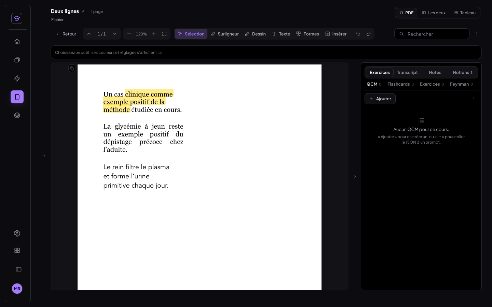

# Synchro rapide, surlignage précis, listes dans les boîtes (29/10/2026)

Trois corrections sur MedRevise. MealWeek et `src/shared/` ne sont pas touchés : aucun fichier modifié depuis `4a47f65`, et MealWeek s'ouvre sans erreur console.

Commits :

| Commit | Contenu |
|---|---|
| `94e0583` | synchro incrémentale au retour sur l'app |
| `7a268da` | surlignage aux bornes exactes des caractères, rendu unifié |
| `28f1a75` | listes à puces et numérotées dans les boîtes, post-it, cellules, cartes, collage, export PDF |
| `2004c73` | synchro rapide : une ligne datée en retard ne passe plus pour « À jour » ; mesures et bancs |
| (ce document) | compte rendu |

Build vert. Vitest : 227 tests sur 228. Le seul échec, `crayon › trois épaisseurs par mode`, existait avant ce chantier.

---

## 1. Synchro rapide au retour sur l'app

### 1.1 Mesure avant

Banc : 4480 enregistrements d'environ 1,5 Ko, l'ordre de grandeur du vrai compte. Réseau du téléphone simulé en 4G : 120 ms de latence, 1,5 Mo/s en réception, 0,6 Mo/s en envoi. Faux Supabase local, jamais le vrai cloud.

| Étape (avant) | Temps |
|---|---|
| Envoi de la file (vide) | 0 ms |
| Récupération : lecture **complète** de la table, 6,77 Mo | **5 224 ms** |
| Application (fusion) | 58 ms |
| Journal des révisions | 136 ms |
| Empreinte locale | 41 ms |
| Empreinte cloud : **une 2ᵉ lecture complète**, contenu compris | **5 262 ms** |
| **Retour sans changement, jusqu'à « À jour »** | **10 853 / 10 914 / 10 675 ms** |
| **Retour après 10 réponses sur l'autre appareil** | **10 905 ms** |

Chaque retour téléchargeait donc **deux fois toute la table** : une fois pour la fusion, une fois pour l'empreinte. Le temps grossit avec le nombre d'enregistrements et la qualité du réseau, d'où les ~30 s constatées sur ton compte réel.

### 1.2 Ce qui change

- **Vérification légère d'abord** (`data/sync.js#etatLegerCloud`). Deux requêtes minimales, en parallèle, d'une ligne chacune :
  - le nombre de lignes et l'`updated_at` le plus récent ;
  - le nombre de lignes vivantes.

  Pour le journal, une requête donne l'`inserted_at` le plus récent (`journal/synchro.js#journalAChange`).

  Si tout est identique au **curseur** (dernier alignement vérifié), que la file d'envoi est vide et que l'empreinte locale est celle du curseur : « À jour » **sans rien télécharger**.
- **Sinon, seulement ce qui a changé** (`lib/storage.js#syncRapide`) :
  1. envoi de la seule file d'attente ;
  2. lecture des **métadonnées** des lignes modifiées depuis le curseur, avec une marge de 10 min ;
  3. lecture du **contenu** des seules lignes qui diffèrent vraiment du local ;
  4. fusion avec **exactement** les règles de `reconcileAll` ;
  5. relecture limitée aux stores touchés : seulement les cartes si seules les cartes ont changé (`MedReviseApp#reload(stores)`).
- **Empreinte complète en arrière-plan**, après l'affichage. Elle ne lit plus que les métadonnées : 940 ms au lieu de 5,3 s. Elle tourne après une passe qui a reçu des changements, ou au plus toutes les 30 min. Un écart relance aussitôt une passe complète.
- **Passe complète** (pagination totale, inchangée) seulement :
  - au premier démarrage, quand il n'y a pas encore de curseur vérifié ;
  - après une erreur du serveur ou une synchro incomplète ;
  - sur « Forcer la synchro ».

  Une simple coupure réseau ne l'impose pas : la lecture est tout ou rien, donc rien n'a été fusionné à moitié.
- **« À jour » garde son sens.** La passe rapide ne l'affiche que si :
  - la file est vide ;
  - le cloud correspond au curseur, ou les changements ont été appliqués ;
  - le **nombre de lignes vivantes du cloud égale celui de l'appareil**.

  Ce dernier contrôle attrape une ligne écrite par un appareil à l'horloge très en retard, que le tirage incrémental ne verrait pas : on passe alors en synchro complète au lieu d'afficher « À jour ».
- Le curseur `{ n, maxMaj, hash }` vit dans le store IndexedDB `meta` de l'appareil, pas en localStorage : une base effacée ne peut pas garder un curseur qui la ferait croire à jour.

### 1.3 Mesure après (même banc)

| Cas | Avant | Après |
|---|---|---|
| Retour sans changement | 10,7 – 10,9 s | **0,17 – 0,24 s** (vérification ~125 ms + empreinte locale ~40 ms) |
| Retour **après 5 min réelles** sans changement | — | **0,22 – 0,28 s** |
| Retour après 10 réponses sur l'autre appareil | 10,9 s | **1,86 – 2,07 s** |
| Mode avion, puis retour du réseau (3 réponses faites entre-temps) | — | « Hors ligne », puis **1,8 – 2,0 s**, sans lecture complète |
| Ligne datée en retard (cas rare) | — | passe complète, « À jour » à **8,6 s**, seulement une fois la ligne reçue |
| Empreinte complète (désormais en arrière-plan) | 5,3 s avant l'affichage | 0,94 s après l'affichage |

Détail du cas « 10 réponses » :

| Étape | Temps |
|---|---|
| Vérification | 126 ms |
| Récupération | 1 450 – 1 660 ms |
| Application | 5 ms |
| Journal | 136 – 157 ms |
| Renvoi des cartes recalculées | ~150 ms |
| Recalcul | 1 ms |

La récupération est le pire cas du banc : ses 4 428 enregistrements de volume venaient d'être créés et tombent tous dans la marge de 10 min, donc leurs métadonnées (~450 Ko) sont relues. En usage normal, seules les lignes des 10 dernières minutes le sont.

Fin du banc : empreintes **A = B = cloud**, rien de perdu (4 480 → 4 481 enregistrements vivants : la ligne du scénario « date ancienne »).

Fichiers du banc :
- `scripts/tests-synchro-rapide/mesures-avant.json` et `mesures-apres.json` ;
- sortie complète : `scripts/tests-synchro-rapide/resultat-t-synchro.txt`.

### 1.4 Tests

- Vitest, `tests/synchro-rapide/rapide.test.js` (12 tests) :
  - vérification légère sans contenu ;
  - aucun téléchargement quand rien n'a changé ;
  - 10 lignes modifiées : seul leur contenu est tiré ;
  - mêmes règles que `reconcileAll` (tombstone plus récent, local plus récent, nouveau) ;
  - empreinte sur métadonnées ;
  - curseur dans IndexedDB ;
  - ligne datée en retard détectée ;
  - porte : passe rapide / complète, erreur serveur, coupure réseau, vérification de fond.
- Navigateur, deux appareils (ordinateur + téléphone tactile), `scripts/tests-synchro-rapide/t-synchro.mjs` : 6 scénarios, **tous verts**, avec l'attente réelle de 5 min.

---

## 2. Surlignage précis et plus beau

### 2.1 Cause du bug de la première lettre

La couche de texte invisible, celle que l'on sélectionne, est écrite en **`sans-serif`**. Chaque morceau de texte y est ensuite **étiré** (`scaleX`) pour avoir la largeur exacte du PDF. Seule la largeur **totale** du morceau est juste : à l'intérieur, les lettres `sans-serif` n'ont pas la largeur des lettres réelles de la police du PDF.

Sur un PDF à **polices embarquées** (PowerPoint, Word, Chrome…), une borne de caractère tombait jusqu'à **14 px** à côté de l'encre, avec une médiane de 4 px. Deux conséquences :

- **début** calculé à droite de l'encre : la 1ʳᵉ lettre reste dehors (« **e**xemple positif ») ;
- **fin** : le navigateur place aussi la borne de la sélection d'après ces fausses lettres. Relâcher la souris sur la fin réelle d'un mot laissait sa dernière lettre dehors (« demandera**i** », « patien**t** »).

Sur un PDF **sans** police embarquée, la page est dessinée en `sans-serif` elle aussi, et l'écart est presque nul. C'est pourquoi le bug n'apparaissait que sur certains cours.

### 2.2 Correction

- **Bornes exactes** (`pdf/pdfShared.js`, « BORNES EXACTES DES CARACTÈRES ») :
  - la position de chaque caractère est calculée avec les **vraies largeurs de glyphes** de la police du PDF. pdf.js les fournit avec `fontExtraProperties : widths + toUnicode`, ligatures comprises ;
  - les positions sont ramenées à la largeur exacte du morceau ;
  - les espaces insérées par pdf.js, sans glyphe, prennent le reste.

  Repli sur l'ancien calcul pour un texte pivoté ou une police mal décrite. Le stockage ne change pas : l'ancre reste « morceau + caractère », seule la géométrie devient exacte.
- **OCR** : un mot OCR couvre son mot *et* l'espace qui le suit. Ses lettres sont réparties sur la largeur **réelle** du mot (boîte OCR), donc début et fin du mot tombent exactement sur sa boîte.
- **Bornes d'un glisser à la souris** : reprises sous le pointeur avec le même calcul.
  - Une lettre est prise dès que le pointeur a passé 20 % de sa largeur, en fin de passage.
  - Elle est prise tant qu'il n'a pas dépassé 80 % de sa largeur, en début de passage.

  Au doigt, la sélection reste celle du système, mais la bande est exacte.
- **Aperçu de la sélection** : dessiné avec les mêmes bornes, donc l'aperçu correspond au futur surlignage.
- **Rendu identique partout** (diapo, couche OCR, fiche, images ; `pdfreader-v2.css`) :
  - une bande par ligne, du premier au dernier caractère, espaces compris ;
  - **2 px de débord** à gauche et à droite ;
  - **coins de 4 px** ;
  - hauteur de la ligne de texte (+1 px en haut et en bas, comme avant) ;
  - `multiply`, couleur à **45 %** (`OPACITE_SURLIGNAGE`).

  Les surlignages du **mode document** (`.pt-prose mark.rt-notion`, avant 75 % sans multiply) et des textes d'image reprennent le même rendu.

### 2.3 Mesures et tests

Sonde `scripts/tests-surlignage-listes/sonde-bornes.mjs`. Elle compare le bord calculé de chaque mot au bord réel de son encre, lu sur le canvas de la page. PDF à polices embarquées fabriqué par Chrome : Georgia, Avenir, Times, Gill Sans, texte justifié.

| Bord gauche du mot (écart à l'encre) | Ancien calcul | Nouveau calcul |
|---|---|---|
| page 1 : médiane / max | 2,8 / 8,0 px | 1,4 / 3,4 px |
| page 2 : médiane / max | 1,6 / 10,6 px | 0,4 / 2,8 px |

Le reste de l'écart (~1 px) vient du lissage des bords de l'encre et de son retrait naturel dans chaque glyphe ; les 2 px de débord le couvrent.

**10 passages réels** (`t-surlignage.mjs`, glisser à la souris de l'encre du 1ᵉʳ mot à l'encre du dernier) :

| | Avant | Après |
|---|---|---|
| 1ʳᵉ lettre couverte | 8 passages sur 10 laissaient dépasser l'encre (jusqu'à 2,4 px) | **10 / 10** (bande 0,8 à 3,5 px au-delà de l'encre) |
| Dernière lettre couverte | 2 mots tronqués : « demandera », « patien » | **10 / 10** |
| Texte enregistré | 2 faux | **10 / 10 justes** |

Les 10 passages comprennent :
- « à quatre », qui commence par une lettre isolée ;
- « exemple positif », à cheval sur deux lignes ;
- deux mots d'une **page OCR**.

Autres vérifications :
- Rendu : coins de 4 px, débord de 2 px, multiply, 45 %.
- **Tablette** (1024×1366 tactile) : 7 surlignages sur 7 couvrent leur encre.
- Non-régression, suite « simplification des outils » (ordinateur + tablette) : barre, surligneur, mini barres, boîte-tableau, document, texte, mobile.
  - Tout est vert.
  - Seule l'ancienne attente « coins 3 px » a été mise à jour pour la nouvelle règle.

Captures (`docs/img/surlignage-listes/`) :
- `surlignage-avant-*.png` / `surlignage-apres-*.png` : polices, lettre-isolee, deux-lignes, ocr ;
- `surlignage-apres-tablette.png`.

**Point existant non traité (hors liste)** : un passage à cheval sur deux lignes est enregistré sans l'espace entre les deux lignes (« exemplepositif ») quand le PDF ne marque pas la fin de ligne. La bande est juste ; seul le texte enregistré (repris dans les flashcards) colle les deux mots. Ce n'était pas dans la liste, donc ce n'est pas corrigé ici.

---

## 3. Listes dans les boîtes

### 3.1 Bug

Dans une boîte, un post-it, une cellule de tableau ou une carte, une liste prenait les valeurs par défaut du navigateur, mesurées dans la boîte étroite :

- **40 px de retrait** (3,08 em) ;
- **13 px de marge** avant et après chaque liste ;
- sous-liste numérotée en « 1. » au lieu de « a. ».

Selon la source, s'y ajoutaient d'autres défauts :

| Source | Défaut |
|---|---|
| Collage Word | aucune liste : des paragraphes commençant par « ·      » |
| Collage Google Docs | marges de 32 px, styles en ligne |
| Cartes faites depuis une boîte | sous-listes aplaties, « • » collé au texte, pas de retrait suspendu |
| Export PDF | retours à la ligne sous la puce, niveaux perdus |

### 3.2 Correction

- **Une seule règle** (`styles/listes.css`), pour :
  - boîtes, post-it et textes libres (`.note-box .nb-body`, en édition et à l'affichage) ;
  - cellules de tableau des documents et notes ;
  - cartes.

  Retrait ~1,1 em (1,35 em pour les numéros), puce ou numéro sur la 1ʳᵉ ligne, retour à la ligne **sous le texte**, interligne du texte normal, **aucune marge** avant ou après la liste ni entre les éléments. Deux niveaux : • puis ◦, et 1. 2. 3. puis a. b.
- **Collage** (`lib/collageListes.js`, branché sur les éditeurs des boîtes et des documents) :
  - paragraphes Word `mso-list` → vraies listes imbriquées, numérotées si la marque est un numéro ou une lettre, puce retirée du texte ;
  - sous-liste Google Docs orpheline → rangée dans son élément ;
  - retraits, marges, interlignes, tailles, polices et couleurs importés retirés des listes, en gardant gras, italique et souligné ;
  - Notion, déjà propre, reste inchangé.
- **Cartes** (`lib/boiteVersCarte.js`, `components/Tex.jsx`) : l'imbrication est gardée (deux espaces par niveau, « a. » au 2ᵉ niveau) et rendue en vraie liste, retour à la ligne compris. Les cartes d'avant s'affichent comme avant.
- **Export PDF** (`pdf/exportAnnote.js`) : • puis –, 1. puis a. ; une sous-liste commence sous le texte de son élément ; les retours à la ligne s'alignent sous le texte.

### 3.3 Tests

`scripts/tests-surlignage-listes/t-listes.mjs`, tous les cas **verts** :

| Cas | Résultat après |
|---|---|
| Boîte étroite, boîte large, post-it | 0 marge ; retrait 1,1 em (puces) / 1,35 em (numéros) ; retours à la ligne alignés (écart 0 px) ; interligne = texte ; • ◦ 1. a. |
| Zooms 60 %, 100 %, 160 % | retrait 1,1 / 1,35 em à chaque zoom |
| Tablette (1024×1366) | identique |
| Collages Word / Google Docs / Notion (vrai évènement « coller ») | vraies listes, sous-liste dans son élément, sans « · » ni style importé, même mesures |
| Cellule de tableau d'un document | mêmes mesures |
| Carte faite depuis une boîte | 9 lignes, • • ◦ ◦ 1. 2. a. b. 3., marque sur la 1ʳᵉ ligne, suite sous le texte |
| Export PDF | suite décalée de 4,5 pt (sous le texte) ; « – » et « a. » sous le texte du parent |

- Vitest `tests/listes/listes.test.js` (8 tests) : collages Word, Google Docs et Notion ; imbrication des cartes ; export (niveaux, retour à la ligne).
- Captures `docs/img/surlignage-listes/` : `listes-avant-*.png` et `listes-apres-*.png` pour la boîte étroite, la boîte large, le post-it, les zooms 60 et 160, les collages Word, Google Docs et Notion, la carte, la cellule et l'export PDF ; plus `listes-apres-tablette-etroite.png`.

---

## 4. Bancs

| Banc | Installation | Lancement |
|---|---|---|
| Synchro | faux Supabase :54399 (`JOURNAL=1 CONTRAINTE_RATING=0`), Vite :5300, Chrome 9335 (ordinateur) et 9336 (téléphone), profils neufs | `scripts/tests-synchro-rapide/tout.sh` |
| Surlignage et listes | Vite :5199 sans Supabase, Chrome 9333 | `node t-surlignage.mjs`, `node t-listes.mjs`, `node sonde-bornes.mjs polices.pdf 1` |

Les PDF de test du surlignage sont imprimés par Chrome : `polices.pdf` à polices embarquées, `scan.pdf` en image seule. Ils vivent dans le dossier `FX` du banc.

## 5. À vérifier de ton côté

1. Sur le téléphone, quitte MedRevise 5 min puis reviens : « À jour » doit s'afficher presque aussitôt.
2. Réponds à quelques cartes sur l'ordinateur, puis reviens sur le téléphone : « Synchronisation… » une à deux secondes, puis « À jour ».
3. Sur un cours dont le PDF vient de PowerPoint ou Word, surligne un mot au milieu d'une ligne : la première et la dernière lettre doivent être dans la bande.
4. Colle une liste depuis Word dans une boîte : puces, sous-niveaux et retrait propres.

## Espace entre deux lignes (31/10/2026)

**Défaut** : le texte enregistré d'un surlignage à cheval sur deux lignes recollait les deux mots (« exemplepositif »,
« commeexemple »). C'est ce texte qui part dans les Notions et les flashcards. La bande dessinée, elle, était juste.

**Cause** : le texte venait de `range.toString()`, qui ignore les `<br>` que la couche de texte pose aux fins de ligne,
et qui recolle deux morceaux pdf.js posés sur deux lignes quand le PDF ne marque pas la fin de ligne.

**Correctif** : nouvelle fonction `pdfShared.js#texteDeRange(range)`. Entre deux morceaux de texte consécutifs, elle met
un passage à la ligne s'il y a un `<br>` entre eux. Sinon, elle met une espace s'ils ne sont pas sur la même ligne (même
règle que `lignesSurlignage` : moins de la moitié de la plus petite hauteur en commun). Le texte est ensuite replié sur
une ligne, comme avant. Il n'y a aucun ajout dans trois cas :
- deux morceaux d'une même ligne (pdf.js coupe parfois un mot en deux) ;
- un blanc déjà présent ;
- un seul morceau de texte.

`PdfPage.jsx` l'utilise pour le texte d'un nouveau surlignage, pour les morceaux non couverts et pour les morceaux
recalculés en repassant au surligneur.

**Anciens surlignages** : le contrôle d'affichage (`shownRects`) accepte le texte d'avant (`range.toString()`) comme le
nouveau. Un surlignage enregistré « exemplepositif » reste donc affiché depuis son ancre, et **son texte n'est pas
réécrit** (aucune écriture en base ni dans le cloud).

### Tests

Banc `scripts/tests-surlignage-listes/t-deux-lignes.mjs` (Vite :5302 sans Supabase, Chrome headless 9337). Le PDF est
imprimé par Chrome depuis un HTML de 3 paragraphes étroits (Georgia, justifié, Avenir), soit 9 coupures de ligne.
L'outil Surligneur est utilisé comme un utilisateur : glisser à la souris du premier au dernier caractère. **16 ✅** :

| Cas | Avant (lecture d'origine) | Après |
|---|---|---|
| 5 coupures de ligne | « commeexemple », « cours.La », « dudépistage », « l’adulte.Le », « l’urineprimitive » | « comme exemple », « cours. La », « du dépistage », « l’adulte. Le », « l’urine primitive » |
| Une ligne (« Un cas clinique ») | identique | identique (aucune espace ajoutée) |
| Trois lignes | mots recollés | « clinique comme exemple positif de la méthode » |
| Sans `<br>`, deux lignes (morceaux posés à la main) | « exemplepositif » | « exemple positif » |
| Sans `<br>`, un mot coupé en deux morceaux sur la même ligne | « dépistage » | « dépistage » |
| Blanc déjà présent | « fin suite » | « fin suite » (pas de double espace) |
| Ancien surlignage « commeexemple », rects stockés volontairement faux | — | affiché depuis son ancre (2 bandes sur les mots), texte non réécrit |

Le banc d'origine (`t-surlignage.mjs`) comparait les lettres sans les blancs, d'où le défaut passé inaperçu. Ses PDF
de test (dossier temporaire) n'existent plus. Non-régression : `npm test` 235/236 (seul l'échec connu `crayon`),
`vite build` vert, `src/shared/` et `src/mealweek/` non touchés.

HTML du PDF de test (impression Chrome, `--print-to-pdf`, sans en-tête) :

```html
<style>@page{size:A4;margin:20mm} body{font:22px Georgia,serif} p{width:260px;margin:0 0 30px} .j{text-align:justify}</style>
<p>Un cas clinique comme exemple positif de la méthode étudiée en cours.</p>
<p class="j">La glycémie à jeun reste un exemple positif du dépistage précoce chez l’adulte.</p>
<p style="font-family:Avenir,Helvetica;width:240px">Le rein filtre le plasma et forme l’urine primitive chaque jour.</p>
```

| Surlignage sur trois lignes (texte enregistré : « clinique comme exemple positif de la méthode ») |
|---|
|  |
