# Compte rendu — tableau, boîtes, insertion de page, texte uniforme, Transcript, Flashcards (22/10/2026)

Six chantiers MedRevise. Tests sur une instance locale isolée (Vite :5199 sans Supabase, Chrome headless en CDP) :
aucune écriture Supabase.

## Suivi

| Chantier | État |
|---|---|
| 3. « Insérer une page » | livré, testé (ordinateur, iPad) |
| 5. Transcript : en-tête, défilement | livré, testé (ordinateur, iPad, mobile) |
| 2. Boîtes modernisées | livré, testé (ordinateur, iPad) |
| 4. Texte uniforme (% de la largeur de page) | livré, testé (3 formats, ordinateur, iPad) |
| 6. Onglet Flashcards | livré, testé (ordinateur, iPad, mobile) |
| 1. Tableau par fiche | livré, testé (ordinateur, iPad, mobile) |

## 3. « Insérer une page » : réglé pour de bon

Avant, deux défauts : au zoom, le « + » restait fixe pendant que la ligne bleue s'étirait sur toute la largeur ; au
dézoom, il flottait sans rapport avec les pages.

Nouveau rendu (`PdfReader.jsx`, CSS « INSÉRER UNE PAGE (22/10) » de `pdfreader-v2.css`) :
- après chaque page, la dernière comprise (insertion en fin de document), une zone de la hauteur **exacte** de l'espace
  inter-pages (18 px × zoom) et de la largeur **exacte** de la page ;
- **rien n'est affiché** hors survol ;
- au survol, au focus clavier ou au premier toucher (doigt), apparaissent une ligne pointillée de la largeur de la page
  et un bouton rond « + » centré, de 24 px au zoom 160 %, à l'échelle de la page, borné entre 18 et 40 px à l'écran ;
- la souris insère d'un clic ; au doigt, un premier toucher montre la zone (elle se cache après 4 s) et le « + » insère ;
- la prise reste d'au moins 20 px de haut, même dézoomé ;
- l'ancien rendu (bouton pleine zone, pastille « Insérer une page ici », fine ligne « + ») est supprimé.

Banc `scripts/tests-pdfreader-harmonisation/t-inserer.mjs` : **9/9** sur ordinateur, **9/9** sur iPad.

| Zoom | Zone (hauteur) | Ligne / page | « + » |
|---|---|---|---|
| 25 % (affiché 40 %) | 7,2 px | 336,8 px / 336,8 px | 18 px |
| 50 % | 9 px | 421 px / 421 px | 18 px |
| 100 % | 18 px | 842 px / 842 px | 18 px |
| 160 % | 28,8 px | 1347,2 px / 1347,2 px | 24 px |
| 200 % | 36 px | 1684 px / 1684 px | 30 px |
| 300 % | 54 px | 2526 px / 2526 px | 40 px |

| 50 % (survol) | 160 % (survol) | 300 % (survol) |
|---|---|---|
|  |  |  |

## 5. Transcript : en-tête et défilement

**En-tête de lecture** : avant, la date de la session s'affichait en colonne verticale. Il tient désormais sur **une
ligne** : « ‹ Sessions · Mer. 21 oct. · 10:51 · 1 h 59 », puis le bouton « Reprendre » (icône micro + libellé court).
- Le titre se tronque par une ellipse (infobulle complète au survol).
- Quand le panneau rétrécit, les libellés s'abrègent avant tout retour à la ligne : « Sessions » disparaît sous 360 px
  (le chevron reste), « Reprendre » sous 300 px (l'icône reste). Une requête de conteneur sur le panneau gère ce
  passage, y compris en tablette, où `tablette.css` faisait passer les barres à la ligne.

**Barre de défilement** de la liste, toujours visible : fine, aux couleurs de la DA. La barre du système se cache sur
Mac et au doigt.
- La poignée fait au moins 28 px et se met à jour avec les nouvelles lignes.
- Elle se saisit à la souris, au doigt et au stylet. Pendant le glisser, un **repère horaire** flotte à côté (« 59:12 »,
  « 1:11:12 »), c'est l'heure de la première ligne visible.
- Un clic dans la piste défile d'un écran.
- « ↑ Début » et « ↓ Fin » apparaissent quand il y a de quoi défiler. En direct, « ↓ Reprendre » garde son rôle.
- La liste virtualisée (au-delà de 150 lignes) estime désormais la hauteur des lignes non mesurées par la moyenne des
  lignes mesurées : la hauteur totale, donc la poignée, ne saute plus au fil du défilement.

Banc `t-transcript-entete.mjs` (session de 2 h, 300 lignes) : **9/9** sur ordinateur, iPad et mobile. Il vérifie
l'en-tête sur une ligne à 332, 260 et 220 px, la barre au repos, le glisser jusqu'au milieu avec son repère, et
« Fin » / « Début ». Non-régression : `t-reprise` 17/17, `v3/t-transcript` 24/24.

| En-tête (332 px) | 260 px | 220 px |
|---|---|---|
|  |  |  |

| Glisser la poignée : repère horaire, « ↑ Début », « ↓ Fin » |
|---|
|  |

## 2. Boîtes : plus modernes, de la même famille que les cartes du tableau

Une **famille « carte »** (CSS « FAMILLE CARTE (22/10) » de `pdfreader-v2.css`) dessine à la fois les boîtes du lecteur
(commentaires, post-it, zones de texte) et les cartes du tableau. Les réglages de taille changent d'un usage à l'autre
par variables (`--carte-r`, `--carte-px`, `--carte-py`) : une famille visuelle, sans copie.

- **Boîtes créées depuis le 22/10** (`gabarit: 'carte'`) :
  - coins arrondis de 10 px, marges de 10 px (horizontales) × 8 px (verticales), interligne 1,35 ;
  - fond plein de la couleur choisie, texte en contraste automatique (règle existante) ;
  - ombre très légère, contour fin uniquement à la sélection (cadre commun) ;
  - largeur du texte (règle « un mot »), jamais sous la taille d'un mot.
- **Boîtes d'avant** : elles prennent le nouveau dessin (coins de 10 px, ombre légère, bandeau des toutes premières boîtes
  devenu invisible, épingle discrète) **sans changer de position ni de taille**. Leurs marges sont gardées, puisque des
  marges plus grandes changeraient leur taille. C'est vérifié sur trois formats de page (§4).
- La typographie de la DA, 13–14 px, correspond à la taille « M » sur une diapo 16:9 au zoom de référence (13,5 px).

| Nouvelle boîte (« M ») | Sélecteur de taille de la mini barre |
|---|---|
|  |  |

## 4. Taille de texte uniforme entre cours

**Avant** : une taille « 24 » était exprimée en pixels de l'échelle de référence de la page. Sur une page étroite, elle
paraissait énorme ; sur une page large, petite.

**Règle** (`pdfShared.js#TAILLES_TEXTE`) : toutes les tailles de texte d'annotation sont un **pourcentage de la largeur
de la page**. Cela vaut pour les boîtes, commentaires et post-it, les zones de texte, le texte des formes et les tailles
de la barre de mise en forme d'une boîte.
- Préréglages **S 0,8 %**, **M 1 %**, **L 1,4 %**, **XL 2 %**, et un réglage fin de 0,4 à 4 % par crans de 0,05 %. Ils
  sont proposés par le bouton « Aa » de la mini barre, avec un aperçu de chaque taille.
- La dernière taille choisie est mémorisée sur l'appareil : la boîte suivante naît à cette taille.
- Rendu : variable `--lp` (1 % de la largeur de la page à l'échelle de référence de la boîte), puis
  `font-size: calc(var(--lp) × taille)`.
- **Étalonnage** : M = 1 % donne 13,5 px sur une diapo 16:9 au zoom de référence. La demande citait 1,6 % en exemple,
  mais 1 % respecte la typographie 13–14 px exigée au §2 sur le format le plus courant des cours (diapos).

**Migration à la lecture** : une annotation d'avant n'a pas de champ `tailleTexte`. Elle garde sa taille d'alors
(13 px de référence, 15 px pour une zone de texte). Le sélecteur la présente en % de **sa** page, sans rien écrire.

**Crayon et bordures**, même logique : nouveau champ `epaisseurL`, fraction de la largeur, sur les traits et les formes
créés depuis le 22/10 (`pdfShared.js#epaisseurPx`).
- Les traits et formes d'avant gardent `epaisseur`, fraction de la hauteur, relue telle quelle.
- Les deux champs sont écrits, pour qu'un appareil pas encore à jour lise `epaisseur`.
- Les préréglages sont convertis pour qu'un trait sur une diapo 16:9 garde exactement son épaisseur d'avant.
- L'export PDF suit les mêmes règles.

Bancs (`scripts/tests-pdfreader-harmonisation/`) :
- `t-formats.mjs uniforme` (A4 portrait, diapo 16:9, capture d'écran 390 × 844) : 5/5.

  | Format | Largeur affichée | Police « M » | « Néphron » | Texte de forme | Trait | Bordure |
  |---|---|---|---|---|---|---|
  | A4 portrait | 595 px | 1 % | 4,158 % | 1 % | 0,3 % | 0,3 % |
  | Diapo 16:9 | 960 px | 1 % | 4,157 % | 1 % | 0,3 % | 0,3 % |
  | Capture d'écran | 390 px | 1 % | 4,159 % | 1 % | 0,3 % | 0,3 % |

  (Le rendu ne descend jamais sous 1 px : une bordure de 0,18 % sur la capture de 390 px resterait à 1 px.)
- `t-formats.mjs geo avant|apres` : les **annotations d'avant inchangées** sur les trois formats (boîte à bandeau,
  compacte, « un mot », zone de texte, trait, forme avec texte). Position, taille, police et épaisseurs sont relevées
  sur l'ancien code puis sur le nouveau : **3/3, 0 écart**. À l'œil, seul le dessin change (coins, ombre, bandeau).
- `t-taille.mjs` (9/9 ordinateur, 9/9 iPad) : nouvelle boîte (gabarit, coins, marges, interligne, ombre, contour,
  taille M), sélecteur S / M / L / XL avec aperçu, L enregistré, réglage fin au clavier, mémorisation pour la boîte
  suivante, tailles de la barre de mise en forme.
- Non-régression :
  - `t-objets` (PDF ×3, fiche jumelle, document) : la mini barre a désormais l'option « taille » ;
  - `t-boites` (×2) et `t-contextes` 19/19, mis aux métriques « carte » et à `epaisseurL` ;
  - `t-fleches`, `t-zoom`, `t-crayon` (×2), `t-export`, `t-dock`, `t-couleurs-boite` 33/33 : tout passe ;
  - `t-anciennes` (comparaison au pixel) diffère désormais par le nouveau dessin, comme prévu. La géométrie est
    vérifiée par `t-formats geo`.

| A4 portrait | Diapo 16:9 | Capture d'écran |
|---|---|---|
|  |  |  |

| Annotations d'avant, ancien code (16:9) | Même page, nouveau code |
|---|---|
|  |  |

## 6. Onglet Flashcards : audit AVANT (écrit avant la refonte)

Parcours en conditions réelles (`scripts/tests-flashcards-refonte/audit.mjs`, cours « Rein v3 », une carte de chaque
sorte) : création texte, image, Muscle, Tableau, Molécule, carte à trou, modification, suppression, import, sélection,
mise en apprentissage, thème auto, mobile.

| Zone | Constat | Type |
|---|---|---|
| Liste | Aucune **recherche**, aucun **filtre par type** : avec 50 cartes on fait défiler à l'aveugle | manque |
| Liste | Chaque carte affiche ses deux faces en grand, plus un bouton « Mettre en apprentissage » toujours visible : 3 cartes par écran | encombré |
| Liste | Actions « éditer » / « supprimer » en icônes de 12 px sans libellé ; pas d'accès au carnet d'erreurs depuis la liste | incohérent |
| En-tête | « 6 cartes › », « Ajouter », « Importer », « Sélectionner », « ⋯ » sur une rangée qui déborde (le « ⋯ » est coupé) | encombré |
| Thème auto | Une barre pleine largeur « Pas de thème auto pour cette fiche — Définir », plus visible que les cartes | hiérarchie |
| Formulaire | Les **chips de types** « + Tableau muscle », « + Tableau », « + Molécule » (pointillés) passent sur deux lignes, et la carte standard n'a pas de puce : on ne voit pas quelle sorte on crée | confus |
| Formulaire | **« Terminer » isolé** à droite, sous les chips, alors qu'« Annuler » et « Ajouter » sont en bas : trois façons de finir | incohérent |
| Formulaire | **Thème en premier**, avant le recto : le champ secondaire passe avant l'essentiel | hiérarchie |
| Formulaire | **Amorces en vrac** : 7 chips, « Plus… », « + Mon amorce » entre le libellé « Recto » et son champ | encombré |
| Formulaire | Indice, À retenir, Image toujours dépliés : 8 champs à l'écran pour une carte qui n'en demande que 2 | champs sans hiérarchie |
| Formulaire | Placeholder du recto sur trois lignes (mode d'emploi du trou), « Ajouter un trou » loin du champ | laid |
| Modification | Le formulaire de modification n'a ni en-tête ni sorte : on ne sait plus qu'on modifie, ni quoi | incohérent |
| Muscle / Tableau / Molécule | Retour par « ‹ Carte standard » + titre + « Terminer » sur deux lignes | encombré |
| Mobile (768 px) | Le formulaire tient dans la largeur (0 débordement mesuré), mais les chips d'amorces occupent la moitié de la hauteur | encombré |

Fonctions à retrouver après la refonte (vérifiées une par une, §6 après) : texte, carte à trou (ajouter / retirer un
trou), image (coller, glisser, parcourir, place recto / verso / les deux, masques à deviner), Muscle, Tableau, Molécule,
thème par carte et thème de la fiche (définir, appliquer aux cartes sans thème, annuler), indice, à retenir, amorces
(courantes, plus, perso), aperçu, ⌘↵ / Échap / Tab, modification (les 4 sortes), suppression, import JSON, sélection
multiple et mise en apprentissage, glisser vers Apprentissage, copier (Muscle, Molécule), résumé « N cartes · à revoir »,
coller du JSON, prompts.

| Liste | Formulaire | Carte à trou |
|---|---|---|
|  |  |  |
| **Muscle** | **Modification** | **Mobile** |
|  |  |  |

## 6. Onglet Flashcards : APRÈS la refonte

**Principes appliqués** :
- **un sélecteur de sorte unique et compact** en tête du formulaire (Texte · Muscle · Tableau · Molécule), qui le
  transforme (`CarteAjoutFlashcard.jsx`) ;
- **Recto / Verso d'abord**. « Amorce ▾ » et « Trou » sont sur la ligne du libellé Recto ;
- **« Plus d'options »** replié : thème, indice, à retenir, image, masques à deviner. Il s'ouvre d'office si la carte en a
  déjà, ou dès qu'une image est collée. Replié, il résume ce qui est rempli (« Thème : Néphron · Image ») ;
- **amorces dans un menu** (`AmorcesRecto.jsx#MenuAmorces`) : recherche sans accents, favoris (étoile, en tête), « Mes
  amorces », courantes, autres, « + Mon amorce ». Les mêmes amorces qu'avant ;
- **un seul bouton principal « Ajouter » (⌘↵)** et « Annuler », plus de « Terminer » flottant. Après un ajout, le
  formulaire reste ouvert et vide (« 2 ajoutées ✓ »). « Annuler » le ferme ;
- **formulaire identique en création et en modification** : en modification, l'en-tête dit « Modification », la sorte
  est affichée et verrouillée, le bouton s'appelle « Enregistrer » ;
- **thème de la fiche** : un petit en-tête discret « Thème : — · Définir » (même fonction : définir, appliquer aux cartes
  sans thème, annuler) ;
- **liste** :
  - recherche (recto, verso, thème, indice, à retenir, nom du muscle ou de la molécule ; sans accents ni majuscules) ;
  - filtres par sorte avec leurs effectifs (Toutes, Texte, Trou, Image, Muscle, Tableau, Molécule) ;
  - cartes compactes (images limitées à 96 px de haut) ;
  - **actions au survol** : modifier, apprentissage, carnet d'erreurs (le menu de pré-réponses de la révision,
    `ActionsCarte`), supprimer. Au doigt, elles restent toujours visibles ;
  - état vide soigné (« Aucune carte ne correspond · Tout afficher ») ;
- **barre** : « + Nouvelle carte », « Importer », « Sélectionner » en icône, « ⋯ ».

**Deux défauts d'usage au doigt corrigés en route** :
- **toucher manqué sur « Ajouter » / « Enregistrer »** pendant la saisie : la perte du focus repliait le volet de la
  tablette et déplaçait le bouton sous le doigt avant le « click ». Un appui sur les boutons d'action et sur le
  sélecteur de sorte ne retire plus le focus du champ ;
- **mesure du débordement** : 0 px à 768 px (tactile).

**Chaque fonction de l'audit retrouvée** (`t-flashcards.mjs`, 18/18 sur ordinateur, iPad et mobile) :

| Fonction | Où, après |
|---|---|
| Texte, ⌘↵, Échap, Tab | formulaire Texte (⌘↵ testé) |
| Carte à trou : ajouter / retirer un trou | « Trou » sur la ligne Recto, aperçu cliquable sous le recto (testé) |
| Image : coller, glisser, parcourir, place, masques | « Plus d'options » › Image ; coller sur le recto / verso l'ouvre (fichier testé, « Masques à deviner » proposé) |
| Muscle, Tableau, Molécule | sélecteur de sorte (les trois créés dans le test) |
| Thème par carte | « Plus d'options » › Thème (avec « Remettre » le thème de la fiche) |
| Thème de la fiche (définir, appliquer, annuler) | en-tête « Thème : — · Définir » |
| Indice, À retenir | « Plus d'options » (testé) |
| Amorces courantes, plus, perso | menu « Amorce ▾ », avec en plus la recherche et les favoris (testé) |
| Aperçu recto / verso | sous les champs, inchangé |
| Modification des 4 sortes | même formulaire, sorte verrouillée (testé sur Texte ; Muscle, Tableau, Molécule passent par leurs formulaires d'avant) |
| Suppression (confirmation) | action au survol (testé) |
| Import JSON | « Importer » (fenêtre inchangée) |
| Sélection multiple + apprentissage | « Sélectionner » (icône) ; barre de sélection inchangée |
| Mettre / retirer de l'apprentissage | action au survol (testé), pastille « Apprentissage » |
| Carnet d'erreurs | action au survol (nouvelle ; même menu qu'en révision, testé) |
| Glisser vers Apprentissage, copier Muscle / Molécule | inchangés |
| Résumé « N cartes · à revoir », coller du JSON, prompts | inchangés (« ⋯ ») |

Autres bancs : `tests-import-tableau-nettete` mis au sélecteur de sorte et à « Nouvelle carte » : `t-tableau` 16/16,
`t-tableau-mobile` 9/9, `t-import-tablette` 5/5, `t-import` 16/17. Son seul échec (« fichier .json ») vient d'une
fixture absente de ce banc (`fichier.json`), pas de l'interface. `tests-zones/t-zones.mjs` et
`tests-collage/t-relecture.mjs` ont été mis au nouveau formulaire (sorte, « Annuler »). Ils tournent sur un autre banc
(profil de test et faux Supabase) et n'ont pas été rejoués.

| Liste (recherche, filtres) | Formulaire | Amorces |
|---|---|---|
|  |  |  |
| **Plus d'options** | **Modification** | **Muscle** |
|  |  |  |
| **Mobile (768 px)** | | |
|  | | |

## 1. Tableau (Miro) par fiche

**Où** :
- un onglet **« Tableau »** dans le panneau de la fiche, après Notions (`tableau/PanneauTableau.jsx`) : résumé (cartes,
  flèches, images), « Ouvrir en plein écran », « Côte à côte » (ordinateur de 1100 px et plus), « Revenir au cours »,
  « Depuis les flashcards » ;
- le tableau lui-même (`tableau/Board.jsx`) prend la place du PDF ou se met à côté, dans les dispositions du lecteur qui
  existaient pour le tableau du 04/10. **Ce tableau est remplacé** : `tableau/Tableau.jsx`, `tableau/geometrie.js` et
  `lib/tableau.js` sont supprimés, ainsi que leur CSS.

**Un seul moteur d'annotation**, partagé avec le lecteur, sans copie :
- `pdf/Selection.jsx` : cadre de sélection, mini barre, redimension par les coins ;
- `pdf/flechesGeo.js` + `pdf/Fleche.jsx` : modèle `geo 3`, tracé, pointes, styles, points de contrôle, mini barre des
  flèches, rattachement (`boiteSous` vise désormais tout `[data-boite]`, boîtes du lecteur et cartes du tableau) ;
- `pdf/pointeur.js` : gestes ;
- la famille « carte » (`.carte-mr`) pour les cartes.

Le monde du tableau est une « page » (`.pdfr-page`) : ses styles de sélection, de points et de bouts sont ceux du
lecteur. Seule la conversion écran ↔ monde (la caméra) est propre au tableau. Les mini barres vivent dans un calque à
l'échelle de l'écran.

**Canevas** :
- fond sombre ou blanc (bascule mémorisée avec le tableau), grille pointillée discrète ;
- déplacement par glisser du fond (au doigt) ou par la molette / le trackpad ; à la souris, glisser le fond trace un
  cadre de sélection (Espace ou la molette centrale déplacent la vue) ;
- zoom à la molette avec ⌘ / Ctrl, au pincement (trackpad, deux doigts) ou par les boutons, borné de 15 % à 300 % ;
- minimap facultative en bas à droite (cliquer pour y aller), « Recadrer sur tout ».

**Objets** :
- **cartes** : titre + texte, couleur du dock (sélecteur commun), coins arrondis, redimensionnables, double-clic ou
  Entrée pour écrire ;
- **flèches** du lecteur : droite / courbe, points de contrôle (double-clic sur le trait = un point, double-clic sur un
  point = le retirer), pointes, styles, épaisseurs. Elles sont accrochées aux cartes et les suivent ; glisser le trait
  déplace toute la flèche ; un bout relâché sur une carte s'y accroche ; le départ passe sur une autre carte ;
- **images** collées (⌘V) ou glissées ;
- **groupes** : sélection multiple au cadre (ou Maj-clic), puis « Grouper » (⌘G) dans la mini barre ; un groupe se
  sélectionne et se déplace d'un bloc ;
- **aimantation légère** : bords et centres alignés sur les autres objets à 6 px, guides affichés, Alt pour s'en passer.

**Mêmes règles que le lecteur** : un clic sélectionne (cadre et 4 coins) ; glisser n'importe où déplace ; un clic sur
une carte déjà sélectionnée ou un double-clic l'édite ; la mini barre est la même (carte : couleur │ flèche · écrire
· flashcard │ supprimer ; flèche : celle du lecteur).

**Depuis les flashcards** :
- « + Depuis les flashcards » ouvre la liste des cartes de la fiche, avec cases à cocher et recherche. Chaque carte
  choisie devient une carte du tableau qui **garde son contenu** : recto en titre, verso en texte, image, tableau Muscle
  rendu en tableau, tableau rendu en tableau, molécule rendue en image ;
- une **icône** sur la carte rouvre la flashcard d'origine (Exercices › Flashcards, carte mise en évidence) ;
- la carte du tableau est une **copie indépendante** : la modifier ne touche pas la flashcard ;
- même résultat en **glissant une flashcard** du panneau sur le tableau (côte à côte), à l'endroit du dépôt ;
- la vue se recadre sur les cartes importées si elles tombent hors de l'écran.

**Depuis le cours** : une sélection de texte du PDF (outil Sélection) propose **« Ajouter au tableau »**. Si le
tableau est affiché, la carte y apparaît ; sinon, elle est ajoutée à son enregistrement.

**Stockage** (`lib/board.js`) :
- un enregistrement `board:<ficheId>` par fiche, `{ objects[], edges[], viewport, theme }`, store `board` ajouté à la
  synchro comme type additionnel ;
- sauvegarde continue (chaque geste) ; annuler / rétablir (⌘Z, ⇧⌘Z, ⌘Y, boutons) par la même pile d'annulation que le
  lecteur (`lib/annotHistory.js`) ;
- une version plus récente arrivée par la synchro remplace l'affichage (pas pendant un geste) ;
- la purge d'une fiche emporte son tableau ;
- l'**ancien tableau** (store `tableau`) n'est jamais réécrit : à la première ouverture, ses cartes et ses liens sont
  repris dans un board neuf (lecture seule de l'ancien) ;
- **export PNG** du tableau entier (canvas : cartes, textes, tableaux, images, molécules, flèches).

**Migration SQL** préparée, **non appliquée** : `supabase/migrations/20261022_board.sql`. Elle ajoute un index partiel.
La table `medrevise_records` est générique et `medrevise_push` n'a pas de liste blanche : sans ce script, le type
« board » se synchronise déjà.

**Banc** `scripts/tests-tableau/t-tableau.mjs` : **24/24 sur ordinateur**, **23/23 sur iPad et mobile** (au doigt,
l'étape de sélection du PDF est hors sujet). Il couvre, dans l'ordre :
1. l'onglet après Notions ;
2. le plein écran ;
3. 5 cartes ;
4. la sélection au cadre du lecteur et sa mini barre ;
5. le glisser n'importe où ;
6. 3 flèches du modèle `geo 3` (2 accrochées, 1 libre), avec la mini barre des flèches du lecteur ;
7. une flèche courbe avec un point ajouté au double-clic ;
8. la flèche qui suit la carte déplacée ;
9. 3 flashcards importées (texte, Muscle, image), leur rendu et leur lien ;
10. l'indépendance de la copie ;
11. le lien qui rouvre la flashcard ;
12. le glisser-déposer depuis le panneau ;
13. le fond blanc mémorisé ;
14. le zoom borné (15 % à 300 %) ;
15. le déplacement de la vue (molette / doigt) ;
16. la minimap ;
17. annuler / rétablir ;
18. l'export PNG (2408 × 1180, 200 ko) ;
19. la version d'un 2ᵉ appareil qui s'affiche (enregistrement plus récent, puis rechargement après synchro ; le type
    est dans `SYNCABLE_STORES`) ;
20. la sélection du PDF › « Ajouter au tableau » (côte à côte).

La synchro vers un vrai 2ᵉ appareil passe par le cloud. Elle n'a pas été jouée : aucun test ne touche Supabase. Seul le
chemin de réception local est vérifié.

| Fond sombre (cartes importées : Muscle, image, texte) | Fond blanc |
|---|---|
| 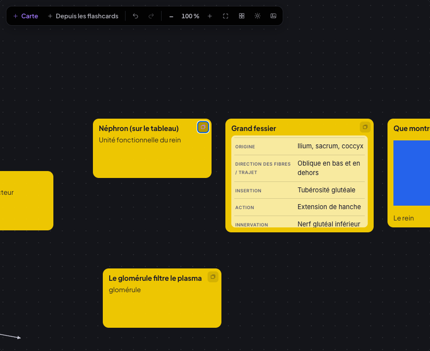 | 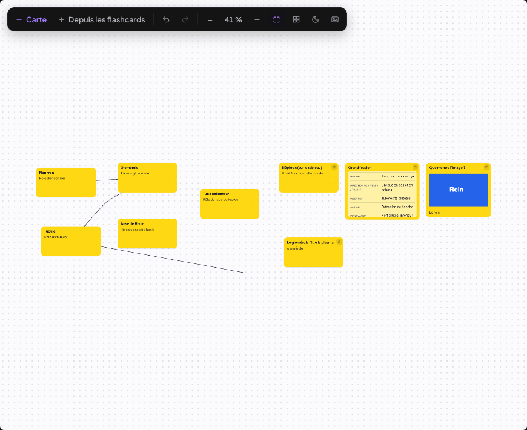 |
| **Flèches (dont la courbe avec son point)** | **Côte à côte, carte sélectionnée, minimap** |
| 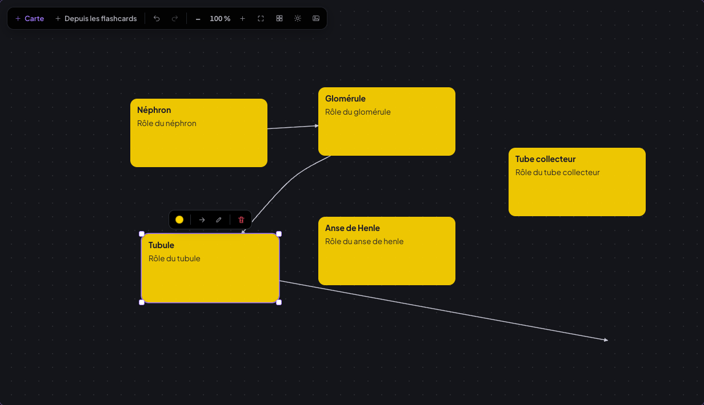 | 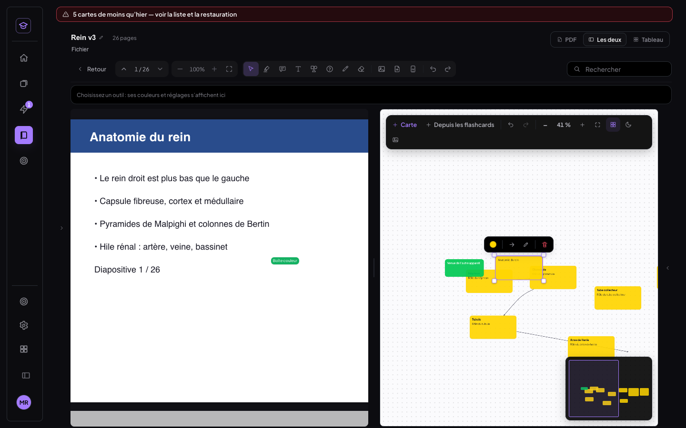 |
| **iPad** | **Mobile (768 px)** |
| 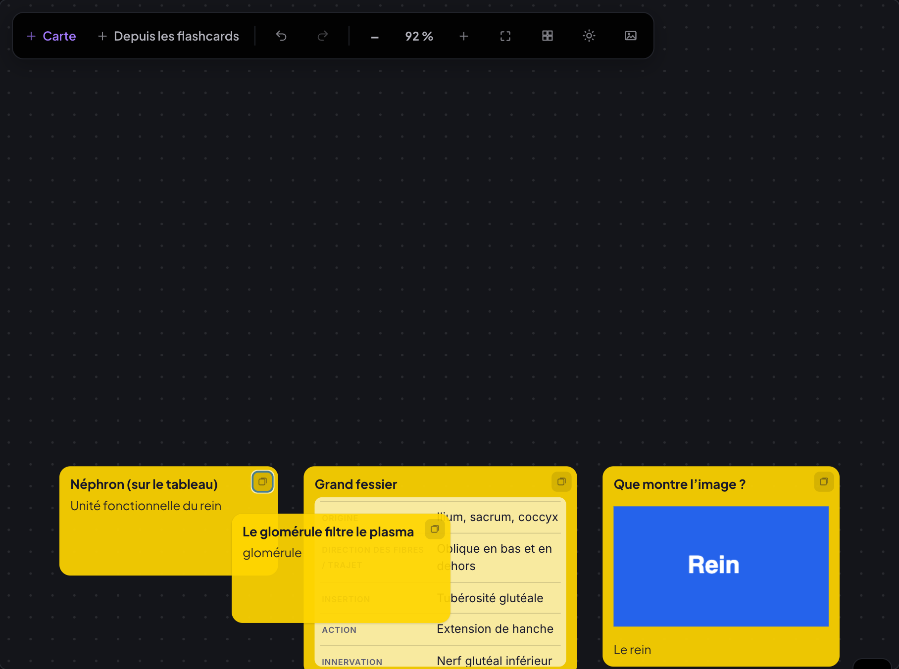 | 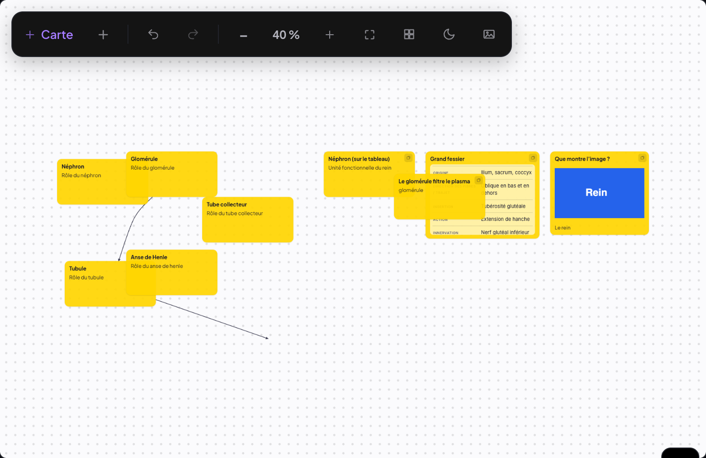 |

## Non-régression générale

Rejouée en fin de chantier sur le banc local (Chrome headless, base locale, aucun appel Supabase) :

| Banc | Résultat |
|---|---|
| `t-objets` (PDF ×3 appareils, document, fiche jumelle) | 33/33 ×3, 30/30, 33/33 |
| `t-fleches` (ordinateur, iPad), `t-zoom`, `t-inserer`, `t-taille`, `t-formats uniforme` | 18/18 ×2, 10/10, 9/9, 9/9, 5/5 |
| `t-crayon` (×2), `t-boites`, `t-dock`, `t-export`, `t-telephone`, `t-contextes` | tout passe |
| `v4/t-clignotement`, `v3/t-zoom`, `v3/t-couleurs`, `v3/t-transcript` | 6/6, 6/6, 27/27, 24/24 |
| `t-reprise`, `t-transcript-entete` | 17/17, 9/9 |
| `t-flashcards`, `t-tableau`, `import-tableau-nettete` (t-tableau, mobile, tablette) | 18/18, 24/24, 16/16, 9/9, 5/5 |
| fiche jumelle `tout.sh` (couleurs, import, bascule, calques, éditeur, tablette, remplacer, sans-les-deux, document ×5, correspondance 30/30 ×3) | tout passe |

Ajustements de bancs pendant ce passage (le code n'était pas en cause) :
- `t-objets` fixe le zoom à 160 % : les bancs `t-zoom` et `t-inserer` laissaient le cours de test à 100 %, et les objets
  déplacés finissaient par se chevaucher ;
- `t-tableau` remet le cours en disposition « PDF » à la fin : en « côte à côte », le panneau est fermé, ce qui gênait
  les bancs suivants ;
- `t-reprise` et `v3/t-transcript` visent le bouton « ‹ Sessions » par sa classe, puisque son libellé s'abrège en
  panneau étroit (§5).

Aléa connu, non lié à ce chantier : `v3/t-transcript` peut voir un segment validé pendant le défilement entre deux
pages (« page 5 »). Il est réapparu sur un passage sur trois.

**MealWeek** : elle s'ouvre normalement depuis le sélecteur d'apps (« Planning de la semaine »), 0 erreur JavaScript.
`git diff 4b8d13c..HEAD -- src/mealweek src/shared` est **vide**.

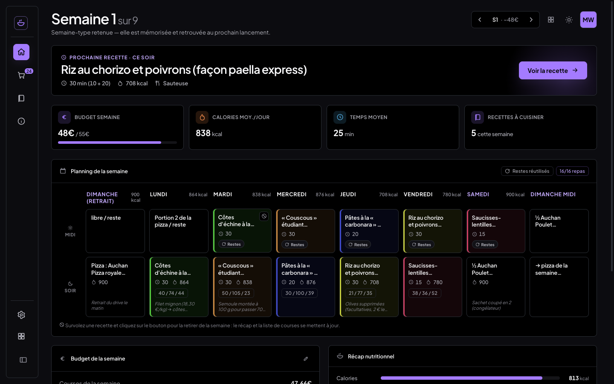

## Migration SQL

`supabase/migrations/20261022_board.sql` : additive, idempotente, **non appliquée**. Elle ajoute un index partiel sur
`medrevise_records` pour le type « board ». L'app fonctionne sans elle.

## Commits

| Commit | Message |
|---|---|
| `a26e038` | fix(medrevise): « Insérer une page » — invisible hors survol, ligne de la largeur exacte de la page, « + » rond à l'échelle (18–40 px) |
| `0225b9d` | feat(medrevise): Transcript — en-tête de lecture sur une ligne, barre de défilement toujours visible avec repère horaire, Début / Fin |
| `391214f` | feat(medrevise): boîtes de la famille « carte » et tailles en % de la largeur de page (texte, crayon, bordures) |
| `db65df8` | feat(medrevise): onglet Flashcards refait — sélecteur de sorte unique, Recto / Verso d'abord, « Plus d'options », menu Amorce, recherche et filtres, actions au survol |
| `721a422` | feat(medrevise): tableau (Miro) par fiche — cartes, flèches du lecteur, images, groupes, import de flashcards, export PNG |
| (ce commit) | test + docs : non-régression, MealWeek, liste des commits |

## v1.1 — corrections (22/10/2026)

Cinq corrections demandées après le chantier, et rien d'autre. Tests sur l'instance locale isolée (Vite :5199 sans
Supabase, Chrome headless en CDP, faux Deepgram local pour la session en direct) : aucune écriture Supabase. MealWeek et
`src/shared/` intacts (contrôle en fin de section).

| Correction | État |
|---|---|
| 1. Cartes du tableau : retour à l'ancien design | livré, testé (ordinateur, iPad, mobile) |
| 2. Menu « Amorce » et en-tête du panneau en session de transcript | livré, testé (ordinateur, iPad, mobile) |
| 3. Taille de texte en px, uniforme entre diapos | livré, testé (3 formats, ordinateur, iPad, mobile) |
| 4. Flashcards ajoutées au tableau depuis la carte | livré, testé (ordinateur, iPad, mobile) |
| 5. Grille unique des tailles par défaut, sélecteur unique | livré, testé (ordinateur, iPad, mobile) |

### 1. Cartes du tableau : l'ancien design rétabli

Le dessin des cartes du tableau du 04/10 (`tableau/Tableau.jsx` et le CSS `.tb-carte` d'`etudes.css`, supprimés par
`721a422`) a été retrouvé dans git et réappliqué tel quel aux cartes du tableau actuel (`tableau-board.css`,
`Board.jsx#fondCarte`) :

- coins arrondis de 10 px, marges 10 × 12 px, bord fin `rgba(0,0,0,.08)` ;
- ombre double `0 1px 2px rgba(0,0,0,.12), 0 4px 14px rgba(0,0,0,.08)`, plus marquée au survol ;
- encre `#1d1d26`, texte de la police de l'app en 16 px, graisse normale, interligne normal (valeurs **mesurées** sur
  l'ancien code : la règle `font: 500 14px/1.4 inherit` d'alors était invalide, le navigateur l'ignorait) ;
- fond : la couleur à 88 % (teinte à 30 % pour une couleur foncée), posée sur le fond clair d'alors (`#f7f7f5`) puis
  rendue opaque. La carte est donc identique à l'ancienne sur le fond blanc comme sur le fond sombre ;
- « Double-clic pour écrire » en italique gris ; on écrit directement sur la carte (champs sans cadre ni fond).

Ce qui est venu depuis garde ce dessin : le titre (même taille, en gras), le contenu riche d'une flashcard (tableau
Muscle, tableau, molécule, image), l'icône de lien vers la flashcard. Le reste du chantier est conservé : flèches
unifiées, mini barre, sélection multiple, groupes, fond sombre / blanc, minimap, export PNG (qui dessine aussi l'ancien
design). Les boîtes du lecteur reprennent l'ombre de ces cartes (famille visuelle, `pdfreader-v2.css`).

Contrôle (`scripts/tests-tableau-v11/cap-cartes.mjs`, même jeu de 7 cartes, même caméra, ancien code servi sur le
même port) : rayon, marges, bord, ombre, encre et police identiques ; fond jaune `rgb(254, 220, 97)` =
88 % de `#FFD84D` sur `#f7f7f5`, exactement la couleur affichée avant.

| Avant le chantier (commit `721a422^`) | Refusé (`94efb32`) | v1.1 |
|---|---|---|
| 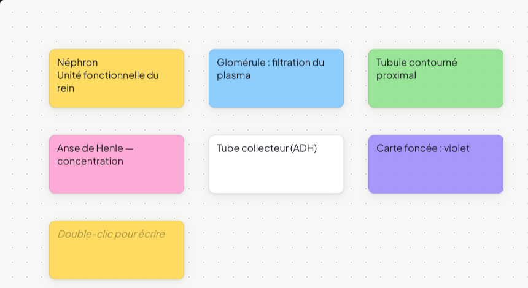 | 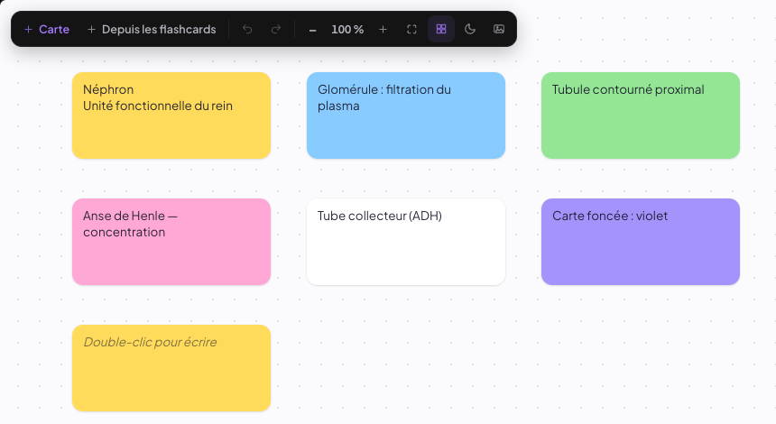 | 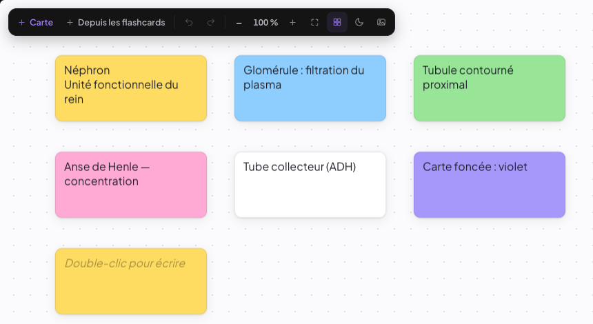 |

| v1.1 sur fond sombre : cartes importées (texte, Muscle, image), flèches, lien vers la flashcard |
|---|
| 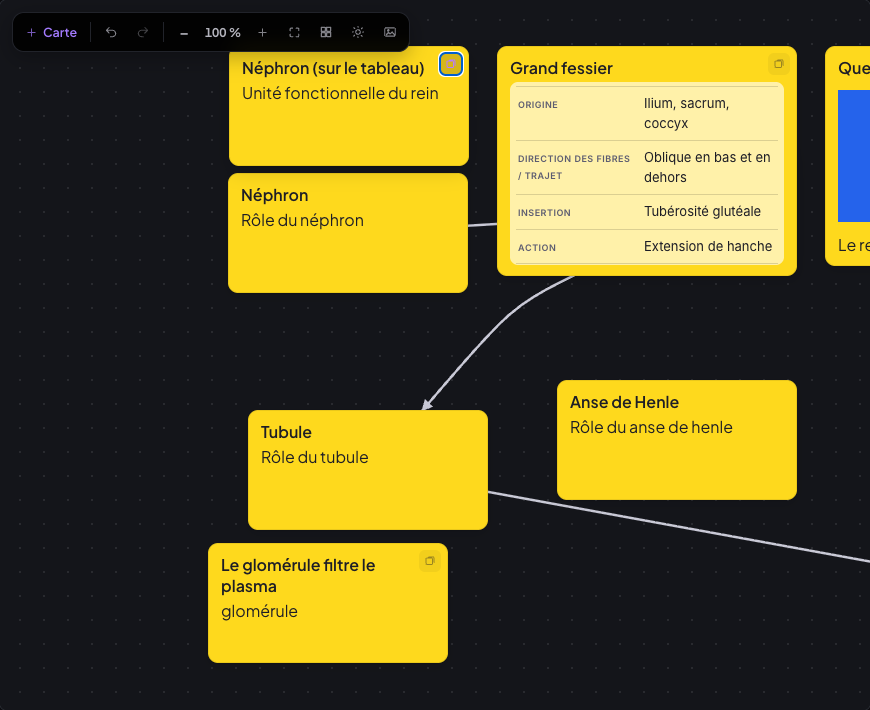 |

### 2. Affichages coupés ou superposés

**Menu « Amorce »** (`AmorcesRecto.jsx`) : il est rendu dans un **portail** (au-dessus de tout, hors du panneau qui le
coupait), en position fixe calculée :
- largeur ≥ 320 px (celle du formulaire jusqu'à 360 px) ;
- sous le bouton, ou au-dessus s'il manque la place ;
- aligné sur le bouton, ou sur le bord gauche du formulaire si la place manque à droite ;
- jamais hors du panneau ni de l'écran, recalculé au défilement et au redimensionnement ;
- la liste défile à l'intérieur ;
- la recherche, les favoris, « + Mon amorce », Échap et le clic dehors marchent comme avant. Les événements du portail
  ne remontent plus au formulaire : Échap ferme le menu sans fermer le formulaire.

Banc `t-amorce.mjs` (panneau de 360 puis 320 px) : 6/6 sur ordinateur, iPad et mobile. Il vérifie le menu entier dans
l'écran et dans le panneau, ≥ 320 px, au-dessus de tout, le défilement interne, aucun libellé tronqué, la recherche au
clavier et l'insertion au recto, Échap.

| Menu Amorce, panneau de 360 px — avant | v1.1 |
|---|---|
| 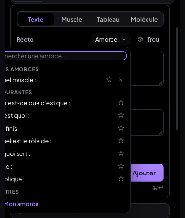 | 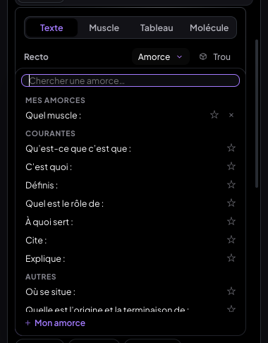 |

**En-tête du panneau en session de transcript.**
- **Sélecteur de modes** (`CourseItemsSidebar.jsx`, `panneau-modes.css`). Avant, ses colonnes n'étaient plus égales
  quand un libellé dépassait : l'indicateur glissant restait sur une grille égale, donc la pastille « 6 » d'Exercices
  chevauchait « Transcript » et « Tableau » sortait du cadre. Désormais :
  - les colonnes restent égales, larges comme le plus long contenu (mesuré) ;
  - si les libellés entiers ne tiennent pas, ils s'abrègent : « Exos », « Trans. », « Notes », « Notions », « Tableau ».
    Le libellé entier reste lu par les lecteurs d'écran et donné en infobulle ;
  - si cela ne tient toujours pas, le sélecteur défile à l'horizontale en douceur, avec un fondu sur le bord qui cache
    encore un mode, et le mode actif reste visible.
- **Rangée de contrôles d'une session** (lecture et direct, `transcription.css`). Sous 400 px de panneau, la rangée
  secondaire passe sur deux lignes propres : les actions (note, mots-clés, source, page), puis à droite la taille du
  texte et le plein écran. Sur la rangée principale du direct, la pastille garde son point ; Pause et Arrêter restent
  entiers.

Banc `t-entete-panneau.mjs` : vue lecture d'une session enregistrée, puis session **en direct** (micro simulé, faux
Deepgram), panneau de 520, 420, 360 et 320 px. Il mesure chaque paire d'éléments de l'en-tête (aucun ne chevauche un
autre), tout débordement hors du panneau, tout texte rogné sans ellipse, et le nombre de lignes de la rangée de
contrôles. Résultat : **9/9 sur ordinateur, iPad et mobile**.

| En direct, panneau de 360 px — avant | v1.1 |
|---|---|
| 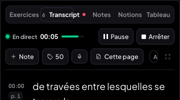 | 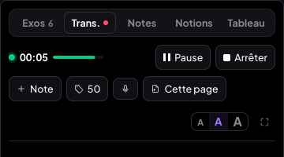 |
| **Lecture, 360 px — avant** | **v1.1** |
| 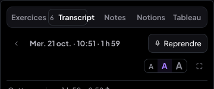 | 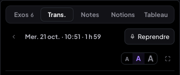 |
| **v1.1 à 320 px (défilement, fondu à droite)** | **v1.1 à 420 px** |
| 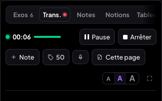 | 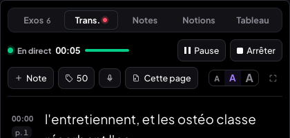 |

### 3 et 5. Tailles en px d'une page de 1000 px, une grille, un sélecteur

**Unité** (`pdfShared.js#GRILLE`) : toute taille et toute épaisseur du lecteur et du tableau est un **px d'une page de
référence de 1000 px de large**, rendu proportionnellement à la largeur réelle de la page. L'utilisateur ne voit que
des px.
- Les préréglages S / M / L / XL, le réglage fin et tout affichage en % sont retirés.
- Champs : `taille1000` (texte), `ep1000` (crayon, surligneur, formes, flèches), `bord1000` et `pad1000` (boîtes).
- Dans le tableau, le monde compte comme une page de 1000 px.

**Grille des tailles par défaut** (nouvelles annotations ; la dernière valeur choisie est reprise pour la suivante,
comme avant) :

| Élément | Défaut (px d'une page de 1000 px) | Préréglages | Champ px |
|---|---|---|---|
| Texte (boîte, zone de texte, texte d'une forme) | **18** | 14 · 18 · 24, plus la liste 10 · 12 · 14 · 16 · 18 · 20 · 24 · 28 · 32 · 40 | 6 à 120 |
| Bordure de boîte (transparente ou teintée) | **1,5** | 1 · 1,5 · 3 | 0,5 à 12 |
| Marges de boîte | **10 × 8** | — | — |
| Flèche (boîtes, Formes, tableau) ; pointe proportionnelle | **2,5** | 1,5 · 2,5 · 4 | 0,5 à 20 |
| Crayon | **3** | 2 · 3 · 5 | 0,5 à 40 |
| Surligneur à main levée | **14** | 10 · 14 · 20 | 2 à 80 |
| Formes (trait) | **2,5** | 1,5 · 2,5 · 4 | 0,5 à 20 |

Avant, en px d'une page de 1000 px : texte « M » 10, crayon moyen ≈ 3, surligneur moyen ≈ 12, flèche ≈ 1,1 sur une
diapo 16:9 (elle dépendait du format), forme ≈ 1,8. La nouvelle grille est un peu plus grande et plus lisible, et la
même pour tous les outils.

**Un seul sélecteur** (`pdf/ChoixTaille.jsx`, remplace `TailleTexte.jsx`, les boutons Fin / Moyen / Épais du crayon
et les cycles d'épaisseur des mini barres) :
- le même composant pour le texte, la bordure, la flèche, le crayon, le surligneur et la forme ;
- 3 préréglages, chacun avec un **aperçu réel à l'échelle de la page** : un « Aa » ou un trait, de la couleur de
  l'objet ;
- un champ en px avec son aperçu (flèches ↑ ↓ pour ajuster, Entrée pour valider) ; pour le texte, « ▾ » ouvre la liste
  10 → 40 px ;
- depuis la barre d'outils (crayon), le panneau passe par un portail : la rangée de réglages, qui défile, le rognait.

La barre de mise en forme d'une boîte propose les mêmes tailles en px.

**Migration à la lecture, sans aucun changement visuel.** Les champs d'avant sont relus quand le nouveau manque :
- `tailleTexte` (% de la largeur, 22/10) × 10 ;
- `epaisseurL` × 1000 ;
- `epaisseur` en fraction de la hauteur (d'avant le 22/10) ;
- un texte sans champ garde sa taille d'alors (13 px de référence, 15 px pour une zone de texte), rapportée à **sa** page ;
- une flèche à facteur garde son facteur.

Rien n'est réécrit en base à la lecture. À la modification, le nouveau champ est écrit, et l'ancien à côté pour un
appareil pas encore à jour. L'export PDF suit les mêmes règles.

Bancs (`scripts/tests-tableau-v11/t-tailles.mjs`) :
- `geo avant|apres` : sur trois cours (A4 portrait, diapo 16:9, capture 390 × 844) chargés d'annotations existantes
  (boîte à bandeau, boîte « un mot » avec sa flèche, zone de texte, trait, surligneur, rectangle avec texte, flèche de
  Formes à facteur 1,6, boîte, trait et ellipse du 22/10 en %). Relevé sur l'ancien code (`024913c`, même port, même
  base), puis sur le nouveau : **3/3, 11 objets identiques** par cours (position, taille, police, marges, bordures,
  épaisseurs des traits et des flèches). Et **rien n'est réécrit en base**.
- `uniforme` : 16 px choisis au sélecteur (champ + Entrée) sur une boîte de chacun des trois cours. Résultat sur
  ordinateur, iPad et mobile :

  | Format | Page affichée | Police à l'écran | Police / largeur × 1000 | « Néphron » / largeur × 1000 |
  |---|---|---|---|---|
  | A4 portrait | 595 px | 9,52 px | 16 | 66,5 |
  | Diapo 16:9 | 960 px | 15,36 px | 16 | 66,5 |
  | Capture d'écran | 390 px | 6,24 px | 16 | 66,51 |

- `selecteurs` : **7/7 sur ordinateur, iPad et mobile**. Il vérifie :
  - les défauts des nouvelles annotations, stockés et rendus : boîte 18 / 10 × 8 / 1,5, sa flèche 2,5, crayon 3,
    surligneur 14, rectangle 2,5 avec texte 18, flèche de Formes 2,5 ;
  - le même sélecteur pour les six réglages (3 préréglages, champ en px, 4 aperçus) ;
  - les préréglages et la liste du texte ;
  - un préréglage choisi qui écrit `ep1000` et le facteur d'avant ;
  - qu'il ne reste ni S / M / L / XL, ni %, ni Fin / Moyen / Épais.

Chrome arrondit une bordure au pixel d'écran (1,44 px voulu, 1,25 px affiché au zoom 100 %) : c'est le moteur, pas la
valeur.

| Sélecteur d'avant (S / M / L / XL, %) | Texte, v1.1 | Flèche, v1.1 | Crayon, v1.1 (barre d'outils) |
|---|---|---|---|
|  | 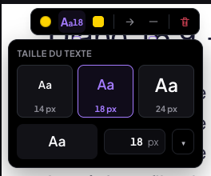 | 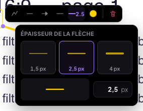 | 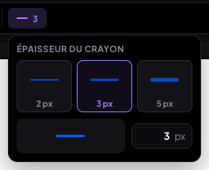 |

| 16 px sur A4 portrait | 16 px sur diapo 16:9 | 16 px sur capture d'écran |
|---|---|---|
| 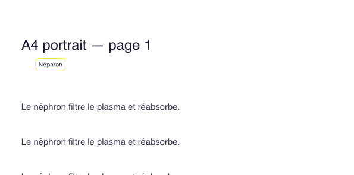 | 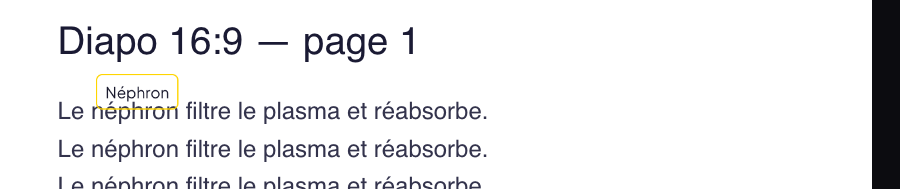 | 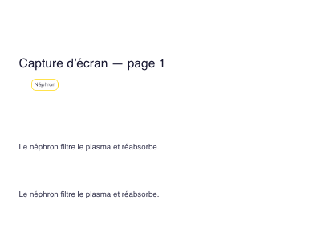 |

### 4. Ajout de flashcards au tableau : depuis la carte

**Retiré** : « + Depuis les flashcards » de la barre du tableau et de l'onglet Tableau, et sa fenêtre
(`ImportFlashcardsTableau.jsx`, supprimé).

Trois chemins restent :
- **(a) « → Tableau » sur chaque flashcard** (onglet Exercices › Flashcards) : une petite action discrète dans la
  rangée d'actions de la carte (icône grille, infobulle « → Tableau »).
  - Tableau affiché : la carte y apparaît, et ⌘Z l'annule.
  - Tableau masqué : elle est ajoutée à son enregistrement, à droite de ce qui est posé.
  - L'icône est ensuite **marquée** (fond accent). Un clic sur une carte déjà posée **ouvre le tableau** (côte à côte
    sur un écran large, plein écran sinon), sélectionne la carte et **recentre** la vue dessus, une fois la largeur
    du tableau stabilisée.
  - **Sélection multiple** : « → Tableau (n) » dans la barre de sélection pose toutes les cartes cochées en grille.
    Celles déjà posées ne sont pas doublées.
- **(b) Glisser-déposer** une flashcard du panneau sur le canevas : un **aperçu fantôme** en pointillés suit le
  pointeur (« Déposer ici », ou « n cartes » en grille). La carte tombe exactement à l'endroit lâché.
- **(c) Création manuelle** : double-clic sur le fond ou « + Carte ».

Banc `t-vers-tableau.mjs` : **8/8 sur ordinateur** (dont un glisser-déposer HTML5 réel, avec la position du fantôme
comparée à celle de la carte déposée), **7/7 sur iPad et mobile** (le glisser HTML5 n'existe pas au doigt).

| « → Tableau » marquée (déjà posée) | « → Tableau (3) » sur une sélection | Aperçu fantôme pendant le glisser |
|---|---|---|
| 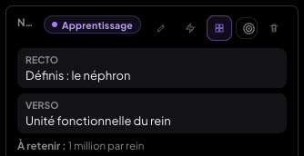 | 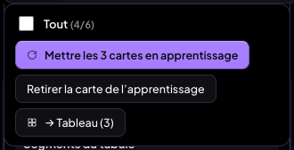 | 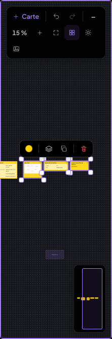 |

### Non-régression

Rejouée sur le banc local après les cinq corrections (Chrome headless, base locale, aucun appel Supabase) :

| Banc | Résultat |
|---|---|
| `t-objets` : PDF (ordinateur, iPad, mobile), document, fiche jumelle | 33/33 ×3, 30/30, 33/33 |
| `t-fleches` (ordinateur, iPad), `t-zoom`, `t-inserer` | 18/18 ×2, 10/10, 9/9 |
| `reparation/` : `t-boites`, `t-crayon` (ordinateur, iPad), `t-contextes`, `t-dock`, `t-export`, `t-telephone` | 13/13, 15/15, 17/17, 19/19, 11/11, 3/3, 6/6 |
| `fiche-jumelle/t-couleurs-boite`, `v3/t-couleurs` | 33/33, 27/27 |
| `t-tableau` (ordinateur, iPad, mobile) | 25/25, 24/24, 24/24 |
| `t-flashcards` (ordinateur, iPad, mobile) | 18/18 ×3 |
| `t-transcript-entete` | 9/9 |
| v1.1 : `t-vers-tableau`, `t-amorce`, `t-entete-panneau`, `t-tailles` (geo, uniforme, selecteurs), `t-mealweek` | 8/8 · 7/7 · 7/7 ; 6/6 ×3 ; 9/9 ×3 ; 5/5, 2/2 ×3, 7/7 ×3 ; 2/2 |

Bancs mis à jour pour la v1.1 (le code n'était pas en cause, les attentes étaient celles d'avant) :
- `reparation/t-boites` : marges 10 × 8 px d'une page de 1000 px ;
- `reparation/t-crayon` et `t-contextes` : le sélecteur d'épaisseur commun, `ep1000` 3 / 5 ;
- `t-tableau` : le libellé entier d'un mode, puisqu'il est abrégé à l'écran en panneau étroit ;
- `t-tableau` : l'import par glisser-déposer remplace la fenêtre « Depuis les flashcards ».

`harmonisation/t-taille` et `t-formats` (S / M / L / XL, « M = 1 % ») sont remplacés par `t-tailles`.

Écartés, car **ils échouaient déjà sur `94efb32`**, avant toute la v1.1 (rejoués sur ce code, servi sur le même port) :
- `reparation/t-fleches` : il vise un libellé « Ajouter une flèche » qui a changé le 22/10 ;
- `v4/t-boites`, `v4/t-crayon`, `v4/t-fleches`.

`t-reprise` échoue sur 2 points (page des lignes après une reprise). Il échoue de la même façon sur `94efb32` et sur
`bc6a624` : c'est un aléa du banc, sans lien avec ces corrections.

Pendant la passe, la fiche jumelle de test avait perdu sa jumelle (état du banc). Elle a été réimportée par
`t-jumelle-import`.

**MealWeek** : elle s'ouvre depuis le sélecteur d'apps (« Semaine 1 sur 9 »), 0 erreur JavaScript (`t-mealweek.mjs`).
`git diff 94efb32..HEAD -- src/mealweek src/shared` est **vide**.

### Commits v1.1

| Commit | Message |
|---|---|
| `bc6a624` | fix(medrevise): tableau v1.1 — cartes à l'ancien design, flashcards ajoutées depuis la carte |
| `024913c` | fix(medrevise): panneau v1.1 — menu Amorce entier (portail ≥ 320 px), sélecteur de modes et contrôles de session sans chevauchement |
| `79bd5a2` | feat(medrevise): tailles v1.1 — px d'une page de 1000 px, grille de défauts unique, un seul sélecteur |
| (ce commit) | docs + test : compte rendu v1.1 (captures avant / après, table des tailles), banc MealWeek |
