# Compte rendu — tableau, boîtes, insertion de page, texte uniforme, Transcript, Flashcards (22/10/2026)

Six chantiers MedRevise. Tests sur une instance locale isolée (Vite :5199 sans Supabase, Chrome headless en CDP) :
aucune écriture Supabase.

## Suivi

| Chantier | État |
|---|---|
| 3. « Insérer une page » | livré, testé (ordinateur, iPad) |
| 5. Transcript : en-tête, défilement | livré, testé (ordinateur, iPad, mobile) |
| 2. Boîtes modernisées | livré, testé (ordinateur, iPad) |
| 4. Texte uniforme (% de la largeur de page) | livré, testé (3 formats, ordinateur, iPad) |
| 6. Onglet Flashcards | livré, testé (ordinateur, iPad, mobile) |
| 1. Tableau par fiche | à faire |

## 3. « Insérer une page » : réglé pour de bon

Avant, deux défauts : au zoom, le « + » restait fixe pendant que la ligne bleue s'étirait sur toute la largeur ; au
dézoom, il flottait sans rapport avec les pages.

Nouveau rendu (`PdfReader.jsx`, CSS « INSÉRER UNE PAGE (22/10) » de `pdfreader-v2.css`) :
- après chaque page, la dernière comprise (insertion en fin de document), une zone de la hauteur **exacte** de l'espace
  inter-pages (18 px × zoom) et de la largeur **exacte** de la page ;
- **rien n'est affiché** hors survol ;
- au survol, au focus clavier ou au premier toucher (doigt), apparaissent une ligne pointillée de la largeur de la page
  et un bouton rond « + » centré, de 24 px au zoom 160 %, à l'échelle de la page, borné entre 18 et 40 px à l'écran ;
- la souris insère d'un clic ; au doigt, un premier toucher montre la zone (elle se cache après 4 s) et le « + » insère ;
- la prise reste d'au moins 20 px de haut, même dézoomé ;
- l'ancien rendu (bouton pleine zone, pastille « Insérer une page ici », fine ligne « + ») est supprimé.

Banc `scripts/tests-pdfreader-harmonisation/t-inserer.mjs` : **9/9** sur ordinateur, **9/9** sur iPad.

| Zoom | Zone (hauteur) | Ligne / page | « + » |
|---|---|---|---|
| 25 % (affiché 40 %) | 7,2 px | 336,8 px / 336,8 px | 18 px |
| 50 % | 9 px | 421 px / 421 px | 18 px |
| 100 % | 18 px | 842 px / 842 px | 18 px |
| 160 % | 28,8 px | 1347,2 px / 1347,2 px | 24 px |
| 200 % | 36 px | 1684 px / 1684 px | 30 px |
| 300 % | 54 px | 2526 px / 2526 px | 40 px |

| 50 % (survol) | 160 % (survol) | 300 % (survol) |
|---|---|---|
| 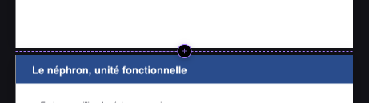 | 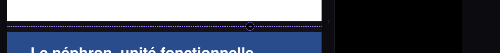 |  |

## 5. Transcript : en-tête et défilement

**En-tête de lecture** : avant, la date de la session s'affichait en colonne verticale. Il tient désormais sur **une
ligne** : « ‹ Sessions · Mer. 21 oct. · 10:51 · 1 h 59 », puis le bouton « Reprendre » (icône micro + libellé court).
- Le titre se tronque par une ellipse (infobulle complète au survol).
- Quand le panneau rétrécit, les libellés s'abrègent avant tout retour à la ligne : « Sessions » disparaît sous 360 px
  (le chevron reste), « Reprendre » sous 300 px (l'icône reste). Une requête de conteneur sur le panneau gère ce
  passage, y compris en tablette, où `tablette.css` faisait passer les barres à la ligne.

**Barre de défilement** de la liste, toujours visible : fine, aux couleurs de la DA. La barre du système se cache sur
Mac et au doigt.
- La poignée fait au moins 28 px et se met à jour avec les nouvelles lignes.
- Elle se saisit à la souris, au doigt et au stylet. Pendant le glisser, un **repère horaire** flotte à côté (« 59:12 »,
  « 1:11:12 »), c'est l'heure de la première ligne visible.
- Un clic dans la piste défile d'un écran.
- « ↑ Début » et « ↓ Fin » apparaissent quand il y a de quoi défiler. En direct, « ↓ Reprendre » garde son rôle.
- La liste virtualisée (au-delà de 150 lignes) estime désormais la hauteur des lignes non mesurées par la moyenne des
  lignes mesurées : la hauteur totale, donc la poignée, ne saute plus au fil du défilement.

Banc `t-transcript-entete.mjs` (session de 2 h, 300 lignes) : **9/9** sur ordinateur, iPad et mobile. Il vérifie
l'en-tête sur une ligne à 332, 260 et 220 px, la barre au repos, le glisser jusqu'au milieu avec son repère, et
« Fin » / « Début ». Non-régression : `t-reprise` 17/17, `v3/t-transcript` 24/24.

| En-tête (332 px) | 260 px | 220 px |
|---|---|---|
| 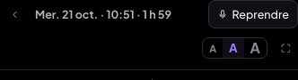 | 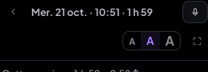 | 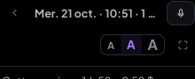 |

| Glisser la poignée : repère horaire, « ↑ Début », « ↓ Fin » |
|---|
| 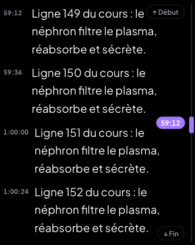 |

## 2. Boîtes : plus modernes, de la même famille que les cartes du tableau

Une **famille « carte »** (CSS « FAMILLE CARTE (22/10) » de `pdfreader-v2.css`) dessine à la fois les boîtes du lecteur
(commentaires, post-it, zones de texte) et les cartes du tableau. Les réglages de taille changent d'un usage à l'autre
par variables (`--carte-r`, `--carte-px`, `--carte-py`) : une famille visuelle, sans copie.

- **Boîtes créées depuis le 22/10** (`gabarit: 'carte'`) :
  - coins arrondis de 10 px, marges de 10 px (horizontales) × 8 px (verticales), interligne 1,35 ;
  - fond plein de la couleur choisie, texte en contraste automatique (règle existante) ;
  - ombre très légère, contour fin uniquement à la sélection (cadre commun) ;
  - largeur du texte (règle « un mot »), jamais sous la taille d'un mot.
- **Boîtes d'avant** : elles prennent le nouveau dessin (coins de 10 px, ombre légère, bandeau des toutes premières boîtes
  devenu invisible, épingle discrète) **sans changer de position ni de taille**. Leurs marges sont gardées, puisque des
  marges plus grandes changeraient leur taille. C'est vérifié sur trois formats de page (§4).
- La typographie de la DA, 13–14 px, correspond à la taille « M » sur une diapo 16:9 au zoom de référence (13,5 px).

| Nouvelle boîte (« M ») | Sélecteur de taille de la mini barre |
|---|---|
| 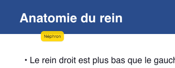 | 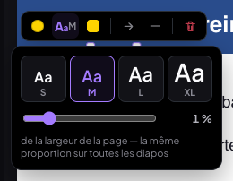 |

## 4. Taille de texte uniforme entre cours

**Avant** : une taille « 24 » était exprimée en pixels de l'échelle de référence de la page. Sur une page étroite, elle
paraissait énorme ; sur une page large, petite.

**Règle** (`pdfShared.js#TAILLES_TEXTE`) : toutes les tailles de texte d'annotation sont un **pourcentage de la largeur
de la page**. Cela vaut pour les boîtes, commentaires et post-it, les zones de texte, le texte des formes et les tailles
de la barre de mise en forme d'une boîte.
- Préréglages **S 0,8 %**, **M 1 %**, **L 1,4 %**, **XL 2 %**, et un réglage fin de 0,4 à 4 % par crans de 0,05 %. Ils
  sont proposés par le bouton « Aa » de la mini barre, avec un aperçu de chaque taille.
- La dernière taille choisie est mémorisée sur l'appareil : la boîte suivante naît à cette taille.
- Rendu : variable `--lp` (1 % de la largeur de la page à l'échelle de référence de la boîte), puis
  `font-size: calc(var(--lp) × taille)`.
- **Étalonnage** : M = 1 % donne 13,5 px sur une diapo 16:9 au zoom de référence. La demande citait 1,6 % en exemple,
  mais 1 % respecte la typographie 13–14 px exigée au §2 sur le format le plus courant des cours (diapos).

**Migration à la lecture** : une annotation d'avant n'a pas de champ `tailleTexte`. Elle garde sa taille d'alors
(13 px de référence, 15 px pour une zone de texte). Le sélecteur la présente en % de **sa** page, sans rien écrire.

**Crayon et bordures**, même logique : nouveau champ `epaisseurL`, fraction de la largeur, sur les traits et les formes
créés depuis le 22/10 (`pdfShared.js#epaisseurPx`).
- Les traits et formes d'avant gardent `epaisseur`, fraction de la hauteur, relue telle quelle.
- Les deux champs sont écrits, pour qu'un appareil pas encore à jour lise `epaisseur`.
- Les préréglages sont convertis pour qu'un trait sur une diapo 16:9 garde exactement son épaisseur d'avant.
- L'export PDF suit les mêmes règles.

Bancs (`scripts/tests-pdfreader-harmonisation/`) :
- `t-formats.mjs uniforme` (A4 portrait, diapo 16:9, capture d'écran 390 × 844) : 5/5.

  | Format | Largeur affichée | Police « M » | « Néphron » | Texte de forme | Trait | Bordure |
  |---|---|---|---|---|---|---|
  | A4 portrait | 595 px | 1 % | 4,158 % | 1 % | 0,3 % | 0,3 % |
  | Diapo 16:9 | 960 px | 1 % | 4,157 % | 1 % | 0,3 % | 0,3 % |
  | Capture d'écran | 390 px | 1 % | 4,159 % | 1 % | 0,3 % | 0,3 % |

  (Le rendu ne descend jamais sous 1 px : une bordure de 0,18 % sur la capture de 390 px resterait à 1 px.)
- `t-formats.mjs geo avant|apres` : les **annotations d'avant inchangées** sur les trois formats (boîte à bandeau,
  compacte, « un mot », zone de texte, trait, forme avec texte). Position, taille, police et épaisseurs sont relevées
  sur l'ancien code puis sur le nouveau : **3/3, 0 écart**. À l'œil, seul le dessin change (coins, ombre, bandeau).
- `t-taille.mjs` (9/9 ordinateur, 9/9 iPad) : nouvelle boîte (gabarit, coins, marges, interligne, ombre, contour,
  taille M), sélecteur S / M / L / XL avec aperçu, L enregistré, réglage fin au clavier, mémorisation pour la boîte
  suivante, tailles de la barre de mise en forme.
- Non-régression :
  - `t-objets` (PDF ×3, fiche jumelle, document) : la mini barre a désormais l'option « taille » ;
  - `t-boites` (×2) et `t-contextes` 19/19, mis aux métriques « carte » et à `epaisseurL` ;
  - `t-fleches`, `t-zoom`, `t-crayon` (×2), `t-export`, `t-dock`, `t-couleurs-boite` 33/33 : tout passe ;
  - `t-anciennes` (comparaison au pixel) diffère désormais par le nouveau dessin, comme prévu. La géométrie est
    vérifiée par `t-formats geo`.

| A4 portrait | Diapo 16:9 | Capture d'écran |
|---|---|---|
| 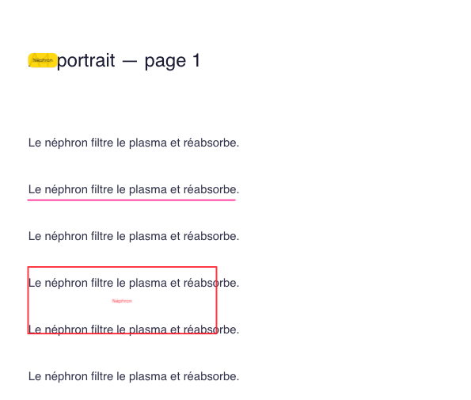 | 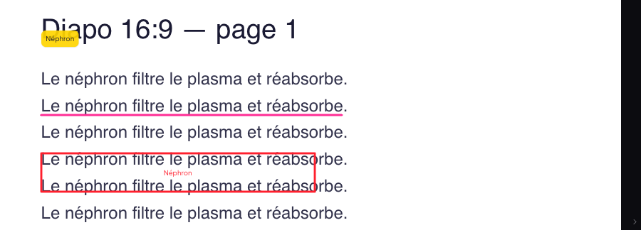 | 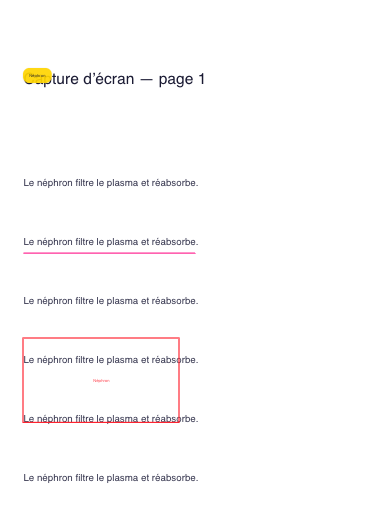 |

| Annotations d'avant, ancien code (16:9) | Même page, nouveau code |
|---|---|
| 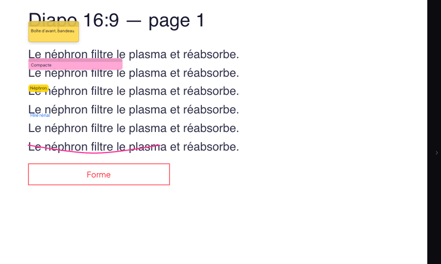 | 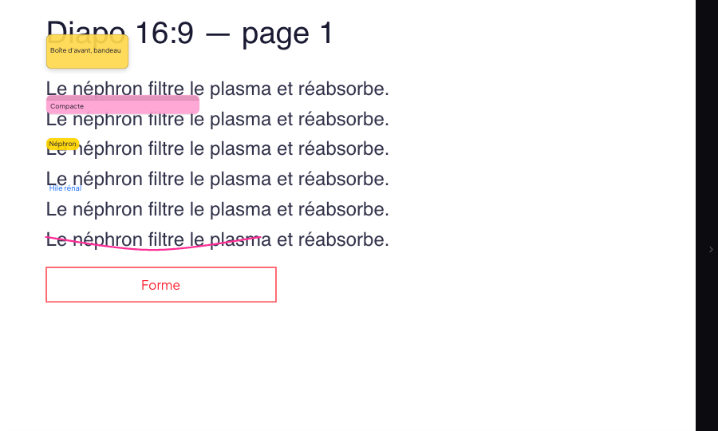 |

## 6. Onglet Flashcards : audit AVANT (écrit avant la refonte)

Parcours en conditions réelles (`scripts/tests-flashcards-refonte/audit.mjs`, cours « Rein v3 », une carte de chaque
sorte) : création texte, image, Muscle, Tableau, Molécule, carte à trou, modification, suppression, import, sélection,
mise en apprentissage, thème auto, mobile.

| Zone | Constat | Type |
|---|---|---|
| Liste | Aucune **recherche**, aucun **filtre par type** : avec 50 cartes on fait défiler à l'aveugle | manque |
| Liste | Chaque carte affiche ses deux faces en grand, plus un bouton « Mettre en apprentissage » toujours visible : 3 cartes par écran | encombré |
| Liste | Actions « éditer » / « supprimer » en icônes de 12 px sans libellé ; pas d'accès au carnet d'erreurs depuis la liste | incohérent |
| En-tête | « 6 cartes › », « Ajouter », « Importer », « Sélectionner », « ⋯ » sur une rangée qui déborde (le « ⋯ » est coupé) | encombré |
| Thème auto | Une barre pleine largeur « Pas de thème auto pour cette fiche — Définir », plus visible que les cartes | hiérarchie |
| Formulaire | Les **chips de types** « + Tableau muscle », « + Tableau », « + Molécule » (pointillés) passent sur deux lignes, et la carte standard n'a pas de puce : on ne voit pas quelle sorte on crée | confus |
| Formulaire | **« Terminer » isolé** à droite, sous les chips, alors qu'« Annuler » et « Ajouter » sont en bas : trois façons de finir | incohérent |
| Formulaire | **Thème en premier**, avant le recto : le champ secondaire passe avant l'essentiel | hiérarchie |
| Formulaire | **Amorces en vrac** : 7 chips, « Plus… », « + Mon amorce » entre le libellé « Recto » et son champ | encombré |
| Formulaire | Indice, À retenir, Image toujours dépliés : 8 champs à l'écran pour une carte qui n'en demande que 2 | champs sans hiérarchie |
| Formulaire | Placeholder du recto sur trois lignes (mode d'emploi du trou), « Ajouter un trou » loin du champ | laid |
| Modification | Le formulaire de modification n'a ni en-tête ni sorte : on ne sait plus qu'on modifie, ni quoi | incohérent |
| Muscle / Tableau / Molécule | Retour par « ‹ Carte standard » + titre + « Terminer » sur deux lignes | encombré |
| Mobile (768 px) | Le formulaire tient dans la largeur (0 débordement mesuré), mais les chips d'amorces occupent la moitié de la hauteur | encombré |

Fonctions à retrouver après la refonte (vérifiées une par une, §6 après) : texte, carte à trou (ajouter / retirer un
trou), image (coller, glisser, parcourir, place recto / verso / les deux, masques à deviner), Muscle, Tableau, Molécule,
thème par carte et thème de la fiche (définir, appliquer aux cartes sans thème, annuler), indice, à retenir, amorces
(courantes, plus, perso), aperçu, ⌘↵ / Échap / Tab, modification (les 4 sortes), suppression, import JSON, sélection
multiple et mise en apprentissage, glisser vers Apprentissage, copier (Muscle, Molécule), résumé « N cartes · à revoir »,
coller du JSON, prompts.

| Liste | Formulaire | Carte à trou |
|---|---|---|
| 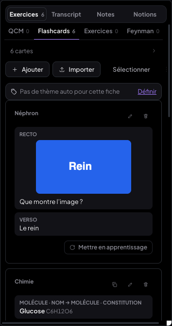 | 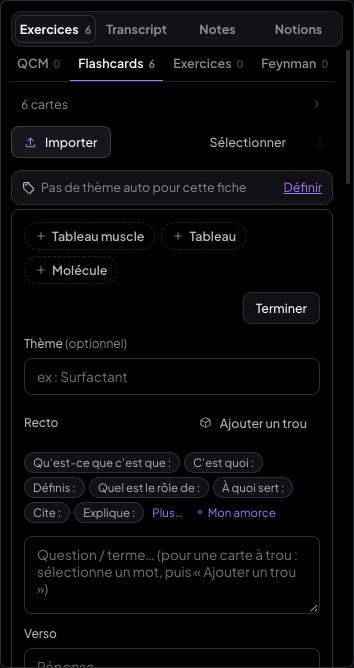 | 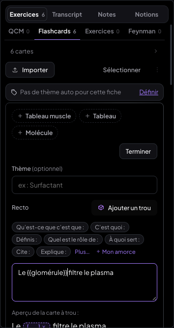 |
| **Muscle** | **Modification** | **Mobile** |
| 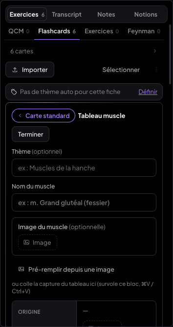 | 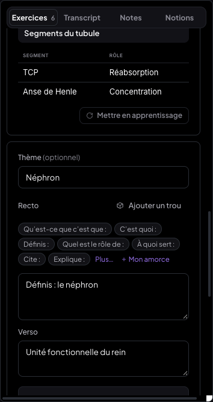 | 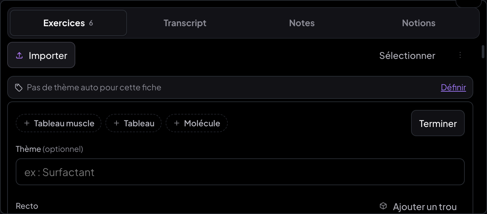 |

## 6. Onglet Flashcards : APRÈS la refonte

**Principes appliqués** :
- **un sélecteur de sorte unique et compact** en tête du formulaire (Texte · Muscle · Tableau · Molécule), qui le
  transforme (`CarteAjoutFlashcard.jsx`) ;
- **Recto / Verso d'abord**. « Amorce ▾ » et « Trou » sont sur la ligne du libellé Recto ;
- **« Plus d'options »** replié : thème, indice, à retenir, image, masques à deviner. Il s'ouvre d'office si la carte en a
  déjà, ou dès qu'une image est collée. Replié, il résume ce qui est rempli (« Thème : Néphron · Image ») ;
- **amorces dans un menu** (`AmorcesRecto.jsx#MenuAmorces`) : recherche sans accents, favoris (étoile, en tête), « Mes
  amorces », courantes, autres, « + Mon amorce ». Les mêmes amorces qu'avant ;
- **un seul bouton principal « Ajouter » (⌘↵)** et « Annuler », plus de « Terminer » flottant. Après un ajout, le
  formulaire reste ouvert et vide (« 2 ajoutées ✓ »). « Annuler » le ferme ;
- **formulaire identique en création et en modification** : en modification, l'en-tête dit « Modification », la sorte
  est affichée et verrouillée, le bouton s'appelle « Enregistrer » ;
- **thème de la fiche** : un petit en-tête discret « Thème : — · Définir » (même fonction : définir, appliquer aux cartes
  sans thème, annuler) ;
- **liste** :
  - recherche (recto, verso, thème, indice, à retenir, nom du muscle ou de la molécule ; sans accents ni majuscules) ;
  - filtres par sorte avec leurs effectifs (Toutes, Texte, Trou, Image, Muscle, Tableau, Molécule) ;
  - cartes compactes (images limitées à 96 px de haut) ;
  - **actions au survol** : modifier, apprentissage, carnet d'erreurs (le menu de pré-réponses de la révision,
    `ActionsCarte`), supprimer. Au doigt, elles restent toujours visibles ;
  - état vide soigné (« Aucune carte ne correspond · Tout afficher ») ;
- **barre** : « + Nouvelle carte », « Importer », « Sélectionner » en icône, « ⋯ ».

**Deux défauts d'usage au doigt corrigés en route** :
- **toucher manqué sur « Ajouter » / « Enregistrer »** pendant la saisie : la perte du focus repliait le volet de la
  tablette et déplaçait le bouton sous le doigt avant le « click ». Un appui sur les boutons d'action et sur le
  sélecteur de sorte ne retire plus le focus du champ ;
- **mesure du débordement** : 0 px à 768 px (tactile).

**Chaque fonction de l'audit retrouvée** (`t-flashcards.mjs`, 18/18 sur ordinateur, iPad et mobile) :

| Fonction | Où, après |
|---|---|
| Texte, ⌘↵, Échap, Tab | formulaire Texte (⌘↵ testé) |
| Carte à trou : ajouter / retirer un trou | « Trou » sur la ligne Recto, aperçu cliquable sous le recto (testé) |
| Image : coller, glisser, parcourir, place, masques | « Plus d'options » › Image ; coller sur le recto / verso l'ouvre (fichier testé, « Masques à deviner » proposé) |
| Muscle, Tableau, Molécule | sélecteur de sorte (les trois créés dans le test) |
| Thème par carte | « Plus d'options » › Thème (avec « Remettre » le thème de la fiche) |
| Thème de la fiche (définir, appliquer, annuler) | en-tête « Thème : — · Définir » |
| Indice, À retenir | « Plus d'options » (testé) |
| Amorces courantes, plus, perso | menu « Amorce ▾ », avec en plus la recherche et les favoris (testé) |
| Aperçu recto / verso | sous les champs, inchangé |
| Modification des 4 sortes | même formulaire, sorte verrouillée (testé sur Texte ; Muscle, Tableau, Molécule passent par leurs formulaires d'avant) |
| Suppression (confirmation) | action au survol (testé) |
| Import JSON | « Importer » (fenêtre inchangée) |
| Sélection multiple + apprentissage | « Sélectionner » (icône) ; barre de sélection inchangée |
| Mettre / retirer de l'apprentissage | action au survol (testé), pastille « Apprentissage » |
| Carnet d'erreurs | action au survol (nouvelle ; même menu qu'en révision, testé) |
| Glisser vers Apprentissage, copier Muscle / Molécule | inchangés |
| Résumé « N cartes · à revoir », coller du JSON, prompts | inchangés (« ⋯ ») |

Autres bancs : `tests-import-tableau-nettete` mis au sélecteur de sorte et à « Nouvelle carte » : `t-tableau` 16/16,
`t-tableau-mobile` 9/9, `t-import-tablette` 5/5, `t-import` 16/17. Son seul échec (« fichier .json ») vient d'une
fixture absente de ce banc (`fichier.json`), pas de l'interface. `tests-zones/t-zones.mjs` et
`tests-collage/t-relecture.mjs` ont été mis au nouveau formulaire (sorte, « Annuler »). Ils tournent sur un autre banc
(profil de test et faux Supabase) et n'ont pas été rejoués.

| Liste (recherche, filtres) | Formulaire | Amorces |
|---|---|---|
| 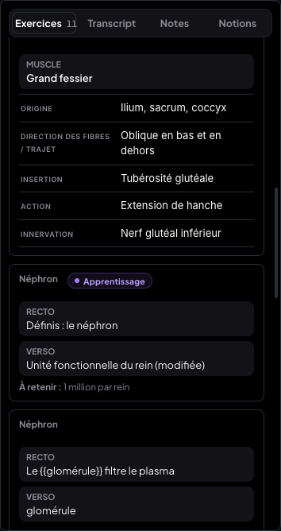 | 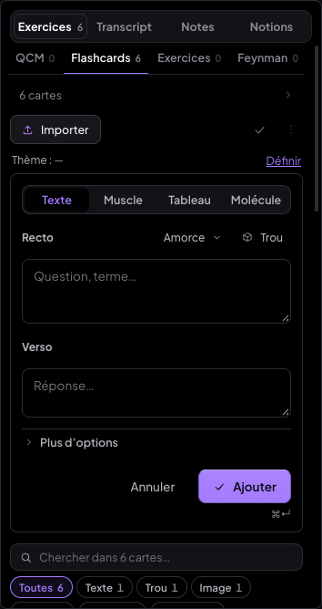 | 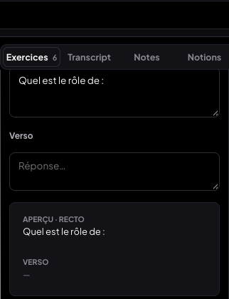 |
| **Plus d'options** | **Modification** | **Muscle** |
| 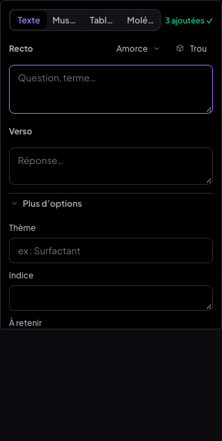 | 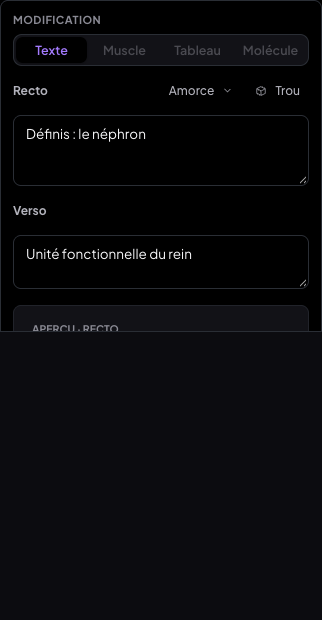 | 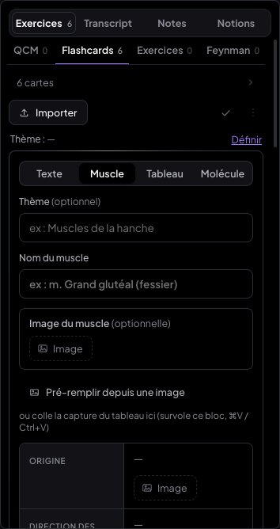 |
| **Mobile (768 px)** | | |
| 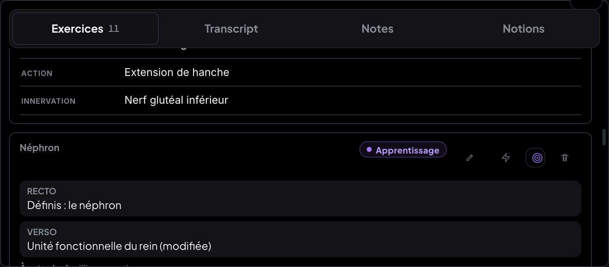 | | |
